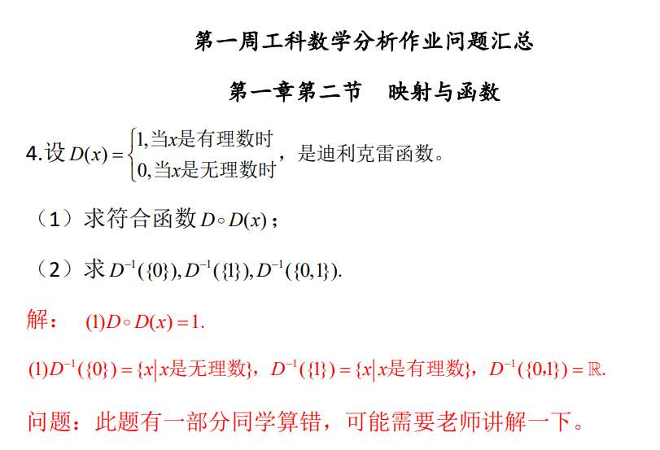

# 工科数学分析(1) 第1章作业答案（2022秋）

## 第1次作业

### 第一章第二节 映射与函数

#### 习题 1.2 第 4 题

##### 题目

设

$$
D(x)=\begin{cases}1, & \text{当 }x\text{ 是有理数时}\\ 0, & \text{当 }x\text{ 是无理数时}\end{cases}
$$

是迪利克雷函数。

（1）求符合函数 $D\circ D(x)$；

（2）求 $D^{-1}(\{0\}),\ D^{-1}(\{1\}),\ D^{-1}(\{0,1\})$。

##### 答案

**问题：** 此题有一部分同学算错，可能需要老师讲解一下。

**解：** (1) $D\circ D(x)=1$。

(1) $D^{-1}(\{0\})=\{x\mid x\text{ 是无理数}\}$， $D^{-1}(\{1\})=\{x\mid x\text{ 是有理数}\}$， $D^{-1}(\{0,1\})=\mathbb{R}$。

