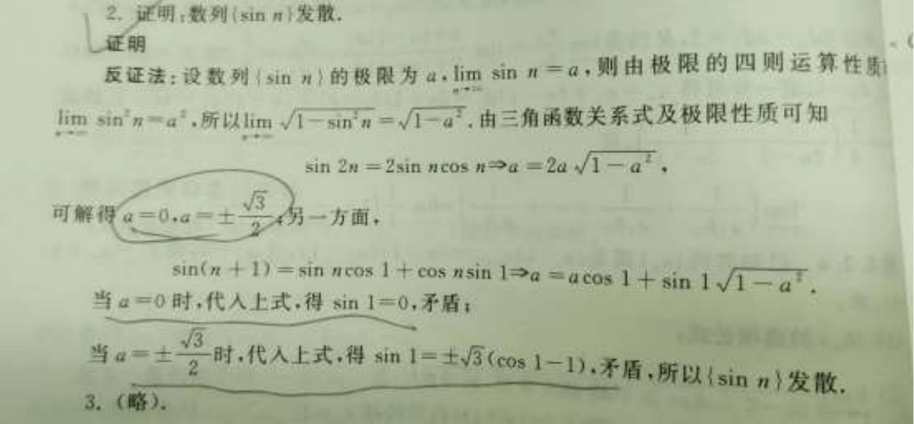
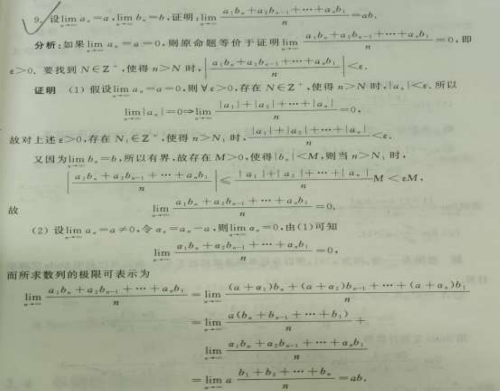
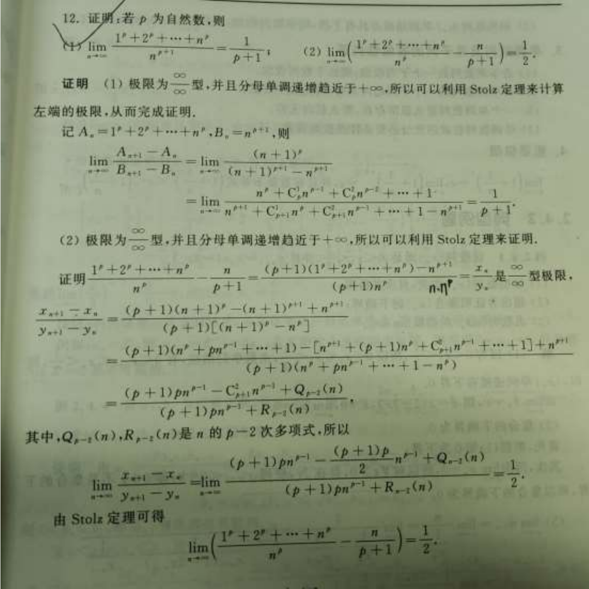
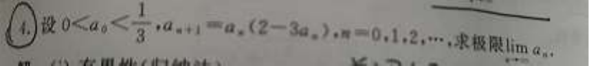
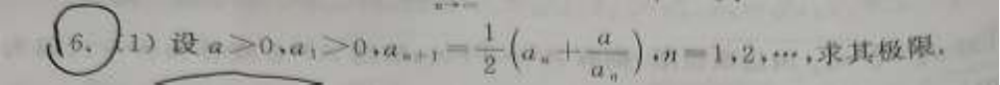
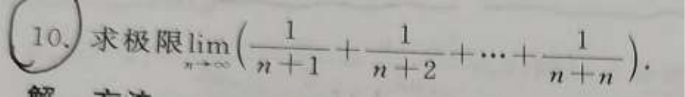
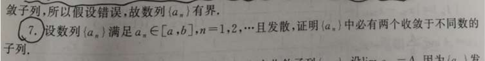

# 工科数学分析(1) 第2章作业答案（2022秋）

## 第2次作业

### 第二章第二节 数列极限的性质

#### 习题 2.2 第 2 题

##### 题目

证明：数列 $\{\sin n\}$ 发散。

##### 答案

**问题：** 许多同学不知道证明的思路。需要老师讲解一下。

**证明：** 用反证法。假设 $\lim\limits_{n\to\infty}\sin n=a$。

由 $\sin(n+1)-\sin(n-1)=2\cos n\sin 1$ 知， $2\sin 1\cdot\lim\limits_{n\to\infty}\cos n=a-a=0$，

$\therefore \lim\limits_{n\to\infty}\cos n=0$。

再由 $\sin 2n=2\sin n\cos m$ 知， $\therefore a=2a\lim\limits_{n\to\infty}\cos n=0$。

因此， $\lim\limits_{n\to\infty}\sin n=\lim\limits_{n\to\infty}\cos n=0$。

而 $\sin^2 n+\cos^2 n=1$， $\therefore 0=1$，矛盾！

### 第二章第三节 无穷大和无穷小

#### 习题 2.3 第 9 题

##### 题目

设 $\lim\limits_{n\to\infty}a_n=a$， $\lim\limits_{n\to\infty}b_n=b$，证明：

$$
\lim_{n\to\infty}\frac{a_1b_n+a_2b_{n-1}+\cdots+a_nb_1}{n}=ab
$$

##### 答案

**问题：** 许多同学不知道要分情况讨论，请老师讲解一下。

**证明：** $\because\lim\limits_{n\to\infty}a_n=a$，所以，可令 $a_n=a+\alpha_n$，其中 $\lim\limits_{n\to\infty}\alpha_n=0$。

$\because\lim\limits_{n\to\infty}b_n=b$，所以，可令 $|b_n|\le M$。

$$
\left|\frac{a_1b_n+a_2b_{n-1}+\cdots+a_nb_1}{n}-ab\right|
=\left|a\left(\frac{b_n+b_{n-1}+\cdots+b_1}{n}-b\right)+\frac{\alpha_1b_n+\alpha_2b_{n-1}+\cdots+\alpha_nb_1}{n}\right|
$$

$$
\le|a|\cdot\left|\frac{b_n+b_{n-1}+\cdots+b_1}{n}-b\right|+M\cdot\frac{|\alpha_1|+|\alpha_2|+\cdots+|\alpha_n|}{n}
$$

$\because\lim\limits_{n\to\infty}b_n=b$， $\therefore\lim\limits_{n\to\infty}\dfrac{b_n+b_{n-1}+\cdots+b_1}{n}=b$。

$\therefore\forall\varepsilon>0$， $\exists N_1$，s.t.， $n>N_1$ 时， $\left|\dfrac{b_n+b_{n-1}+\cdots+b_1}{n}-b\right|<\varepsilon$。

$\because\lim\limits_{n\to\infty}\alpha_n=0$， $\lim\limits_{n\to\infty}|\alpha_n|=0$， $\therefore\lim\limits_{n\to\infty}\dfrac{|\alpha_1|+|\alpha_2|+\cdots+|\alpha_n|}{n}=0$。

$\exists N_2$，s.t.， $n>N_2$ 时， $\dfrac{|\alpha_1|+|\alpha_2|+\cdots+|\alpha_n|}{n}<\varepsilon$。

所以， $n>\max\{N_1,N_2\}$ 时， $\left|\dfrac{a_1b_n+a_2b_{n-1}+\cdots+a_nb_1}{n}-ab\right|<(|a|+M)\varepsilon$。

#### 习题 2.3 第 12 题

##### 题目

证明：若 $p$ 为自然数，则

$$
\text{(1)}\quad \lim_{n\to\infty}\frac{1^p+2^p+\cdots+n^p}{n^{p+1}}=\frac{1}{p+1};
\qquad
\text{(2)}\quad \lim_{n\to\infty}\left(\frac{1^p+2^p+\cdots+n^p}{n^p}-\frac{n}{p+1}\right)=\frac{1}{2}
$$

##### 答案

**问题：** 许多同学第二问不会计算，求讲解。

**解：**

$$
\frac{1+2^p+\cdots+n^p}{n^p}-\frac{n}{p+1}
=\frac{(p+1)(1+2^p+\cdots+n^p)-n^{p+1}}{(p+1)n^p}\equiv\frac{x_n}{y_n}
$$

$$
\frac{x_{n+1}-x_n}{y_{n+1}-y_n}
=\frac{(p+1)(n+1)^p-[(n+1)^{p+1}-n^{p+1}]}{(p+1)[(n+1)^p-n^p]}
$$

$\because(n+1)^{p+1}=n^{p+1}+C_{p+1}^1 n^p+C_{p+1}^2 n^{p-1}+\cdots$， $\Rightarrow(n+1)^{p+1}-n^{p+1}=(p+1)n^p+\dfrac{p(p+1)}{2}n^{p-1}+\cdots$。

$(n+1)^p=n^p+C_p^1 n^{p-1}+\cdots$， $\Rightarrow(n+1)^p-n^p=C_p^1 n^{p-1}+\cdots$。

$$
\therefore(p+1)(n+1)^p-[(n+1)^{p+1}-n^{p+1}]
=(p+1)[n^p+C_p^1 n^{p-1}+\cdots]-\left[(p+1)n^p+\frac{p(p+1)}{2}n^{p-1}+\cdots\right]
$$

$$
=\frac{p(p+1)}{2}n^{p-1}+\cdots
$$

$$
\therefore\frac{x_{n+1}-x_n}{y_{n+1}-y_n}
=\frac{\frac{p(p+1)}{2}n^{p-1}+\cdots}{(p+1)[C_p^1 n^{p-1}+\cdots]},
\qquad
\therefore\lim_{n\to\infty}\frac{x_{n+1}-x_n}{y_{n+1}-y_n}
=\lim_{n\to\infty}\frac{\frac{p(p+1)}{2}n^{p-1}+\cdots}{(p+1)[C_p^1 n^{p-1}+\cdots]}=\frac12 。
$$

## 第3次作业

### 第二章第 4 节 单调数列的极限及其应用

#### 习题 2.4 第 4 题

##### 题目

设 $0<a_0<\dfrac{1}{3}$， $a_{n+1}=a_n(2-3a_n)$， $n=0,1,2,\cdots$，求极限 $\lim\limits_{n\to\infty}a_n$。

##### 答案

**问题：** 这一节第 4、6、10 题的题干只说了求极限，不少同学只求了极限而没有证明极限存在，老师可以提醒一下大家。遇到这样的题目先考虑极限是否存在，然后计算极限值。

#### 习题 2.4 第 6 题

##### 题目

(1) 设 $a>0$， $a_1>0$， $a_{n+1}=\dfrac{1}{2}\left(a_n+\dfrac{a}{a_n}\right)$， $n=1,2,\cdots$，求其极限。

#### 习题 2.4 第 10 题

##### 题目

求极限

$$
\lim_{n\to\infty}\left(\frac{1}{n+1}+\frac{1}{n+2}+\cdots+\frac{1}{n+n}\right)
$$

### 第二章第 5 节 实数连续性的基本定理

#### 习题 2.5 第 6 题

##### 题目

证明：数列 $\{a_n\}$ 有界的充分必要条件是它的任意子列 $\{a_{n_k}\}$ 都有收敛子列。

##### 答案

**问题：** 这两个证明题大家错误较多，老师可以给大家讲解一下。

**证明：** $\Rightarrow$）若 $\{a_n\}$ 有界，则它的任何子列 $\{a_{n_k}\}$ 必有界。

再有列紧定理，则 $\{a_{n_k}\}$ 的任何子列必有收敛子列界。

$\Leftarrow$）若 $\{a_n\}$ 无界，不妨设无上界。对于 $\forall M>0$， $\exists n_0$，使得 $a_{n_0}\ge M$。

于是，对于 $M=1$， $\exists n_1$ 使得 $a_{n_1}\ge 1$；

对于 $M=a_{n_1}+1$， $\exists n_2>n_1$，使得 $a_{n_2}\ge a_{n_1}+1$；对于 $M=a_{n_2}+1$， $\exists n_3>n_2$，使得 $a_{n_3}\ge a_{n_2}+1$； $\cdots$

对于 $M=a_{n_{k-1}}+1$， $\exists n_k>n_{k-1}$，使得 $a_{n_k}\ge a_{n_{k-1}}+1$； $\cdots$

得到子列 $\{a_{n_k}\}$ 严格单调，且 $\lim\limits_{k\to\infty}a_{n_k}=+\infty$，则 $\{a_{n_k}\}$ 的任何子列均发散到 $+\infty$。矛盾！！！

#### 习题 2.5 第 7 题

##### 题目

设数列 $\{a_n\}$ 满足 $a_n\in[a,b]$， $n=1,2,\cdots$ 且发散，证明 $\{a_n\}$ 中必有两个收敛于不同数的子列。

##### 答案

**证明：** 因为若 $\{a_n\}$ 有界，由列紧性定理知，必有收敛子列 $\{a_{n_k}'\}$。设 $\lim\limits_{k\to\infty}a_{n_k}'=x$，

但是 $\{a_n\}$ 发散，即 $\lim\limits_{n\to\infty}a_n\ne x$。 $\exists\varepsilon_0>0$， $\{a_n\}$ 有无穷项在 $(x-\varepsilon_0,\ x+\varepsilon_0)$ 外。

又他们都是有界的，故有收敛子列 $\{a_{n_k}''\}$，设 $\lim\limits_{k\to\infty}a_{n_k}''=y$。注意到， $|a_{n_k}'-a_{n_k}''|\ge\varepsilon_0$，

$\therefore|x-y|\ge\varepsilon_0$。
