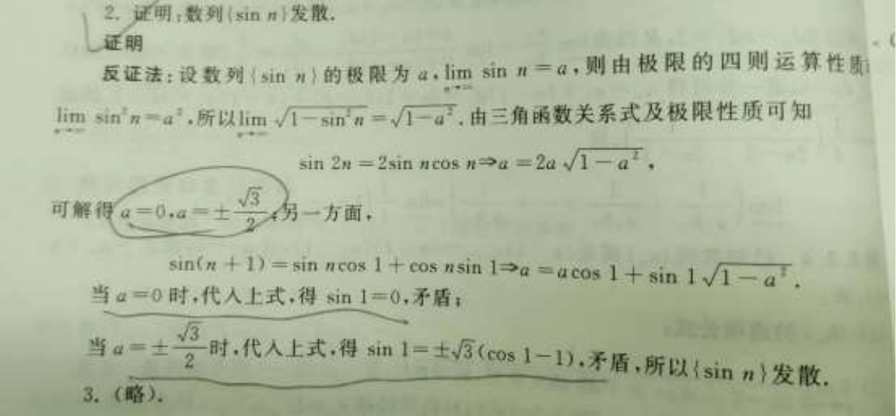
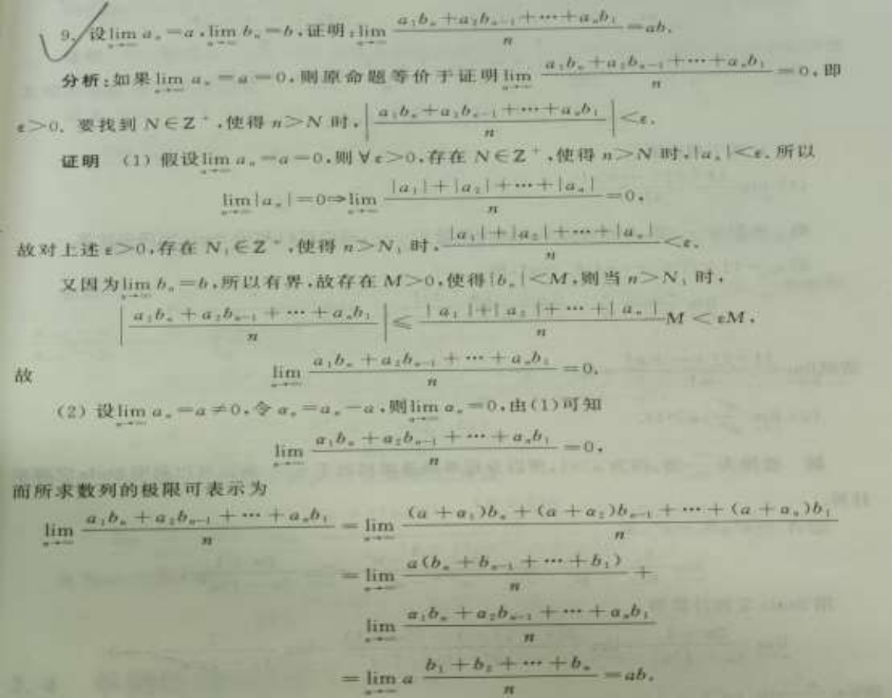
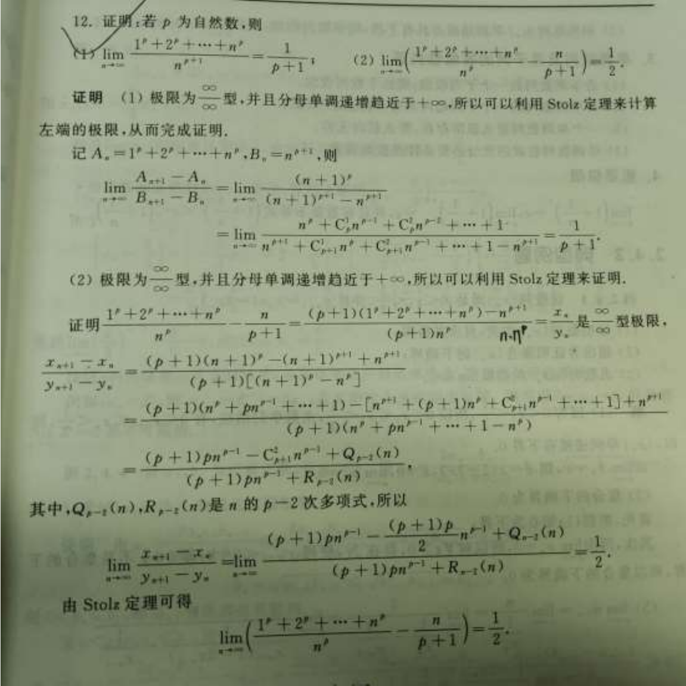
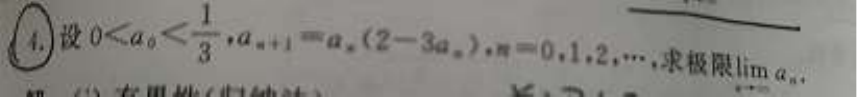
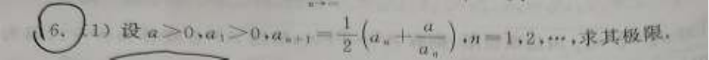
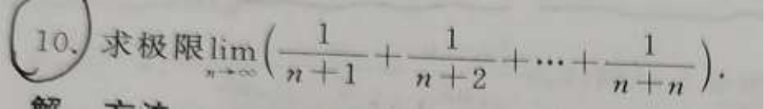
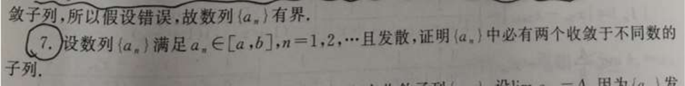

# 工科数学分析(1) 第2章作业题目（2022秋）

## 第2次作业

### 第二章第二节 数列极限的性质

#### 习题 2.2 第 2 题

证明：数列 $\{\sin n\}$ 发散。

### 第二章第三节 无穷大和无穷小

#### 习题 2.3 第 9 题

设 $\lim\limits_{n\to\infty}a_n=a$， $\lim\limits_{n\to\infty}b_n=b$，证明：

$$
\lim_{n\to\infty}\frac{a_1b_n+a_2b_{n-1}+\cdots+a_nb_1}{n}=ab
$$

#### 习题 2.3 第 12 题

证明：若 $p$ 为自然数，则

$$
\text{(1)}\quad \lim_{n\to\infty}\frac{1^p+2^p+\cdots+n^p}{n^{p+1}}=\frac{1}{p+1};
\qquad
\text{(2)}\quad \lim_{n\to\infty}\left(\frac{1^p+2^p+\cdots+n^p}{n^p}-\frac{n}{p+1}\right)=\frac{1}{2}
$$

## 第3次作业

### 第二章第 4 节 单调数列的极限及其应用

#### 习题 2.4 第 4 题

设 $0<a_0<\dfrac{1}{3}$， $a_{n+1}=a_n(2-3a_n)$， $n=0,1,2,\cdots$，求极限 $\lim\limits_{n\to\infty}a_n$。

#### 习题 2.4 第 6 题

(1) 设 $a>0$， $a_1>0$， $a_{n+1}=\dfrac{1}{2}\left(a_n+\dfrac{a}{a_n}\right)$， $n=1,2,\cdots$，求其极限。

#### 习题 2.4 第 10 题

求极限

$$
\lim_{n\to\infty}\left(\frac{1}{n+1}+\frac{1}{n+2}+\cdots+\frac{1}{n+n}\right)
$$

### 第二章第 5 节 实数连续性的基本定理

#### 习题 2.5 第 6 题

证明：数列 $\{a_n\}$ 有界的充分必要条件是它的任意子列 $\{a_{n_k}\}$ 都有收敛子列。

#### 习题 2.5 第 7 题

设数列 $\{a_n\}$ 满足 $a_n\in[a,b]$， $n=1,2,\cdots$ 且发散，证明 $\{a_n\}$ 中必有两个收敛于不同数的子列。

