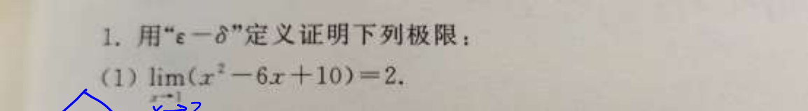
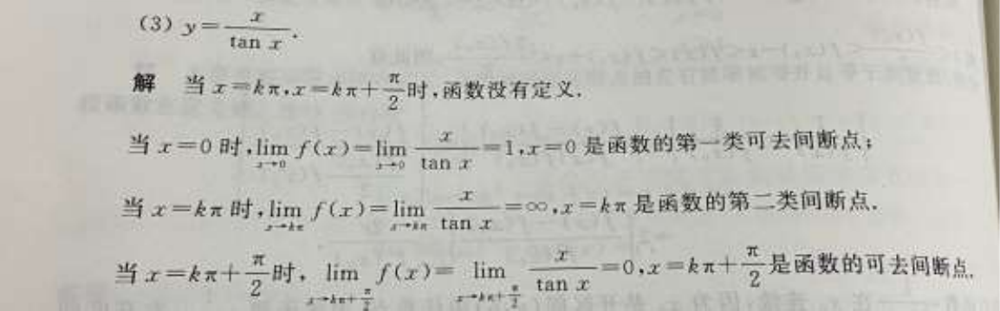
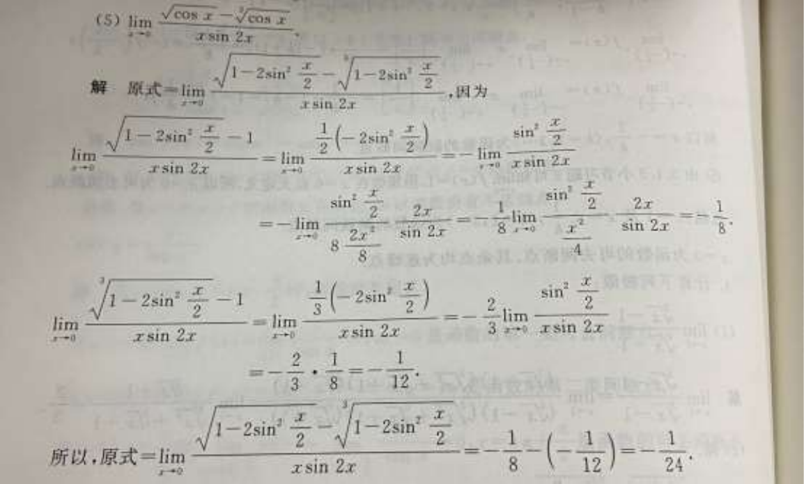
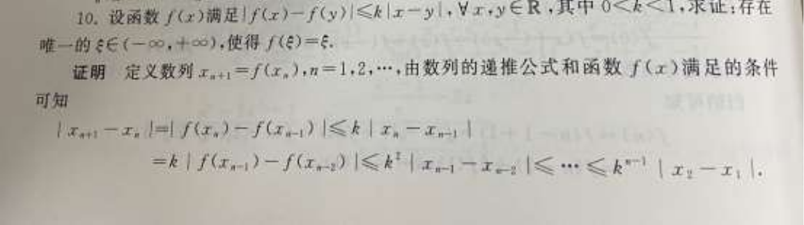
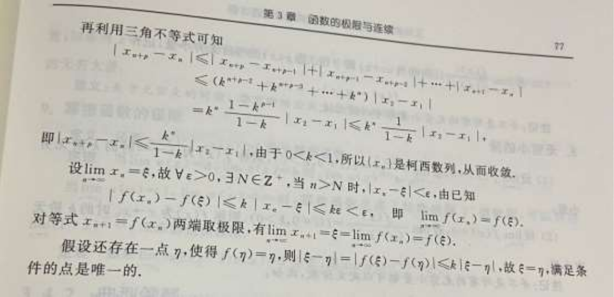
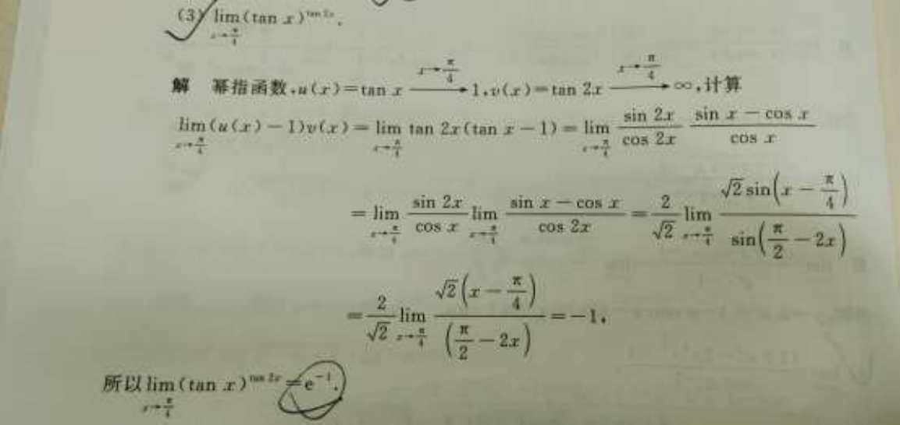
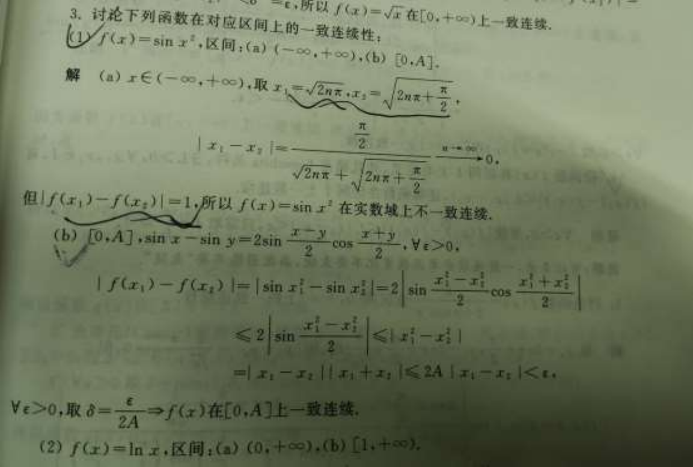
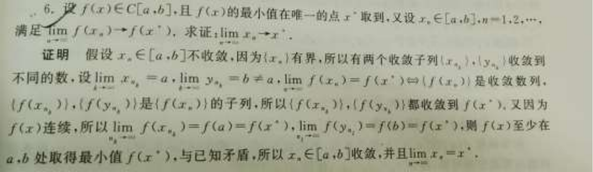
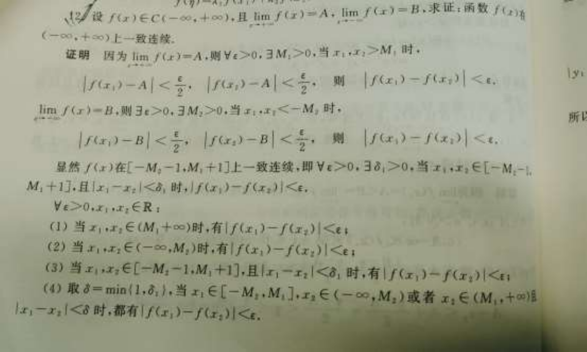

# 工科数学分析(1) 第3章作业答案（2022秋）

## 第4次作业

### 3.1 函数极限

#### 习题 3.1 第 1 题

##### 题目

用「 $\varepsilon-\delta$ 」定义证明下列极限：

$$
\text{(1)}\quad \lim_{x\to 2}(x^2-6x+10)=2
$$

##### 答案

**问题：** 此题对于 $\delta$ 的取法需要多加考虑，部分同学未能正确作答，需要老师讲解。

**解：** $|(x^2-6x+10)-2|=|x^2-6x+8|=|(x-2)(x-4)|$

$\because x\to 2$，可预设 $|x-2|\le 1$，即 $1<x<3$。

此时， $|(x^2-6x+10)-2|=|(x-2)(x-4)|<3|x-2|$

$\forall\varepsilon>0$，取 $\delta=\min\{\varepsilon/3,\ 1\}$，则当 $|x-2|<\delta$ 时， $|(x^2-6x+10)-2|<\varepsilon$

#### 习题 3.1 第 6 题

##### 题目

使用夹逼定理求下列极限：

$$
\text{(1)}\quad \lim_{x\to 0}x\left[\frac{1}{x}\right];
\qquad
\text{(2)}\quad \lim_{x\to 0^+}\left(\frac{1}{x}\right)^{x}
$$

##### 答案

**问题：** 第二问有一定难度，需要对该表达式进行放缩等处理，再结合已知的结论进行分析。

**解：** 令 $\left[\dfrac1x\right]=n$，则 $n\le\dfrac1x<n+1$， $x\to 0+\Leftrightarrow n\to\infty$。

$$
1\leftarrow\frac{(n+1)^{\frac{1}{n+1}}}{2^{\frac{1}{n+1}}}
=\left(\frac{n+1}{2}\right)^{\frac{1}{n+1}}
\le n^{\frac{1}{n+1}}
\le\left(\frac1x\right)^{x}
\le(n+1)^{\frac1n}
\le(2n)^{\frac1n}
=(2)^{\frac1n}\cdot(n)^{\frac1n}\to 1
$$

#### 习题 3.1 第 7 题

##### 题目

$$
\lim_{x\to 1}\left(\frac{k}{x^k-1}-\frac{l}{x^l-1}\right)
$$

##### 答案

**问题：** 该题难度较大，过程中涉及换元以及对分子分母中的多项式进行分析，需老师讲解。 $k=l$ 时为特殊情况，相当一部分同学未考虑，值得注意。

#### 习题 3.1 第 12 题

##### 题目

求极限 $\lim\limits_{n\to\infty}\sin\left(\pi\sqrt{n^2+\sqrt n}\right)$ 和 $\lim\limits_{n\to\infty}2n\sin\left(\pi\sqrt{4n^2+1}\right)$。

##### 答案

**问题：** 本题正弦函数相关的表达式较难处理，部分同学未能参悟其中奥妙，需讲解。

**解：** $\pi\sqrt{n^2+\sqrt n}\sim n\pi$

$$
\sin\pi\sqrt{n^2+\sqrt n}
=(-1)^n\sin\left(\pi\sqrt{n^2+\sqrt n}-n\pi\right)
=(-1)^n\sin\left(\pi\frac{\sqrt n}{\sqrt{n^2+\sqrt n}+n}\right)\to 0
$$

$\pi\sqrt{4n^2+1}\sim 2n\pi$

$$
2n\sin\pi\sqrt{4n^2+1}
=2n\sin\left[\pi\sqrt{4n^2+1}-2n\pi\right]
=2n\sin\left[\pi\frac{1}{\sqrt{4n^2+1}+2n}\right]
\sim\pi\frac{2n}{\sqrt{4n^2+1}+2n}\to\frac{\pi}{2}
$$

## 第5次作业

### 第三章第三节 连续函数

#### 习题 3.3 第 3 题第 (3) 小题

##### 题目

讨论下列函数的不连续点：

$$
\text{(3)}\quad y=\frac{x}{\tan x}
$$

##### 答案

**解：** 考虑函数无定义的点，分母为零的点，分母无定义的点，是可能的间断点。

#### 习题 3.3 第 4 题第 (5) 小题

##### 题目

计算下列极限：

$$
\text{(5)}\quad \lim_{x\to 0}\frac{\sqrt{\cos x}-\sqrt[3]{\cos x}}{x\sin 2x}
$$

##### 答案

**解：** $\cos x=1-2\sin^2\dfrac x2\to1\ (x\to0)$，

$$
\sqrt{\cos x}-1=\left(1-2\sin^2\frac x2\right)^{\frac12}-1
=\frac12\left(-2\sin^2\frac x2\right)\sim-\sin^2\frac x2\sim-\frac{x^2}{4}\quad(x\to0),
$$

$$
\sqrt[3]{\cos x}-1=\left(1-2\sin^2\frac x2\right)^{\frac13}-1
=\frac13\left(-2\sin^2\frac x2\right)\sim-\frac23\sin^2\frac x2\sim-\frac{x^2}{6}\quad(x\to0),
$$

$$
\lim_{x\to0}\frac{\sqrt{\cos x}-1}{x\sin 2x}=\lim_{x\to0}\frac{-\frac{x^2}{4}}{2x^2}=-\frac18,
\qquad
\lim_{x\to0}\frac{\sqrt[3]{\cos x}-1}{x\sin 2x}=\lim_{x\to0}\frac{-\frac{x^2}{6}}{2x^2}=-\frac1{12}
$$

$$
\therefore\lim_{x\to0}\frac{\sqrt{\cos x}-\sqrt[3]{\cos x}}{x\sin 2x}
=\lim_{x\to0}\left[\frac{\sqrt{\cos x}-1}{x\sin 2x}-\frac{\sqrt[3]{\cos x}-1}{x\sin 2x}\right]
=-\frac18+\frac1{12}=-\frac1{24}
$$

#### 习题 3.3 第 10 题

##### 题目

设函数 $f(x)$ 满足 $|f(x)-f(y)|\le k|x-y|$， $\forall x,y\in\mathbf{R}$，其中 $0<k<1$，求证：存在唯一的 $\xi\in(-\infty,+\infty)$，使得 $f(\xi)=\xi$。

##### 答案

**问题：** 以上题目有一部分同学算错或者没有思路，可能需要老师讲解一下。

## 第6次作业

### 第三章第四节 无穷小量和无穷大量的阶

#### 习题 3.4 第 3 题第 (3) 小题

##### 题目

计算下列极限：

$$
\text{(3)}\quad \lim_{x\to \pi/4}(\tan x)^{\tan 2x}
$$

##### 答案

**解：** $\lim\limits_{x\to\pi/4}(\tan x)^{\tan 2x}$ 为 $1^\infty$， $(\tan x)^{\tan 2x}=\mathrm{e}^{\tan 2x\cdot\ln\tan x}$，

令 $x-\pi/4=t$，则 $x=t+\pi/4$，且 $x\to\pi/4\Leftrightarrow t\to0$，

$$
\tan 2x\cdot\ln\tan x
=\tan(2t+\pi/2)\cdot\ln\tan(t+\pi/4)
=\cot(2t)\ln\frac{1+\tan t}{1-\tan t}
=\frac{1}{\tan(2t)}\cdot\ln\left[1-\frac{2\tan t}{1-\tan t}\right]
$$

$$
\sim\frac{1}{\tan(2t)}\cdot\left(-\frac{2\tan t}{1-\tan t}\right)
\sim\frac{-2\tan t}{\tan(2t)}
\sim\frac{-2t}{2t}\sim-1
$$

$$
\lim_{x\to\pi/4}(\tan x)^{\tan 2x}=\mathrm{e}^{-1}
$$

### 第三章第五节 函数的一致连续性

#### 习题 3.5 第 3 题

##### 题目

讨论下列函数在对应区间上的一致连续性：

(1) $f(x)=\sin x^2$，区间：(a) $(-\infty,+\infty)$，(b) $[0,A]$。

(2) $f(x)=\ln x$，区间：(a) $(0,+\infty)$，(b) $[1,+\infty)$。

##### 答案

### 第三章第六节 有限闭区间上的连续函数的性质

#### 习题 3.6 第 6 题

##### 题目

设 $f(x)\in C[a,b]$，且 $f(x)$ 的最小值在唯一的点 $x^*$ 取到，又设 $x_n\in[a,b]$， $n=1,2,\cdots$，满足 $\lim\limits_{n\to\infty}f(x_n)=f(x^*)$。求证： $\lim\limits_{n\to\infty}x_n=x^*$。

##### 答案

**证明：** 反证法：假设 $x_n\in[a,b]$ 不收敛，则存在两个子列 $\{x_{n_k}'\}$， $\{x_{n_k}''\}$， $\lim\limits_{k\to\infty}x_{n_k}'=a$， $\lim\limits_{k\to\infty}x_{n_k}''=b$， $a\ne b$

$\because\lim\limits_{n\to\infty}f(x_n)=f(x^*)$， $\therefore\lim\limits_{k\to\infty}f(x_{n_k}')=f(x^*)$， $\lim\limits_{k\to\infty}f(x_{n_k}'')=f(x^*)$。

再有连续性， $f(a)=f(x^*)$， $f(b)=f(x^*)$。

$\therefore f(x)$ 至少在 $x=a$， $x=b$ 处取得极小值 $f(x^*)$，矛盾！！

所以， $\lim\limits_{n\to\infty}x_n=x$，所以， $f(x)=f(x^*)$，但是， $x^*$ 是唯一的极小值点， $x=x^*$

#### 习题 3.6 第 12 题

##### 题目

设 $f(x)\in C(-\infty,+\infty)$，且 $\lim\limits_{x\to+\infty}f(x)=A$， $\lim\limits_{x\to-\infty}f(x)=B$，求证：函数 $f(x)$ 在 $(-\infty,+\infty)$ 上一致连续。

##### 答案

**问题：** 以上题目有一部分同学算错或者没有思路，可能需要老师讲解一下。

**证明：** $\lim\limits_{x\to+\infty}f(x)=A$，由 Cauchy 收敛准则： $\forall\varepsilon>0$， $\exists X_1>0$，s.t.， $\forall x',x''>X_1$，成立 $|f(x')-f(x'')|<\varepsilon$

同理， $\lim\limits_{x\to-\infty}f(x)=B$，由 Cauchy 收敛准则： $\exists X_2>0$，s.t.， $\forall x',x''<-X_2$，成立 $|f(x')-f(x'')|<\varepsilon$

$f(x)$ 在 $[-X_2-1,\ X_1+1]$ 上连续，故一致连续，

$\exists\delta>0$，s.t.， $\forall x',x''\in[-X_2-1,\ X_1+1]$，成立 $|f(x')-f(x'')|<\varepsilon$

取 $\delta'=\min\{\delta,1\}>0$，则， $\forall x',x''\in(-\infty,+\infty)$，成立 $|f(x')-f(x'')|<\varepsilon$。

