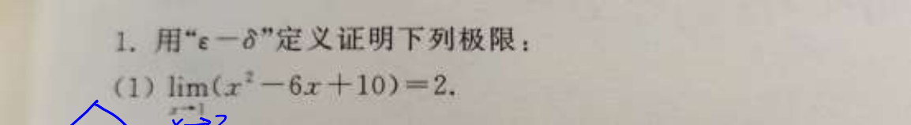
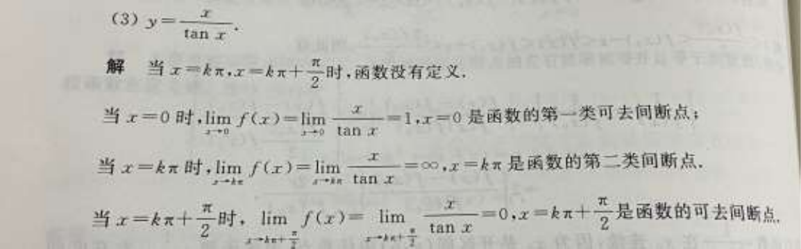
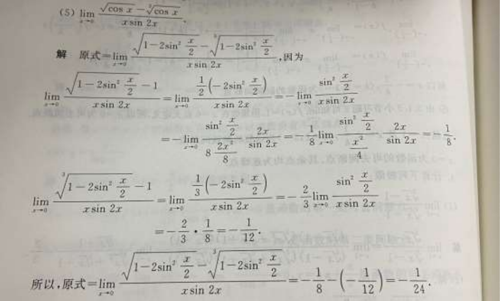
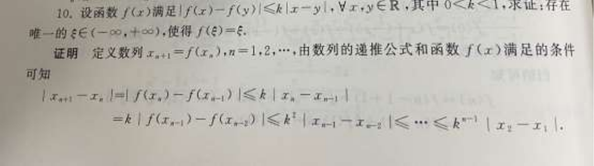
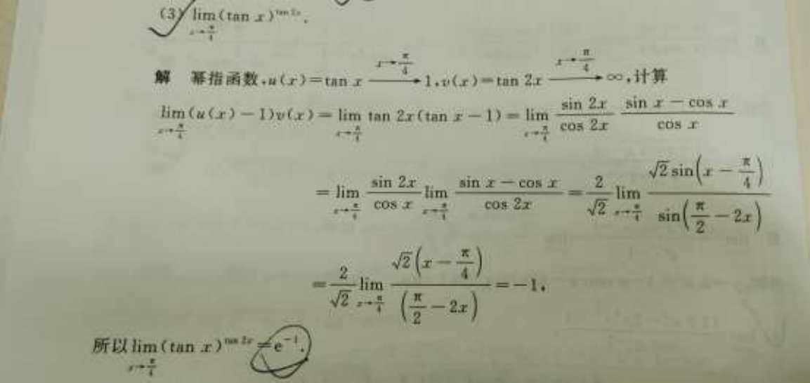
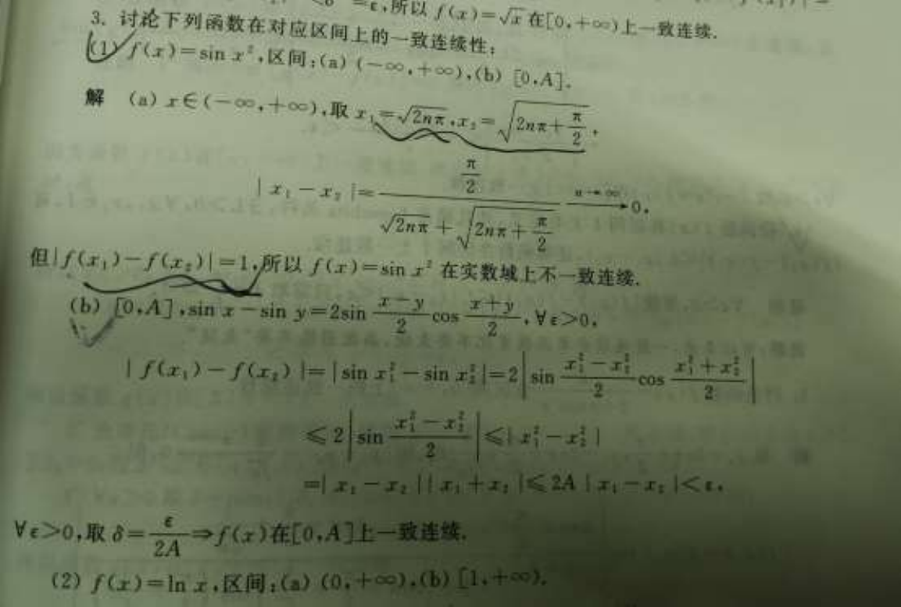
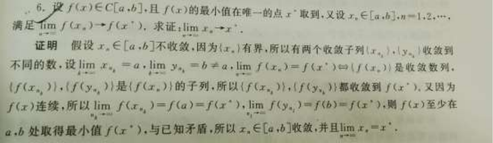
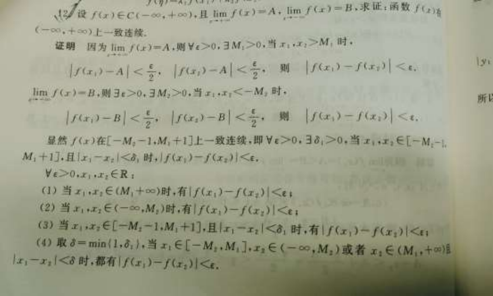

# 工科数学分析(1) 第3章作业题目（2022秋）

## 第4次作业

### 3.1 函数极限

#### 习题 3.1 第 1 题

用「 $\varepsilon-\delta$ 」定义证明下列极限：

$$
\text{(1)}\quad \lim_{x\to 2}(x^2-6x+10)=2
$$

#### 习题 3.1 第 6 题

使用夹逼定理求下列极限：

$$
\text{(1)}\quad \lim_{x\to 0}x\left[\frac{1}{x}\right];
\qquad
\text{(2)}\quad \lim_{x\to 0^+}\left(\frac{1}{x}\right)^{x}
$$

#### 习题 3.1 第 7 题

$$
\lim_{x\to 1}\left(\frac{k}{x^k-1}-\frac{l}{x^l-1}\right)
$$

#### 习题 3.1 第 12 题

求极限 $\lim\limits_{n\to\infty}\sin\left(\pi\sqrt{n^2+\sqrt n}\right)$ 和 $\lim\limits_{n\to\infty}2n\sin\left(\pi\sqrt{4n^2+1}\right)$。

## 第5次作业

### 第三章第三节 连续函数

#### 习题 3.3 第 3 题第 (3) 小题

讨论下列函数的不连续点：

$$
\text{(3)}\quad y=\frac{x}{\tan x}
$$

#### 习题 3.3 第 4 题第 (5) 小题

计算下列极限：

$$
\text{(5)}\quad \lim_{x\to 0}\frac{\sqrt{\cos x}-\sqrt[3]{\cos x}}{x\sin 2x}
$$

#### 习题 3.3 第 10 题

设函数 $f(x)$ 满足 $|f(x)-f(y)|\le k|x-y|$， $\forall x,y\in\mathbf{R}$，其中 $0<k<1$，求证：存在唯一的 $\xi\in(-\infty,+\infty)$，使得 $f(\xi)=\xi$。

## 第6次作业

### 第三章第四节 无穷小量和无穷大量的阶

#### 习题 3.4 第 3 题第 (3) 小题

计算下列极限：

$$
\text{(3)}\quad \lim_{x\to \pi/4}(\tan x)^{\tan 2x}
$$

### 第三章第五节 函数的一致连续性

#### 习题 3.5 第 3 题

讨论下列函数在对应区间上的一致连续性：

(1) $f(x)=\sin x^2$，区间：(a) $(-\infty,+\infty)$，(b) $[0,A]$。

(2) $f(x)=\ln x$，区间：(a) $(0,+\infty)$，(b) $[1,+\infty)$。

### 第三章第六节 有限闭区间上的连续函数的性质

#### 习题 3.6 第 6 题

设 $f(x)\in C[a,b]$，且 $f(x)$ 的最小值在唯一的点 $x^*$ 取到，又设 $x_n\in[a,b]$， $n=1,2,\cdots$，满足 $\lim\limits_{n\to\infty}f(x_n)=f(x^*)$。求证： $\lim\limits_{n\to\infty}x_n=x^*$。

#### 习题 3.6 第 12 题

设 $f(x)\in C(-\infty,+\infty)$，且 $\lim\limits_{x\to+\infty}f(x)=A$， $\lim\limits_{x\to-\infty}f(x)=B$，求证：函数 $f(x)$ 在 $(-\infty,+\infty)$ 上一致连续。

