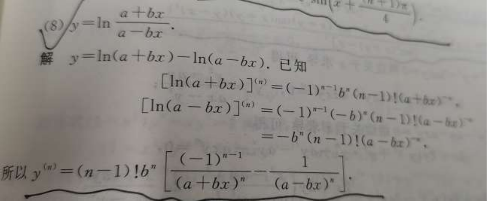
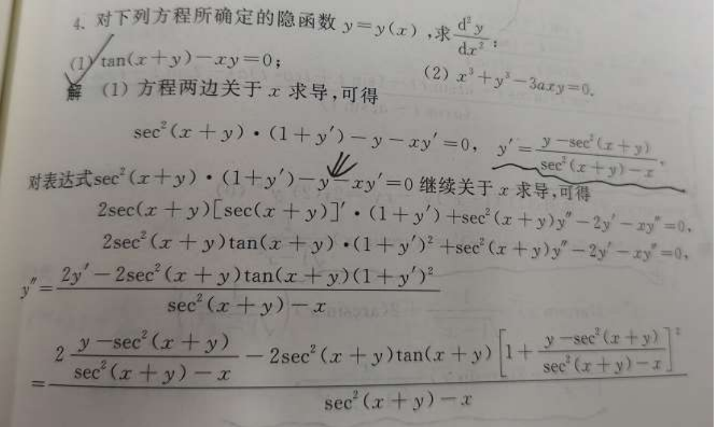
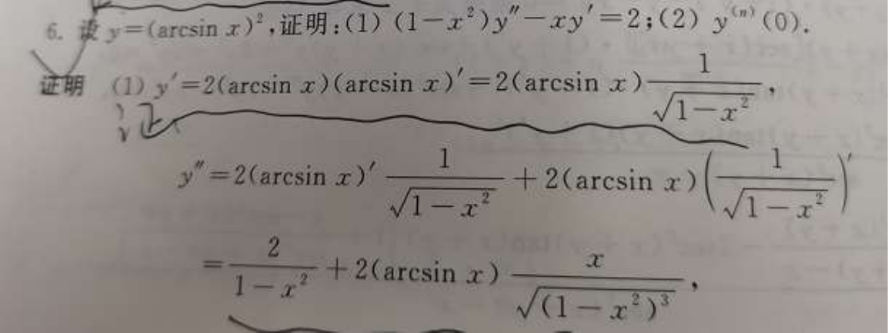
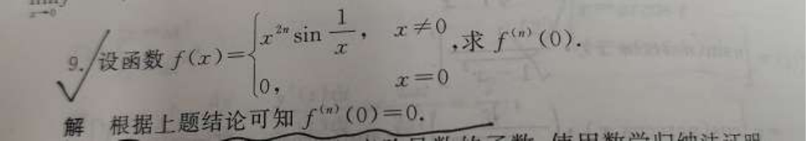
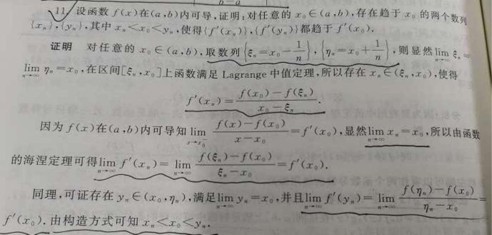
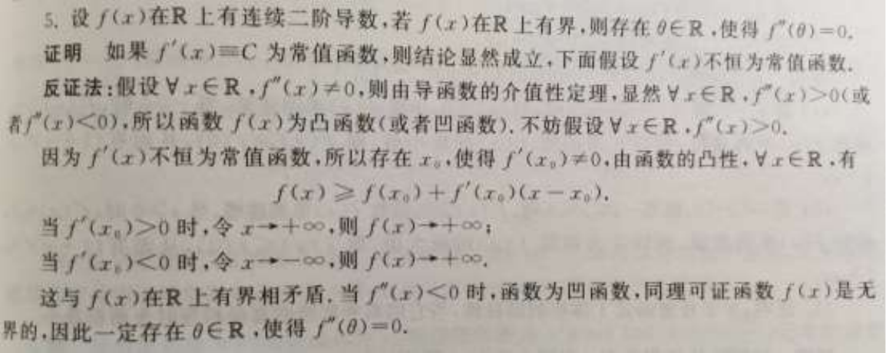
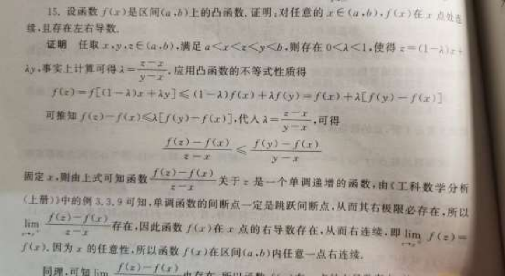
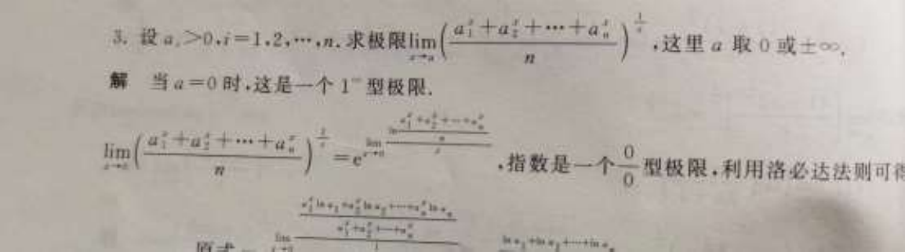

# 工科数学分析(1) 第4章作业题目（2022秋）

## 第7次作业

### 第四章第四节 高阶导数

#### 习题 4.4 第 1 题第 (8) 小题

求以下函数的 $n$ 阶导数。

$$
\text{(8)}\quad y=\ln\frac{a+bx}{a-bx}
$$

#### 习题 4.4 第 4 题

对下列方程所确定的隐函数 $y=y(x)$，求 $\dfrac{\mathrm{d}^2y}{\mathrm{d}x^2}$：

$$
\text{(1)}\quad \tan(x+y)-xy=0;
\qquad
\text{(2)}\quad x^3+y^3-3axy=0
$$

#### 习题 4.4 第 6 题

设 $y=(\arcsin x)^2$，证明：

(1) $(1-x^2)y''-xy'=2$；

(2) $y^{(n)}(0)$。

#### 习题 4.4 第 9 题

设函数

$$
f(x)=\begin{cases}x^{2n}\sin\dfrac{1}{x}, & x\ne 0\\ 0, & x=0\end{cases}
$$

求 $f^{(n)}(0)$。

### 第四章第五节 中值定理

#### 习题 4.5 第 11 题

设函数 $f(x)$ 在 $(a,b)$ 内可导，证明：对任意的 $x_0\in(a,b)$，存在趋于 $x_0$ 的两个数列 $\{x_n\}$、 $\{y_n\}$，其中 $x_n<x_0<y_n$，使得 $\{f'(x_n)\}$、 $\{f'(y_n)\}$ 都趋于 $f'(x_0)$。

## 第8次作业

### 4.6 利用导数研究函数的性质

#### 习题 4.6 第 5 题

设 $f(x)$ 在 $\mathbf{R}$ 上有连续二阶导数，若 $f(x)$ 在 $\mathbf{R}$ 上有界，则存在 $\theta\in\mathbf{R}$，使得 $f''(\theta)=0$。

#### 习题 4.6 第 15 题

设函数 $f(x)$ 是区间 $(a,b)$ 上的凸函数，证明：对任意的 $x\in(a,b)$， $f(x)$ 在 $x$ 点处连续，且存在左右导数。

### 4.7 洛必达法则

#### 习题 4.7 第 3 题

设 $a_i>0$， $i=1,2,\cdots,n$。求极限

$$
\lim_{x\to a}\left(\frac{a_1^x+a_2^x+\cdots+a_n^x}{n}\right)^{\frac1x}
$$

这里 $a$ 取 $0$ 或 $\pm\infty$。

