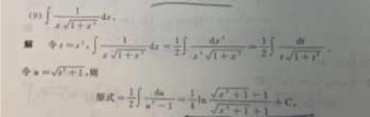
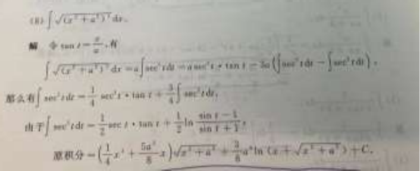
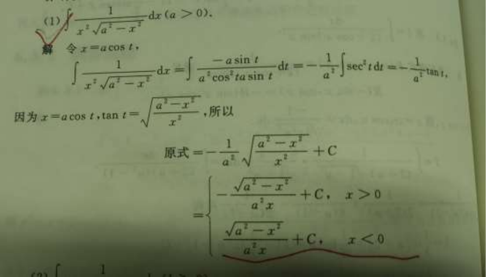

# 工科数学分析(1) 第6章作业答案（2022秋）

## 第9次作业

### 第六章第一节 不定积分的概念

#### 习题 6.1 第 2 题第 (20) 小题

##### 题目

求下列不定积分：

$$
\text{(20)}\quad \int\frac{1}{1+\cos 2x}\,\mathrm{d}x
$$

##### 答案

**问题：** 以上题目有一部分同学算错，可能需要老师讲解一下。

**解：**

$$
\int\frac{1}{1+\cos 2x}\,\mathrm{d}x
=\int\frac{1}{1+2\cos^2x-1}\,\mathrm{d}x
=\frac12\int\sec^2x\,\mathrm{d}x
=\frac12\tan x+C
$$

### 第六章第二节 换元积分法和分部积分法

#### 习题 6.2 第 1 题第 (4) 小题

##### 题目

应用换元积分法求下列不定积分：

$$
\text{(4)}\quad \int\frac{2x+4}{(x^2+4x+5)^2}\,\mathrm{d}x
$$

##### 答案

**问题：** 以上题目有一部分同学算错，可能需要老师讲解一下。

**解：** 令 $t=x+2$，有

$$
\int\frac{2x+4}{(x^2+4x+5)^2}\,\mathrm{d}x
=\int\frac{2t}{(t^2+1)^2}\,\mathrm{d}\left(\frac{t-1}{2}\right)
=\frac12\int\frac{2t}{(t^2+1)^2}\,\mathrm{d}t
=\frac{-1}{(x+2)^2+1}+C
$$

#### 习题 6.2 第 2 题第 (9) 小题

##### 题目

应用分部积分法求下列不定积分：

$$
\text{(9)}\quad \int\frac{1}{x\sqrt{1+x^4}}\,\mathrm{d}x
$$

##### 答案

**问题：** 以上题目有一部分同学算错，可能需要老师讲解一下。

**解：**

$$
\int\frac{\mathrm{d}x}{x\sqrt{1+x^4}}
=\int\frac{x^3\,\mathrm{d}x}{x^4\sqrt{1+x^4}}
=\frac14\int\frac{\mathrm{d}x^4}{x^4\sqrt{1+x^4}}
=\frac14\int\frac{\mathrm{d}(1+x^4)}{x^4\sqrt{1+x^4}}
=\frac12\int\frac{\mathrm{d}\sqrt{1+x^4}}{x^4}
$$

$$
=\frac12\int\frac{\mathrm{d}t}{t^2-1}
=\frac14\ln\left|\frac{t-1}{t+1}\right|+C
=\frac14\ln\left|\frac{\sqrt{1+x^4}-1}{\sqrt{1+x^4}+1}\right|+C
$$

**问：** $\displaystyle\int\frac{\mathrm{d}x}{x\sqrt{1+x^n}}=??$

#### 习题 6.2 第 4 题第 (18) 小题

##### 题目

计算下列不定积分（ $a,b$ 均为非零常数）：

$$
\text{(18)}\quad \int\sqrt{(x^2+a^2)^3}\,\mathrm{d}x
$$

##### 答案

**问题：** 以上题目有一部分同学算错或者没有思路，可能需要老师讲解一下。

**解：** 令 $x=a\tan t$， $\displaystyle\int\sqrt{(x^2+a^2)^3}\,\mathrm{d}x=a^4\int\sec^5 t\,\mathrm{d}t$

$$
\int\sec^5 t\,\mathrm{d}t
=\int\sec^3 t\,\mathrm{d}\tan t
=\sec^3 t\tan t-\int\tan t\,\mathrm{d}\sec^3 t
=\sec^3 t\tan t-3\int\tan^2 t\cdot\sec^3 t\,\mathrm{d}t
$$

$$
=\sec^3 t\tan t-3\int(\sec^2 t-1)\cdot\sec^3 t\,\mathrm{d}t
=\sec^3 t\tan t-3\int\sec^5 t\,\mathrm{d}t+3\int\sec^3 t\,\mathrm{d}t
$$

$$
\therefore\int\sec^5 t=\frac14\sec^3 t\tan t+\frac34\int\sec^3 t\,\mathrm{d}t,
$$

而 $\displaystyle\int\sec^3 t\,\mathrm{d}t=\int\sec t\,\mathrm{d}\tan t=\ldots\ldots$

## 第10次作业

### 第六章第三节 有理函数及可化为有理函数的不定积分

#### 习题 6.3 第 1 题第 (1) 小题

##### 题目

计算下列不定积分：

$$
\text{(1)}\quad \int\frac{1}{x^2\sqrt{a^2-x^2}}\,\mathrm{d}x\quad (a>0)
$$

##### 答案

**问题：** 同学不太能考虑到分情况讨论，可能需要老师讲解一下。

**解：** (1) 设 $x>0$，令 $x=1/t$，

$$
\int\frac{\mathrm{d}x}{x^2\sqrt{a^2-x^2}}
=\int\frac{\mathrm{d}\frac1t}{\frac{1}{t^2}\sqrt{a^2-\frac{1}{t^2}}}
=-\int\frac{t\,\mathrm{d}t}{\sqrt{a^2t^2-1}}
=-\frac{1}{2a^2}\int\frac{\mathrm{d}(a^2t^2-1)}{\sqrt{a^2t^2-1}}
=-\frac{\sqrt{a^2t^2-1}}{a^2}+C
$$

$$
=-\frac{\sqrt{a^2-x^2}}{a^2x}+C
$$

(2) 设 $x<0$，令 $x=-u$，

$$
\int\frac{\mathrm{d}x}{x^2\sqrt{a^2-x^2}}
=-\int\frac{\mathrm{d}u}{u^2\sqrt{a^2-u^2}}
=\frac{\sqrt{a^2-u^2}}{a^2u}+C
=-\frac{\sqrt{a^2-x^2}}{a^2x}+C
$$

