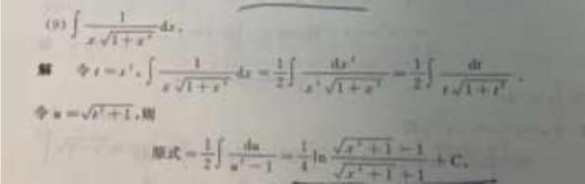
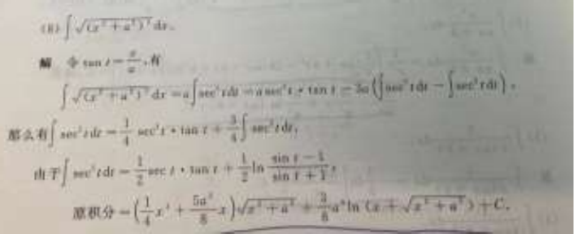
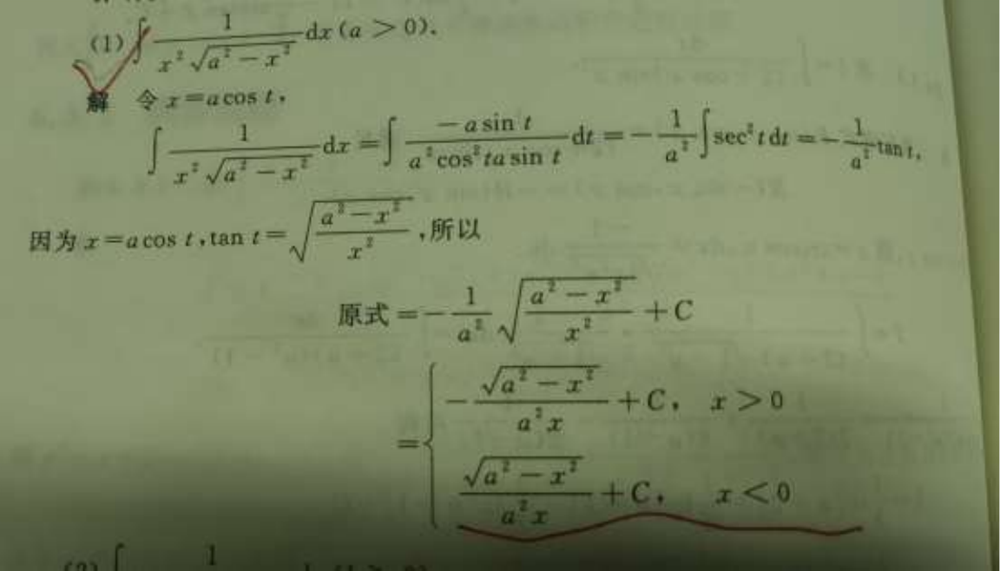

# 工科数学分析(1) 第6章作业题目（2022秋）

## 第9次作业

### 第六章第一节 不定积分的概念

#### 习题 6.1 第 2 题第 (20) 小题

求下列不定积分：

$$
\text{(20)}\quad \int\frac{1}{1+\cos 2x}\,\mathrm{d}x
$$

### 第六章第二节 换元积分法和分部积分法

#### 习题 6.2 第 1 题第 (4) 小题

应用换元积分法求下列不定积分：

$$
\text{(4)}\quad \int\frac{2x+4}{(x^2+4x+5)^2}\,\mathrm{d}x
$$

#### 习题 6.2 第 2 题第 (9) 小题

应用分部积分法求下列不定积分：

$$
\text{(9)}\quad \int\frac{1}{x\sqrt{1+x^4}}\,\mathrm{d}x
$$

#### 习题 6.2 第 4 题第 (18) 小题

计算下列不定积分（ $a,b$ 均为非零常数）：

$$
\text{(18)}\quad \int\sqrt{(x^2+a^2)^3}\,\mathrm{d}x
$$

## 第10次作业

### 第六章第三节 有理函数及可化为有理函数的不定积分

#### 习题 6.3 第 1 题第 (1) 小题

计算下列不定积分：

$$
\text{(1)}\quad \int\frac{1}{x^2\sqrt{a^2-x^2}}\,\mathrm{d}x\quad (a>0)
$$

