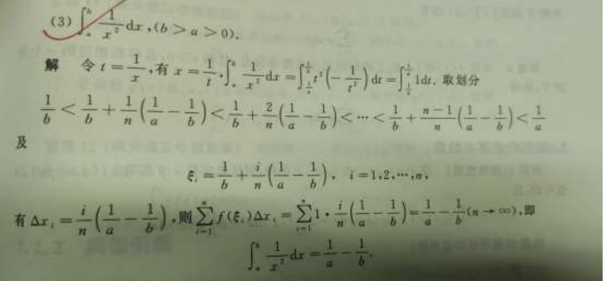
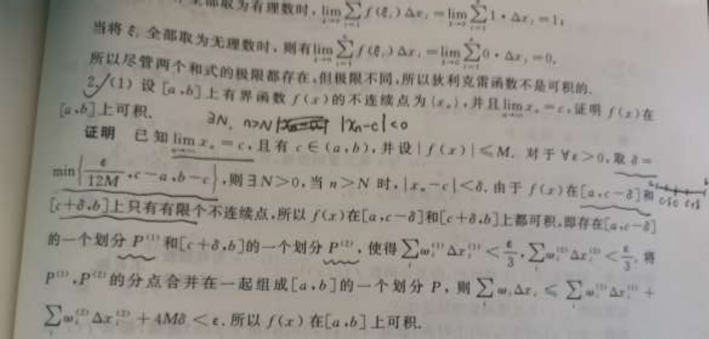
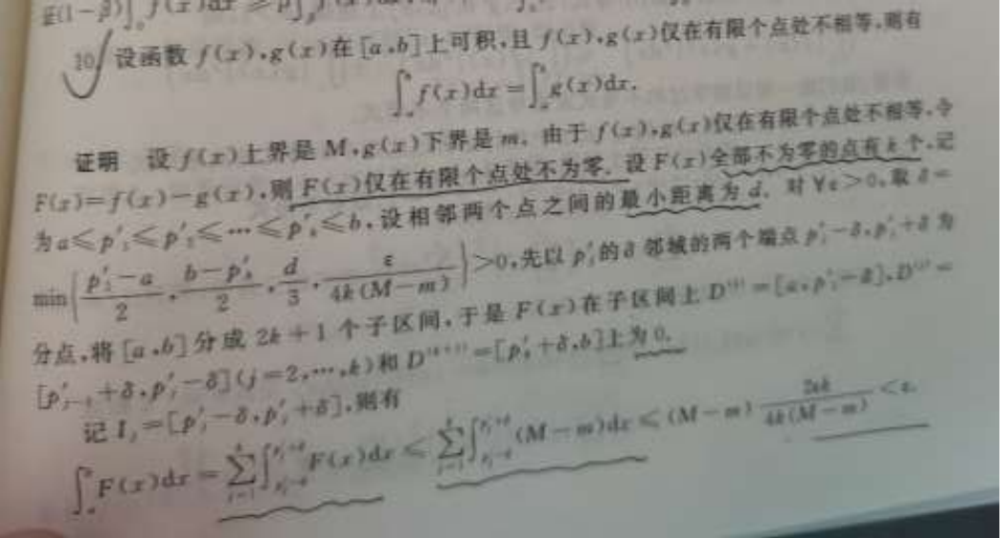

# 工科数学分析(1) 第7章作业答案（2022秋）

## 第10次作业

### 第七章第一节 定积分

#### 习题 7.1 第 1 题第 (3) 小题

##### 题目

已知下列定积分都存在，利用定积分的定义计算下列积分：

$$
\text{(3)}\quad \int_a^b\frac{1}{x^2}\,\mathrm{d}x\quad (b>a>0)
$$

##### 答案

**问题：** 大多数同学没有思路，可能需要老师讲解一下。

## 第11次作业

### 第 7 章第 2 节 可积条件和定积分的性质

#### 习题 7.2 第 2 题第 (1) 小题

##### 题目

(1) 设 $[a,b]$ 上有界函数 $f(x)$ 的不连续点为 $\{x_n\}$，并且 $\lim\limits_{n\to\infty}x_n=c$，证明 $f(x)$ 在 $[a,b]$ 上可积。

##### 答案

#### 习题 7.2 第 10 题

##### 题目

设函数 $f(x)$， $g(x)$ 在 $[a,b]$ 上可积，且 $f(x)$， $g(x)$ 仅在有限个点处不相等，则有

$$
\int_a^b f(x)\,\mathrm{d}x=\int_a^b g(x)\,\mathrm{d}x
$$

##### 答案

### 第 7 章第 3 节 微积分基本定理

#### 习题 7.3 第 (10) 小题

##### 题目

$$
\text{(10)}\quad \int_0^2\frac{1+x^2}{1+x^4}\,\mathrm{d}x
$$

##### 答案

**问题：** 以上题目有一部分同学算错或者没有思路，可能需要老师讲解一下。
