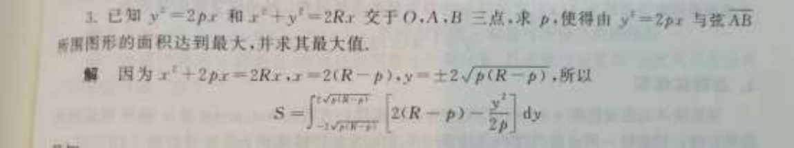
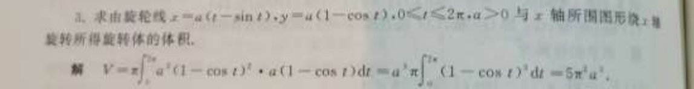
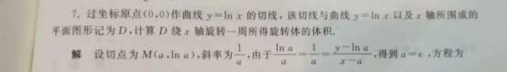
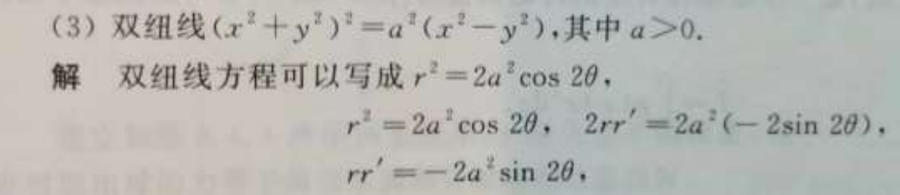

# 工科数学分析(1) 第8章作业题目（2022秋）

## 第12次作业

### 8.1 平面图像的面积

#### 习题 8.1 第 3 题

已知 $y^2=2px$ 和 $x^2+y^2=2Rx$ 交于 $O,A,B$ 三点，求 $p$，使得由 $y^2=2px$ 与弦 $\overline{AB}$ 所围图形的面积达到最大，并求其最大值。

### 8.2 旋转体体积和旋转曲面的面积

#### 习题 8.2 第 5 题

求由旋轮线 $x=a(t-\sin t)$， $y=a(1-\cos t)$， $0\le t\le 2\pi$， $a>0$ 与 $x$ 轴所围图形绕 $x$ 轴旋转所得旋转体的体积。

#### 习题 8.2 第 7 题

过坐标原点 $(0,0)$ 作曲线 $y=\ln x$ 的切线，该切线与曲线 $y=\ln x$ 以及 $x$ 轴所围成的平面图形记为 $D$，计算 $D$ 绕 $x$ 轴旋转一周所得旋转体的体积。

### 8.3 平面曲线的弧长和曲率

#### 习题 8.3 第 (3) 小题

(3) 双纽线 $(x^2+y^2)^2=a^2(x^2-y^2)$，其中 $a>0$。

