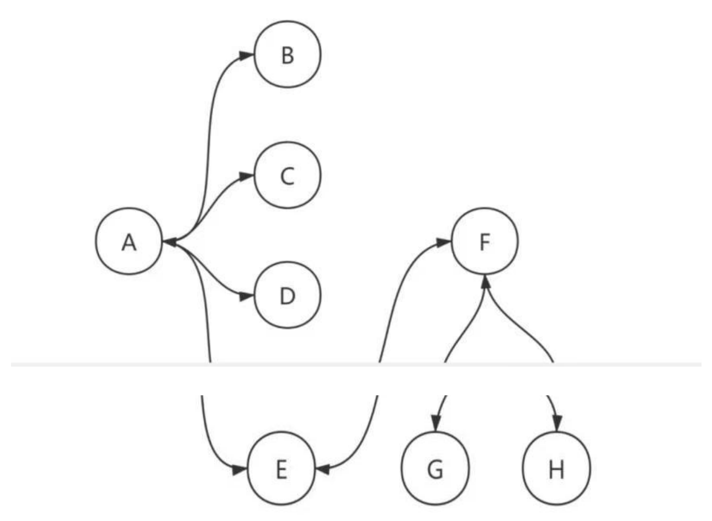

# 程序设计基础 2021–2022 学年第一学期期中试卷

## A

### 题目描述

读入一个字符，判断它属于哪一类：小写字母、大写字母、数字字符 0-9，还是其它字符，并按输出格式输出对应的一行字符串。

### 输入格式

一行，一个字符。

### 输出格式

一行一个字符串：

- 若输入字符为小写字母，输出 `Lowercase letter QAQ.`
- 若输入字符为大写字母，输出 `Capital! \^ ^/`
- 若输入字符为字符 0-9，输出 `! Number !`
- 若输入字符为其它字符，输出 `I can't read.`

### 样例输入1

```text
a
```

### 样例输出1

```text
Lowercase letter QAQ.
```

### 样例输入2

```text
B
```

### 样例输出2

```text
Capital! \^ ^/
```

## B

$a[]=\{a_0,a_1,a_2,\cdots,a_{n-1}\}$

请你帮帮 ta 吧！

### 输入格式

第一行一个整数 $n$（ $1\le n\le 100$），表示数字的数量。

第二行 $n$ 个 int 范围内的整数，分别表示： $a_{n-1},a_{n-2},\cdots,a_1,a_0$。

注意输入是从 $a_{n-1}$ 到 $a_0$。

### 输出格式

一行，表示相应的定义数组语句： $a[]=\{a_0,a_1,a_2,\cdots,a_{n-1}\};$

### 样例输入

```text
5
2 6 13 0 -5
```

### 样例输出

```text
a[]={-5,0,13,6,2};
```

## C

### 题目描述（可见部分）

首先给出一个自然数 $k$（大于 1），如果 $k$ 是奇数就将其变为 $3k+1$，如果 $k$ 是偶数就将其变为 $k/2$，一直持续下去。

即：

$$
a_1=k,\qquad
a_{n+1}=
\begin{cases}
3a_n+1 & a_n\text{ 是奇数}\\[2pt]
a_n/2 & a_n\text{ 是偶数}
\end{cases}
$$

陆木缘同学看到了，想了一会儿以后说："无论一开始 n 是多少，最终都会落入 $4\to 2\to 1\to 4\to 2\to 1\cdots$ 的无穷循环之中，永远也逃不出这样的宿命。我对这个结论有一个完美的证明，但是这里地方太小了，我写不下。"

但是肖梅霞则认为循环总是有止境的，宿命是可以被打破的。于是她找到了会编程的你，希望你帮忙解决这个问题。

### 输入格式

一行，一个正整数 $k$， $1\le k\le 10^3$。

### 输出格式

输出这个正整数经过上述变换规则依次变化为 1 的过程。该过程包含起点 $k$ 和终点 1。

因为肖梅霞只有 14 岁，她认为 100 已经是很大的数了。因此如果这个过程大于 100 步（输出行数超过 100 行），那么只输出前 100 步。

### 样例输入

```text
35
```

### 样例输出

```text
35
106
53
160
80
40
20
10
5
16
8
4
2
1
```

## D

### 题目描述

给定平面上 $n$ 个点的坐标和一个角度 $\theta$（弧度制），求每个点绕原点旋转 $\theta$ 之后的坐标。

### 输入格式

第一行：一个整数 $n$ 表示点的数量（ $1\le n\le 100$）。

接下来 $n$ 行，每行输入一个点的坐标 $(x,y)$。

最后一行输入 theta = $\theta$ 表示 $\theta$ 的值（弧度制），具体格式见样例。

$|x|,|y|,|\theta|\le 10^6$。

### 输出格式

$n$ 行，分别表示旋转坐标后每个点的坐标 $(x,y)$。（保留两位小数）

### 样例输入

```text
3
(1,-1.8)
(2.5,1.5)
(3.6,1)
theta=3.1415926
```

### 样例输出

```text
(-1.00,1.80)
(-2.50,-1.50)
(-3.60,-1.00)
```

## E

### 题目描述（可见部分）

Liella 一行人在东京大赛中取得了第二名的好成绩。叶月恋又开始整理期中成绩了。她得到了学生的人数 $n$，每个学生的学号和每个学生的总分，请按成绩从低到高给同学排序，当成绩相同时，按学号的大小升序排序。

### 输入格式

输入 $n+1$ 行，第一行是 $n$（ $1\le n\le 300$）。接下来每行是空格分隔的，每位同学的学号和总分。学号是一个八位数整数，可能有前导 0（和北航一样 QAQ）。总分是一个两位小数的浮点数，满分跟全国卷高考一样（750）。

### 输出格式

输出 $n$ 行，每行是空格分隔的，每位同学的学号和总分（同样保留两位小数）。按规定顺序排列。

### 样例输入

```text
5
51260352 200.50
62054230 750.00
87451630 200.50
21036987 100.60
01562350 300.65
```

### 样例输出

```text
21036987 100.60
51260352 200.50
87451630 200.50
```

## F

### 题目描述（可见部分）

某只薇娜特别喜欢一个字符串 $S$，对于修改（不能删除或添加）三个字符以内可以等于 $S$ 的字符串 ta 都会觉得很可爱，现在 XIAO7 给了 ta 另一个字符串 $S_0$，请求出 $S_0$ 有多少个子串是可爱的。

如： $S$ = ABCDEFG 时，ABCD111、ABGD1FG、0BCDEFG 都是可爱的，ABCDE、ABCDEFGH、1234EFG 都是不可爱的。

子串： $S_0$ 的子串表示 $S_0$ 中任意个连续的字符组成的子序列。如： $S_0$ = 123 时， $S_0$ 的所有子串包括：1、2、3、12、23、123。

### 输入格式

第一行一个由除空格外的可见字符组成的字符串 $S$。

第二行一个由除空格外的可见字符组成的字符串 $S_0$。

$1\le |S|,|S_0|\le 10^3$，即字符串 $S$ 和 $S_0$ 的长度均 $\le 10^3$。

### 输出格式

一行，一个整数，表示 $S_0$ 有多少个子串是可爱的。

### 样例输入

```text
AbcDF
AbcSbcAcAd
```

### 样例输出

```text
2
```

### 样例解释

AbcSbcAcAd 的子串中 AbcSb 和 SbcAc 是可爱的，其余子串都是不可爱的。

## G

### 题目描述

现在有一个长度为 $n$ 的正整数数组 $a$，这个数组有以下性质：

（1）这个数组的所有元素之和为 3 的整数倍。

（2）这个数组的每个元素 $a_i$ 都满足 $a_i\in[l,r]$。

请你帮助助教找出有多少个满足条件的数组。

### 输入格式

输入共 $T+1$ 行。

第一行为数据组数 $T$（ $1\le T\le 10$）。

接下来 $T$ 行每行 3 个数字，用空格分隔，分别代表 $n,l,r$（ $0\le l\le r\le 10$， $1\le n\le 10$）。

### 输出格式

输出共 $n$ 行。

每行一个整数，为满足条件的数组的数目。

### 样例输入

```text
2
2 1 3
3 2 4
```

### 样例输出

```text
3
9
```

### 样例说明

长度为 $n=2$，每个元素 $a_i\in[1,3]$ 的数组，有：

{1,1} {1,2} {1,3} {2,1} {2,2} {2,3} {3,1} {3,2} {3,3}

其中所有元素之和为 3 的整数倍的数组包括 {1,2}，{2,1}，{3,3}，则答案为 3。

长度为 $n=3$，每个元素 $a_i\in[2,4]$ 且元素之和为 3 的整数倍的数组有：

{2,3,4} {2,4,3} {3,2,4} {3,4,2} {4,2,3} {4,3,2} {2,2,2} {3,3,3} {4,4,4}

一共 9 个，因此答案为 9。

### Hint

递归

## H

这天星乃觉得自己的朋友很少，非常苦恼。具体地，她觉得："我的朋友的朋友往往多于我的朋友"，这让她心里很不平衡。

### 题目描述

举例说明，下图表示 $A,B,\cdots,H$ 这几位同学的朋友关系，由双箭头首尾相连的一对同学互为朋友。在下图中：

- $A$ 的朋友有： $B$、 $C$、 $D$、 $E$
- $B$、 $C$、 $D$ 的朋友有： $A$
- $E$ 的朋友有： $A$、 $F$
- $F$ 的朋友有： $E$、 $G$、 $H$
- $G$、 $H$ 的朋友有： $F$



此时，这几名同学观察了朋友关系：

- $B$、 $C$ 和 $D$ 得出结论，他们自己每个人都有 1 个朋友，而他们的朋友 $A$ 则有 4 个朋友。
- $G$ 和 $H$ 得出结论，他们有 1 个朋友，但他们的朋友 $F$ 有 3 个朋友。
- $E$ 得出结论，他有 2 个朋友，但他的朋友 $F$ 和 $A$ 则分别有 3 和 4 个朋友。
- $A$ 得出结论，他有 4 个朋友，她的朋友 BCDE 分别有 1，1，1 和 2 个朋友。
- $F$ 得出结论，他有 3 个朋友，而他的朋友 EGH 分别有 1，1 和 2 个朋友。

如果某人自己的朋友比他的朋友的朋友的平均数要少，他就会觉得"我的朋友的朋友往往多于我的朋友"，从而感到心理不平衡。在上图所示的关系中，感到不平衡的人有 $B$、 $C$、 $D$、 $E$、 $G$、 $H$。

### 输入格式

本题会给入一张朋友关系构成的网路，具体地：

第一行有两个正整数 $n$ 和 $m$，其中 $n$ 为网络中涉及的同学的总数， $m$ 为关系（双箭头）的个数。

这 $n$ 个同学从第 1 个开始，编号为 $A,B,C,\cdots$（ $n\le 26$）。

接下来 $m$ 行，声明了至多 $m$ 对朋友关系，每行两个大写字母 $X_i,Y_i$，表示 $X_i$ 和 $Y_i$ 是一对朋友。

注意：

- 同样的两个人之间的朋友关系可能会被重复声明，多次重复声明的朋友关系和只声明一次的朋友关系没有任何区别，你可以忽略掉除了首次声明以外的其它重复声明。如果 $A$ 和 $B$ 是朋友，那么 $B$ 和 $A$ 一定是朋友。
- 一个人和自己不是朋友，如果遇到这种声明，例如 `A A`，请直接忽略这条声明。
- 保证输入数据中没有 `Yr`。

### 输出格式

输出一行，表示感到心理不平衡的同学的名单，要求：

- 按字母顺序输出；
- 每个大写字母之间以一个空格隔开。

如果不存在这样的人，输出 `Not Found`。

### 样例输入

```text
8 10
A B
A C
A D
A E
E F
F G
F H
A A
B A
A B
```

### 样例输出

```text
B C D E G H
```

### 数据范围

$n\le 26$

样例就是题目里面例子的情况。

### Hint

"朋友关系"就可以为一个二元函数，自变量为两个人的编号，因变量为 0 或 1，表示这两个人是否是朋友。

一维数组可以建立两个数之间的映射，那么什么数据结构可以建立一个（两个数） $\to$（一个数）的映射呢？

## I

### 题目描述

给出圆周上的若干个点，已知相邻两个点之间的弧长，其值均为正整数，并依圆周顺序排列。

请找出这些点中有没有可以围成矩形的点，并希望在最短时间内找出所有不重复矩形有多少个。

### 输入格式

第一行为正整数 $N$，表示点的个数，接下来 $N$ 行分别为这 $N$ 个点所分割的各个圆弧长度。

### 输出格式

所构成不重合矩形的个数。

### 样例输入1

```text
8
1 2 2 3 1 1 3 3
```

### 样例输出1

```text
6
```

### 样例输入2

```text
6
1 2 3 4 5 6
```

### 样例输出2

```text
0
```

### 数据范围

$1\le n\le 10^3$；

任意相邻两点之间圆弧长度不超过 $10^9$。

## J


### 题目描述

由于版本不一，Sheep 版的 2048 的规则可能要简单一些

1. 规定方格大小为 $4\times 4$
2. 每次选择并非一整个棋盘，而是**某一行或者某一列**进行操作
3. 当次选择某一行（某一列）后便仅会进行左右（或上下）中的一种方式移动
4. 所移动的行（列）当中的数字会向对应的操作方向移动
5. 每次移动会合并相同的数字，并且是先移动而后合并
6. 合并后的两个数变成两个数的加和
7. 如果一次操作出现了多次合并，那么会一直合并并移动到终点（不能再向相同方向移动）
8. 如果一次操作会出现多种可执行的方案，按终点处的合并优先进行
9. 合并时每个数仅会参与一次合并操作（不会因 4 相同的数合并后的两数也相同而发生二次合并）
10. 合并后会获得相当于两个被合并的数的数字之和的分数
11. 每一次**有效操作**后，会随机从当前盘面上选择一个空位置生成一个 2（有效操作 Sheep 在这里规定为操作前后棋盘上至少有一个数发生了改变）
12. 当盘面上出现了再进行任何操作均无法达到有效操作时，Sheep 便 Game Over 了

为了能让大家更好地测试，我们将 2048 游戏的内测随机数生成器发给大家，评测时对此仅输入初始随机数与随机数种子

随机函数定义如下：

```c
long long Curl_rand(long long p, long long q) {
    long long r = (p % q) * (1103515245 % q) / 10 % q;
    return ((r ^ (1LL << 17)) | ((r >> 16) & 0xFFFF)) % q;
}
```

定义随机数生成规则如下：

由初始随机数 $p_0$，和种子 $q$ 可得到 $p_1=f(p_0,q)$，而后再通过 $p_1$ 得到 $p_2=f(p_1,q)$，重复上述规则，便可以得到后续随机数

后台随机从当前盘面上选择一个空位置生成一个 2 的规则如下：

1. 首先从当前状态的随机数获取中间变量 $temp$， $temp$ 满足规则 $temp=p_i\%16$
2. 如果坐标 $(temp/4+1,\ temp\%4+1)$ 是处位置为空（本题目规定初始盘面上为 0 的位置即为空位置），那么就在此位置生成一个 2；如果不为空，通过下一个时间点的随机数重复执行上述操作

### 输入格式

前 4 行每行 4 个正整数 $C_{ij}$（ $0\le C_{ij}\le 2^{13}$），为初始棋盘的状态（数据保证棋盘上的初始数字一定为 0 或 2 的正整数次方）

然后输入一行三个正整数 $p,q,s$，（ $1\le p\le 10^{16}$， $16\le q\le 10^9$， $1\le s\le 1.6\times 10^4$）分别表示初始随机数、随机数种子和 Sheep 的操作数

接下来输入一行一个字符串，总长度为 $2s$，表示 Sheep 的操作

数据保证字符串中仅含 $W,S,A,D$ 与 $1,2,3,4$ 的组合，代表第 1, 2, 3, 4 行（列）的上下左右的移动

数据保证游戏开局时 Sheep 是可以有效移动的

### 输出格式

先输出一行一个正整数，表示本局游戏 Sheep 的得分

如果 Sheep 不小心 Game Over 了，请输出一行一个字符串 `Sheep was game over on the step %d.` 其中 %d 为格式说明符，需要更换为 Sheep Game Over 的步数

如果 Sheep 仍然可以移动，那么则输出一行一个字符串 `OMG, Sheep was still alive!`

### 样例输入

```text
4 0 0 8
0 0 0 0
0 8 0 0
0 8 0 8
425851597 78303757 5
D4W3A2W2A3
```

### 样例输出

```text
16
OMG, Sheep was still alive!
```

### Hint

对于合并操作的说明：

如果操作行（列）初始状态为 [0 4 0 4]，有一个向左的操作，则会合并成 [8 0 0 0]

如果操作行（列）初始状态为 [4 2 0 2]，有一个向左的操作，则会合并成 [4 4 0 0]

如果操作行（列）初始状态为 [8 4 4 4]，有一个向左的操作，则会合并成 [8 8 4 0]

如果操作行（列）初始状态为 [4 4 0 4]，有一个向左的操作，则会合并成 [8 4 0 0]

如果操作行（列）初始状态为 [4 4 4 4]，有一个向左的操作，则会合并成 [8 8 0 0]

对于随机数的初始调用的说明：

输入的 $p_0$ 与 $q$ 为初始用于生成随机数的量，在第一次对盘面进行更新时，所使用的应当为由 $p_0$ 与 $q$ 生成随机数。
