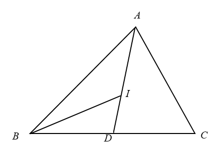

# 程序设计基础 E2 答案（2021秋）

## Problem A. xf学数学

### 题目

| 难度 | 考点 |
| --- | --- |
| 1 | 简单循环，模拟 |

#### 题目描述

给定一个整数 $k$，求最小的正整数 $n$，使得

$$
1+\frac{1}{2}+\frac{1}{3}+\cdots+\frac{1}{n}>k
$$

#### 输入格式

一行，一个整数 $k$。

#### 输出格式

一行，一个整数，表示所求的 $n$。

#### 样例输入

```text
1
```

#### 样例输出

```text
2
```

#### 样例输入2

```text
2
```

#### 样例输出2

```text
4
```

### 答案

### 题目分析

### 示例程序

```c
#include<stdio.h>
int main()
{
    int k;
    scanf("%d",&k);
    double ans=1;
    int poi=1;
    while(ans<=k)
    {
        poi++;
        ans+=1.0/poi;
    }
    printf("%d",poi);
    return 0;
}
```

## Problem B. 水水的输出字母

### 题目

| 难度 | 考点 |
| --- | --- |
| 2 | 简单条件判断、循环 |

#### 题目描述

给定一个字符 $a$ 和一个整数 $x$，从字符 $a$ 开始依次输出 $x$ 个连续的字母，每个字母后面输出一个空格。若 $a$ 不是字母，输出 `Not a Letter`；若从 $a$ 开始连续 $x$ 个字母会超出 $a$ 所在的大小写区间（即小写字母超过 `z`，或大写字母超过 `Z`），输出 `OverfIow!`。

#### 输入格式

一行，一个字符 $a$ 和一个整数 $x$，用空格分隔。

#### 输出格式

按上述规则输出：连续的 $x$ 个字母（每个后面有一个空格），或 `Not a Letter`，或 `OverfIow!`。

#### 样例输入

```text
A 3
```

#### 样例输出

```text
A B C 
```

#### 样例输入2

```text
X 20
```

#### 样例输出2

```text
OverfIow!
```

#### 样例输入3

```text
1 5
```

#### 样例输出3

```text
Not a Letter
```

### 答案

### 题目分析

本题需要注意的易错点：

- `"Not a Letter"` 的判断不要忽略了ascii码位于 `'Z'` 和 `'a'` 之间的字符。
- “OverfIow!”的输出需要大小写分开判断，不能简单地判断a+x是否为字母，例如数据 `'X 20'` ， `'X'` 在大写字母区间， `'X'+20` 却在小写字母区间，这也是 `"OverfIow!"` 的一种情况。

### 示例程序

```c
#include <stdio.h>
int main()
{
    char a;
    int x, i;
    scanf("%c%d", &a, &x);
    if (!((a >= 'a' && a <= 'z') || (a >= 'A' && a <= 'Z')))
    {
        printf("Not a Letter");
    }
    else if (((a >= 'a' && a <= 'z') && (a + x - 1 > 'z')) || ((a >= 'A' && a <= 'Z') && (a + x - 1 > 'Z')))
    {
        printf("OverfIow!");
    }
    else
    {
        i = 0;
        while (i < x)
        {
            printf("%c ", a + i);
            i++;
        }
    }
    return 0;
}
```

## Problem C. 零花钱储蓄计划

### 题目

| 难度 | 考点 |
| --- | --- |
| 2 | 简单循环，模拟 |

#### 题目描述

小函每月有 $300$ 元零花钱。给定连续 $n$ 年中每个月的花费，第 $i$ 个月花掉 $c_i$ 元，剩下的钱留在手里。每当手里的钱达到 $100$ 元的整数倍时，就把整百的部分存起来（存起来的部分不再计入手里的钱）。每年结束时，妈妈把这一年存起来的钱按 $1.2$ 倍还给小函，这笔钱加入手里的钱。

若某个月结束后手里的钱为负数，说明这个月钱不够，此时输出 `-I`，其中 $I$ 是从第一个月开始计数的月份序号。若所有月份都够用，输出最后手里剩下的钱。

#### 输入格式

第一行一个整数 $n$，表示年数。

接下来 $12n$ 个整数，依次表示每个月的花费。

#### 输出格式

一行。钱不够时输出 `-I`（ $I$ 为月份序号），否则输出最终手里的钱。

#### 样例输入

```text
1
0 0 0 0 0 0 0 0 0 0 0 0
```

#### 样例输出

```text
4320
```

### 答案

### 题目分析

1、每一年之后妈妈都会把钱还给小函。

2、注意如果出现某个月钱不够的情况即可直接输出，或者记录月数。

### 示例程序

```c
#include<stdio.h>

int sum, posit, i, flag = 0, I, n;
int main()
{
    scanf("%d", &n);
    for (int j = 0; j < n; j++) {
        for (i = 1; i <= 12; i++) {
            int tmp;
            scanf("%d", &tmp);
            sum += 300 - tmp;
            posit += sum / 100 * 100;
            sum = sum - sum / 100 * 100;
            if (sum < 0 && !flag) {
                flag = 1;
                I = 12 * j + i;
            }
        }
        sum += (int)(posit * 1.2);
        posit = 0;
    }
    if (flag) {
        printf("-%d", I);
    }
    else {
        printf("%d", sum + (int)(posit * 1.2));
    }
    return 0;
}
```

## Problem D. 数位平均

### 题目

| 难度 | 考点 |
| --- | --- |
| 3 | 数据类型、数字各位求和、浮点误差的处理 |

#### 题目描述

给定一个正整数 $n$，设它各位数字之和为 $S$。把 $n$ 的每一位数字 $d$ 拿出来判断：若 $10d\le S$，则保留这一位；否则把这一位置为 $0$。输出处理后得到的整数。

#### 输入格式

一行，一个正整数 $n$。

#### 输出格式

一行，一个整数，表示处理后的结果。

#### 样例输入

```text
1234
```

#### 样例输出

```text
1000
```

#### 数据范围

$n\le 10^{10}$，需要使用 `long long`。

### 答案

### 题目分析

本题需要注意以下几点：

- 输入的整数不超过 $10^{10}$ ，因此需要使用 `long long` 类型的变量
- 计算平均值时， $n$ 的值不能被修改，需要使用另外的变量进行取模-除10操作。
- 将除法转换为乘法，避免浮点类型变量带来的误差。若要使用浮点类型的变量，则在判断时需要考虑误差。

### 示例程序

```c
#include <stdio.h>

int main()
{
    long long n, n_copy;
    scanf("%lld", &n);

    int sum = 0;
    n_copy = n;
    for (int i = 0; i < 10; ++i)
    {
        sum += n_copy % 10;
        n_copy /= 10;
    }

    long long ans = 0;
    n_copy = n;
    for (long long base = 1; base < 10000000000LL; base *= 10)
    {
        if ((n_copy % 10) * 10 <= sum)
        {
            ans += base * (n_copy % 10);
        }
        n_copy /= 10;
    }
    printf("%lld\n", ans);

    return 0;
}
```

## Problem E. 水水的跳格子

### 题目

| 难度 | 考点 |
| --- | --- |
| 3 | 字符串 |

#### 题目描述

给定一个长度为 $len$ 的字符串，第 $i$ 个格子的属性是字符 $str_i$。小明从位置 $0$ 出发，每次可以向右跳 $1$ 到 $3$ 格，落点必须落在格子上（第 $1$ 到第 $len$ 格），终点在位置 $len+1$。

他只能落在同一属性的格子上：如果上一次落在属性为 $c$ 的格子上，这一次也要落在属性为 $c$ 的格子上，并且两次落点的距离不能超过 $3$；一旦某个属性的两次落点距离超过 $3$，该属性之后就不能再使用。

请求出所有能让他到达终点的属性中 ASCII 码最小的那个，输出该字符；若不存在这样的属性，输出 `You loser!`。

#### 输入格式

第一行一个整数 $n$，表示数据组数。

接下来 $n$ 行，每行一个字符串。

#### 输出格式

$n$ 行，每行输出一个字符或 `You loser!`。

#### 样例输入

```text
2
abab
abcdeabcde
```

#### 样例输出

```text
a
You loser!
```

### 答案

### 题目分析

在遍历字符串时，我们可以用一个hash数组来存储所有可能出现的字符的当前状态。具体而言，对某个字符，hash数组中下标为该字符ASCII码值的格子中存储的便是该字符最近一次出现的位置，初始化后值为0。当遍历到一个新的字符时，我们关注hash数组中下表为该字符ASCII码值的元素的值。若该元素值加3后大于等于字符串当前位置，则代表小明可以从原来的位置跳到当前位置，因此将该元素值更新为当前位置。若该元素值加3后小于字符串当前位置，则距离过远，小明无法跳跃，将该元素值赋为-1，代表此路不通。

具体请看代码。

### 示例程序

```c
#include<stdio.h>
#include<string.h>
char str[9999];
char hash[130];
int main(void){
    int n,i,j,k,len;
    scanf("%d",&n);//数据组数
    for(i = 0;i < n;i++) {
        for(j = 0;j < 130;j++) {//初始化hash数组
            hash[j] = 0;
        }
        scanf("%s",str+1);//这里将字符串从下标为1的位置开始存，可以简化一下代码
        len = strlen(str+1);
        for(j = 1;j <= len;j++) {
            if(hash[str[j]] >= 0 && j-hash[str[j]] <= 3) {//判断是否可以走str[j]对应属性的格子
                hash[str[j]] = j;
            } else {
                hash[str[j]] = -1;
            }
        }
        for(j = 32;j <= 126;j++) {//输出ASCII值最小的
            if(hash[j]+3 >= len+1) {
                printf("%c\n",j);
                break;
            }
        }
        if(j == 127) {//没有则输出字符串
            printf("You loser!\n");
        }
    }
    return 0;
}
```

## Problem F. 由果推因

### 题目

| 难度 | 考点 |
| --- | --- |
| 3 | 数学推导、格式化输出、循环结构、浮点数运算 |

#### 题目描述

某地有 $n$ 种公交车。乘坐第 $i$ 种车的概率为 $P_i$，在乘坐第 $i$ 种车的条件下迟到的概率为 $Q_i$。现在已知有人迟到了，求他最可能乘坐的是哪一种车，即求使

$$
P(B_i\mid A)=\frac{P_iQ_i}{\sum_{j=1}^{n}P_jQ_j}
$$

最大的那个 $i$。输出该种车的编号和对应的概率。若所有 $P(B_i\mid A)$ 都不大于 $10^{-5}$，输出 `ERROR!`。

#### 输入格式

第一行一个整数 $n$。

接下来 $n$ 行，每行一个整数和两个实数，依次表示车的编号 $name_i$、概率 $P_i$ 和条件概率 $Q_i$。

#### 输出格式

一行，车的编号（不足四位时在前面补 0）和对应的概率（保留四位小数），用空格分隔；无解时输出 `ERROR!`。

#### 样例输入

```text
2
1 0.5 0.2
2 0.5 0.6
```

#### 样例输出

```text
0002 0.7500
```

#### 数据范围

$n\le 30$。

### 答案

### 题目分析

注意到题目中公式（1）、（3）中的 $P(AB)$ 是相等的，试联立公式（1）、（3）求解 $P(B|A)$ ，由

$$
\begin{cases}
P(A \mid B) = \dfrac{P(AB)}{P(B)} \\
P(B \mid A) = \dfrac{P(AB)}{P(A)}
\end{cases}
$$

得

$$P(AB) = P(B)P(A \mid B) = P(A)P(B \mid A)$$

所以

$$P(B \mid A) = \dfrac{P(B)P(A \mid B)}{P(A)}$$

在本题中，我们设“坐第 $i$ 个公交车”为事件 $B_i$ ，“迟到”为事件 $A$ 。

那么

$$
\begin{aligned}
P(A) &= \sum_{i=1}^{n} P(\text{坐第}i\text{种车})P(\text{坐第}i\text{种车的条件下迟到}) \\
&= \sum_{i=1}^{n} P(B_i)P(A \mid B_i) \\
&= \sum_{i=1}^{n} P_i Q_i
\end{aligned}
$$

于是问题转化成了在 $n$ 个 $\dfrac{P(B_i)P(A|B_i)}{P(A)}$ 中寻找最大的那一个的问题。

我们使用一个 `Max` 变量来记录最大的那一个的值，初始设置为极小值，顺序查找数组，一旦找到一个比 `Max` 大的，就把 `Max` 替换为这个值，并在替换时顺便记录下标。

在输出时，需要活用 `printf` 来进行格式化输出。

有的同学可能会问：总共只有最多30个，怎么可能每一个的概率都小于等于 $10^{-5}$ 呢？

事实上，题目里说的是“**不大于**”，而测试数据中存在 $\forall i Q_i = 0$ 的情况。此时每个 $\dfrac{P(B_i)P(A|B_i)}{P(A)}$ 都是 $\dfrac{0}{0}$ ，也就是 `NaN` ，而我们知道 `NaN` 是浮点数数据类型的一类值，它不大于，不小于，不等于任何数，自然不大于 $10^{-5}$ .

### 示例程序

```c
#include <stdio.h>
#include <string.h>
#include <math.h>
#include <ctype.h>
#include <stdlib.h>
#define maxn 105
#define ll long long
const double eps=1e-5;
int name[maxn];
double p[maxn],q[maxn],ans[maxn];
double Max=-1.0;

int main() {
    int n;
    scanf("%d",&n);
    for(int i=1; i<=n; ++i)
        scanf("%d%lf%lf",&name[i],&p[i],&q[i]);
    double PA=0.0;
    for(int i=1; i<=n; ++i)
        PA+=p[i]*q[i];
    int ansi,flag=0;
    for(int i=1; i<=n; ++i) {
        ans[i]=(p[i]*q[i])/PA;
        if(ans[i]>eps)//ans如果是0/0，也就是NaN，那么不会触发这个if,因为它不大于1e-5
            flag=1;
        if(ans[i]>Max) {
            Max=ans[i];
            ansi=i;
        }
    }
    if(!flag) {
        printf("ERROR!\n");
        return 0;
    }
    printf("%04d %.4lf",name[ansi],ans[ansi]);
    return 0;
}
```

## Problem G. 补给广播站的建设

### 题目

| 难度 | 考点 |
| --- | --- |
| 2 | 格式化读入输出 |

#### 题目描述

给定三角形三个顶点的坐标，求这个三角形的内心坐标和内切圆方程。设三边长分别为 $a,b,c$（ $a$ 为顶点 $1$ 对边的长度， $b$、 $c$ 类同），则内心坐标为

$$
x_I=\frac{ax_1+bx_2+cx_3}{a+b+c},\qquad y_I=\frac{ay_1+by_2+cy_3}{a+b+c}
$$

内切圆半径为 $r_I=\dfrac{2S}{a+b+c}$，其中 $S$ 为三角形面积。

#### 输入格式

三行，每行两个实数，用 `(x,y)` 的形式给出一个顶点的坐标。

#### 输出格式

第一行输出内心坐标，形如 `(x,y)`，保留三位小数。

第二行输出内切圆标准方程 $(x-x_I)^2+(y-y_I)^2=r_I^2$ 的左半部分（到等号为止），保留三位小数。其中某个坐标为 $0$ 时对应项写成 `x^2` 或 `y^2`；坐标为负数时括号内用加号，为正数时用减号。

#### 样例输入

```text
(0,0)
(4,0)
(0,3)
```

#### 样例输出

```text
(1.000,1.000)
(x-1.000)^2+(y-1.000)^2=
```

### 答案

### 题目分析

- 格式化读入：注意不是简单读入 `%d,%lf` 而是诸如读入带格式的输入时要考虑换行符一并读入的问题，简单读入 `%d,%lf` 时能够自动忽略换行符等，而带格式的不会忽略需要全部读入。这里有三行输入，所以要读入两个 `\n` ，注意最后一个 `\n` 作为输入的中止，不要在 `scanf` 里面读入，否则输入无法中止。
- 格式化输出：本身的思路简单，只是需要注意的是圆的标准方程的坑：
  - 没有坑的情况：内心坐标横纵坐标值都是正数，直接 $(x - x_I)^2 + (y - y_I)^2 = r_I^2$ 格式化输出即可，都是减号没有问题。
  - 有坑的情况：如果有坐标值为负数，注意减一个负数是加上它的绝对值，需要改成加号，比如 $(x + x_I)^2 + (y + y_I)^2 = r_I^2$ ；以及当坐标值为 0 时，是需要单独判断，考虑到，需要写成最简的形式比如 $x^2 + y^2 = r^2$ 。
- 内心：
  - 内心坐标的计算：按照题面 HINT 给出的公式计算即可，关于三角形三条边长的计算，是 C1 上机 G 题的内容。
  - 内切圆半径的计算：同理用 HINT 给出的公式计算即可。

### 示例程序

```c
#include <stdio.h>
#include <math.h>
#define eps 1e-6
int main()
{
    double x1, y1, x2, y2, x3, y3;
    scanf("(%lf,%lf)\n(%lf,%lf)\n(%lf,%lf)", &x1, &y1, &x2, &y2, &x3, &y3);
    double a, b, c, p, S;
    double xi, yi, ri;
    a = sqrt((x2 - x3) * (x2 - x3) + (y2 - y3) * (y2 - y3));
    b = sqrt((x1 - x3) * (x1 - x3) + (y1 - y3) * (y1 - y3));
    c = sqrt((x2 - x1) * (x2 - x1) + (y2 - y1) * (y2 - y1));
    p = (a + b + c) / 2.0;
    S = sqrt(p * (p - a) * (p - b) * (p - c));
    xi = (a * x1 + b * x2 + c * x3) / (a + b + c);
    yi = (a * y1 + b * y2 + c * y3) / (a + b + c);
    printf("(%.3lf,%.3lf)\n",xi,yi);
    ri = 2.0 * S / (a + b + c);
    if (fabs(xi) < eps) printf("x^2+");
    else printf("(x%c%.3lf)^2+", xi > 0 ? '-' : '+', fabs(xi));
    if (fabs(yi) < eps) printf("y^2=");
    else printf("(y%c%.3lf)^2=", yi > 0 ? '-' : '+', fabs(yi));
    return 0;
}
```

### 附录：内心坐标公式的详细证明

#### 引理：内心的向量结论

首先需要证明一条关于三角形内心的向量结论：



三角形三顶点 $A, B, C$ ，三边长对应为 $a, b, c$ ，内心 $I$ ，则：

$$\overrightarrow{aAI} + \overrightarrow{bBI} + \overrightarrow{cCI} = \vec{0}$$

#### 证明思路

我们不妨从 $\overrightarrow{AI}$ 出发，为了与 $\overrightarrow{BI}$ 与 $\overrightarrow{CI}$ 产生关系，一个朴素的想法是先写成 $\overrightarrow{AI} = \lambda \overrightarrow{AB} + \mu \overrightarrow{AC}$ 的线性组合（ $\lambda, \mu$ 待定，在推导过程中求得），然后再拆开 $\overrightarrow{AB} = \overrightarrow{AI} - \overrightarrow{BI}, \overrightarrow{AC} = \overrightarrow{AI} - \overrightarrow{CI}$ ，最后得到只剩下 $\overrightarrow{AI}, \overrightarrow{BI}, \overrightarrow{CI}$ 的式子。

然后如何找系数呢，注意到可以将 $\overrightarrow{AI}$ 与 $\overrightarrow{AD}$ 关联，而 $\overrightarrow{AD}$ 又可以写成 $\overrightarrow{AD} = \overrightarrow{AB} + \overrightarrow{BD}$ ， $\overrightarrow{BD}$ 又跟 $\overrightarrow{BC}$ 关联， $\overrightarrow{BC} = \overrightarrow{AC} - \overrightarrow{AB}$ 就可以把 $\overrightarrow{AI}$ 写成只含 $\overrightarrow{AB}, \overrightarrow{AC}$ 的式子。

#### 证明

由角平分线定理： $\dfrac{BD}{DC} = \dfrac{AB}{AC} = \dfrac{c}{b}$ ，故 $\dfrac{BD}{BC} = \dfrac{BD}{BD+DC} = \dfrac{c}{b+c}$ ，有 $BD = \dfrac{ac}{b+c}$ ，

$$\overrightarrow{BD} = \dfrac{c}{b+c}\overrightarrow{BC} = \dfrac{c}{b+c}(\overrightarrow{AC} - \overrightarrow{AB})$$

又由角平分线定理： $\dfrac{AI}{ID} = \dfrac{BA}{BD} = \dfrac{b+c}{a}$ ， $\dfrac{AI}{AD} = \dfrac{b+c}{a+b+c}$ ，故

$$\overrightarrow{AI} = \dfrac{b+c}{a+b+c}\overrightarrow{AD} = \dfrac{b+c}{a+b+c}(\overrightarrow{AB} + \overrightarrow{BD}) = \dfrac{b+c}{a+b+c}(\overrightarrow{AB} + \dfrac{c}{b+c}(\overrightarrow{AC} - \overrightarrow{AB}))$$

即：

$$
\begin{aligned}
\overrightarrow{AI} &= \dfrac{b+c}{a+b+c}(\dfrac{b}{b+c}\overrightarrow{AB} + \dfrac{c}{b+c}\overrightarrow{AC}) = \dfrac{b+c}{a+b+c}(\dfrac{b}{b+c}(\overrightarrow{AI} - \overrightarrow{BI}) + \dfrac{c}{b+c}(\overrightarrow{AI} - \overrightarrow{CI})) \\
&= \dfrac{b+c}{a+b+c}(\overrightarrow{AI} - \dfrac{b}{b+c}\overrightarrow{BI} - \dfrac{c}{b+c}\overrightarrow{CI})
\end{aligned}
$$

等式两边同乘以 $a + b + c$ ： $(a + b + c)\overrightarrow{AI} = (b + c)\overrightarrow{AI} - b\overrightarrow{BI} - c\overrightarrow{CI}$

移项可得： $a\overrightarrow{AI} + b\overrightarrow{BI} + c\overrightarrow{CI} = \vec{0}$ 获证

#### 证明内心坐标公式

由引理： $a\overrightarrow{AI} + b\overrightarrow{BI} + c\overrightarrow{CI} = \vec{0}$

可列出方程组：

$$
\begin{cases}
a(x_I - x_1) + b(x_I - x_2) + c(x_I - x_3) = 0 \\
a(y_I - y_1) + b(y_I - y_2) + c(y_I - y_3) = 0
\end{cases}
$$

解方程组可得其结果，获证。

## Problem H. 回文日期

### 题目

| 难度 | 考点 |
| --- | --- |
| 5 | 日期、循环 |

#### 题目描述

一个日期写成 $8$ 位数字 $YYYYMMDD$ 后是回文数，就称它为回文日期。给定一个回文日期，求它与下一个回文日期之间相差多少天。若在 $9999$ 年及以前不存在下一个回文日期，输出 $-1$。

#### 输入格式

若干行，每行一个 $8$ 位整数，表示一个回文日期，读到文件结束为止。

#### 输出格式

对每个输入输出一行，表示相差的天数；不存在时输出 $-1$。

#### 样例输入

```text
20200202
```

#### 样例输出

```text
669
```

### 答案

### 题目分析

- 每年至多有一天为“回文日期”（也可能没有）。
- 因此从输入的“回文日期”开始逐年往后枚举，同时累计这一年的天数即可。
- 其实感觉没有什么特殊情况（或许需要注意一下-1的判断？）

### 示例程序

```c
#include<stdio.h>
#include<math.h>
#include<stdlib.h>
#include<string.h>
#include<stdbool.h>
int day[]={0,31,28,31,30,31,30,31,31,30,31,30,31};//平年每月的天数
int main(){
    int nowy;
    while(~scanf("%d",&nowy)){
        int nowd=nowy%100;nowy/=100;//输入日期的日
        int nowm=nowy%100;nowy/=100;//输入日期的月
        //现在的nowy输入日期年

        //第一年的总天数
        int ans=365+((nowy%100&&nowy%4==0)||nowy%400==0);
        //减去今年已经过去的天数
        for(int i=1;i<nowm;i++){
            ans-=day[i];
            if(i==2)//二月且是闰年需要多减去一天
                ans-=((nowy%100&&nowy%4==0)||nowy%400==0);
        }
        ans-=nowd;
        //现在的ans为输入日期到当年年末的天数

        bool haveans=false;
        //记录9999年前是否存在新的回文日期

        //枚举下一个回文日期的年
        for(int i=nowy+1;i<=9999;i++){
            int x=i,y=i;
            for(int j=0;j<4;j++)
                y=y*10+x%10,x/=10;
            //翻转年份，得到一个回文数y

            int d=y%100;y/=100;
            int m=y%100;y/=100;
            //判断y是否是一个合法日期
            if(m>=1 && m<=12 /*月份必须在1-12之间*/
               && d>=1 && (d<=day[m] /*日满足要求*/
                || (m==2 && d==29 && ((y%100&&y%4==0)||y%400==0)
                    /*闰年特殊判断*/))){

                //ans累计上当前年的年初到回文日期当天的天数
                for(int j=1;j<m;j++){
                    ans+=day[j];
                    if(j==2)//二月且是闰年需要多减去一天
                        ans+=((y%100&&y%4==0)||y%400==0);
                }
                ans+=d;
                haveans=true;break ;
            }
            //当前日期不是合法日期，即i年没有回文日期，直接累计当年总天数
            else ans+=365+((i%100&&i%4==0)||i%400==0);
            //printf("%d\n",ans);
        }
        printf("%d\n",haveans?ans:-1);
    }
    return 0;
}
```

### 示例程序2

使用了函数，这样代码会简单很多QAQ，思路也会比较清晰。

```c
#include<stdio.h>
#include<math.h>
#include<stdlib.h>
#include<string.h>
#include<stdbool.h>
int day[]={0,31,28,31,30,31,30,31,31,30,31,30,31};//平年每月的天数
bool check(int y){//检查y是否是一个合法日期
    int d=y%100;y/=100;
    int m=y%100;y/=100;//计算月日
    if(m<1 || m>12) return 0;//月份不在1-12
    else if(d==29&&m==2)//2.29日判断是否是闰年
        return (y%100&&y%4==0)||y%400==0;
    return d>=1 && d<=day[m];//判断日是否符合标准
}
int Day(int y){//返回y年有多少天平年365闰年366
    return 365+((y%100&&y%4==0)||y%400==0);
}
int getFroDay(int y){//返回当年年初到日期y的天数
    int d=y%100;y/=100;
    int m=y%100;y/=100;//计算月日
    int ret=0;
    for(int i=1;i<m;i++){//累计前m-1月的天数
        ret+=day[i];
        if(i==2) ret+=((y%100&&y%4==0)||y%400==0);
    }
    return ret+=d;//加上当月的天数
}
int getBacDay(int y){//计算日期y到当年年末的天数
    return Day(y/10000)-getFroDay(y);
}
int main(){
    int now;
    while(~scanf("%d",&now)){
        int nowy=now/10000;
        //因为下一个回文日期一定至少在第二年
        //所以首先累计当前日期到年末的天数
        int ans=getBacDay(now);
        bool haveans=false;
        for(int i=nowy+1;i<=9999;i++){//枚举下一个回文日期的年份
            int x=i,y=i;
            //翻转年份形成回文数
            for(int j=0;j<4;j++)
                y=y*10+x%10,x/=10;
            if(check(y)){//检查当前回文数是否为合法日期
                ans+=getFroDay(y);//累计年初但到回文日期的时间
                haveans=true;break ;
            }
            else ans+=Day(i);//当年没有回文日期，直接累计全年天数
        }
        printf("%d\n",haveans?ans:-1);//输出答案
    }
    return 0;
}
```

## Problem I. Long Long Factorial

### 题目

| 难度 | 考点 |
| --- | --- |
| 5 | 简单数学 |

#### 题目描述

给定一个整数 $x$，求 $x!$ 的末尾有多少个 $0$。

#### 输入格式

若干行，每行一个整数 $x$，读到文件结束为止。

#### 输出格式

对每个 $x$ 输出一行，表示 $x!$ 末尾 $0$ 的个数。

#### 样例输入

```text
5
10
25
```

#### 样例输出

```text
1
2
6
```

### 答案

### 题目分析

大致思路都在题目的提示里了，满分做法如下：（感觉这道题都做得挺好，没什么问题的样子）

### 示例程序

```c
#include<stdio.h>
#include<math.h>
#include<stdlib.h>
#include<string.h>
#include<stdbool.h>
#include<time.h>
int main(){
    int x;long long ans;
    while(~scanf("%d",&x)){
        for(ans=0ll;x;ans+=x/5,x/=5);
        printf("%lld\n",ans);
    }
}
```

## Problem J. Long Long Double Factorial

### 题目

| 难度 | 考点 |
| --- | --- |
| 5 | 数组、高精度 |

#### 题目描述

双阶乘 $n!!$ 的定义是： $n$ 为奇数时 $n!!=n\times(n-2)\times\cdots\times 1$， $n$ 为偶数时 $n!!=n\times(n-2)\times\cdots\times 2$。给定 $n$，求 $n!!$ 的值。结果可能远超 `long long` 的表示范围。

#### 输入格式

第一行一个整数 $t$，表示数据组数。

接下来 $t$ 行，每行一个整数 $n$。

#### 输出格式

$t$ 行，每行一个整数，表示 $n!!$ 的值。

#### 样例输入

```text
2
5
6
```

#### 样例输出

```text
15
48
```

### 答案

### 题目分析

本题的结果位数最多可以达到四位数，long long的数据范围显然是不够的，所以这里考虑使用数组。思路参考竖式乘法，模拟每一位的运算，通过数组按位存储计算结果，其中低位存储计算结果的低位。

首先我们确定初始乘数，循环与储存在数组中的数（被乘数）进行运算：从被乘数的低位开始，按位依次乘以乘数，并加上之前的进位，每次所得结果取个位作为最终结果该位的值，超出个位的部分作为进位参与下次运算。当被乘数的最高位运算结束后，若还存在进位，则增加位数并赋值，直到进位为零，如此便完成一次高精度数（被乘数）与单精度数（乘数）的计算。最后将数组中的结果从高位向低位依次输出即可。

### 示例程序

```c
#include<stdio.h>
#include<string.h>
int main(){
    int t, n, i, j, temp, carry, cnt;   //carry代表进位，cnt代表当前位数
    int res[10010];                     //注意数组大小
    scanf("%d", &t);
    while(t--){
        memset(res, 0, sizeof(res));    //数组初始化清零
        cnt = 1;                        //初始位数为1
        res[1] = 1;                     //初始值设为1（右数第1位即个位）
        scanf("%d", &n);
        for(i = n % 2 ? 1 : 2; i <= n; i += 2){ //三目运算符，根据n的奇偶性决定初始乘数
            carry = 0;                          //进位置零
            for(j = 1; j <= cnt; ++j){          //从低位向高位循环
                temp = res[j] * i + carry;      //按位与乘数相乘再加上进位存入temp
                res[j] = temp % 10;             //更新右数第j位的值
                carry = temp / 10;              //更新进位
            }
            while(carry){                       //如果此时还有进位（进位大于零）
                res[++cnt] = carry % 10;        //位数加1，新的位数赋值
                carry = carry / 10;             //更新进位
            }
        }
        for(i = cnt; i > 0; --i)                //从高位向低位依次输出
            printf("%d", res[i]);
        printf("\n");
    }
    return 0;
}
```
