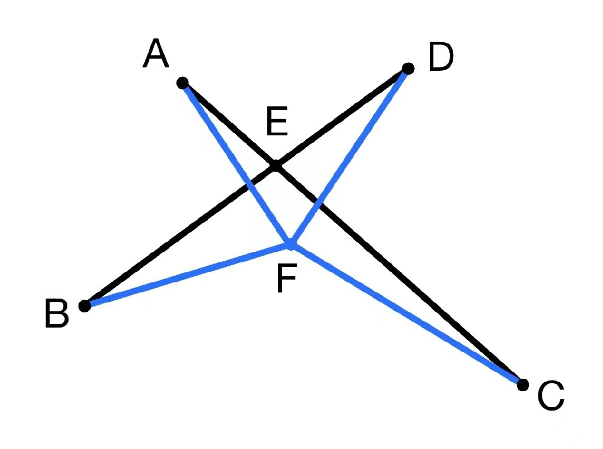
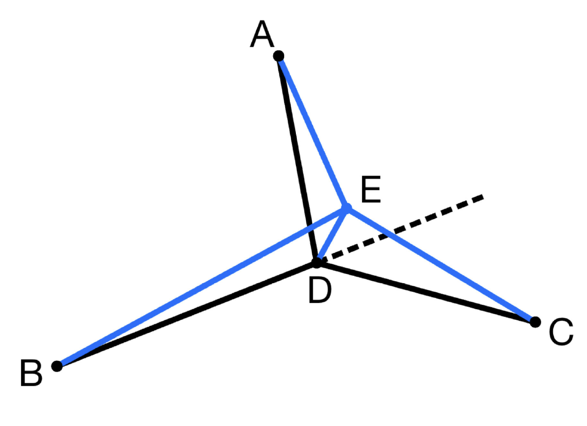

# 程序设计基础 E2 答案（2022秋）

## A 助教机器人Pro

### 题目

| 难度 | 考点 |
| --- | --- |
| 原稿未给 | 原稿未给 |

#### 题目描述

助教机器人会回答同学们的问题。给定若干个问题编号，按下面的对照表输出回答：

| 编号 | 回答 |
| --- | --- |
| 1 | `本地对了就是对了，交上去WA说明评测机有问题。` |
| 2 | `调试调试。` |
| 3 | `没啥问题。在OJ上输入和输出是分开的，不用担心。` |
| 4 | `SIGESGV大约是数组越界了,SIGFPE大约是除以零了。` |
| 5 | `大约是数组越界了。` |
| 6 | `百度一下报错信息。` |
| 7 | `可能是死循环了，如果显示process exited with return value 3221225477等非零数，可以百度百度这个数字的携带的错误信息。` |
| 8 | `对对对` |
| 其他 | `你的代码有问题，但是我不知道是什么问题。` |

#### 输入格式

多组数据输入，每组数据为一个正整数 $n$ ，读到文件结束为止。

#### 输出格式

共若干行，每行为对应的回答。

#### 样例输入

```text
1
9
```

#### 样例输出

```text
本地对了就是对了，交上去WA说明评测机有问题。
你的代码有问题，但是我不知道是什么问题。
```

### 答案

### 题目分析

只需要复制所有的输出，使用 `if-else` 语句判断并输出即可。不过，本题的QA都很有用哦（最后一个除外）

### 示例代码

```c
#include <stdio.h>
int main()
{
    int n;
    while (scanf("%d", &n) != EOF)//多组读入，if-else判断
        if (n == 1)
            printf("本地对了就是对了，交上去WA说明评测机有问题。\n");
        else if (n == 2)
            printf("调试调试。\n");
        else if (n == 3)
            printf("没啥问题。在OJ上输入和输出是分开的，不用担心。\n");
        else if (n == 4)
            printf("SIGESGV大约是数组越界了,SIGFPE大约是除以零了。\n");
        else if (n == 5)
            printf("大约是数组越界了。\n");
        else if (n == 6)
            printf("百度一下报错信息。\n");
        else if (n == 7)
            printf("可能是死循环了，如果显示process exited with return value 3221225477等非零数，可以百度百度这个数字的携带的错误信息。\n");
        else if (n == 8)
            printf("对对对\n");
        else
            printf("你的代码有问题，但是我不知道是什么问题。\n");
    return 0;
}
```

## B ywp的伤害计算助手

### 题目

| 难度 | 考点 |
| --- | --- |
| 原稿未给 | 原稿未给 |

#### 题目描述

ywp 的伤害计算公式为：基础伤害 $a$ 乘以倍率 $b$ ，此外还有暴击机制——暴击时伤害额外乘以 $1 + c$ ，暴击概率为 $d$ ，不暴击的概率为 $1 - d$ 。

请求出伤害的期望值，即

$$E = a \times b \times (1 + c) \times d + a \times b \times (1 - d)$$

#### 输入格式

一行四个实数 $a, b, c, d$ 。

#### 输出格式

一行一个实数，为伤害期望，保留 4 位小数。

#### 样例输入

```text
100 2 0.5 0.3
```

#### 样例输出

```text
230.0000
```

### 答案

### 题目解读

计算一个随机的，有两种取值的函数的期望

### 解题思路

我们可以分别讨论两种情况下（暴击和非暴击）的造成伤害是多少，然后根据离散期望的定义：

$$E(X) = \sum_i x_i p_i $$

进行计算即可

### 代码示例

```c
#include <stdio.h>
int main()
{
    double a, b, c, d;
    scanf("%lf%lf%lf%lf", &a, &b, &c, &d);
    double v1 = a * b * (1 + c), p1 = d;//暴击
    double v2 = a * b, p2 = 1 - d;//不暴击
    double ans = v1 * p1 + v2 * p2;
    printf("%.4lf\n", ans);
    return 0;
}
```

## C 搬运不动卿

### 题目

| 难度 | 考点 |
| --- | --- |
| 原稿未给 | 原稿未给 |

#### 题目描述

搬运不动卿（Orson）体重为 $w$ ，不动卿（Maruluku）的力量为 $f$ 。绳子的根数 $rope$ 从 0 开始，绳子的作用是把 Maruluku 的力量放大 $2^{rope}$ 倍。

请求出最小的 $rope$ ，使得 Orson 的体重不超过放大后的力量（两个数相差小于 $10^{-6}$ 时视为相等）。

#### 输入格式

一行两个实数 $w, f$ 。

#### 输出格式

一行一个整数，为最小的 $rope$ 。

#### 样例输入

```text
10 3
```

#### 样例输出

```text
2
```

### 答案

### 题目分析

本题主要考察同学们对浮点数判断相等情况的掌握。

在判断两个 `double` 类型数是否相等时，由于浮点数的精度问题，不能直接使用 `==` 。一般而言，当两个 `double` 数差值的绝对值小于 $1e-6$ 时，我们就可以认为这两个浮点数是相等的。（函数 `fabs()` 会返回参数的绝对值）

`pow()` 这个函数的参数和返回值都是 `double` 类型，大家在未来写题的时候注意他的返回值不是 `int` 这一点，有可能会出现奇妙のbug。并且这个函数也可以计算底数和指数都是浮点数的类型，可谓是十分的强大。同学们也可以在网上搜索 `math.h` 自行学习，了解一下这里面都包含了哪些数学函数。

在解决本题时，在读入数据之后，从 `rope` 为 0 时开始算起，每次比较 `orson` 的体重和 `maruluku` 被放大后的力量大小即可。

### 示例代码

```c
#include <stdio.h>
#include <math.h>

int main()
{
    double orson;
    double maruluku;
    int rope = 0;
    scanf("%lf%lf", &orson, &maruluku);
    while (1)
    { //不把条件写在条件判断里是为了可读性。
        if (fabs(orson - maruluku * pow(2, rope)) < 1e-6 || orson < maruluku * pow(2, rope))
            break; //当符合条件时退出循环即可。
        rope++;
    }
    printf("%d\n", rope);
    return 0;
}
```

当然本题也可以不使用 `pow()` 来做出，但是助教希望同学们逐渐掌握一些 `math.h` 里的函数的用法。

不使用 `pow()` 的做法：

```c
#include <stdio.h>
#include <math.h>

int main(){
    double orson;
    double maruluku;
    int rope = 0;
    int power = 1;
    scanf("%lf%lf", &orson, &maruluku);
    while(1){
        if(fabs(orson - maruluku * power) < 1e-6 || orson < maruluku * power)
            break;
        rope++;
        power *= 2;
    }
    printf("%d\n", rope);
    return 0;
}
```

## D 石中刀

### 题目

| 难度 | 考点 |
| --- | --- |
| 原稿未给 | 原稿未给 |

#### 题目描述

石中刀被埋在一层层岩石中。每层岩石给出两个数，表示这一层的两个位置是否为 1 （1 表示通，0 表示不通）。第一层之上默认两个位置都是通的。

若当前层与上一层「连通」——即上一层第一个位置与当前层第一个位置都是 1，或者上一层第二个位置与当前层第二个位置都是 1——则可以继续向下挖；否则停止。

请求出一共能挖通多少层。

#### 输入格式

若干行，每行两个整数，读到文件结束为止。

#### 输出格式

一行一个整数，为能挖通的层数。

#### 样例输入

```text
1 1
1 0
0 1
1 1
```

#### 样例输出

```text
2
```

### 答案

### 题目分析

记录前一行输入为 `a` 和 `b`，后一行为 `x` 和 `y`。

假设 `a` 和 `b` 与上方连通，若 `a==1&&x==1` 或 `b==1&&y==1`，则 `x` 与 `y` 所在行与前一行连通。循环进行输入，每个有效行为答案+1即可。

### 示例代码

```c
#include <stdio.h>

int main() {
    int n, m;
    int lastn = 1, lastm = 1, ans = 0;//记录上一行的两个数
    while (scanf("%d%d", &n, &m) > 0) {
        if (lastn == 1 && n == 1 || lastm == 1 && m == 1)
            ans++;
        else break;//断开则直接跳出循环
        lastm = m, lastn = n;
    }
    printf("%d", ans);
    return 0;
}
```

## E 卡牌数数

### 题目

| 难度 | 考点 |
| --- | --- |
| 2 | 一维数组 |

#### 题目描述

你有标着 0 到 9 的十种卡牌，第 $i$ 种卡牌有 $cnt_i$ 张。从数字 $x$ 开始报数，每报一个数就要消耗与这个数各位数字对应的卡牌各一张（消耗后卡牌不会恢复）。

请求出最多能数到多少（第一次就无法报出的数之前的那个数就是答案）。

#### 输入格式

第一行 10 个非负整数，依次为标号 0 到 9 的卡牌数量。

第二行一个正整数 $x$ 。

#### 输出格式

一行一个整数，为最多能数到的数。

#### 样例输入

```text
1 1 1 1 1 1 1 1 1 1
9
```

#### 样例输出

```text
10
```

### 答案

### 题目分析

题目最主要的问题在于将一个数 $x$ 的每一位提取出来并统计个数：

假设 $x = 1234$，我们可以通过%运算获得 $x$ 的最后一位 4，统计最后一位后我们直接将 $x$ 整除 10，此时 $x$ 变为 123，我们再通过%运算获得 $x$ 的最后一位 3，后面依次循环往复，即可提取出 $x$ 的每一位数。

之前的练习中有过类似的题目，相信大家能很快的想到。

### 示例代码

```c
#include <stdio.h>
int main()
{
    int cnt[10];
    long long x;
    for (int i = 0; i < 10; i++)
        scanf("%d", &cnt[i]); //输入各张卡牌的数量
    scanf("%lld", &x);        // 输入初始数数的位置x
    for (int check = 1;; x++) // 判断x是否可以被表示出来，如果可以则令x++，否则退出循环
    {
        int now[10] = {0}; // 用来存储表示x所需的每种卡牌的数量
        long long tmp = x;
        while (tmp) // 拆分出x的每一位
        {
            now[tmp % 10]++; // x%10提取出当前最低位的数
            tmp /= 10;       // 将最低位的数舍去
        }
        for (int i = 0; i < 10; i++)
        {
            if (now[i] > cnt[i])
            {
                check = 0; // 判断卡牌i是否够用，不够的话令check=0
                break;     // 跳出循环
            }
            cnt[i] -= now[i]; // 更新卡牌数量
        }
        if (check == 0)
            break; // 卡牌不够用了，直接跳出循环
        // 否则所有卡牌均够用，继续下次循环
    }
    printf("%lld\n", x - 1); //退出循环时的x是无法被表示的，所以最多数到x-1
    return 0;
}
```

再额外提供一份使用了函数，更简易的代码，大家可以在学习完函数后回来看看。

```c
#include <stdio.h>
#define ll long long
int cnt[10];
int check(ll x) //判断x是否能被余下的卡牌表示出来
{
    int now[10] = {0}; //用来存储表示x所需的每种卡牌的数量
    while (x)          //拆分出x的每一位
    {
        now[x % 10]++; // x%10提取出当前最低位的数
        x /= 10;       //将最低位的数舍去
    }
    for (int i = 0; i < 10; i++)
    {
        if (now[i] > cnt[i])
            return 0;     //判断卡牌i是否够用，不够的话返回0
        cnt[i] -= now[i]; //更新卡牌数量
    }
    return 1; //所有卡牌均够用，返回1
}
int main()
{
    ll x;
    for (int i = 0; i < 10; i++)
        scanf("%d", &cnt[i]); //输入各张卡牌的数量
    scanf("%lld", &x);        //输入初始数数的位置x
    for (; check(x); x++)
        ;                    //判断x是否可以被表示出来，如果可以则令x++，否则退出循环
    printf("%lld\n", x - 1); //退出循环时的x是无法被表示的，所以最多数到x-1
    return 0;
}
```

## F 五八三十五

### 题目

| 难度 | 考点 |
| --- | --- |
| 原稿未给 | 原稿未给 |

#### 题目描述

某人口诀背错了，把「五八四十」背成了「五八三十五」。于是在做乘法时，只要有一对数位上的数字分别是 5 与 8，它们相乘得到的贡献就会比正确结果少 $5 \times$ 该对数位的位权之积。

给定两个正整数 $x, y$ ，请求出按错误口诀计算 $x \times y$ 得到的结果。

#### 输入格式

一行两个正整数 $x, y$ 。

#### 输出格式

一行一个整数，为按错误口诀计算的结果。

#### 样例输入

```text
15 8
```

#### 样例输出

```text
115
```

### 答案

### 题目分析

在乘法的竖式运算中，采用的方式是每一位分别相乘，例如十位（假设为 5）和百位（假设为 8）相乘效果为 $5 \times 8 \times 10 \times 100$。

因此我们发现，当某一组数的乘积结果改变时，其对总体结果的改变量是可以计算的。

所以只需要对两个乘数的每一位进行循环判断，找出其中的 5 与 8，在常规运算的结果中减去其改变量即可。

### 示例代码

```c
#include <stdio.h>
#include <math.h>

int main()
{
    int x = 0, y = 0, mult = 0, a = 0, b = 0, i = 1, j = 1;
    scanf("%d%d", &x, &y);
    mult = x * y; //先得到正确计算时的结果
    a = x;
    b = y;
    //遍历每一位，找出其中所有的的5*8项，再减去差值
    while (a > 0)
    {
        b = y;
        j = 1;
        while (b > 0)
        {
            int s = a % 10, t = b % 10; //提取每位上的数
            if (s == 5 && t == 8 || s == 8 && t == 5)
            {
                mult -= 5 * i * j; //减去正确计算与错误计算的差
                //i、j用于计算位数
            }
            j *= 10;
            b /= 10;
        }
        i *= 10;
        a /= 10;
    }
    printf("%d", mult);
    return 0;
}
```

### 扩展

这道题也可以用高精度做……这里不展示了。

## G 魔法实验 1.0

### 题目

| 难度 | 考点 |
| --- | --- |
| 1 | 贪心 |

#### 题目描述

给定一个正整数列 $a_1, a_2, \ldots, a_n$ ，可以进行如下两种操作：

- 融合：将两个正整数相加得到一个新的正整数；
- 浓缩：将一个偶数除以 2。

请求出最少需要操作多少次，才能使所有整数都变为奇数。

提示：两个数相加后，质因子 2 的个数等于两个加数中质因子 2 个数的较小值；若数列中已经存在奇数，把每个偶数与它融合即可；否则要先浓缩出第一个奇数。

#### 输入格式

第一行一个正整数 $t$ ，表示数据组数。

每组数据占两行：第一行一个正整数 $n$ ，第二行 $n$ 个正整数。

#### 输出格式

共 $t$ 行，每行一个整数，为该组数据的最少操作次数。

#### 样例输入

```text
2
3
2 4 3
2
4 8
```

#### 样例输出

```text
2
3
```

### 答案

### 简要题意

对一个正整数列 $a_1, a_2, \ldots, a_n$ 可进行如下两种操作：

- 融合：将两个正整数相加得到一个新的正整数；
- 浓缩：将一个偶数除以 2。

最少需要操作多少次才能使所有整数变为奇数？

### 问题分析

我们知道，两数相加，奇偶性相同和为偶，反之为奇。若要使一个偶数变为奇数，最简单的办法便是使用融合，让它与一个奇数相加，显然这是最少的操作方法之一。但是，如果这个数列中没有奇数，我们就需要浓缩来先得到一个奇数。在描述操作前，我们先用一个简单的证明来揭示浓缩的本质。

设有两数分别为 $2^{p_1} \times p_2$ 和 $2^{q_1} \times q_2$，其中 $p_2, q_2$ 均与 2 互质。

我们不妨设 $p_1 \le q_1$，将两数相加有： $2^{p_1} \times p_2 + 2^{q_1} \times q_2 = 2^{p_1} \times (2^{q_1-p_1} \times q_2 + p_2)$。

由于 $p_2$ 与 2 互质，故 $2^{q_1-p_1} \times q_2 + p_2$ 为奇数。

因此，浓缩的意义在于生成一个数，它的质因子 2 的个数为两加数中质因子 2 个数的较小值。

明白了这一点，本题的目标就很明确了：

- 如果数列中有奇数，就让它与每个偶数相加；
- 如果数列中没有奇数，我们需要找到一个质因子的个数最小的偶数，重复进行浓缩直至变为奇数，再与每个偶数相加。

### 参考代码

```c
#include <stdio.h>
#define MIN(a,b) (((a)-(b)<0)?(a):(b))//用于求两数较小值

int main()
{
    int t, a, n, ans;
    int flag;//记录是否出现过奇数
    int cnt;//质因子2的个数
    int min;//记录最小的质因子2的个数
    scanf("%d", &t);
    while (t--)
    {
        min = 2147483647;//int最大值
        ans = 0;
        flag = 0;
        scanf("%d", &n);
        while (n--)
        {
            scanf("%d", &a);
            cnt = 0;
            while (a % 2 == 0)//统计质因子2的幂
            {
                a /= 2;
                cnt++;
            }
            if (cnt == 0)//数列中有奇数
                flag = 1;
            else
            {
                min = MIN(cnt, min);
                ans++;
            }
        }
        if (flag)
            printf("%d\n", ans);
        else
            printf("%d\n", (ans - 1) + min);//第一个变为奇数的偶数不需要再与某个奇数相加
    }
    return 0;
}
```

## H 眼睛哥的时间

### 题目

| 难度 | 考点 |
| --- | --- |
| 原稿未给 | 原稿未给 |

#### 题目描述

眼睛哥有一个显示到秒的时钟。开始时时钟显示为 `hh:mm:ss` ，之后他进行若干次行动，每次行动真实花费的时间是一个以分钟为单位的实数（时间会累加，显示的时间按累加后的总用量计算）。

每次行动结束后输出当前时钟应该显示的时间（时、分、秒各占两位）；若这次行动使日期发生了变化（跨过了一天），再输出一行 `O! A new day!` 。

所有行动结束后，输出一行 `use x mins` ，其中 $x$ 是总用时四舍五入到整分钟的结果。

#### 输入格式

第一行一个时间，格式为 `hh:mm:ss` 。

第二行一个正整数 $cnt$ ，表示行动次数。

接下来 $cnt$ 行，每行一个实数，为一次行动的真实用时（分钟）。

#### 输出格式

按上述规则输出。

#### 样例输入

```text
23:59:30
2
0.5
1.0
```

#### 样例输出

```text
00:00:00
O! A new day!
00:01:00
use 2 mins
```

### 答案

### 题目解读

按照题意，每一个循环中

读入浮点数，利用强制类型转换将其转为显示的时、分、秒

注意时分秒的进位修正。由于浮点数累加作用使得显示的时间并不代表真实使用的时间，因而需要注意从累加量来计算当前应该显示的时间。

一个常见的思路是累加每次使用的时间，得到从第一次行动开始到此刻所用总分钟数，然后逐位修正得到当前应该显示的时分秒。

四舍五入可以采用 $+0.5$ 接上强制类型转换实现，此方法比较保险，后续的函数教学中将会见到使用 `math.h` 函数库的方法。

复制粘贴题示字符串.

<!-- markdownlint-disable-next-line MD026 -->
#### 精度修正问题：

1. 按照 HINT 在计算秒数向下取整时，可以考虑先判断是否等于某个整数，再向下取整。
2. 运算过程中尽量减少浮点整数的来回切换。
3. 比较两个浮点数，或者比较整数浮点数是否相等的时候注意eps

### 代码

#### 样例1：使用分钟解答

```c
#include<stdio.h>
int main()
{
// 定义变量
    int hour, min, sec;//读取的先前时间
    scanf("%2d:%2d:%2d", &hour, &min, &sec);
// 读取循环次数
    int cnt;
    scanf("%d", &cnt);
    int i;
// 指示当前时分秒和日期
    int now_sec, now_min, now_hour;
    int past_day = 0;
// 累加时间
    double sum_total_mins = 0;
    for(i=0;i<cnt;i++)
    {
        int now_day;
        double use_time;//真实使用的时间
// 读取
        scanf("%lf", &use_time);
        sum_total_mins += use_time;
// 计算使用的时、分、秒，注意累加
// 由于显示精确到秒即可，所以计算使用的整分钟数和整秒数加到显示的时间上
        int use_sec, use_min, use_hour, use_total;
        use_min = (int)sum_total_mins;// use_min表示从最开始累计用了use_min（取整）分钟
        use_sec = (int)((sum_total_mins - use_min) * 60.0);
// 相加，修正显示的时间
// 首先计算累积量
        now_sec = use_sec + sec;
        now_min = use_min + min + now_sec / 60;
        now_hour = hour + now_min / 60;
        now_day = now_hour / 24;
// 最后修正展示
        now_hour %= 24;
        now_min %= 60;
        now_sec %= 60;
// 输出
        printf("%02d:%02d:%02d\n", now_hour, now_min, now_sec);
        if(now_day>past_day)
        printf("O! A new day!\n");
        past_day = now_day;
    }
// 此处需要注意强制类型转换的四舍五入问题
// 可以通过+0.5补偿实现四舍五入
    printf("use %d mins", (int)(sum_total_mins + 0.5));
    return 0;
}
```

#### 样例2：使用秒钟解答

```c
#include<stdio.h>
#define eps 1e-6

int main()
{
// 定义变量
    int hour, min, sec;//读取的先前时间
    scanf("%2d:%2d:%2d", &hour, &min, &sec);
    int cnt;
    scanf("%d", &cnt);
    int i;
    int now_sec, now_min, now_hour;
    int past_day = 0;
    double sum_total_sec = 0;
    for(i=0;i<cnt;i++)
    {
        int now_day;
        double use_time;//读取的使用时间
// 读取
        scanf("%lf", &use_time);
        sum_total_sec += use_time * 60.0;
// 计算使用的时、分、秒
        int use_sec, use_min;
        use_sec = (int)(sum_total_sec + eps);//增加一个小量，防止精度误差导致问题
// 相加，修正
        now_sec = use_sec + sec;
        now_min = min + now_sec / 60;
        now_hour = hour + now_min / 60;
        now_day = now_hour / 24;

        now_hour %= 24;
        now_min %= 60;
        now_sec %= 60;
// 输出
        printf("%02d:%02d:%02d\n", now_hour, now_min, now_sec);
        if(now_day>past_day)
        printf("O! A new day!\n");
        past_day = now_day;
    }
// 此处需要注意强制类型转换的四舍五入问题
// 可以通过+0.5补偿实现四舍五入
    printf("use %d mins", (int)(sum_total_sec/60.0 + 0.5));
    return 0;
}
```

## I 哪吒的水题（一）

### 题目

| 难度 | 考点 |
| --- | --- |
| 原稿未给 | 原稿未给 |

#### 题目描述

四个村庄的位置构成一个四边形（四个顶点按顺序给出，可能构成凸四边形或凹四边形）。现在要修建一个供水站，求供水站到四个村庄的距离之和的最小值。

可以证明：若四个村庄构成凸四边形，供水站应修在两条对角线的交点；若构成凹四边形，供水站应修在凹点处的那个村庄。

#### 输入格式

四行，每行两个整数，依次为四个村庄的坐标（按顺序给出）。

#### 输出格式

一行一个实数，为最小距离之和，保留 3 位小数。

#### 样例输入

```text
0 0
2 0
2 2
0 2
```

#### 样例输出

```text
5.657
```

### 答案

### 题目分析

由题意，四个村庄构成一个四边形，需要分凸四边形和凹四边形两种情况考虑。（如果四个村庄构成了一个三角形，其中一个村庄在两个村庄连线上，则既可以视为凸四边形，也可以视为凹四边形）

当四个村庄构成一个凸四边形时，如下图：



$$AF + CF >= AC = AE + CE, BF + DF >= BD = BE + DE $$

因此供水站应修在四边形对角线交点处（即图中 $E$ 点），距离之和应该是对角线长度之和；

当四个村庄构成一个凹四边形时，如下图：



$$AE + ED >= AD, BE + CE >= BD + CD $$

因此供水站应修在四边形凹点（内角为优角的顶点）处的村庄（即在另外三个村庄构成三角形内部的那个村庄），距离之和为该村庄到另外三个村庄的距离之和（到自己的距离为 0）.

实现本题有两种思路：

#### 思路1

分别在对角线交点和四个村庄处共 5 个位置建立供水站，分别算出五个位置的供水站到四个村庄的距离之和，取 5 个结果中的最小值输出。这个方法难点在于求交点的坐标 $(x_0, y_0)$ 过于复杂，可以参考以下公式：

$$x_0 = \frac{(x_1 y_3 - x_3 y_1)(y_2 - y_4) - (x_2 y_4 - x_4 y_2)(y_1 - y_3)}{(x_1 - x_3)(y_2 - y_4) - (x_2 - x_4)(y_1 - y_3)}, \quad y_0 = \frac{(x_1 y_3 - x_3 y_1)(x_2 - x_4) - (x_2 y_4 - x_4 y_2)(x_1 - x_3)}{(x_1 - x_3)(y_2 - y_4) - (x_2 - x_4)(y_1 - y_3)} $$

距离运用两点间距离公式 $\sqrt{(x_i - x_j)^2 + (y_i - y_j)^2}$ 计算。

注意：

1. 这个思路不能直接用对角线长度之和去算，因为没有判断四边形的凹凸性，如果是凹四边形，对角线长度之和会小于正确答案。
2. 计算交点坐标是用联立直线方程解二元一次方程组的方法，注意当对角线两点横坐标相同时不能设直线方程为 $y = kx + b$
3. 整数输入，如果直接用上方公式计算可能会爆int，建议乘1.0转化为浮点数计算。

#### 思路2

利用叉乘的方法判断是凸四边形还是凹四边形。

假设四个村庄按照逆时针方向给出，分别为 $A(x_0, y_0), B(x_1, y_1), C(x_2, y_2), D(x_3, y_3)$，则 $\overrightarrow{DA} \times \overrightarrow{AB}$ 的 $z$ 轴坐标，即算式 $(x_0 - x_3)(y_1 - y_0) - (y_0 - y_3)(x_1 - x_0)$ 的符号是否为正代表了点 $A$ 的内角是否为劣角，即该点是否为凸点。

设 $cross[i] = sign((x_i - x_{i-1})(y_{i+1} - y_i) - (y_i - y_{i-1})(x_{i+1} - x_i))$，其中 $sign()$ 是符号函数，正数取 1，负数取 $-1$，0 取 0。若 $x \ne 0$，则 $sign(x) = \frac{x}{|x|}$。

因此只需要计算 $cross[i], i = 0, 1, 2, 3$，就可以判断四边形的凹凸性。

如果四边形是凸四边形，则四个顶点处的内角均为劣角，四个 $cross[i]$ 一定相同（逆时针给出四个点则均为 1，顺时针给出四个点则均为 $-1$）；

如果四边形是凹四边形，则其中一个顶点是凹点（该点处内角为优角），另外三个顶点是凸点（该点处内角为劣角），四个 $cross[i]$ 中有一个与另外三个不相同（逆时针给出四个点则一负三正，顺时针给出四个点则一正三负）。

因此可以将四个 $cross[i]$ 乘起来，若为正说明是凸四边形，直接输出对角线长度之和；若为负说明是凹四边形，此时需要找到四个 $cross[i]$ 中与另外三个不同的 $cross[i]$，输出它对应的点到另外三点的距离和；或者直接分别计算四个顶点到另外三个点的距离之和，然后取四个值中的最小者。

这个方法虽然码量较大，但是不用手算交点公式，实际耗费做题时间也许更少，但是思路略微难想。

补：计算 $cross[i]$ 时，若 $i = 0$， $i - 1$ 应为 3，若 $i = 3$， $i + 1$ 应为 0，可以用模运算将特殊情况统一起来，代码如下：

```c
(i-1+4)%4 //i-1
(i+1)%4 //i+1
```

### 其他思路&题目总结

上两个思路是出题人想到的，大部分做出来的同学用的是这两个思路。

还有的同学利用其他性质判断四边形的凹凸性，如：

（1）凹四边形的一对对边中，一定有一条边所在直线穿过另外一条边，即这条边对边的两个端点在这条边所在直线的两侧；而凸四边形一定在同侧。

（2）四边形 $ABCD$，若为凸四边形，则有 $S_{\triangle ABC} + S_{\triangle ADC} = S_{\triangle BAD} + S_{\triangle BCD}$ 成立；若为凹四边形则不然。三角形面积也可以用向量叉积来计算，或者利用海伦公式（可能会丢失精度，不推荐）。

（3）四边形的四个邻边所夹的劣角可以用向量点乘加上反余弦函数来计算，凸四边形四个夹角之和为 $2\pi$；凹四边形则不然。

归根结底这道题是想锻炼同学们将几何问题转化为编程语言的能力。视觉上一眼能看出来凹凸性对计算机而言并不那么直观，计算机需要如思路2中的数学工具才能够判断；而计算机比人的优势在于计算能力强，如思路1，其实凹凸性实际上并不需要判断，对于计算机来说只需要把可能的答案都找出来取最小的就可以了。

希望同学们可以通过这道题有所收获。

### 示例代码

#### 法一：运用思路1

```c
#include <stdio.h>
#include <math.h>

int main()
{
    double x[5], y[5];
    for (int i = 1; i <= 4; ++i)
    {
        scanf("%lf%lf", &x[i], &y[i]);
    }
    //计算对角线交点，坐标存入x[0], y[0]
    x[0] = ((x[4] - x[2]) * (x[1] * y[3] - x[3] * y[1]) - (x[3] - x[1]) * (x[2] * y[4] - x[4] * y[2])) / ((y[1] - y[3]) * (x[2] - x[4]) - (x[1] - x[3]) * (y[2] - y[4]));
    y[0] = ((y[4] - y[2]) * (x[1] * y[3] - x[3] * y[1]) - (y[3] - y[1]) * (x[2] * y[4] - x[4] * y[2])) / ((y[1] - y[3]) * (x[2] - x[4]) - (x[1] - x[3]) * (y[2] - y[4]));
    double ans = 0, sum = 0;
    for (int j = 0; j <= 4; ++j)
    { //分别在对角线交点和四个村庄共5个点建立供水站，计算距离和，取最小者
        sum = 0;
        for (int i = 1; i <= 4; ++i)
        { //计算供水站到四个村庄的距离之和
            sum += sqrt((x[j] - x[i]) * (x[j] - x[i]) + (y[j] - y[i]) * (y[j] - y[i]));
        }
        if (sum < ans || j == 0)
            ans = sum; // j=0时ans赋值为sum，此后ans取ans和sum中较小者，最终ans即为5个距离和中的最小者
    }
    printf("%.3f", ans);
}
```

#### 法二：运用思路2

```c
#include <stdio.h>
#include <math.h>

int main()
{
    int x[4], y[4];
    int cross[4];
    for (int i = 0; i < 4; ++i)
    {
        scanf("%d%d", &x[i], &y[i]);
    }
    for (int i = 0; i < 4; ++i)
    {
        cross[i] = (x[i] - x[(i - 1 + 4) % 4]) * (y[(i + 1) % 4] - y[i]) - (x[(i + 1) % 4] - x[i]) * (y[i] - y[(i - 1 + 4) % 4]); //计算点i所连两条边对应向量的叉乘
        //防止后续操作爆int，保留符号即可
        if (cross[i])
            cross[i] /= abs(cross[i]); // abs是绝对值函数，该语句实现了sign函数
    }
    //四个点的cross[i]要么符号一致，要么只有一个与另外三个符号不一致
    if (cross[0] * cross[1] * cross[2] * cross[3] >= 0) //四个cross[i]符号一致（或存在0），说明为凸四边形，输出对角线之和
        printf("%.3f", sqrt((x[0] - x[2]) * (x[0] - x[2]) + (y[0] - y[2]) * (y[0] - y[2])) + sqrt((x[1] - x[3]) * (x[1] - x[3]) + (y[1] - y[3]) * (y[1] - y[3])));
    else //有一个点的cross[i]与另外三个符号不一致，说明这个点是凹点，找到这个点，在这个点建立供水站
    {
        int i; //设凹点为点i
        if (cross[0] * cross[1] > 0)
        { //点0与点1符号相同，说明i=2或3
            if (cross[0] * cross[2] > 0)
                i = 3; //点2与点0符号相同，说明i=3
            else
                i = 2; //点2与点0符号不同，说明i=2
        }
        else
        { //点0与点1符号不同，说明i=0或1
            if (cross[0] * cross[2] > 0)
                i = 1; //点2与点0符号相同，说明i=1
            else
                i = 0; //点2与点0符号不同，说明i=0
        }
        //  i=(cross[0]*cross[1]+1)+(cross[0]*cross[2]+1)/2; //按这个算式算出来的i和上面找到的i结果一样
        double d = 0; //记录距离和
        for (int j = 0; j < 4; ++j)
        { //计算点i到四个点的距离之和，最后输出
            d += sqrt((x[i] - x[j]) * (x[i] - x[j]) + (y[i] - y[j]) * (y[i] - y[j]));
        }
        printf("%.3f", d);
    }
    return 0;
}
```

Author: 哪吒

## J 回文日期

### 题目

| 难度 | 考点 |
| --- | --- |
| 原稿未给 | 原稿未给 |

#### 题目描述

把日期写成 8 位数字 `yyyymmdd` ，若这个 8 位数字是回文数（即正着读和反着读相同），则称这一天是回文日期。

给定一个日期 $n$ ，请求出在它之后最近的回文日期，并求出这个回文日期与「在 $n$ 当天或之前最近的回文日期」之间相隔的天数。

若 $n$ 之后不存在回文日期，输出 `N0, mG g0D!` 。

#### 输入格式

多组数据输入，每组数据为一个 8 位整数 $n$ ，读到文件结束为止。

#### 输出格式

对每组数据输出一行：若存在，输出之后最近的回文日期与间隔天数，用空格分隔；否则输出 `N0, mG g0D!` 。

#### 样例输入

```text
20200202
```

#### 样例输出

```text
20211202 669
```

### 答案

### 题目分析

由题意即求距离当前日期最近的前后两次回文日期及其间隔。

根据回文日期的特点，可以通过遍历月和日来构造合法回文日期。

```c
// 当前月为m，日为d
// 对应回文日期为
date = ((d % 10) * 1000 + (d / 10) * 100 + (m % 10) * 10 + (m / 10)) * 10000 + i * 100 + j;
```

计算两回文日期间隔时，可以将间隔分为三部分进行计算。

```c
// 开始年份已经过去天数a，结束年份已经过去天数b，中间完整年份总天数c
// 间隔为
interval = b + c + 365 - a; // 开始年份为平年
interval = b + c + 366 - a; // 开始年份为闰年
```

闰年判断

```c
isleap = !((date % 100 != 0 && date % 4 == 0) || date % 400 == 0)
```

如果 `date` 是闰年，则 `isleap` 为 1，否则为 0。

### 示例代码

```c
#include <stdio.h>

int h[13] = {0, 31, 29, 31, 30, 31, 30, 31, 31, 30, 31, 30, 31};
int n, a, c, now, ans, lst;

int main() {
    while (~scanf("%d", &n)) {
        ans = 99999999;
        lst = 10000000;
        for (int i = 1; i <= 12; i++) {
            // 遍历找出当前日期前后两个回文日期
            for (int j = 1; j <= h[i]; j++) {
                c = (j % 10) * 1000 + (j / 10) * 100 + (i % 10) * 10 + (i / 10);
                now = c * 10000 + i * 100 + j;
                if (now > n && ans > now)
                    ans = now;
                if (now <= n && lst < now)
                    lst = now;
            }
        }
        if (ans >= 99999999) // 找不到
            puts("N0, mG g0D!");
        else {
            // 找到，计算回文日期间隔
            int x = 0, y = 0, sum = 0;
            for (int i = 1; i < (lst % 10000) / 100; i++) {
                // lst年已经过去的天数
                if (i != 2)
                    x += h[i];
                else
                    x += h[i] - !(((lst / 10000) % 100 != 0 && (lst / 10000) % 4 == 0) || (lst / 10000) % 400 == 0);
            }
            x += lst % 100;
            for (int i = 1; i < (ans % 10000) / 100; i++) {
                // ans年已经过去的天数
                if (i != 2)
                    y += h[i];
                else
                    y += h[i] - !(((ans / 10000) % 100 != 0 && (ans / 10000) % 4 == 0) || (ans / 10000) % 400 == 0);
            }
            y += ans % 100;
            if (lst / 10000 == ans / 10000)
                return y - x;
            for (int i = lst / 10000 + 1; i < ans / 10000; i++) // lst和ans中间完整的总天数
                sum += 366 - !((i % 100 != 0 && i % 4 == 0) || i % 400 == 0);
            int interval = y + sum + 366 - !(((lst / 10000) % 100 != 0 && (lst / 10000) % 4 == 0) || (lst / 10000) % 400 == 0) - x;
            printf("%d %d\n", ans, interval);
        }
    }
    return 0;
}
```
