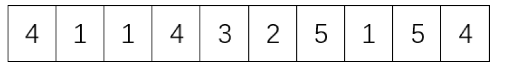
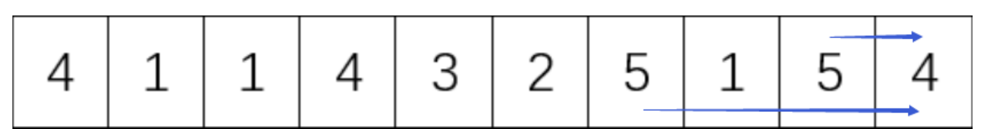

# 程序设计基础 E4 答案（2022秋）

## A 奶龙的数学课

### 题目

#### 题目描述

给定一个八进制表示的区间 $[L, R]$ ，请求出这个区间内 7 的倍数的个数。

输入与输出都采用八进制。

#### 输入格式

一行两个八进制整数 $L, R$ 。

#### 输出格式

一行一个八进制整数，为区间内 7 的倍数的个数。

#### 样例输入

```text
10 100
```

#### 样例输出

```text
10
```

### 答案

### 题目分析

本题求 $[L,R]$ 区间内 7 的倍数的数字个数，可直接由 $R/7-(L-1)/7$ 公式求得。

另外，注意题目要求输入输出均采用八进制，可用 `scanf("%o", &x);` 输入。

### 示例代码

```c
#include<stdio.h>
int main()
{
    int l, r;
    scanf("%o%o", &l, &r); //八进制输入
    printf("%o\n", r/7 - (l-1)/7);
    return 0;
}
```

## B 函数

### 题目

#### 题目描述

定义数列 $f$ ：

$$f(1) = 1, \quad f(2) = 1, \quad f(3) = 2, \quad f(4) = 3$$

$$f(x) = (f(x-1) + f(x-4)) \bmod (10^9 + 7), \quad x \ge 5$$

给定 $n$ ，请求出 $f(n)$ 。

#### 输入格式

一行一个正整数 $n$ 。

#### 输出格式

一行一个整数，为 $f(n)$ 。

#### 样例输入

```text
8
```

#### 样例输出

```text
10
```

### 答案

### 题目分析

本题较为简单，但是要注意两个坑点

1. 运算的时候，参与运算的每一步都要取模，比如计算 $f(x) = f(x-1) + f(x-4)$ 的时候，实际上应该这样写： $f(x) = (f(x-1) + f(x-4))\%mod$，记 $mod = 1000000007$，此外，不能直接用 `1e9+7` 来取模，因为科学计数法的数是一个 `double` 类型的数，直接取模会CE。
2. 有一部分同学用了递归函数，然后 TLE了。提前学习的习惯很好，但是首先我们可以分析一下递归函数的复杂度，递归求解的时候，每一步都需要在前面进行再次的计算，这样造成的时间复杂度是指数级的。其次，就算没有TLE的问题，我们也要知道，C语言的函数递归是有最大层数限制的，就算没有TLE，也会因为递归超过最大层数而RE。

### 代码分析

```c
#include <stdio.h>
typedef long long LL;
// typedef 的作用是将c语言原有的类型（此处为long long）用自定义符号（此处为LL）来替换
LL n;
const LL M = 1000000007;
LL a[10010];
int main()
{
    scanf("%lld", &n);
    a[1] = 1, a[2] = 1, a[3] = 2, a[4] = 3;
    for (int i = 5; i <= n; i++)
        a[i] = (a[i - 1] + a[i - 4]) % M; //直接在数组中计算，算一次取一次模
    printf("%lld", a[n]);
    return 0;
}
```

## C 朝田诗乃的压枪训练

### 题目

#### 题目描述

压枪训练共进行 $n$ 次，每次给出两个偏移量 $a, b$ ，本次的偏移距离为 $|a|$ 与 $|b|$ 中的较大值。

按下面的标准给出评价：

| 偏移距离 | 评价 |
| --- | --- |
| 0 | `Perfect` |
| 不超过 3 | `Excellent` |
| 不超过 5 | `Good` |
| 不超过 10 | `Not Bad` |
| 大于 10 | `Oh!` |

最后输出最好成绩（偏移距离的最小值）与平均偏移距离（保留 2 位小数）。

#### 输入格式

第一行一个正整数 $n$ 。

接下来 $n$ 行，每行两个整数 $a, b$ 。

#### 输出格式

先输出 $n$ 行评价，最后一行输出最好成绩与平均偏移距离，用一个空格分隔。

#### 样例输入

```text
3
0 0
2 -1
7 8
```

#### 样例输出

```text
Perfect
Excellent
Not Bad
0 3.33
```

### 答案

### 题目分析

只需要正确理解题意即可，注意 距离 是两者绝对值中的较小值。

### 示例代码

```c
#include <stdio.h>
int main()
{
    int sum = 0, Min = 0x7fffffff, maxn = 0; //将Min初始化为int范围的最大值
    int n;
    scanf("%d", &n);
    for (int i = 1; i <= n; i++)
    {
        maxn = 0;
        int a, b;
        scanf("%d %d", &a, &b);
        if (a < 0) a = -a;
        if (b < 0) b = -b;
        //将a、b变为正的
        if (a > b) maxn = a;
        else maxn = b;
        //取a、b之间的较大值
        if (maxn == 0) printf("Perfect\n");
        else if (maxn <= 3) printf("Excellent\n");
        else if (maxn <= 5) printf("Good\n");
        else if (maxn <= 10) printf("Not Bad\n");
        else printf("Oh!\n");
        sum += maxn; //答案累加
        if (Min > maxn)
            Min = maxn; //将最好成绩更新
    }
    printf("%d ", Min);
    double Ave = sum * 1.0 / n;
    printf("%.2f\n", Ave);
    return 0;
}
```

## D 眼镜的复数计算器

### 题目

#### 题目描述

实现一个复数计算器。给定两个复数 $z_1 = Re_1 + Im_1 i$ 与 $z_2 = Re_2 + Im_2 i$ ，以及一个运算符编号 $op$ ：

| $op$ | 运算 | 结果 |
| --- | --- | --- |
| 1 | $z_1 + z_2$ | $(Re_1 + Re_2) + (Im_1 + Im_2)i$ |
| 2 | $z_1 - z_2$ | $(Re_1 - Re_2) + (Im_1 - Im_2)i$ |
| 3 | $z_1 \times z_2$ | $(Re_1 Re_2 - Im_1 Im_2) + (Re_1 Im_2 + Re_2 Im_1)i$ |
| 4 | $z_1 \div z_2$ | $\dfrac{Re_1 Re_2 + Im_1 Im_2}{Re_2^2 + Im_2^2} + \dfrac{Re_2 Im_1 - Re_1 Im_2}{Re_2^2 + Im_2^2}i$ |

#### 输入格式

第一行一个正整数 $n$ ，表示运算次数。

接下来 $n$ 行，每行 5 个整数 $Re_1, Im_1, op, Re_2, Im_2$ 。

#### 输出格式

共 $n$ 行，每行一个复数，实部与虚部都保留 2 位小数，虚部前面带正负号，末尾加字母 `i` 。

#### 样例输入

```text
2
1 2 1 3 4
1 2 3 3 4
```

#### 样例输出

```text
4.00+6.00i
-5.00+10.00i
```

### 答案

### 题目解读

按照题意要求和公式计算并保留结果即可，可以使用 if 分支，也可以使用 switch 分支。

### 代码

```c
#include <stdio.h>
#define square(x) ((x) * (x))
int main()
{
    int op;
    int Re1, Im1, Re2, Im2;
    double Re_fin = 0., Im_fin = 0.;
    // 定义变量：
    int n;
    scanf("%d", &n);
    int cnt;
    for (cnt = 0; cnt < n; cnt++)
    { // 读取：
        scanf("%d %d %d %d %d", &Re1, &Im1, &op, &Re2, &Im2);
        { // 分支进行处理：
            switch (op)
            {
            case 1:
                Re_fin = Re1 + Re2;
                Im_fin = Im1 + Im2;
                break;
            case 2:
                Re_fin = Re1 - Re2;
                Im_fin = Im1 - Im2;
                break;
            case 3:
                Re_fin = Re1 * Re2 - Im1 * Im2;
                Im_fin = Re1 * Im2 + Re2 * Im1;
                break;
            case 4:
                // 如果使用int定义变量，注意变量类型类型问题
                Re_fin = 1.0 * (Re1 * Re2 + Im1 * Im2) / (square(Re2) + square(Im2));
                Im_fin = 1.0 * (Re2 * Im1 - Re1 * Im2) / (square(Re2) + square(Im2));
                break;
            }
        }
        printf("%.2f%+.2fi\n", Re_fin, Im_fin);
    }
    return 0;
}
```

## E 打音游

### 题目

#### 题目描述

打音游时每个音符的判定结果用一个字符表示：

- `P` （Perfect）：准确度 1.0；
- `G` （Great）：准确度 0.5；
- `M` （Miss）：连击数清零。

每个音符的基础分值为 200 分，得分为 `基础分值 × 连击倍率 × 准确度` ，其中连击倍率由本次判定后的连击数决定：

| 连击数 | 0–9 | 10–19 | 20–29 | 30–39 | 40–49 | 50 及以上 |
| --- | --- | --- | --- | --- | --- | --- |
| 倍率 | 1.0 | 1.1 | 1.2 | 1.3 | 1.4 | 1.5 |

请求出总分；若整首曲子没有出现 `M` ，再输出一行 `Full Combo!` 。

#### 输入格式

若干个字符，读到文件结束为止。

#### 输出格式

第一行一个整数，为总分；若达成全连击，再输出一行 `Full Combo!` 。

#### 样例输入

```text
PPG
```

#### 样例输出

```text
500
Full Combo!
```

### 答案

### 题目分析

本题是一个朴实无华的模拟题，合理安排代码结构即可较为轻松的通过本题。

在判断是否达到 $full\ combo$ 的条件时可以使用标识变量。标识变量的作用是标记是否达到某些条件，辅助我们进行情况的判断。在本题中标识变量的作用就是标记是否出现过 $Miss$ 情况。

在计算连击倍率时可以利用数组，简化代码。

### 标准程序

```c
//Author: bluebean
#include <stdio.h>
int main(){
    int combo = 0;      //保存combo数
    int score = 200;    //基础分值
    int ans = 0;        //最终答案
    int flag = 1;       //标识变量，判断是否full combo
    double mul[10] = {1.0, 1.1, 1.2, 1.3, 1.4, 1.5};    //使用数组存储倍率
    char ch;
    while(scanf("%c", &ch) != EOF){
        if(ch == 'P' || ch == 'G'){
            combo++;    //首先将combo数加一。
            double accuracy = (ch == 'P' ? 1.0 : 0.5);    //使用三目运算符判断准确度
            if(combo < 50)
                ans += score * mul[combo / 10] * accuracy;  //直接从数组中取出对应的倍率值。
            else                                            //注意，数组下标必须是整型类型。
                ans += score * mul[5] * accuracy;
        }
        else if(ch == 'M'){
            combo = 0;  //重置combo数。
            flag = 0;   //当出现Miss情况时，将标识变量flag置零，代表不满足full combo的条件。
        }
    }
    printf("%d\n", ans);
    if(flag == 1)    //如果满足full combo的条件，则输出Full Combo!
        printf("Full Combo!");
    return 0;
}
```

## F Cirno 的完美位运算教室

### 题目

| 难度 | 考点 |
| --- | --- |
| 1 | 位运算 |

#### 题目描述

给定正整数 $x$ ，请找出一个正整数 $y$ ，使得 $x$ 与 $y$ 的二进制表示中既存在某一位同为 $1$ ，又存在某一位不同，即

$$x \& y \ne 0 \quad \text{且} \quad x \oplus y \ne 0$$

#### 输入格式

第一行一个正整数 $T$ ，表示数据组数。

接下来 $T$ 行，每行一个正整数 $x$ 。

#### 输出格式

共 $T$ 行，每行一个满足条件的正整数 $y$ 。

#### 样例输入

```text
4
1
4
6
5
```

#### 样例输出

```text
3
5
2
1
```

### 答案

### 问题分析

题意很清晰，我们应当使 $x$ 和 $y$ 的二进制位上至少有一位相同（按位与），有一位不同（按位异或），那么我们可以对 $x$ 的值进行分类讨论：

1. 若 $x = 1$，显然 $y = 3$；
2. 若 $x$ 的二进制位上只有一位为 1，由于 $x \neq 1$，仅需令 $y = x + 1$ 即可满足题意；
3. 若 $x$ 的二进制位上有多个 1，只需取 $x$ 的最低位的 1 赋给 $y$ 即可。

### 参考代码 #1

```c
#include <stdio.h>
int main()
{
    int T, x, i, y;
    int cnt;//记录x的二进制位为1的个数
    scanf("%d", &T);
    while (T--)
    {
        cnt = 0;//初始化
        scanf("%d", &x);
        if (x == 1)
            y = 3;
        else
        {
            for (i = 0; i < 32; i++)
            {
                if ((x >> i) & 1)//x的二进制位为1的最低位
                {
                    y = (1 << i);
                    cnt++;
                    break;
                }
            }
            for (i = i + 1; i < 32; i++)//等等，为什么是i=i+1？
            {
                if ((x >> i) & 1)
                    cnt++;
            }
            if (cnt == 1)//x仅有一位二进制位为1
                y++;
        }
        printf("%d\n", y);
    }
    return 0;
}
```

为什么第 2 个 for 循环的初始条件是 `i=i+1` 呢？

很简单，因为 for 循环的 `i++` 执行于一次循环结束，而由于我们的 `break` 语句提前跳出了循环，所以我们继续记录二进制位的时候需要手动加上这个 1。

### 小拓展

#### 关于 lowbit 运算

我们定义一个函数 $f(x) = \mathrm{lowbit}(x)$，函数值为 $x$ 的二进制最低位的 1 所对应的值。

例如： $6 = (110)_2$，那么 $\mathrm{lowbit}(6) = (10)_2 = 2$，因为 $(110)_2$ 的最低位的 1 对应的数为 $2^1 = 2$。

#### lowbit 运算的实现

为得到 lowbit 的值，我们只需得到最低位的 1 的位置，将其余位置全部置 0 即可，下面介绍两种方式：

1. `x&(x^(x-1))`

   对 $x$ 的取值进行讨论：

   若 $x$ 为奇数，显然运算结果为 1，符合要求；

   若 $x$ 为偶数，那么 $x - 1$ 会将 $x$ 从最低位的 1 开始一直到最右位全部取反，即得到一个前面不变，后面为 $011\ldots$ 的串，与 $x$ 进行按位异或，得到一个前面为 0，后面为 $111\ldots$ 的串，再与 $x$ 进行按位与，即得到 lowbit。

2. `x&-x`

   我们知道，一个负数的补码是其绝对值的原码取反加一，有了这个前置知识，这个运算的实现原理留给读者思考。

lowbit 运算有很多用途，比如可以用来统计一个数的二进制位为 1 的个数：

```c
while(x)
{
    x-=x&-x;
    cnt++;
}
```

有了 lowbit 运算，我们的代码可以得到很大的简化。

### 参考代码 #2

```c
#include <stdio.h>
int main()
{
    int T, x, y;
    scanf("%d", &T);
    while (T--)
    {
        scanf("%d", &x);
        if (x == 1)
            y = 3;
        else if (x - (x & -x))//x的二进制有多位为1
            y = x & -x;
        else
            y = x + 1;
        printf("%d\n", y);
    }
    return 0;
}
```

## G

### 题目

| 难度 | 考点 |
| --- | --- |
| 3 | 动态规划 |

#### 题目描述

一排有 $N$ 个格子，魔理沙站在第 1 个格子上。第 $i$ 个格子上写着一个不超过 10 的正整数 $num_i$ ，表示从第 $i$ 格出发最多可以向前走 $num_i$ 格（每步至少走 1 格，且只能向前走）。

请求出魔理沙从第 1 格走到第 $N$ 格所需要的最少步数。

#### 输入格式

第一行一个正整数 $N$ 。

第二行 $N$ 个正整数 $num_1, num_2, \cdots, num_N$ 。

#### 输出格式

一行一个整数，为最少步数。

#### 样例输入

```text
5
2 1 3 1 1
```

#### 样例输出

```text
2
```

#### 数据范围

- $num_i \le 10$

### 答案

### 题目分析

这是一道典型的动态规划题目，接下来以样例为例子讲解这道题的思路：



如Hint所示，不去直接思考到达终点的最短路线，而只考虑最后一步：我到达终点的最后一步有几种选择？他们分别需要多少总步数？

能够到达最后一格的可行性为：



如图，从第七格向前移动至终点，或者从第九格向前移动至终点。

那么，到达终点所需要的最小步数只有两种情况：到达第七格的最小步数+1，或者到达第九格的最小步数+1，取这两者中的最小值。

假如我们用数列 $dp[i]$ 来表示到达第 $i$ 格所需要的最小步数，那么我们可以得到如下式子:

$$ans = dp[10] = min(dp[7], dp[9]) + 1$$

于是问题被分解为求 $dp[7]$ 和 $dp[9]$ ，即到达第七格和第九格的最小步数。

对于这两个格子的讨论同理，分别将他们看做是终点进行分析即可，如是不断向前分析，直到回到第一格： $dp[1]$

显然 $dp[1] = 0$ ,因为魔理沙并不需要移动就在这一格上。

因此我们计算时可从 $dp[1]$ 开始，计算到达第 $i$ 格所需要的最小步数。

只需要遍历能到达第 $i$ 格的所有格子——在本题中，就是从第 $i - 10$ 到第 $i - 1$ 格中满足步数要求的格子，取他们中 $dp$ 的最小值 +1 ，就是到达第 $i$ 格的最小步数，也就是 $dp[i]$ 的最终值

由此依次计算 $dp[1]$, $dp[2]$, $dp[3]$, ..., $dp[n]$ ，最后输出 $dp[n]$ 即可。

*当然本题方法不止这一种，很多做法都能完成本题，这里的 $dp$ 是时间复杂度为 $o(n)$——因为题目限制了格子中的数字为不超过 10 的整数，否则时间复杂度会变为 $o(n^2)$——的算法，也可以使用贪心算法等等。*

### 实例代码

```c
#include <stdio.h>
const int maxInt = 2147483647;
int main(void) {
    int num[1005] = {0}, dp[1005] = {0};
    // num数组记录每一格的数字,dp数组记录到达这个格所需要的最小步数
    //再次强调：数组长度最好取足够大但不太大的常数，不要使用动态数组
    int N;
    scanf("%d", &N);
    for (int i = 1; i <= N; i++) {
        scanf("%d", &num[i]);
        dp[i] = maxInt;
        //将dp数组的每一位初始化为一个足够大的数字
        //这样在取最小值的时候就一定会变成数据中的值而不会卡在一个比最小值更小的数上
    }
    dp[1] = 0;
    // 魔理沙正站在第一格上，她不需要移动就能够到达第一格
    for (int i = 2; i <= N; i++) {
        //遍历魔理沙到达每一格的情况
        for (int j = 1; (j <= 10) && (i - j >= 0); j++) {
            //遍历从第i-j格到达第i格的情况，注意j的范围不能越界
            if ((num[i - j] >= j) && (dp[i - j] + 1 < dp[i])) {
                // num[i - j] >= j ,说明从第i-j格出发能到达第i格
                // dp[i - j] + 1 < dp[i],说明第i-j格出发到达第i格的走法比当前记录的到达第i格的走法最好
                dp[i] = dp[i - j] + 1;
            }
        }
        //遍历完成后，dp[i]得到了正确的值，也就是到达第i格所需要的最少步数
    }
    printf("%d", dp[N]);
    return 0;
}
```

## H 希卡式打孔纸带·alter

### 题目

#### 题目描述

从整数 1 出发，允许进行两种操作：

- 左移一位并在低位补 0；
- 按位取反。

给定整数 $x$ ，请求出从 1 变到 $x$ 所需要的最少操作次数。可以证明任何 $x$ 都是可达的。

#### 输入格式

多组数据输入，每组数据为一个整数 $x$ ，读到文件结束为止。

#### 输出格式

共若干行，每行一个整数，为对应的最少操作次数。

#### 样例输入

```text
2
3
```

#### 样例输出

```text
1
3
```

### 答案

### 题目分析

逆向思考：如果撤销一次编辑，这次撤销要如何实现？对1使用“左移低位补零”和“取反”，从而到达x的最小步骤，从逆过程看，等于对x使用“对末尾为0的数右移并在高位补任意值”和“取反”到达1的最小步骤。

特殊情况包括-2，0两种。除了这两种以外，最低位是0时，直接使用算术右移时得到的结果总是与正向进行时相同（证明过程不易列举，留给大家)。如果没有发现这一结论，可以通过统计可以任取的高位个数解决右移补位问题。本题代码比较简单，根据代码思考一下为什么这样写。

> 算术右移与逻辑右移：
>
> - 逻辑右移(LSR)是将各位依次右移指定位数，然后在左侧补 0
> - 算术右移(ASR)是将各位依次右移指定位数，然后在左侧用原符号位补齐（即正数补 0，负数补 1）

本题顺着操作顺序思考是没有解法的。

另外，不存在不可达的情况（这就是古人的智慧（））。

### 代码样例

没有利用算术右移最优的解法（略复杂，另一种写法更简洁）：

```c
#include <stdio.h>
int main() {
    int x;
    while (scanf("%d", &x) > 0) {
        int ans = 0;
        long long shift = 0xffffffff;//没有进行过补位的区间是1，否则是0。0x是16进制前缀，0xffffffff是16进制ffffffff，等于二进制1111_1111_1111_1111_1111_1111_1111_1111.
        while ((shift & x) != 1) {//shift为0的位不计入考虑
            ans++;
            if (x & 1 || (shift & (~x)) == 1) x = ~x;
            else x >>= 1, shift >>= 1;//经过了补位的位不需要考虑
        }
        printf("%d\n", ans);
    }
}
```

考虑到算术右移最优的解法：

```c
#include <stdio.h>
int main() {
    int x;
    while (scanf("%d", &x) > 0) {
        int ans = 0;
        while (x != 1) {
            ans++;
            if (x == 0) ans += 31, x = 1;//特判0
            else if (x & 1 || x == -2) x = ~x;//特判-2
            else x >>= 1;
        }
        printf("%d\n", ans);
    }
}
```

## I 狼了个狼 (2)

### 题目

#### 题目描述

有 $n$ 堆肉，第 $i$ 堆的重量为 $tv_i$ 。每次操作可以选定一个阈值 $j$ （大于所有堆重量的最小值），把所有重量大于 $j$ 的堆都削减到 $j$ ，但一次操作削减的总量不能超过 $m$ 。

请求出：最终所有堆能达到的共同重量（也就是所有堆重量的最小值），以及把所有堆都削减到这个重量所需的最少操作次数。

#### 输入格式

第一行两个正整数 $n, m$ 。

第二行 $n$ 个正整数，依次为每堆肉的重量。

#### 输出格式

一行两个整数，依次为最终每堆的重量与最少操作次数，用空格分隔。

#### 样例输入

```text
3 3
1 3 5
```

#### 样例输出

```text
1 3
```

### 答案

### 题目分析

第一问显然是所有质量的最小值，下面主要分析第二问。

要求操作次数尽可能的少，那么每次就要尽可能取多的肉，直到达到平均。

因此可以得到思路：每次遍历阈值，尽可能的设低阈值（高于最小值）。但如果只是简单的暴力判断高于阈值的数量那么会有部分点 `tle`，因此我们需要优化判断：利用数组 `s[i]` 存储重量不大于 `i` 的肉的堆数，当判大于阈值 `j` 的堆数时，只需要计算 `s[max_tv]-s[j]`。

### 示例代码

```c
#include <stdio.h>
#define  max(x,y) (((x)>(y)) ? (x) : (y))
#define  min(x,y) (((x)<(y)) ? (x) : (y))
int n, m, tv;
int s[1000010];
int min_tv = 1000010, max_tv, res, tmp;
int main() {
    scanf("%d%d", &n, &m);
    for (int i = 0; i < n; i ++ ) {
        scanf("%d", &tv);
        min_tv = min(min_tv, tv); // 最小值即最多能分配的量
        max_tv = max(max_tv, tv);
        s[tv] ++ ; // 记录质量为tv的堆数
    }
    for (int i = 1; i <= max_tv; i ++ )
        s[i] += s[i - 1]; // 累加得到质量不大于i的堆数
    for (int i = max_tv; i > min_tv;) { // 判断是否到达最小值
        int j = i, sum = 0;
        while (j > min_tv && sum +  (tmp = s[max_tv] - s[j - 1]) <= m) // 只要超过部分没超过sum就降低阈值
            sum += tmp, j--;
        res ++ ;
        i = j;
    }
    printf("%d %d\n", min_tv, res);
    return 0;
}
```

## J 伦蒂尼姆的守卫

### 题目

#### 题目描述

$n$ 座塔楼围成一圈，编号 $1$ 到 $n$ ； $n$ 名萨卡兹分别站在一座塔楼上，第 $i$ 名萨卡兹的初始朝向为 $a_i$ （1 表示顺时针，0 表示逆时针）。

每个小时按下面的规则行动：

1. 若某人所在的塔楼上同时出现了顺时针与逆时针的萨卡兹（即两人相遇），则他调转方向；
2. 随后每人尝试沿当前方向移动一格：若他要去的那一格上的萨卡兹与他同向，则他调转方向并留在原地；否则前进一格。

请求出 $t$ 小时后第 $k$ 名萨卡兹所在的塔楼编号。

#### 输入格式

第一行两个正整数 $n, k$ 与一个整数 $t$ 。

第二行 $n$ 个整数 $a_1, a_2, \cdots, a_n$ ，依次为每名萨卡兹的初始朝向。

#### 输出格式

一行一个整数，为 $t$ 小时后第 $k$ 名萨卡兹所在的塔楼编号。

#### 样例输入

```text
4 1 2
1 1 0 0
```

#### 样例输出

```text
1
```

### 答案

### 题目分析

本题看似只是简单的模拟，但却需要一些特别的技巧才能通过全部数据点，否则就会陷入TLE的泥沼之中

首先，“当且仅当萨卡兹两两相遇时，他们会改变方向”，但我们可以换一种想法：当两人相遇时，两人交换序号，而这两个人仍沿着原先的方向前进。容易发现，当 $n$ 小时过去后，每个人仍在初始位置上，而序号可能发生改变。假定此时每人的序号为 $a[i]$，那么便等同于对序号作了一次从 $\{1,2,\ldots,n\}$ 到 $\{1,2,\ldots,n\}$ 的一一映射。

- 显然地，我们有： $n$ 次这样的映射后，每个序号映射回了原值。于是， $t$ 小时就变为了 $t\%n^2$ 小时，即 $\frac{t}{n^2}$ 为整数时我们只需输出原值，此即为这部分数据点的意义所在

同时，注意到两人每当相遇时就会交换序号，那么序号的顺序将不会改变，显然地有这个映射即为所有序号加上一个固定值（超过n的部分减去n）。

我们发现每过去 $n$ 小时时后需要对 $k$ 进行一次映射即可找到此刻 $k$ 的位置，那么我们只需要找到一种方法，能找到某一时刻某点的位置，就能得到答案。直观的想法是直接对所有的 $n$ 个人模拟 $n$ 次即可，但观察 $n$ 的数据范围，这样至多可以通过90%的数据（可能只能通过70%)。想拿到剩下的0.1分，我们需要继续上面的想法----两人相遇只交换序号。因为每个人的移动方向始终不变，那么可以视为初始顺时针的人每回合均顺时针移动一个塔楼，在i个小时后，只要找到某个塔楼逆时针移动i个塔楼后的位置在开始时是否为顺时针，就能知道此时是否有初始顺时针的人移动到该塔楼（因为若有，那么他将在i个回合顺时针移动i个塔楼并抵达该塔楼，倒推即可知道他是否存在）；逆时针同理。所有我们只要跟随并模拟一个人的行为，就能知道他任意回合后抵达的位置。

因此，我们可以先任意选定一个人，找到他 $n$ 小时后的位置并计算相对初始位置的位移，对 $k$ 作 $\frac{t}{n}$ 个同样的位移，再找到他在 $t\%n$ 小时后的位置并输出即可。

### 示例代码

```c
#include <stdio.h>
#define DEFAULT_LOC 1//第一次模拟以计算n小时位移时的初始位置，需要不大于n，取0or1即可，也可直接用k
int main()
{
    int a[100010], n, k;
    long long t;
    scanf("%d%d%lld", &n, &k, &t);
    k--;//变为从0开始的编号
    for (int i = 0; i < n; i++)
        scanf("%d", &a[i]);
    int loc = DEFAULT_LOC, dir = a[DEFAULT_LOC];//初始模拟位置与方向
    for (int i = 0; i < n; i++)
    {//(loc + n - i) % n 即为为loc逆时针移动i格后的序号，那么若a[(loc + n - i) % n] == 1，即这个位置的人初始为顺时针，则有他会在i小时后到达loc处
     //(loc + i) % n同理
        if (a[(loc + n - i) % n] == 1 && a[(loc + i) % n] == 0)
            dir ^= 1;//每小时开始时，当前位置若有两人相遇（即同时有顺时针与逆时针），则转向
        if (dir && a[(loc + i + 1) % n])
            loc = (loc + 1) % n;//若方向为顺时针且顺时针的下个塔楼此时不为逆时针，则顺时针前进
        else if (!dir && !a[(loc + n - i - 1) % n])
            loc = (loc + n - 1) % n;//若方向为逆时针且逆时针的下个塔楼此时不为顺时针，则逆时针前进
        else
            dir ^= 1;//否则转向且不移动
    }
    loc = (t / n * ((loc - DEFAULT_LOC + n)) + k) % n;//每n个小时均移动同样距离
                                                      //则对于k在t/n个n小时后移动至loc
    t = t % n, dir = a[loc];//模拟我们要寻找的第k个人，方法同上
    for (int i = 0; i < t; i++)
    {
        if (a[(loc + n - i) % n] ^ a[(loc + i) % n])
            dir ^= 1;
        if (dir && a[(loc + i + 1) % n])
            loc = (loc + 1) % n;
        else if (!dir && !a[(loc + n - i - 1) % n])
            loc = (loc + n - 1) % n;
        else
            dir ^= 1;
    }
    printf("%d", loc + 1);//编号变回从1开始
}
```

### 优化

但是有同学觉得我们要模拟两次，实在是太麻烦了。于是，我们可以进行一些优化。考虑 $n$ 个人在 $n$ 个小时后的总位移，为 顺时针移动的人数 $\times n$ - 逆时针移动的人数 $\times n$，而其除以人数就能得到每 $n$ 小时每人的位移为 顺时针移动的人数 - 逆时针移动的人数，这样就能省下第一次模拟。

```c
#include <stdio.h>
int main()
{
    int a[100010], n, loc, dir, cnt = 0;
    long long t;
    scanf("%d%d%lld", &n, &loc, &t);
    loc--;
    for (int i = 0; i < n; i++)
    {
        scanf("%d", &a[i]);
        cnt += a[i];//统计顺时针数量，n-cnt即可得到逆时针
    }
    loc = ((int)(t / n % n) * cnt * 2 + loc) % n;//(cnt - (n - cnt)) % n = cnt * 2 % n
    t = t % n, dir = a[loc];
    for (int i = 0; i < t; i++)
    {
        if (a[(loc + n - i) % n] ^ a[(loc + i) % n])//因loc在此处，故可用^替代判断
            dir ^= 1;
        if (dir && a[(loc + i + 1) % n])
            loc = (loc + 1) % n;
        else if (!dir && !a[(loc + n - i - 1) % n])
            loc = (loc + n - 1) % n;
        else
            dir ^= 1;
    }
    printf("%d", loc + 1);
}
```

拓展此方法也可以省下全部的模拟，感兴趣的同学可以自行思考。
