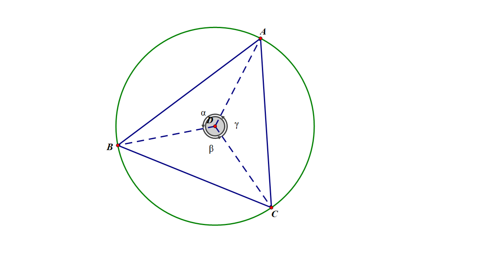

# 程序设计基础 E2 答案（2023秋）

## A 坐标系变换

### 题目

| 难度 | 考点 |
| --- | --- |
| 1 | double, <math.h> |

#### 题目描述

在平面直角坐标系中，极坐标 $(r, \theta)$ 与直角坐标 $(x, y)$ 的关系为

$$x = r\cos\theta, \quad y = r\sin\theta$$

给定一点的极坐标，求它的直角坐标。

#### 输入格式

一行两个实数 $r, \theta$ ，其中 $\theta$ 为弧度制。

#### 输出格式

一行两个实数，分别为 $x$ 和 $y$ ，保留 1 位小数，用空格分隔。

#### 样例输入

```text
2 0
```

#### 样例输出

```text
2.0 0.0
```

### 答案

### 题目分析

本题为签到题，主要 `math.h` 中函数的使用，按要求读入并输出即可。

注意不能使用希腊字母 θ 作为变量名。

用 `scanf` 读入时需要使用 `"%lf"`，用 `printf` 输出时用 `"%f"` 或 `"%lf"` 均可。

### 示例代码

```c
#include <stdio.h>
#include <math.h> //注意添加math.h头文件

int main()
{
    double r, theta;
    scanf("%lf%lf", &r, &theta); //读入r和theta
    printf("%.1f %.1f", r * cos(theta), r * sin(theta)); //按要求输出即可
    return 0;
}
```

## B 这里是 BUAA 2

### 题目

| 难度 | 考点 |
| --- | --- |
| 1 | 字符输入输出，ascii码 |

#### 题目描述

给定一段由可见字符组成的文本（长度不定，可能包含空格与换行），请把其中每一个大写字母替换成它在字母表中的前一个字母，即 `B` 变成 `A` ， `C` 变成 `B` ，……， `Z` 变成 `Y` ；字符 `A` 以及所有非大写字母的字符保持不变。

#### 输入格式

不定数量的字符，读到文件结束为止。

#### 输出格式

按上述规则替换后的文本，不额外添加任何字符。

#### 样例输入

```text
Hello BUAA!
```

#### 样例输出

```text
Gello ATAA!
```

### 答案

### 题目分析

不定数量输入，且可能包含空格，用 `while(scanf("%c", &c)!=EOF)` 来实现。

每读入一个字符后进行改动操作，先判断字符 $c$ 是否在 `B` ~ `Z` 之间的范围内，如果是，就输出 $c-1$，否则输出 $c$。判断和输出都利用 **ascii码表**中字母 `A` ~ `Z` 对应的整数是连续的的特点。

### 示例代码

```c
#include <stdio.h>
char c;
int main() {
    while (scanf("%c", &c) != EOF) {
        if (c > 'A' && c <= 'Z')
            printf("%c", c - 1);
        else
            printf("%c", c);
    }
    return 0;
}
```

## C 乘法口诀表

### 题目

| 难度 | 考点 |
| --- | --- |
| 2 | 循环 |

#### 题目描述

给定正整数 $n$ ，输出乘法口诀表的前 $n$ 行：第 $i$ 行依次输出 $i * 1, i * 2, \cdots, i * i$ 的算式。

#### 输入格式

一行一个正整数 $n$ 。

#### 输出格式

共 $n$ 行。第 $i$ 行包含 $i$ 个算式，形如 `i*j=i*j` ，每个算式之后有一个空格。

#### 样例输入

```text
3
```

#### 样例输出

```text
1*1=1 
2*1=2 2*2=4 
3*1=3 3*2=6 3*3=9 
```

### 答案

### 题目分析

按照要求模拟输出即可。

### 示例代码

```c
#include <stdio.h>
int main()
{
    int n;
    scanf("%d",&n);
    for (int i = 1; i <= n; i++)
    {
        for (int j = 1; j <= i; j++)
        {
            printf("%d*%d=%d ", i, j, i*j);
        }
        printf("\n");
    }
    return 0;
}
```

## D 小亮的圆周率

### 题目

| 难度 | 考点 |
| --- | --- |
| 3 | 循环 |

#### 题目描述

小亮用两种无穷级数来逼近圆周率 $\pi$ ：

$$\pi_1 = 4\sum_{i=0}^{\infty}\frac{(-1)^i}{2i+1}, \quad \pi_2 = \sqrt{8\sum_{i=0}^{\infty}\frac{1}{(2i+1)^2}}$$

两个级数都只取前 $n$ 项求和。给定 $n$ ，求 $|\pi_1 - \pi_2|$ 。

#### 输入格式

第一行一个正整数 $t$ ，表示数据组数。

接下来 $t$ 行，每行一个正整数 $n$ 。

#### 输出格式

共 $t$ 行，每行一个实数，为 $|\pi_1 - \pi_2|$ ，保留 6 位小数。

#### 样例输入

```text
2
1
1000
```

#### 样例输出

```text
1.171573
0.000682
```

#### 数据范围

- $1 \le n \le 10^{5}$

### 答案

### 题目分析

这道题主要考察循环和浮点数的计算。

$\sum_{n=0}^{\infty}\frac{(-1)^n}{2n+1}$ 公式中数列符号与 $n$ 的奇偶性有关。我们可以采取使用条件语句进行奇偶性判断。我们也可以采用示例代码中的方法，定义变量 `sign`，初始值为 $1$，每一次循环结束时， $sign$ 变量自乘 $-1$。这样即可作为第 $n$ 项的符号。当然，还可以使用 `math.h` 库中的 `pow` 函数，`pow(-1,n)` 就是 $(-1)^n$，注意 `pow` 只能用于计算浮点数的幂。

在整数除以整数时，如果**想要得到浮点数，一定要在表达式中乘以** `1.0`，**或者使用强制类型转换**，使表达式的计算范围扩展到浮点数范围。

这道题 $n$ 的范围是 $1 \le n \le 10^5$。在公式 2 中需要计算 $(2n+1)^2$，当 $n$ 接近给定范围的上限时， $(2n+1)^2$ 的大小会超过 `int` 范围。所以需要使用表达式 `((2ll * i + 1) * (2 * i + 1))` 进行计算，其中的 `2ll` 可以使表达式在 `long long` 范围内计算。

### 示例代码

```c
#include<stdio.h>
#include <math.h>

int main() {
    int t;
    int n;
    scanf("%d", &t);
    while (t--) {//循环t次
        scanf("%d", &n);
        double col1 = 0;
        int sign = 1;
        for (int i = 0; i < n; ++i) {
            col1 += (1.0 * sign / (2 * i + 1));
            sign *= -1;
        }
        col1 *= 4; //计算公式1的pi

        double col2 = 0;
        for (int i = 0; i < n; ++i) {
            col2 += (1.0 / ((2ll * i + 1) * (2 * i + 1)));
        }
        col2 = sqrt(8 * col2); //计算公式2的pi

        printf("%.6f\n", fabs(col1 - col2));//输出，保留6位小数。注意浮点数绝对值使用fabs函数
    }
}
```

Author：pyh

## E 体能锻炼走廊

### 题目

| 难度 | 考点 |
| --- | --- |
| 3 | 理解题意、循环结构 |

#### 题目描述

大学四年共 6 个学期，每个学期需要完成 48 次体能锻炼走廊打卡（简称 TD）。学校采用「补前不补后」的原则：某学期多打的卡可以补到之前的学期，但补的次数不能超过之前学期累计未完成的次数。也就是说，到第 $x$ 学期期末为止，累计最多只能记录 $48x$ 次 TD，超出的次数作废。

给定一位同学每个学期实际打卡的次数，判断他是否达标。

#### 输入格式

第一行一个正整数 $t$ ，表示数据组数。

接下来 $t$ 行，每行 6 个非负整数，依次表示第 1 到第 6 学期实际打卡的次数。

#### 输出格式

共 $t$ 行。若累计有效次数达到 $48 \times 6 = 288$ 次，输出 `Success` ；否则输出 `Failure` 与还差的次数，用一个空格分隔。

#### 样例输入

```text
2
50 40 30 20 10 100
10 10 10 10 10 10
```

#### 样例输出

```text
Failure 40
Failure 228
```

### 答案

### 题目解析

本题主要是考一个理解题意，能不能把题面中给出的较为抽象的过程描述转换为程序语言。我们可以把“补前不补后”原则等效地转换为：到第 $x$ 学期期末为止，最多记录 $48x$ 次 TD，多余的次数作废。于是，可以就此完成编程。当然，我看到很多同学也有其它的等效转换方法，比如计算”剩余未打卡次数“的，这些都很正确，这里就不多赘述了。

### 示例代码

```c
#include <stdio.h>

#define STD 48 //每学期的达标次数
#define TERMS 6 //学期总数

int main() {
    int t;
    scanf("%d", &t);
    for (int j = 1; j <= t; ++j) {
        int sum = 0;
        for (int i = 1; i <= TERMS; ++i) {
            int x;
            scanf("%d", &x);
            if (sum + x > STD * i) {
                sum = STD * i;
            } else {
                sum = sum + x;
            }
        }
        if (sum < STD * TERMS) {
            printf("Failure %d", STD * TERMS - sum);
        } else {
            printf("Success");
        }
        printf("\n");
    }
    return 0;
}
```

请注意，本代码中使用了两个宏定义来表示题面中给出的常数：

```c
#define STD 48 //每学期的达标次数
#define TERMS 6 //学期总数
```

在一些情况下，合理地采用宏定义可以提高程序的可读性和可维护性。什么叫可维护性呢？就是比如说万一哪一天学校的政策突然变了，变成总共要刷 $4$ 学期，每学期刷 $72$ 次，那么如果不用宏定义，就需要把程序里面的 $48$ 一个一个找出来换成 $72$，再把程序中的 $6$ 一个一个找出来换成 $4$。但是用了宏定义后，只需修改宏定义里面的量，就可以对整个程序完成修改。

## F Wings 咖啡

### 题目

| 难度 | 考点 |
| --- | --- |
| 4 | 数据类型、循环结构 |

#### 题目描述

黄九妹在 Wings 咖啡点了 $n + 1$ 杯咖啡（连同她自己那杯），每杯咖啡的价格都是自然数。她可以用校园卡支付其中价格最高的 $m + 1$ 杯，但校园卡对每杯咖啡最多只能刷 6 元。

于是把价格从大到小排列后的前 $m + 1$ 杯咖啡中，凡是价格超过 6 元的都按 6 元计入，其余咖啡按原价计入。求最终的总价格。

#### 输入格式

第一行两个正整数 $n, m$ 。

接下来 $n + 1$ 个自然数，依次表示每杯咖啡的价格。

#### 输出格式

一行一个整数，表示最终的总价格。

#### 样例输入

```text
3 1
10 20 3 7
```

#### 样例输出

```text
22
```

#### 数据范围

- $n \le 3 \times 10^{6}$
- 每杯咖啡的价格不超过 $10^{9}$

### 答案

### 题目分析

不难将题目抽象为一个数学描述：现有一个数集 $\{a_1,a_2,\cdots,a_n\}$，找出其中前 $m$ 大的数，判断是否大于 $6$，如果大于 $6$，就把它替换为 $6$，然后计算这个数集的和。

本题的正确率很低，绝大部分错误都是没有认真分析数据范围导致的。

1. 数据范围只说了”每杯咖啡的价格是自然数”，而并没有保证每杯咖啡的价格超过 $6$ 元。很多同学先入为主地认为每杯咖啡的价格一定超过 $6$ 元，于是导致错误。
2. 数据范围里面说 $n \le 3 \times 10^6$，每杯咖啡的价格不超过 $10^9$。在最大的情况下，总价格可能达到 $10^{15}$ 数量级，而 `int` 能表示的最大的数是 $2^{31}-1 \approx 10^{9.3}$，因此在求和时需要使用 `long long int` 类型。
3. 可以注意到，本题中 $n$ 虽然很大，但是 $m$ 的值却很小。我看到很多同学用了排序来做这道题，且不说我们现在并没有学排序，你觉得用排序是不是把这个题搞复杂了？因为排序这个操作本质上是求长度为 $n$ 的数列的前 $n$ 大，而我们现在只需要求前 $m$ 大， $m$ 是远远小于 $n$ 的，所以你大可不必把整个数列都排序一遍，而只需要找出前 $m$ 个就可以了。

   部分有基础的同学可能会知道，快速排序的复杂度是 $O(n \log n)$，冒泡排序的时间复杂度是 $O(n^2)$，而接下来要介绍的本题的标准做法的时间复杂度是 $O(mn)$。在估算程序用时时，经常取计算机一秒运算 $10^8$ 次，同学们可以把相应的数据带入前面的式子里，估算一下哪个最大，哪个最小。知道高级的算法固然很好，可以也要学会”因地制宜“，选择最合适这道题的做法。

那么这道题到底怎么做呢？很简单：遍历 $m$ 遍这个数组，找 $m$ 个最大值即可。首先我们考虑一下如果只需要找到最大的 $1$ 个数，应该怎么写？我们可以先用一个极小的数作为最大值的初始值，然后遍历整个数组，每遇到一个比当前最大值还大的数，就用这个数来替换当前最大值：

```c
int Max = -1, Maxcur = -1;
for (int i = 1; i <= n; ++i) {
    if (Max < a[i]) {
        Max = a[i];
        Maxcur = i;
    }
}
//Max是最大值，Maxcur是最大值对应的下标
```

现在大家都知道了找一个最大值的方法，那么找前 $m$ 大的呢？我们可以另外使用一个数组，记录原数组中某个位置上的数有没有当过最大值，即：

```c
bool vis[3000001];//vis[i]=1则表示a[i]当过最大值，否则表示a[i]没有当过最大值
```

有：

```c
for (int i = 1; i <= m; ++i) {
    int Max = -1, Maxcur = -1;
    for (int j = 1; j <= n; ++j) { //寻找第i大
        if (Max < a[j] && vis[j] == false) {//只在还没当过最大值的数里找最大值
            Max = a[j];
            Maxcur = j;
        }
    }
    //Max是最大值
    //Maxcur是最大值对应的下标
    //标记a[Maxcur]当过最大值了
    vis[Maxcur] = true;
}
```

然后，再改一改，就可以完成这道题了。

### 示例代码

```c
#include <stdio.h>
#include <stdbool.h>

#define MAXN 3000001

int a[MAXN];
bool vis[MAXN];

int main() {
    int n, m;
    scanf("%d%d", &n, &m);
    ++n;//加上黄九妹自己
    ++m;
    for (int i = 1; i <= n; ++i) {
        scanf("%d", &a[i]);
        vis[i] = false;
    }

    for (int i = 1; i <= m; ++i) {
        int Max = -1, Maxcur = -1;
        for (int j = 1; j <= n; ++j) { //寻找第i大
            if (Max < a[j] && vis[j] == false) {
                Max = a[j];
                Maxcur = j;
            }
        }
        if (a[Maxcur] <= 6) {
            //如果当前的最大值已经小于6了
            //说明已经没有需要用校园卡买的咖啡了
            break;//跳出当前循环
        } else {
            vis[Maxcur] = true;
            a[Maxcur] = 6;
        }
    }

    long long int sum = 0LL;
    for (int i = 1; i <= n; ++i) {
        sum += a[i];
    }

    printf("%lld\n", sum);
    return 0;
}
```

这里引用了一个头文件 `stdbool`，它的作用是引入了一个数据类型：布尔类型 `bool`，这个数据类型仅有两个取值， $1$（`true`）和 $0$（`false`），可以用它来表示逻辑的真或假。

## G 某咸鱼与投资

### 题目

| 难度 | 考点 |
| --- | --- |
| 5 | 日期处理 |

#### 题目描述

某咸鱼在某时刻提交了一笔投资申请。申请不会立刻处理，而是按下面的规则顺延到某个日期：

- 若提交时刻在当天 15:00:00 之前（含 15:00:00 整）：工作日当天处理，周六顺延 2 天，周日顺延 1 天；
- 若提交时刻在当天 15:00:00 之后：周一至周四顺延 1 天，周五顺延 3 天，周六顺延 2 天，周日顺延 1 天。

顺延的天数可能跨月、跨年。给定提交时刻与星期，输出处理的日期。

#### 输入格式

一行，格式为 `yyyy/mm/dd hh:mm:ss Week` ，其中 `Week` 取 `Mon` 、 `Tue` 、 `Wed` 、 `Thu` 、 `Fri` 、 `Sat` 、 `Sun` 之一。

#### 输出格式

一行，格式为 `yyyy/mm/dd` ，其中年份占 4 位，月、日各占 2 位，不足补前导零。

#### 样例输入

```text
2023/12/29 16:00:00 Fri
```

#### 样例输出

```text
2024/01/01
```

### 答案

### 题目分析

本题虽然情况复杂，但是也有一些思路去处理。

注意到本题有日期、时刻、周次 3 个不同的输入，因此我们可以先选取其中一项作为讨论的主要标准，以选取时刻为例，可分成下面的两种情况：

1. 每天的15点前：易知工作日9点前的购买都会在当天进行处理，而周末9点前都会顺延到周一，因此可以将15点前合并考虑：如果为工作日，则输出当日；如果为周末，则输出下一个周一的日期。易知周六应输出2天后的日期，周日应输出1天后的日期。
2. 每天的15点后：15时后的购买，不论是哪一天，都会顺延。如果为周一至周四，则顺延至下一日，如果为周五、周六和周日，则输出下一个周一的日期。易知周五应输出3天后的日期，周六应输出2天后的日期，周日应输出1天后的日期。

这样我们就可以将顺延日期计算清楚。接下来就是日期计算的过程：

我们可以先将顺延的日期直接加到“年月日”里面的“日”（dd）上，如果 dd 小于等于 28，则不必处理，直接输出；如果大于 28 且为平年2月，则日期减去 28，月数加一；如果大于 29 且为闰年2月，则日期减去 29，月数加一；如果大于 30 且为 4、6、9、11 月，则日期减去 30，月数加一；如果大于 31 且为其他月份，则日期减去 31，月数加一；这样处理以后，可能出现“13月”，可以判断月份是否为 13，若为 13，则月份减 12，年份加一。

注意要先读取数据，再对数据进行处理，不要先处理再读取。同时，读取可以采用 `"%d/%d/%d %d:%d:%d %s"` 格式，注意字符串在输入时不要加 `&` 号。

### 示例代码

```c
#include <stdio.h>
#include <string.h>
int main() {
    int year, month, day, hour, minute, second;
    char str[5];
    scanf("%d/%d/%d %d:%d:%d %s", &year, &month, &day, &hour, &minute, &second, str);//input
    if (hour <= 14 || (hour == 15 && (minute + second) == 0)) {//每日15时之前
        if (strcmp(str, "Sun") == 0 ) {
            day = day + 1;
        }
        else if (strcmp(str, "Sat") == 0) {
            day = day + 2;
        }
        else {
            day = day + 0;
        }
    }
    else {//每日15时之后
        if (strcmp(str, "Fri") == 0) {
            day = day + 3;
        }
        else if (strcmp(str, "Sat") == 0) {
            day = day + 2;
        }
        else {
            day = day + 1;
        }
    }
    //处理完延后天数以后，开始日期计算
    if (((year % 4 == 0 && year % 100 != 0) || (year % 400 == 0)) && (month == 2)) { //闰年2月
        if (day > 29) {
            month = month + 1;
            day = day - 29;
        }
    }
    else if ((year % 4 != 0 || (year % 100 == 0 && year % 400 != 0)) && (month == 2)) {//平年2月
        if (day > 28) {
            month = month + 1;
            day = day - 28;
        }
    }
    else if (month == 4 || month == 6 || month == 9 || month == 11) {//小月
        if (day > 30) {
            month = month + 1;
            day = day - 30;
        }
    }
    else if (month == 12) {//12月（跨年，单独讨论）
        if (day > 31) {
            year = year + 1;
            month = 1;
            day = day - 31;
        }
    }
    else {//其他大月
        if (day > 31) {
            month = month + 1;
            day = day - 31;
        }
    }
    printf("%04d/%02d/%02d\n", year, month, day);
    return 0;
}
```

## H 摩卡背单词

### 题目

| 难度 | 考点 |
| --- | --- |
| 5 | 字符处理、哈希 |

#### 题目描述

摩卡在背单词，每个单词都由 4 个小写字母组成。她依次看到 $n$ 个单词，对于每个单词判断它之前是否已经出现过：若没有出现过，输出 `Moca memorized a new word!` ；否则输出 `Moca has already memorized this word!` 。

#### 输入格式

第一行一个正整数 $n$ 。

接下来 $n$ 行，每行一个由 4 个小写字母组成的单词。

#### 输出格式

共 $n$ 行，每行一条上述提示。

#### 样例输入

```text
3
abcd
abce
abcd
```

#### 样例输出

```text
Moca memorized a new word!
Moca memorized a new word!
Moca has already memorized this word!
```

#### 数据范围

- $n \le 5 \times 10^{5}$

### 答案

### 题目分析

我们先来看 `Hint`：如果是给大家一串数字，让大家判断某数字之前是否出现过，**我们可以用数组元素 vis[i] 表示数字 i 是否出现过，这样的话是不是很简单呢**？

假设我们用 $vis[i]$ 来表示数字 $i$ 是否出现过（这里用 $vis$ 当数组名没啥特殊含义， $vis$ 是 $visited$ 的缩写，是一种习惯用法），那么初始时，没有任何数字出现过，所以 $vis$ 数组的所有元素的值都应该为 $0$，表示没出现过。然后，当读入某个数字 $i$ 时，如果 $vis[i]$ 为 $0$，那么就证明 $i$ 之前没有出现过，我们让 $vis[i] = 1$ 已标记其已经出现（也就是这次）；如果 $vis[i]$ 不为 $0$，就证明其之前已经被打上了标记，也就说明这个数字之前已经出现过。实现这样功能的程序代码如下：

```c
#include <stdio.h>

int vis[1000]; // 假设我们读进来的数都小于 1000

int main()
{
    for(int i = 1;i < 1000;i++) {
        vis[i] = 0; // 初始时所有数字都没出现过
    }

    int n;
    scanf("%d",&n); // n 表示后面会输入 n 个整数判断它们是否出现过

    for(int i = 1;i <= n;i++)
    {
        int a;
        scanf("%d",&a); // 每次读入一个小于 1000 的非负整数 a

        if (vis[a] != 0) {
            printf("This number already exists!\n");
        }
        else {
            vis[a] = 1; // 打标记
            printf("This is the first time %d exists!\n", a);
        }
    }

    return 0;
}
```

也就是说，如果这个题不是输入一组组四个字符的话，我们把函数的维度稍微开大一点，这个题就算完成了。但是很遗憾，这道题每次输入的是四个字符，那么有没有什么方法能够将四个字符映射到一个数字呢？

提到字符映射为数字，我们就想到了上周刚刚学的 ASCII 码，每一个小写字母都对应着一个 ASCII 码，小写字母的 ASCII 码范围是 $[97,122]$，我们可以再做一个偏移，把每个字符都减去 `'a'`，这样小写字母对应的数字范围就变成了 $[0,25]$。现在，问题就转化为了将四个 $[0,25]$ 的数字转化为一个非负整数。

有些同学想到了十进制的方法，加入四个数字分别是 a b c d，那么它们对应的非负整数就是 $1000a + 100b + 10c + d$，但是，这样就可能会让两个不同的数字序列经过计算后转化为同一个非负整数，比如 $a = 0, b = 0, c = 0, d = 25$ 的运算结果和 $a = 0, b = 0, c = 2, d = 5$ 的运算结果是一样的，就会产生错误；归根结底是选取十进制不够用。

于是，有些同学想到了一百进制的方法，即 $1000000a + 10000b + 100c + d$，当然可以，但是太多的数字被浪费了，因为单词一共只有 $26 * 26 * 26 * 26 = 456976$ 种，而上面那个计算式的最大值将达到 $100100100 * 25 = 2502502500$，足足两千万。

所以，最好的选择是 $26$ 进制，也就是 $26 * 26 * 26 * a + 26 * 26 * b + 26 * c + d$。这样，所有的数字刚好被利用。当然，比 $26$ 大的但是又不至于大到开不了那么大数组的数字都是可以接受的。

最后，有的同学想到了单词映射为数字，但是每次都把这个数字记录在数组里，然后每次读入单词转化为数字后都遍历一遍记录出现过单词的数组；这样的想法当然没问题，但是这道题的 $n$ 实际上太大了，有 $5 \times 10^5$，所以这种做法会超时。

还发现有的同学想到了映射数字，但是没有考虑到可能发生冲突（也就是不同单词映射到同一数字），比如把四个整数乘在一起，或者前面说的十进制。

学了多维数组之后，大家可能还有其它方法。

### 示例代码

```c
#include <stdio.h>
int word[500005];       // 确保数组可以装下所有单词即可

int main()
{
    int n;
    scanf("%d",&n);
    char a,b,c,d;

    for(int i = 1;i <= n;i++)
    {
        getchar();      // 每一行的换行符需要处理
        scanf("%c%c%c%c",&a,&b,&c,&d);
        int num = (a - 'a') * 26 * 26 * 26 + (b - 'a') * 26 * 26 + (c - 'a') * 26 + (d - 'a');
        if (word[num] != 0) {
            printf("Moca has already memorized this word!\n");
        }
        else {
            word[num] = 1;
            printf("Moca memorized a new word!\n");
        }
    }
    return 0;
}
```

## I 规则的形

### 题目

| 难度 | 考点 |
| --- | --- |
| 6 | 浮点数，计算几何 |

#### 题目描述

给定平面上互不相同的三个点。若存在一个正多边形，它的某三个顶点恰好是这三个点，则称这个正多边形是「规则的形」。可以证明这样的正多边形一定内接于这三个点确定的三角形的外接圆。

在所有「规则的形」中，求周长的最小值。

#### 输入格式

一行 6 个实数 $x_1, y_1, x_2, y_2, x_3, y_3$ ，表示三个点的坐标。

#### 输出格式

一行一个实数，表示最小周长。

#### 样例输入

```text
0 0 1 0 0.5 0.8660254037844386
```

#### 样例输出

```text
3.000000000000
```

#### 数据范围

- 正多边形的边数只需在 $3$ 到 $100$ 之间枚举

### 答案

### 题目分析

首先思考如何根据已知的三点确定一个正多边形？容易得到的一个结论是这个多边形内接于这三个点构成的三角形的外接圆。

接下来考虑哪些边数是可行的。



从 3 到 100 枚举所有可能的边数，设此时的边数为 $i$，可以知道 $\alpha$、 $\beta$、 $\gamma$ 都是 $\frac{2\pi}{i}$ 的整数倍，又由几何关系可以得知 $\alpha = 2\angle BCA$，根据余弦定理 $\angle BCA = \arccos\left(\frac{a^2+b^2-c^2}{2ab}\right)$，由两式可知：

$$
\alpha = 2\arccos\left(\frac{a^2+b^2-c^2}{2ab}\right)
$$

$\beta$、 $\gamma$ 同样也可以求出，若它们中的一个不是 $\frac{2\pi}{i}$ 的整数倍，则 $i$ 不是一个可能的边数，否则一定可以构成一个正多边形。

最后我们要求出每种可能边数的周长，先求出外接圆的半径 $R$，由正弦定理可知 $R = \frac{c}{2\sin\left(\frac{\alpha}{2}\right)}$，则由几何关系可以得到边数为 $i$ 时周长 $c$ 的表达式：

$$
c = 2Ri\sin\left(\frac{\pi}{i}\right)
$$

将这些可能的周长取最小值即为最后的答案。需要注意的是判断浮点数是否是整数通常采用下面的办法：`fabs(x - round(x)) < eps`。

### 示例代码

```c
#include<stdio.h>
#include<math.h>
const double pi = acos(-1.0);//通常用这个表达式来表示pi的值
const double eps = 1e-5;
int main()
{
    double x1,y1,x2,y2,x3,y3;
    double a,b,c,a1,a2,a3,r,s;
    int i;
    s = 1e18;
    scanf("%lf%lf%lf%lf%lf%lf",&x1,&y1,&x2,&y2,&x3,&y3);
    a = sqrt((x1 - x2) * (x1 - x2) + (y1 - y2) * (y1 - y2));//分别算出三边的长度
    b = sqrt((x1 - x3) * (x1 - x3) + (y1 - y3) * (y1 - y3));
    c = sqrt((x3 - x2) * (x3 - x2) + (y3 - y2) * (y3 - y2));
    a1 = acos((a * a + b * b - c * c) / (2 * a * b));//使用余弦定理算出三个角的大小
    a2 = acos((a * a - b * b + c * c) / (2 * a * c));
    a3 = acos((-a * a + b * b + c * c) / (2 * c * b));
    r = a / sin(a3) / 2;
    for(i = 3;i <= 100;i++)
    {
        double b1 = a1 * i / pi,b2 = a2 * i / pi,b3 = a3 * i / pi;
        if(fabs(b1 - round(b1)) < eps && fabs(b2 - round(b2)) < eps && fabs(b3 - round(b3)) < eps)//如果三个角都满足条件，则i是满足条件的边数
        {
            double tmp = 2 * r * sin(pi / i) * i;
            if(s > tmp)//更新最小值
            s = tmp;
        }
    }
    printf("%.12lf",s);
    return 0;
}
```

### 思考

为什么不采用求出圆心坐标的方式计算周长呢？

## J 骰子 3rd

### 题目

| 难度 | 考点 |
| --- | --- |
| 8 | 循环、数论 |

#### 题目描述

有两种骰子：红色骰子的点数只能是 $1$ 或 $4$ ，黑色骰子的点数只能是 $2$ 、 $3$ 、 $5$ 、 $6$ 。

给定三个整数 $m, a, b$ ，问是否存在一种方案：共投出 $m$ 个骰子，其中红色骰子的点数之和为 $a$ ，黑色骰子的点数之和为 $b$ 。若存在，输出 `Yes` ，否则输出 `No` 。

#### 输入格式

第一行一个正整数 $n$ ，表示数据组数。

接下来 $n$ 行，每行三个整数 $m, a, b$ 。

#### 输出格式

共 $n$ 行，每行 `Yes` 或 `No` 。

#### 样例输入

```text
3
2 5 7
1 4 0
3 100 4
```

#### 样例输出

```text
No
Yes
No
```

### 答案

### 题目分析

通过观察 1,4 与 2,3,5,6 两组数，我们可以发现当我们投掷出 $x$ 个红色骰子时，可能会产生 $x, x+3, x+6, \ldots, 4x$ 这些点数。同理，当我们投掷出 $y$ 个黑色骰子时，当 $y = 1$ 时，会有 2，3，5，6 四种结果，当 $y \ge 2$ 时，则可能产生 $[2y, 6y]$ 之间的任何一种结果。若 $m, a, b$ 对应的情况能出现，则我们可以推断 $a, b$ 一定落在上述两个区间里。通过 $b$ 可以解出 $\left\lceil \frac{b}{6} \right\rceil \le y \le \left\lfloor \frac{b}{2} \right\rfloor$，进而得知 $m - \left\lfloor \frac{b}{2} \right\rfloor \le x \le m - \left\lceil \frac{b}{6} \right\rceil$，通过 $a$ 可以解出 $\left\lfloor \frac{a}{4} \right\rfloor + (a \bmod 4) \le x \le a$，因此需要寻找两者区间交集中的可行解。又易知红色骰子的个数 $x$ 与红色点数 $a$ 模 3 同余，因此只要在两者区间的连续的交集中寻找出一个满足同余的数字即可。即最多寻找 3 次即可判断有没有符合条件的可行解。因此对于每一组输入，时间复杂度均为 $O(1)$，满足本题的时间限制。

同时，本题有一种特殊情况 $b = 4$，并不适用于上面的公式，这是一个黑色骰子的可行解并不连续的原因导致的，即上述公式的成立必须满足 $y \ge 2$。因此需要对这一情况单独讨论。另外，上述推理的严谨证明过程较为复杂，因篇幅所限不再展开。

### 示例代码

```c
#include<stdio.h>
int main() {
    int m, n, a, b, i;
    scanf("%d", &n);
    for (i = 0; i < n; i++) {
        scanf("%d%d%d", &m, &a, &b);
        int sgn = 0; //标记有没有符合的情况
        if (b == 0) {
            if (m <= a && a <= 4 * m && (a - m) % 3 == 0) {
                printf("Yes\n");
                sgn = 1;
                continue;
            }
        }
        if (b == 2 || b == 3 || b == 5 || b == 6) {
            if (m - 1 <= a && a <= 4 * (m - 1) && (a - (m - 1)) % 3 == 0) {
                printf("Yes\n");
                sgn = 1;
                continue;
            }
        }
        int a_min, b_min;
        if (b % 6 == 0)b_min = b / 6;
        else if (b == 4)b_min = 2;
        else b_min = b / 6 + 1;
        a_min = a / 4 + a % 4;
        int st;
        if ((m - b / 2) >= a_min) st = (m - b / 2);
        else st = a_min;
        if ((m - b / 2 > a || m - b_min < a_min))  {
            printf("No\n");
            continue;
        }
        for (int j = st; j <= m - b_min && j <= a && j <= st + 3; j++) {
            if ((a - j) % 3 == 0) {
                sgn = 1;
                printf("Yes\n");
                break;
            }
        }
        if (sgn == 0) {
            printf("No\n");
        }
    }
}
```

- End -

## 我的代码

### A

```cpp
#include<stdio.h>
#include<math.h>
#include<string.h>
int main()
{
   double r,x;
   scanf("%lf%lf",&r,&x);
   printf("%.1lf %.1lf",r*cos(x),r*sin(x));
   return 0;
}
```

### B

```cpp
#include<stdio.h>
#include<math.h>
#include<string.h>
int main()
{
   char ch;
   while(scanf("%c",&ch)!=EOF)
   {
         if(ch>'A'&&ch<='Z')printf("%c",ch-1);
         else printf("%c",ch);
   } 
   return 0;
}
```

### C

```cpp
#include<stdio.h>
#include<math.h>
#include<string.h>
int main()
{
   int n;
   scanf("%d",&n);
   for(int i=1;i<=n;i++)
   {
         for(int j=1;j<=i;j++)
         printf("%d*%d=%d ",i,j,i*j);
      printf("\n");
   }
   return 0;
}
```

### D

```cpp
#include<stdio.h>
#include<math.h>
#include<string.h>
int main()
{
   long long n,T;
   scanf("%lld",&T);
   for(int m=1;m<=T;m++)
   {
         double pi1=0,pi2=0;
      scanf("%lld",&n);
         for(double i=0;i<n;i++)
         {
              if((int)i%2==0)pi1+=1/(2*i+1);
              else pi1-=1/(2*i+1);
      }
      pi1*=4;
      for(double i=0;i<n;i++)
         {
              double k=1;
              k/=2*i+1;
              k/=2*i+1;
              pi2+=k;
      }
      pi2*=8;
      pi2=sqrt(pi2);
      if(pi1>=pi2)printf("%.6lf\n",pi1-pi2);
      else printf("%.6lf\n",pi2-pi1);
   }
   return 0;
}
```

### E

```cpp
#include<stdio.h>
#include<math.h>
#include<string.h>
int main()
{
   int n;
   scanf("%d",&n);
   for(int i=1;i<=n;i++)
   {
         int sum=0,a;
         scanf("%d",&a);
         if(sum+a>=48)sum=48;
         else sum+=a;
         scanf("%d",&a);
         if(sum+a>=96)sum=96;
         else sum+=a;
         scanf("%d",&a);
         if(sum+a>=144)sum=144;
         else sum+=a;
         scanf("%d",&a);
         if(sum+a>=192)sum=192;
         else sum+=a;
         scanf("%d",&a);
         if(sum+a>=240)sum=240;
         else sum+=a;
         scanf("%d",&a);
         if(sum+a>=288)sum=288;
         else sum+=a;
         if(sum==288)printf("Sucess\n");
         else printf("Failure %d\n",288-sum);
   }
   return 0;
}
```

### F

```cpp
#include<stdio.h>
#include<math.h>
#include<string.h>
int a[3000005];
int main()
{
   int n,m,M=6,sign=0;
   long long sum=0;
   scanf("%d%d",&n,&m);
   n++;m++;
   for(int i=1;i<=n;i++)
   {
         scanf("%d",&a[i]);
         if(a[i]>M)
      {
         M=a[i];
         sign=i;
      }
   }
   a[sign]=6;
   for(int i=1;i<=m-1;i++)
   {
         M=6;sign=0;
      for(int j=1;j<=n;j++)
      {
           if(a[j]>M)
         {
            M=a[j];
            sign=j;
         }
      }
      a[sign]=6;
   }
   for(int i=1;i<=n;i++)sum+=a[i];
   printf("%lld",sum);
   return 0;
}
```

### H

```cpp
#include<stdio.h>
#include<math.h>
#include<string.h>
int vis[30000000];
int main()
{
   int n,num;
   char ch;
   scanf("%d",&n);getchar();
   for(int i=1;i<=n;i++)
   {
         num=0;
      scanf("%c",&ch);
      num=num*100+(int)(ch-96);
      scanf("%c",&ch);
      num=num*100+(int)(ch-96);
      scanf("%c",&ch);
      num=num*100+(int)(ch-96);
      scanf("%c",&ch);
      num=num*100+(int)(ch-96);
      getchar();
      if(vis[num]>0)printf("Moca has already memorized this word!\n");
      else printf("Moca memorized a new word!\n");
      vis[num]++;
   }
   return 0;
}
```

### I

```cpp
#include<stdio.h>
#include<math.h>
#include<string.h>
#define PI acos(-1)
double dist(double a1,double b1,double a2,double b2)
{
   return sqrt((a1-a2)*(a1-a2)+(b1-b2)*(b1-b2));
}
double helen(double x,double y,double z)
{
   double p=(x+y+z)/2;
   return sqrt(p*(p-x)*(p-y)*(p-z));
}
double gcd(double x,double y)
{
   if(y>=x)return gcd(y,x);
   if(x-y<=1e-6)return x;
   return gcd(y,fmod(x,y));
}
int main()
{
   double x1,y1,x2,y2,x3,y3;
   scanf("%lf%lf%lf%lf%lf%lf",&x1,&y1,&x2,&y2,&x3,&y3);
   double a,b,c,s,r,ans;
   a=dist(x1,y1,x2,y2);
   b=dist(x3,y3,x2,y2);
   c=dist(x1,y1,x3,y3);
   s=helen(a,b,c);
   r=a*b*c/(4*s);
   if(a>c)
   {
         double m=a;
         a=c;c=m;
   }
   if(b>c)
   {
         double m=b;
         b=c;c=m;
   }
   double A=asin(a/(2*r));
   double B=asin(b/(2*r));
   double D=gcd(A,B);
   ans=(2*PI/D)*r*sin(D);
   printf("%lf",ans);
   return 0;
}
```

### J

```cpp
#include <stdio.h>
#include <string.h>
int main() 
{
    int n;
    scanf("%d",&n);
    while(n--)
    {
        int m,a,b;
        scanf("%d%d%d",&m,&a,&b);
        int l=m-a,r=m-a/4+a%4;
        if(l<0) l=(l%3+3)%3;
        int ok=0;
        if(l<=20) 
        {
            for (int i=l;i<=20&&i<=r;i+=3)
            {
                if(i==1)
                {
                    if (b==2||b==3||b==5||b==6)
                    {puts("Yes");ok=1;break;}
                } else if (2*i<=b&&6*i>=b)
                    {puts("Yes");ok=1;break;}
            }
            if(r<=20&&!ok) {puts("No");continue;}
        }
        if(ok) continue;
        if(l<=20) l=21;
        if(l>r) {puts("No");continue;}
        int L=2*l,R=6*r;
        if(L<=b&&b<=R) puts("Yes");
        else puts("No");
    }
    return 0;
}
```
