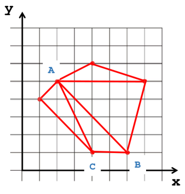

# 程序设计基础 E4 答案（2023秋）

## A 等腰直角三角形

### 题目

| 难度 | 考点 |
| --- | --- |
| 1 | 循环输出 |

#### 题目描述

三角形是最简单的多边形，而等边三角形是最美丽的三角形。学习 C 语言后，我们都迫不及待地想要在控制台上画出美丽的几何图形，可惜控制台上输出一个美观的等边三角形有点难度，那等腰直角三角形也不是不能接受……

请以输入的字符为三角形主体，输出一个边长为 $n$ 的、直角在右上方的等腰直角三角形。

#### 输入格式

一行，首先为一个字符 $c$ ，然后为一个整数 $n$ ，中间用一个空格隔开，保证 $c$ 为可打印字符。

#### 输出格式

以可打印字符 $c$ 为主体、边长为 $n$ 的、直角在右上方的等腰直角三角形。

#### 样例输入 1

```text
* 5
```

#### 样例输出 1

```text
*****
 ****
  ***
   **
    *
```

#### 样例输入 2

```text
0 3
```

#### 样例输出 2

```text
000
 00
  0
```

#### 数据范围

- $2 \le n \le 100$
- $c$ 为可打印字符

### 答案

### 题目分析

这题最终需要输出的字符由输入决定，可以使用 `getchar()` 函数读入这个字符，输出时使用 `putchar()` 函数将所需字符输出。

### 示例代码

```c
#include <stdio.h>
int main()
{
    int c, n, i, j;
    c = getchar();
    scanf("%d", &n);
    for (i = 0; i < n; i++)
    {
        for (j = 0; j < i; j++)
            putchar(' ');
        for (j = 0; j < n - i; j++)
            putchar(c);
        if (i != n - 1)
            putchar('\n');
    }
    return 0;
}
```

## B 从十进制数到2421码

### 题目

| 难度 | 考点 |
| --- | --- |
| 2 | 多组数据输入，判断结构 |

#### 题目描述

2421 码（又称 Aiken 码）是一种加权码，十进制数字 $0$ 到 $9$ 与它的对应关系如下：

| 十进制数字 | 2421 码 |
| --- | --- |
| 0 | 0000 |
| 1 | 0001 |
| 2 | 0010 |
| 3 | 0011 |
| 4 | 0100 |
| 5 | 1011 |
| 6 | 1100 |
| 7 | 1101 |
| 8 | 1110 |
| 9 | 1111 |

给定一个十进制大整数（位数非常多，`int` 与 `long long` 都无法存储），请输出它的 2421 码。

#### 输入格式

一个十进制大整数，读到文件结束为止。

#### 输出格式

把大整数的每一位替换成对应的 2421 码后依次输出，中间不添加任何分隔符。

#### 样例输入

```text
95
```

#### 样例输出

```text
11111011
```

#### 数据范围

- 大整数的位数不超过 $10^{6}$

### 答案

### 题目分析

$10^6$ 位的大整数，`int` 和 `long long` 均无法读入，因此需要使用其他方式处理这个大整数。注意到本题对于整数只需要一位一位地处理，因此可以逐位读入大整数的每一位数。与之前的身份证、AMI编码等题类似，可以用getchar、`"%c"`、`"%s"` 等多种方法读入，然后逐位处理。

### 示例代码

```c
#include <stdio.h>
int main()
{
    int n;
    while(scanf("%1d", &n) != EOF)
    //也可使用char c;scanf("%c", &c)或c=getchar()的结构
    //使用字符输入时，注意后面的0-9要对应改成'0'-'9'
    {
        switch(n)
        {
            case 0:
                printf("0000");
                break;
            case 1:
                printf("0001");
                break;
            case 2:
                printf("0010");
                break;
            case 3:
                printf("0011");
                break;
            case 4:
                printf("0100");
                break;
            case 5:
                printf("1011");
                break;
            case 6:
                printf("1100");
                break;
            case 7:
                printf("1101");
                break;
            case 8:
                printf("1110");
                break;
            case 9:
                printf("1111");
                break;
        }
    }
    return 0;
}
```

## C 摩卡与音游

### 题目

| 难度 | 考点 |
| --- | --- |
| 3 | 模拟、循环、分支 |

#### 题目描述

摩卡在打一首有 $n$ 个音符的曲子，每个音符的判定结果用一个字符给出：

| 字符 | 判定 | 得分 |
| --- | --- | --- |
| `p` | Perfect | 300 |
| `g` | Great | 208 |
| `b` | Bad | 105 |
| `m` | Miss | 0 |

连续获得 `p` 或 `g` 会累积连击数（combo），一旦出现 `b` 或 `m` 则连击数清零。

请输出总分、最大连击数，并给出评价：

- 若整首曲子没有出现 `p` 以外的判定，输出 `All Perfect!` ；
- 否则若最大连击数等于音符总数 $n$ ，输出 `Full Combo!` ；
- 否则输出 `Moca Complete!` 。

#### 输入格式

第一行一个正整数 $n$ 。

接下来 $n$ 个字符，依次表示每个音符的判定结果，字符之间用空白分隔。

#### 输出格式

共 3 行：第一行为总分，第二行为最大连击数，第三行为评价。

#### 样例输入

```text
4
p g b m
```

#### 样例输出

```text
613
2
Moca Complete!
```

### 答案

### 题目分析

这题是一道简单的模拟题，数据范围发现表现分最大只有 `6` 亿，所以 int 就可以。

需要我们考虑的有两件事：如何获得最大连击数，如何知道最后是 `All Perfect!`、`Full Combo!` 还是 `Moca Complete!`。

对于第一个问题，我们可以用一个变量 `maxCombo` 来维护最大连击数，这个变量的初值为 `0`；用 `combo` 维护当前的连击数，每当获得一个 `p` 或者 `g` 时，combo 数增加 `1`；每当获得一个 `b` 或者 `m` 时，combo 数变为 `0`，但在 combo 数变为 `0` 之前，我们需要判断一下这次的连击数是不是大于最大连击数，如果是的话则需要更新 `maxCombo`。这里需要注意的是如果只在断连时更新 `maxCombo`，那么曲子结束之前最后一次的连击数就无法被用来更新 `maxCombo` 了，这里我们需要注意一下。

第二个问题的解决方法是多样的，可以用 `maxCombo` 来判断是不是 `Moca Complete!`（如果 maxCombo 与总音符数不相等那么就是 `Moca Complete!`）；可以用一个标记来标记是否出现过 `g`，以此来判断是 `All Perfect!` 还是 `Full Combo!`。

### 示例代码

```c
#include <stdio.h>

int main()
{
    int n;
    int score = 0;
    int maxCombo = 0;
    int combo = 0;
    int ap = 1; // 如果为 1 ，证明没有出现过 ap 以外的字符

    char c;
    int a,b;
    scanf("%d",&n);
    for(int i = 1;i <= n;i++)
    {
        getchar();  // 处理换行符
        scanf("%c",&c);
        switch (c)
        {
            case 'p':
                combo++;
                score += 300;
                break;

            case 'g':
                combo++;
                ap = 0;
                score += 208;
                break;

            case 'b':
                score += 105;
                if(combo > maxCombo) maxCombo = combo;
                combo = 0;
                ap = 0;
                break;
            case 'm':
                if(combo > maxCombo) maxCombo = combo;
                combo = 0;
                ap = 0;
                break;
        }
    }
    if(combo > maxCombo) {
        maxCombo = combo;
    }

    printf("%d\n%d\n",score,maxCombo);
    if(ap == 1) {
        printf("All Perfect!");
    }
    else if(maxCombo == n) {
        printf("Full Combo!");
    }
    else {
        printf("Moca Complete!");
    }
    return 0;
}
```

你也可以利用 `switch` 的一些特性将代码写的更简洁一些，但是在这里我们将不会给出这样的代码，以免带偏同学们。

## D 水獭游戏

### 题目

| 难度 | 考点 |
| --- | --- |
| 4 | 模拟、循环 |

#### 题目描述

$n$ 只水獭围成一圈，编号为 $1$ 到 $n$ 。从编号 $1$ 的水獭开始依次报数 $1, 2, 3, \cdots$ ，报到 $k$ 的水獭被淘汰；随后从被淘汰水獭的下一只开始重新从 $1$ 报数。重复这个过程直到只剩一只水獭。

求最后存活的水獭编号。

#### 输入格式

一行两个正整数 $n, k$ 。

#### 输出格式

一行一个整数，表示最后存活的水獭编号。

#### 样例输入

```text
7 3
```

#### 样例输出

```text
4
```

#### 数据范围

- $n \le 1000$

### 答案

### 题目分析

这是一道模拟题，我们的任务就是模拟水獭报数淘汰的流程。

我们可以用 *alive* 表示当前存活的水獭数，当 *alive*（有存活的意思）变成 `1` 时，游戏结束，剩下的一只水獭获胜。我们用 *pos*（*position* 的缩写）表示当前正在报数的水獭，用 *num* 表示当前水獭应该报的数。每当一只水獭报数 $k$ 时，我们就应该淘汰这只水獭，所以我们用数组元素 $out_i$ 标记第 $i$ 只水獭是否被淘汰，每当遍历到一只被淘汰的水獭时，这只水獭不参与报数，我们直接跳过它。

最后，遍历整个 *out* 数组，没有被淘汰的水獭即为最后活着的水獭，获得胜利。

### 示例代码

```c
#include <stdio.h>

int out[1005]; // 表示每只水獭是否被淘汰，标记为 1 代表被淘汰

int main()
{
    int n,k;
    scanf("%d%d",&n,&k);

    int alive = n;  // 表示当前存活的水獭数
    int pos = 0;    // 表示当前报数的水獭编号
    int num = 0;    // 表示当前水獭应该报的号

    while(alive != 1) {
        pos++;
        if(pos == (n + 1))
            pos = 1;

        if(out[pos] == 1)
            continue;   // 这只水獭已经出局了

        num++;          // 水獭报数
        if(num == k) {
            out[pos] = 1; // 标记该水獭已经出局
            num = 0;    // 重置报数
            alive--;
        }
    }

    // 找到没被淘汰的一只水獭
    for(int i = 1;i <= n;i++){
        if(out[i] != 1) {
            printf("%d",i);
            break;
        }
    }

    return 0;
}
```

有同学反应要求增加一组 *hack* 数据，就是恰好是最后一只水獭存活，没想到真卡住了不少同学（，还有的同学加完这组数据之后 TLE 死循环了。

这道题其实就是著名的约瑟夫问题，在下学期的数据结构中大家还会与它见面。同时，除了循环模拟外，这道题还有一些效率更高的解法，感兴趣的同学可以搜索研究一下。

## E 小霁的时间乱流

### 题目

| 难度 | 考点 |
| --- | --- |
| 4 | 进制转换 |

#### 题目描述

小霁被卷入了时间乱流，她看到的时间可能是不合法的：分钟数可能达到 $60$ 甚至更大，小时数可能达到 $24$ 甚至更大，日期可能超过当月的天数，月份也可能超过 $12$ 。

请把乱流中的时间还原成正常时间：先由分钟向小时进位，再由小时向天进位，月份超过 $12$ 的部分向年份进位，最后按各月天数（闰年的二月为 $29$ 天）由天向月进位。能被 400 整除，或者能被 4 整除但不能被 100 整除的年份是闰年。

#### 输入格式

第一行一个正整数 $n$ ，表示数据组数。

接下来 $n$ 行，每行格式为 `y.m.d h:min` ，表示乱流中的时间。

#### 输出格式

共 $n$ 行，每行格式为 `yyyy.mm.dd hh:mm` ，年份占 4 位，其余各占 2 位，不足补前导零。

#### 样例输入

```text
2
2023.13.32 25:70
2024.2.30 0:0
```

#### 样例输出

```text
2024.02.02 02:10
2024.03.01 00:00
```

### 答案

### 题目分析

本题在分钟进位小时，小时进位天数较为简单。

但在天数进位月份时，需要考虑每月天数不同也需要考虑闰年的因素。

闰年的规定是“**能被400整除，或者能被4整除但不能被100整除的是闰年**”，转化为C语言就是 `((y % 4 == 0 && y % 100 != 0) || y % 400 == 0)`，如果该条件式成立，则y是闰年，反之不是闰年。

具体的乱流中的时间调整方式已在题目中详细给出，此处不再赘述。

### 示例代码

```c
#include<stdio.h>
int main()
{

    int months[13]={0,31,28,31,30,31,30,31,31,30,31,30,31};//定义每月天数
    int n;//数据组数
    int y,mon,d,h,min;//年、月、日、时、分
    int tempday;
    scanf("%d",&n);
    for (int i = 0; i < n; ++i) {
        scanf("%d.%d.%d %d:%d",&y,&mon,&d,&h,&min);//输入乱流中的时间
        h+=(min/60);
        min%=60;
        d+=(h/24);
        h%=24;//计算正常的小时数、分钟数，并向天数进位
        y += (mon - 1) / 12; mon = (mon - 1) % 12 + 1;//先将月份向年份进位
        tempday=months[mon]+(((y % 4 == 0 && y % 100 != 0) || y % 400 == 0)&&(mon==2));//计算当前的y和mon对应的当月天数
            //(((y % 4 == 0 && y % 100 != 0) || y % 400 == 0)&&(mon==2))用于判定当前的y和mon是否是闰年的2月，若条件式成立，则条件式的值为1，在28天的基础上加1天。
        while (d>tempday)//如果天数超过该月份的天数
        {
            d-=tempday;
            mon++;//天数减去该月天数，月份加一
            y += (mon - 1) / 12; mon = (mon - 1) % 12 + 1;//若月份大于12，则向年份进位
            tempday=months[mon]+(((y % 4 == 0 && y % 100 != 0) || y % 400 == 0)&&(mon==2));//计算当前的y和mon对应的当月天数
        }
        printf("%04d.%02d.%02d %02d:%02d\n",y,mon,d,h,min);
    }

}
```

## F 摩卡与幸运面包

### 题目

| 难度 | 考点 |
| --- | --- |
| 4 | 差分 |

#### 题目描述

摩卡有 $m$ 个排成一列的面包，初始时对每个面包的喜爱值都是 $0$ 。

接下来有 $n$ 次操作，每次操作给出三个整数 $l, r, x$ ，表示把编号在 $[l, r]$ 内的每个面包的喜爱值都增加 $x$ 。

所有操作结束后，求喜爱值不小于 $limit$ 的面包个数。

#### 输入格式

第一行三个正整数 $m, n, limit$ 。

接下来 $n$ 行，每行三个整数 $l, r, x$ 。

#### 输出格式

一行一个整数，表示喜爱值不小于 $limit$ 的面包个数。

#### 样例输入

```text
10 3 7
1 5 6
2 8 1
9 10 100
```

#### 样例输出

```text
6
```

### 答案

### 题目分析

在前面的多次比赛中，我们已经见到过前缀和的思想（如 `SP-S` 赌怪、`E3-H` 军乐团分组 以及本次的 `E4-J` 循环的能量块 都有所涉及），这道题介绍一种和它相对的策略，差分。

显然，如果我们用数组元素 $love_i$ 维护对第 $i$ 个面包的喜爱值，那么每次输入一组 $l, r, x$，我们需要将区间 $[l, r]$ 上的每一个面包喜爱值都增加 $x$，相当于操作了 $r - l + 1$ 个数；然而事实上，对于这一次操作，真正有用的信息就是**我们对区间 [l , r] 上每个面包的喜爱值加了 x**；而对于我们对第 $l$ 个面包的喜爱值增加了 $x$，我们对第 $l+1$ 个面包的喜爱值增加了 $x$， $\cdots$，我们对第 $r$ 个面包的喜爱值增加了 $x$，这样的表达无疑是重复的。

根据 Hint ，我们尝试计算一下样例数据每次差分数列和原数列的对应变化：

- **初始：**

  - **原数列**：0 0 0 0 0 0 0 0 0 0
  - **差分数列**：0 0 0 0 0 0 0 0 0 0

- **l = 1 , r = 5 , x = 6：**

  - **原数列**：6 6 6 6 6 0 0 0 0 0
  - **差分数列**：6 0 0 0 0 -6 0 0 0 0

- **l = 2 , r = 8 , x = 1：**

  - **原数列**：6 7 7 7 7 1 1 1 0 0
  - **差分数列**：6 1 0 0 0 -6 0 0 -1 0

- **l = 9 , r = 10 , x = 100：**

  - **原数列**：6 7 7 7 7 1 1 1 100 100
  - **差分数列**：6 1 0 0 0 -6 0 0 99 0

在上面的模拟过程中，我们可以回答 Hint 中的问题了：**每次操作，对差分数列的变化，只是 $d_l$ 增加 $x$， $d_r$ 减小 $x$，只进行了两步操作**，大家可以简单思考一下，或者用 Hint 中给出的公式推导一下，看看差分数列如此变化是不是对应着原数列的 $[l, r]$ 上的元素都增大 $x$。这就是我们所期待的我们只记录了**对区间 [ l , r ] 上每个面包的喜爱值加了 x** 这个信息，而没有多余的信息。我们用如此简单的两步操作，就记录了在原数列上如此繁琐的那么多操作！

最后，我们需要利用差分数列计算出原数列，这里只需要用一个元素 *sum* 保存差分数列前 $i$ 项的和，每次只需要让 *sum* 增加 $d_i$ 即可；这里注意一下有些同学每次把 *sum* 清空，从头开始重新计算 *sum* 的值，比如 *sum* 本来已经存了前三项和，下一次是求前四项和，然后有些同学把前三项和清空说我重新算一遍前四项和，这样显然做了许多无效工作，也会超时。

注意数据范围不会超出 int 。

### 示例代码

```c
#include <stdio.h>
int love[200005];
int main()
{
    int m,n,limit;
    scanf("%d%d%d",&m,&n,&limit);

    for(int i=1;i<=n;i++)
    {
        int l,r,x;
        scanf("%d%d%d",&l,&r,&x);
        love[l]+=x;
        love[r+1]-=x;   // 维护差分数组
    }

    int sum=0;
    int cnt=0;
    for(int i=1;i<=m;i++)
    {
        sum += love[i]; // sum 每次对应着原数组的第 i 个元素
        if(sum >= limit) cnt++;
    }
    printf("%d",cnt);
    return 0;
}
```

## G czx 学数学

### 题目

| 难度 | 考点 |
| --- | --- |
| 5 | 循环，数组 |

#### 题目描述

给定两个正整数 $a, b$ ，求 $\frac{a}{b}$ 的小数表示，并把其中循环出现的小数部分用括号括起来。

例如 $\frac{1}{6} = 0.1666\cdots$ ，其中 $1$ 是不循环部分， $6$ 是循环节，输出为 `0.1(6)` 。

#### 输入格式

一行两个正整数 $a, b$ 。

#### 输出格式

一行，先输出整数部分和一个小数点，接着输出不循环的小数部分，最后用一对括号把循环节括起来。

#### 样例输入

```text
1 6
```

#### 样例输出

```text
0.1(6)
```

### 答案

### 题目分析

模拟竖式计算除法的过程，当同一个数第二次作为被除数出现时，即可判断循环节的出现，且循环节的起点应为这个被除数第一次出现时对应的位置，终点为第二次出现时对应的的前一个位置。

在代码实现里，使用一个数组，结合数组下标来记录一个数是否在此前出现过以及相应的出现位置，再用一个 while 循环来进行运算即可。

### 示例代码

```c
#include <math.h>
#include <stdio.h>
int num[30005], ans[40005];
// num标记每个数是否成为过被除数，ans记录小数部分
int main() {
    int a, b, begin, end, t = 1;
    scanf("%d%d", &a, &b);
    printf("%d.", a / b); // 计算整数部分
    a %= b;
    a *= 10;
    int i = 0; // 记录当前小数位次
    while (num[a] == 0) {
        i++;
        num[a] = i;
        ans[i] = a / b;
        a %= b;
        a *= 10;
    }
    begin = num[a];
    end = i;
    int l = end - begin + 1;
    for (int j = 1; j < begin; j++)
        printf("%d", ans[j]);
    printf("(");
    for (int j = begin; j <= end; j++) {
        printf("%d", ans[j]);
    }
    printf(")\n");
    return 0;
}
```

## H 内部演出

### 题目

| 难度 | 考点 |
| --- | --- |
| 5 | 计算几何，辗转相除 gcd |

#### 题目描述

某演出场地是一块凸 $n$ 边形的地块，所有顶点的坐标都是整点，且按顺时针顺序给出。

由皮克定理可知，对于顶点都是整点的多边形，其内部整点个数 $a$ 与面积 $S$ 、边界上整点个数 $b$ 满足

$$2a = 2S - b + 2$$

请求出多边形内部的整点个数。

#### 输入格式

第一行一个正整数 $n$ ，表示顶点数。

接下来 $n$ 行，每行两个整数 $x_i, y_i$ ，按顺时针顺序给出每个顶点的坐标。

#### 输出格式

一行一个整数，表示多边形内部的整点个数。

#### 样例输入

```text
4
0 0
2 0
2 2
0 2
```

#### 样例输出

```text
1
```

### 答案

### 题目分析

这道题分成两个部分：求凸 $n$ 边形面积和求边上经过的整点数目。

**求凸 $n$ 边形面积：**

可以将其划分为 $n - 2$ 个三角形，由于保证了按顺时针顺序给出顶点坐标，因此只需选取第一个顶点为公共顶点，求余下的每两个相邻顶点与公共顶点构成的三角形面积之和（如下图）。



例如求图中三角形 $ABC$ 的面积 `S`，用 `abx` 和 `aby` 分别表示 $\overrightarrow{AB}$ 的横纵坐标，用 `acx` 和 `acy` 分别表示 $\overrightarrow{AC}$ 的横纵坐标（注意这里由于向量具有方向性，不要对这四个坐标本身取绝对值），于是就有：

```c
S=llabs(abx*acy-acx*aby)/2;
```

其中 `llabs` 是对 `long long` 型变量取绝对值的库函数，用法与 `abs` 同理（`abs` 是对 `int` 型变量取绝对值）。由于总面积有可能达到 $(2^{31}-1)^2$，超过 `int` 范围和 `double` 精度，因此要用 `long long`。同时由于 `S` 不一定是整数，但 `2*S` 一定是 `long long` 范围内的整数，因此不妨将 *Pick* 定理转化为：

$$
2 * a = 2 * S - b + 2
$$

**求边上经过整点数目：**

若向量 $\vec{m} = (x, y)$ 的顶点都为整点，则其边上经过整点（包括端点）数目为 $gcd(x, y) + 1$。由于这些边首位顺次连接，每个顶点都重复计算了一次，因此每次求出 $gcd$ 之后不必再 $+1$。

这里为了避免负数整除取模的一些问题，可以直接将 $x$ 与 $y$ 取绝对值。

### 示例代码

```c
#include<stdio.h>
#include<stdlib.h>
int main()
{
    int n,xa,ya,xb,yb,xc,yc,dx,dy,temp;
    long long abx,aby,acx,acy,ans=2;  //2*a=2*S-b+2,给ans赋初始值时别忘了这个+2

    scanf("%d",&n);
    scanf("%d%d",&xa,&ya);
    scanf("%d%d",&xb,&yb);
    dx=abs(xa-xb);  //n边形第一条边横向跨度
    dy=abs(ya-yb);  //n边形第一条边纵向跨度
    while(dy)
    {
        temp=dx%dy;
        dx=dy;
        dy=temp;
    }  //辗转相除法求gcd，最终dx即为所求
    ans-=dx;

    abx=(long long)(xa-xb);  //第一个三角形中向量AB横坐标
    aby=(long long)(ya-yb);  //第一个三角形中向量AB纵坐标

    for(int i=3;i<=n;i++)
    {
        scanf("%d%d",&xc,&yc);
        dx=abs(xb-xc);
        dy=abs(yb-yc);
        while(dy)
        {
            temp=dx%dy;
            dx=dy;
            dy=temp;
        }
        ans-=dx;

        acx=(long long)(xa-xc);  //当前求面积的三角形中向量AC横坐标
        acy=(long long)(ya-yc);  //当前求面积的三角形中向量AC横坐标
        ans+=llabs(abx*acy-acx*aby);  //面积的二倍

        xb=xc;
        yb=yc;  //进入到下一条边中
        abx=acx;
        aby=acy;  //进入到下一个三角形中
    }

    dx=abs(xa-xb);  //最后一条边再单独算一次
    dy=abs(ya-yb);
    while(dy)
    {
        temp=dx%dy;
        dx=dy;
        dy=temp;
    }
    ans-=dx;

    ans/=2;  //别忘了把ans除以2
    printf("%lld",ans);

}
```

## I 对称的 2k+1 进制

### 题目

| 难度 | 考点 |
| --- | --- |
| 5 | 平衡进制 |

#### 题目描述

平衡 $2k+1$ 进制是一种「对称」的进制：它的每一位数码取值范围是 $-k$ 到 $k$ ，而不是普通 $2k+1$ 进制的 $0$ 到 $2k$ 。数码用如下字符表示：

| 数码 | $-9$ | $-8$ | $\cdots$ | $-1$ | $0$ | $1$ | $\cdots$ | $9$ |
| --- | --- | --- | --- | --- | --- | --- | --- | --- |
| 字符 | `I` | `H` | $\cdots$ | `A` | `0` | `1` | $\cdots$ | `9` |

给定整数 $n$ 与正整数 $k$ ，输出 $n$ 的平衡 $2k+1$ 进制表示。

#### 输入格式

一行两个整数 $n, k$ 。

#### 输出格式

一行一个字符串，为 $n$ 的平衡 $2k+1$ 进制表示。若 $n = 0$ 则输出 `0` 。

#### 样例输入

```text
10 1
```

#### 样例输出

```text
101
```

### 答案

### 题目分析

类似于负进制的题目，可以先将数码存在一个字符数组中等待调用。对于平衡 $2k+1$ 进制，可以先将其转换为普通的 $2k+1$ 进制，再进行转换。

注意到普通 $2k+1$ 进制的数码是 $0$ 到 $2k$，平衡 $2k+1$ 进制的数码是 $-k$ 到 $k$。若一个数在转换前后的数码都在 $0$ 至 $k$ 内，则无需转换，因此转换的主要对象是大于 $k$ 的数码。对于普通 $2k+1$ 进制的数码 $m, m > k$，可以将这一位数转换为平衡进制数码 $(1(m - (2k+1)))_{2k+1}$，保持相等。对于整数内的运算，则可以类比，使用“整数位本身减 $2k+1$，高位进一”的方法，这样就实现了转换。

注意到平衡进制正负数只要数码取反即可，因此可将负数先化为正数，再逐位取相反数即可。

### 示例代码

```c
#include<stdio.h>
char s[20] = "IHGFEDCBA0123456789";
int ans[20], cnt;
int main() {
    int n, k;
    scanf("%d%d", &n, &k);
    if (n == 0) {
        printf("0\n");
    } else if (n > 0) {
        while (n > 0) {
            ans[cnt] = n % (2 * k + 1);
            n = n / (2 * k + 1);
            cnt++;
        }
        for (int i = 0; i <= cnt - 1; i++) {
            if (ans[i] >= k + 1) {
                ans[i] -= (2 * k + 1);
                ans[i + 1]++;
                if (i == cnt - 1)cnt++;
            }
        }
        for (int i = cnt - 1; i >= 0; i--) {
            printf("%c", s[9 + ans[i]]);
        }
    } else if (n < 0) {
        n = -n;
        while (n > 0) {
            ans[cnt] = n % (2 * k + 1);
            n = n / (2 * k + 1);
            cnt++;
        }
        for (int i = 0; i <= cnt - 1; i++) {
            if (ans[i] >= k + 1) {
                ans[i] -= (2 * k + 1);
                ans[i + 1]++;
                if (i == cnt - 1)cnt++;
            }
        }
        for (int i = cnt - 1; i >= 0; i--) {
            printf("%c", s[9 - ans[i]]);
        }
    }
    return 0;
}
```

## J 简单的能量块

### 题目

| 难度 | 考点 |
| --- | --- |
| 6 | 前缀和、单调队列 |

#### 题目描述

有 $n$ 个能量块首尾相连排成一个环，第 $i$ 个能量块蕴含的能量为 $a_i$ （可能为负数）。

你可以选择环上一段连续的能量块（可以跨越环的首尾），最多选择 $m$ 个，且至少选择 $1$ 个。求所能获得的最大能量之和。

#### 输入格式

第一行两个正整数 $n, m$ 。

第二行 $n$ 个整数 $a_1, a_2, \cdots, a_n$ 。

#### 输出格式

一行一个整数，表示最大能量之和。

#### 样例输入

```text
5 3
1 -2 3 -4 5
```

#### 样例输出

```text
6
```

### 答案

### 题目分析

这是一道循环的能量块问题，本质上是一个环形有限最大子序列问题（不过数据太弱了）

要解决环形问题，首先考虑拆链成环，即：将原来的 $n$ 个数复制一次，接到数列末尾，这样就可以处理子序列包含数列两端的问题。

接着考虑如何找到最大子序列，这里我们利用前缀和的知识： $\mathit{pre\_sum}[k] = \sum_{i=1}^{k} a[i]$

那么一段连续序列的和（假设下标从 $s$ 到 $t$）的值为 $\mathit{pre\_sum}[t] - \mathit{pre\_sum}[s-1]$.

对于以 $t$ 结尾的子序列， $\mathit{pre\_sum}[t]$ 是一个确定的值，那么要计算以 $t$ 结尾的最大子序列（记为 $ans[t]$），需要找到一个最小的 $\mathit{pre\_sum}[s-1]$，使得 $\mathit{pre\_sum}[t] - \mathit{pre\_sum}[s-1]$ 的值最大. 而最终答案一定在 $ans[t]$ 中. 所以如果不考虑 $m$ 的限制，只需要找到 $t$ 之前最小的 $\mathit{pre\_sum}[s-1]$ 即可。

但是考虑到最多选择 $m$ 个数，所以需要找到一种方法快速算出 $t-m \sim t-1$ 中最小的前缀和。这里用单调队列来维护一个单调递增的前缀和序列，每次加入一个新的数（ $\mathit{pre\_sum}[t-1]$），判断它与单调队列末尾的数（设为 $q[last]$）的大小，若小于等于 $q[last]$,则将 $q[last]$ 从队列中删除，直到末尾数小于 $\mathit{pre\_sum}[t-1]$ 或者队列已清空。这样更新的理由是：对于之后的数来说，若 $\mathit{pre\_sum}[t-1] \le q[last]$，那么 $\mathit{pre\_sum}[t-1]$ 一定是更优解（满足大小和位置更优）.同时，还应判断队列中的第一个数的位置是否小于 $t-m$,若小于，则应当删除.

简单说来，每次计算时该队列中的第一个数即为 $t-m \sim t-1$ 中最小的前缀和，通过变化指向队列头部的变量和指向队列后部的变量来维护队列的单调性，并且保证队列中的数合乎范围要求.

具体处理请阅读代码

### 示例代码

```c
#include<stdio.h>
#include<math.h>

int n,m;
int a[1000010];
long long pre_suma[2000010];//数组大小*2
int q[2000010];//单调队列，与题解稍有不同的是，q中储存的是a中的位置下标，将通过位置对应数值
int pre_p,bac_p;//队列头和队列尾

int main ()
{

    scanf("%d%d",&n,&m);
    m = fmin(m,n);//注意判断m与n的大小，除了不超过容积m，还应不超过n
    for(int i = 1;i <= n;++ i)
    {
        scanf("%d",&a[i]);
        pre_suma[i] = pre_suma[i - 1] + (long long)a[i];//计算前缀和，数据范围可能超过int
    }

    for(int i = n + 1;i <= 2 * n;++ i)
        pre_suma[i] = pre_suma[i - 1] + (long long)a[i - n];//前缀和加倍
    long long ans = -1e15;//初始化最终答案，由于必须选择一个能量块，需要考虑最大值为负数的情况
    for(int i = 1;i <= 2 * n;++ i)
    {
        while(i - q[pre_p] > m)
        {
            pre_p ++;
        }//如果q的队列头位置超出范围，那么指向头部的变量移动到下一个位置
        ans = fmax(ans,pre_suma[i] - pre_suma[q[pre_p]]);//更新ans，令其与以i结尾的最大子序列作比较
        while(pre_suma[i] <= pre_suma[q[bac_p]] && bac_p >= pre_p) bac_p --;//维护单调递增的序列
        q[++ bac_p] = i;//将第i个位置加入队列
    }
    printf("%lld",ans);
}
```

- End -

## 我的代码

### A

```cpp
#include<stdio.h>
#include<math.h>
#include<string.h>
int max(int a,int b)
{
   if(a>b)return a;
   return b;
}
int min(int a,int b)
{
   if(a<b)return a;
   return b;
}
void swap(int a,int b)
{
   int t=a;
   a=b;
   b=t;
}
int gcd(int a,int b)
{
   if(b==0)return a;
   return gcd(b,a%b);
}
int abs(int a)
{
   if(a>=0)return a;
   else return -a;
}
int main()
{
   char ch;
   int n;
   scanf("%c%d",&ch,&n);
   for(int i=1;i<=n;i++)
   {
         for(int j=1;j<i;j++)printf(" ");
         for(int j=i;j<=n;j++)printf("%c",ch);
         printf("\n");
   } 
   return 0;
}
```

### B

```cpp
#include<stdio.h>
#include<math.h>
#include<string.h>
int max(int a,int b)
{
   if(a>b)return a;
   return b;
}
int min(int a,int b)
{
   if(a<b)return a;
   return b;
}
void swap(int a,int b)
{
   int t=a;
   a=b;
   b=t;
}
int gcd(int a,int b)
{
   if(b==0)return a;
   return gcd(b,a%b);
}
int abs(int a)
{
   if(a>=0)return a;
   else return -a;
}
int main()
{
   char ch;
   while(scanf("%c",&ch)!=EOF)
   {
         if(ch=='0')printf("0000");
         if(ch=='1')printf("0001");
         if(ch=='2')printf("0010");
         if(ch=='3')printf("0011");
         if(ch=='4')printf("0100");
         if(ch=='5')printf("1011");
         if(ch=='6')printf("1100");
         if(ch=='7')printf("1101");
         if(ch=='8')printf("1110");
         if(ch=='9')printf("1111");
   }
   return 0;
}
```

### C

```cpp
#include<stdio.h>
#include<math.h>
#include<string.h>
int max(int a,int b)
{
   if(a>b)return a;
   return b;
}
int min(int a,int b)
{
   if(a<b)return a;
   return b;
}
void swap(int a,int b)
{
   int t=a;
   a=b;
   b=t;
}
int gcd(int a,int b)
{
   if(b==0)return a;
   return gcd(b,a%b);
}
int abs(int a)
{
   if(a>=0)return a;
   else return -a;
}
int main()
{
   int n,flag=0,score=0,combo=0,mostcombo=0;
   char ch;
   scanf("%d",&n);getchar();
   for(int i=1;i<=n;i++)
   {
         scanf("%c",&ch);
         getchar();
         if(ch=='p')
      {
         score+=300;
         combo++;
         if(combo>mostcombo)mostcombo=combo;
      }
         if(ch=='g')
         {
              score+=208;
              combo++;
              if(combo>mostcombo)mostcombo=combo;
              if(flag==0)flag=1;
      }
      if(ch=='b')
      {
           score+=105;
           flag=2;
           if(combo>mostcombo)mostcombo=combo;
           combo=0;
      }
      if(ch=='m')
      {
           flag=2;
           if(combo>mostcombo)mostcombo=combo;
           combo=0;
      }
   }
   printf("%d\n%d\n",score,mostcombo);
   if(flag==0)printf("All Perfect!");
   if(flag==1)printf("Full Combo!");
   if(flag==2)printf("Moca Complete!");
   return 0;
}
```

### D

```cpp
#include<stdio.h>
#include<math.h>
#include<string.h>
int max(int a,int b)
{
   if(a>b)return a;
   return b;
}
int min(int a,int b)
{
   if(a<b)return a;
   return b;
}
void swap(int a,int b)
{
   int t=a;
   a=b;
   b=t;
}
int gcd(int a,int b)
{
   if(b==0)return a;
   return gcd(b,a%b);
}
int abs(int a)
{
   if(a>=0)return a;
   else return -a;
}
int flag[1005];
int main()
{
   int n,k;
   scanf("%d%d",&n,&k);
   int tot=n,num=0,i=0;
   while(tot>1)
   {
         num++;i++;
         if(i>n)i=1; 
         while(flag[i])
         {
              i++;
              if(i>n)i=1;
      }
         if(num==k)
         {
              num=0;
              flag[i]=1;
              tot--;
      }
   }
   for(i=1;i<=n;i++)
      if(!flag[i])printf("%d",i);
   return 0;
}
```

### E

```cpp
#include<stdio.h>
#include<math.h>
#include<string.h>
int max(int a,int b)
{
   if(a>b)return a;
   return b;
}
int min(int a,int b)
{
   if(a<b)return a;
   return b;
}
void swap(int a,int b)
{
   int t=a;
   a=b;
   b=t;
}
int gcd(int a,int b)
{
   if(b==0)return a;
   return gcd(b,a%b);
}
int abs(int a)
{
   if(a>=0)return a;
   else return -a;
}
int main()
{
   int n,year,month,day,hour,minute;
   scanf("%d",&n);
   for(int i=1;i<=n;i++)
   {
         scanf("%d.%d.%d %d:%d",&year,&month,&day,&hour,&minute);
         if(minute>=60)
         {
              minute-=60;
              hour++;
      }
      if(hour>=24)
      {
           day+=hour/24;
           hour%=24;
      }
      if(month>12)
      {
           year+=(month-1)/12;
           month-=(month-1)/12*12;
      }
      if(month==1)
         if(day>31)
           {
               day-=31;
               month++;
         }
      if(month==2)
      {
           if(day>28)
           {
            if(day>28)
              {
               if(((year%4==0&&year%100!=0)||year%400==0)&&year%3200!=0)
               {
                   if(day>29)
                  {
                     day-=29;
                        month++;
                  }
               }
               else
               {
                  day-=28;
                  month++;
               }
            }
         }
      }
      if(month==3)
         if(day>31)
           {
               day-=31;
               month++;
         }
      if(month==4)
         if(day>30)
           {
               day-=30;
               month++;
         }
      if(month==5)
         if(day>31)
           {
               day-=31;
               month++;
         }
      if(month==6)
         if(day>30)
           {
               day-=30;
               month++;
         }
      if(month==7)
         if(day>31)
           {
               day-=31;
               month++;
         }
      if(month==8)
         if(day>31)
           {
               day-=31;
               month++;
         }
      if(month==9)
         if(day>30)
           {
               day-=30;
               month++;
         }
      if(month==10)
         if(day>31)
           {
               day-=31;
               month++;
         }
      if(month==11)
         if(day>30)
           {
               day-=30;
               month++;
         }
      if(month==12)
         if(day>31)
           {
               day-=31;
               month++;
         }
      if(month>12)
      {
           month%=12;
           year++;
           if(month==1)
            if(day>31)
              {
                  day-=31;
                  month++;
            }
         if(month==2)
         {
              if(day>28)
              {
               if(((year%4==0&&year%100!=0)||year%400==0)&&year%3200!=0)
               {
                   if(day>29)
                  {
                     day-=29;
                        month++;
                  }
               }
               else
               {
                  day-=28;
                  month++;
               }
            }
         }
      }
      printf("%d.",year);
      if(month<10)printf("0%d.",month);
      else printf("%d.",month);
      if(day<10)printf("0%d ",day);
      else printf("%d ",day);
      if(hour<10)printf("0%d:",hour);
      else printf("%d:",hour);
      if(minute<10)printf("0%d\n",minute);
      else printf("%d\n",minute);
   }
   return 0;
}
```

### F

```cpp
#include<stdio.h>
#include<math.h>
#include<string.h>
int max(int a,int b)
{
   if(a>b)return a;
   return b;
}
int min(int a,int b)
{
   if(a<b)return a;
   return b;
}
void swap(int a,int b)
{
   int t=a;
   a=b;
   b=t;
}
int gcd(int a,int b)
{
   if(b==0)return a;
   return gcd(b,a%b);
}
int abs(int a)
{
   if(a>=0)return a;
   else return -a;
}
int d[200005];
int main()
{
   int n,m,limit,l,r,x,ans=0;
   long long sum=0;
   scanf("%d%d%d",&n,&m,&limit);
   for(int i=1;i<=m;i++)
   {
         scanf("%d%d%d",&l,&r,&x);
         d[l]+=x;d[r+1]-=x;
   }
   for(int i=1;i<=n;i++)
   {
         sum+=d[i];
         if(sum>=limit)ans++;
   }
   printf("%d",ans);
   return 0;
}
```

### G

```cpp
#include<stdio.h>
#include<math.h>
#include<string.h>
int max(int a,int b)
{
   if(a>b)return a;
   return b;
}
int min(int a,int b)
{
   if(a<b)return a;
   return b;
}
void swap(int a,int b)
{
   int t=a;
   a=b;
   b=t;
}
int gcd(int a,int b)
{
   if(b==0)return a;
   return gcd(b,a%b);
}
int abs(int a)
{
   if(a>=0)return a;
   else return -a;
}
int c[5005],r[5005];
int main()
{
   int a,b;
   scanf("%d%d",&a,&b);
   int GCD=gcd(a,b);
   a/=GCD;
   b/=GCD;
   if(b==1)
   {
      printf("%d.(0)",a);
      return 0;
   }
   printf("%d.",a/b);
   int res=a%b,len=0,flag=0,str,ans;
   while(!flag)
   {
         ans=res*10/b;
      res=res*10%b;
      for(int i=1;i<=len;i++)
         {
              if(ans==c[i]&&res==r[i])
              {
                  flag=1;
                  str=i;
                  break;
         }
      }
      len++;
      c[len]=ans;r[len]=res;
   }
   for(int i=1;i<str;i++)printf("%d",c[i]);
   printf("(");
   for(int i=str;i<len;i++)printf("%d",c[i]);
   printf(")");
   return 0;
}
```

### H

```cpp
#include<stdio.h>
#include<math.h>
#include<string.h>
int max(int a,int b)
{
   if(a>b)return a;
   return b;
}
int min(int a,int b)
{
   if(a<b)return a;
   return b;
}
void swap(int a,int b)
{
   int t=a;
   a=b;
   b=t;
}
long long gcd(long long a,long long b)
{
   if(b==0)return a;
   return gcd(b,a%b);
}
long long abs(long long a)
{
   if(a>=0)return a;
   else return -a;
}
int main()
{
   long long n,x0,y0,x1,y1,x2,y2,s=0,b,ans,a1,b1,a2,b2,c1,c2;
   scanf("%lld",&n);
   scanf("%lld%lld",&x0,&y0);
   scanf("%lld%lld",&x1,&y1);
   b=n;
   c1=abs(x1-x0);c2=abs(y1-y0);
   b+=gcd(c1,c2)-1;
   for(int i=3;i<=n;i++)
   {
         scanf("%lld%lld",&x2,&y2);
         a1=x1-x0;b1=y1-y0;
         a2=x2-x0;b2=y2-y0;
         c1=abs(x1-x2);c2=abs(y1-y2);
         s+=abs(a1*b2-a2*b1);
         b+=gcd(c1,c2)-1;
         x1=x2;y1=y2;
   }
   c1=abs(x2-x0);c2=abs(y2-y0);
   b+=gcd(c1,c2)-1;
   ans=(s-b)/2+1;
   printf("%lld",ans);
   return 0;
}
```
