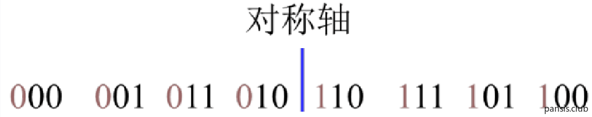

# 程序设计基础 E5 答案（2023秋）

## 题解

### A 无幂之幂

#### 题目

| 考点 | 难度 |
| --- | --- |
| 函数 | 1 |

#### 题目描述

给定若干组整数 $a, b$ ，对每组数据求 $|a^b - b^a|$ 。

本题禁止在提交的代码中出现 `math.h` 、 `pow` 、 `abs` 这三个字符串，因此不能调用 `math.h` 中的 `pow` 与 `fabs` 、 `stdlib.h` 中的 `abs` ，需要自己实现乘方与取绝对值。

#### 输入格式

多组数据输入，每组数据为一行两个整数 $a, b$ ，读到文件结束为止。

#### 输出格式

对每组数据输出一行一个整数，为 $|a^b - b^a|$ 。

#### 样例输入

```text
2 5
5 2
```

#### 样例输出

```text
7
7
```

#### 答案

#### 题目分析

如题目描述，由于禁止在代码中出现 `math.h`, `pow`, `abs` 这三个字符串，因此我们不调用 `math.h` 库中的 `pow` 函数和 `fabs` 函数，以及 `stdlib.h` 中的 `abs` 函数，而是自己声明函数用于计算。注意不仅是不能调用这几个函数，代码别的地方同样不能含有以上内容(例如不能声明函数名为 `Mypow`，不能声明变量名为 `power`)。

```c
int myPow(int a, int b) {
    int ans = 1;
    for (int i = 0; i < b; i++) {
        ans = ans * a;
    }
    return ans;
}
int myAbs(int a) {
    if (a >= 0) {
        return a;
    } else {
        return -a;
    }
}
```

如果使用三目运算符和宏定义的话，`myAbs` 也可以写成如下形式

```c
#define myAbs(a) ((a) > 0 ? (a) : (-(a)))
```

注意这些括号的使用，因为使用宏定义本质上是进行文本的替换，若不加上括号那么替换后的文本的运算顺序可能与你预期不相符，例如可以试试以下代码

```c
#include <stdio.h>
#define myAbs(a) a > 0 ? a : -a
int main(void) {
    printf("%d", myAbs(1 - 3));
    return 0;
}
```

你会发现运行结果为 `-4`

在这个代码中，将 `myAbs(1 - 3)` 进行文本替换后得到的结果是

```c
1 - 3 > 0 ? 1 - 3 : - 1 - 3
```

也即

```c
-2 > 0 ? -2 : -4
```

这显然与我们所期望的效果不同，因此需要加上括号来矫正运算顺序。

<!-- markdownlint-disable-next-line MD036 -->
*如果真的一定要使用库函数的话，也不是不可以，绕过字符串匹配的方法有很多，例如使用标记粘贴运算符*

```c
#define A(x) fab##s(x)
#define P(a,b) po##w(a,b)
```

<!-- markdownlint-disable-next-line MD036 -->
*以及使用宏延续运算符*

```c
#define H <math\
.h>
#define F po\
w
#define A fab\
s
```

#### 示例代码

```c
#include <stdio.h>
#define myAbs(a) ((a) > 0 ? (a) : (-(a)))
int myPow(int a, int b) {
    int ans = 1;
    for (int i = 0; i < b; i++) {
        ans = ans * a;
    }
    return ans;
}
int main(void) {
    int a, b;
    while (scanf("%d%d", &a, &b) != EOF) {
        printf("%d\n", myAbs(myPow(a, b) - myPow(b, a)));
    }
    return 0;
}
```

### B 阶阶乘乘

#### 题目

| 难度 | 考点 |
| --- | --- |
| 2 | 函数，模运算 |

#### 题目描述

定义 $f(n) = (n!) \bmod (10^9 + 7)$ 。

给定 $n$ ，求 $f(f(n))$ 。

#### 输入格式

多组数据输入，每组数据为一个正整数 $n$ ，读到文件结束为止。

#### 输出格式

对每组数据输出一行一个整数，为 $f(f(n))$ 。

#### 样例输入

```text
3
10
```

#### 样例输出

```text
720
107621982
```

#### 数据范围

- $n \le 10$

#### 答案

#### 题目分析

设函数 $f(n) = (n!) \bmod (10^9 + 7)$， $f(f(n))$ 就是我们要求的答案。

注意，由于 $n \le 10$， $n! \le 10! = 3628800 < 10^9 + 7$，因此在 $n \le 10$ 的时候 $f(n) = n!$。因此我们才能直接将 $f(n)$ 的值作为参数再次传入函数 $f$ 中。如果模数换为一个不大于 3628800 的数，那这种做法就错了。如若模数为 11， $(4!)! \bmod 11 = 24! \bmod 11 = 0$，然而 $f(4) = 4! \bmod 11 = 24 \bmod 11 = 2, f(f(4)) = f(2) = 2$，就错误了。

#### 示例代码

```c
#include <stdio.h>
const int mod = 1000000007;
int f(int n)
{
    long long ans = 1;
    for(int i = 1; i <= n; ++i)
        ans = ans * i % mod;
    return ans;
}
int main()
{
    int n;
    while(~scanf("%d", &n))
        printf("%d\n", f(f(n)));
    return 0;
}
```

### C 朗伯W函数

#### 题目

| 难度 | 考点 |
| --- | --- |
| 3 | 二分法求函数零点 |

#### 题目描述

朗伯 W 函数 $W(x)$ 是函数 $y e^y$ 的反函数，即 $W(x)$ 是方程

$$y e^y = x$$

的解。

给定 $x$ ，求 $W(x)$ 的值。

#### 输入格式

一行一个实数 $x$ 。

#### 输出格式

一行一个实数，为 $W(x)$ ，保留 6 位小数。

#### 样例输入

```text
1
```

#### 样例输出

```text
0.567143
```

#### 答案

#### 题目分析

很简单的二分法求解单调函数零点，初始化 $l = -1$， $r = 10$， $eps$ 选用 $1e-8$，定义函数 $f$，补全 Hint 中给出的代码模板即可。具体实现见示例代码。

#### 示例代码

```c
#include <stdio.h>
#include <math.h>
#define eps 1e-8
double f(double x)
{
    return x * exp(x);
}
int main()
{
    double x;
    scanf("%lf", &x);
    double l = -1, r = 10, mid = 4.5;
    while(r - l > eps)
    {
        if(f(mid) > x)
            r = mid;
        else
            l = mid;
        mid = (l + r) / 2;
    }
    printf("%.6lf", mid);
    return 0;
}
```

### D - 经典的三角形

#### 题目

| 难度 | 考点 |
| --- | --- |
| 3 | 函数 |

#### 题目描述

给定 10 个正整数 $a_1, a_2, \cdots, a_{10}$ 作为线段长度，需要回答 7 个问题。第 $i$ 个问题取出三条线段，判断它们能否构成三角形；若能，再判断三角形的形状：

- 最大角是锐角、直角还是钝角，分别输出 `acute triangle` 、 `right triangle` 、 `obtuse triangle` ；
- 是等边三角形则输出 `equilateral triangle` ，是（不含等边的）等腰三角形则输出 `isosceles triangle` 。

7 个问题取用的线段依次是：

| 问题 | 三条线段 |
| --- | --- |
| 1 | $a_1, a_5, a_9$ |
| 2 | $a_2, a_7, a_{10}$ |
| 3 | $a_2, a_3, a_6$ |
| 4 | $a_8, a_9, a_{10}$ |
| 5 | $a_6, a_7, a_{10}$ |
| 6 | $a_3, a_4, a_8$ |
| 7 | $a_1, a_2, a_6$ |

若三条线段无法构成三角形，则只输出 `no triangle` 。

#### 输入格式

一行 10 个正整数 $a_1, a_2, \cdots, a_{10}$ 。

#### 输出格式

对每个问题先输出一行 `Question i:` （ $i$ 从 1 到 7 ），随后按上述规则输出判断结果，每个结果占一行。

#### 样例输入

```text
3 4 5 6 4 3 4 5 3 4
```

#### 样例输出

```text
Question 1:
acute triangle
isosceles triangle
Question 2:
acute triangle
equilateral triangle
Question 3:
right triangle
Question 4:
right triangle
Question 5:
acute triangle
isosceles triangle
Question 6:
acute triangle
isosceles triangle
Question 7:
acute triangle
isosceles triangle
```

#### 答案

#### 题目分析

首先筛选出最大的边，将其换到 $a$ 边。然后利用三角形 $a^2 + b^2$ 与 $c^2$ 的关系，判断三角形最大角的形状，接着再用三条边的长度判断等腰性。

将以上思路封装成一个函数，按题目要求的顺序调用即可。

#### 示例代码

```c
#include <stdio.h>
void triangle(int i, int a, int b, int c) {
    printf("Question %d:\n", i);
    if(b > a && b > c) {
        int t = a; a = b, b = t;
    }
    if(c > a && c > b) {
        int t = a; a = c, c = t;
    }

    if(b + c <= a) {
        printf("no triangle\n");
        return ;
    }

    if(b * b + c * c > a * a)
        printf("acute triangle\n");
    else if(b * b + c * c == a * a)
        printf("right triangle\n");
    else printf("obtuse triangle\n");

    if(a == b && a == c)
        printf("equilateral triangle\n");
    else if(b == c || a == b || a == c)
        printf("isosceles triangle\n");
}
int main() {
    int a[15];
    for(int i = 1; i <= 10; i ++)
        scanf("%d", &a[i]);
    triangle(1, a[1], a[5], a[9]);
    triangle(2, a[2], a[7], a[10]);
    triangle(3, a[2], a[3], a[6]);
    triangle(4, a[8], a[9], a[10]);
    triangle(5, a[6], a[7], a[10]);
    triangle(6, a[3], a[4], a[8]);
    triangle(7, a[1], a[2], a[6]);
    return 0;
}
```

### E 计算不确定度

#### 题目

| 难度 | 考点 |
| --- | --- |
| 3 | 循环，浮点数，计算 |

#### 题目描述

在物理实验中，对同一个物理量重复测量 $n$ 次得到 $x_1, x_2, \cdots, x_n$ 。其最佳估计值为算术平均值

$$avg = \frac{1}{n}\sum_{i=1}^{n} x_i$$

A 类标准不确定度为

$$u = \sqrt{\frac{1}{n(n-1)}\sum_{i=1}^{n}(x_i - avg)^2}$$

给定 $n$ 次测量的数据，求 $avg$ 与 $u$ 。

#### 输入格式

第一行一个正整数 $n$ 。

第二行 $n$ 个实数 $x_1, x_2, \cdots, x_n$ 。

#### 输出格式

两行，第一行为 $avg$ ，第二行为 $u$ ，均保留 6 位小数。

#### 样例输入

```text
5
1 2 3 4 5
```

#### 样例输出

```text
3.000000
0.707107
```

#### 答案

#### 题意分析

<!-- markdownlint-disable-next-line MD036 -->
*很建议做一份计算不确定度的代码保存起来，能用excel之类的做就更好了，做基物实验的时候真的用得上*

根据题意进行计算。注意要将所有数据读入后计算得到的 $avg$ 才是正确的 $avg$

#### 示例代码

```c
#include <math.h>
#include <stdio.h>
int main(void) {
    double data[1000], avg = 0, u = 0;
    int n = 0;
    scanf("%d", &n);
    for (int i = 0; i < n; i++) {
        scanf("%lf", &data[i]);
        avg += data[i];
    }
    avg /= n;
    for (int i = 0; i < n; i++) {
        u += (data[i] - avg) * (data[i] - avg);
    }
    u = sqrt(u / n / (n - 1));
    printf("%.6f\n%.6f", avg, u);
    return 0;
}
```

### F 哪吒的水题

#### 题目

| 难度 | 考点 |
| --- | --- |
| 4 | 二分法、三分法 |

#### 题目描述

Simon 家与哪吒家分别位于 $(x_1, y_1)$ 与 $(x_2, y_2)$ ，两家的横坐标满足 $x_1 < x_2$ 。现在要在 $x$ 轴上（横坐标为 $x$ ， $x_1 \le x \le x_2$ ）修建一个供水站。

铺设管道到 Simon 家的单位长度费用为 $s_1$ ，到哪吒家的单位长度费用为 $s_2$ ，总费用为

$$s(x) = s_1\sqrt{(x-x_1)^2 + y_1^2} + s_2\sqrt{(x-x_2)^2 + y_2^2}$$

求使总费用最小的供水站横坐标 $x$ ，以及此时的最小总费用。

#### 输入格式

一行 6 个实数 $x_1, y_1, x_2, y_2, s_1, s_2$ 。

#### 输出格式

一行两个实数，分别为最优横坐标 $x$ 与最小总费用 $s(x)$ ，均保留 3 位小数，用空格分隔。

#### 样例输入

```text
0 1 4 2 1 2
```

#### 样例输出

```text
2.926 7.632
```

#### 答案

#### 题目分析

设供水站横坐标为 $x$，则供水站到 $Simon$ 家 $(x_1, y_1)$ 的距离为 $\sqrt{(x-x_1)^2 + y_1^2}$，到哪吒家 $(x_2, y_2)$ 距离为 $\sqrt{(x-x_2)^2 + y_2^2}$，因此总费用

$$s(x) = s_1\sqrt{(x-x_1)^2 + y_1^2} + s_2\sqrt{(x-x_2)^2 + y_2^2}.$$

显然，供水站最佳位置的横坐标在区间 $[x_1, x_2]$ 中，我们要在该区间内找到一个合适的 $x$ 使得 $s(x)$ 最小，并输出此时的 $x$ 和 $s(x)$.

#### 法一：二分法

求函数极值点可以使用求导函数零点的方法。

$s(x)$ 是关于 $x$ 的先减后增函数， $s'(x) = s_1 \frac{x-x_1}{\sqrt{(x-x_1)^2+y_1^2}} + s_2 \frac{x-x_2}{\sqrt{(x-x_2)^2+y_2^2}}$，一般情况下**先负后正**，在区间 $[x_1, x_2]$ 上只有一个零点，可以用**二分法**求该导函数零点。

#### 示例代码

```c
#include <stdio.h>
#include <math.h>
//math.h库中有个函数名字叫y1，如果声明全局变量的话不能被命名为y1，奇怪的事情发生了
#define eps (1e-8)
int main()
{
    double a, b, c, d, s1, s2; //a, b, c, d分别为x1, y1, x2, y2
    scanf("%lf%lf%lf%lf%lf%lf", &a, &b, &c, &d, &s1, &s2);
    double l = a, r = c, mid = (l + r) / 2;
    double dis1, dis2, f, s; //分别记录距离1，距离2，s'(x)的值，s(x)的值
    while(r - l > eps) {
        dis1 = sqrt((mid - a) * (mid - a) + b * b);
        dis2 = sqrt((mid - c) * (mid - c) + d * d);
        f = s1 * (mid - a) / dis1 + s2 * (mid - c) / dis2; //计算s'(mid)
        if(f > 0) //若导函数s'(mid)>0
            r = mid; //此时供水站只可能在区间[l, mid]上，更新r = mid
        else
            l = mid; //此时供水站只可能在区间[mid, r]上，更新l = mid
        mid = (l + r) / 2; //更新mid
    }
    //此时l, mid, r之间的差小于eps，一定精度范围下可视为相等，均为满足要求的供水站横坐标
    dis1 = sqrt((mid - a) * (mid - a) + b * b);
    dis2 = sqrt((mid - c) * (mid - c) + d * d);
    s = s1 * dis1 + s2 * dis2; //计算s(mid)
    printf("%.3f %.3f", mid, s); //输出mid, s(mid)
    return 0;
}
```

但如果 $s(x)$ 并不是一个方便求导的函数，我们仍想求极值点，该如何做呢？

#### 法二：三分法

易知 $s(x)$ 一般情况下是关于 $x$ 的**先减后增函数**，可以选择使用**三分法**求该函数极小值点。

三分法类似二分法，可以用于求**单峰函数**的**极值点**，下面以本题为例对其思路做简单说明。

设极小值点为 $(x_0, s(x_0))$. 初始化 $l = x_1, r = x_2$，每次循环，在区间 $[l, r]$ 中选择两个点 $mid1 < mid2$，如区间 $[l, r]$ 的三等分点 $mid1 = \frac{2l+r}{3}, mid2 = \frac{l+2r}{3}$。如果 $s(mid1) > s(mid2)$ 则说明 $x_0$ 在区间 $[mid1, r]$ 中（若在 $[l, mid1]$ 中，则说明 $s(x)$ 在 $[x_0, r]$ 上单调递增，与 $s(mid1) > s(mid2)$ 矛盾），更新 $l = mid1$；否则说明 $x_0$ 在区间 $[l, mid2]$ 中，更新 $r = mid2$。每次循环缩小区间长度为原来的 $\frac{2}{3}$，当 $r - l$ 缩小到足够小时，即可得到满足精度要求的答案。

<!-- markdownlint-disable-next-line MD024 -->
#### 示例代码

```c
#include <stdio.h>
#include <math.h>
#define eps (1e-8)
//s函数用到了很多次，利用宏定义简化代码，在之后学了函数后可以将s(x)定义为函数
#define s(x) (s1 * sqrt((x - a) * (x - a) + b * b) + s2 * sqrt((x - c) * (x - c) + d * d))
int main()
{
    double a, b, c, d, s1, s2;
    scanf("%lf%lf%lf%lf%lf%lf", &a, &b, &c, &d, &s1, &s2);
    double l = a, r = c, mid1 = (2 * l + r) / 3, mid2 = (l + 2 * r) / 3;
    while(r - l > eps) {
        if(s(mid1) > s(mid2)) l = mid1; //此时供水站只可能在区间[mid1, r]上，更新l=mid1
        else r = mid2; //此时供水站只可能在区间[l, mid2]上，更新r=mid2
        mid1 = (2 * l + r) / 3; //更新mid1
        mid2 = (l + 2 * r) / 3; //更新mid2
    }
    //此时l, mid1, mid2, r之间差小于eps，一定精度范围下可视为相等，均为满足要求的供水站横坐标
    printf("%.3f %.3f", mid1, s(mid1)); //输出mid1, s(mid1)
    return 0;
}
```

#### 补充

1. 两种方法时间复杂度均为 $O(log(\frac{x_2-x_1}{eps}))$.
2. 二分法适用于求**先正后负**或**先负后正**的**函数的零点**，三分法适用于求**先减后增**或**先增后减**的**函数的极值点**。特殊情况下，函数可能为单增函数或者单减函数，但是不影响做法的正确性。
3. 三分法选取 $mid1, mid2$ 时，选择区间的三等分点可以使每次循环缩小区间长度为原来的 $\frac{2}{3}$，如果选择靠近区间中点的两个点，可以使每次循环缩小区间长度接近原来的 $\frac{1}{2}$。

```c
mid1 = (l + r) / 2 - eps;
//mid1 = (5001 * l + 5000 * r) / 10001;
mid2 = (l + r) / 2 + eps;
//mid2 = (5000 * l + 5001 * r) / 10001;
```

但注意避免死循环，这里的eps数量级要小于循环条件中的eps。

<!-- markdownlint-disable-next-line MD024 -->
#### 示例代码

```c
#include <stdio.h>
#include <math.h>
#define eps1 (1e-6)
#define eps2 (1e-8) //eps2数量级要小于eps1
#define s(x) (s1 * sqrt((x - a) * (x - a) + b * b) + s2 * sqrt((x - c) * (x - c) + d * d))
int main()
{
    double a, b, c, d, s1, s2;
    scanf("%lf%lf%lf%lf%lf%lf", &a, &b, &c, &d, &s1, &s2);
    double l = a, r = c, mid1 = (l + r) / 2 - eps2, mid2 = (l + r) / 2 + eps2;
    while(r - l > eps1) {
        if(s(mid1) > s(mid2)) l = mid1;
        else r = mid2;
        mid1 = (l + r) / 2 - eps2;
        //mid1 = (5001 * l + 5000 * r) / 10001;
        mid2 = (l + r) / 2 + eps2;
        //mid2 = (5000 * l + 5001 * r) / 10001;
    }
    printf("%.3f %.3f", mid1, s(mid1));
}
```

PS:另外这道题和光的折射十分类似， $s_1, s_2$ 可看作光在两个介质中的折射率，供水站位置应满足折射定律，即入射角和出射角的正弦之比应该等于 $\frac{s_2}{s_1}$，也可以利用该定律用二分法求使函数值等于 $\frac{s_2}{s_1}$ 的 $x$ 方法来做。其实折射定律可以通过求导法得出，本质上和法一是一样的。

Author:哪吒

### G 格雷码2023

#### 题目

| 难度 | 考点 |
| --- | --- |
| 5 | 递归 分治 |

#### 题目描述

$n$ 位格雷码是一个由 $2^n$ 个 $n$ 位二进制串组成的序列，相邻两个串恰好有一位不同，第一个串为全 0 。

给定 $n$ ，按顺序输出全部 $2^n$ 个 $n$ 位格雷码。

#### 输入格式

一行一个正整数 $n$ 。

#### 输出格式

共 $2^n$ 行，每行一个 $n$ 位二进制串（由 `0` 和 `1` 组成）。

#### 样例输入

```text
2
```

#### 样例输出

```text
00
01
11
10
```

#### 答案

#### 题目分析

这道题采用了一种分治递归的思想，在求解 $n$ 位格雷码的问题划分成求解 $n-1$ 位格雷码的问题，以此类推直至划分成求解 1 位格雷码的问题。

可以用递归的思路实现。具体而言，设递归函数 $f(n,x)$ 的功能是输出 $n$ 位格雷码的第 $x$ 个， $x$ 从 0 开始记，如下图， $f(3,4)$ 就是输出 `110`。



对于 $f(k,x)$，我们可以先输出最高位，然后问题转化为输出 $k-1$ 位的格雷码。如果第 $x$ 个格雷码在 $2^k$ 个格雷码中的前一半，即 $x < 2^{k-1}$，则最高位为 0，后面的部分等价于 $k-1$ 位格雷码的第 $x$ 个，因此递归调用 $f(k-1,x)$ 即可；如果第 $x$ 个格雷码在 $2^k$ 个格雷码中的后一半，即 $x \ge 2^{k-1}$，则最高位为 1，观察上方图片 $k=3$ 的例子，根据对称关系，可知后面的部分等价于 $k-1$ 位格雷码的第 $2^k - 1 - x$ 个，因此递归调用 $f(k-1, 2^k-1-x)$ 即可。

递归的基本情况为 $k = 0$ 时，即所谓 0 位格雷码，应结束递归，不输出内容。由于本题中每输出一个格雷码之后都要换行，可以把输出换行写在递归的基本情况中，即基本情况 $f(0,0)$ 输出一个换行符。

最后在主函数中输出全部格雷码，即从第 0 个一直输出到第 $2^n - 1$ 个 $n$ 位格雷码，从 $f(n,0)$ 一直调用到 $f(n, 2^n - 1)$ 即可。

#### 示例代码 1 - 递归

```c
#include <stdio.h>

void f(int k, int x)
{
    if(k == 0)
        printf("\n");
    else if(x < (1 << (k - 1)))
    {
        printf("0");
        f(k - 1, x);
    }
    else
    {
        printf("1");
        f(k - 1, (1 << k) - 1 - x);
    }
}

int main()
{
    int n;
    scanf("%d", &n);
    for(int i = 0; i < 1 << n; ++i)
        f(n, i);
    return 0;
}
```

#### 示例代码 2 - 二维数组

二维数组的做法，可以参考。

1 位格雷码为 0 和 1，利用通过 1 位格雷码构造出 2 位格雷码，再通过 2 位格雷码构造出 3 位格雷码。直到构造出 $n$ 位格雷码。

```c
#include <stdio.h>
int a[2048][2048];
//求n位格雷码
void GrayCode(int n, int num)
{
    if (n == 1) //分治到只有1位Gray码的情况
    {
        a[0][0] = 0;
        a[1][0] = 1;
        return;
    }
    //将求解n位Gray码的问题划分成求解n-1位Gray码的问题
    GrayCode(n - 1, num / 2);
    //n位Gray码的前半部分最高位置0，其余位不变
    for (int i = 0; i < num / 2; ++i)
    {
        a[i][n-1] = 0;
    }
    //n位Gray码的后半部分最高位置1，其余位由n-1位Gray码翻转而来
    for (int i = num / 2; i < num; ++i)
    {
        a[i][n-1] = 1;
        for (int j = 0; j < n - 1; ++j)
        {
            a[i][j] = a[num - i - 1][j];
        }
    }
}
int main()
{
    int n;
    scanf("%d",&n);
    int num = 1<<n; //n位Gray码的个数num
    GrayCode(n, num);//求num个n位Gray码
    //输出num个n位Gray码
    for (int i = 0; i < num; ++i)
    {
        for (int j = n - 1; j >= 0; --j)
        {
            printf("%d",a[i][j]);
        }
        printf("\n");
    }
    return 0;
}
```

#### 示例代码 3 - 位运算

第 $x$ 个 $n$ 位格雷码等价于 $x$ ^ $(x >> 1)$ 的 $n$ 位二进制表示。据此可以写出如下代码：

```c
#include <stdio.h>
void print(int i, int n)
{
    for(int k = n - 1; k >= 0; --k)
        printf("%d", i >> k & 1);
    puts("");
}
int main()
{
    int n;
    scanf("%d", &n);
    for(int i = 0; i < 1 << n; ++i)
        print(i ^ (i >> 1), n);
    return 0;
}
```

<!-- markdownlint-disable-next-line MD026 -->
### H 让废土重获生机！

#### 题目

| 难度 | 考点 |
| --- | --- |
| 5 | 递归思想 |

#### 题目描述

Gino 要在一块 $m \times n$ 的废土上摆放能量石。

一排 $n$ 个位置上的摆放规则是：先在第 1 个与第 $n$ 个位置各放一块，再在中间位置放一块，之后左右两段各自按同样的规则继续摆放，且任意两块能量石不能相邻。当无法继续摆放时， $n$ 个位置上能放的能量石数量记为 $f(n)$ 。

在 $m \times n$ 的废土上按二维版本执行同样的规则，最终所有能量石恰好占据 $f(m)$ 行与 $f(n)$ 列，构成一个 $f(m) \times f(n)$ 的方阵。

没有生机的区域是所在行与所在列都没有能量石的区域。请求出能量石总数、有生机的区域总数与无生机的区域总数。

#### 输入格式

一行两个正整数 $m, n$ 。

#### 输出格式

三行，依次为能量石总数、有生机的区域总数、无生机的区域总数。

#### 样例输入

```text
5 7
```

#### 样例输出

```text
9
27
8
```

#### 答案

#### 题目分析

由 Gino 摆放能量石的限制规则很容易让人联想到 C5 的 H 题，其实本质上这题就是对于"男厕尴尬定理""禁止抄袭！"的二维拓展。当无法继续放入能量石之后，区域内的所有能量石会构成一个 $a \times b$ 的方阵，而 $a$ 和 $b$ 分别对应的就是 C5 的 H 题中座位总数为 $m$ 和 $n$ 时可以容纳的学生总数。在此再次把两题的灵感来源放在这里(ಡωಡ)

[【毕导】男同胞福音！如何解决尿尿时最尴尬的难题？建议偷偷收藏](https://www.bilibili.com/video/BV1RT4y1j7pP)

当然，如果你想使用数组来模拟这个过程的话肯定是不现实的， $m$ 和 $n$ 可能很大，每放一块能量石计一次数的效率过于低下。此题不必纠结能量石的摆法，只需要求能量石的数量。在此给出两种方法。

#### 方法一：递归法

如果总数 $n$ 为奇数，那么第一个能量石放在区域 1，第二个能量石放在区域 $n$，第三个能量石放在区域 $\frac{n+1}{2}$。左边 $\frac{n+1}{2}$ 个区域可以放 $f(\frac{n+1}{2})$ 块能量石，右边 $\frac{n+1}{2}$ 个区域也可以放 $f(\frac{n+1}{2})$ 块能量石，那么去掉中间那个被重复计算的能量石之后，此时 $n$ 个区域可以放置的能量石个数为 $f(n) = 2f(\frac{n+1}{2}) - 1$

如果总数 $n$ 为偶数，那么第一个能量石放在区域 1，第二个能量石放在区域 $n$，第三个能量石放在区域 $\frac{n}{2}$（中间两个位置的效果一样）。左边 $\frac{n}{2}$ 个区域可以放 $f(\frac{n}{2})$ 块能量石，右边 $\frac{n}{2} + 1$ 个区域可以放 $f(\frac{n}{2} + 1)$ 块能量石，那么去掉中间那个被重复计算的能量石之后，此时 $n$ 个区域可以放置的能量石个数为 $f(n) = f(\frac{n}{2}) + f(\frac{n}{2} + 1) - 1$

递归终止条件为 $n = 3$ 或 $n = 4$ 时，此时两边放置能量石之后中间都无法放置能量石， $f(n) = 2$。记得 $n = 1$ 和 $n = 2$ 两个特殊情况，此时 $f(n) = 1$。

需要强调的是，当 $n$ 为奇数时，千万不能把递归关系式写成 `f((n + 1) / 2) + f((n + 1) / 2) - 1`，这样每次 $n$ 为奇数时都会比原来多调用自身一次，看起来只是多了一次，可是对于程序效率的降低是特别显著的，会导致 TLE。

计算出 $f(m)$ 和 $f(n)$ 之后，求能量石的总数，有生机区域的总数和无生机区域的总数就很简单了，详见示例代码，注意结果可能会爆 int，需要使用 long long。

#### 示例代码

```c
#include <stdio.h>
long long f(long long n)
{
    if (n <= 2)
        return 1;
    else if (n <= 4)
        return 2;
    if (n % 2 == 1)
        return 2 * f((n + 1) / 2) - 1;
    else
        return f(n / 2) + f(n / 2 + 1) - 1;
}
int main(void)
{
    long long m, n, a, b;
    scanf("%lld%lld", &m, &n);
    a = f(m);
    b = f(n);
    printf("%lld\n", a * b);
    printf("%lld\n", m * n - (m - a) * (n - b));
    printf("%lld\n", (m - a) * (n - b));
    return 0;
}
```

#### 方法二：不递归法

通过自行推导或者观看视频之后，我们可以求出 $f(n)$ 的通项：

$$f(n) = \begin{cases} 2^{k-1}+1, & 2^k+1 \le n < 3 \times 2^{k-1}+1 \\ n-2^k, & 3 \times 2^{k-1}+1 \le n < 2^{k+1}+1 \end{cases}, n \ge 3, k = 1,2,3\ldots$$

<!-- markdownlint-disable-next-line MD024 -->
#### 示例代码

```c
#include <stdio.h>
int f(int n)
{
    if (n <= 2)
        return 1;
    int k = 0;
    while ((1 << k) < n)
        k++;
    if (n > 3 << (k - 2))
        return n - (1 << (k - 1));
    else
        return (1 << (k - 2)) + 1;
}
int main()
{
    int m, n;
    scanf("%d%d", &m, &n);
    int x = f(m), y = f(n);
    long long a = 1LL * x * y, c = 1LL * (m - x) * (n - y), b = 1LL * m * n - c;
    printf("%lld\n%lld\n%lld", a, b, c);
    return 0;
}
```

### I 哪吒的分形

#### 题目

| 难度 | 考点 |
| --- | --- |
| 5 | 递归、循环、二维数组 |

#### 题目描述

哪吒画了一个分形图案。规定 0 阶图案是一个 $2 \times 2$ 的、全由 `1` 组成的方阵。

由 $k-1$ 阶图案生成 $k$ 阶图案的方法是：

1. 把 $k-1$ 阶图案复制 4 份，分别放在左上、右上、左下、右下，拼成一个边长为原来 2 倍的大正方形；
2. 把这个大正方形中心与 $k-1$ 阶图案同样大小的区域置为空白（空格）。

$k$ 阶图案的边长为 $2^{k+1}$ 。给定 $k$ ，输出 $k$ 阶图案。

#### 输入格式

一行一个非负整数 $k$ 。

#### 输出格式

共 $2^{k+1}$ 行，每行 $2^{k+1}$ 个字符，由 `1` 与空格组成。

#### 样例输入

```text
1
```

#### 样例输出

```text
1111
1  1
1  1
1111
```

#### 答案

#### 题意分析

##### 思路一：递归输出每一行

**定义一个函数 $f(k,l,m)$，表示输出 $k$ 阶图案第 $m$ 个部分的第 $l$ 行**， $m = 0,1,2,3$ 分别代表左上、右上、左下、右下部分。

以左上部分为例，可以发现，对于 $k$ 阶图案的左上部分，是由 $k-1$ 阶图案的左上、右上、左下部分和空白组成的。如果 $k$ 阶图案左上部分第 $l$ 行在左上部分的上半部分，则其等于 $k-1$ 阶图案的左上和右上部分；如果第 $l$ 行在左上部分的下半部分，则等于 $k-1$ 阶图案的左下部分和相同大小的空白。

其他情况与左上部分类似，分类讨论递归即可完成本题。

递归基本情况是 $k = 0$ 时，左上、右上、左下、右下部分均为一个 `1`； $k$ 阶图案的边长为 $2^{k+1}$，其左上、右上、左下、右下部分的边长为 $2^k$，每个部分均由四个边长为 $2^{k-1}$ 的小部分组成。

具体实现参照示例代码及注释。

##### 思路二：递归输出每个位置

**定义一个函数 $f(k,i,j)$，表示输出 $k$ 阶图案第 $i$ 行第 $j$ 个位置（从第0行第0列开始记）**。

- 若 $k = 0$，则输出 `1`；
- 否则，若位置 $(i,j)$ 在中央，即 $i,j \in [2^{k-1}, 3 \cdot 2^{k-1})$，则输出空格；
- 否则，输出 $f(k-1, i', j')$，其中 $i' = i \bmod 2^k$， $j' = j \bmod 2^k$。

具体实现参照示例代码及注释。

该思路耗时比思路一更长，但较为简单。

##### 思路三：循环+二维数组（会MLE）

由于二维数组还未学到，本思路仅作为参考。

由 $k$ 阶图案生成 $k+1$ 阶图案可由下列两步操作实现：

1. 将 $k$ 阶图案复制 4 份，拼在一起形成一个大正方形（即向右、向下、向右下复制平移）；
2. 将该大正方形中心与 $k$ 阶图案相同大小的区域置为空白。

依次思路， $k$ 阶图案仅需要从原始图案重复执行上列操作 $k$ 遍即可得到。

具体实现参照示例代码及注释。

#### 补充

学过二维数组后似乎思路三要更加的简单一些，但是这种规律并不具有普遍性，换一个分形图案就无法用相同的规律生成了，而递归的思路却是类似的。此外思路三的空间消耗非常大，虽然本题不会爆内存，但是推荐大家写程序时考虑占用的空间大小。

#### 示例代码

##### 思路一：递归输出每一行

```c
#include <stdio.h>
void f(int k, int l, int m)
{
    if(!k) printf("1"); //基本情况，k=0，此时l一定为1，无论m是0,1,2,3，均输出一个1
    else if(l < (1 << (k - 1))) //如果l小于2^(k-1)，即该行在左上或右上或左下或右下部分的上半部分
    {
        switch(m) //根据m的值进行分类讨论
        {
            case 2: //左下部分的上半部分
                f(k - 1, l, 0); //输出k-1阶的左上部分的第l行
                for(int i = 0; i < (1 << (k - 1)); ++i) printf(" "); //输出相同长度的空格
                break;
            case 3: //右下部分的上半部分
                for(int i = 0; i < (1 << (k - 1)); ++i) printf(" "); //输出相同长度的空格
                f(k - 1, l, 1); //输出k-1阶的右上部分的第l行
                break;
            default: //左上或右上部分的上半部分
                f(k - 1, l, 0); //输出k-1阶的左上部分的第l行
                f(k - 1, l, 1); //输出k-1阶的右上部分的第l行
                break;
        }
    }
    else //l不小于2^(k-1)，说明该行在左上或右上或左下或右下部分的下半部分
    {
        l -= (1 << (k - 1)); //更新l的值为k-1阶左上或右上或左下或右下部分对应的行数，即自减2^(k-1)
        switch(m) //根据m的值进行分类讨论
        {
            case 0: //左上部分的下半部分
                f(k - 1, l, 2); //输出k-1阶的左下部分的第l行
                for(int i = 0; i < (1 << (k - 1)); ++i) printf(" "); //输出相同长度的空格
                break;
            case 1: //右上部分的下半部分
                for(int i = 0; i < (1 << (k - 1)); ++i) printf(" "); //输出相同长度的空格
                f(k - 1, l, 3); //输出k-1阶的右下部分的第l行
                break;
            default: //左下或右下部分的下半部分
                f(k - 1, l, 2); //输出k-1阶的左下部分的第l行
                f(k - 1, l, 3); //输出k-1阶的右下部分的第l行
                break;
        }
    }
}
int main()
{
    int k;
    scanf("%d", &k);
    for(int i = 0; i < (1 << k); ++i)
    {
        f(k, i, 0); //输出左上部分的第i行
        f(k, i, 1); //输出右上部分的第i行
        printf("\n"); //每输出一整行要换行
    }
    for(int i = 0; i < (1 << k); ++i)
    {
        f(k, i, 2); //输出左下部分的第i行
        f(k, i, 3); //输出右下部分的第i行
        printf("\n"); //每输出一整行要换行
    }
    return 0;
}
```

##### 思路二：递归输出每个位置

```c
#include <stdio.h>
void f(int i, int j, int k) //输出k阶分形的第i行第j列
{
    if (k == 0)
        printf("1");
    else if (1 << k - 1 <= i && i < 3 << k - 1 && 1 << k - 1 <= j && j < 3 << k - 1)
        printf(" ");
    else
        f(i % (1 << k), j % (1 << k), k - 1);
}
int main()
{
    int k;
    scanf("%d", &k);
    for (int i = 0; i < (1 << (k + 1)); i++)
    {
        for (int j = 0; j < (1 << (k + 1)); j++)
            f(i, j, k);
        puts("");
    }
    return 0;
}
```

##### 思路三：循环+二维数组

```c
#include <stdio.h>
int a[2048][2048] = {{1, 1}, {1, 1}}; //初始为四个1
int main()
{
    int K;
    scanf("%d", &K);
    for(int k = 1; k <= K; ++k) //K遍操作
    {
        for(int i = 0; i < (1 << k); ++i)
            for(int j = 0; j < (1 << k); ++j)
                a[i + (1 << k)][j + (1 << k)] = a[i + (1 << k)][j] = a[i][j + (1 << k)] = a[i][j]; //向右、下、右下复制平移
        for(int i = 0; i < (1 << k); ++i)
            for(int j = 0; j < (1 << k); ++j)
                a[i + (1 << (k - 1))][j + (1 << (k - 1))] = 0; //中心部分置零
    }
    for(int i = 0; i < (1 << (K + 1)); ++i)
    {
        for(int j = 0; j <= (1 << (K + 1)); ++j)
            printf("%c", a[i][j] ? '1' : ' '); //输出，若为1则输出1，若为0则输出空格
        printf("\n"); //每行之间要换行
    }
    return 0;
}
```

Author:哪吒

### J 博丽灵梦的大清洗

#### 题目

| 考点 | 难度 |
| --- | --- |
| 递归 | 6 |

#### 题目描述

把 $1, 2, \cdots, n$ 从上到下排成一列，博丽灵梦要做大清洗。

清洗时两种操作交替进行：先从上到下，消去当前序列中第 $1, 3, 5, \cdots$ 个数；再从下到上，消去当前序列中倒数第 $1, 3, 5, \cdots$ 个数；如此反复，直到只剩下一个数。

求最后剩下的数。

#### 输入格式

一行一个正整数 $n$ 。

#### 输出格式

一行一个整数，表示最后剩下的数。

#### 样例输入

```text
5
```

#### 样例输出

```text
2
```

#### 答案

#### 题目分析

<!-- markdownlint-disable-next-line MD036 -->
*本问题被称为 Tantalizer Problem，方法很多，例如维护等差数列，计算递推公式等。感兴趣的同学可以自行搜索调研*

本题解采用递归的做法，将大的目标转化为更小且更易解决的子目标。

放到这道题来，就是将一个从 1 到 $n$ 的序列不断转化**为更小的从 1 到 $n$ 的序列**来处理。

题目中有两种操作：从上到下消去和从下到上消去，两种操作轮流执行，得到最终剩下的数字。

记 $f(n)$ 为第一步从上到下消去时最后剩下的数字， $f'(n)$ 为第一步从下到上消去时最后剩下的数字。由对称性可知 $f(n) + f'(n) = n + 1$

随后我们考察从上到下进行消去时的情况。此时序列中所有的奇数被消去，只剩下偶数，且他们的值正好是 1 到 $\lfloor \frac{n}{2} \rfloor$ 的序列的两倍。由此可以得到 $f(n) = 2 * f'(\lfloor \frac{n}{2} \rfloor)$

由题意可知初始条件为 $f(1) = f'(1) = 1$

由上可以计算得到：

$$f(n) = \begin{cases} 1 & n = 1 \\ 2 * (\lfloor \frac{n}{2} \rfloor + 1 - f(\lfloor \frac{n}{2} \rfloor)) & n > 1 \end{cases}$$

由此，我们可以得到递归函数

```c
int GreatPurge(int n) {
    if (n == 1) {
        return 1; // 初始条件
    } else {
        return 2 * (n / 2 + 1 - GreatPurge(n / 2)); // 递归调用函数
    }
}
```

#### 示例代码

```c
#include <stdio.h>
int GreatPurge(int);
int main(void) {
    int n;
    scanf("%d", &n);
    printf("%d", GreatPurge(n));
    return 0;
}
int GreatPurge(int n) {
    if (n == 1) {
        return 1; // 初始条件
    } else {
        return 2 * (n / 2 + 1 - GreatPurge(n / 2)); // 递归调用函数
    }
}
```

## 我的代码

### A

```cpp
#include<stdio.h>
#include<string.h>
int max(int a,int b)
{
   if(a>b)return a;
   return b;
}
int min(int a,int b)
{
   if(a<b)return a;
   return b;
}
void swap(int a,int b)
{
   int t=a;
   a=b;
   b=t;
}
int gcd(int a,int b)
{
   if(b==0)return a;
   return gcd(b,a%b);
}
int f(int a)
{
   if(a>=0)return a;
   else return -a;
}
int main()
{
   int a,b,ans1=1,ans2=1;
   while(scanf("%d%d",&a,&b)!=EOF)
   {
         ans1=1;ans2=1;
      for(int i=1;i<=b;i++)ans1*=a;
      for(int i=1;i<=a;i++)ans2*=b;
      printf("%d\n",f(ans1-ans2));
   }
   
   return 0;
}
```

### B

```cpp
#include<stdio.h>
#include<math.h>
#include<string.h>
#define MOD 1000000007
int max(int a,int b)
{
   if(a>b)return a;
   return b;
}
int min(int a,int b)
{
   if(a<b)return a;
   return b;
}
void swap(int a,int b)
{
   int t=a;
   a=b;
   b=t;
}
int gcd(int a,int b)
{
   if(b==0)return a;
   return gcd(b,a%b);
}
int abs(int a)
{
   if(a>=0)return a;
   else return -a;
}
long long jie(long long n)
{
   long long ans=1;
   while(n)
   {
         ans*=n;
         n--;
         ans=ans%MOD;
   }
   return ans;
}
int main()
{
   long long n;
   while(scanf("%lld",&n)!=EOF)printf("%lld\n",jie(jie(n)));
   return 0;
}
```

### C

```cpp
#include<stdio.h>
#include<math.h>
#include<string.h>
#define eps 1e-7
int max(int a,int b)
{
   if(a>b)return a;
   return b;
}
int min(int a,int b)
{
   if(a<b)return a;
   return b;
}
void swap(int a,int b)
{
   int t=a;
   a=b;
   b=t;
}
int gcd(int a,int b)
{
   if(b==0)return a;
   return gcd(b,a%b);
}
int abs(int a)
{
   if(a>=0)return a;
   else return -a;
}
double f(double x)
{
   return x*exp(x);
}
int main()
{
   double x;
   scanf("%lf",&x);
   double l=-1.0,r=10.0;
   double mid=(l+r)/2;
   while(r-l>eps)
   {
         if(f(mid)>x)r=mid;
         else l=mid;
         mid=(l+r)/2;
   }
   printf("%.6lf",l);
   return 0;
}
```

### D

```cpp
#include<stdio.h>
#include<math.h>
#include<string.h>
int max(int a,int b)
{
   if(a>b)return a;
   return b;
}
int min(int a,int b)
{
   if(a<b)return a;
   return b;
}
void swap(int a,int b)
{
   int t=a;
   a=b;
   b=t;
}
int gcd(int a,int b)
{
   if(b==0)return a;
   return gcd(b,a%b);
}
int abs(int a)
{
   if(a>=0)return a;
   else return -a;
}
int a[11],b[8][4]={0,0,0,0,0,1,5,9,0,2,7,10,0,2,3,6,0,8,9,10,0,6,7,10,0,3,4,8,0,1,2,6};
char c[4][100]={"no triangle\n","acute triangle\n","right triangle\n","obtuse triangle\n"};
char d[3][100]={"","isosceles triangle\n","equilateral triangle\n"};
int f1(int x,int y,int z)
{
   if(x+y<=z||x+z<=y||y+z<=x)return 0;
   if(x*x+y*y>z*z&&z*z+y*y>x*x&&z*z+x*x>y*y)return 1;
   if(x*x+y*y==z*z||z*z+y*y==x*x||z*z+x*x==y*y)return 2;
   return 3;
}
int f2(int x,int y,int z)
{
   if(x==y&&y==z)return 2;
   if(x==y||y==z||z==x)return 1;
   return 0;
}
int main()
{
   for(int i=1;i<=10;i++)scanf("%d",&a[i]);
   for(int i=1;i<=7;i++)
   {
         printf("Question %d:\n",i);
         int flag1=f1(a[b[i][1]],a[b[i][2]],a[b[i][3]]);
         printf("%s",c[flag1]);
         if(flag1==0)continue;
         int flag2=f2(a[b[i][1]],a[b[i][2]],a[b[i][3]]);
         printf("%s",d[flag2]);
   }
   return 0;
}
```

### E

```cpp
#include<stdio.h>
#include<math.h>
#include<string.h>
int max(int a,int b)
{
   if(a>b)return a;
   return b;
}
int min(int a,int b)
{
   if(a<b)return a;
   return b;
}
void swap(int a,int b)
{
   int t=a;
   a=b;
   b=t;
}
int gcd(int a,int b)
{
   if(b==0)return a;
   return gcd(b,a%b);
}
double abs(double a)
{
   if(a>=0)return a;
   else return -a;
}
double x[1005],avx,ua;
int main()
{
   int n;
   scanf("%d",&n);
   for(int i=1;i<=n;i++)
   {
         scanf("%lf",&x[i]);
         avx+=x[i];
   }
   avx/=n;
   for(int i=1;i<=n;i++)ua+=abs(avx-x[i])*abs(avx-x[i]);
   ua=sqrt(ua/(n*(n-1)));
   printf("%.6lf\n%.6lf",avx,ua);
   return 0;
}
```

### F

#### F.cpp

```cpp
#include<stdio.h>
#include<math.h>
#include<string.h>
#define eps 1e-7
int max(int a,int b)
{
   if(a>b)return a;
   return b;
}
int min(int a,int b)
{
   if(a<b)return a;
   return b;
}
int gcd(int a,int b)
{
   if(b==0)return a;
   return gcd(b,a%b);
}
double abs(double a)
{
   if(a>=0)return a;
   else return -a;
}
double f(double x,double y1,double y2,double x0,double s1,double s2)
{
   double d1=sqrt(y1*y1+x*x);
   double d2=sqrt(y2*y2+(x0-x)*(x0-x));
   return s1*d1+s2*d2;
}
int main()
{
   double x1,y1,x2,y2,x0,s1,s2;
   scanf("%lf%lf%lf%lf%lf%lf",&x1,&y1,&x2,&y2,&s1,&s2);
   x0=x2-x1;
   double l=x1,r=x2,mid1,mid2;
   mid1=(2*l+r)/3;
   mid2=(l+2*r)/3;
   while(r-l>eps)
   {
         if(f(mid1-x1,y1,y2,x0,s1,s2)>f(mid2-x1,y1,y2,x0,s1,s2))l=mid1;
         else r=mid2;
         mid1=(l*2+r)/3;
         mid2=(l+r*2)/3;
   }
   printf("%.3lf %.3lf",l,f(l-x1,y1,y2,x0,s1,s2));
   return 0;
}
```

#### F1.cpp

```cpp
#include<stdio.h>
#include<math.h>
#include<string.h>
#define eps 1e-4
double x1,y1,x2,y2,x0,s1,s2;
double f(double x)
{
   double d1=sqrt(y1*y1+x*x);
   double d2=sqrt(y2*y2+(x0-x)*(x0-x));
   return s1*d1+s2*d2;
}
int main()
{
   
   scanf("%lf%lf%lf%lf%lf%lf",&x1,&y1,&x2,&y2,&s1,&s2);
   x0=x2-x1;
   double l=x1,r=x2,mid1,mid2;
   mid1=(2*l+r)/3;
   mid2=(l+2*r)/3;
   while(r-l>eps)
   {
         if(f(mid1-x1)>f(mid2-x1))l=mid1;
         else r=mid2;
         mid1=(l*2+r)/3;
         mid2=(l+r*2)/3;
   }
   printf("%.3lf %.3lf",l,f(l-x1));
   return 0;
}
```

### G

```cpp
#include<stdio.h>
#include<math.h>
#include<string.h>
int max(int a,int b)
{
   if(a>b)return a;
   return b;
}
int min(int a,int b)
{
   if(a<b)return a;
   return b;
}
int gcd(int a,int b)
{
   if(b==0)return a;
   return gcd(b,a%b);
}
int abs(int a)
{
   if(a>=0)return a;
   else return -a;
}
int a[2100]={0,0,1};
int mi[12]={1,2,4,8,16,32,64,128,256,512,1024,2048};
int main()
{
   int n;
   //printf("%d %d",a[1],a[2]);
   scanf("%d",&n);
   for(int i=2;i<=n;i++)
      for(int j=mi[i-1]+1;j<=mi[i];j++)a[j]=a[mi[i]-j+1]+mi[i-1];
   for(int i=1;i<=mi[n];i++)
   {
         for(int j=n-1;j>=0;j--)
         {
              printf("%d",a[i]/mi[j]);
              a[i]%=mi[j];
      }
      printf("\n");
   }
   return 0;
}
```

### H

```cpp
#include<stdio.h>
#include<math.h>
#include<string.h>
int max(int a,int b)
{
   if(a>b)return a;
   return b;
}
int min(int a,int b)
{
   if(a<b)return a;
   return b;
}
int gcd(int a,int b)
{
   if(b==0)return a;
   return gcd(b,a%b);
}
int abs(int a)
{
   if(a>=0)return a;
   else return -a;
}
long long am=2,an=2; 
void work1(long long m)
{
   if(m==1||m==2)return;
   if(m==3||m==4)
   {
         am++;
         return;
   }
   if(m==6)
   {
         am+=2;
         return;
   }
   if(m==7||m==8||m==9||m==10||m==11)
   {
         am+=3;
         return;
   }
   work1((m-1)/2);
   am++;
   work1(m/2);
}
void work2(long long n)
{
   if(n==1||n==2)return;
   if(n==3||n==4||n==5)
   {
         an++;
         return;
   }
   if(n==6)
   {
         an+=2;
         return;
   }
   if(n==7||n==8||n==9||n==10||n==11)
   {
         an+=3;
         return;
   }
   work2((n-1)/2);
   an++;
   work2(n/2);
}
int main()
{
   long long m,n;
   scanf("%lld%lld",&m,&n);
   if(m>2)work1(m-2);
   else am=1;
   if(n>2)work2(n-2);
   else an=1;
   long long a=am*an; 
   long long b=am*n+an*m-a;
   long long c=m*n-b;
   printf("%lld\n%lld\n%lld",a,b,c);
   return 0;
}
```
