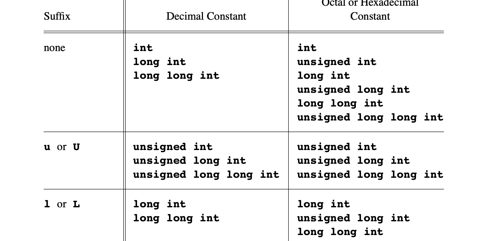

# 程序设计基础 E2 答案（2024秋）

## A int or long long

### 题目

#### 题目描述

​Xhesica曾经说过：`To int or to long long, that's a question.`

​现在，Xhesica会给你一个整数，你能告诉他这个整数能否用int储存吗？

#### 输入

一行，一个整数，保证在 long long 范围内。

#### 输出

如果该整数位于 int 的范围内，输出`Int is enough`；

如果该整数超出了 int 的范围，输出`We need long long`。

#### 输入样例

```text
1
```

#### 输出样例

```text
Int is enough
```

#### 样例解释

$1$ 位于 int 的范围内。

#### Hint

int的范围是 $-2^{31}$ 到 $2^{31}-1$。

你知道这是为什么吗?

### 答案

| 难度 | 考点 |
| --- | --- |
| 1 | 模拟 |

### 题目分析

根据 Hint，计算出 int 的范围带入即可。

### 示例代码

```c
#include<stdio.h>
int main(){
    long long a;
    scanf("%lld",&a);
    if(a<=2147483647 && a>=-2147483648)
        printf("Int is enough");
    else
        printf("We need long long");

    return 0;
}
```

### 扩展补充

在 C 语言标准中，只规定了 int 表示的最小范围，然而在大部分机器上的实现都是 -2147483648 ~ 2147483647。

其次就是在部分编译器上，直接写出 -2147483648 可能会有异常行为，这种异常行为是由于正数和负数的不对称性造成的；编译器实际上是先写出来一个 2147483648，然后再对其进行取反操作，但是实际上 2147483648 已经超出了 int 的表示范围。C99 标准规定了一个整数常量的类型是在下面的列表中给出的第一个匹配的类型：



所以使用了 C99 标准的编译器都会将其解释为 long long；但是也有部分编译器使用了 C89（C90），会将它解释成 unsigned，出现错误。在我们的 oj 上，-2147483648 这种写法是正确的。

## B 摩卡与分数统计 2

### 题目

#### 题目描述

Moca 需要对同学们的期末成绩进行统计。

学生们的期末成绩由以下几部分组成：**文化课成绩**（权重 1），**科技创新成绩**（权重 0.4），**学科竞赛成绩**（权重 0.2），**学生工作成绩**（权重 0.2），**文艺体育成绩**（权重 0.1）。

每个部分的满分为 100，总成绩按照以下公式进行计算：
$$
总成绩=文化课成绩×1+科技创新成绩×0.4+学科竞赛成绩×0.2+学生工作成绩×0.2+文艺体育成绩×0.1
$$
当然，**如果总成绩超过 $100$ 分，那么学生的最终期末成绩也只能记为 $100$ 分**。

#### 输入

第一行输入一个正整数 $n$，表示接下来要统计 $n$ 名同学的成绩，保证 $1 \le n \le 100$。

接下来 $n$ 行，每行五个自然数，分别代表学生的文化课成绩、科技创新成绩、学科竞赛成绩、学生工作成绩和文艺体育成绩，保证每部分成绩在 $0$ 到 $100$ 之间（包括 $0$ 和 $100$）。

#### 输出

输出 $n$ 行，每行输出一个小数，代表对应同学的最终期末成绩，保留到小数点后两位。

#### 输入样例

```text
2
60 40 40 40 30
90 90 90 90 90
```

#### 输出样例

```text
95.00
100.00
```

Author : Moca

### 答案

| 难度 | 考点 |
| --- | --- |
| 1 | 四则运算，简单 if |

### 题目分析

本题较为简单，分析题意，先输入一个 $n$，表示接下来要处理 $n$ 组输入，每组输入输入 $5$ 个整数，分别表示学生的文化课成绩、科技创新成绩、学科竞赛成绩、学生工作成绩和文艺体育成绩，乘上对应的系数后，如果超过 $100$ 成绩就按 $100$ 记。

### 示例代码

```c
#include <stdio.h>
#include <string.h>

int main() {
    int n = read();
    for(int i = 1; i <= n ;i++) {
        int a, b, c, d, e;
        scanf("%d%d%d%d%d", &a, &b, &c, &d, &e);

        // 诸如 b * 0.4，得到的结果是一个浮点数
        double score = a + b * 0.4 + c * 0.2 + d * 0.2 + e * 0.1;

        // 超过 100 的成绩按照 100 记
        if(score > 100)
            score = 100;

        printf("%.2lf\n", score);
    }
    return 0;
}
```

<!-- markdownlint-disable-next-line MD026 -->
## C 大撤离！

### 题目

#### 题目描述

「Mar Sara」星球遭到了异虫的入侵，「James Eugene Raynor」乘坐他的「Hyperion」号撤离了这颗星球。

撤离过程中，「Hyperion」号进行了若干次战术跳跃，每次战术跳跃可以从空间中的一个坐标点跳跃到另一个坐标点，需要消耗的能量等于两坐标点间距离的平方。已知初始时坐标为 $(0,0,0)$ 。

现在我们找到了「Hyperion」号的战术跳跃记录，请你帮忙计算，这场撤离行动消耗了多少单位能量。

#### 输入

若干行，每行 $3$ 个用空格分开的整数 $x,y,z ( -15000\le x,y,z\le 15000)$ ，表示「Hyperion」号从上一个坐标战术跳跃到了这个坐标。出于战略需要，「Hyperion」号有可能会战术跳跃到原地。

当 $x=y=z=0$ 时表示输入结束，而不是战术跳跃回原点。

保证 `0 0 0`为输入的最后一行，「Hyperion」号的战术跳跃次数至少为 $1$ 且不超过 $10000$ 次。

#### 输出

输出一个整数，代表消耗的能量单位数。

#### 输入样例

```text
1 1 1
2 2 2
0 0 0
```

#### 输出样例

```text
6
```

#### 样例解释

「Hyperion」号的战术跳跃路径为 $(0,0,0)\rightarrow (1,1,1)\rightarrow (2,2,2)$ ，能量消耗为 $3+3=6$。

#### Hint

空间中两点距离公式为： $d((x_1,y_1,z_1),(x_2,y_2,z_2))=\sqrt{(x_1-x_2)^2+(y_1-y_2)^2+(z_1-z_2)^2}$

Author: Protoss

### 答案

| 难度 | 考点 |
| --- | --- |
| 2 | 循环、赋值语句、数据类型 |

### 题目分析

由于题目并没有给出战术跳跃次数，因此必须要使用 `while` 循环。不过因为保证了当输入为 `0 0 0` 时结束，因此强烈不推荐使用 `EOF` 判断输入结束，而应该判断三个数是否同时为 $0$。

其次，每次输入后，都要记录下当前的坐标，才能计算出战术跳跃到下一个点的坐标的距离平方。

需要注意的是，这里考到了同学们对赋值语句的了解。

每个坐标各个分量的绝对值最大为 $15000$，因此相邻两次战术跳跃距离的平方最大可能达到 $(15000 - (-15000))^2 \times 3 = 2.7 \times 10^9$，超过了通常情况下 `int` 类型的最大值。而 C 语言对赋值语句的实现，是先计算出等号右侧表达式的值，再赋值给左侧变量。因此如下的代码片段就会存在问题。

```c
int x,y,z,lastx,lasty,lastz;
long long ans=0;
//...此处一些代码处理输入
ans+=(x-lastx)*(x-lastx)+(y-lasty)*(y-lasty)+(z-lastz)*(z-lastz);
```

这个片段中，虽然 ans 是 `long long` 类型，但等号右侧的表达式却是个 `int` 类型值，因此计算表达式时可能会发生溢出，从而给 `ans` 加上一个错误的值。（相信同学们在 C2 中 B 题也注意到了这个问题，部分同学给浮点型变量赋值了一个整型除法，结果自然不符合预期）

为了防止此类现象发生，对于上述片段，我们给出几种解决办法：

1. 将参与运算的所有变量类型改成 `long long`，这样表达式计算时的类型自然也是超长整型，因此不会溢出。

2. 将表达式改成如下格式，这样进行加法时，由于加数 `ans` 参与加法运算，每一次与 `ans` 的加法都会转换成 `long long` 类型，而 `(x-lastx)*(x-lastx)` 的最大值是 $9 \times 10^8$，并未达到 `int` 类型的最大值，因此也不会发生溢出。

```c
ans=ans+...;
```

<!-- markdownlint-disable-next-line MD029 -->
3. 原理大致同上一条，`0ll` 也是 `long long` 类型。

```c
ans+=0ll+...;
```

<!-- markdownlint-disable-next-line MD029 -->
4. 将整个表达式拆分成三个，从而避免溢出（见示例代码）。

### 示例代码

```c
#include<stdio.h>
int x,y,z,lx,ly,lz;
long long ans; // 定义全局变量自动初始化为0
int main(){
    while ( scanf("%d%d%d",&x,&y,&z) && (x==0)+(y==0)+(z==0)!=3 ){ //PPT上出现过类似写法
        ans+=(x-lx)*(x-lx);//分成了三次加，从而避免溢出
        ans+=(y-ly)*(y-ly);
        ans+=(z-lz)*(z-lz);
        lx=x;//更新上一次坐标
        ly=y;
        lz=z;
    }
    printf("%lld",ans);
    return 0;
}
```

## D 简单的字符处理

### 题目

#### 题目描述

输入一篇文章，文章仅由可见字符（ASCII码值在闭区间 $[32, 126]$中）和换行符组成，要求对该文章进行处理：

1. 对于其中的大写字母，在每个大写字母之后插入一个其对应的小写字母。
2. 对于其中的小写字母，在每个小写字母之前插入一个其对应的大写字母。

然后将按照上述规则变换后的文章输出。本题目保证换行符只有`\n`。

#### 输入

若干行字符串，表示一篇文章。（行数 $l$ 满足 $1 ≤ l ≤ 100$）

每行字符串长度 $l'$ 满足 $1≤l'≤100$

#### 输出

输出和输入的文章相同行数的若干行字符串，表示经过题述规则变换后的新文章

#### 输入样例

```text
st12A
3fxB
```

#### 输出样例

```text
SsTt12Aa
3FfXxBb
```

#### Hint

如果在读入上遇到了问题或许可以参考PPT上的一个示例：

```text
while ((c = getchar()) != EOF) {
    // your code
}
```

或者：

```c
while ((scanf("%c", &c)) != EOF) {
    // your code
}
```

AUTHOR：shtog

### 答案

| 难度 | 考点 |
| --- | --- |
| 2 | 循环结构, 字符处理 |

### 题目分析

这道题就是针对输入的包括换行符的字符串，将其中的所有字母都替换为大小写的成对出现且大写在前小写在后。那思路就比较简单的，直接遍历所有字符，只要不是字母，全部原样输出（包括换行符），是字母则变为大小写成对输出。

### 示例代码

```c
#include <stdio.h>

int main() {
    char c;
    while (scanf("%c", &c) != EOF) {
        if (c <= 'Z' && c >= 'A')
            printf("%c%c", c, c - 'A' + 'a');
        else if (c <= 'z' && c >= 'a')
            printf("%c%c", c - 'a' + 'A', c);
        else
            printf("%c", c);
    }
    return 0;
}
```

## E 抽取小球 1

### 题目

#### 题目描述

小 P 获得了 $n$ 种颜色各不相同的小球，每种颜色分别有 $a_1,a_2,\cdots,a_n$ 个小球，之后小 P 将它们都放在了一个不透明袋子中。小 $P$ 每次将从袋子中抽取 $k$ 个小球，并将抽到的小球放到袋子之外。当袋子中的小球数量不足 $k$ 个时，抽取将结束。小 P 想知道，最后的袋子中每种小球最少剩多少个？最多剩多少个？

#### 输入

第一行给出两个整数 $n,k$。其中， $0<n≤2\times10^5$， $0<k≤10^9$。

第二行给出 $n$ 个整数，分别代表 $a_1,a_2,\cdots,a_n$。其中 $0<a_i≤10^9$。

具体含义见题目描述。

#### 输出

输出共两行。

第一行输出 $n$ 个数，分别为每种小球最少剩余个数。

第二行输出 $n$ 个数，分别为每种小球最多剩余个数。

对于每一行，第 $i$ 个数输出第 $i$ 种小球最少/最多剩余个数，且每两个数之间用一个空格间隔。

#### 输入样例 1

```text
5 4
1 2 3 4 5
```

#### 输出样例 1

```text
0 0 0 0 0
1 2 3 3 3
```

#### 输入样例 2

```text
5 8
1 1 1 1 11
```

#### 输出样例 2

```text
0 0 0 0 3
1 1 1 1 7
```

#### Hint

局部数组有栈大小的限制，请注意建局部数组时不要开太大。

有兴趣深入了解的同学可以搜索局部数组与全局数组的差别。

auther：小P

### 答案

| 难度 | 考点 |
| --- | --- |
| 3 | 贪心，分类 |

### 题目分析

由题，设 $s$ 为小球个数之和，则最后会剩余 $s \bmod k$ 个球（这里只是一种表述方法，对应的 C 语言代码是 `s % k`）。 注意求 $s$ 时会出现超过 $int$ 范围的问题。

对于每种球的最小剩余个数：设当前询问种类的球个数为 $a$，如果其他种类的球总数 $s - a$ 大于 $s \bmod k$。则可以通过先取这种球的方式，使这种球最后剩余 $0$ 个；否则，可以先用其他种类的球作为剩余的球，最后实在不够再用这种球，此时最小值为 $(s \bmod k) - s + a$。

对于每种球的最大剩余个数：设当前询问种类的球个数为 $a$，由于最多剩余 $s \bmod k$ 个球，故而可以通过后取这种球的方式，使最终此种球剩余 $min(a, s \bmod k)$ 个。

思考：如果抽取球时要求抽取到的球颜色不全部相同，则答案为多少？

具体代码见下：

### 示例代码

```c
#include<stdio.h>
long long s1[200010]; //每种球的个数
signed main()
{
    long long n,k,sum,i,remain,x;
    sum=0;
    scanf("%lld%lld",&n,&k);
    for(i=0;i<n;i++)
    {
        scanf("%lld",&s1[i]);
        sum+=s1[i];
    }
    remain=sum%k;
    for(i=0;i<n;i++)
    {
        x=sum-s1[i];
        if(x<remain)
        {
            printf("%lld ",remain-x);
        }
        else
        {
            printf("0 ");
        }
    }
    printf("\n");
    for(i=0;i<n;i++)
    {
        if(s1[i]<remain)
        {
            printf("%lld ",s1[i]);
        }
        else
        {
            printf("%lld ",remain);
        }
    }
    printf("\n");
    return 0;
}
```

## F 计算哈希值

### 题目

#### 题目描述

对于一个长度为 $n$ 的字符串，我们可以用以下公式，将一个字符串映射到一个整数上，这个整数我们把它称为字符串的「哈希值」

$$
f(s) = ( \sum_{i=1}^{n} s_i \times b^{i-1} )\bmod p
$$

其中， $s_i$ 代表字符串第 $i$ 位对应字符的 ASCII 码， $b$ 是大于 $s_i$ 小于 $p$ 的正整数， $p$ 是一个大质数。

现在给定 $b$ 和 $p$，请你计算字符串 $s$ 的哈希值

#### 输入

第一行三个数 $n,b,p$， $n$ 代表字符串的长度， $b,p$ 含义与题意相同。保证 $1 \le n \le 10^6$， $128 < b < p \le 10^9 + 7$，且 $p$ 是一个质数。

第二行一个长度为 $n$ 的字符串，其中仅包含大小写字母和数字。

#### 输出

一个正整数，代表字符串的哈希值。

#### 输入样例 1

```text
3 131 998244353
abc
```

#### 输出样例 1

```text
1711874
```

#### 输入样例 2

```text
18 13331 1000000007
CrazyThursdayVMe50
```

#### 输出样例 2

```text
866798914
```

#### 样例解释

对于第一组样例，字符串的哈希值为 $97 \times 1 + 98 \times 131 + 99 \times 131^2 = 1711874$

#### Hint

以 $\bmod$ 作为取模运算，其有如下性质：

- $(a+b) \bmod p = ((a \bmod p) + (b \bmod p)) \bmod p$
- $(a-b) \bmod p = ((a \bmod p) - (b \bmod p)) \bmod p$
- $(a \times b) \bmod p = ((a \bmod p)  \times  (b \bmod p)) \bmod p$

#### 扩展阅读

哈希算法可以将一个数据转换为一个标志，这个标志和源数据的每一个字节都有十分紧密的关系。哈希算法还具有一个特点，就是很难找到逆向规律。例如本题中，将输入样例 2 中的 `CrazyThursdayVMe50` 改为 `CrazyThursdayVme50`，虽然只改动了一个字母，但是哈希值却会从 `866798914` 变成 `423499794`，两个数字根本无法看出来有任何联系

哈希算法是一个广义的算法，也可以认为是一种思想，使用哈希算法可以提高存储空间的利用率，可以提高数据的查询效率，也可以做数字签名来保障数据传递的安全性。所以哈希算法被广泛地应用在互联网应用中。

而算法中对于字符串的哈希一般特指类似本题的“多项式哈希”，它的主要用途和上面提到的哈希特性无关，而更多是被用于高效的字符串匹配，是竞赛必备字符串算法之一。

##### Author: Gino

### 答案

| 难度 | 考点 |
| --- | --- |
| 4 | 取模运算，循环，ASCII |

### 题目分析

首先，一个朴素的思想就是，对于字符串中的每个字符，都计算一遍 $b^{i-1}$，将这个值与字符的 ASCII 码相乘。最后把字符串每一位这样计算得到的值相加，再对 $p$ 取模，得到最终答案。

这样做遇到的第一个问题就是整型溢出问题。由于我们最后可能需要计算 $b^{1000000}$，而这个数字实在是过于庞大，远远超过 `long long` 支持的存储范围。所以，我们需要借助取模运算的性质。计算例如 $b^{1000000}$ 的大数时，我们可以每乘一个 $b$ 就对 $p$ 取一次模。根据取模运算的性质，这样提前取模的操作并不影响最终的结果。

还有第二个问题，那就是，如果我们每次都重新计算 $b^i$，那么这个时间复杂度就来到了 $O(n^2)$。在 $n \le 10^6$ 的数据范围下，这肯定是太慢了。可是我们完全没有必要每次都重新计算 $b^i$。因为 $b^i = b^{i-1} \times b$，所以只要我们把上一次计算得到的 $b^i$ 记录下来，然后将其再乘以一个 $b$，我们就能得到下一个 $b^i$。（看到许多人用了快速幂，其实完全没有必要）

注意，模 $p$ 之后的两个数相乘还是会爆 `int`，因此先转化成 `long long` 再相乘，模了 $p$ 之后会回到 `int` 范围之内。

### 示例代码

```c
#include <stdio.h>
int main()
{
    int c, b, p, n;
    int val = 0, mul = 1; // mul 用来记录b的i次方，初始为b的0次方，即1
    scanf("%d%d%d", &n, &b, &p);
    getchar(); // 过滤掉换行符
    for (int i = 0; i < n; i++)
    {
        c = getchar();
        val = (val + 1ll * c * mul) % p;
        mul = 1ll * mul * b % p; // 先转化成long long再相乘
    }
    printf("%d", val);
    return 0;
}
```

## G 解方程 2025 纯净版

### 题目

#### 题目描述

给定一个方程 $ax^2 + bx +c = 0$，在实数范围内求根。

#### 输入

一行，三个空格分隔的**整数** $a,b,c$， $−100 \le a,b,c \le 100$。

#### 输出

若方程无实根，输出 `No real root`；

若方程有一个实根，输出唯一实根（多个值相同的实根视为同一个实根），保留**两位**小数；

若方程有不同实根，按从小到大输出，保留**两位**小数；

若方程有无穷多解，输出 `infinite solutions`。

#### 输入样例

```text
1 2 -3
```

#### 输出样例

```text
-3.00 1.00
```

#### Hint

考虑 $a,b,c$ 可能为 $0$ 的情况。

可能会用到 `math.h` 库中的 `sqrt` 函数，该函数的作用是求一个 `double` 类型变量的算术平方根。

### 答案

| 难度 | 考点 |
| --- | --- |
| 4 | 分支判断 |

### 题目分析

由题意分析可知，该方程由于 $a, b, c$ 取值的变化，可能为二次方程、一次方程，还有可能不含未知量 $x$。
对于二次方程，需要判断判别式的大小，分为两根、一根和无实根的三种情况讨论；
对于一次方程，直接求得一个实根即可；
对于不含未知量的方程，若 $c = 0$，则有无穷多解，否则无解。

### 示例代码

```c
#include <stdio.h>
#include <string.h>
#include <math.h>

int main() {
    int a, b, c;
    scanf("%d%d%d", &a, &b, &c);

    if (a == 0 && b == 0 && c == 0) {
        // a b c 都是 0，无穷多解
        printf("infinite solutions");
    } else if (a == 0 && b != 0) {
        // a = 0, b != 0，一次方程
        printf("%.2lf\n", -c * 1.0 / b);
    } else if (a == 0) {
        // a = 0，隐含 b = 0, c != 0（否则会进前面的分支），无实根
        printf("No real root\n");
    } else if (b * b < 4 * a * c) {
        // 否则就是二次方程，这里是德尔塔 < 0
        printf("No real root\n");
    } else if (b * b == 4 * a * c) {
        // 德尔塔 = 0
        printf("%.2lf\n", -b / (2.0 * a));
    } else {
        // 德尔塔 > 0，两个根
        double r = sqrt(b * b - 4 * a * c);
        double x = (-b - r) / (2 * a);
        double y = (-b + r) / (2 * a);

        // 确保 x 是较小的根
        // 为什么 y 有可能 > x，可以试试把样例的输入取个相反数看看
        if (x > y) {
            double t = x; x = y; y = t;
        }

        printf("%.2lf %.2lf\n", x, y);
    }
    return 0;
}
```

### 扩展补充

为什么这道题叫做 “纯净版” 呢？大家可以试试这句代码：`printf("%.2lf", 0.0 / -2);`，会惊奇地发现它的输出是 `-0.00`，而不是 `0.00`。实际上，这和浮点数在计算机中的二进制表示有关（IEEE754），所以才会有 `+0.0` 和 `-0.0`。大家在下节课就会学到了。

在这道题中，正常不做 `-0.00` 特判处理的代码，比如输入了 `1 0 0`，就会输出 `-0.00`。我们不想在这里卡大家，于是就没有这样的数据点（所以叫做“纯净版”）；但是大家还是要了解，说不定哪天就会遇到这个问题。

## H 清除障碍

### 题目

#### 题目描述

「James Eugene Raynor」试图从「Taldarim」手中抢夺神器，但对方在一条必经之路上设置了一些障碍。

「Raynor」对这条路进行了若干次析像扫描，共发现了 $n$ 段区间上有障碍。现在我们已知这条路长 $2^{20}=1048576$ 千米，这样就可以用区间 $[a,b]$ 来表示这条路从起点开始的第 $a$千米处到第 $b$ 千米处被障碍堵住。请注意，可能有的障碍的一部分被扫描多次，即这些区间有可能有重叠。

「Raynor」想知道，这条路上有多少千米长度是被障碍堵住的，请你帮帮他。

#### 输入

第一行，一个正整数 $n(1\le n\le 10^6)$ ，含义如题所示；

接下来 $n$ 行，每行两个由空格分开的整数 $a,b(0\le a<b\le 2^{20})$，表示扫描到的这个区间被障碍堵住了。

#### 输出

一行 一个整数，表示被障碍堵死的长度，单位是千米。

#### 输入样例

```text
4
1 3
3 4
6 8
7 9
```

#### 输出样例

```text
6
```

#### 样例解释

被堵死的区间是 $[1,4]\cup [6,9]$ ，总长度为 $6$。

#### Hint

本题可以使用差分数列处理。

定义（差分数列）：对于数列 $\\{A_n\\}$ ，定义数列 $\\{B_n=A_n-A_{n-1}, \forall n \in \mathbb{N}^+(A_0\stackrel{def}{=}0)\\}$ 为数列 $\\{A_n\\}$ 的差分数列。

另，如果使用较大的数组，请在 `main` 函数外面声明，否则会运行错误。

例如（只是个示例，具体大小请参考题目）：

```c
int A[1008611];
int main(){
    //...
}
```

这样可以开较大的数组，且数组中所有元素初始值为 $0$ （将其他 `int` 型变量在 `main` 外声明也会将初始值置为 $0$ ）。

Author: Protoss

### 答案

| 难度 | 考点 |
| --- | --- |
| 5 | 差分 |

### 题目分析

很自然的想法是，定义一个比道路长度还大的数组 $A_i$，称为标记数列，表示道路的第 $i$ 千米到第 $i + 1$ 千米处的状态。每次输入有障碍的区间 $[a, b]$ 后，将下标满足 $i \in a, a + 1, \cdots, b - 1$ 的数组元素加一，表示这段路上有障碍。最后数一下有多少个元素非零即可。暴力代码如下：

```c
#include<stdio.h>
int n,a,b,A[1048600],cnt;
int main(){
    scanf("%d",&n);
    while ( n-- ){
        scanf("%d%d",&a,&b);
        for ( int i=a ; i<b ; i++ )
            A[i]+=1;
    }
    for ( int i=0 ; i<1048576 ; i++ )//整条道路
        if ( A[i]>0 )
            cnt++;
    printf("%d",cnt);
    return 0;
}
```

于是我们会惊喜地发现拿到了 $0.3$ 分。

题目给出的数据范围是 $n \le 10^6$，因此如果每段区间都很长，我们这么做就会超时，需要优化方法。

题目给出了提示：使用差分数列（不过题目给的提示不符合本题的情况。提示中数列的下标从 1 开始，而本题中数组的下标从 0 开始，因此我们需要根据本题题意更新一下定义。

定义：对于数列 $\{A_n\}$，定义数列 $\{B_n\}$ 为数列 $\{A_n\}$ 的差分数列，其通项为

$$
B_n =
\begin{cases}
A_n - A_{n-1}, & n > 0 \\
A_0, & n = 0
\end{cases}
$$

从而我们将 $A_a, A_{a+1}, \cdots, A_{b-1}$ 逐项加一的操作，就可以化简为对 $B_a$ 加一，对 $B_b$ 减一。此时我们标记操作的效率与区间长度无关，程序执行的效率大大提高。

最后我们将差分数列累加，差分数列的前缀和就是原数列。之后，再去枚举数组中有多少个非零元素即可。

### 示例代码

```c
#include<stdio.h>
int n,A[1048600],a,b,cnt;//数组太大，开成全局变量
int main(){
    scanf("%d",&n);
    while ( n-- ){//开始时，A是标记数列的差分数列
        scanf("%d%d",&a,&b);
        A[a]++;
        A[b]--;
    }
    for ( int i=1 ; i<1048576 ; i++ )
        A[i]+=A[i-1];//将A恢复为标记数列
    for ( int i=0 ; i<1048576 ; i++ )
        if ( A[i]>0 )
            cnt++;
    printf("%d",cnt);
    return 0;
}
```

### 另解

何劲杉同学提供了另一种思路，非常简单且巧妙，在此表扬！也希望同学们能有自己的思考，提供更多的解法。

何同学的思路是，首先对区间进行计数排序（即统计以每个位置为左端点有多少个障碍。代码中化简了这部分，仅保留最长的区间），然后沿着道路向前走，不断更新前方有多少千米障碍，最后走过完整的路程，也就数出来有多少千米障碍了。

代码如下：

```c
#include <stdio.h>

int a[1050000];
int main()
{
    int i,j,k=0,n,x,y;
    scanf("%d",&n);
    for(i=1;i<=n;i++)
    {
        scanf("%d%d",&x,&y);
        if(y-x>a[x])
            a[x]=y-x;
    }
    for(i=0,j=0;i<1048576;i++,j--)
    {
        if(a[i]>j)
            j=a[i];
        if(j>0)
            k++;
    }
    printf("%d",k);
    return 0;
}
```

## I 朝日的画圈游戏

### 题目

#### 题目描述

 asahi 在一个二维平面上选取了 $n$ 个点，并给你了一个半径 $r$ 。

请你判断 $x$ 轴上是否存在一个点 $P$ ，使得以 $P$ 为圆心， $r$ 为半径的圆能覆盖所有的 $n$ 个点。

点在圆的边界上也算作被覆盖。

注意你不需要找出点 $P$ ，只需告诉 asahi 是否存在这样一个点即可。若存在，输出 `YES` ，否则输出 `NO` 。

#### 输入

第一行两个整数 $n,r$ ，表示需要覆盖的点总数和给定的半径。满足 $1\le n\le 10^5,1\le r\le 10^6$ 。

接下来 $n$ 行，每行两个整数 $x_i,y_i$ ，表示第 $i$ 个点在二维平面上的坐标。满足 $-10^6\le x_i,y_i \le 10^6$ 。

#### 输出

一行，`YES` 或 `NO` ，表示答案。

#### 输入样例 1

```text
2 5
3 4
5 5
```

#### 输出样例 1

```text
YES
```

#### 输入样例 2

```text
3 4
0 3
-2 2
2 4
```

#### 输出样例 2

```text
NO
```

author:Layn

### 答案

| 难度 | 考点 |
| --- | --- |
| 6 | 计算几何、浮点运算 |

### 题目分析

考虑覆盖第 $i$ 个点 $(x, y)$ 需要满足的要求：

1. $R \ge |y|$

2. 令 $d = \sqrt{R^2 - y^2}$，则圆心必须落在 $[x - d, x + d]$ 中。

$n$ 个点对应了 $n$ 个区间，圆心可以取的范围是这些区间的交。

这些区间的交不为空等价于左端点的最大值 $\le$ 右端点的最小值。

### 示例代码

```c
#include<stdio.h>
#include<math.h>
long long n,R;
int main(){
    scanf("%lld%lld",&n,&R);
    double tl=-1e18,tr=1e18; //tl和tr是左端点的最大值和右端点的最小值
    for(int i=1;i<=n;i++){
        long long x,y;
        scanf("%lld%lld",&x,&y);
        if(R*R<y*y){
            printf("NO"); //对应第一个要求
            return 0;
        }
        double d=sqrt(R*R-y*y),l=x-d,r=x+d; //对应第二个要求
        if(tl<l)tl=l;
        if(tr>r)tr=r;
        if(tl>tr){
            printf("NO");
            return 0;
        }
    }
    printf("YES");
    return 0;
}
```

### 思考

1. 如何求出存在圆心能覆盖所有点的最小的 $R$。

2. 如果圆心不需要定在 $x$ 轴上，怎么做 1 。

## J 数组加密

### 题目

#### 题目描述

有一串长度为 $n$ 的数 $a_1,a_2,\cdots, a_n$， $0 \le a_i \le 10^8$，它们组成一个数组。出于某种原因，Gino 想把这个数组加密，于是他找来三位操作员，让他们分别将原数组 $a$ 按照以下方式**加密数组任意正整数次**：

- 任选一个数字 $i$， $2 \le i \le n - 1$，将 $a_i$ 加上 $2$，将 $a_{i-1}$ 和 $a_{i + 1}$ 都减去 $1$

可是，其中一位操作员听错了 Gino 的要求，他会按照这个方式来**加密数组任意正整数次**：

- 任选一个数字 $i$， $2 \le i \le n - 2$，将 $a_i$ 加上 $2$，将 $a_{i - 1}$ 和 $a_{i + 2}$ 都减去 $1$

请你根据三位操作员加密完毕后得到的数组，判断是哪位操作员听错了要求，使用错误的方法加密了数组，并计算出他进行了多少次的错误操作？

注意你并不需要求出另外两名操作员的操作次数。

数据保证三位操作员都进行了不少于 $1$ 次操作，不多于 $10^8$ 次操作。

#### 输入

第一行一个正整数 $t$，代表数据组数， $1\le t \le 10^4$。

对于每组数据，第一行一个正整数 $n$，代表数组长度， $5 \le n \le 10^5$。

接下来三行，每行 $n$ 个整数 $a_1,a_2,\cdots a_n$， $-10^8\le a_i \le 3 \times 10^8$，代表三位操作员分别完成加密操作后得到的三个加密后数组。

数据保证 $\sum n \le 3 \times 10^5$，即所有数据的 $n$ 的总和不超过 $3\times 10^5$。

数据保证，三位操作员得出的数组是由同一个原始数组通过以上操作得到的。

#### 输出

对于每组数据，输出一行两个正整数 $k,m$，含义为第 $k$ 位操作员听错了 Gino 的要求，使用了错误的方法加密数组，而他操作了 $m$ 次。

#### 输入样例

```text
3
5
0 4 2 4 5
0 3 4 3 5
1 1 5 4 4
5
0 3 0 1 1
0 2 3 0 0
0 3 -1 3 0
10
28 19 49 -1 31 35 33 7 54 -1
23 18 73 -6 14 43 38 13 39 -1
29 17 50 0 28 37 31 16 43 3
```

#### 输出样例

```text
3 1
2 2
2 44
```

#### 样例解释

对于第一组样例，原始数组为 $\left\{1,2,3,4,5 \right\}$，操作员 1 正确加密了 $1$ 次，操作员 2 正确加密了 $2$ 次，操作员 3 错误加密了 $1$ 次。

对于第二组样例，原始数组为 $\left\{1,1,1,1,1\right\}$，操作员 1 正确加密了 $1$ 次，操作员 2 错误加密了 $2$ 次，操作员 3 正确加密了 $2$ 次。

##### Author: Gino

### 答案

| 难度 | 考点 |
| --- | --- |
| 6 | 数学，观察能力 |

### 题目分析

思考这样一个问题：每次正确操作之后，数组有什么东西是不变的吗？

可能你的第一反应就是数组每个元素的和，因为每次正确操作之后，给一个元素加 2，给两个元素减 1，总和不变。

可是，与此同时，对于错误操作来说，数组中每个元素的和也是从始至终不会改变的，我们又回到了起点。

别急，我们来看这样几个表格。

这是原数组的某一段：

| i - 2 | i - 1 | i | i + 1 | i + 2 |
| --- | --- | --- | --- | --- |
| a | b | c | d | e |

这是原数组的这一段经过一次正确操作后的情况：

| i - 2 | i - 1 | i | i + 1 | i + 2 |
| --- | --- | --- | --- | --- |
| a | b - 1 | c + 2 | d - 1 | e |

这是原数组的这一段经过一次错误操作后的情况：

| i - 2 | i - 1 | i | i + 1 | i + 2 |
| --- | --- | --- | --- | --- |
| a | b - 1 | c + 2 | d | e - 1 |

注意到这样一个式子 $\sum_0^{n-1}(a_i \times i)$（注意力惊人）

对于每次正确操作来说，这个式子得出的值会改变 $(i - 1) \times (-1) + i \times 2 + (i + 1) \times (-1) = 0$，也就是说正确操作不会改变这个数值。

对于每次错误操作来说，这个式子得出的值会改变 $(i - 1) \times (-1) + i \times 2 + (i + 2) \times (-1) = -1$，也就是说每一次错误操作，都会使得这个值减小 $1$。

现在我们只需要对三个数组都计算出它们的 $\sum_0^{n-1}(a_i \times i)$，找到小的那个，并输出它与另外两个值的差值即可。注意计算过程中可能存在的爆 `int` 的情况。

当然我也发现一些做法，通过把正确操作从左往右转移的方式来找到进行了多少次错误操作。可是如果你使用了这个方法，你会发现，其实你就是计算了个 $\sum_0^{n-1}(a_i \times i) - \sum_0^{n-1}(b_i \times i)$，这与标答在数学上是等效的。

### 示例代码

```c
#include <stdio.h>
int a[100005];
int b[100005];
int c[100005];
int main(void)
{
    int t;
    scanf("%d", &t);
    while (t--)
    {
        int n;
        scanf("%d", &n);
        for (int i = 0; i < n; i++)
        {
            scanf("%d", &a[i]);
        }
        for (int i = 0; i < n; i++)
        {
            scanf("%d", &b[i]);
        }
        for (int i = 0; i < n; i++)
        {
            scanf("%d", &c[i]);
        }
        long long suma = 0, sumb = 0, sumc = 0;
        for (int i = 0; i < n; i++)
        {
            suma += 1ll * i * a[i];
            sumb += 1ll * i * b[i];
            sumc += 1ll * i * c[i];
        }
        if (sumb == sumc)
        {
            printf("1 %lld\n", sumb - suma);
        }
        else if (suma == sumc)
        {
            printf("2 %lld\n", suma - sumb);
        }
        else
        {
            printf("3 %lld\n", suma - sumc);
        }
    }
    return 0;
}
```
