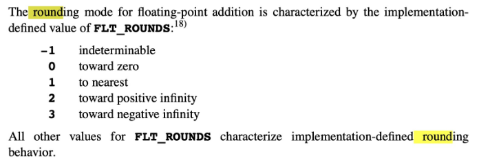

# 程序设计基础 E4 答案（2024秋）

## A 信类友谊赛

### 题目

#### 题目描述

传源书院和士谔书院的学生们组织了一场友谊比赛。比赛共分为多轮，每轮比赛中，两所书院的队伍分别获得一定的积分。如果某所书院在一轮比赛中得分更高，则该书院的胜局数加 1；若两所书院在一轮比赛中的得分相同，则双方胜局数不变。

比赛结束后，大家想知道哪所书院最后获胜（胜局数多的获胜）。如果两所书院的胜局数相同，则比赛结果为平局。

#### 输入

第一行输入一个整数 $N$，表示比赛的轮数。接下来有 $N$ 行，每行两个整数 $X_i $ 和  $Y_i$ ，分别表示传源书院和士谔书院在第 $i$ 场比赛中的得分。

保证 $1 \le N \le 100$， $1 \le X_i, Y_i \le 30$ 。

#### 输出

- 输出 `Chuanyuan wins` 如果传源书院的胜局数更多；
- 输出 `Shie wins` 如果士谔书院的胜局数更多；
- 输出 `Draw` 如果两所书院的胜局数相同。

#### 输入样例 1

```text
3
10 5
9 8
6 9
```

#### 输出样例 1

```text
Chuanyuan wins
```

#### 输入样例 2

```text
3
10 5
8 8
6 9
```

#### 输出样例 2

```text
Draw
```

#### 样例解释

在第一组样例中，传源书院最后的胜局数为 2，士谔书院最后的胜局数为 1。

在第二组样例中，传源书院和士谔书院最后的胜局数都为 1。

Author：Moca

### 答案

| 难度 | 考点 |
| --- | --- |
| 1 | 模拟、条件判断、循环结构 |

### 题目分析

根据题意，我们需要维护一个传源书院和士谔书院的总胜局数。每轮比赛会给出两个得分 $X_i$ 和 $Y_i$ ，分别表示传源书院和士谔书院在这一轮的得分：

- 如果 $X_i > Y_i$ ，传源书院胜局数加 1；
- 如果 $X_i < Y_i$ ，士谔书院胜局数加 1；
- 如果 $X_i == Y_i$ ，两个书院胜局数不变。

比赛结束后，通过对比两所书院的胜局数，输出对应的结果。

### 示例代码

```c
#include <stdio.h>
#include <string.h>

int main() {
    int a = 0, b = 0;
    int n;
    scanf("%d", &n);

    // 每一轮的比分情况来维护胜局
    for(int i = 1; i <= n ;i++) {
        int x, y;
        scanf("%d%d", &x, &y);
        if(x > y)
            a++;
        else if(x < y)
            b++;
    }

    // 判断总的胜局情况
    if(a > b)
        printf("Chuanyuan wins");
    else if(a < b)
        printf("Shie wins");
    else
        printf("Draw");

    return 0;
}
```

## B 摩卡与音游

### 题目

#### 题目描述

Moca 最近在玩一款音游。

每首歌曲都有若干个按键，对于每个音符，Moca 都能打出判定 `perfect` 、 `great` 、 `bad` 、 `miss` 中的一种，其中 `bad` 和 `miss` 将会中断连击，而 `perfect` 和 `great` 能够保持连击；同时，每种按键会对应一个表现分，四种按键对应的表现分分别为 `300` 、 `208` 、 `105` 和 `0` 。

现在，Moca 希望你帮她算出一场游戏后，她能获得多少表现分。

#### 输入

第一行一个正整数 $n$， $1 \le n \le 2000000$。

接下来 $n$ 行每行 $1$ 个字符 $c$ ，表示 Moca 对应音符的判定，其中 `p` 表示 `perfect`； `g` 表示 `great` ；`b` 表示 `bad`；`m` 表示 `miss`。

#### 输出

第一行一个整数 $score$ ，表示 Moca 的表现分之和。

第二行一个非负整数 `combo` ，表示 Moca 的**最大**连击数。

如果 Moca 对于所有音符都打出了 `perfect` 判定，第三行输出 `All Perfect!`；如果 Moca 没有对所有音符打出 `perfect` 判定，但是对所有音符都打出了 `perfect` 或 `great` 判定，第三行输出 `Full Combo!`；否则第三行输出 `Moca Complete!`。

#### 输入样例 1

```text
5
p
p
p
p
p
```

#### 输出样例 1

```text
1500
5
All Perfect!
```

#### 输入样例 2

```text
4
p
g
p
g
```

#### 输出样例 2

```text
1016
4
Full Combo!
```

#### 输入样例 3

```text
3
p
b
g
```

#### 输出样例 3

```text
613
1
Moca Complete!
```

Author : Moca

### 答案

| 难度 | 考点 |
| --- | --- |
| 2 | 模拟、循环、分支 |

### 题目分析

这题是一道简单的模拟题，数据范围发现表现分最大只有 6 亿，所以 int 就可以。

需要我们考虑的有两件事：如何获得最大连击数，如何知道最后是 `All Perfect!` 、 `Full Combo!` 还是 `Moca Complete!` 。

对于第一个问题，我们可以用一个变量 `maxCombo` 来维护最大连击数，这个变量的初值为 `0` ；用 `combo` 维护当前的连击数，每当获得一个 `p` 或者 `g` 时， `combo` 数增加 `1` ；每当获得一个 `b` 或者 `m` 时， `combo` 数变为 `0` ，但在 `combo` 数变为 `0` 之前，我们需要判断一下这次的连击数是不是大于最大连击数，如果是的话则需要更新 `maxCombo` 。这里需要注意的是如果只在断连时更新 `maxCombo` ，那么曲子结束之前最后一次的连击数就无法被用来更新 `maxCombo` 了，这里我们需要注意一下。

第二个问题的解决方法是多样的，可以用 `maxCombo` 来判断是不是 `Moca Complete!` （如果 `maxCombo` 与总音符数不相等那么就是 `Moca Complete!` ）；可以用一个标记来标记是否出想过 `g` ，以此来判断是 `All Perfect!` 还是 `Full Combo!` 。

### 示例代码

```c
#include <stdio.h>

int main()
{
    int n;
    int score = 0;
    int maxCombo = 0;
    int combo = 0;
    int ap = 1; // 如果为 1 ，证明没有出现过 ap 以外的字符

    char c;
    int a,b;
    scanf("%d",&n);
    for(int i = 1;i <= n;i++)
    {
        getchar();  // 处理换行符
        scanf("%c",&c);
        switch (c)
        {
            case 'p':
                combo++;
                score += 300;
                break;

            case 'g':
                combo++;
                ap = 0;
                score += 208;
                break;
            case 'b':
                score += 105;
                if(combo > maxCombo) maxCombo = combo;
                combo = 0;
                ap = 0;
                break;

            case 'm':
                if(combo > maxCombo) maxCombo = combo;
                combo = 0;
                ap = 0;
                break;
        }
    }
    if(combo > maxCombo) {
        maxCombo = combo;
    }

    printf("%d\n%d\n",score,maxCombo);
    if(ap == 1) {
        printf("All Perfect!");
    }
    else if(maxCombo == n) {
        printf("Full Combo!");
    }
    else {
        printf("Moca Complete!");
    }
    return 0;
}
```

你也可以利用 `switch` 的一些特性将代码写的更简洁一些，但是在这里我们将不会给出这样的代码，以免带偏同学们。

## C 不讲 5 的（小数据）

### 题目

#### 题目描述

「James Eugene Raynor」曾是「Mar Sara」星球的治安官。在这个星球上，人们认为 $5$ 是不吉利的数字，因此他们总是尽量避免写出这个数字。

这天「Raynor」发现，每一个自然数都能表示成两个自然数的和。

他知道这个星球上总人口为 $n$ ，他想知道，有多少组有序数对 $(a,b)$ 满足 $a+b=n$ ，且 $a,b$ 是所有数位都不含数字 $5$ 的自然数。

#### 输入

一行，一个整数 $n$ （保证 $0\le n\le 10^6$ ， $n$ 中可能出现数字 $5$ ）。

#### 输出

一行，符合题意的有序数对的组数。

#### 输入样例

```text
6
```

#### 输出样例

```text
5
```

#### 样例解释

满足题意的有序数对有 $(0,6)(2,4)(3,3)(4,2)(6,0)$ 共 $5$ 种可能。

Author: Protoss

### 答案

| 难度 | 考点 |
| --- | --- |
| 2 | 循环 |

### 题目分析

由于 $n$ 的范围只有 $10^6$ ，因此我们直接枚举所有的有序数对 $(a, n-a)$ 即可。

还有一种更快的方法，我们可以将 0 到 $n$ 范围内每个数是否含有数字 5 存储起来，这样就避免每次都判断一遍。并且注意到，对于 $k(k \ge 2)$ 位数而言，它没有数字 5，当且仅当它的前 $k-1$ 位没有数字 5 且它的个位不是 5。当我们计算这个数的时候，它的前 $k-1$ 位实际上已经计算过了，因此可以直接使用。

### 示例代码 1

```c
#include <stdio.h>

int main(void)
{
    int n, ans = 0;
    scanf("%d", &n);

    for (int i = 0; i <= n; i++)
    {
        int tem1 = i, tem2 = n - i;
        int valid1 = 1, valid2 = 1;

        // 检查 i 是否包含数字 5
        while (tem1)
        {
            if (tem1 % 10 == 5)
            {
                valid1 = 0;
                break;
            }
            tem1 /= 10;
        }

        // 检查 n - i 是否包含数字 5
        while (tem2)
        {
            if (tem2 % 10 == 5)
            {
                valid2 = 0;
                break;
            }
            tem2 /= 10;
        }

        // 如果 i 和 n - i 都不包含数字 5，增加计数
        if (valid1 && valid2)
            ans++;
    }

    printf("%d", ans);
    return 0;
}
```

### 示例代码 2

```c
#include<stdio.h>

int n,ans;
int check[1008611];
int main(){
    scanf("%d",&n);
    for ( int i=0 ; i<=9 ; i++ )
        check[i]=1;
    check[5]=0;
    for ( int i=10 ; i<=n ; i++ )
        check[i]=check[i/10]&&check[i%10];
    for ( int i=0 ; i<=n ; i++ )
        if ( check[i] && check[n-i] )
            ans++;
    printf("%d",ans);
    return 0;
}
```

## D 摩卡与成绩统计 4

### 题目

#### 题目描述

水獭幼儿园组织了一场编程大赛，Moca 需要对表现出色的小水獭颁发奖励。

排名规则如下：第一名的名次为 1 ，第二名的名次为 2 ，以此类推。比赛成绩相同者名次并列，例如：如果最高得分有两名，他们名次均为 1 ，得分第二高的水獭的名次则为 3 。

奖励规则如下（设排名为 $r$）：

- 若成绩前三名，则按照 $r = 1$ 颁发金牌， $r = 2$ 颁发银牌， $r = 3$ 颁发铜牌的规则为对应水獭颁发奖励（也就是说，可能有多只水獭同时获得金牌）
- 若未获得奖牌，且排名在前 $10\%$，即 $r \le n \cdot 10\%$，则获得一等奖
- 若未获得奖牌、一等奖，且排名在前 $30\%$，即 $n \cdot 10\% \lt r \le n \cdot 30\%$，则获得二等奖
- 若未获得奖牌、一等奖、二等奖，且排名在前 $60\%$，即 $n \cdot 30\% \lt r \le n \cdot 60\%$，则获得三等奖
- 若未获得其它奖项（包括奖牌），且排名在前 $90\%$，即 $n \cdot 60\% \lt r \le n \cdot 90\%$，则获得优秀奖
- 未达到上述之一则为未获奖

现在 Moca 已经对水獭们的成绩排好序了，请你帮忙写一个程序，为水獭们颁发对应的奖项。

#### 输入

第一行一个整数 $n$，表示参与比赛的水獭数，保证 $1 \le n \le 500000$。

接下来一行， $n$ 个整数（保证在 $0$ 到 $100$ 之间，包括 $0$ 和 $100$），表示每只水獭的成绩，保证成绩输入的时候降序（不严格）。

#### 输出

输出 $n$ 行，对每个水獭，按如下规则输出一行对应的字符串：

- **金牌：** 输出 `Gold Award`
- **银牌：** 输出 `Silver Award`
- **铜牌：** 输出 `Bronze Award`
- **一等奖：** 输出 `First Class Award`
- **二等奖：** 输出 `Second Class Award`
- **三等奖：** 输出 `Third Class Award`
- **优秀奖：** 输出 `Excellence Award`
- **未获奖：** 输出 `No Award`

#### 输入样例

```text
11
100 100 99 98 95 93 92 91 91 90 89
```

#### 输出样例

```text
Gold Award
Gold Award
Bronze Award
Third Class Award
Third Class Award
Third Class Award
Excellence Award
Excellence Award
Excellence Award
No Award
No Award
```

### 答案

| 难度 | 考点 |
| --- | --- |
| 3 | 数组、分支结构 |

### 题目分析

本题实际上是含特判的多分支题目。我们的思路是可以先求出每只水獭的排名，再根据总水獭数判定某水獭获得的奖项（当然合并为一次循环操作也是可以的）。

我们注意到所给分数按照降序排列，因此本题可以通过**如果当前水獭的得分与上一位相同，则（进入特判）该水獭的排名和上一只水獭相同**来先处理排名。

在后续根据排名判断名次的区间最好使用整型变量判断，不会有误差。如 $r \le n \cdot 10\%$ 等价于 $10 \times r \le n$ 。后续的多分支情况注意使用 `else` 使各情况互斥即可。

### 示例代码

```c
#include <stdio.h>
#include <string.h>

int rank[500005];
int score[500005];

int main() {
    int n;
    scanf("%d", &n);

    scanf("%d", &score[1]);

    rank[1] = 1;
    for(int i = 2; i <= n ;i++) {
        scanf("%d", &score[i]);
        if(score[i] == score[i - 1])
            rank[i] = rank[i - 1];
        else
            rank[i] = i;
    }
    for(int i = 1; i <= n ;i++) {
        if(rank[i] == 1)
            printf("Gold Award\n");
        else if(rank[i] == 2)
            printf("Silver Award\n");
        else if(rank[i] == 3)
            printf("Bronze Award\n");
        else if(10 * rank[i] <= n)
            printf("First Class Award\n");
        else if(10 * rank[i] <= n * 3)
            printf("Second Class Award\n");
        else if(10 * rank[i] <= n * 6)
            printf("Third Class Award\n");
        else if(10 * rank[i] <= n * 9)
            printf("Excellence Award\n");
        else
            printf("No Award\n");
    }

    return 0;
}
```

## E 摩卡与 Cache

### 题目

#### 题目描述

Moca 最近在学习计算机硬件基础，特别是**高速缓存存储器 Cache**的工作原理。Cache 是一种用于暂时存储经常访问或最近使用的数据的设备，它通过减少访问较慢的存储设备（如内存或硬盘）的次数，显著提升数据访问速度。

现在，你需要用一个数组来模拟一个容量为 $C$ 的**全相联 Cache**。在全相联 Cache 中，任何数据块都可以存储在缓存中的任意位置。我们将通过一系列的查询操作来模拟数据的访问过程：

- 每次查询一个整数：
  - 如果这个整数已经存在于 Cache 中，则表示**命中**缓存，直接从 Cache 中**取出该整数**，并更新对应位置的**最近一次访问时间**。
  - 如果这个整数不在 Cache 中，则发生缓存未命中。此时我们需要将该整数加入到 Cache 中，并**将其取出**，并更新对应位置的**最近一次访问时间**。当缓存未命中时：
    - 如果 Cache 未满，将该整数存储到 Cache 中第一个可用的位置（即缓存中第一个空闲的位置）。
    - 如果 Cache 已满，采用 **LRU（Least Recently Used）** 替换策略，淘汰 Cache 中**最长时间未被访问**的整数（即**最近一次访问时间**最小的位置处的整数），将新查询的整数替换到该位置中。

请结合样例理解上面的替换策略。

#### 输入

第一行输入两个整数 $C$ 与 $N$，分别表示 Cache 容量和查询次数，保证 $1 \le C \le 100$， $1 \le N \le 10000$。

下面 $N$ 行，每行一个整数 $k_i$，表示该次查询的整数，保证 $k$ 在 `int` 范围内。

#### 输出

输出 $N$ 行，分别对应 $N$ 次查询结果，对于每次查询：

- 若 $k_i$ 在 Cache 中，输出 `Cache hits, the number's position is xx.` ，其中 `xx` 表示要查询的数字在 Cache 中的位置（从 $1$ 开始到 $C$）。
- 若 $k_i$ 不在 Cache 中，则按照题目中要求的替换策略进行替换，输出 `Cache miss, the number's new position is xx.`，其中 `xx` 表示要查询的数字新换入 Cache 中的位置（从 $1$ 开始到 $C$）。

#### 输入样例

```text
3 7
4
3
4
2
5
2
6
```

##### 样例输出

```text
Cache miss, the number's new position is 1.
Cache miss, the number's new position is 2.
Cache hits, the number's position is 1.
Cache miss, the number's new position is 3.
Cache miss, the number's new position is 2.
Cache hits, the number's position is 3.
Cache miss, the number's new position is 1.
```

#### 样例解释

Cache 的容量为 $3$，查询次数为 $N$。

- **第一次查询：** Cache 为空，把 `4` 放入第一个可用的位置，此时每个位置的数字为 `4 空 空`，每个位置的最近访问时间为 `1 inf inf`（`inf` 表示无穷大）
- **第二次查询：** `3` 不在当前 Cache 中，且 Cache 未满，把 `3` 放入第一个可用的位置，此时每个位置的数字为 `4 3 空`，每个位置的最近访问时间为 `1 2 inf`
- **第三次查询：** `4` 在 Cache 中，位置为 $1$，此时每个位置的数字为 `4 3 空`，每个位置的最近访问时间为 `3 2 inf`（更新了最近访问时间）
- **第四次查询：** `2` 不在当前 Cache 中，且 Cache 未满，把 `2` 放入第一个可用的位置，此时每个位置的数字为 `4 3 2`，每个位置的最近访问时间为 `3 2 4`
- **第五次查询：** `5` 不在当前 Cache 中，Cache 已满，把 `5` 放入最近最久未使用的位置，此时每个位置的数字为 `4 5 2`，每个位置的最近访问时间为 `3 5 4`
- **第六次查询：** `2` 在当前 Cache 中，位置为 $3$，此时每个位置的数字为 `4 5 2`，每个位置的最近访问时间为 `3 5 6`
- **第七次查询：** `6` 不在当前 Cache 中，Cache 已满，把 `6` 放入最近最久未使用的位置，此时每个位置的数字为 `6 5 2`，每个位置的最近访问时间为 `7 5 6`

Author：Moca

### 答案

| 难度 | 考点 |
| --- | --- |
| 4 | 数组、模拟 |

### 题目分析

对于每次输入，我们无非有以下三种情况：

- **输入的数字在 Cache 中**： 遍历 Cache 数组，能找到这个数字，输出对应的位置
- **输入的数字不在 Cache 中，且 Cache 未满**： 遍历 Cache 数组，找不到这个数字，且已经占用的 Cache 大小没到 $C$ ，可以把这个元素存到已经存储的一段连续区间的下一个位置
- **输入的数字不在 Cache 中，且 Cache 已满**： 遍历 Cache 数组，找不到这个数字，且已经占用的 Cache 达到了 $C$ ，运用题目中说的 LRU 算法找到时间戳最小的位置（本质上是一个查找数组中最小元素及其位置的问题，可以参考 `E1 - shtog 挑武器` ），把新的数字放进去，并更新时间戳

需要注意的是由于输入是 `int` 范围，有同学直接把读入的数字和代表 Cache 的数组中的数字相比较，然而已经初始化的数组默认的初值也是 `0` ，这样就会造成误判；针对这个问题有以下几种解决办法：

- **把数组初值赋成一个不在 `int` 范围内的数字**： 比如超过 `int` 的数字，或者一个浮点数
- **用一个数组表示每一位是否已经被使用了**： 比如数组元素 $vis_i$ 代表 Cache 的第 $i$ 位是否被使用
- **用一个整数表示 Cache 数组被用到哪里了**： 不难发现任何时候 Cache 被占用的元素都是从头开始连续的一段，比如用 `3` 表示 Cache 的前三个位置已经有元素了

下面的题解中采用的是第二种方法。

### 示例代码

```c
#include <stdio.h>
#include <string.h>

int cache[105];
int last[105];
int vis[105];

int main() {
    int c, n;
    scanf("%d%d", &c, &n);
    for(int i = 1; i <= n ;i++) {
        int x;
        scanf("%d", &x);
        int flag = 0;
        for(int j = 1; j <= c ;j++) {
            // 与输入数字相同且存过东西
            if(cache[j] == x && vis[j]) {
                printf("Cache hits, the number's position is %d.\n", j);
                // 更新时间
                last[j] = i;
                flag = 1;
            }
            if(flag)
                break;
        }

        if(flag)
            continue;

        for(int j = 1; j <= c ;j++) {
            // 没找到且 Cache 未满
            if(!vis[j]) {
                printf("Cache miss, the number's new position is %d.\n", j);
                vis[j] = 1;
                last[j] = i;
                cache[j] = x;
                flag = 1;
            }
            if(flag)
                break;
        }

        if(flag)
            continue;

        int m = 100000, pos = -1;
        // 寻找最小元素和它的位置
        for(int j = 1; j <= c ;j++)
            if(last[j] < m)
                m = last[j], pos = j;

        printf("Cache miss, the number's new position is %d.\n", pos);
        cache[pos] = x;
        last[pos] = i;
    }
    return 0;
}
```

## F 小懒獭与小数计算

### 题目

#### 题目描述

小懒獭最近在使用计算器计算分数时，发现计算器给出的结果不够精确，她想要更加精确的结果。小懒獭决定自己动手，编写程序来解决这个问题。

给定三个正整数 $a$、 $b$ 和 $c$，其中 $a$ 和 $b$ 分别是分子和分母， $c$ 是小数位数。小懒獭希望计算 $a / b$ 的结果，并且保证精确到小数点后 $c$ 位（**四舍五入**）。

#### 输入

一行三个整数，分别为 $a$、 $b$ 和 $c$。

其中 $1 \le a, b \le 10^7$ ， $1 \le c \le 1000$

#### 输出

一行小数，保留到小数点后 $c$ 位，表示正确答案。

#### 输入样例

```text
5 3 6
```

#### 输出样例

```text
1.666667
```

Author : Moca

### 答案

| 难度 | 考点 |
| --- | --- |
| 4 | 循环、数组 |

### 题目分析

直接利用 `double` 格式化小数点后 $n$ 位精度远远不能满足题目的要求；我们可以想想如果没有计算机我们人是如何进行小数除法计算的：列竖式除法。

我们模拟竖式除法的过程：

我们将整数 $a$ 除以 $b$ ，得到一个商 $n$ 和余数 $a \bmod b$ 。接下来，通过逐步计算余数并将其扩大 `10` 倍来获得小数位数，同时进行四舍五入；逐位计算小数位数的过程：

- 使用数组 `m[]` 来保存小数部分的各位数字。
- 逐位计算每一位小数，即不断将余数 `a` 乘以 `10` ，并除以 `b` 获得这一位的小数部分，同时更新余数为 `a * 10 % b` 。
- 重复上述操作 `c + 1` 次，获得指定精度的小数位数（多一位用于下面的四舍五入）。

在检查第 `c + 1` 位是不是大于等于 `5` 后，如果是的话需要进位；这里要考虑的特殊情况是连续进位，甚至进位到整数部分（但不一定会进位到整数部分）

### 示例代码

```c
#include <stdio.h>

// m 存储小数部分
int n, m[1100];

int main() {
    int a, b, c, i;
    scanf("%d%d%d", &a, &b, &c);

    n = a / b;
    a = a % b;
    m[0] = 0;

    // 计算小数部分的 c 位
    for (i = 1; i <= c; i++) {
        m[i] = a * 10 / b;
        a = a * 10 % b;
    }

    // 判断第 c+1 位，决定是否四舍五入
    if (a * 10 / b >= 5) {
        for (i = c; i >= 0; i--) {
            m[i] = m[i] + 1; // 四舍五入进位
            if (m[i] < 10)    // 检查是否需要进一步进位
                break;
            else
                m[i] -= 10;
        }
    }

    // 如果 m[0] 有进位，就加到整数部分
    n = n + m[0];

    printf("%d.", n);
    for (i = 1; i <= c; i++) {
        printf("%d", m[i]);
    }
    return 0;
}
```

### 扩展延伸

`printf("%.3lf", f);` 的效果不一定是四舍五入输出到小数点后三位，这与具体的实现有关：



在我们的 OJ 平台上的实现是四舍五入的。

## G 摩卡与水獭小团体

### 题目

#### 题目描述

Moca 负责组织水獭学院的运动会开幕式，她想从站成一排的水獭中挑选出一组连续的水獭，代表学院参加开幕式。现在有 $n$ 只水獭站成一排，编号从 $1$ 到 $n$，每只水獭来自于某个小团体。

Moca 想从这些水獭中选出一个连续的区间 $[l,r]$，其中 $1 \leq l \leq r \leq n$，但她有一个特殊的要求：**选取的区间中，不能有任何两只水獭来自同一个小团体**。如果被选中的水獭中有来自相同小团体的水獭，他们可能会在开幕式上交头接耳，这不是 Moca 希望看到的。

请你帮 Moca 计算她有多少种选取符合条件的连续水獭区间的方案。

#### 输入

第一行包含一个整数 $n$（ $1 \le n \leq 500000$），表示水獭的数量。

第二行包括 $n$ 个正整数 $a_i$ ， $a_2$ ， $\dots$， $a_n$； $a_i$ 表示第 $i$ 只水獭所属的小团体编号，保证 $1 \le a_i \le n$ 。

#### 输出

输出一个整数，表示 Moca 可以选出的符合条件的连续区间的数量。

#### 输入样例

```text
5
1 2 3 1 2
```

#### 输出样例

```text
12
```

#### 样例解释

Moca 随意选取连续区间共有 $15$ 种选法，其中 $[1,4]$、 $[1,5]$、 $[2,5]$ 三个区间不合条件；故满足条件的区间共 $12$ 个。

Author：Moca

### 答案

| 难度 | 考点 |
| --- | --- |
| 5 | 数组、双指针法、哈希思想 |

### 题目分析

显然，对应指定的右端点 `r` ，有：

- 能与 `r` 一起构成合法的区间的左端点 `l` 的集合，一定是 `r` 之前连续的一段，即 `i` 、 `i + 1` ，…， `r`
- 随着 `r` 增大，与 `r` 对应的一系列左端点中最小的一个一定不变或增加

我们使用两个整数 `l` 和 `r` ，其中 `r` 代表无重复元素的子数组的右端点， `l` 代表与右端点对应的左端点中最小的一个，显然对于一对 `l` 和 `r` ，它们代表的合法区间有 `r - l + 1` 个。

我们从左到右遍历数组，用下标 `r` 表示每次选取的右端点：

- 如果 `a[r]` 在当前窗口 `[l, r-1]` 中已经出现过，则移动左下标 `l` 到最近一次出现 `a[r]` 的下一个位置，这样就保证了 `[l, r]` 的子数组不包含重复元素。如何判断 `a[r]` 是否在窗口中出现过呢？可以维护一个数组 `pre` ， `pre[i]` 代表 `i` 上一次出现的位置，我们只需要判断这个位置是不是在当前窗口中就可以了。
- 更新 `pre[a[r]]` 为当前元素的位置 `r` ，表示元素 `a[r]` 最近一次出现的位置。

因为 `l` 和 `r` 都是单调递增的，每个元素最多会被访问两次，因此时间复杂度为 `O(n)` ，可以满足题目要求。

### 示例代码

```c
#include <stdio.h>
#include <string.h>

int a[500005];
int pre[500005];

int main() {
    int n;
    scanf("%d", &n);
    for(int i = 1; i <= n ;i++)
        scanf("%d", &a[i]);

    long long ans = 0;
    int l = 0;
    for(int r = 1; r <= n ;r++) {
        if(pre[a[r]] >= l)
            l = pre[a[r]] + 1;    // 如果a[r]在[l, r-1]之间出现过，更新左边界
        pre[a[r]] = r;              // 更新a[r]最后出现的位置
        ans += r - l + 1;           // 当前窗口长度为无重复元素子数组数量
    }

    // 别忘了分析数据范围
    printf("%lld", ans);
    return 0;
}
```

### 扩展延伸

[双指针法](https://www.bilibili.com/video/BV1Mp4y1E74K)

## H ddz 的强迫症

### 题目

#### 题目描述

$ddz$ 得到了一个长度为 $n$ 的数组 $a$ ，但 $ddz$ 有强迫症，他发现数组中的元素不是全都一样的，于是他想做如下操作使得数组中的所有元素一样：

- 选择两个 **相邻** 的数，移除这两个数，并将他们的异或插入到这两个数原来的位置，例如对于数组 $[4, 2, 3, 0]$ ，选择其中的 $2$ 和 $3$ ，将他们的异或 $1$ 插入回去得到 $[4, 1, 0]$

$ddz$ 想知道他在做任意次操作后能不能将数组中的所有元素都变得一样，当然即使 $ddz$ 想让所有的元素变得一样，也会让数组的长度不小于 $2$ 。

#### 输入

第一个数为数据组数 $t$ $( 1 \le t \le 15)$

对于每组数据，第一行是数组长度 $n$，第二行 $n$ 个数字表示数组 $a$ 中的元素 $a_1, a_2, ..., a_n$ $( 2 \le n \le 2000,\ 0 \le a_i \lt 2^{30})$

#### 输出

对于每组数据，输出一行字符串，如果 $ddz$ 可以在做任意次操作后使得所有数组元素一样且数组长度不小于 $2$ 输出 `Yes` 否则输出 `No` 。

#### 输入样例

```text
2
3
0 2 2
4
2 3 1 10
```

#### 输出样例

```text
Yes
No
```

##### Author : ddz

### 答案

| 难度 | 考点 |
| --- | --- |
| 6 | 前缀和、循环 |

### 题目分析

如果我们最终能得到 $m$ 个相同的数 $[x, x, x, \ldots, x]$ ，我们在最左边的三个数中间插入异或，由于 $x \oplus x \oplus x = x$ ，我们会得到 $m-2$ 个相同的数 $[x, \ldots, x]$ ，重复此操作最终我们可以得到不超过三个相同的数。也就是说我们只需要判断原数组是否能够切割成两份或者三份，每一份异或的结果相同。

对于两份的情况，如果我们最终得到两个相同的数 $[x, x]$ ，那么他们的异或是 `0` ，也即原数组所有数异或的结果是 `0` 。充分性显然，所以原数组所有数异或的结果是 `0` 就输出 `Yes` 。

对于三份的情况，由于 $n$ 不大，我们可以枚举分割的位置，对于每种分割方法计算每一份的异或是否相同。为了减少计算次数，计算每一份的异或的时候可以用一个类似前缀和的数组来快速计算。

### 示例代码

```c
#include <stdio.h>

int pre[2005];

int main() {
    int t;
    scanf("%d", &t);
    while (t--) {
        int n;
        scanf("%d", &n);
        for (int i = 1; i <= n; ++i) {
            scanf("%d", &pre[i]);
            pre[i] ^= pre[i - 1];
        }
        if (pre[n] == 0) {
            printf("Yes\n");
            continue;
        }
        int yes = 0;
        for (int i = 1; i < n && !yes; ++i) {
            for (int j = i + 1; j <= n && !yes; ++j) {
                // 判断是否有 pre[i] = pre[j] ^ pre[i] = pre[n] ^ pre[j]
                // 化简上述式子就能得到
                if (pre[j] == 0 && pre[n] == pre[i]) {
                    printf("Yes\n");
                    yes = 1;
                }
            }
        }
        if (!yes) {
            printf("No\n");
        }
    }
    return 0;
}
```

## I ddz 与 vya 的游戏

### 题目

#### 题目描述

$ddz$ 在和 $vya$ 玩一个数字游戏。

开始时有一个数字 $n$ ，每个人轮流对 $n$ 进行如下两个操作之一：

- 如果 $n$ 存在一个大于一的奇因数，让 $n$ 除以这个奇因数
- 如果 $n$ 大于 $1$，让 $n$ 减一

当轮到某个人时他不能进行任何操作就输了， $ddz$ 先开始操作， $vya$ 想知道他能不能赢，你能告诉他吗。（我们认为 $ddz$ 和 $vya$ 都很想赢所以做出的每次操作都是最优的）

#### 输入

第一行一个数为数据组数 $t$ $( 1 \le t \lt 100)$

接下来 $t$ 行，每行 $1$ 个整数 $n$ ，表示最开始的数字 $( 1 \le n \lt 10^9 )$

#### 输出

对于每组数据，输出一行字符串，如果 $vya$ 可以赢则输出 `Yes` ， 否则输出 `No`

#### 输入样例

```text
8
1
2
3
4
5
6
12
15
```

#### 输出样例

```text
Yes
No
No
Yes
No
Yes
No
No
```

##### Author : ddz

### 答案

| 难度 | 考点 |
| --- | --- |
| 6 | 游戏、质数 |

### 题目分析

1. $n = 1$ 时无法操作所以先手输。
2. 如果 $n$ 是 2 的幂次，由于 $n$ 没有奇因数，先手只能减一。

   - 如果 $n = 2$ ，后手得到 1，后手输。
   - 如果 $n > 2$ ，后手得到一个奇数，后手除以这个奇数，先手得到 1，先手输。
3. 其他情况我们考虑对 $n$ 进行质因数分解 $n = 2^a 3^b 5^c \cdots$

   - $a = 0$ 时也就是 $n$ 为奇数时，先手除以 $n$ 本身，后手得到 1 后手输。
   - $a = 1$ 时

     - 如果除 2 以外只有一个质数，先手如果减一，后手拿到奇数，后手除以这个奇数，先手拿到 1，先手输。先手如果除以那个质数，后手拿到 2，后手减一，先手输。所以此时先手必输。
     - 如果除 2 以外多于一个质数， $n = 2pqr \cdots$ ，先手除以 $2p$ 以外的其他质数的积使得 后手拿到 $2p$ ，此时套用前面的讨论结果可知此时后手必输
   - $a > 1$ 时，先手除以除 2 以外所有质因数的积，后手拿到 $2^a(a > 1)$ ，根据前面 2 的幂次的讨论，后手输。

综上所述是当 $n = 1, 2^x(x > 1), 2p(p > 2 \text{且} p \text{是质数})$ 时后手 $vya$ 必胜其余先手必胜。

### 示例代码

```c
#include<stdio.h>

int isPrime(int n) {
    if (n == 1) {
        return 0;
    }
    for (int i = 2; i * i <= n; ++i) {
        if (n % i == 0) {
            return 0;
        }
    }
    return 1;
}

int main(){
    int t, n;
    scanf("%d", &t);
    while (t--) {
        scanf("%d", &n);
        if (n == 1 || (n > 2 && (n & (n - 1)) == 0) || (n % 2 == 0 && ((n / 2) & 1) && isPrime(n / 2))) {
            printf("Yes\n");
        } else {
            printf("No\n");
        }
    }
    return 0;
}
```

## J 虾泥卡拉斯

### 题目

#### 题目描述

$kiraa$ 正在玩风靡buaa的一款游戏「shiny colors」。游戏的基本玩法是对偶像进行培育。

在培育中，有六名偶像参与，其中包括一名「培育偶像」和五名编号为 $1\sim 5$ 的「支援偶像」。

「培育偶像」具有六个属性： $vo,da,vi,me,sp,fans$ ，分别表示「歌唱力」「舞蹈力」「表现力」「精神力」「技巧」「粉丝数」，其初始值分别为 $vo_0,da_0,vi_0,me_0,sp_0,1$。

每个「支援偶像」有一个与「培育偶像」的「羁绊值」，第 $i$ 个「支援偶像」的初始「羁绊值」为 $b_{0i}$ 。

培育包括四个季度，每个季度有八周的时间。

每周， $kiraa$ 可以选择让「培育偶像」进行「上课」或者「试镜」，同时其他五名「支援偶像」会出现在「上课」所需的六个房间中。

「上课」的房间有六个：「歌唱室」「舞蹈室」「化妆室」「广播收录」「访谈」「杂志摄影」，编号分别为房间 $1\sim 6$  。

若选择「上课」，「培育偶像」将在其中一个房间中进行课程活动，上完课后各个属性会**同时**有一定的增加。「培育偶像」会选择「支援偶像」人数最多的房间，若有多个满足条件的，则选择编号最小的房间。选择第 $i$ 个房间时，设 $S$ 为该房间「支援偶像」的集合，则各个属性 $c$ 的增量可以由以下公式表示：
$$
\Delta _c =\lfloor base_{lv,i,c}\times (1+0.05 \times |S|) \times (1+0.001 \times  \sum_S b_i )\rfloor
$$
其中 $lv$ 表示该房间的等级。各个房间初始等级为 $1$ ，每上四次课后房间的等级会加一，最大不超过 $5$ 级； $base$ 表在题目末尾给出。

 $\sum_S b_i$  表示该房间中各个「支援偶像」的「羁绊值」之和；上完课后， $S$ 中的「支援偶像」的「羁绊值」会增加 $5$ ，最高不超过 $100$ 。

「培育偶像」的 $vo,da,vi,me$ 不能超过各自的上限。这四个属性的初始上限均为 $500$ 。

在每周前，可以花费 $3$ 点 $sp$ 来使 $vo,da,vi$ 的上限都增加 $1$ 。这个操作可以进行若干次，但必须保证 $sp\ge 0$

若选择「试镜」，「培育偶像」会去参加当前季度对应的试镜使粉丝数增加。第一季度的试镜成功后粉丝数会增加 $1000$ ，第二季度的会增加 $10000$ ，第三季度 $50000$ ，第四季度 $100000$ 。若「培育偶像」当前的 $vo,da,vi,me$ 属性都大于等于当前季度所需的数值，则试镜成功，否则失败，即 $vo\ge VO_{season},da\ge DA_{season},vi\ge VI_{season},me\ge ME_{season},season\in \{1,2,3,4\}$ 。失败后粉丝数不变。

每一季度结束后，下一季度开始前，将结算「培育偶像」是否达成季度目标。若没有达成，则认为是培育失败，培育在该季度结束，不再进行后面的培育。第一季度的目标是粉丝数达到 $1000$ ；第二季度的目标是粉丝数达到 $10000$ ，第三季度的目标是粉丝数达到 $100000$ ，第四季度的目标是粉丝数达到 $500000$ 。完成第四季的的目标后则认为是培育成功，达成「True end」，培育结束。

神通广大的 $kiraa$ 得知了培育中每一周 「支援偶像」的分布，并且制定好了每周去上课还是去试镜的决策。 $kiraa$ 希望你编写一个程序，告诉他的这次培育会在哪个季度结束，并且告诉他结束后「培育偶像」的 $vo,da,vi,me$ 的数值。

#### 输入

第一行五个整数 $vo_0,da_0,vi_0,me_0,sp_0$ ，表示「培育偶像」前五个属性的初始值。 $(0\le vo_0,da_0,vi_0,me_0,sp_0\le 100)$

第二行五个整数 $b\_{01}\sim b\_{05}$ ，表示每个「支援偶像」的初始羁绊值。 $(0\le b_{0i}\le 100)$

接下来四行，每行四个数 $VO_{season},DA_{season},VI_{season},ME_{season}$ ，表示各个季度的试镜所需数值。 $(0\le VO_{season},DA_{season},VI_{season},ME_{season}\le 1000)$

接下来 $32$ 行，分别表示每一周的情况。每行五个整数 $p_1 \sim p_5$ 和一个字符串 $T\in \{lesson,audition\}$ 。 $p_i$ 表示第 $i$ 个「支援偶像」本周在房间 $p_i$ 。 $T=lesson$  时表示本周去「上课」， $T=audition$ 时表示本周去「试镜」。 $(1\le p_i\le 6)$

#### 输出

共两行

第一行输出 `1` 、`2` 、`3` 、`4`、`True end` 中的一个，分别表示培育结束的季度，若达成第四季度目标则输出 `True end` 。

第二行输出四个整数 $vo,da,vi,me$ ，表示培育结束后这四个属性的数值。

#### 输入样例 1

```text
50 50 50 50 0
25 25 25 25 25
50 50 50 30
80 80 80 40
100 100 100 70
130 130 130 100
6 4 2 4 2 lesson
1 6 6 6 4 lesson
3 4 2 2 3 lesson
5 4 1 6 3 lesson
4 1 6 2 2 lesson
3 5 6 1 5 lesson
2 2 5 6 5 lesson
1 2 4 2 2 audition
6 1 5 3 5 lesson
6 2 2 5 2 lesson
6 1 3 5 4 lesson
2 3 6 6 3 lesson
5 6 4 2 3 lesson
6 1 5 2 4 lesson
5 5 6 2 3 lesson
5 6 4 4 5 audition
5 2 1 1 6 lesson
4 6 5 4 2 lesson
5 5 4 5 1 lesson
2 6 5 6 2 lesson
4 2 2 4 2 lesson
6 4 6 2 6 lesson
6 6 4 3 5 audition
2 1 3 6 5 audition
2 4 1 4 5 lesson
6 3 2 2 1 lesson
1 4 5 6 6 lesson
1 2 2 2 3 lesson
3 2 3 2 3 audition
1 4 5 6 5 audition
6 4 3 2 4 audition
6 4 3 5 3 audition
```

#### 输出样例 1

```text
3
141 273 86 92
```

#### 输入样例 2

```text
50 50 50 50 0
25 25 25 25 25
0 0 130 70
0 0 180 70
0 0 390 70
0 0 480 70
6 6 6 6 6 lesson
6 6 6 6 6 lesson
6 6 6 6 6 lesson
6 6 6 6 6 lesson
6 6 6 6 6 lesson
6 6 6 6 6 lesson
6 6 6 6 6 lesson
6 6 6 6 6 lesson
3 3 3 3 3 lesson
3 3 3 3 3 lesson
3 3 3 3 3 lesson
3 3 3 3 3 lesson
3 3 3 3 3 lesson
3 3 3 3 3 lesson
3 3 3 3 3 lesson
3 3 3 3 3 audition
3 3 3 3 3 lesson
3 3 3 3 3 lesson
3 3 3 3 3 lesson
3 3 3 3 3 lesson
3 3 3 3 3 lesson
3 3 3 3 3 lesson
3 3 3 3 3 audition
3 3 3 3 3 audition
3 3 3 3 3 lesson
3 3 3 3 3 lesson
3 3 3 3 3 lesson
3 3 3 3 3 lesson
3 3 3 3 3 audition
3 3 3 3 3 audition
3 3 3 3 3 audition
3 3 3 3 3 audition
```

#### 输出样例 2

```text
True end
50 50 563 114
```

以下给出 $base_{lv}$ ，行编号表示房间编号，列表示属性。

$base_1$

| | vo | da | vi | me | sp | fans |
| --- | --- | --- | --- | --- | --- | --- |
| 1 | 20 | 0 | 0 | 0 | 3 | 32 |
| 2 | 0 | 20 | 0 | 0 | 3 | 32 |
| 3 | 0 | 0 | 20 | 0 | 3 | 32 |
| 4 | 3 | 0 | 0 | 15 | 3 | 158 |
| 5 | 0 | 3 | 0 | 3 | 10 | 158 |
| 6 | 0 | 0 | 5 | 5 | 5 | 263 |

$base_2$

| | vo | da | vi | me | sp | fans |
| --- | --- | --- | --- | --- | --- | --- |
| 1 | 24 | 0 | 0 | 0 | 4 | 64 |
| 2 | 0 | 24 | 0 | 0 | 4 | 64 |
| 3 | 0 | 0 | 24 | 0 | 4 | 64 |
| 4 | 4 | 0 | 0 | 20 | 4 | 316 |
| 5 | 0 | 4 | 0 | 4 | 12 | 316 |
| 6 | 0 | 0 | 6 | 6 | 6 | 526 |

$base_3$

| | vo | da | vi | me | sp | fans |
| --- | --- | --- | --- | --- | --- | --- |
| 1 | 28 | 0 | 0 | 0 | 5 | 128 |
| 2 | 0 | 28 | 0 | 0 | 5 | 128 |
| 3 | 0 | 0 | 28 | 0 | 5 | 128 |
| 4 | 5 | 0 | 0 | 25 | 5 | 632 |
| 5 | 0 | 5 | 0 | 5 | 14 | 632 |
| 6 | 0 | 0 | 7 | 7 | 7 | 1052 |

$base_4$

| | vo | da | vi | me | sp | fans |
| --- | --- | --- | --- | --- | --- | --- |
| 1 | 32 | 0 | 0 | 0 | 6 | 256 |
| 2 | 0 | 32 | 0 | 0 | 6 | 256 |
| 3 | 0 | 0 | 32 | 0 | 6 | 256 |
| 4 | 6 | 0 | 0 | 30 | 6 | 1264 |
| 5 | 0 | 6 | 0 | 6 | 16 | 1264 |
| 6 | 0 | 0 | 8 | 8 | 8 | 2104 |

$base_5$

| | vo | da | vi | me | sp | fans |
| --- | --- | --- | --- | --- | --- | --- |
| 1 | 36 | 0 | 0 | 0 | 7 | 512 |
| 2 | 0 | 36 | 0 | 0 | 7 | 512 |
| 3 | 0 | 0 | 36 | 0 | 7 | 512 |
| 4 | 7 | 0 | 0 | 35 | 7 | 2528 |
| 5 | 0 | 7 | 0 | 7 | 18 | 2528 |
| 6 | 0 | 0 | 9 | 9 | 9 | 4208 |

### 答案

| 难度 | 考点 |
| --- | --- |
| 7 | 模拟、代码能力 |

### 题目分析

耐心读题，谨慎写题。

几个需要注意的地方：

1. base表可以找些等差等比的规律推出来，可能会比纯手搓稍微方便些
2. 每周前记得把 $sp$ 花完，把上限都点了。

详见代码注释。

### 示例代码

```c
#include<stdio.h>
int c[10]={0,0,0,0,0,0,1},lim[10]={0,500,500,500,500};     //培育偶像的属性值和属性上限
int b[10],p[10];       //支援偶像的羁绊值和每周的位置
int num[10],B[10],lv[10]={0,1,1,1,1,1,1},cnt[10];     //房间的人数、羁绊值总和、等级、上课次数
int VO[10],DA[10],VI[10],ME[10];
int AUDI[10]={0,1000,10000,50000,100000},GOAL[10]={0,1000,10000,100000,500000};  //试镜所需数值、试镜成功的粉丝数、目标人数
char T[10];            //每周的指令
int base[10][10][10]={
    {
        {20,0,0,0,3,32},
        {0,20,0,0,3,32},
        {0,0,20,0,3,32},
        {3,0,0,15,3,158},
        {0,3,0,3,10,158},
        {0,0,5,5,5,263}
    }
};
int main(){
    for(int i=1;i<5;i++){
        for(int j=0;j<6;j++)for(int k=0;k<6;k++)base[i][j][k]=base[i-1][j][k];
        base[i][0][0]+=4,base[i][0][4]+=1,base[i][0][5]*=2;
        base[i][1][1]+=4,base[i][1][4]+=1,base[i][1][5]*=2;
        base[i][2][2]+=4,base[i][2][4]+=1,base[i][2][5]*=2;
        base[i][3][0]+=1,base[i][3][3]+=5,base[i][3][4]+=1,base[i][3][5]*=2;
        base[i][4][1]+=1,base[i][4][3]+=1,base[i][4][4]+=2,base[i][4][5]*=2;
        base[i][5][2]+=1,base[i][5][3]+=1,base[i][5][4]+=1,base[i][5][5]*=2;
    }//生成base表
    for(int i=1;i<=5;i++)scanf("%d",&c[i]);
    for(int i=1;i<=5;i++)scanf("%d",&b[i]);
    for(int i=1;i<=4;i++)scanf("%d%d%d%d",&VO[i],&DA[i],&VI[i],&ME[i]);
    for(int season=1;season<=4;season++){
        for(int week=1;week<=8;week++){
            for(int i=1;i<=3;i++)lim[i]+=c[5]/3;
            c[5]%=3;//每周前用sp把上限点了
            for(int i=1;i<=5;i++)scanf("%d",&p[i]);
            scanf("%s",T);
            if(T[0]=='l'){
                int pos=0,res=0;
                for(int i=1;i<=6;i++)num[i]=0,B[i]=0;
                for(int i=1;i<=5;i++)num[p[i]]++,B[p[i]]+=b[i];  //计算每个房间的人数、总羁绊值
                for(int i=1;i<=6;i++)if(res<num[i])res=num[i],pos=i;  //找到人数最多、编号最小的房间
                for(int i=1;i<=6;i++){
                    c[i]=c[i]+base[lv[pos]-1][pos-1][i-1]*(1+0.05*res)*(1+0.001*B[pos]);
                    if(i<=4&&c[i]>lim[i])c[i]=lim[i];  //不能超上限
                }
                cnt[pos]++;
                if(cnt[pos]==4){
                    lv[pos]++,cnt[pos]=0;
                    if(lv[pos]>5)lv[pos]=5;
                }
                //上课次数计数和升房
                for(int i=1;i<=5;i++)if(p[i]==pos){
                    b[i]+=5;
                    if(b[i]>100)b[i]=100;
                }
                //支援偶像羁绊值增加，注意100的上限
            }
            else if(c[1]>=VO[season]&&c[2]>=DA[season]&&c[3]>=VI[season]&&c[4]>=ME[season])
                c[6]+=AUDI[season];
                //试镜
        }
        if(c[6]<GOAL[season]){
            printf("%d\n",season);
            for(int i=1;i<=4;i++)printf("%d ",c[i]);
            return 0;
            //季度结算
        }
    }
    puts("True end");
    for(int i=1;i<=4;i++)printf("%d ",c[i]);
}
```
