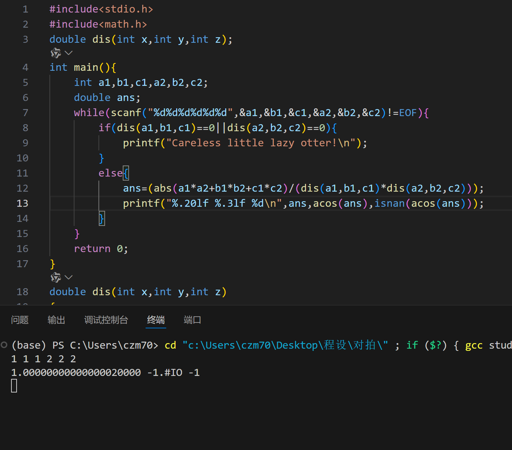

# 程序设计基础 E5 答案（2024秋）

## A 小懒獭与平面夹角

### 题目

#### 题目描述

小懒獭马上就要进行高代的期中考试了！

在复习的过程中，小懒獭复习到了如何根据法向量求两个平面的夹角：
$$
\theta=arccos(\frac{\left|A_1 A_2+B_1 B_2+C_1 C_2\right|}{\sqrt{A_1^2+B_1^2+C_1^2} \cdot \sqrt{A_2^2+B_2^2+C_2^2}})
$$
现在，小懒獭想实现一个程序自动去根据法向量计算两个平面的夹角，你能帮帮小懒獭吗？

#### 输入

不定组数据输入，保证数据组数不超过 1000。

每组数据输入一行，包含六个整数 $A_1, B_1, C_1, A_2, B_2, C_2 $ ，表示法向量  $\overrightarrow{n_1}$ 和 $\overrightarrow{n_2}$ 的分量；保证绝对值均不超过 $10^4$。

数据保证当两向量长度均非0时，两直线不平行。

#### 输出

对于每组数据，输出一行。

如果有某一法向量长度为 $0$，输出 `Careless little lazy otter!`；否则，输出一个浮点数，保留到小数点后三位，表示夹角的值（弧度制）。

#### 输入样例

```text
1 2 3 4 5 6
1 0 1 1 0 -1
```

#### 输出样例

```text
0.226
1.571
```

#### Hint

建议使用 `math.h` 库中以下几个函数：

- `acos(x)` 返回以弧度表示的 $x$ 的反余弦
- `sqrt(x)` 返回 $x$ 的完全平方根
- `abs(x)` 返回整数 $x$ 的绝对值

Author：Moca

### 答案

| 难度 | 考点 |
| --- | --- |
| 1 | 库函数 |

### 题目分析

根据给定的公式和 Hint，直接计算结果即可。需要注意的是首先，发现得到的最大值都是 `int` 范围内的，而且上面取绝对值内部的计算不涉及浮点数，所以用 `abs` 即可。

其次就是，题目保证了所给的两条线不会平行，为什么要给出这样的限制呢，如果平行了会发生什么？实际上，比如下面的代码：



可以看到，`ans` 的结果由于浮点误差，稍稍大于了 `1.0`；但是很显然没有任何弧度的 `cos` 值能大于 `1`，所以 `acos` 只能返回 `NaN`（Not a Number），出现错误。

### 示例代码

```c
#include<stdio.h>
#include<math.h>
int a1,a2,b1,b2,c1,c2;
int main(){
    while (~scanf("%d%d%d%d%d%d",&a1,&b1,&c1,&a2,&b2,&c2) ){
        int fm=abs(a1*a2+b1*b2+c1*c2);
        double fz=sqrt(a1*a1+b1*b1+c1*c1)*sqrt(a2*a2+b2*b2+c2*c2);
        if (a1*a1+b1*b1+c1*c1 == 0 || a2*a2+b2*b2+c2*c2 == 0)
            printf("Careless little lazy otter!\n");
        else
            printf("%.3lf\n",acos(fm/fz));
    }
    return 0;
}
```

## B ddz 学 RSA

### 题目

#### 题目描述

$ddz$ 在学习了 $RSA$ 加密算法后想自己动手实践一下，但他发现他确定好了公钥 $a$ 之后不知道如何利用公式 $ax≡1(mod\ p)$ 来计算私钥 $x$ ，他的好朋友给了他一个函数来帮助 $ddz$ 解决这个问题：

```text
long long inv(long long a, long long p) {
    long long ans = 1, b = p - 2;
    a = (a % p + p) % p;
    for (; b; b >>= 1) {
        if (b & 1) ans = (a * ans) % p;
        a = (a * a) % p;
    }
    return ans;
}
```

这个函数的返回值即私钥 $x$ ，现在让你来利用这个函数帮 $ddz$ 计算私钥。

#### 输入

第一行一个整数为数据组数 $n$ $( 1 \le n \le 10^5 )$

接下来 $n$ 行，每行两个整数 $a, p$ $( 1 \le a \le 10^{18},\ 2 \le p \le 10^9+7,\ gcd(a, p) = 1\ 且\ p\ 为质数)$

#### 输出

对于每组数据，输出一行一个整数 $x$ ，为私钥 $x$ 。

#### 输入样例

```text
2
3 2
2 998244353
```

#### 输出样例

```text
1
499122177
```

#### Hint

1. 注意这个函数只能在 $p$ 为质数的情况下使用。
2. 事实上满足 $ax≡1(mod\ p)$ 的 $x$ 称为 $a$ 在模 $p$ 意义下的逆元。等式两边同时除以 $a$ 可以得到 $\frac{1}{a}≡x(mod\ p)$ ，也就是说分数也是可以取模的，对于一个分数 $\frac{1}{a}$ 来说，模 $p$ 的结果即分母 $a$ 在模 $p$ 意义下的逆元 $x$ 。

##### Author: ddz

### 答案

| 难度 | 考点 |
| --- | --- |
| 2 | 函数 |

### 题目分析

把题目所给函数复制下来，输入数据并调用它，输出结果即可。

### 示例代码

```c
#include <stdio.h>
long long inv(long long a, long long p) {
    long long ans = 1, b = p - 2;
    a = (a % p + p) % p;
    for (; b; b >>= 1) {
        if (b & 1) ans = (a * ans) % p;
        a = (a * a) % p;
    }
    return ans;
}
int main() {
    long long n, a, p;
    scanf("%lld", &n);
    while (n--) {
        scanf("%lld %lld", &a, &p);
        printf("%lld\n", inv(a, p));
    }
    return 0;
}
```

## C 汉明距离 2024

### 题目

#### 题目描述

对于两个 `unsigned int` 类型（32 位无符号整数）范围内的自然数 $a$ 和 $b$，设它们的 32 位二进制表示分别为 $a_{31} a_{30} \cdots a_0 $ 和 $b_{31} b_{30} \cdots b_0 $， $a$ 和 $b$ 的汉明距离 $d(a, b) $ 定义为它们的 32 位二进制表示中有多少位不相同，即满足 $a_i \neq b_i$ 的 $i$ 的数量。

现在给出五个 `unsigned int` 范围内的自然数 $x_1$、 $\cdots$、 $x_5$，求出下列表达式的值：
$$ \max\{ d(x_1, x_2), d(x_1, x_3)\} + \max\{ d(x_2, x_4), d(x_3, x_4)\} + \max\{ d(x_3, x_5), d(x_4, x_5)\} $$

#### 输入

不定组数据输入，保证数据组数不超过 1000。

每组数据输入一行，包含五个 `unsigned int` 范围内的自然数 $x_1$、 $x_2$、 $x_3$、 $x_4$ 和 $x_5$。

#### 输出

对于每组数据，输出一行一个正整数，表示所求表达式的值。

#### 输入样例

```text
3 5 7 9 11
1 2 3 4 5
0 255 128 31 15
```

#### 输出样例

```text
7
7
19
```

Author：Moca

### 答案

| 难度 | 考点 |
| --- | --- |
| 2 | 函数、位运算 |

### 题目分析

可以把 `max` 和求汉明距离的 `d` 封装为函数，然后直接代题目中给出的公式即可。

`max` 除了用 `if-else` 结构实现之外，也可以用我们之前学过的三目表达式实现，更加简洁：

```c
// 命名最好不要与库函数冲突
int myMax(int a, int b) {
    return a > b ? a : b;
}
```

求汉明距离，实际上就是看有多少位不一样，可以用如下代码：

```c
int popcount(unsigned t) {
    int ret = 0;
    for(int i = 31; i >= 0 ;i--) {
        if((t >> i) & 1)
            ret++;
    }
    return ret;
}
int d(unsigned a, unsigned b) {
    // __builtin_popcount 不是 C 标准库函数，只是 gcc 支持，我们的 OJ 上也能用，在这里我们使用自己实现的函数了
    // __builtin_popcount 相关的一族函数感兴趣的同学可以查阅
    return popcount(a ^ b); 
}
```

### 示例代码

```c
#include <stdio.h>
int myMax(int a, int b) {
    return a > b ? a : b;
}
int popcount(unsigned t) {
    int ret = 0;
    for(int i = 31; i >= 0 ;i--) {
        if((t >> i) & 1)
            ret++;
    }
    return ret;
}
int d(unsigned a, unsigned b) {
    // __builtin_popcount 不是 C 标准库函数，只是 gcc 支持，我们的 OJ 上也能用，在这里我们使用自己实现的函数了
    // __builtin_popcount 相关的一族函数感兴趣的同学可以查阅
    return popcount(a ^ b); 
}
int main() {
    unsigned x[6];
    while (~scanf("%u%u%u%u%u", &x[1], &x[2], &x[3], &x[4], &x[5])) {
        int ans = myMax(d(x[1], x[2]), d(x[1], x[3])) + myMax(d(x[2], x[4]), d(x[3], x[4])) + myMax(d(x[3], x[5]), d(x[4], x[5]));
        printf("%d\n", ans);
    }
    
    return 0;
}
```

## D 小亮的圆周率 2024

### 题目

#### 题目背景

小亮正在学习《工科数学分析》(1)，当他学到了到数列极限时发现 π 可以通过多种数列求和求得，于是他想要查看一下通过不同的数列求得的 π 实数有何差异。但由于手算太麻烦，于是他决定利用自己刚刚学习的 C 语言来算并满足自己的好奇心。

小亮使用了下面两个不同的数列求得 π 的公式，它们分别是：

公式 1:
$$
\frac{\pi}{4} = \arctan 1 = \sum_{n=0}^{\infty} \frac{(-1)^n}{2n + 1}
$$

公式 2:
$$
\frac{\pi^2}{8} = \sum_{n=0}^{\infty} \frac{1}{(2n + 1)^2}
$$

#### 题目描述

请编写程序，通过式子 1 和公式 2 的前 n 项部分和计算出的 π 的差值的绝对值。

#### 输入

输入共 2 行：

- 第一行一个正整数 $T$，保证 $1 \leq T \leq 1000$。
- 第二行 $T$ 个正整数 $n_1, n_2, ..., n_T$，表示式 1 和公式 2 的部分和的项数。

保证 $1 \leq n \leq 10^4$。

#### 输出

共 $T$ 行：第 $i$ 行表示通过式子 1 和公式 2 的前 $n_i$ 项部分和计算出的 π 的差值的绝对值。

结果保留 6 位小数。

#### 输入样例

```text
2
2 3
```

#### 输出样例

```text
0.314757
0.432052
```

#### 样例解释

当 $n = 2$ 时，通过公式 1 可求得 $\pi_1 = 4 \times (1 - \frac{1}{3}) \approx 2.66666667$

通过公式 2 可求得 $\pi_2 = \sqrt{8 \times (1 + \frac{1}{3^2})} \approx 2.98142397$

公式 1 和公式 2 的前 2 项部分和的差值绝对值 $|\pi_1 - \pi_2| \approx 0.314757$

### 答案

| 难度 | 考点 |
| --- | --- |
| 3 | 函数、循环语句、浮点数 |

### 题目分析

本题可以先将两种求 `pi` 的方法进行封装，将结果作差取绝对值，主要考察循环和浮点数的计算。

$\sum_{n=0}^{\infty} \frac{(-1)^n}{2n+1}$ 公式中数列符号与 $n$ 的奇偶性有关。我们可以采取使用条件语句进行奇偶性判断。我们也可以采用示例代码中的方法，定义变量 `sign`，初始值为 $1$，每一次循环结束时， $sign$ 变量自乘 $-1$。这样即可作为第 $n$ 项的符号。

在整数除以整数时，如果想要得到浮点数，**一定要在表达式中乘以** `1.0`，**或者使用强制类型转换**，使表达式的计算范围扩展到浮点数范围。

### 示例代码

```c
#include<stdio.h>
#include <math.h>
double pi1(int n) {
    double col1 = 0;
    int sign = 1;
    for (int i = 0; i < n; ++i) {
        col1 += (1.0 * sign / (2 * i + 1));
        sign *= -1;
    }
    return col1 * 4;
}
double pi2(int n) {
    double col2 = 0;
    for (int i = 0; i < n; ++i) {
        col2 += (1.0 / ((2 * i + 1) * (2 * i + 1)));
    }
    return sqrt(8 * col2);
}
int main() {
    int t;
    int n;
    scanf("%d", &t);
    
    //循环 t 次
    while (t--) {
        scanf("%d", &n);
        printf("%.6lf\n", fabs(pi1(n) - pi2(n)));//输出，保留6位小数。注意浮点数绝对值使用fabs函数
    }
}
```

## E 卡皮巴拉小团队1

### 题目

#### 题目描述

卡皮巴拉学院的卡皮巴拉们在这学期有许多课程需要团队合作。**大佬巴拉**选择了若干只卡皮巴拉组成了卡皮巴拉小团队，其中有 $p$ 只**打工巴拉**和 $q$ 只**摆烂巴拉**。

卡皮巴拉小团队现在面临着 $t$ 项任务需要完成，每项任务需要 $n$ 只卡皮巴拉，只有这 $n$ 只卡皮巴拉中的**打工巴拉**数量**大于等于** $m$ 时，任务才能够完成。对于每项任务，大佬巴拉需要选择若干只卡皮巴拉去完成，请你计算出，**有多少种选择方案**能够完成任务。

#### 输入

第一行，3 个整数 $p,q,t$，分别表示**打工巴拉**数量、**摆烂巴拉**数量和任务个数，满足 $0 \leq p + q \leq 21,1 \leq t \leq 5$。

接下来 $t$ 行，每行 2 个整数 $n,m$，分别表示这项任务需要的卡皮巴拉数量和任务完成需要的**打工巴拉**数量，满足 $0 \leq m \leq n \leq 21$。

#### 输出

对于每项任务，输出能够完成任务的方案数。

#### 输入样例 1

```text
3 2 2
3 2
5 4
```

#### 输出样例 1

```text
7
0
```

#### 输入样例 2

```text
6 5 2
5 3
7 0
```

#### 输出样例 2

```text
281
330
```

#### Hint

可以参考课件 **P5-函数** 中的递归求组合数。
递归求组合数需要用到帕斯卡法则 $C(m,n) = C(m-1, n) + C(m-1, n−1)$ 。

### 答案

| 难度 | 考点 |
| --- | --- |
| 3 | 数据类型，组合数，函数 |

### 题目分析

题目大意：

在给定数量的打工巴拉和摆烂巴拉中，选择符合条件的卡皮巴拉组合来完成任务。任务成功的条件是选择的组合中打工巴拉的数量满足任务要求。

解题思路：

可以遍历符合条件的打工巴拉数，设 $k$ 为选择的打工巴拉数量（满足 $m \le k \le p$ 且 $k \le n$），剩余的 $n - k$ 个卡皮巴拉则从摆烂巴拉中选择。对于每个 k 的值，计算出符合条件的方案数，并累加得到最终结果。

接下来的关键在于组合的数量计算。组合数求解有两种方法，一种是递归函数（函数自己调用自己），另一种是非递归函数。

对于 PPT 中的非递归做法，在求阶层的连乘过程中可能会溢出，导致即使 `long long` 也无法存下（同学们可以算算题目数据范围求阶层极限情况的数据大小）。所以需要进行运算步骤的调整，一边乘一边除，如下示例代码。

对于递归做法，需要用到帕斯卡法则，这种方法不会溢出。

### 示例代码

```c
#include <stdio.h>
// 组合数计算函数，非递归函数
long long comb(int m, int n) {
    if (n == 0 || m == n)
        return 1;
    if (m < n)
        return 0;
    if (n == 1)
        return m;
    long long result = 1;
    for (int i = 1; i <= n; i++) {
        result = result * (m - i + 1) / i;
    }
    return result;
}
// 组合数计算函数，递归函数
int comb_num(int m, int n) {
    if (n == 0 || m == n)
        return 1;
    if (m < n)
        return 0;
    if (n == 1)
        return m;
    return comb_num(m - 1, n) + comb_num(m - 1, n - 1);
}
int MIN(int a, int b) {
    return a < b ? a : b;
}
int main() {
    int p, q, t;
    scanf("%d%d%d", &p, &q, &t);
    while (t--) {
        int n, m;
        scanf("%d%d", &n, &m);
        int sum = 0;
        // 枚举可以选择的打工巴拉数量
        for (int i = m; i <= MIN(n, p); i++) {
            // p 个打工巴拉中选取 i 个，q 个摆烂巴拉中选择 n-i 个
            // sum += comb(p, i) * comb(q, n - i);
            sum += comb_num(p, i) * comb_num(q, n - i);
        }
        printf("%d\n", sum);
    }
    return 0;
}
```

## F 斐波那契数列 (hard version)

### 题目

#### 题目描述

如果每对大兔子每月能生殖一对小兔子，每对小兔子需要花一个月长成大兔子，那么在第一个月有 $0$ 对大兔子， $1$ 对小兔子的情况下，兔子每个月的数量情况会形成下面这个数列：

$$
1,1,2,3,5,8,13,21,\cdots
$$

这个数列被称为斐波那契数列，又称兔子数列。

现在，改变第一个月的大兔子数量和小兔子数量，请你判断第 $n$ 个月时总共有多少对兔子？

由于这个数很大，请你输出兔子总数对 $998244353$ 取模的结果。

#### 输入

第一行两个非负整数 $a,b$，表示在第一个月里，有 $a$ 对大兔子， $b$ 对小兔子， $0\le a \le 10^9, 0\le b \le 10^9$。

第二行一个正整数 $t$，表示数据组数， $1\le t \le 10^4$。

接下来 $t$ 行，每行一个正整数 $n$，表示询问第 $n$ 个月时，兔子总数有多少对， $1\le n \le 10^6$。

#### 输出

对于每组数据，输出一行一个正整数，表示第 $n$ 个月时的兔子总数（对）模 $998244353$ 的结果。

#### 输入样例 1

```text
1 0
3
1
4
2
```

#### 输出样例 1

```text
1
5
2
```

#### 输入样例 2

```text
114514 1919810
3
1
2
10
```

#### 输出样例 2

```text
2034324
2148838
115781296
```

#### 样例解释

对于第二组样例，第一个月大小兔子数量分别为 $114514, 1919810$，总数 $2034324$。第二个月大小兔子数量分别为 $2034324, 114514$，总数 $2148838$。

##### Author: Gino

### 答案

| 难度 | 考点 |
| --- | --- |
| 3 | 递推，数组 |

### 题目分析

这题与 `easy version` 相比，区别仅在于数据范围的显著增大。我们知道，递归解法的时间复杂度是指数级的，显然无法解决这么大数据范围的计算。

注意到，我们使用递归解法时，总是要重新计算 `f(n - 1)` 和 `f(n - 2)`，而重新计算 `f(n - 1)` 的时候又需要重新计算 `f(n - 2)` 和 `f(n - 3)`，效率十分低下。因此，我们可以直接拿数组将计算过的 `f[n - 1]` 和 `f[n - 2]` 存储起来，计算 `f[n]` 的时候只需要使得 `f[n] = f[n - 1] + f[n - 2]` 进行一次运算即可。由于少了大量重复运算，单次计算的时间复杂度也从 $O(1.618^n)$ 降低到 $O(n)$。

然而，如果仅仅是这样的话，那么仍然无法通过测试，因为我们有 $10^4$ 组数据，最终的时间复杂度是 $O(tn)$。因此，我们还需要进一步的去除重复计算。

对此，解决方法是，我们提前计算 `f[1000000]`，而在这个过程中，`f[0]` 到 `f[1000000]` 之间的所有结果都已经算出，我们只需把它们都存储起来，然后在之后的询问中直接查询答案即可。这样，我们 $O(n)$ 预处理了所有答案，然后对于之后的每次询问只需 $O(1)$ 查询。

注意，有些写法可能没有将 `f[1]` 或 `f[2]` 对 `998244353` 取模，导致 WA，注意边界情况的处理。

### 示例代码

```c
#include <stdio.h>
#define mod 998244353
int ans[1000005];
int main(void)
{
    int a, b;
    scanf("%d%d", &a, &b);
    ans[0] = a % mod;
    ans[1] = (a + b) % mod;
    for (int i = 2; i <= 1000000; i++)
    {
        ans[i] = ans[i - 1] + ans[i - 2];
        if (ans[i] >= mod)
            ans[i] -= mod;
    }
    int t;
    scanf("%d", &t);
    while (t--)
    {
        int n;
        scanf("%d", &n);
        printf("%d\n", ans[n]);
    }
    return 0;
}
```

## G 回到十七岁那年

### 题目

#### 题目描述

如果 $\left( a_{1}, a_{2}, \cdots, a_{n} \right)$ 是 $\left\{ 1, 2, \cdots, n \right\}$ 的排列且 $\displaystyle \sum_{1 \leqslant k \leqslant n} \left( a_{k} \times 10^{n - k} \right)$ 是 $17$ 的倍数，那么 $\left( a_{1}, a_{2}, \cdots, a_{n} \right)$ 有多少种取值。

#### 输入

不小于 $4$ 且不大于 $9$ 的正整数 $n$ 。

#### 输出

第一行，满足题意的 $\left( a_{1}, a_{2}, \cdots, a_{n} \right)$ 的取值的数量。

第二行， $\left( a_{1}, a_{2}, \cdots, a_{n} \right)$ 满足题意时 $\displaystyle \sum_{1 \leqslant k \leqslant n} \left( a_{k} \times 10^{n - k} \right)$ 的最小值。

第三行， $\left( a_{1}, a_{2}, \cdots, a_{n} \right)$ 满足题意时 $\displaystyle \sum_{1 \leqslant k \leqslant n} \left( a_{k} \times 10^{n - k} \right)$ 的最大值。

#### 输入样例

```text
4
```

#### 输出样例

```text
1
2431
2431
```

#### 说明

$2431$ 是 $17$ 的倍数。

### 答案

| 难度 | 考点 |
| --- | --- |
| 4 | 递归，全排列 |

### 题目分析

我们可以生成 $\{1, 2, \cdots, n\}$ 的每个排列然后进行研究。

设 `f(x)` 表示在 $(a_1, a_2, \cdots, a_x)$ 已经被确定的情况下生成排列然后进行研究。

如果 $x = n$，说明 $(a_1, a_2, \cdots, a_n)$ 已经被确定，可以直接进行研究。

如果 $x < n$，说明 $(a_1, a_2, \cdots, a_n)$ 尚未被确定，由于此时 $(a_1, a_2, \cdots, a_x)$ 已经被确定，我们可以确定 $a_{x+1}$ 后通过 `f(x+1)` 进行生成和研究；也就是说，对于 $\{1, 2, \cdots, n\}$ 中的每一个数 $v$，如果 $v$ 在 $\{a_1, a_2, \cdots, a_x\}$ 中出现了 $0$ 次，那么就可以将 $a_{x+1}$ 确定为 $v$ 后调用 `f(x+1)`。

### 示例代码

```c
# include <stdio.h>
int n;
int a[10], b[10];
int m = 0, l = 987654321, r = 0;
void f(int x) {
    if (x == n) {
        int s = 0;
        for (int k = n, t = 1; k >= 1; k--, t *= 10) {
            s += a[k] * t;
        }
        if (s % 17 == 0) {
            m += 1;
            if (s < l) {
                l = s;
            }
            if (s > r) {
                r = s;
            }
        }
    } else {
        for (int v = 1; v <= n; v++) {
            if (b[v] == 0) {
                a[x + 1] = v;
                b[v] += 1;
                f(x + 1);
                a[x + 1] = 0;
                b[v] -= 1;
            }
        }
    }
}
int main() {
    scanf("%d", &n);
    f(0);
    printf("%d\n%d\n%d", m, l, r);
    return 0;
}
```

## H 小懒獭与 Hardmard 矩阵

### 题目

#### 题目描述

小懒獭在学习 `Coding Theory` 的过程中，遇到了一种非常美丽的矩阵，叫 `Hardmard` 矩阵，可以用来构造纠错码。

现有 $2^n\times 2^n (n\le10)$ 大小的 `Hardmard` 矩阵，它的构造方法如下：

- 初始时，矩阵内的所有元素都为 $1$

- 将原矩阵均分为 4 个更小的正方形矩阵，每个更小的矩阵的边长是原矩阵的一半，然后将右下角那一个矩阵的所有数字取相反数，即

$$
H_{n}= \left[\begin{array}{cc}
H_{n-1} & H_{n-1} \\\\
H_{n-1} & -H_{n-1}
\end{array}\right]
$$

- 每一个矩阵继续分为 4 个更小的矩阵，然后通过同样的方式进行处理，直到矩阵无法再继续分下去（边长为 1），结束这个过程

小懒獭感觉求解 `Hardmard` 矩阵的过程和自己在上一次程设课上学到的函数递归的过程很像，于是她想让你帮她实现一个程序，能够帮她求出 $2^n$ 阶 `Hardmard` 矩阵。

#### 输入

一个整数 $n$ ( $0 \le n \le 10$ )

#### 输出

$2^n \times 2^n$ 的 01 矩阵，数字之间有一个空格。

#### 输入样例

```text
2
```

#### 输出样例

```text
1 1 1 1
1 -1 1 -1
1 1 -1 -1
1 -1 -1 1
```

Author：Moca，Saisyc

### 答案

| 难度 | 考点 |
| --- | --- |
| 5 | 递归、循环 |

### 题目分析

思路一：递归输出每个位置

**定义一个函数 $f(k, i, j)$，表示输出 $k$ 阶图案第 $i$ 行第 $j$ 个位置（从第0行第0列开始记）。**

- 若 $k = 0$，则输出 `1`；
- 如果 $(i, j)$ 在 $k$ 阶图案的左上、右上或者右下角，输出 $f(k - 1, i', j')$，其中 $i' = i \bmod 2^{k-1}$， $j' = j \bmod 2^{k-1}$。
- 否则（即在右下角），输出 $-f(k - 1, i', j')$，其中 $i' = i \bmod 2^{k-1}$， $j' = j \bmod 2^{k-1}$。

具体实现参照示例代码。

思路二：递归+二维数组（暂时没学，下节课才会学，仅供参考）

由于二维数组还未学到，本思路仅作为参考。

跟思路 1 差不多，只不过一开始把整个数组元素都初始化为 1，随着递归的进行修改数组元素，最后再统一输出。

具体实现参照示例代码。

思路三：循环+二维数组（暂时没学）

由于二维数组还未学到，本思路仅作为参考。

由 $k$ 阶图案生成 $k + 1$ 阶图案可由下列两步操作实现：

1. 将 $k$ 阶图案复制 $4$ 份，拼在一起形成一个大正方形（即向右、向下、向右下复制平移）；
2. 把右下角的所有元素取相反数。

依次思路， $k$ 阶图案仅需要从原始图案重复执行上列操作 $k$ 遍即可得到。

具体实现参照示例代码及注释。

### 示例代码 1

```c
#include <stdio.h>
int f(int i, int j, int n) {
    if(n == 0)
        return 1;
    else if(i >= (1 << n - 1) && j >= (1 << n - 1))
        return -f(i % (1 << n - 1), j % (1 << n - 1), n - 1);
    else
        return f(i % (1 << n - 1), j % (1 << n - 1), n - 1);
}
int main() {
    int k;
    scanf("%d", &k);
    for (int i = 0; i < (1 << k); i++) {
        for (int j = 0; j < (1 << k); j++)
            printf("%d ", f(i, j, k));
        printf("\n");
    }
    return 0;
}
```

### 示例代码 2

```c
#include <stdio.h>
// 用 int 会 MLE，可以用 short、char 或者压位数组
char a[1030][1030];
void dfs(int i, int j, int n) {
    if(n == 0)
        return ;
    int tem = 1 << (n - 1);
    int tem2 = 1 << n;
    for(int k = i + tem ; k < i + tem2 ;k++)
        for(int l = j + tem ; l < j + tem2 ;l++)   
            a[k][l] *= -1;
    
    dfs(i, j, n - 1);               // 左上
    dfs(i + tem, j, n - 1);         // 右上
    dfs(i, j + tem, n - 1);         // 左下
    dfs(i + tem, j + tem, n - 1);   // 右下
}
int main() {
    int n;
    scanf("%d", &n);
    int tem = 1 << n;
    for(int i = 1; i <= tem ;i++)
        for(int j = 1; j <= tem ;j++)
            a[i][j] = 1;
    dfs(1, 1, n);
    for(int i = 1; i <= tem ;i++) {
        for(int j = 1; j <= tem ;j++)
            printf("%d ", a[i][j]);
        printf("\n");
    }
    return 0;
}
```

### 示例代码 3

```c
#include <stdio.h>
short a[1024][1024] = {{1}}; //初始为一个1
int main()
{
    int K;
    scanf("%d", &K);
    for(int k = 1; k <= K; ++k) //K遍操作
    {
        for(int i = 0; i < (1 << (k - 1)); ++i)
            for(int j = 0; j < (1 << (k - 1)); ++j)
                a[i + (1 << (k - 1))][j + (1 << (k - 1))] = a[i + (1 << (k - 1))][j] = a[i][j + (1 << (k - 1))] = a[i][j]; //向右、下、右下复制平移
        for(int i = 0; i < (1 << (k - 1)); ++i)
            for(int j = 0; j < (1 << (k - 1)); ++j)
                a[i + (1 << (k - 1))][j + (1 << (k - 1))] *= -1; // 右下角取反
    }
    for(int i = 0; i < (1 << K); ++i)
    {
        for(int j = 0; j < (1 << K); ++j)
            printf("%d ", a[i][j]);
        printf("\n"); //每行之间要换行
    }
    return 0;
}
```

<!-- markdownlint-disable-next-line MD026 -->
## I 欢乐！欢乐！

### 题目

#### 题目描述

自从小 $P$ 成为了助教后，便非常愿意为同学们答疑。小 $P$ 每花 $x$ 分钟为一名同学答疑，就能获得 $x$ 点愉悦度，而小 $P$ 当天的欢乐度是从每名同学处获得的愉悦度之积。由于每名同学问的问题都不同，小 $P$ 答疑所需要的时间也有所不同，但小 $P$ 总以分钟做最低单位，即 $x$ 总为正整数。

由于小 $P$ 每天最多可以帮同学们答疑 $n$ 分钟，即花费时间 $x$ 之和不能超过 $n$。请问小 $P$ 每天获得的最大欢乐度为多少？

##### 由于结果可能很大，请将结果对 $10^9+7$ 取模

注：若小 $P$ 当天未帮其他同学答疑，则欢乐度为 $0$；若只帮一名同学答疑，则欢乐度为从该名同学处获得的愉悦度。

#### 输入

第一行给出整数 $T$，代表数据组数。其中， $0<T≤2*10^5$。

接下来每组数据中，将给出一个整数 $n$， $0≤n≤10^9$。

具体含义见题目描述。

#### 输出

输出一行整数，代表小P获得的最大欢乐度。

#### 输入样例

```text
2
4
7
```

#### 输出样例

```text
4
12
```

#### 样例解释

对于第一组数据，当一名同学来答疑且花费时间 $x$ 为 $4$ 时，小  $P$ 的欢乐度达到最大。其他情况如两名同学来答疑且花费时间 $x$ 分别为 $2,2$，三名同学来答疑且花费时间 $x$ 分别为 $1,1,2$，小  $P$ 的欢乐度分别为 $4,2$，均小于等于 $4$ 。

对于第二组数据，当三名同学来答疑且花费时间 $x$ 分别为 $2,2,3$ 时，可证明小 $P$ 的欢乐度达到最大。

#### Hint

如果你通过了第一个测试点，以下HINT或许可以帮助到你：

$level 1:$

对于 $a^b,a^c(b<c)$ ，当计算完 $a^b$ 后，可用以下公式计算 $a^c$：
$$a^c=a^{c-b+b}=a^{c-b}\times a^b$$

$level 2:$

若 $b$ 为奇数，有：
$$a^b=a^{b-1}\times a=(a^2)^{\frac{b-1}2}\times a$$

若 $b$ 为偶数，有：
$$a^b=(a^2)^{\frac{b}2}$$

Adaptation author：小P

### 答案

| 难度 | 考点 |
| --- | --- |
| 5 | 贪心、快速幂（可能） |

### 题目分析

可将题目改变为：选取任意多个正整数（可能为 $0$ 个），使这些数之和为 $n$，求这些数乘积的最大值。

设取出 $m$ 个正整数，分别为 $a_1, a_2, \ldots\ldots, a_m$。根据贪心原理，当 $n > 1$ 时，可以得到下面三条原则：

1. $a_i \ge 2$；
2. $a_i \le 3$；
3. 对于 $a_1, a_2, \ldots\ldots, a_m$，至多有两个 $2$。

对于第一条，若 $a_i = 1$，则其不会给最后的乘积带来任何贡献，但会使其他数之和 $-1$。

对于第二条，若 $a_i > 3$，可将 $a_i$ 改为 $a_i - 2, 2$ 这两个数。由于两者有相同的加和，但 $a_i \le 2 * (a_i - 2)$，故改后的乘积永远不小于改前，即不选大于 $3$ 的数所得结果总优于选大于 $3$ 的数。

对于第三条，当选出的正整数中有 $3$ 个 $2$ 时，由于 $2 + 2 + 2 = 3 + 3$，但 $2 * 2 * 2 < 3 * 3$。所以将 $3$ 个 $2$ 替换为 $2$ 个 $3$ 后这些数的乘积永远大于替换前，即不选超过 $2$ 个 $2$ 所得结果总优于选超过 $2$ 个 $2$。

因此可以发现，对于每个 $n$，若满足以上三条原则，则均有唯一的选取方案，依照此方案计算答案即可。

在求解的过程中，需要求 $3$ 的 $x$ 次方模 $10^9 + 7$ 的结果。而这里的 $x$ 最大可以达到 $3 * 10^8$ 左右，直接一位一位相乘将会 $TLE$，且数组也记录不了这么多个的数。

下面介绍一种快速求幂的板子，它可以在 $p$ 不是特别大（ $int$ 范围内的正整数均可以）时快速求出 $a$ 的 $b$ 次方模 $p$ 的结果：

```c
/*快速求 a 的 b 次方模 p 的结果. 时间复杂度为 O(logN)，称为 快速幂 。板子来自于助教组*/
long long qpow(long long a, unsigned long long b, long long p) {
    long long ans = 1;
    a = a % p;
    while(b) {
        if(b & 1)
            ans = (ans * a) % p;
        b >>= 1;
        a = a * a % p;
    }
    return ans;
}
```

其实解决这个的方法还有很多，也有比快速幂时间负责度更优的写法。设变量 $x \ge 1$，时间复杂度最低可以为 $O(n^{1/x} + T * x)$。当 $x$ 满足 $n^{1/x} = T * x$ 时，达到最优时间复杂度。但在实际情况中， $x$ 只能为正整数，故在本题的 $T, n$ 限制下， $x = 2$ 时时间复杂度最优，为 $O(n^{1/2} + T)$。

具体代码见下（快速幂解法）：

### 示例代码

std：

```c
#include<stdio.h>
long long mod=1000000007;
long long quick(long long x,long long n)
{
    long long sum=1;
    while(n>0)
    {
        if(n%2==1)
        {
            sum=sum*x%mod;
        }
        x=x*x%mod;
        n/=2;
    }
    return sum;
}
signed main()
{
    long long t,x,a,b,sum; //a^b
    scanf("%lld",&t);
    while(t--)
    {
        scanf("%lld",&x);
        if(x==0)
        {
            printf("0\n");
        } 
        else if(x==1)
        {
            printf("1\n");
        }
        else if(x%3==0)
        {
            a=3;
            b=x/3;
            sum=quick(3,b);
        
            printf("%lld\n",sum);
        }
        else if(x%3==1)
        {
            a=3;
            b=x/3-1;
            sum=quick(3,b);
            printf("%lld\n",sum*4%mod);
        }
        else if(x%3==2)
        {
            a=3;
            b=x/3;
            sum=quick(3,b);
            printf("%lld\n",sum*2%mod);
        }
    }
    return 0;
}
```

## J ddz 与 01 序列

### 题目

#### 注意

本题相较于前面的编程题而言难度较高，请为了复习程设练手的同学忽略该题。

#### 题目描述

$ddz$ 最喜欢的两个数字是 $0$ 和 $1$ ，他想把一个只有一个数 $n$ 的序列变成只有 $0$ 和 $1$ 的一个序列，考虑如下操作：

- 将序列中的一个大于 $1$ 的数 $x$ 移除，并按顺序将三个数 $\lfloor\frac{x}{2}\rfloor$ ， $x\ mod\ 2$ ， $\lfloor\frac{x}{2}\rfloor$ 放入原来 $x$ 在序列中的位置。

$ddz$ 一直执行上述操作直到序列中只剩下 $0$ 和 $1$ 。 $ddz$ 想知道最终的序列从第 $l$ 项开始到第 $r$ 项中有多少个 $1$ 。

#### 输入

输入一行三个整数 $n,\ l,\ r$ $( 0 \le n \le 10^{15} ,\ 1 \le l \le r )$ ，含义如题所示。保证 $r$ 不大于最终序列的长度

#### 输出

对于每组数据，输出一行一个整数 $num$ ，表示最终的序列从第 $l$ 项开始到第 $r$ 项中有 $num$ 个 $1$ 。

#### 输入样例

```text
10 2 9
```

#### 输出样例

```text
5
```

#### 样例解释

序列演变过程 $[10]\rightarrow[5, 0, 5]\rightarrow[2, 1, 2, 0, 5]\rightarrow[2, 1, 2, 0, 2, 1, 2]\rightarrow[1, 0, 1, 1, 2, 0, 2, 1, 2]$ $\rightarrow[1, 0, 1, 1, 1, 0, 1, 0, 2, 1, 2]\rightarrow[1, 0, 1, 1, 1, 0, 1, 0, 1, 0, 1, 1, 2]$ $\rightarrow[1, 0, 1, 1, 1, 0, 1, 0, 1, 0, 1, 1, 1, 0, 1]$ 其中第 $2$ 项到第 $9$ 项为 $[0, 1, 1, 1, 0, 1, 0, 1]$ 其中有 $5$ 个 $1$

##### Author: ddz

### 答案

| 难度 | 考点 |
| --- | --- |
| 7 | 函数、递归 |

### 题目分析

首先有几点观察：

1. 操作后所有数字和不变。显然有 $x = \lfloor \frac{x}{2} \rfloor + (x \bmod 2) + \lceil \frac{x}{2} \rceil$，所以对任意一个数字一直操作下去，最终得到的序列中 $1$ 的个数等于原来的数。
2. 一个序列中对不同两个数的操作互不影响。
3. 对一个数字 $n$ 一直操作到最后得到的序列长度为 $2^{\lfloor log_2 n \rfloor + 1} - 1$。记 $f(n)$ 为前述长度，那么有 $f(n) = f(\lfloor \frac{n}{2} \rfloor) \times 2 + 1$，此式可以用递归实现，或者记 $t$ 为 $n$ 的二进制表示的位数，得到 $f(t) = f(t - 1) \times 2 + 1$，运用数列的知识可以解出最终序列长度。

后续题解中 $f(n)$ 表示对一个数字 $n$ 一直操作到最后得到的序列长度

考虑用递归函数解决此题，为了简化递归函数，我们可以利用前缀和的思想计算前 $r$ 项中 $1$ 的个数和前 $l - 1$ 项中 $1$ 的个数，他们相减即为答案。令函数 $cal(n, num)$ 为求将 $n$ 展开为 01 串之后前 $num$ 项中 $1$ 的个数，我们现在来完成这个 $cal$ 函数：

当 $n = 0 \ or \ 1$，直接返回 $n == 1 \ ? \ 1 : 0$，其余情况都需要将 $n$ 先操作一次变成 $\lfloor \frac{n}{2} \rfloor, (n \bmod 2), \lceil \frac{n}{2} \rceil$。

1. 当 $num \le f(\lfloor \frac{n}{2} \rfloor)$ 时，我们只需计算 $\lfloor \frac{n}{2} \rfloor$ 展开后的前 $num$ 项中 $1$ 的个数，即返回 $cal(\lfloor \frac{n}{2} \rfloor, num)$。
2. 当 $num = f(\lfloor \frac{n}{2} \rfloor) + 1$ 时，结果是 $\lfloor \frac{n}{2} \rfloor$ 展开后的所有 $1$ 的个数加上 $n \bmod 2$ 是否是 $1$，也就是 $\lfloor \frac{n}{2} \rfloor + n \bmod 2 == 1 \ ? \ 1 : 0$。
3. 当 $num > f(\lfloor \frac{n}{2} \rfloor) + 1$ 时，用 2. 的结果加上 $\lfloor \frac{n}{2} \rfloor$ 展开后的前 $num - (f(\lfloor \frac{n}{2} \rfloor) + 1)$ 项的 $1$ 的个数，即 $\lfloor \frac{n}{2} \rfloor + n \bmod 2 == 1 \ ? \ 1 : 0 + cal(\lfloor \frac{n}{2} \rfloor, num - (f(\lfloor \frac{n}{2} \rfloor) + 1))$。

完成 $cal$ 函数之后，输出 $cal(n, r) - cal(n, l - 1)$ 即可。

### 示例代码

```c
#include <stdio.h>
#define ll long long
ll f(ll n) {
    ll res = 1;
    while (n) res <<= 1, n >>= 1;
    return res - 1;
}
ll cal(ll n, ll num) {
    if (num == 0) return 0;
    if (n <= 1) return n & 1;
    ll len = f(n / 2);
    if (num <= len) return cal(n / 2, num);
    if (num == len + 1) return n / 2 + (n & 1);
    return n / 2 + (n & 1) + cal(n / 2, num - len - 1);
}
int main() {
    ll n, l, r;
    scanf("%lld %lld %lld", &n, &l, &r);
    printf("%lld", cal(n, r) - cal(n, l - 1));
    return 0;
}
```

当然，也可以将这个递归函数展开成一个循环：

```c
#include <stdio.h>
#define ll long long
ll f(ll n) {
    ll res = 1;
    while (n) res <<= 1, n >>= 1;
    return res - 1;
}
ll cal(ll n, ll num) {
    ll res = 0;
    while (n > 1) {
        if (num == 0) {
            return res;
        }
        ll len = f(n / 2);
        if (num <= len) {
            n /= 2;
        } else if (num == len + 1) {
            return res + n / 2 + (n & 1);
        } else {
            res += n / 2 + (n & 1);
            n /= 2;
            num -= len + 1;
        }
    }
    return res + (n & 1);
}
int main() {
    ll n, l, r;
    scanf("%lld %lld %lld", &n, &l, &r);
    printf("%lld", cal(n, r) - cal(n, l - 1));
    return 0;
}
```
