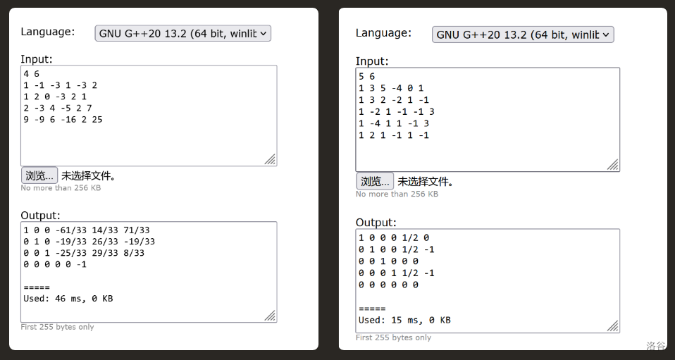
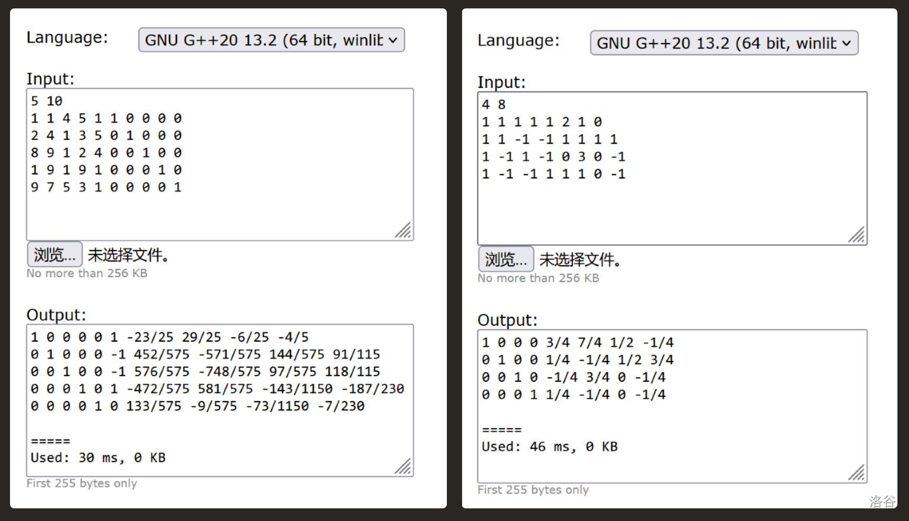

# 程序设计基础 E6 题目（2024秋）

## A 字符串距离

### 题目描述

给定两个长度相等的字符串 $A$ 和 $B$，每个字符串只包含小写字母。字符串 $A$ 和字符串 $B$ 的距离定义为每一位字符的 ASCII 值差的绝对值之和。例如，`A = "abc"` 和 `B = "bcd"`，则 `A` 和 `B` 的距离为
$$
|a - b| + |b - c| + |c - d| = 1 + 1 + 1 = 3
$$
请编写一个程序，计算字符串 $A$ 和 $B$ 的距离。

#### **输入格式**

共两行，第一行代表字符串 $A$，第二行代表字符串 $B$。保证字符串只由小写字母组成，长度不超过 $1000$ 。

#### **输出格式**

一个正整数，表示字符串距离。

#### **样例输入**

```text
abc
bcd
```

#### **样例输出**

```text
3
```

Author：Moca

## B 努力学习的小懒獭

### 题目描述

小懒獭开始了一段努力学习的旅程。但由于她是小“懒”獭，她时常会在学习中偷懒。每当小懒獭学习时，她的智力都会得到提升，而偷懒将不会提升智力。

- 用 `S` 表示小懒獭学习了一次，智力提升了目前连续出现的 `S` 的个数
- 用 `L` 表示小懒獭偷懒了一次，智力不会提升（但也不会下降），但会中断连续的 `S`

如 `SSLS`，第一个 `S` 智力提升一点，第二个 `S` 智力提升两点，`L` 智力不变化，第三个 `S` 智力提升一点。所以小懒獭最后智力将提升四点。

现在给定一个小懒獭的活动序列，请你计算她最后智力提升了多少点。

### 输入

一个字符串，表示小懒獭的活动序列，仅由 `S` 与 `L` 组成，保证长度在 $1$ 到 $1000$ 之间。

### 输出

一个整数，表示小懒獭经过活动序列后智力提升了多少点。

### 输入样例

```text
SSLS
```

### 输出样例

```text
4
```

## C 三生万物2024

### 题目描述

道德经：“道生一，一生二，二生三，三生万物。”

$3$ 是一个很玄妙的数字，卡皮巴拉给了你一个正整数，希望你用 $3$ 的幂次将它表示出来。

比如，对于正整数 $19$，我们可以表示为 `19 = 3^0 + 2*3^2` 。

### 输入

不定行输入，每行一个正整数 $x$（ $1 \leq x \leq 10^{9}$）。

### 输出

对于每一个 $x$ ，输出一行，用 $3$ 的幂次表示 $x$。

注意，对于某一项 `a*3^i` ，如果 $a=0$，则省略这一项；如果 $a=1$，则不输出 `a*`。只有 `=` 和 `+` 与其他数字之间有一个空格。项的顺序按照幂次从小到大排列。

### 输入样例

```text
2024
11
5
```

### 输出样例

```text
2024 = 2*3^0 + 2*3^1 + 2*3^2 + 2*3^3 + 2*3^5 + 2*3^6
11 = 2*3^0 + 3^2
5 = 2*3^0 + 3^1
```

Author：Yury

## D 小懒獭与矩阵乘法

### 题目描述

小懒獭最近学习了矩阵乘法，她决定编写一个程序帮她求出两个矩阵的乘积。

已知两个矩阵 $A$ 和 $B$ 分别为 $N \times M$ 和 $M \times P$ 的矩阵，小懒獭需要计算出它们的乘积矩阵 $C$，其中 $C$ 是一个 $N \times P$ 的矩阵，满足：

$$
C[i][j] = \sum_{k=1}^M A[i][k] \times B[k][j]
$$

### 输入

第一行包含三个正整数 $N$、 $M$、 $P$，表示矩阵 $A$ 的行数、列数和矩阵 $B$ 的列数。

接下来 $N$ 行，每行包含 $M$ 个整数，表示矩阵 $A$ 的元素。

接下来 $M$ 行，每行包含 $P$ 个整数，表示矩阵 $B$ 的元素。

保证 $1 \le N,M,P \le 100$，矩阵中元素的值在 $[-100,100]$ 范围内。

### 输出

输出 $N$ 行，每行包含 $P$ 个整数，表示矩阵乘积的结果；相邻整数间用空格隔开

### 输入样例

```text
2 3 2
1 2 3
4 5 6
7 8
9 10
11 12
```

### 输出样例

```text
58 64
139 154
```

### 解释

根据输入数据，矩阵 $A$ 为：
$$
\begin{bmatrix}
1 & 2 & 3 \\\\
4 & 5 & 6
\end{bmatrix}
$$
矩阵 $B$ 为：
$$
\begin{bmatrix}
7 & 8 \\\\
9 & 10 \\\\
11 & 12
\end{bmatrix}
$$
矩阵乘积 $C$ 为：
$$
\begin{bmatrix}
58 & 64 \\\\
139 & 154
\end{bmatrix}
$$

## E 摩卡与数独

### 题目描述

Moca 最近发现了一种叫做数独的益智游戏。

经典的数独规则是这样的：

- 将一个 $9 \times 9$ 的方格分为 9 个 $3 \times 3$ 的小方格，每个 $3 \times 3$ 方格称为一个宫
- 开始时一些方格中的数字是给定的，玩家需要根据推理，填写剩余方格中的数字，直到所有方格中都被填上了数字
- 最后**在每一行、每一列、每一宫中，数字 1 - 9 都出现且只出现一次**，则填写正确

Moca 喜欢做数独，但她不喜欢检查自己做的数独是否正确，尽管这很简单。所以，她希望你能帮她写一个程序，对于一个给定的初始状态，检查她做的数独是否正确。

### 输入

第一行一个正整数 $t$ ，表示 Moca 做了多少数独， $1 \le t \le 5$ 。

接下来 $t$ 组输入，每组输入之前有一个空行。每组输入 $19$ 行：前九行每行九个数字，为初始的数独局面， $0$ 代表待填写的数字，其余数字代表初始给定的数字，保证初始局面中所有数字一定是 $0$ 到 $9$ 中的一个；接下来一行空行；后九行每行九个数字，表示对应做出来的数独，保证做出来的数独中的数字一定是 $1$ 到 $9$ 中的一个。

### 输出

输出 $t$ 行，如果第 $i$ 组做出来的数独对于第 $i$ 组初始局面数独填写正确，那么对应输出行输出 `Moca finish this sudoku perfectly!` ；否则（包括做出来的数独虽然正确，但是不符合给定的初始局面的情况）输出 `Moca is so careless!` 。

### 输入样例

```text
3

0 2 0 4 0 0 0 0 0
4 5 0 7 0 0 0 0 3
0 8 9 0 3 0 0 0 6
2 0 0 0 0 0 8 0 0
0 9 0 0 0 0 0 6 5
3 0 5 8 7 0 2 0 0
5 0 0 0 0 0 9 7 8
6 0 0 9 0 0 0 0 1
0 7 0 5 1 0 0 4 0

1 2 3 4 5 6 7 8 9
4 5 6 7 9 8 1 2 3
7 8 9 1 3 2 4 5 6
2 1 4 3 6 5 8 9 7
8 9 7 2 4 1 3 6 5
3 6 5 8 7 9 2 1 4
5 3 1 6 2 4 9 7 8
6 4 2 9 8 7 5 3 1
9 7 8 5 1 3 6 4 2

0 2 0 4 0 0 0 0 0
4 5 0 7 0 0 0 0 3
0 8 9 0 3 0 0 0 6
2 0 0 0 0 0 8 0 0
0 9 0 0 0 0 0 6 5
3 0 5 8 7 0 2 0 0
5 0 0 0 0 0 9 7 8
6 0 0 9 0 0 0 0 1
0 7 0 5 1 0 0 4 0

1 2 3 4 5 6 7 8 9
4 5 6 7 9 8 1 2 3
7 8 9 1 3 2 4 5 6
2 1 4 3 6 5 8 9 7
8 9 7 2 4 1 3 6 5
3 6 5 8 7 9 2 1 4
5 3 1 6 2 4 9 7 8
6 4 2 9 8 7 5 3 1
9 7 8 5 1 3 6 4 1

0 2 0 4 0 0 0 0 0
4 5 0 7 0 0 0 0 3
0 8 9 0 3 0 0 0 6
2 0 0 0 0 0 8 0 0
0 9 0 0 0 0 0 6 5
3 0 5 8 7 0 2 0 0
5 0 0 0 0 0 9 7 8
6 0 0 9 0 0 0 0 1
0 7 0 5 1 0 0 4 0

1 2 3 6 5 4 7 8 9
4 5 6 9 8 7 1 2 3
7 8 9 3 2 1 4 5 6
8 9 7 4 1 2 3 6 5
3 6 5 7 9 8 2 1 4
2 1 4 5 6 3 8 9 7
5 3 1 2 4 6 9 7 8
6 4 2 8 7 9 5 3 1
9 7 8 1 3 5 6 4 2
```

### 输出样例

```text
Moca finish this sudoku perfectly!
Moca is so careless!
Moca is so careless!
```

### 样例解释

对于第 $1$ 组输入，补全后的数独正确，且符合初始局面；对于第 $2$ 组输入，补全后的数独不正确，在九行和九列中都出现了两次 $1$ ；对于第 $3$ 组输入，虽然补全后的数独正确，但并不符合初始局面（如第一行第四列初始局面给定的数字是 $4$ ，但是 Moca 补全的数独中对应位置的数字却是 $6$ ），所以也是错的。

## F 多项式导数计算

### 题目描述

在一次数  析课上， $\text{Paradise}$ 将分子分母同时出现的微分约掉了，进而证明了 $1=-1$ ，创造了这个世界上最伟大的奇迹......
于是期末这门课挂掉了一位
重修一学期， $\text{Paradise}$ 痛定思痛，想要拿到学分
这天老师留了一道题，是求一个多项式的一阶导数！但 $\text{Paradise}$ 却呆住了，这该怎么做呀！于是将问题转交给了你。

### 输入

一行，一个以 `f(x)=` 开头的字符串，后面有多个项相加，每一个非常数项都是 `x` 、 `ax` 、 `x^b` 或 `ax^b` 的格式，其中 $a,b$ 都是正整数，如果不存在则表示 $1$ ，否则表示 $a\times x^b$ ，每项之间用 `+` 连接，代表加法。多项式一定是降幂排列的

### 输出

一行，一个以 `f'(x)=` 开头的字符串，后面格式与输入相同，表示多项式的导数

### 输入样例

```text
f(x)=x^3+3x^2+6
```

### 输出样例

```text
f'(x)=3x^2+6x
```

### 数据范围

所有的 $a,b$ 都满足 $1\le a,b\le 10000$

### Hint

下面介绍本题可能需要用到的求导法则，有数学方面基础的同学可以忽略。

对于单项式 $a\times x^b,a,b\in \mathbb{R}$ ，其关于 $x$ 的导数为 $ab\times x^{b-1}$ 。易见常数项关于 $x$ 的导数为 $0$ 。

导数的四则运算：本题中你只需要用到 $(f(x)+g(x))'=f'(x)+g'(x)$ 。

## G 某程设助教大战高代

### 题目描述

助教 Gino 经过不懈努力，在与教务的斗智斗勇后，终于，如愿以偿来到了 6 系——计算机学院！

然而，代价是什么呢？

补修工科高等代数！有一天，他在写高代作业时写破防了：五元一次方程组，增广矩阵是 5 行 6 列，一顿狂算化简之后，由于没有答案，不敢确定到底有没有哪里算错了。

Gino 突然想起来，自己是个程设助教，为什么不写个程序来求解这种方程组，区区五元一次方程组，怎么可能难倒善于编程的他呢（

Gino 也深知广大程设学子也被高代的繁琐计算所苦恼，于是特意传授大家 “高斯消元法”：

我们假设，这个 $n$ 元一次方程组的增广矩阵恰好为 $n$ 行 $n+1$ 列，并且有且仅有唯一解。记增广矩阵的第 $i$ 行第 $j$ 列元素为 $(A|b)_{i,j}$，其详细过程如下：

1. 若 $(A|b)_{i,i}$ 为 $0$，找到 $k \in [i+1,n]$，使得 $(A|b)_{k,i} \not ={0}$，将第 $i$ 行与第 $k$ 行交换。（由于假设方程有且仅有唯一解，这样的 $k$ 一定存在）
2. 执行上一步之后，将第 $i$ 行所有元素除以 $(A|b)_{i,i}$。在这一步之后， $(A|b)_{i,i}=1$
3. 对所有 $k \in [1,n]$ 且 $k \not ={i}$，将第 $k$ 行减去 $(A|b)_{k,i}$ 倍的第 $i$ 行。在这一步之后，第 $i$ 列上只有第 $i$ 行位置的元素为 $1$，其余位置的元素都为 $0$。
4. $i$ 从 $1\sim n$ 遍历之后，增广矩阵化为最简型，第 $n+1$ 列位置上的元素即为方程组的解。

以解如下方程组为例

$$\left\{\begin{matrix}
  x_1&+&x_2  &+& x_3  &+& x_4  &=& 2 \\\
2x_1&+&2x_2  &-& x_3  &+& 2x_4  &=& 13 \\\
-4x_1&-&2x_2  &+& x_3  &+& x_4  &=& 1 \\\
5x_1&+&7x_2  &-& 3x_3  &-& 4x_4  &=& 2
\end{matrix}\right.$$

对其增广矩阵化为最简型的过程如下：

$$
\left ( \begin{array}{cccc|c}
 1 & 1 & 1 & 1 & 2\\\
 2 & 2 & -1 & 2 & 13\\\
 -4 & -2 & 1 & 1 & 1\\\
 5 & 7 & -3 & -4 & 2
\end{array} \right) \xrightarrow[操作3]{r_2-2r_1,r_3+4r_1,r_4-5r_1} \left ( \begin{array}{cccc|c}
 1 & 1 & 1 & 1 & 2\\\
 0 & 0 & -3 & 0 & 9\\\
 0 & 2 & 5 & 5 & 9\\\
 0 & 2 & -8 & -9 & -8
\end{array} \right)\\\ \xrightarrow[操作1]{r_2 \leftrightarrow r_3}
\left ( \begin{array}{cccc|c}
 1 & 1 & 1 & 1 & 2\\\
 0 & 2 & 5 & 5 & 9\\\
 0 & 0 & -3 & 0 & 9\\\
 0 & 2 & -8 & -9 & -8
\end{array} \right) \xrightarrow[操作2]{\frac{r_2}{2}} \left ( \begin{array}{cccc|c}
 1 & 1 & 1 & 1 & 2\\\
 0 & 1 & 2.5 & 2.5 & 4.5\\\
 0 & 0 & -3 & 0 & 9\\\
 0 & 2 & -8 & -9 & -8
\end{array} \right)\\\ \xrightarrow[操作3]{r_1-r_2,r_4-2r_2}
\left ( \begin{array}{cccc|c}
 1 & 0 & -1.5 & -1.5 & -2.5\\\
 0 & 1 & 2.5 & 2.5 & 4.5\\\
 0 & 0 & -3 & 0 & 9\\\
 0 & 0 & -13 & -14 & -17
\end{array} \right) \xrightarrow[操作2]{\frac{r_3}{-3}}\left ( \begin{array}{cccc|c}
 1 & 0 & -1.5 & -1.5 & -2.5\\\
 0 & 1 & 2.5 & 2.5 & 4.5\\\
 0 & 0 & 1 & 0 & -3\\\
 0 & 0 & -13 & -14 & -17
\end{array} \right)\\\ \xrightarrow[操作3]{r_1+1.5r_3,r_2-2.5r_3,r_4+13r_3}\
\left ( \begin{array}{cccc|c}
 1 & 0 & 0 & -1.5 & -7\\\
 0 & 1 & 0 & 2.5 & 12\\\
 0 & 0 & 1 & 0 & -3\\\
 0 & 0 & 0 & -14 & -56
\end{array} \right)\xrightarrow[操作2]{\frac{r_4}{-14}}\left ( \begin{array}{cccc|c}
 1 & 0 & 0 & -1.5 & -7\\\
 0 & 1 & 0 & 2.5 & 12\\\
 0 & 0 & 1 & 0 & -3\\\
 0 & 0 & 0 & 1 & 4
\end{array} \right)\\\ \xrightarrow[操作3]{r_1+1.5r_4,r_2-2.5r_4}
\left ( \begin{array}{cccc|c}
 1 & 0 & 0 & 0 & -1\\\
 0 & 1 & 0 & 0 & 2\\\
 0 & 0 & 1 & 0 & -3\\\
 0 & 0 & 0 & 1 & 4
\end{array} \right)
$$

我们得到，这个四元一次方程组的解为 $x_1 = -1, x_2 = 2, x_3 = -3, x_4 = 4$。

### 输入

第一行一个正整数 $t$，表示数据组数， $1\le t \le 50$。

对于每组数据，第一行一个正整数 $n$ 代表未知数与方程的个数， $2\le n \le 100$。

接下来 $n$ 行，每行 $n + 1$ 个数字，表示方程组的增广矩阵。对于系数，保证 $-10\le A_{i,j} \le 10$。对于常数列，保证 $-100\le b_{i} \le 100$。

数据保证，方程组有且仅有唯一解，且 $1 \le |x_i| \le 10，x_i\in \mathbb{Z}$，即 $x_i$ 为 $-10$ 到 $-1$ 之间或 $1$ 到 $10$ 之间的整数。

数据保证，化简增广矩阵的过程不会超过 $\text{double}$ 的精度范围。

### 输出

对于每组数据，输出一行 $n$ 个整数，代表方程组的解。

### 输入样例

```text
3
2
-1 1 4
5 -1 4
3
1 1 0 0
1 0 1 3
0 1 1 1
4
1 1 1 1 2
2 2 -1 2 13
-4 -2 1 1 1
5 7 -3 -4 2
```

### 输出样例

```text
2 6
1 -1 2
-1 2 -3 4
```

### 拓展思考

写了高代作业的同学都知道，解方程的题大多不是唯一解的，有时是无穷解，还需要写出通解形式。而且，遇到类似 $\frac{1}{7},\frac{1}{13}$ 的这种分母，最后就算计算机给你解出来，你也看不出来它写成分数的形式是什么样的。本题只是一个简化版的方程求解器，学有余力的同学可以尝试实现出如下效果：

- 解决方程组个数多于或少于未知数个数的情况，解决无解与无穷解的情况，且无穷解时可以直接看出通解
- 以分数的形式显示化简后的增广矩阵



实现以上功能之后，你将可以拿它进行以下操作

- 矩阵求逆
- 求两组基的过渡矩阵



## H 寻找因数 (hard version)

### 题目描述

$a$ 是 $b$ 的因数，当且仅当 $b \bmod a = 0$，其中 $\bmod$ 代表求模运算。

Gino 给了你一个大数字，他想知道这个大数字的正因数一共有多少个。

不过这个数字好像有点太大了。幸运的是，Gino 已经提前将这个数字分解成为若干较小数字的乘积。他会给你 $n$ 个数字 $a_1, a_2, \cdots, a_n$，请计算 $m$ 有多少不同的正因数，其中 $m=a_1\times a_2\times \cdots \times a_n$。

### 输入

第一行一个正整数 $t$ 代表数据组数， $1\le t \le 100$。

对于每组数据，第一行一个正整数 $n$，代表数字个数， $1 \le n \le 10$。第二行 $n$ 个正整数 $a_i$， $1 \le a_i \le 10^9$。

### 输出

对于每组数据，输出一行一个正整数，代表 $m$ 的不同正因数的个数，其中 $m=a_1\times a_2\times \cdots \times a_n$。

### 输入样例

```text
4
2
6 2
1
17
1
1000000000
3
11 45 14
```

### 输出样例

```text
6
2
100
48
```

### 样例解释

对于第一组样例， $6 \times 2 = 12$， $12$ 的正因数有 $1, 2, 3, 4, 6, 12$ 共 $6$ 个。

对于第二组样例， $17$ 的因数有 $1, 17$ 共 $2$ 个。

*Author: Gino*

## I ddz 的开灯游戏

### 题目描述

$ddz$ 做完期中的开灯游戏这一题后觉得灯的数量太少了，于是他买回来 $n$ 盏灯，并将他们排成一排，这 $n$ 盏灯的编号为 $1, 2, ..., n$ 。最开始 $ddz$ 将**所有灯打开**，然后做了如下操作：

- 对于每个 $i = 1, 2, ..., n$ ，反转所有编号能被 $i$ 整除的灯的状态。（反转即将开着的灯关闭，未开的灯打开）

$ddz$ 想在执行所有操作后，恰有 $k$ 个灯仍然亮着。

请你帮他找到最小的 $n$，使得在执行所有操作后，恰有 $k$ 个灯仍然亮着。

### 输入

第一个数为数据组数 $t$ $( 1 \le t \le 10^4 )$

接下来 $t$ 行，每行一个整数 $k$ $( 1 \le k\le 10^{18} )$

### 输出

对于每组数据，输出一行一个整数 $n$

### 输入样例

```text
3
1
3
8
```

### 输出样例

```text
2
5
11
```

### 样例解释

当 $n = 5$ 时，最开始灯的状态是 $[1, 1, 1, 1, 1]$ ， $i = 1$ 时将 $1, 2, 3, 4, 5$ 反转，灯的状态变为 $[0, 0, 0, 0, 0]$ ， $i = 2$ 时将 $2, 4$ 反转，灯的状态变为 $[0, 1, 0, 1, 0]$ ， $i = 3$ 时将 $3$ 反转，灯的状态变为 $[0, 1, 1, 1, 0]$ ， $i = 4$ 时将 $4$ 反转，灯的状态变为 $[0, 1, 1, 0, 0]$ ， $i = 5$ 时将 $5$ 反转，灯的状态变为 $[0, 1, 1, 0, 1]$ 。最终剩下 $3$ 盏灯亮着，可以证明为了使得最终有 $3$ 盏灯亮着， $n$ 不可能小于 $5$ 。

*Author: ddz*

## J 扫雷问题01

### 题目描述

小 $P$ 想创造一个扫雷游戏。众所周知，扫雷游戏在第一次点击后会随机产生一个雷型，并根据此雷型生成对应的数字，其中每个数字代表了其周围 $8$ 格中雷的个数。现在，小 $P$ 随机产生了一个巨大的雷型 $Y$，并选择其中一部分来生成对应的数字。小 $P$ 想知道，对于给定的雷型，其生成的数字之和（雷不算）为多少？

注：不考虑选择区域外的雷对选择区域的影响。

### 输入

第一行给出三个正整数 $n,m,q$，分别代表了 $Y$ 的行数， $Y$ 的列数以及询问次数。其中， $1≤n\times m≤3\times10^5$， $1≤q≤3\times10^5$。

随后 $n$ 行，对于第 $i$ 行，将给出 $m$ 个整数 $a∈[0,1]$ ，代表 $Y$ 第 $i$ 行中雷的分布情况。其中，第 $j$ 个数字代表了第 $i$ 行第 $j$ 列是否为雷，若 $a=0$ 代表此格无雷，若 $a=1$ 代表此格有雷。

随后 $q$ 行，每行给出四个正整数 $x_1,y_1,x_2,y_2$，代表了小 $P$ 选择 $Y$ 的第 $x_1$ 行第 $y_1$ 列到第 $x_2$ 行第 $y_2$ 列这一个小矩形来生成对应的数字。其中， $1≤x_1≤x_2≤n$， $1≤y_1≤y_2≤m$。

### 输出

$q$ 行整数，为每种雷型生成的数字之和。

两次询问之间用换行间隔。

具体含义见题目描述。

### 输入样例

```text
5 5 3
1 0 1 1 0
0 0 0 0 0
1 0 1 0 1
1 1 1 0 0
0 0 1 1 1
1 1 2 3
1 1 5 5
3 2 3 4
```

### 输出样例

```text
6
41
2
```

### 样例解释

在样例解释中，用 $*$ 代表雷，数字 $0-9$ 即生成后的数字。

对于第一个询问，其生成完数字后的模样见下：

$*\ 2\ *$

$1\ 2\ 1$

数字之和为 $6$。

### Hint

对于前 $20\%$ 的测试样例， $1≤n≤5000$， $1≤m≤5000$。

对于前 $50\%$ 的测试样例， $1≤n\times m\times q≤3\times10^6$。

对于 $100\%$ 的测试样例，所有变量均符合输入格式中的范围。

auther：小P
