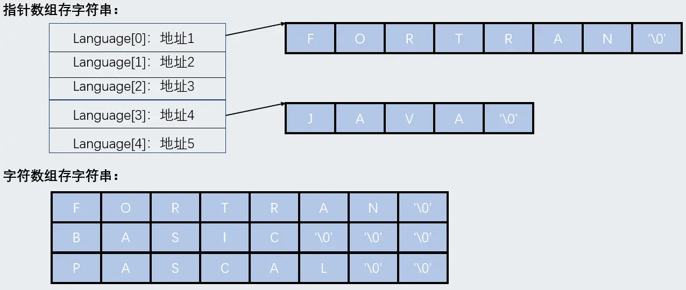
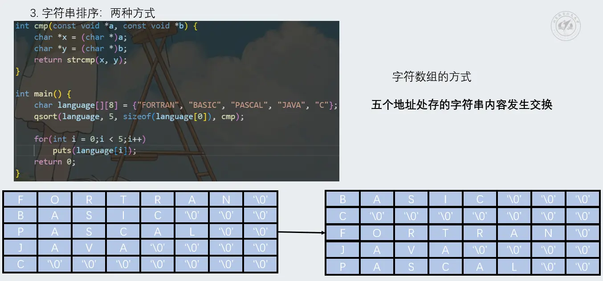
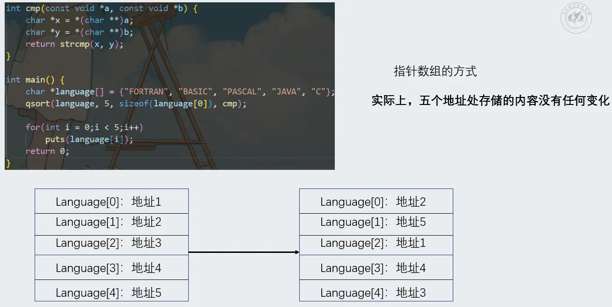

# 程序设计基础 E8 答案（2024秋）

## A 与众不同的字符

### 题目

#### 题目描述

给定一个由小写英文字母组成的字符串，其中最多有一个字符是与众不同的。你能找到那个与众不同的字符吗，如果所有字符都相同，请输出 `All characters are the same`

注意，与众不同意味着它和其他字符都不同且其他字符都相同。也就是说，字符串的第 $i$ 个字符是与众不同的，当且仅当，对于任意不大于字符串长度的正整数 $j, k$，如果 $i, j, k$ 互不相同，那么「字符串的第 $i$ 个字符与字符串的第 $j$ 个字符不同」且「字符串的第 $j$ 个字符与字符串的第 $k$ 个字符相同」。

#### 输入

一次输入多组数据，每组一行一个长度为 $N$ 的字符串 $S$，其中 $S$ 由小写英文字母组成，且 $3 \le N \le 100$。

保证 $S$ 中最多只有一个字符与众不同。

#### 输出

对于每组输入，如果字符串的第 $k$ 个字符是与众不同的，那么输出 $k$；如果所有字符都相同，输出 `All characters are the same`。

#### 输入样例

```text
aaba
aaaa
```

#### 输出样例

```text
3
All characters are the same
```

### 答案

| 难度 | 考点 |
| --- | --- |
| 1 | 循环结构 |

### 题目分析

一种简单的方法是记录每个字符出现的次数，如果有出现次数为 1 的字符，那它肯定就是那个与众不同的字符（因为字符串长度至少为 3，且只有一个与众不同的字符），这时再返回去找它的位置。

### 示例代码

```c
#include <stdio.h>
#include <string.h>
char str[105];
int vis[30];
int main() {
    while (scanf("%s", str) != EOF) {
        int len = strlen(str);
        for(int i = 0 ; i < 26 ;i++)
            vis[i] = 0;

        // 记录每个字符出现的次数
        for(int i = 0; i < len ;i++)
            vis[str[i] - 'a']++;
        int flag = 0;
        for(int i = 0; i < 26 ;i++)
            if(vis[i] == 1) {
                // 重新去找它的位置
                for(int j = 0; j < len ;j++) {
                    if(str[j] == i + 'a')
                        printf("%d\n", j + 1);
                }
                flag = 1;
                break;
            }

        // 没有与众不同的字符
        if(!flag)
            printf("All characters are the same\n");
    }

    return 0;
}
```

## B 查质数表

### 题目

#### 题目描述

给定一张包含前 $N$ 个质数的有序质数表，请你据此判断某个数是不是质数。

#### 输入

第一行输入一个正整数 $N$，表示将会给定前 $N$ 个质数，保证 $1 \le N \le 500000$。

第二行输入 $N$ 个正整数，表示从小到大输入的前 $N$ 个质数，保证输入的质数不超过 $10^7$。

第三行输入一个正整数 $t$，表示接下来将查询 $t$ 个正整数，保证 $1 \le t \le 500000$。

接下来 $t$ 行，每行一个正整数，表示要查询的数字 $k$，保证 $1 \le k \le 10^7$。

#### 输出

对于每次查询，输出一行，如果这个数字是给定质数表中的数字，输出 `It must be xx-th prime!`，其中 `xx` 表示它是第几个（从 1 开始）质数；如果这个数字小于给定质数表中最大的数且不在质数表中，输出 `It can't be a prime!`；如果这个数字大于给定质数表中最大的数，输出 `I'm not sure!`。

#### 输入样例

```text
5
2 3 5 7 11
4
5
10
15
17
```

#### 输出样例

```text
It must be 3-th prime!
It can't be a prime!
I'm not sure!
I'm not sure!
```

#### 样例解释

- 5 在给定的质数表中的第三个元素，所以是第三个质数
- 10 小于质数表中最大的质数，且不在质数表中，所以一定不是质数
- 15 和 17 都大于质数表中最大的质数，所以我们无法判断它们是不是质数

#### Hint

除了自己实现一个二分查找外，你也可以使用 `bsearch`。

`bsearch` 是 `<stdlib.h>` 中的库函数，用于在已排序的一段数组中二分查找 ：

```text
void *bsearch(const void *key, const void *base, size_t num, size_t size, int (*cmp)(const void *, const void *));
```

其中 `key` 为指向待查找数据的 **指针**，`base` 为待查找数组的首地址（数组名），`num` 为数组中元素个数，`size` 为单个元素的大小（一般用 `sizeof(...)`表示），`cmp` 为自定义判断函数，定义方式如下：

```text
int cmp(const void *a,const void *b) {
    if(*b 为 目标元素) return 0;
    if(*b 位于 目标元素 右侧) return 一个负整数;
    if(*b 位于 目标元素 左侧) return 一个正整数;
}
```

比如在这道题中，我们可以定义 `cmp` 为：

```text
// 想一想为什么可以如此定义
int cmp(const void *a, const void *b) {
 // 无类型指针，使用前必须进行类型转换
 return *(int *)a - *(int *)b;
}
```

以下是该题一个可参考的代码片段：

```c
int cmp(const void *a, const void *b) {
    return *(int *)a - *(int *)b;
}
int primes[500005];

int main() {
 // 读入 n
    // 从 0 开始读入 primes 数组
    // 读入 t
    for(int i = 1; i <= t ;i++) {
 int target;
 scanf("%d", &target);

 // bsearch 返回值为 void*，即无类型指针，接收时我们利用了一个 int* 进行了类型转换
 // 如果元素在数组中，那么 bsearch 将返回指向数组中与 key 相等的元素的指针（如果有多个相等的元素将返回任意一个）
 // 如果元素不在数组中，那么 bsearch 将返回 NULL
 int *ret = bsearch(&target, primes, n, sizeof(int), cmp);
 // 根据返回值进行相应的处理
    }
}
```

### 答案

| 难度 | 考点 |
| --- | --- |
| 2 | 二分、函数指针、`bsearch` |

### 题目分析

本题主要考察 `bsearch` 的使用，希望大家一定要学会 `bsearch` 以及 `qsort` 中最后一个参数（即比较函数）的编写。

我们可以先将元素与质数表中最后一个元素比较，如果大于最后一个元素直接输出 I'm not sure!；否则再进行二分查找，由于元素不重复，所以如果 `bsearch` 返回 `NULL`，就说明元素不在质数表中；否则用返回的指针值减去数组的起始地址（可以用数组名表示）就是元素在质数表中的位置（只不过这个位置从 0 开始，我们输出时要加上 1）。

### 示例代码

```c
#include <stdio.h>
#include <stdlib.h>
// 比较规则
// 在利用 Hint 写法时，千万要注意数据范围，避免两个整数相减时溢出
// 以下是一个更安全的写法
/*
int cmp(const void *a, const void *b) {
    // 类型转换 + 解指针
    int x = *(int *)a;
    int y = *(int *)b;
    if(x < y)
        return -1;
    else if(x > y)
        return 1;
    return 0;
}
*/
int cmp(const void *a, const void *b) {
    return *(int *)a - *(int *)b;
}
int primes[500005];
int main() {
    // 读入 n
    int n;
    scanf("%d", &n);
    // 从 0 开始读入 primes 数组
    for(int i = 0; i < n ;i++)
        scanf("%d", &primes[i]);
    // 读入 t
    int t;
    scanf("%d", &t);
    for(int i = 1; i <= t ;i++) {
        int target;
        scanf("%d", &target);

        // 调用 bsearch(&target, primes, n, sizeof(int), cmp);
        if(target > primes[n - 1])
            printf("I'm not sure!\n");
        else {
            int *ret = bsearch(&target, primes, n, sizeof(int), cmp);
            if(ret)
                printf("It must be %d-th prime!\n", ret - primes + 1);
            else
                printf("It can't be a prime!\n");
        }
    }
}
```

## C 钢琴大师

### 题目

#### 题目描述

热爱钢琴的 shtog 偶然获得了一项特殊的能力：可以用意念操纵琴键，也就是说他可以用意念控制钢琴上任意个键被同时按下！为了熟练这项能力，他决定拿一个比较特殊的只有 $32$ 个键（编号从左到右为 $31$ 到 $0$）的智能钢琴练习一下。于是，在练习最开始时其用意念控制了若干个琴键被按下，接下来其智能钢琴屏幕上迅速闪过一系列操作，shtog 需要连贯无误地完成这一系列操作。每次操作是下列中的一种：

| 操作码 | 操作参数 | 含义 |
| --- | --- | --- |
| 1 | $x_1$, $x_2$ | 将钢琴的第 $x_1$ 个键和第 $x_2$ 个键（从第 $0$ 个键开始计数，下同）的按压状态交换 |
| 2 | $x$ | 如果第 $x$ 个琴键正被按下，那么将其松开；否则，将其按下。 |
| 3 | $x$ | 让第 $x$ 个琴键处于被按下的状态 |
| 4 | $x$ | 让第 $x$ 个琴键处于被松开的状态 |
| 5 | $x_1, x_2 (x_1 ≤ x_2)$ | 让从第 $x_1$ 个琴键到第 $x_2$个琴键的状态逆序（比如有3个琴键依次是压下，松开，松开的状态，将其逆序后即为松开，松开，压下的状态） |

要求输出钢琴各个琴键最终的状态。

#### 输入

第一行一个整数 $T(1≤T≤100)$，表示数据组数。

接下来 $T$ 组数据。

每组数据第一行一个 `unsigned int` 整数 $a$，其 $32$ 个位表示钢琴的 $32$ 个键的起始按压状态（ $1$ 表示按下， $0$ 表示松开）。第二行一个整数 $t$，表示该组数据一共有 $t$ 次操作, 接下来 $t$ 行每行一个操作，每个操作由操作码和操作的琴键索引组成，这些数字以一个空格隔开，如：`1 2 3`表示操作码为1，将第2个和第3个琴键的按压状态交换；`3 2`表示操作码为3，让第2个琴键保持被按下的状态。

#### 输出

每组数据对应输出一行输出，输出一个无符号整数，其 $32$ 个位表示经过这些次操作后钢琴的各个琴键的状态。

#### 输入样例

```text
2
3279105849
2
2 3
2 1
2994330020
2
1 26 0
1 22 13
```

#### 输出样例

```text
3279105843
2990143908
```

AUTHOR：shtog

### 答案

| 难度 | 考点 |
| --- | --- |
| 3 | 钢琴大师 |

### 题目分析

这其实是一个位运算的题目，输入一个32位的无符号数，然后对其进行若干次位操作，最后输出经历这若干次操作后的结果。具体每种操作应该如何实现直接看下方代码中的注释即可。

### 示例代码

```c
#include <stdio.h>
#include <string.h>
unsigned int set1(unsigned int t, int i) { // 将t的第i位置为1
    t |= (1 << i);
    return t;
}
unsigned int set0(unsigned int t, int i) { // 将t的第i位置为0
    t &= (~(1 << i));
    return t;
}
unsigned int seto(unsigned int t, int i) { // 将t的第i位取反
    t ^= (1 << i);
    return t;
}
unsigned int swapBit(unsigned int t, int x1, int x2) { // 将t的第x1位和第x2位的数字交换
    unsigned int t1, t2, a = t;
    t1 = (a >> x1 & 1);
    t2 = (a >> x2 & 1);
    if (t1) a = set1(a, x2);
    else a = set0(a, x2);
    if (t2) a = set1(a, x1);
    else a = set0(a, x1);
    return a;
}
int main() {
    unsigned int a;
    int T, t;
    scanf("%d", &T);
    while (T--) {
        scanf("%u", &a);
        scanf("%d", &t);
        while (t--) { // 对a操作
            int op;
            scanf("%d", &op);
            switch (op) {
                case 1: { // 交换位的操作
                    int x1, x2, t1, t2;
                    scanf("%d%d", &x1, &x2);
                    a = swapBit(a, x1, x2);
                } break;
                case 2: { // 取反的操作
                    int x;
                    scanf("%d", &x);
                    a = seto(a, x);
                } break;
                case 3: { // 置1的操作
                    int x;
                    scanf("%d", &x);
                    a = set1(a, x);
                } break;
                case 4: { // 置0的操作
                    int x;
                    scanf("%d", &x);
                    a = set0(a, x);
                } break;
                case 5: { // 将[x1, x2]之间的位进行逆序的操作
                    int x1, x2;
                    scanf("%d%d", &x1, &x2);
                    while (x1 < x2) { // 就是让x1 + i和x2 - i这些位上的数交换位置, 便实现了逆序的效果
                        // 例如：
                        /*
                        第 x1 + 1 和 x2 - 1 位交换
                        第 x1 + 2 和 x2 - 2 位交换
                        第 x1 + 3 和 x2 - 3 位交换
                        ...
                        */
                        a = swapBit(a, x1++, x2--);
                    }
                } break;
            }
        }
        printf("%u\n", a);
    }
    return 0;
}
```

## D 磁盘调度

### 题目

#### 题目描述

请你编程模拟一种经典的磁盘调度算法——**SSTF（Shortest Seek Time First）**，即**最短寻道时间优先算法**。算法的过程如下：

- 初始时，磁头停在某磁道上，磁头需要访问一个磁道请求队列 $P = \{p_1,p_2,\cdots,p_n\}$
- 每次磁头都会从 $P$ 中选择一个距离磁头当前所在磁道 $q$ 最近的磁道 $p_i$（如果 $P$ 中有多个距离 $q$ 最近的磁道，选择在位置上最左面的一个，如 $10$ 和 $12$ 都离 $11$ 最近，我们在其中选择 $10$），将 $p_i$ 从 $P$ 中删除，然后移动距离 $|q - p_i|$ 后移动到磁道 $p_i$
- 重复上一步直到 $P$ 为空

现在，你需要实现一个程序模拟上面的磁盘调度算法，请结合样例理解算法的过程。

#### 输入

第一行输入两个正整数 $n$ 和 $m$，分别表示磁道请求的数量和磁头的初始位置，保证 $1 \le n \le100$， $1 \le m \le 10000$。

第二行 $n$ 个整数，表示每次请求所请求的磁道号，保证在 $[1,10000]$ 之间，且互不相同。

#### 输出

第一行输出 $n$ 个整数，表示按处理顺序输出的请求磁道号，相邻两个整数之间用空格隔开。

第二行一个整数，表示磁头按 SSTF 算法处理完 $n$ 个请求移动的总距离。

#### 输入样例

```text
5 50
82 170 43 140 24
```

#### 输出样例

```text
43 24 82 140 170
172
```

#### 样例解释

- 初始时，磁头在 $50$ 位置，有 $5$ 个请求要处理，离磁头初始位置最近的位置是 $43$
- 磁头移动 $7$ 个距离后到达 $43$，离磁头最近的请求位置是 $24$
- 磁头移动 $19$ 个距离后到达 $24$，离磁头最近的请求位置是 $82$
- 磁头移动 $58$ 个距离后到达 $82$，离磁头最近的请求位置是 $140$
- 磁头移动 $58$ 个距离后到达 $140$，离磁头最近的位置是 $170$
- 磁头移动 $30$ 个距离后到达 $170$，所有请求处理完毕

综上，处理顺序为 `43 24 82 140 170`，移动的总距离为 $172$。

### 答案

| 难度 | 考点 |
| --- | --- |
| 3 | 循环结构、模拟 |

### 题目分析

下面提供两种思路：

思路一：

每次遍历所有请求的磁道号，找到未被处理且离磁头最近的一个，选择处理它（也就是输出），并把磁头移动到对应的磁道位置。

如何发现哪个请求有没有被处理呢？我们可以利用一个数组 $vis$，如果 $vis_i = 1$ 就代表第 $i$ 个请求被处理过了。这样，相较于真正在数组中删除这个元素（也就是把在它后面的所有元素向前移动一位），我们做了一个简单的赋值操作，就轻松地实现了这一需求。

第二是有多个磁道离当前磁头最近，我们应该选择磁道号最小的，而不是先发来的请求。

思路二：

可以先对所有请求按磁道号排序，之后每次磁头到达的位置，要么是未到达过且位于磁头初始位置左侧的磁头中最靠右的，要么是未到达过且位于磁头初始位置右侧的磁头中最靠左的。这样每次不用遍历整个数组，只比较两者就可以

### 示例代码 1

```c
#include <stdio.h>
int a[105];
int vis[105];   // 表示每个请求是否被处理过
int myAbs(int x) {
    return x > 0 ? x : -x;
}
int main()
{
    int n, m;
    scanf("%d%d", &n, &m);
    for (int i = 1; i <= n; i++)
        scanf("%d", &a[i]);
    int sum = 0;
    // 处理 n 个请求
    for(int i = 1; i <= n ;i++) {
        int minDis = 10005, minPos = 0;
        // 遍历所有请求
        for(int i = 1; i <= n ;i++) {
            if(!vis[i] && (minDis > myAbs(a[i] - m) || (minDis == myAbs(a[i] - m) && a[i] < a[minPos])))
                minDis = myAbs(a[i] - m), minPos = i;
        }
        sum += minDis;
        vis[minPos] = 1;
        m = a[minPos];
        printf("%d ", a[minPos]);
    }
    printf("\n%d", sum);
    return 0;
}
```

### 示例代码 2 （By Saisyc）

```c
# include <stdio.h>
# include <stdlib.h>
int n, m, p[10000];
int compar(const void * x, const void * y) {
    return * (int *) x - * (int *) y;
}
int main() {
    scanf("%d%d", &n, &m);
    for (int i = 0; i < n; i++) {
        scanf("%d", &p[i]);
    }
    qsort(p, n, sizeof(p[0]), compar);
    int t = 0;
    while (t < n && p[t] < m) {
        t++;
    }
    int s = 0;
    for (int i = 0, l = t - 1, r = t; i < n; i++) {
        if (l < 0 || (r < n && p[r] - m < m - p[l])) {
            printf("%d ", p[r]);
            s += p[r] - m;
            m = p[r];
            r++;
        } else {
            printf("%d ", p[l]);
            s += m - p[l];
            m = p[l];
            l--;
        }
    }
    printf("\n%d", s);
    return 0;
}
```

## E big a+b problem

### 题目

#### 题目背景

Orch1d 刚刚学会用程序解决 $a+b$ 问题，但他发现自己的程序有时仍会出错，你能根据他给出的数据范围求出正确答案吗？

#### 题目描述

输入形式为 $a+b=$ 的表达式，其中 $a,b$ 均为非负整数，求出 $a+b$ 的值。

#### 输入

一行字符串，表示要计算的表达式。

#### 输出

$a+b$ 的值

#### 输入样例 1

```text
1+1=
```

#### 输出样例 1

```text
2
```

#### 输入样例 2

```text
999999999999999999+1=
```

#### 输出样例 2

```text
1000000000000000000
```

#### 数据范围

对于30%的数据，保证 $0\leq a,b\leq 10^{18}$。

对于100%的数据，保证 $0\leq a,b\leq 10^{10086}$。

### 答案

| 难度 | 考点 |
| --- | --- |
| 4 | 高精度、模拟 |

### 题目分析

由题目给出的数据范围可以发现，我们学过的 `unsigned long long` 也无法存储如此大的整形，因此在进行大整数运算时，可以考虑采用高精度算法，即用数组存储数据，再模拟运算的过程。

### 示例代码

```c
#include<stdio.h>
#include<string.h>
#include<stdlib.h>
#include<math.h>
#define ll long long
int a[10100],b[10100];//存数a、b
int l1,l2,len;
void swap(int *num,int l)
{
    for(int i=l/2-1;i>=0;i--)
    {
        int t=num[l-i-1];
        num[l-i-1]=num[i];
        num[i]=t;
    }
}
int main()
{
    char ch;
    while(scanf("%c",&ch))//输入a
    {
        if(ch=='+') break;
        a[l1++]=ch-'0';
    }
    while(scanf("%c",&ch))//输入b
    {
        if(ch=='=') break;
        b[l2++]=ch-'0';
    }
    len=(l1>l2)?l1:l2;//len为两个数中较长那个数的长度
    swap(a,l1);swap(b,l2);//将数翻转，方便计算
    for(int i=0;i<len;i++)
    {
        a[i]=a[i]+b[i];//相加
        a[i+1]+=a[i]/10;//进位
        a[i]%=10;
    }
    if(a[len]!=0) len++;//最高位存在进位
    for(int i=len-1;i>=0;i--) printf("%d",a[i]);
    return 0;
}
```

## F 让我们一起来学习离散化

### 题目

#### 题目背景-离散化

##### 简介

‌**离散化**‌是指将无限空间中的有限个体映射到有限的空间中去，以此提高算法的时空效率。通俗地说，离散化是在不改变数据相对大小的条件下，对数据进行相应的缩小。

在本题中，会将数据压缩为从 $1$ 开始的一个排列。（具体含义见下方法）

##### 常见运用

当有些数据因为本身很大或者类型不支持，自身无法作为数组的下标来方便地处理，而影响最终结果的只有元素之间的相对大小关系时，我们可以将原来的数据按照排名来处理问题，即离散化。

用来离散化的可以是大整数、浮点数、字符串等等。

##### 方法（其中一个）

通常原数组中会有重复的元素，一般把相同的元素离散化为相同的数据。

方法如下：

1. 创建原数组的副本。
2. 将副本中的值进行排序。（本题中请按照从小到大排序）
3. 将排序好的副本去重。
4. 查找原数组的每一个元素在副本中的位置，位置即为排名，将其作为离散化后的值。（本题中位置从 $1$ 开始）

以上方法来自于oi.wiki

#### 题目描述

下面将给一个长度为 $n$ 的数组，分别为 $a_1,a_2,……a_n$，请将这个数组**离散化**‌。

**本题将按照上述离散化方式进行评测，如果用其他离散化方式进行离散的同学请仔细确认最后得到的结果是否与上述方法得到的结果相同。**

#### 输入

输入共两行。

第一行输入一个整数 $n$。其中， $1≤n≤3\times10^5$。

第二行输入 $n$ 个整数，分别为 $a_1,a_2,……,a_n$。其中， $-10^9≤a_i≤10^9$。

#### 输出

输出共 $1$ 行。

第 $i$ 个输出的数为 $a_i$ **离散化**后的结果，每两个数之间用一个空格做间隔。

#### 输入样例

```text
10
3 9 7 8 2 6 10 7 9 7
```

#### 输出样例

```text
2 6 4 5 1 3 7 4 6 4
```

#### 样例解释

步骤二结束后副本为： $2,3,6,7,7,7,8,9,9,10$

步骤三结束后副本为： $2,3,6,7,8,9,10$

因而原数组中 $2$ **离散化**后为 $1$， $3$ **离散化**后为 $2$，其他数以此类推。

#### Hint

如何排序更快呢？如何查找更快呢？

Author：小P

### 答案

| 难度 | 考点 |
| --- | --- |
| 4 | 快速排序、二分（可能） |

### 题目分析

根据题目方法操作即可。

注：本题可以不用二分。

### 示例代码：std

```c
#include<stdio.h>
#include<stdlib.h>
#include<math.h>
#include<string.h>
int s1[300010];
int s2[300010];//副本
int cmp(const void *p,const void *q)
{
    int a=*(int *)p;
    int b=*(int *)q;
    if(a<b)return -1;
    else return 1;
}
int find(int x,int len)//二分查找
{
    int min,max,mid;
    min=0;
    max=len-1;
    while(min<=max)
    {
        mid=(min+max)/2;
        if(x>s2[mid])min=mid+1;
        else max=mid-1;
    }
    return min;
}
signed main()
{
    int n,i,len;
    scanf("%d",&n);
    for(i=0;i<n;i++)
    {
        scanf("%d",&s1[i]);
        s2[i]=s1[i];
    }
    qsort(s2,n,sizeof(int),cmp);
    len=0;
    for(i=0;i<n;i++)
    {
        if(i!=0&&s2[i]==s2[i-1])continue;
        s2[len++]=s2[i];
    }
    for(i=0;i<n;i++)
    {
        printf("%d ",find(s1[i],len)+1);
    }
    return 0;
}
```

## G 弦论

### 题目

#### 题目描述

dyc酷爱上了**弦论**！

为了更深地研究这一理论，他想要搞明白这样一个问题：对于一个给定的字符串，它的字典序第 $k$ 小的子串是什么？（注意：不同位置的相同字串算作多个）

如果你不知道子串的含义，那么dyc告诉你：子串是字符串中任意个连续的字符组成的字符串。

#### 输入

第一行是一个仅由小写英文字母构成的字符串 $s$，保证 $|s|\leq 100$ 。

第二行一个正整数 $k$ , $k$ 的含义如题目所示，保证 $1\leq k\leq 10^{9}$。

#### 输出

输出数据仅有一行,该行有一个字符串，为第 $k$ 小的子串。若子串数目不足 $k$ 个，则输出`-1` 。

#### 输入样例

```text
aabc
3
```

#### 输出样例

```text
aa
```

#### Hint

 字符串字典序比较可以使用 `strcmp` 函数。

如果字符串的长度更长，有没有更好的方法呢？

### 答案

| 难度 | 考点 |
| --- | --- |
| 5 | `qsort`、字符串 |

### 题目分析

不难发现，字符串最多也仅仅只有 5050 个，所以我们把每个子串拆出来，先判断一下子串的个数与 $k$ 的关系，再对字符串进行排序就可以了。

本题的难点在于字符串排序，字符串排序根据存储媒介的不同有两种方式，请参考以下图片：



用二维数组对字符串排序时，相当于各个字符串实打实地存在数组中，每次都真正交换了几个字符串；用指针数组对字符串排序时，相当于数组中只存了几个地址值，这几个地址值标志了真正的各个字符串存在哪，排序时仅仅交换了几个地址值，真正的字符串并没有交换。





### 示例代码 1 - 二维数组写法（By Moca）

```c
#include <stdio.h>
#include <string.h>
#include <stdlib.h>
// 二维数组的方式
char str[105];
char subStr[6000][105];
// 这里传进来的，就是几个字符串所在的起始地址
int cmp(const void *a, const void *b) {
    return strcmp((char *)a, (char *)b);
}
int main() {
    int k;
    scanf("%s", str);
    scanf("%d", &k);
    int len = strlen(str);
    // 这个串不存在
    if(k > len * (len + 1) / 2) {
        printf("-1");
        return 0;
    }
    int pos = 0;
    // 枚举起始位置
    for(int i = 0; i < len ;i++) {
        // 枚举终止位置
        for(int j = i; j < len ;j++) {
            for(int k = 0; k < j - i + 1 ;k++)
                subStr[pos][k] = str[k + i];
            pos++;
        }
    }
    // 几个参数写法比较固定，只有第四个参数对应的函数需要实现
    // 这里的 sizeof(subStr[0]) 是 105，即二维数组第二维的长度
    qsort(subStr, pos, sizeof(subStr[0]), cmp);
    printf("%s", subStr[k - 1]);
    return 0;
}
```

### 示例代码 2（By Moca）

```c
#include <stdio.h>
#include <string.h>
#include <stdlib.h>
// 指针数组的方式
char str[105], tem[105];
char *subStr[6000];
// 这里传进来的，就是指向几个字符串起始地址的指针的地址
// 即指针的指针
int cmp(const void *a, const void *b) {
    return strcmp(*(char **)a, *(char **)b);
}
int main() {
    int k;
    scanf("%s", str);
    scanf("%d", &k);
    int len = strlen(str);
    // 这个串不存在
    if(k > len * (len + 1) / 2) {
        printf("-1");
        return 0;
    }
    int pos = 0;
    // 枚举起始位置
    for(int i = 0; i < len ;i++) {
        // 枚举终止位置
        for(int j = i; j < len ;j++) {
            for(int k = 0; k < j - i + 1 ;k++)
                tem[k] = str[k + i];
            // 为字符串结尾添加空字符
            tem[j - i + 1] = 0;
            // 用之前申请空间，后面的 + 1 是给空字符留空间
            // 注意区分 strlen 与 sizeof
            // 对字符串而言，sizeof 相当于问杯子的容量有多大，strlen 相当于问杯子装了多少水
            subStr[pos] = (char *)malloc(strlen(tem) + 1);
            strcpy(subStr[pos], tem);
            pos++;
        }
    }
    // 几个参数写法比较固定，只有第四个参数对应的函数需要实现
    // 这里的 sizeof(subStr[0]) 取决于地址空间的大小
    // 因为它只代表一个首地址，同一地址空间下各个类型指针的大小都是一样的
    qsort(subStr, pos, sizeof(subStr[0]), cmp);
    printf("%s", subStr[k - 1]);
    return 0;
}
```

## H 圣诞老人送礼物

### 题目

#### 题目描述

圣诞节要结束了，圣诞老人骑着他的驯鹿从天而降来到了最后一座需要送礼物的城市，这座城市比较特殊，其中的楼房都排成了一排，楼房的高度可能不同，圣诞老人会将给某栋楼的居民的礼物送到楼顶让大家自行领取。

由于驯鹿这两天工作很累了，所以这次送礼物的过程中它始终**只能**往**更低的方向**飞（而不能向着**同样高度**或**更高**的方向飞）以保证体力够用，同时掉头也会耗费很多体力，所以驯鹿在送礼物的过程中只能**始终向左边飞**或者**始终向右边飞**而**不能转向**（驯鹿和圣诞老人具有神奇的魔力，可以以透明状态穿过大楼，也就是说在向更低的楼层飞行时，不会被中间的比较高的楼挡住去路）。在保证驯鹿体力够用的前提下，善良的圣诞老人希望给尽可能多的楼房送礼物，初始时他们可以随机降落到任何一座楼的楼顶，请编写程序计算出圣诞老人最多能给几栋楼送上礼物。

#### 输入

第一行一个整数 $T(1≤T≤50)$，表示有 $T$组数据

每组数据有两行输入：

第一行有一个整数为楼房的个数 $n (1≤n≤1000)$。

第二行 $n$ 个以单个空格分隔开的整数（末尾没有多余的空格），表示 $n$ 个楼房各自的高度 $h (1≤h≤10000)$（按照楼房一条线上排列的顺序按序给出）。

#### 输出

输出一共 $T$ 行，每行一个整数，第 $i$行的整数表示第 $i$组数据下圣诞老人最多能送到礼物的楼房数。

#### 输入样例

```text
2
3
1 3 2
4
4 3 6 9
```

#### 输出样例

```text
2
3
```

对于第一组数据，应该从左往右飞 `3,2` 或者从右往左飞 `3,1`

对于第二组数据，应该从右往左飞 `9,6,3`

AUTHOR：shtog

### 答案

| 难度 | 考点 |
| --- | --- |
| 5 | 数组、简单动态规划 |

### 题目分析

这道题其实就是说，有一排高低不一的楼房，然后求出这些楼房中最长的高度单调递增的子序列（一排数，从左到右依次挑出任意个数，它们之间无需连续，这些挑出的数构成的序列就构成了原序列的一个子序列）的长度，以及高度单调递减的子序列的长度，在这二者之中取一个最大长度。那么只需要知道如何求出最长单调递增子序列的长度即可，递减是同理的。下面说明如何求解递增的情况。

可以定义一个数组`dp[]`，其元素`dp[i]`表示以第`i`个楼房为结尾楼房的递增子序列中最长的那个子序列的长度，例如：对于三个楼房`3 1 2`，有`dp[1] == 1; dp[2] == 1; dp[3] == 2;`，因为以第一个房子（高度为3）为结尾的递增子序列只有3本身一个元素，后面的高度都比3小；以第二个房子为结尾的递增子序列同理；以第三个房子为结尾的最长递增子序列为`1 2`，长度为2。

那么可以知道一个递推关系：`dp[i] = max(1, dp[j] + 1)`（其中, `j < i && height[j] < height[i]`），也就是说，以第`i`个房子为结尾的最长递增子序列，可能只有它一个数，此时长度为1，也可能除了它自己之外，前面还有若干个数，此时，前面的这若干个数本身也是一个单调递增子序列，且一定以`i`之前的某个更低的房子为结尾。相当于：以第`i`个房子为结尾的最长递增子序列 一定是 由以第`i`个房子之前的某个房子为结尾的递增子序列再添加上更高一些的第`i`个房子后构成的。所以遍历`dp[1] dp[2] dp[3] ... dp[i - 1]`，看看哪个`i`之前的最长序列的末尾房子比`i`房子低，便可以让其跟上一个`i`房子，将这些遍历后的结果取个最大值遍得到了`dp[i]`。

根据这个递推关系，便可以写循环，依次求出`dp[1] dp[2] dp[3] ... dp[n]`，取这n个数的最大值即为结果。

### 示例代码

```c
#include <stdio.h>
int n;
int h[1005];
int dp1[1005]; // 递增
int dp0[1005]; // 递减
int main() {
    int T;
    scanf("%d", &T);
    for (int i = 0; i < T; ++i) {
        scanf("%d", &n);
        for (int j = 1; j <= n; ++j) scanf("%d", &h[j]);
        int m = 1;
        dp1[1] = dp0[1] = 1;
        // 处理单调递增的情况
        for (int j = 2; j <= n; ++j) {
            dp1[j] = 1;
            for (int k = j - 1; k >= 1; --k) {
                if (h[k] < h[j] && dp1[j] < dp1[k] + 1) dp1[j] = dp1[k] + 1;
            }
            if (dp1[j] > m) m = dp1[j];
        }
        // 处理单调递减的情况
        for (int j = 2; j <= n; ++j) {
            dp0[j] = 1;
            for (int k = j - 1; k >= 1; --k) {
                if (h[k] > h[j] && dp0[j] < dp0[k] + 1) dp0[j] = dp0[k] + 1;
            }
            if (dp0[j] > m) m = dp0[j];
        }
        printf("%d\n", m);
    }
}
```

<!-- markdownlint-disable-next-line MD026 -->
## I 格雷码？格雷码！

### 题目

#### 题目描述

Gino 在写一道算法题时，由于时间复杂度太高而 `TLE` 了。好在他发现可以用格雷码来降低一层时间复杂度！

格雷码（Gray Code）是一种特殊的 $n$ 位二进制串排列法，它要求相邻的两个二进制串间恰好有一位不同，特别地，第一个串与最后一个串也算作相邻。

所有 2 位二进制串按格雷码排列的一个例子为：00，01，11，10。

$n$ 位格雷码不止一种，下面给出其中一种格雷码的生成算法：

1. 1 位格雷码由两个 1 位二进制串组成，顺序为：0，1。
2. $n+1$ 位格雷码的前 $2^n$ 个二进制串，可以由依此算法生成的 $n$ 位格雷码（总共 $2^n$ 个 $n$ 位二进制串）按**顺序**排列，再在每个串前加一个前缀 0 构成。
3. $n+1$ 位格雷码的后 $2^n$ 个二进制串，可以由依此算法生成的 $n$ 位格雷码（总共 $2^n$ 个 $n$ 位二进制串）按**逆序**排列，再在每个串前加一个前缀 1 构成。

综上， $n+1$ 位格雷码，由 $n$ 位格雷码的 $2^n$ 个二进制串按顺序排列再加前缀 0，和按逆序排列再加前缀 1 构成，共 $2^{n+1}$ 个二进制串。另外，对于 $n$ 位格雷码中的 $2^n$ 个二进制串，我们按上述算法得到的排列顺序将它们从 $0\sim 2^n−1$ 编号。

按该算法，2 位格雷码可以这样推出：

1. 已知 1 位格雷码为 0，1。
2. 前两个格雷码为 00，01。后两个格雷码为 11，10。合并得到 00，01，11，10，编号依次为 0 ~ 3。

同理，3 位格雷码可以这样推出：

1. 已知 2 位格雷码为：00，01，11，10。
2. 前四个格雷码为：000，001，011，010。后四个格雷码为：110，111，101，100。合并得到：000，001，011，010，110，111，101，100，编号依次为 0 ~ 7。

现给出 $n, l, r$，Gino 想得到按照上述算法生成的 $n$ 位格雷码中，第 $l$ 到第 $r$ 号之间所有的二进制串。

#### 输入

一行，三个非负整数 $n, l, r$，含义与题意相同，保证 $1 \le n \le 60, 0 \le l \lt r \lt 2^n, 1 \le r - l \le 5 \times 10^7$。

#### 输出

为了减小输出量，只需输出以下内容：

第一行输出一个 $n$ 位的二进制串，表示编号为 $l$ 的 $n$ 位格雷码。

随后，将每一个编号对应的 $n$ 位二进制串 $s$ 都看成其对应的无符号整数形式 $v$（例如，111 看作 $7$，010 看作 $2$），在第二行输出

$$\left(\sum_{i=l}^{r}v_i \times 13331^{i-l}\right) \bmod 2^{64}$$

注：对 $2^{64}$ 取模等同于使用 `unsigned long long` 计算自然溢出后的结果。

#### 输入样例 1

```text
3 5 7
```

#### 输出样例 1

```text
111
710928906
```

#### 输入样例 2

```text
24 114514 1919810
```

#### 输出样例 2

```text
000000010110000011111011
3616982174085117875
```

#### 样例解释

对于第一组样例，三位格雷码为 000，001，011，010，110，111，101，100，编号为 $5\sim 7$ 之间的为 111，101，100，对应的无符号整数为 $7, 5, 4$， $7 + 5 \times 13331 + 4 \times 13331^2 = 710928906$

##### Author: Gino

### 答案

| 难度 | 考点 |
| --- | --- |
| 6 | 位运算，思维题 |

### 解法 1

根据题目定义，对于 $n$ 位 $x$ 号格雷码来说，如果 $x < 2^{n-1}$，那么其最高位就是 `0`，后面的 $n - 1$ 位恰好就是 $n - 1$ 位的 $x$ 号格雷码。如果 $x \ge 2^{n-1}$，那么其最高位就是 `1`，后面的 $n - 1$ 位恰好就是 $n - 1$ 位的 $2^{n-1} - x$ 号格雷码。

这样我们就可以用递归的方法求出给定编号的格雷码。可是，递归的时间复杂度为 $O(\log x)$，而我们要求 $5 \times 10^7$ 个格雷码，这样的时间复杂度还是太高了，最多可以得到 `TLE 0.4`，可能因为具体实现的常数不同导致得分更低。

怎么把这个 log 消掉呢？注意一下 2 位格雷码相邻两项都分别变动了哪一位？（以最低位为第 0 位）答案是 0，1，0。

对于 3 位格雷码，答案则是 0，1，0，2，0，1，0 而且通过这个递归的定义，这个结论也很容易推广到 $n$ 位上。

现在就要考虑如何快速得到这个发生变动的一位了，显然不能递归的去求，否则时间复杂度又回到了 $O(\log)$。注意到，这个过程类似于进位。进一步注意到，从 $x - 1$ 到 $x$ 号的发生变动的那一位，恰好等于 $\mathrm{lowbit}(x)$，即 $x$ 的二进制表示位下最低的为 1 的位。而 $\mathrm{lowbit}(x)$ 可以通过 `x & -x` 快速计算出，也可以使用循环计算出。由于 $\mathrm{lowbit}(x)$ 出现在 $x$ 的低位的概率显著高于出现在 $x$ 的高位的概率，再加上编译器对于这种位运算的特殊优化，使用循环计算 lowbit 并不会比 `x & -x` 慢太多。

### 示例代码 1

```c
#include <stdio.h>
#define ull unsigned long long
ull val(ull pos, int n)
{
    if (n == 1)
        return pos;
    if (pos < (1ull << (n - 1)))
        return val(pos, n - 1);
    else
        return 1ull << (n - 1) | val((1ull << n) - pos - 1, n - 1);
}
int main(void)
{
    int n;
    ull l, r;
    scanf("%d%llu%llu", &n, &l, &r);
    ull ans = 0, base = 1;
    ull v = val(l, n);
    for (int i = n - 1; i >= 0; i--)
    {
        putchar('0' + ((v >> i) & 1));
    }
    putchar('\n');
    ans += v * base;
    base *= 13331;
    for (ull i = l + 1; i <= r; i++)
    {
        ull lb = i & -i;
        v ^= lb;
        ans += v * base;
        base *= 13331;
    }
    printf("%llu", ans);
    return 0;
}
```

### 解法 2

注意力惊人的同学可以发现，不管是多少位的格雷码，第 $x$ 号的格雷码对应的无符号整数形式就是 `x ^ (x >> 1)`。

### 示例代码 2

```c
#include <stdio.h>
#define ull unsigned long long
int main(void)
{
    int n;
    ull l, r;
    scanf("%d%llu%llu", &n, &l, &r);
    ull ans = 0, base = 1;
    ull v = l ^ l >> 1;
    for (int i = n - 1; i >= 0; i--)
    {
        putchar('0' + ((v >> i) & 1));
    }
    putchar('\n');
    ans += v * base;
    base *= 13331;
    for (ull i = l + 1; i <= r; i++)
    {
        v = i ^ i >> 1;
        ans += v * base;
        base *= 13331;
    }
    printf("%llu", ans);
    return 0;
}
```

## J 可分数列

### 题目

#### 题目背景

设 $m$ 为正整数，数列 $a_1,a_2,\dots,a_{4m+2}$ 是公差不为 $0$ 的等差数列，若从中删去两项 $a_i$ 和 $a_j~(i \lt j)$ 后剩余的 $4m$ 项可被平均分成 $m$ 组，且每组的 $4$ 个数都能够成等差数列，则称数列 $a_1,a_2,\dots,a_{4m+2}$ 是 $(i,~j)~-$ 可分数列。

#### 题目描述

已知 $m,i,j$ 的值，求一个可行方案，将剩余的 $4m$ 项可被平均分成 $m$ 组，且每组的 $4$ 个数都能够成等差数列。

#### 输入

多组输入，每组一行 $3$ 个正整数，分别为 $m,i,j$，含义与题目描述相同。

保证 $1 \leq i \lt j \leq 4m+2 \leq 10^6$，且输入不超过 $5$ 组。

（为与题目中 $\lceil$ 平均分成 $m$ 组 $\rfloor$ 区分，此后输入输出的 $\lceil$ 多组 $\rfloor$ 改称 $\lceil$ 多轮 $\rfloor$）

#### 输出

对于每轮 $m,i,j$，对应的输出为：

- 若有可行方案，输出 $m$ 行，即原数列分成的 $m$ 组每组一行，输出其在原数列中的 **下标**，同组的 $4$ 个数之间用一个空格间隔。

- 若无可行方案，输出一行 `Nonseparable!`。

本题采用 `Special Judge`：有多种可行方案时输出任意一种即可；每轮中分成的 $m$ 组输出顺序不做要求；但每组中 $4$ 个数必须按递增或递减顺序输出。

#### 输入样例

```text
1 3 4
6 10 13
```

#### 输出样例

```text
Nonseparable!
1 9 17 25
2 4 6 8
3 7 11 15
5 12 19 26
14 16 18 20
24 23 22 21
```

#### Hint

从 $1,2,\dots,4m+2$ 中一次任取两个数 $i$ 和 $j~(i \lt j)$，记数列 $a_1,a_2,\dots,a_{4m+2}$ 是 $(i,~j)~-$ 可分数列的概率为 $P_m$，则 $P_8=\frac{27}{187}\gt\frac{1}{8}$。

### 答案

| 难度 | 考点 |
| --- | --- |
| 7 | 搜索剪枝、数学 |

### 题目分析

首先 $P_m > \frac{1}{8}$ 部分可以得出以下 3 个结论，具体证明过程及每个结论下具体方案的求法相信大家都已经会了，此处不再赘述。

1. `i%4==1 && j%4==2` 时一定有解。
1. `i%4==2 && j%4==1` 时可能有解，其中 `j-i!=3` 时一定有解。
1. 其余情况一定无解。

下面我们来看看 `i%4==2 && j%4==1 && j-i==3` 的解法：

这实际上是一个 NP 难问题，很难找到数学方法判断，也很难用算法解决，只能在指数时间复杂度下试图搜索答案。

不过题目中给出 $P_8 = \frac{27}{187}$，这说明这种情况下当 $m = 8$ 时已经必然有解，也就是说 $m \ge 8$ 时必然有解。

这大大增加了我们搜索的信心，我们只需要在 $[4a + 1, 4b + 2]$ 的范围内搜索是否有解，这个区间以外的均相邻四个分成一组即可。

- 当 $m \le 8$ 时， $a = 0, b = m$（此时未必有解）；
- 当 $m \ge 8$ 时， $a, b$ 可以为满足 $b = a + 8$ 且 $0 < 4a + 1 < i < j < 4b + 2 \le 4m + 2$ 的任意值（此时必然有解）。

进一步可以得到得到每组小数列的下标跨度不必超过 11，我们只需要递归地重复进行下面 3 个过程：

1. 从 $4a + 1$ 向 $4b + 2$ 寻找**第一个**尚未被分组的项，记为第 $k$ 项。
1. 从 1 到 11 枚举下标跨度 $d$，**若第 $k + d, k + 2d, k + 3d$ 项也未被分组**，则将这四个数分到一组，进入下一层递归。
1. 回溯。

在第 $t$ 层递归中寻找未被分组的第 $k_t$ 项时，不必每次都从 $4a + 1$ 开始找，而是可以从**上一次递归找到的** $k_{t-1}$ 的下一项开始找，因为此前的必然全部都分过组了。

这样时间复杂度为 $o(34 \times 11^8)$，这是一个略高于 `TLE` 限制的时间，但考虑到解数远小于状态数，并且上述过程中加粗部分已经进行了大量的剪枝操作，实际时间复杂度远小于这个值，不会 `TLE`。

### 示例代码

```c
#include<stdio.h>
#include<string.h>
int a[35];
void pt(int x,int n)
{
    for(int i=1;i<=n;i++)
    {
        for(int j=1;j<=4*n+2;j++)
        {
            if(a[j]==i) printf("%d ",j+x);
        }
        printf("\n");
    }
    return;
}
int sep(int n,int now, int k)
{
    if(now>n) return 1; //n组全部分完，找到解了
    while(a[k]) k++; //寻找目前第一个未分组的项k
    a[k]=now;
    int maxi=(4*n+2-k)/3; //注意不要越界
    for(int i=1;i<=maxi;i++) //枚举当前组跨度
    {
        if(a[k+i]+a[k+i*2]+a[k+i*3]==0)
        {
            a[k+i]=a[k+i*2]=a[k+i*3]=now;
            if(sep(n,now+1,k+1)) return 1;
            a[k+i]=a[k+i*2]=a[k+i*3]=0;
        }
    }
    a[k]=0;
    return 0; //从这一组开始往后怎么分都不行，只能回溯
}
int main()
{
    int m,i,j,k;
    while(scanf("%d%d%d",&m,&i,&j)!=EOF)
    {
        if(i%4==1&&j%4==2)
        {
            for(k=1;k<i;k+=4)
                printf("%d %d %d %d\n",k,k+1,k+2,k+3);
            for(k=i+1;k<j;k+=4)
                printf("%d %d %d %d\n",k,k+1,k+2,k+3);
            for(k=j+1;k<4*m;k+=4)
                printf("%d %d %d %d\n",k,k+1,k+2,k+3);
        }
        else if(i%4==2&&j%4==1)
        {
            int d=(j-i+1)/4;
            if(d==1)
            {
                memset(a,0,sizeof(a));
                if(m<=8) //根据m的大小确定搜索的范围，注意搜索范围最大不超过4*8+2
                {
                    a[i]=a[j]=9;
                    if(sep(m,1,1)) pt(0,m);
                    else printf("Nonseparable!\n");
                }
                else if(i<=30) //根据i的位置确定搜索的位置
                {
                    a[i]=a[j]=9;
                    sep(8,1,1);
                    pt(0,8);
                    for(k=35;k<4*m;k+=4)
                        printf("%d %d %d %d\n",k,k+1,k+2,k+3);
                }
                else
                {
                    for(k=1;k<i-30;k+=4)
                        printf("%d %d %d %d\n",k,k+1,k+2,k+3);
                    a[i-k+1]=a[j-k+1]=9;
                    sep(8,1,1);
                    pt(k-1,8);
                    for(k=j+2;k<4*m;k+=4)
                        printf("%d %d %d %d\n",k,k+1,k+2,k+3);
                }
            }
            else
            {
                for(k=1;k<i-1;k+=4)
                    printf("%d %d %d %d\n",k,k+1,k+2,k+3);
                if(d%2)
                {
                    for(int t=k+6;k<t;k+=2)
                        printf("%d %d %d %d\n",k,k+3,k+6,k+9);
                    k+=6;
                }
                for(;k<j;k+=2)
                {
                    for(int t=k+6;k<t;k+=3)
                        printf("%d %d %d %d\n",k,k+2,k+4,k+6);
                }
                for(k=j+2;k<4*m;k+=4)
                    printf("%d %d %d %d\n",k,k+1,k+2,k+3);
            }
        }
        else printf("Nonseparable!\n");
    }
}
```

### 补充

其实在搜索之前，对于时间复杂度究竟有多大这件事，助教心里也没底。 HINT 给出的 “特殊情况下 $m \ge 8$ 时必然有解” 的暗示，是助教按这种方式从小到大一点点扩大跨度上限和搜索范围，实验出的结果。

- 也就是说，这道题如果没有 HINT，那大家能否通过本地的预尝试，想到一个快速的解法呢？
- 再深入一些，大家学了函数递归、数组运用等知识之后，有没有想过用程序设计彻底解决在其它领域自己曾经遇到的极难解决的问题呢？

其实不知不觉程序设计也陪伴大家一学期了，希望大家以后面对开创性、探索性的科研或工作时，在没有 “HINT” 的情况下，也能想出合适的算法，写出优秀的程序，用这门课程学到的知识或者其他创新方法解决生活中遇到的种种难题~
