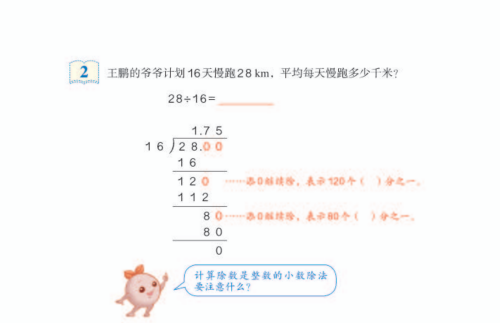

# 程序设计基础 E3 答案（2025秋）

## A Clock Paradox

| 难度 | 考点 |
| --- | --- |
| 1 | 输入输出 |

### 题目

#### 题目描述

给定系数 $a$ 、 $b$ 、 $c$ 和自变量 $x$ ，求 $ax^2 + bx + c$ 的值。

#### 输入格式

一行四个整数 $a$ 、 $b$ 、 $c$ 、 $x$ ，用空格分隔。

#### 输出格式

一行一个整数，表示 $ax^2 + bx + c$ 的值。

#### 样例输入

```text
2 3 4 5
```

#### 样例输出

```text
69
```

### 答案

### 题目分析

略

### 示例代码

```c
#include <stdio.h>

int a,b,c,x;
int main(){
    scanf("%d%d%d%d",&a,&b,&c,&x);
    int ans=a*x*x+b*x+c;
    printf("%d",ans);
    return 0;
}
```

## B 99 bottles of beer

| 难度 | 考点 |
| --- | --- |
| 1 | 输入输出 |

### 题目

#### 题目描述

按下面的格式输出《99 bottles of beer》的歌词，从 $n$ 瓶开始一直数到 1 瓶：每段歌词占 4 行，第 1 行和第 2 行重复瓶数，第 3 行是 `Take one down and pass it around,` ，第 4 行说明剩下多少瓶。注意瓶数为 1 时用单数 `1 bottle` ，瓶数为 2 时第 4 行用 `1 more bottle` ，瓶数为 1 时第 4 行是 `there's no more bottles of beer on the wall!` 。

#### 输入格式

一行一个整数 $n$ 。

#### 输出格式

按上述格式输出 $n$ 段歌词，每段 4 行。

#### 样例输入

```text
3
```

#### 样例输出

```text
3 bottles of beer on the wall,
3 bottles of beer.
Take one down and pass it around,
now there's 2 more bottles of beer on the wall!
2 bottles of beer on the wall,
2 bottles of beer.
Take one down and pass it around,
now there's 1 more bottle of beer on the wall!
1 bottle of beer on the wall,
1 bottle of beer.
Take one down and pass it around,
there's no more bottles of beer on the wall!
```

### 答案

### 题目分析

略

### 示例代码

```c
#include <stdio.h>

int main(){
    int n;
    scanf("%d",&n);
    for(int i=n;i>=1;i--){
        if(i>=3){
            printf("%d bottles of beer on the wall,\n%d bottles of beer.\nTake one down and pass it around,\nnow there's %d more bottles of beer on the wall!\n",i,i,i-1);
        }
        else if(i==2){
            printf("2 bottles of beer on the wall,\n2 bottles of beer.\nTake one down and pass it around,\nnow there's 1 more bottle of beer on the wall!\n");
        }
        else{
            printf("1 bottle of beer on the wall,\n1 bottle of beer.\nTake one down and pass it around,\nthere's no more bottles of beer on the wall!\n");
        }
    }
    return 0;
}
```

## C 奇怪的位运算 2025

| 难度 | 考点 |
| --- | --- |
| 2 | 位运算 |

### 题目

#### 题目描述

定义一种奇怪的按位运算 $\odot$ ，它对每一位独立作用，真值表如下：

| $a_i$ | $b_i$ | $a_i \odot b_i$ |
| --- | --- | --- |
| 0 | 0 | 0 |
| 0 | 1 | 0 |
| 1 | 0 | 1 |
| 1 | 1 | 0 |

给定若干组 $a$ 和 $b$ ，求 $a \odot b$ 。可以发现它等价于 $a \mathbin{\&} (\sim b)$ 。

#### 输入格式

若干行，每行两个整数 $a$ 和 $b$ ，读到文件结束（EOF）为止。

#### 输出格式

每组输出一行一个整数，表示 $a \odot b$ 的值。

#### 样例输入

```text
12 10
5 3
```

#### 样例输出

```text
4
4
```

#### 数据范围

$a$ 、 $b$ 需要用 `long long` 存储，按 64 位处理。若逐位处理，注意 `1 << i` 在 $i$ 较大时会爆 `int` ，应写成 `1ll << i` 。

### 答案

### 题目分析

| $a_i$ | $b_i$ | $a_i \odot b_i$ |
| --- | --- | --- |
| 0 | 0 | 0 |
| 0 | 1 | 0 |
| 1 | 0 | 1 |
| 1 | 1 | 0 |

位运算对于每一位都是独立的，这个奇怪的位运算 $\odot$ 也一样。 $\odot$ 可以看作是按位取反和按位求与的复合运算，即 $a_i \odot b_i = a_i \land (\sim b_i)$ ，其中 $\land$ 表示按位求与， $\sim$ 代表按位取反。于是我们可以先对 $b$ 取反，再将此结果与 $a$ 求与，即可直接得到 $a \odot b$ 的值。（或者你也可以看成 $a_i \odot b_i = a_i \land (a_i \oplus b_i)$ ，其中 $\oplus$ 代表按位异或）

当然，如果你执意要用数组的话，注意本题的数据范围，`1 << i` 是可能爆 int 的，需要写成 `1ll << i` ，还要注意运算符优先级的问题。

（我说的不开数组指的是观察出 $a, b$ 需要通过什么位运算的组合来直接得到答案，不是要你脱离数组之后还在一位一位加啊！）

### 示例代码

```c
#include <stdio.h>
int main(void)
{
    long long a, b;
    while (scanf("%lld%lld", &a, &b) != EOF)
    {
        printf("%lld\n", a & ~b);
    }
    return 0;
}
```

### 示例代码（数组版，不推荐）

```c
#include <stdio.h>
int main(void)
{
    int a1[66], b1[66];
    long long a, b;
    while (scanf("%lld%lld", &a, &b) != EOF)
    {
        for (int i = 0; i < 64; i++)
        {
            a1[i] = a >> i & 1;
            b1[i] = b >> i & 1;
        }
        long long c = 0;
        for (int i = 0; i < 64; i++)
        {
            if (a1[i] == 1 && b1[i] == 0)
            {
                c |= 1ll << i;
            }
        }
        printf("%lld\n", c);
    }
    return 0;
}
```

### 示例代码（逐位考虑，不推荐）

```c
#include <stdio.h>
int main(void)
{
    long long a, b;
    while (scanf("%lld%lld", &a, &b) != EOF)
    {
        long long c = 0;
        for (int i = 0; i < 64; i++)
        {
            if ((a >> i & 1) && !(b >> i & 1)) // 注意运算符优先级问题，& 优先级低于 &&
            {
                c |= 1ll << i;
            }
        }
        printf("%lld\n", c);
    }
    return 0;
}
```

## D 小忆的阶乘

| 难度 | 考点 |
| --- | --- |
| 2 | 输入输出、数组 |

### 题目

#### 题目描述

给定若干个询问，每次给出一个 $n$ ，求 $n!$ 对 998244353 取模的结果。

#### 输入格式

第一行一个整数 $t$ ，表示询问次数。接下来 $t$ 行，每行一个整数 $n$ 。

#### 输出格式

每次询问输出一行一个整数，表示 $n! \bmod 998244353$ 。

#### 样例输入

```text
3
0
1
5
```

#### 样例输出

```text
1
1
120
```

#### 数据范围

$0 \le n \le 7500000$ ， $t \le 2 \times 10^{5}$ 。每次询问都重新从 1 乘到 $n$ 会超时，应先用数组预处理出所有 $n!$ 的值。

### 答案

### 题目分析

我们能不能每一次询问都从 $1$ 到 $n$ 重新乘一次？

实际上不行。假如我进行 $2 \times 10^5$ 次询问，每次询问都询问 $n = 7500000$ ，那么你的程序会运行 $2 \times 10^5 \times 7500000 = 1500000000000$ 次运算，也就是 $1.5 \times 10^{12}$ ，计算机一秒钟跑不了这么多操作。

于是，我们考虑用一个数组，先把 $1$ 到 $7500000$ 的答案全部存到数组里，这样每次询问只需要在数组里找一个数即可，非常快。

时间复杂度 $O(\max n + T) = O(7500000 + 200000)$ 。

### 示例代码

```c
#include <stdio.h>

int fac[7500005];
long long p=998244353;
int main(){
    fac[0]=1;
    for(int i=1;i<=7500005;i++)
        fac[i]=(long long)fac[i-1]*(long long)i%p;
    int t;
    scanf("%d",&t);
    while(t--){
        int n;
        scanf("%d",&n);
        printf("%d\n",fac[n]);
    }
    return 0;
}
```

## E 计算pi

| 难度 | 考点 |
| --- | --- |
| 3 | 循环 |

### 题目

#### 题目描述

用下面两个公式分别计算 $\pi$ 的近似值，并输出两者之差的绝对值：

$$
\pi_1 = 4 \sum_{i=0}^{n-1} \frac{(-1)^i}{2i+1}, \qquad \pi_2 = \sqrt{8 \sum_{i=0}^{n-1} \frac{1}{(2i+1)^2}}
$$

计算时要注意用浮点数除法，并且 $(2i+1)^2$ 会超出 `int` 范围，需要在 `long long` 下计算。

#### 输入格式

第一行一个整数 $t$ ，表示数据组数。接下来 $t$ 行，每行一个整数 $n$ 。

#### 输出格式

每组输出一行一个实数，表示 $|\pi_1 - \pi_2|$ ，保留小数点后 6 位。

#### 样例输入

```text
1
10
```

#### 样例输出

```text
0.067786
```

#### 数据范围

$1 \le n \le 10^{5}$

### 答案

### 题目分析

这道题主要考察循环和浮点数的计算。

$$\sum_{n=0}^{\infty} \frac{(-1)^n}{2n+1}$$

公式中数列符号与 $n$ 的奇偶性有关。我们可以采取使用条件语句进行奇偶性判断。我们也可以采用示例代码中的方法，定义变量 `sign` ，初始值为 $1$ ，每一次循环结束时，`sign` 变量自乘 $-1$ 。这样即可作为第 $n$ 项的符号。

在整数除以整数时，如果想要得到浮点数，**一定要在表达式中乘以 $1.0$** ，使表达式的计算范围扩展到浮点数范围。

这道题 $n$ 的范围是 $1 \le n \le 10^5$ 。在公式 2 中需要计算 $(2n + 1)^2$ ，当 $n$ 接近给定范围的上限时， $(2n + 1)^2$ 的大小会超过 `int` 范围。所以需要使用表达式 `((2ll * i + 1) * (2 * i + 1))` 进行计算，其中的 `2ll` 可以使表达式在 `long long` 范围内计算。

### 示例代码

```c
#include<stdio.h>
#include <math.h>

int main() {
    int t;
    int n;
    scanf("%d", &t);
    while (t--) {//循环t次
        scanf("%d", &n);
        double col1 = 0;
        int sign = 1;
        for (int i = 0; i < n; ++i) {
            col1 += (1.0 * sign / (2 * i + 1));
            sign *= -1;
        }
        col1 *= 4; //计算公式1的pi

        double col2 = 0;
        for (int i = 0; i < n; ++i) {
            col2 += (1.0 / ((2ll * i + 1) * (2 * i + 1)));
        }
        col2 = sqrt(8 * col2); //计算公式2的pi

        printf("%.6f\n", fabs(col1 - col2));//输出，保留6位小数。注意浮点数绝对值使用fabs函数
    }
}
```

Author: pyh

## F 你都如何回蚁窝

| 难度 | 考点 |
| --- | --- |
| 3 | 数组 |

### 题目

#### 题目描述

有 $n$ 只蚂蚁，每只蚂蚁选择一个编号在 1 到 10000 之间的蚁窝。请按蚁窝编号从小到大输出每个有蚂蚁的蚁窝及其中的蚂蚁数量。

#### 输入格式

第一行一个整数 $n$ 。接下来 $n$ 行，每行一个整数，表示这只蚂蚁选择的蚁窝编号。

#### 输出格式

每行输出一个蚁窝的信息，格式为「编号 : 数量」，编号与冒号、冒号与数量之间各有一个空格，按编号从小到大排列。没有蚂蚁的蚁窝不输出。

#### 样例输入

```text
5
3
1
3
2
1
```

#### 样例输出

```text
1 : 2
2 : 1
3 : 2
```

### 答案

### 题目分析

数组的下标除了用来表示数组中元素的顺序以外，还可以用来表示某种状态，此时数组元素的值可以用来计数。

因为蚂蚁数很大，但蚁窝数只有 $10000$ 种可能，因此我们可以用下标表示蚁窝的编号，用对应的数组元素值表示相应蚁窝的蚂蚁个数。

当输入完成后，我们只需要按顺序输出即可完成此题。

注：本题实际上对蚂蚁选择的蚁窝完成了排序，这种排序方法称为计数排序。感兴趣的同学可以自行搜索研究。

### 示例代码

```c
#include<stdio.h>
int A[10086];
int main(){
    int n, x;
    scanf("%d", &n);
    while ( n-- ){
        scanf("%d", &x);
        A[x]++; // 蚁窝 x 中的蚂蚁数量 +1
    }
    for ( int i = 1; i <= 10000; i++ )
        if ( A[i] > 0 ) // 不为 0 才输出
            printf("%d : %d\n", i, A[i]);
    return 0;
}
```

## G 小明的 SCUJN 之旅 Day1

| 难度 | 考点 |
| --- | --- |
| 3 | 分支，循环 |

### 题目

#### 题目描述

在一张画布上以 $(x_0, y_0)$ 为中心画一个坐标系图案。给定一个位置 $(x, y)$ ，请输出以它为中心、边长为 5 的正方形区域中每个位置应该显示的字符：中心点画 `+` ；与中心同一行的位置画 `-` ；与中心同一列的位置画 `|` ；两条对角线上的位置分别画 `\` 和 `/` ；其余位置按所在的象限和它更靠近哪条对角线，分别画 `A` 到 `H` 。设行的下标为 $i$ （向下增大）、列的下标为 $j$ （向右增大），具体规则是： $i < x_0$ 且 $j > y_0$ 时， $i - x_0 < y_0 - j$ 画 `A` ，否则画 `B` ； $i > x_0$ 且 $j > y_0$ 时， $i - x_0 < j - y_0$ 画 `C` ，否则画 `D` ； $i > x_0$ 且 $j < y_0$ 时， $i - x_0 > y_0 - j$ 画 `E` ，否则画 `F` ； $i < x_0$ 且 $j < y_0$ 时， $i - x_0 > j - y_0$ 画 `G` ，否则画 `H` 。

#### 输入格式

第一行四个整数 $n$ 、 $m$ 、 $x_0$ 、 $y_0$ ，其中 $(x_0, y_0)$ 是图案的中心。第二行两个整数 $x$ 和 $y$ ，表示要输出的区域的中心位置。

#### 输出格式

5 行，每行 5 个字符，即以 $(x, y)$ 为中心的 $5 \times 5$ 区域。

#### 样例输入

```text
10 10 5 5
5 5
```

#### 样例输出

```text
\H|A/
G\|/B
--+--
F/|\C
/E|D\
```

### 答案

### 题目分析

本题的第一反应当然是开一个二维数组，然后将二维数组填满，再输出给定的 $5 \times 5$ 区域。

但是，等等，我们根本没学二维数组啊，而且本题的 $n, m$ 都是 $10^9$ 量级的，怎么可能开的了这么大的数组呢？

再次分析，我们只需要分析 $5 \times 5$ 一共 $25$ 个区域应该填写的字符。那么问题就变成了：遍历每个所需区域的横纵坐标 -> 根据横纵坐标分析出此区域的字符 -> 输出此字符。

具体应该如何根据横纵坐标分析此区域的字符呢？显然将横纵坐标与中心坐标进行比较，可以得到此区域是在中心上 ( + )，与中心同一行 ( - )，与中心同一列 ( | )，还是在第一二三四象限上。进一步，可以根据横纵坐标之和与横纵坐标之差，来判断此区域是在对角线上 ( \ , / )，还是在其对应象限中的两个分区之一上。详见代码。

### 示例代码

```c
#include <stdio.h>

int main(void)
{
    int n, m, x0, y0;
    scanf("%d%d%d%d", &n, &m, &x0, &y0);
    int x, y;
    scanf("%d%d", &x, &y);
    for (int i = x - 2; i <= x + 2; i++)
    {
        for (int j = y - 2; j <= y + 2; j++)
        {
            char c;
            if (i == x0 && j == y0)
                c = '+';
            else if (i == x0)
                c = '-';
            else if (j == y0)
                c = '|';
            else if (i - x0 == j - y0)
                c = '\\';
            else if (i - x0 == y0 - j)
                c = '/';
            else if (i < x0 && j > y0)
            {
                if (i - x0 < y0 - j)
                    c = 'A';
                else
                    c = 'B';
            }
            else if (i > x0 && j > y0)
            {
                if (i - x0 < j - y0)
                    c = 'C';
                else
                    c = 'D';
            }
            else if (i > x0 && j < y0)
            {
                if (i - x0 > y0 - j)
                    c = 'E';
                else
                    c = 'F';
            }
            else
            {
                if (i - x0 > j - y0)
                    c = 'G';
                else
                    c = 'H';
            }
            putchar(c);
        }
        putchar('\n');
    }
    return 0;
}
```

## H 小霁的时间乱流plus+++

| 难度 | 考点 |
| --- | --- |
| 4 | 数组 循环 |

### 题目

#### 题目描述

给定若干个「时间乱流」中的时刻，把它们调整成正常的时间：分钟满 60 向小时进位，小时满 24 向天数进位，天数超过当月天数就向月份进位（要区分大小月，2 月还要判断闰年：能被 400 整除，或者能被 4 整除但不能被 100 整除的是闰年），月份满 12 向年份进位。

#### 输入格式

第一行一个整数 $n$ ，表示数据组数。接下来 $n$ 行，每行一个时刻，格式为 `年.月.日 时:分` 。

#### 输出格式

每组输出一行调整后的时刻，格式为 `%04d.%02d.%02d %02d:%02d` ，即年、月、日、时、分都补齐位数。

#### 样例输入

```text
2
2025.13.45 25:70
2024.2.30 00:00
```

#### 样例输出

```text
2026.02.15 02:10
2024.03.01 00:00
```

### 答案

### 题目分析

本题在分钟进位小时，小时进位天数较为简单。

但在天数进位月份时，需要考虑每月天数不同也需要考虑闰年的因素。

闰年的规定是“能被400整除，或者能被4整除但不能被100整除的是闰年”，转化为C语言就是 `((y % 4 == 0 && y % 100 != 0) || y % 400 == 0)` ，如果该条件式成立，则y是闰年，反之不是闰年。具体的乱流中的时间调整方式已在题目中详细给出，此处不再赘述。

### 示例代码

```c
#include<stdio.h>
int main()
{

    int months[13]={0,31,28,31,30,31,30,31,31,30,31,30,31};//定义每月天数
    int n;//数据组数
    int y,mon,d,h,min;//年、月、日、时、分
    int tempday;
    scanf("%d",&n);
    for (int i = 0; i < n; ++i) {
        scanf("%d.%d.%d %d:%d",&y,&mon,&d,&h,&min);//输入乱流中的时间
        h += (min/60);
        min %= 60;
        d += (h/24);
        h %= 24;//计算正常的小时数、分钟数，并向天数进位
        y += (mon - 1) / 12; mon = (mon - 1) % 12 + 1;//先将月份向年份进位
        tempday=months[mon]+(((y % 4 == 0 && y % 100 != 0) || y % 400 == 0)&&(mon==2));//计算当前的y和mon对应的当月天数
        //(((y % 4 == 0 && y % 100 != 0) || y % 400 == 0)&&(mon==2))用于判定当前的y和mon是否是闰年的2月，若条件式成立，则条件式的值为1，在28天的基础上加1天。
        while (d>tempday)//如果天数超过该月份的天数
        {
            d-=tempday;
            mon++;//天数减去该月天数，月份加一
            y += (mon - 1) / 12; mon = (mon - 1) % 12 + 1;//若月份大于12，则向年份进位
            tempday=months[mon]+(((y % 4 == 0 && y % 100 != 0) || y % 400 == 0)&&(mon==2));//计算当前的y和mon对应的当月天数
        }
        printf("%04d.%02d.%02d %02d:%02d\n",y,mon,d,h,min);
    }

}
```

## I 超级精度计算

| 难度 | 考点 |
| --- | --- |
| 4 | 数组 整除 取模 |

### 题目

#### 题目描述

给定两个整数 $a$ 和 $b$ 以及位数 $n$ ，计算 $\frac{a}{b}$ 的值，四舍五入保留到小数点后 $n$ 位并输出。由于数据范围较大，需要用数组手动实现竖式除法：把被除数整除除数的商作为这一位的结果，把上一位的余数乘 10 作为下一位的被除数。

#### 输入格式

一行三个整数 $a$ 、 $b$ 、 $n$ ，用空格分隔。

#### 输出格式

一行，即 $\frac{a}{b}$ 保留 $n$ 位小数的结果，形如「整数部分.小数部分」。

#### 样例输入

```text
1 3 5
```

#### 样例输出

```text
0.33333
```

#### 数据范围

$1 \le a, b \le 10^{9}$ 。计算 `(a % b) * 10` 之类的中间结果可能爆 `int` ，需要用 `long long` 。四舍五入时要处理连续进位。

### 答案

### 题目分析

本题的核心思想就是借助数组来手动实现整数的竖式除法，再四舍五入输出



正如上图所示，竖式除法的逻辑就是将这一位**被除数整除余数的商**作为商在这一位的结果；将上一位**被除数除以除数的余数** $\times 10$ 作为**下一位的被除数**，如此不断循环即可手动实现整数的竖式除法。

故我们可以通过创建一个数组来储存结果的每一位(假设我们创建了数组 `ans[105]` 来储存结果)，对于整数部分，直接用整数的整除运算即可解决，令 `ans[0] = a / b;` `ans[1] = (a % b) * 10;` 对于之后的每一位 `ans[i + 1] = (ans[i] % b) * 10;` 以及 `ans[i] = ans[i] / b;` 注意两句位置不可调换。

除法完毕后进行四舍五入。易知，要四舍五入保留到小数点后第 $n$ 位需要准确计算到小数点后第 $n + 1$ 位。进行判断，如果第 $n + 1$ 位大于等于5，则进入四舍五入操作，将第 $n$ 位 $+1$ ，须注意到，如果第 $n$ 位是 $9$ ，那么四舍五入会产生进位，所以应该当进行循环判断每一位的进位情况，直到整数位，具体处理方法很多，可以参考示例代码。

应当注意题目的数据范围是 $1 \le a \le 10^9, 1 \le b \le 10^9$ 当进行例如 `(a % b) * 10` 等操作时可能会爆 `int` (如 $a = 10^9 - 1, b = 10^9$ 这种极端情况)，，所以须注意你的数据类型的选择。

### 示例代码

```c
#include <stdio.h>

long long ans[105];

int main()
{
    long long a, b, n;

    scanf("%lld%lld%lld", &a, &b, &n);

    ans[0] = a / b;
    ans[1] = (a % b) * 10;

    for (int i = 1; i <= n + 1; i ++)
    {
        ans[i + 1] = (ans[i] % b) * 10;
        ans[i] = ans[i] / b;
    }

    if(ans[n + 1] >= 5) // 进行判断，如果第 $n + 1$ 位大于等于5，则进入四舍五入操作
    {
        ans[n] += 1;
        for(int i = n; i > 0; i --) // 对每一位小数进行进位处理
        {
            ans[i - 1] += ans[i] / 10; // 第 i 位满10，第 i-1 位加一
            ans[i] %= 10; // 第 i 位进一后对 10 取模
        }
    }

    printf("%lld.", ans[0]);

    for(int i = 1; i <= n; i ++) printf("%lld", ans[i]);

    return 0;
}
```

## J 狂乱的鸡尾酒

| 难度 | 考点 |
| --- | --- |
| 7 | 位运算，逐位计算 |

### 题目

#### 题目描述

有 $n$ 种原材料，第 $i$ 种的编码是 $a_i$ 。一杯鸡尾酒由这 $n$ 种原材料的一个非空子集混合而成，它的价值等于所选原材料编码按位异或的结果的平方。求所有 $2^n - 1$ 种鸡尾酒的价值之和，答案对 998244353 取模。

#### 输入格式

第一行一个整数 $t$ ，表示数据组数。每组数据第一行一个整数 $n$ ，第二行 $n$ 个整数，表示各原材料的编码。

#### 输出格式

每组输出一行一个整数，表示所有鸡尾酒价值之和对 998244353 取模的结果。

#### 样例输入

```text
1
2
1 2
```

#### 样例输出

```text
14
```

#### 数据范围

$a_i$ 不超过 $2^{31}$ 。直接枚举子集会超时，需要按二进制位逐位统计。

### 答案

### 题目分析

这是一个比较经典的按位异或的逐位思考题。假设得到的异或值 $s$ 第 $i$ 二进制位为 $1$ ，那么 $s^2$ 可以给 $\sum s^2$ 提供 $2^i \times 2^i$ 的贡献。假设得到的异或值 $s$ 第 $i, j$ 二进制位为 $1$ ，那么 $s^2$ 可以给 $\sum s^2$ 提供 $2 \times 2^i \times 2^j$ 的贡献。

于是，遍历所有二元组 $(i, j), i \le j$ ，考虑在 $2^n - 1$ 种鸡尾酒中，第 $i, j$ 位都为 $1$ 的有多少种可能，这需要保存 4 个 cnt，分别记录目前第 $(i, j)$ 位是 $(0,0), (0,1), (1,0), (1,1)$ 的有多少种可能。初始状态 $cnt_{(0,0)} = 1$ ，此时是一个原材料都不选，异或值为 0。然后更新 $ans$

至于如何统计第 $i, j$ 位都为 $1$ 的鸡尾酒有多少种可能，是一个比较简单的动态规划问题，详见代码。

$$ans := \begin{cases} ans + 2^{i+j} \times cnt_{(1,1)} & i = j \\ ans + 2^{i+j+1} \times cnt_{(1,1)} & i \neq j \end{cases}$$

注意 $2^{i+j+1}$ 接近 `long long` 上限，直接乘 $cnt_{(1,1)}$ 要爆 `long long` ，所以要先对 998244353 取模再乘，再取模，否则 `WA 0.2`

时间复杂度： $O(n \log^2 a)$

也存在 $O(n \log a)$ 的写法，需要使用线性基，不过这超出了教学范围，故不做解释。

### 示例代码

```c
#include <stdio.h>
#define mod 998244353
int a[100005];
void solve()
{
    int n;
    scanf("%d", &n);
    for (int i = 0; i < n; i++)
    {
        scanf("%d", &a[i]);
    }
    int ans = 0;
    for (int i = 0; i < 31; i++)
    {
        for (int j = i; j < 31; j++)
        {
            int cnt[4] = {1, 0, 0, 0};
            int copy[4] = {};
            for (int k = 0; k < n; k++)
            {
                int fi = a[k] >> i & 1, fj = a[k] >> j & 1;
                int mask = fi << 1 | fj;
                for (int x = 0; x < 4; x++)
                {
                    copy[x] = cnt[x] + cnt[x ^ mask];
                    if (copy[x] >= mod)
                        copy[x] -= mod;
                }
                for (int x = 0; x < 4; x++)
                {
                    cnt[x] = copy[x];
                }
            }
            if (i != j)
                ans = (ans + (1ll << (i + j + 1)) % mod * cnt[3]) % mod;
            else
                ans = (ans + (1ll << (i + j)) % mod * cnt[3]) % mod;
        }
    }
    printf("%d\n", ans);
}
int main(void)
{
    int t;
    scanf("%d", &t);
    while (t--)
    {
        solve();
    }
    return 0;
}
```
