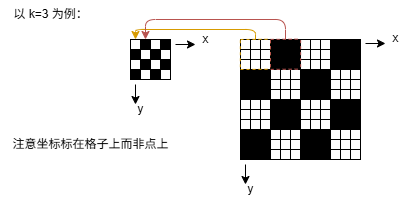

# 程序设计基础 E4 答案（2025秋）

## A The Second Decision

| 难度 | 考点 |
| --- | --- |
| 1 | 辗转相除法求最大公约数 |

### 题目

#### 题目描述

给定两个正整数 $a$ 和 $b$ ，用辗转相除法求它们的最大公约数，并输出它们的最小公倍数。

#### 输入格式

一行两个整数 $a$ 和 $b$ ，用空格分隔。

#### 输出格式

一行一个整数，表示 $a$ 和 $b$ 的最小公倍数。

#### 样例输入

```text
12 18
```

#### 样例输出

```text
36
```

### 答案

### 题目分析

这道题就是为了让大家熟悉辗转相除法，只需按照 **Hint** 的或者PPT上的示例代码来做就肯定难不倒你

虽然PPT上教了很多种方法来控制循环，但是在你理解了每一种方法之后只需选择一个最简洁，最适合你的方法熟练使用即可

### 示例代码

```c
#include <stdio.h>

int main()
{
    long long a, b, gcd, lcm, temp;

    scanf("%lld%lld", &a, &b);
    lcm = a * b;

    while(b != 0)
    {
        temp = a % b;
        a = b;
        b = temp;
    }
    gcd = a;
    lcm /= gcd;

    printf("%lld\n", lcm);

    return 0;
}
```

## B 纵横

| 难度 | 考点 |
| --- | --- |
| 2 | 循环，判断 |

### 题目

#### 题目描述

画一个 $n \times n$ 的棋盘，每个格子用 $k \times k$ 个字符表示，白格用字符 `1` 填充，黑格用空格填充。请输出这个棋盘。判断某个字符属于白格还是黑格，只需看它所在格子的行号与列号之和的奇偶性。

#### 输入格式

一行两个整数 $n$ 和 $k$ ，用空格分隔。

#### 输出格式

$nk$ 行，每行 $nk$ 个字符。

#### 样例输入

```text
2 2
```

#### 样例输出

```text
11
11
  11
  11
```

### 答案

### 解题思路

在此仅介绍最简便的实现方法。对字符画上的每一个字符设一个坐标 $(x,y)$ （以输出的第一个字符为原点 $(0,0)$ ，向右向下建立坐标系），寻找这个字符代表的应是黑色还是白色与 $x,y$ 的关系。

首先考虑 $k=1$ 的情况：不难发现，某个字符代表黑色还是白色与坐标 $x+y$ 的奇偶性有关， $x+y$ 为偶数时应为白色， $x+y$ 为奇数时应为黑色。

当 $k \neq 1$ 时，我们考虑如何将 $k \times k$ 的格子（一个格子代表一个字符）映射到对应的 $k=1$ 的棋盘的格子上，从而仍能通过一个含 $x,y$ 的表达式的奇偶性判断该位置应是白色还是黑色。



以 $k=3$ 为例，右图中 $(0,0),(0,1),(0,2),(1,0),(1,1),(1,2),(2,0),(2,1),(2,2)$ 九个格子要映射到左图中的 $(0,0)$ ，右图中 $(3,0),(3,1),(3,2),(4,0),(4,1),(4,2),(5,0),(5,1),(5,2)$ 九个格子要映射到左图中的 $(1,0)$ 。

不难发现，对右图中格子的坐标 $(x,y)$ 分别进行 `%k` 操作得到 $(x\%k, y\%k)$ 即可映射到左图对应的格子上。判断 $x\%k + y\%k$ 是奇数还是偶数即可判断格子应是黑色还是白色。

### 示例代码

```c
#include<stdio.h>

int main() {
    int n, k;
    scanf("%d %d", &n, &k);
    for (int i = 0; i < n * k; i++) {
        for (int j = 0; j < n * k; j++) {
            if ((i / k + j / k) % 2 == 0) printf("1");
            else printf(" ");
        }
        printf("\n");
    }
    return 0;
}
```

## C 粗线条的雨

| 难度 | 考点 |
| --- | --- |
| 2 | 输入输出，数组/条件判断 |

### 题目

#### 题目描述

给定若干个日期，求它是这一年的第几天。闰年的判断规则是：能被 400 整除，或者能被 4 整除但不能被 100 整除的年份是闰年，闰年的 2 月有 29 天。

#### 输入格式

第一行一个整数 $t$ ，表示数据组数。接下来 $t$ 行，每行三个整数 $y$ 、 $m$ 、 $d$ ，表示年、月、日。

#### 输出格式

每组输出一行一个整数，表示该日期是这一年的第几天。

#### 样例输入

```text
2
2024 3 1
2025 3 1
```

#### 样例输出

```text
61
60
```

### 答案

### 题解

记 $\mathrm{days}_0[k]$ 为平年中，第 $k$ 月拥有的天数。

记 $\mathrm{days}_4[k]$ 为闰年中，第 $k$ 月拥有的天数。

对于 $y$ 年 $m$ 月 $d$ 日：

则如果 $y$ 年是平年：答案为 $\sum_{i=1}^{m-1} \mathrm{days}_0[i] + d$ ;

则如果 $y$ 年是闰年：答案为 $\sum_{i=1}^{m-1} \mathrm{days}_4[i] + d$ ;

### 示例代码

```c
#include <stdio.h>

int days0[]={-1,31,28,31,30,31,30,31,31,30,31,30,31};
int days4[]={-1,31,29,31,30,31,30,31,31,30,31,30,31};
// 使用-1是因为，数组下标从0开始！而月份是从1月到12月，这意味着days[0]是一个不应该用到的数，我们设为-1。
int main(){
    int t;
    scanf("%d",&t);
    while(t--){
        int y,m,d;
        scanf("%d%d%d",&y,&m,&d);
        if(y%400==0||y%4==0&&y%100!=0){
            int ans=d;
            for(int i=1;i<m;i++)
                ans+=days4[i];
            printf("%d\n",ans);
        } else {
            int ans=d;
            for(int i=1;i<m;i++)
                ans+=days0[i];
            printf("%d\n",ans);
        }
    }
    return 0;
}
```

## D 琪露诺的完美算术教室

| 难度 | 考点 |
| --- | --- |
| 3 | 组合数，long long，宏 |

### 题目

#### 题目描述

有 $N$ 发炮弹，其中 $M$ 发是哑弹。随机取出 $n$ 发炮弹，求恰好取出 $k$ 发哑弹的概率（这是超几何分布），其中 $k$ 从 0 取到 $n$ 。概率为 $\dfrac{C_{N-M}^{n-k} C_M^k}{C_N^n}$ ，当 $k > M$ 或 $n - k > N - M$ 时概率为 0。

#### 输入格式

一行三个整数 $N$ 、 $M$ 、 $n$ ，用空格分隔。

#### 输出格式

一行 $n + 1$ 个实数，依次是 $k = 0, 1, \ldots, n$ 时的概率，每个保留小数点后 4 位，相邻两数之间用一个空格分隔。

#### 样例输入

```text
5 2 2
```

#### 样例输出

```text
0.3000 0.6000 0.1000
```

#### 数据范围

$1 \le n \le N \le 20$ ， $0 \le M \le N$ 。 $20!$ 很大，必须分别算出三个组合数再相除，不能把分子分母连乘在一起。

### 答案

### 题目分析

高考之力告诉我们，这是超几何分布。

有 $k$ 枚哑弹的概率是

$$\frac{C_{N-M}^{n-k} C_M^k}{C_N^n}$$

只要我们会求组合数，问题也就迎刃而解。

$$C_a^b = \frac{a!}{b!(a-b)!}$$

实际上也就是求 20 以内的阶乘。如果你嫌每次从 1 开始循环来求阶乘很麻烦，可以参考 E3 的 D 题，构建数组 `fac` ，其中 `fac[i]` 表示 $i!$ 。

容易知道， `fac[i]=fac[i-1]*i` 。这样我们只需要进行一次循环，预处理出 20 以内的阶乘，之后就可以直接调用数组。**阶乘很大，请开 `long long` 。**

我们需要计算三次组合数，每次都要写一大坨阶乘式子。如果你还是嫌麻烦，不想重复劳动，可以用到第二次课上讲的宏定义（实际上就是函数的思想）。

```c
#define C(a,b) (fac[a]/fac[b]/fac[(a)-(b)])
```

这样，每次遇到组合数的时候，你就可以直接写 `C(a,b)` ，把 $a,b$ 改成你需要的值就好了，而不需要写后面那一坨阶乘。

按式子计算即可。请严格注意题目中的数据范围 $1 \le n \le N \le 20, 0 \le M \le N$ 。

当 $k > M$ 或者 $n - k > N - M$ 时，组合数不存在，出现这种情况的概率为 0 ，需要特殊判断。否则，将会出现负数的阶乘，导致**数组越界**。

**另外， 20! 已经是一个很大的数， `long long` 也只能勉强装下。但是题目中会涉及到的组合数都是不太大的整数（不超过 $C_{20}^{10} = 184756$），请一定分别计算出三个组合数之后再得出答案，而不是分子分母连乘在一起，导致溢出！**

### 示例代码1（运用宏定义）

```c
#include<stdio.h>
#define C(x,y) (fac[x]/fac[y]/fac[(x)-(y)])
//宏定义一定要多打括号，养成好习惯，避免文本替换之后计算顺序发生改变
//比如这里如果不写fac[(x)-(y)]，直接写fac[x-y]的话，当x是N-M，y是n-k，就会替换为N-M-n-k，显然和我们想要的不一样
int N,M,n;
long long fac[23];
int main(){
    scanf("%d%d%d",&N,&M,&n);
    fac[0]=1;//0!=1
    for(int i=1;i<=N;i++)
    fac[i]=fac[i-1]*i;//计算阶乘
    for(int k=0;k<=n;k++){
        if(k>M||n-k>N-M)printf("0.0000 ");
        else printf("%.4f ",1.0*C(N-M,n-k)*C(M,k)/C(N,n));//注意数据类型转换
    }
    return 0;
}
```

### 示例代码2（手写组合数）

```c
#include<stdio.h>
int N,M,n;
long long fac[23];
int main(){
    scanf("%d%d%d",&N,&M,&n);
    fac[0]=1;
    for(int i=1;i<=N;i++)
    fac[i]=fac[i-1]*i;
    long long CNn=fac[N]/fac[n]/fac[N-n];//C(N,n)是固定的
    for(int k=0;k<=n;k++){
        if(k>M||n-k>N-M)printf("0.0000 ");
        else{
            long long C1=fac[N-M]/fac[n-k]/fac[N-M-n+k];//C(N-M,n-k)
            long long C2=fac[M]/fac[k]/fac[M-k];//C(M,k)
            /*
            不可以先把fac[N-M]和fac[M]乘到一起，再除后面的式子！这样甚至会爆掉long long和double的范围，应该时刻控制中间变量在一个较小的范围
            */
            printf("%.4f ",1.0*C1*C2/CNn);
        }
    }
    return 0;
}
```

## E Flappy Bird

| 难度 | 考点 |
| --- | --- |
| 2 | 模拟，字符输出 |

### 题目

#### 题目描述

用字符画出一张高度为 21、宽度为 $N$ 的游戏画面。第 $x$ 列的地面高度是 $h_x$ ：在第 $x$ 列中，高度小于 $h_x$ 的位置画 `*` ，高度等于 $h_x$ 的位置画 `_` ，高度大于 $h_x$ 的位置画 `.` 。小鸟由同一行上连续的三个字符 `-o-` 表示，其中心位于第 $x_b$ 列、第 $y_b$ 行（行号从下往上数，最下面一行是第 0 行）。

#### 输入格式

第一行一个整数 $N$ 。第二行 $N$ 个整数，依次是各列的地面高度。第三行两个整数 $x_b$ 和 $y_b$ ，表示小鸟中心的位置。

#### 输出格式

21 行，从最高的一行（第 20 行）到最低的一行（第 0 行）依次输出，每行 $N$ 个字符。

#### 样例输入

```text
5
0 1 2 1 0
2 3
```

#### 样例输出

```text
.....
.....
.....
.....
.....
.....
.....
.....
.....
.....
.....
.....
.....
.....
.....
.....
.....
.....
.-o-.
.._..
._*_.
_***_
```

### 答案

### 题目分析

方法一：

本题的核心在于：**用一维数组存储地面高度**，然后在输出时根据规则逐格判断该输出什么字符。实现思路如下：

1. 读入 `N` 和数组 `h[0..N-1]` ，其中 `h[x]` 表示第 `x` 列的地面高度。

2. 读入小鸟中心坐标 `(xb, yb)` ，小鸟由 `-o-` 三个字符表示。

3. 输出时从 `y = 20` 到 `0` 依次扫描：

   - 若当前位置正好是小鸟的三个格子，输出 `-` 、 `o` 、 `-` 。

   - 否则根据地面高度：

     - `y < h[x]` 输出 `*`

     - `y == h[x]` 输出 `_`

     - `y > h[x]` 输出 `.`

4. 每一行末尾换行。

这种方法不需要开二维数组，时间复杂度是 `O(21*N)` ，数据范围下非常快。

方法二：

等学到二维数组后，也可以直接开一个二维画布，将小鸟和地形逐列填进去，最后整张打印，这样实现难度更低，但复杂度略高一些。因此推荐学会本题的思路。

### 示例代码

```c
#include <stdio.h>

#define H 21
#define MAXN 100

int main(void) {
    int N, h[MAXN], xb, yb;
    scanf("%d", &N);
    for (int i = 0; i < N; i++) scanf("%d", &h[i]);
    scanf("%d %d", &xb, &yb);

    for (int y = H - 1; y >= 0; y--) {
        for (int x = 0; x < N; x++) {
            if (y == yb && x == xb - 1) putchar('-');
            else if (y == yb && x == xb) putchar('o');
            else if (y == yb && x == xb + 1) putchar('-');
            else if (y < h[x]) putchar('*');
            else if (y == h[x]) putchar('_');
            else putchar('.');
        }
        putchar('\n');
    }
    return 0;
}
```

## F onlyMerge

| 难度 | 考点 |
| --- | --- |
| 3 | 循环，判断 |

### 题目

#### 题目描述

给定两个已经从小到大排好序的数组，把它们合并成一个仍然从小到大排列的序列并输出。要求利用两个数组都有序这一特点，避免不必要的比较：每次只比较两个数组当前未处理部分的第一个元素，取较小者输出。

#### 输入格式

第一行两个整数 $m$ 和 $n$ ，分别是两个数组的长度。第二行 $m$ 个整数，表示第一个数组。第三行 $n$ 个整数，表示第二个数组。两个数组都按从小到大排列。

#### 输出格式

一行 $m + n$ 个整数，表示合并后的序列，相邻两数之间用一个空格分隔。

#### 样例输入

```text
3 3
1 3 5
2 4 6
```

#### 样例输出

```text
1 2 3 4 5 6
```

#### 数据范围

$1 < m + n \le 10^{6}$ 。把两个数组拼接后再排序效率不够高。

### 答案

### 解题思路

此题中 $1 < m + n \le 10^6$ ，如果先将后一个数组拼接在前一个数组后，再通过一些方法对拼接后的数组进行排序，这样的方法**效率不够高**，且暂时不属于我们的教学范围。

因此此题要充分利用两个输入的数组都有序这一特点，**减少不必要的比较**。比如：数组 $a$ 中存在两个下标 $i_1, i_2$ 且 $i_1 < i_2$ ，数组 $b$ 中存在一个下标 $j$ ，如果通过比较已经得到了 $b[j] \le a[i_1]$ ，那么必有 $b[j] \le a[i_2]$ ，若是再比较 $b[j]$ 和 $a[i_2]$ 便是不必要的。

下面开始讲具体的实现方法，输入的两个数组记为 $a, b$ 。

1. 设两个下标 $i, j$ ，初始化 $i = 0, j = 0$

2. 比较 $a[i]$ 和 $b[j]$ 的大小，若 $a[i] \le b[j]$ ，则将 $a[i]$ 填入合并后的数组中， $i = i + 1$ ；否则将 $b[j]$ 填入合并后的数组中， $j = j + 1$
   （“填入”代表如果数组为空，则放到第一个位置上，否则放到数组的第一个空位置上）

3. 重复步骤 2 直到 $i = m - 1$ 或 $j = n - 1$ （即其中一个数组的元素已全部填入合并后的数组）

4. 若 $a$ 数组的元素已全部填完，则将 $b$ 数组中的剩余元素依次填入合并后的数组。若 $b$ 数组的元素已全部填完，则将 $a$ 数组中的剩余元素依次填入合并后的数组。

如果还不太理解，这里有**一个比较形象的比喻**：想象有两叠已经排好序的卡片，每次比较两叠卡片最上面的那张，拿走更小的那张，直到其中一叠卡片被拿完，然后把另一叠剩下的卡片全部拿走。

由于合并后的数组是顺序填入的，代码中并未实际设置合并后的数组，直接将输出当作合并后的数组即可。

如果你的代码 TLE 0.4 了，且你使用的也是如上的思路，那么大概率是因为你的提交受评测机波动导致的误判。

### 示例代码

```c
#include<stdio.h>
int nums1[1000010];
int nums2[1000010];
int main() {
    int m, n;
    scanf("%d%d", &m, &n);
    for (int i = 0; i < m; i++) scanf("%d", &nums1[i]);
    for (int i = 0; i < n; i++) scanf("%d", &nums2[i]);
    int i = 0, j = 0;
    while (i < m && j < n) {
        if (nums1[i] <= nums2[j]) {
            printf("%d ", nums1[i]);
            i++;
        } else {
            printf("%d ", nums2[j]);
            j++;
        }
    }

    while (i < m) {
        printf("%d ", nums1[i]);
        i++;
    }
    while (j < n) {
        printf("%d ", nums2[j]);
        j++;
    }
    return 0;
}
```

## G Spasmodic

| 难度 | 考点 |
| --- | --- |
| 4 | 溢出处理 |

### 题目

#### 题目描述

多组数据。每组给出 $n$ 个整数 $a_1, \ldots, a_n$ 和一个整数 $k$ ，求这 $n$ 个数的乘积与 $k$ 的大小关系。乘积可能远远超出 `int` 甚至 `long long` 的范围，需要想办法避免溢出。

#### 输入格式

第一行一个整数 $t$ ，表示数据组数。每组数据第一行两个整数 $n$ 和 $k$ ，第二行 $n$ 个整数。

#### 输出格式

每组输出一行：乘积大于 $k$ 输出 `>` ，小于 $k$ 输出 `<` ，等于 $k$ 输出 `=` 。

#### 样例输入

```text
4
3 6
1 2 3
2 100
1000 1000
2 10
-3 4
2 0
0 5
```

#### 样例输出

```text
=
>
<
=
```

#### 数据范围

$|k| \le 10^{6}$ ， $n \le 100$ 。累乘过程中一旦发现绝对值已经超过 $10^{6}$ ，就可以直接确定答案的符号。

### 答案

### 题解 1

注意到 $|k| \le 10^6$ 。

记乘积 $p = \prod_{i=1}^{n} a_i$ 。

但是， $p$ 不一定在 `int` ，甚至 `long long` 范围里，这会导致溢出，从而错误。

我们仍然需要继续观察。

我们首先需要判断， $p$ 是否满足 $p = 0$ 。很显然，这个是好做的。只要我们发现满足这个条件，那么接下来直接用 $0$ 和 $k$ 比较即可。

否则，这意味着 $p$ 要么是正，要么是负。通过统计数组中负数个数可以知道这一点。

如果 $p$ 是正数：记录累乘值 $product$ 。

循环中，一旦我们发现 $product$ 超出了 $[-10^6, 10^6]$ 范围，这意味着 $p > +10^6$ ，那么答案一定是 > 。

反之，这意味着 $p \in [-10^6, 10^6]$ ，不会爆。直接和 $k$ 判断就行了。

如果 $p$ 是负数：记录累乘值 $product$ 。

循环中，一旦我们发现 $product$ 超出了 $[-10^6, 10^6]$ 范围，这意味着 $p < -10^6$ ，那么答案一定是 < 。

反之，这意味着 $p \in [-10^6, 10^6]$ ，不会爆。直接和 $k$ 判断就行了。

### 题解 2

考虑我们计算 $product$ 的过程。

可以证明，如果 $product > 10^6$ ，把 $product$ 拉到 $10^6 + 1$ 就行。

如果 $product < -10^6$ ，我们把 $product$ 直接赋值为 $-10^6 - 1$ 即可。

这样统计出来的 $product$ 不一定等于 $p$ ，但可以方便地计算溢出情况。同时，其和 $k$ 的大小关系也不会变。

### 题解 3

注意到 $p$ 似乎在浮点数范围内。

利用这个性质和 `double` 在较小整数内没有精度误差的性质直接做。

直接把 $product$ 设成 `double` ，然后直接乘就行。

（艺高人胆大。除非你了解 `IEEE754` 浮点数的运算规则，否则不建议这么做。而且题解中直接使用 `==` 来判断浮点数正是因为断定了浮点数保存整数时无精度误差的性质。）

### 示例代码 1

```c
#include <stdio.h>

int a[105];
int main(){
    int t;
    scanf("%d",&t);
    while(t--){
        int n,k;
        scanf("%d%d",&n,&k);
        for(int i=1;i<=n;i++)
            scanf("%d",&a[i]);
        // 寻找0
        int found0=0;
        for(int i=1;i<=n;i++)
            if(a[i]==0) found0=1;
        if(found0){              // if(statement) 等价于 if((statement)!=0)
            if(0<k) printf("<\n");
            else if(0>k) printf(">\n");
            else printf("=\n");
            continue;
        }
        // 计算答案正负
        int negative_count=0;
        for(int i=1;i<=n;i++)
            if(0>a[i]) negative_count++;
        // 无论是正数还是负数，我都先看看会不会溢出
        int product=1;
        int overflow=0;
        for(int i=1;i<=n;i++){
            product*=a[i];
            if(product<-1000000||product>+1000000){
                overflow=1;
                break;
            }
        }
        // 先看看溢出了没有
        if(overflow){
            // 溢出了。这意味着乘积的绝对值应该会超过k的绝对值。
            if(negative_count%2==0){
                // +
                printf(">\n");
            } else {
                // -
                printf("<\n");
            }
        } else {
            // 太棒了没溢出，直接比较即可
            if(product<k) printf("<\n");
            else if(product>k) printf(">\n");
            else printf("=\n");
        }
    }
    return 0;
}
```

### 示例代码 2

```c
#include <stdio.h>

int main(){
    int t;
    scanf("%d",&t);
    while(t--){
        int n,k;
        scanf("%d%d",&n,&k);
        int prod=1;
        for(int i=1;i<=n;i++){
            int a;
            scanf("%d",&a);
            prod*=a;
            if(prod<-1000000) prod=-1000001;
            if(prod>1000000) prod=1000001;
        }
        if(prod>k) printf(">\n");
        else if(prod<k) printf("<\n");
        else printf("=\n");
    }
    return 0;
}
```

### 示例代码 3

```c
#include <stdio.h>

int main(){
    int t;
    scanf("%d",&t);
    while(t--){
        int n,k;
        scanf("%d%d",&n,&k);
        double prod=1;
        for(int i=1;i<=n;i++){
            int a;
            scanf("%d",&a);
            prod*=a;
        }
        if(prod>k) printf(">\n");
        else if(prod<k) printf("<\n");
        else printf("=\n");
    }
    return 0;
}
```

## H 不讲 5 的（简单版）

| 难度 | 考点 |
| --- | --- |
| 4 | 字符串、九进制？ |

### 题目

#### 题目描述

给定一个正整数 $n$ （位数非常多，只能按字符串读入），求 0 到 $n$ 之间（包含 0 和 $n$ ）十进制表示中不含数字 5 的整数个数，答案对 998244353 取模。

#### 输入格式

一行一个正整数 $n$ ，位数可达 $10^{6}$ 。

#### 输出格式

一行一个整数，表示满足条件的整数个数对 998244353 取模的结果。

#### 样例输入

```text
21
```

#### 样例输出

```text
20
```

#### 数据范围

$n$ 的位数不超过 $10^{6}$ ，必须按字符逐位读入。全过程都要取模，最后可能的加一也要取模。

### 答案

### 题目分析

首先，题目给出的数据规模不可能用整数存储，所以我们只能一位一位存进来。通过上机赛的同背景题，我们很容易想到这个和九进制有关系。事实上，从 $n$ 往小数，数到第一个不含 5 的自然数时，如果将它看成字面上的九进制数（ $6,7,8,9$ 都减一），那么它的值就是我们想要的结果。但我们肯定不能一个个往下减。

集中注意力可以注意到，我们从高位往下数，数到第一个 5 ，将它改成 4 ，将后面所有位都置为 9 （设这个数为 $n'$ ，那么显然 $n'+1, n'+2, \cdots, n$ 都包含数字 5 ，因此结果是一样的。本质是将 $n$ 转换为不含数字 5 的、答案不变的最大的数），再将每一位的 $6,7,8,9$ 减一，最后将它看成九进制数转换为十进制，加一（因为从 0 开始数）即可。这种写法与我们下面给出的方法本质是完全相同的，故不再赘述。接下来我们从十进制的角度考虑这道题，给出注意力不够集中时的解法。

我们可以从高位到低位枚举每一位。对于每一位，我们计算“高位与 $n$ 相同、此位小于 $n$ 的这一位、低位任意”的所有数中，不含数字 5 的个数。由于当前枚举位小于 $n$ 的这一位，因此这里面所有的数都小于 $n$ 。

设 $n$ 的位数为 $m$ 。
假设最高位，或者称之为第 $m-1$ 位，为 $k$ ，我们就先计算 0 到 $\overline{(k-1)99\cdots9}$ 中所有不含 5 的数有多少个。后面 $m-1$ 位，每一位都可以填除了 5 以外的其它 9 个数字，因此共有 $9^{m-1}$ 中填法。此位可以填 $0,1,\cdots,k-1$ 共 $k$ 个数字（如果 $k > 5$ ，那么这里面还有个 5 不能填，那么就是共 $k-1$ 个数字），因此共有

$$
\begin{cases}
k \times 9^{m-1}, & k \le 5 \\
(k-1) \times 9^{m-1}, & k > 5
\end{cases}
$$

种填法。
那么此时我们还剩下 $\overline{k00\cdots0}$ 到 $n$ 中的数没有统计。显然这些数都以 $k$ 为最高位。如果 $k = 5$ ，那么这些数全部不符合题意；否则，这些数是否含 5 与 $k$ 无关。因此抹掉最高位即可。

那么我们就可以用类似的方法处理次高位、第三高位、并一直处理到最低位。

处理最后一位时，假设最后一位为 $k$ ，那么我们实际数的是 0 到 $k-1$ 中不含 5 的数（前面所有位被抹去，实际上与 $n$ 的前面所有位相同），那么还没有讨论 $n$ 本身。如果处理到了最后一位，并且最后一位也不为 5 ，那么 $n$ 本身就是不含 5 的数，最后还要加 1 。

举个栗子，假设 $n = 983254671$ ：
第一次，我们枚举最高位 9 ，数的是 000000000 到 899999999 中不含 5 的个数。最高位可以选择填 $0,1,2,3,4,6,7,8$ 这 8 个数，后面八位可以任意填除 5 以外的数字，此时共有 $8 \times 9^8 = 344373768$ 个数符合题意；
第二次，我们枚举次高位 8 ，数的是 900000000 到 979999999 中不含 5 的个数，共有 $7 \times 9^7 = 33480783$ 个数符合题意；
第三次，我们枚举百万位 3 ，数的是 980000000 到 982999999 中不含 5 的个数，共有 $3 \times 9^6 = 1594323$ 个数符合题意；
第四次，我们枚举十万位 2 ，数的是 983000000 到 983199999 中不含 5 的个数，共有 $2 \times 9^5 = 118098$ 个数符合题意；
第五次，我们枚举万位 5 ，数的是 983200000 到 983249999 中不含 5 的个数，共有 $5 \times 9^4 = 32805$ 个数符合题意；
由于万位为 5 ，因此从 983250000 到 983254671 的万位都是 5 ，不存在符合题意的数，因此我们直接结束枚举。
累加以上的结果，我们得到答案 379599777 。

再举个 $n$ 不含 5 的例子：假设 $n = 2342$ ：
第一次，枚举最高位 2 ，数 0000 到 1999 共 $2 \times 9^3 = 1458$ 个数符合题意；
第二次，枚举百位 3 ，数 2000 到 2299 共 $3 \times 9^2 = 243$ 个数符合题意；
第三次，枚举十位 4 ，数 2300 到 2339 共 $4 \times 9 = 36$ 个数符合题意；
第四次，枚举个位 2 ，数 2340 到 2341 共 2 个数符合题意；
最后，由于 2342 不含 5 ，因此 2342 本身也符合题意。
累加以上的结果，我们得到答案 1740 。

事实上以上方法就是将 $n$ 第一个 5 后面的所有数置为 0 ，即得到 $n' + 1$ ，然后再去计算。因此我们在开头说，这两种方法的本质是完全相同的。

注：做题时，可以考虑把输出样例作为十进制数，转换为九进制数，观察与输入样例的异同，也许你能找到规律： $20 = (21)_9 + 1, 1740 = (2342)_9 + 1, 379599777 = (873249999)_9 + 1$ 。

**最后提醒一下，过程中不要忘记取模，尤其是最后可能的加一。** 虽然从概率学角度来讲，这里不取模出错的概率非常小，但是测试点不一定是随机生成的。本题第一个测试点故意设置为不加一取模前 998244352 ，如果加一不取模则会错误。

### 示例代码 1

需要注意的是，如果你想在本地调试，则需要在读入的循环条件中加上 `&& r != '\n'` ，想想为什么。

```c
#include <stdio.h>
int main() {
    long long ans = 0, five = 0;
    for ( char r; (r = getchar()) != EOF; ans = (ans * 9 + r - '0') % 998244353 ) {
        if ( five ) // 将 5 后面的所有数换成 9
            r = '9';
        else if ( r == '5' ) // 遇到了 5 ，标记，同时把 5 调成 4 （与下面所有大于 5 的数减一合并写在下面，则是大于等于 5 则减一）
            five = 1;
        if ( r >= '5' ) // 大于等于 5 ，则减一
            r--;
    }
    printf("%lld\n", (ans + 1) % 998244353);
    return 0;
}
```

### 示例代码 2

```c
#include <stdio.h>

const int mod = 998244353;

long long M[1008611] = {1}; // M[i] 表示 9 的 i 次方取模，用 long long 防止计算时溢出
int size, A[1008611];
long long ans;

int main() {
    for ( int i = 1; i < 1e6; i++ ) // 预计算 9 的所有幂
        M[i] = M[i - 1] * 9 % mod;

    for ( char r; (r = getchar()) != EOF; A[size++] = r - '0' ); // size 表示输入的位数。顺便将读入的数字的实际值（而非 ascii ）存在数组 A 中

    int i;
    for ( i = 0; i < size; i++ ) {
        ans = (ans + (A[i] - (A[i] > 5)) * M[size - i - 1]) % mod; // A[i] > 5 时，要把此位为 5 、高位与 n 相同的情况减去
        if ( A[i] == 5 ) // 此位为 5 ，则已经计算了从 0 到 {高位与 n 相同、此位为 4 、低位全为 9} 这些数中所有不含 5 的个数。
            break; // 从 {高位与 n 相同、此位为 5 、低位全为 0} 到 n ，这些数的这一位都是 5 ，所以都不会算了，直接结束循环。
    }

    // 当算到个位时，我们计算的实际上是 0 到 n - 1 ，还需要判断 n 是否符合题意。
    // 如果 i 的值为 size ，那就说明上述循环并没有因为 A[i] == 5 而 break ，从而说明 n 没有数位是 5 ，符合题意。
    if ( i == size )
        ans = (ans + 1) % mod;
    printf("%lld\n", ans);
    return 0;
}
```

## I Undying Macula

| 难度 | 考点 |
| --- | --- |
| 5 | 动态规划 |

### 题目

#### 题目描述

给定一个长度为 $n$ 的数列，每次操作可以把任意一个元素移到数列的任意位置。求最少需要多少次操作，才能使整个数列变成不下降数列。

#### 输入格式

第一行一个整数 $n$ 。第二行 $n$ 个整数，表示数列。

#### 输出格式

一行一个整数，表示最少操作次数。

#### 样例输入

```text
5
3 1 2 5 4
```

#### 样例输出

```text
2
```

#### 数据范围

$n \le 5000$ 。答案等于 $n$ 减去最长不下降子序列的长度；注意 $n = 1$ 时答案为 0。

### 答案

### 题目分析

摩耶把元素移过来移过去的，我们发现直接做是不好做的。

不过我们知道，每个元素要么不移动，要么只移动一次，最终一定可以形成不下降序列。也就是说，操作次数不会超过 $n$ 次。

**正难则反。不妨考虑最多有多少个元素不需要被移动**，再用 $n$ 减掉，不就是最小操作次数了？

单独观察这些不需要被移动的元素，它们一定形成一个不下降序列，否则必然产生冲突，需要移动。问题便转化为求最长不下降子序列的长度。

即，求出最大的 $k$ ，使得能从原数列中选出 $k$ 个位置 $b_1, b_2, \cdots, b_k$ ，其中 $b_1 < b_2 < \cdots < b_k$ 且 $a_{b_1} \le a_{b_2} \le \cdots \le a_{b_k}$ 。

这是一个经典的动态规划问题。考虑设 $f_i$ 表示前 $i$ 个位置中选出以 $i$ 位置结尾的不下降子序列，最长的长度。

计算 $f_i$ 的时候，枚举 $1 \le j < i$ 的每个 $j$ ，如果 $a_i \ge a_j$ ，可以把 $i$ 位置接在 $j$ 位置后面，依然是不下降子序列，且序列长度加一。如果都不行， $i$ 位置自己也可以作为子序列的开头。因此

$$f_i = \max(1, \max_{j=1}^{i-1}(f_j + 1))$$

易知最长不下降子序列的长度为 $\max_{i=1}^{n} f_i$ ，而答案为 $n - \max_{i=1}^{n} f_i$ 。

注意一下 $n = 1$ 的情况，此时答案为 0 ，可能会偷袭某些同学的代码。如果你的边界处理足够优雅，是不会出现这些问题的。

### 示例代码

```c
#include<stdio.h>
int main(){
    int n,a[5005],dp[5005],ans=0;
    scanf("%d",&n);
    for(int i=0;i<=n;i++)dp[i]=0;
    for(int i=1;i<=n;i++){
        scanf("%d",&a[i]);
        for(int j=0;j<i;j++)
        if(a[i]>=a[j]&&dp[i]<dp[j]+1)dp[i]=dp[j]+1;
        if(ans<dp[i])ans=dp[i];
    }
    printf("%d",n-ans);
    return 0;
}
```

容易发现这个 dp 的时间复杂度是 $O(n^2)$ 的。请学有余力的同学自行思考 $O(n \log n)$ 的解法。

## J 孤独之数plus

| 难度 | 考点 |
| --- | --- |
| 6 | gcd，容斥 |

### 题目

#### 题目描述

给定一个长度为 $n$ 的数列，求满足 $1 \le x < y \le n$ 且 $\gcd(a_x, a_y) = 1$ 的整数对 $(x, y)$ 的个数。

#### 输入格式

第一行一个整数 $n$ 。第二行 $n$ 个整数，表示数列。

#### 输出格式

一行一个整数，表示满足条件的整数对个数。

#### 样例输入

```text
4
2 3 4 5
```

#### 样例输出

```text
5
```

#### 数据范围

$n \le 10^{5}$ ，数列中的元素不超过 $10^{6}$ 。答案可能很大，需要用 `long long` 存储。

### 答案

### 题目分析

以下设 $V = 1000000$ ，表示值域大小。

设 $f_d$ 表示满足 $1 \le x < y \le n$ 且 $\gcd(a_x, a_y) = d$ 的整数对 $(x,y)$ 有多少。答案即为 $f_1$ 。

怎么求 $f_d$ 呢。一个初步的想法是找出序列中所有 $d$ 的倍数，假设一共有 $k$ 个，那么它们一共可以形成 $C_k^2 = \frac{k(k-1)}{2}$ 个整数对，并且它们两两之间的 $\gcd$ 也一定是 $d$ 的倍数，但不一定等于 $d$ 。

我们只要 $\gcd = d$ 的对数，不需要 $\gcd = 2d, 3d, \cdots$ 的。那就把这些额外的贡献减掉吧。

$$f_d = \frac{k(k-1)}{2} - \sum_{p=2}^{\lfloor V/d \rfloor} f_{pd}$$

只要我们事先计算出了每个 $f_{pd}$ 的值，就可以枚举 $d$ 的倍数来算出 $f_d$ 。

由于序列中所有数都不超过 $V$ ，任意两个数的 $\gcd \le V$ ，因此 $pd$ 也不可能超过 $V$ 。

从 $V$ 开始倒着枚举 $d$ ，求出所有 $f_d$ 即可。时间复杂度是调和级数的， $O(V \log V)$ 。

有竞赛基础的同学，还可以思考莫比乌斯反演的解法，涉及目前所学知识的原因，这里不再赘述。应该也是绝大多数 AI 代码的解法（？）

### 示例代码

```c
#include<stdio.h>
int n,cnt[1000005];
long long ans,f[1000005];
int main(){
    scanf("%d",&n);
    for(int i=1;i<=n;i++){
        int tmp;
        scanf("%d",&tmp);
        cnt[tmp]++;
    }
    for(int i=1000000;i;i--){
        long long res=0,sub=0;
        for(int j=i;j<=1000000;j+=i)res+=cnt[j],sub+=f[j];
        f[i]=res*(res-1)/2-sub;
    }
    printf("%lld",f[1]);
    return 0;
}
```
