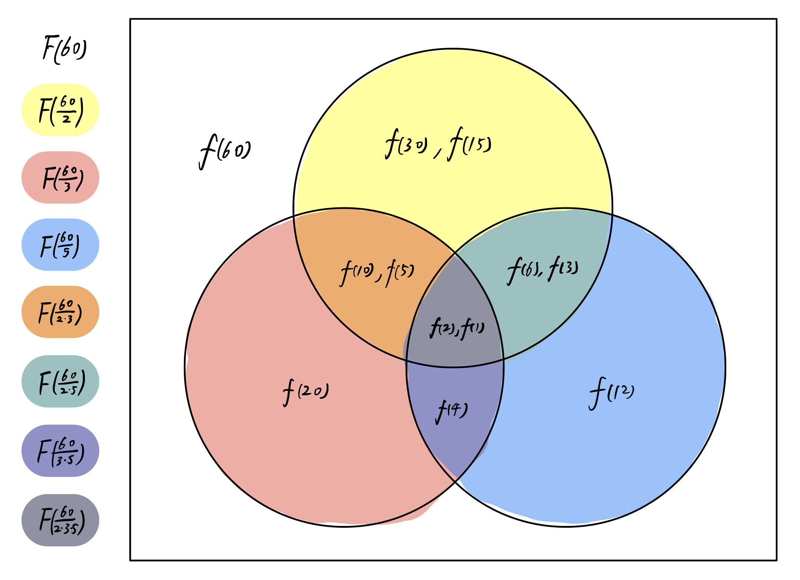

# 程序设计基础 C3 答案（2022秋）

## A 小L的位运算

### 题目

| 难度 | 考点 |
| --- | --- |
| 1 | 位运算 |

#### 题目描述

给定两个 `int` 类型的整数 $a, b$ ，请依次输出 $a \& b$ 、 $a | b$ 、 $a \wedge b$ 的值。

#### 输入格式

一行两个整数 $a, b$ 。

#### 输出格式

一行三个整数，依次为 $a \& b$ 、 $a | b$ 、 $a \wedge b$ ，用空格分隔。

#### 样例输入

```text
5 3
```

#### 样例输出

```text
1 7 6
```

### 答案

### 问题分析

题目要求我们输出两个 int 类型的整数的 &、|、^，我们直接按要求输出即可。

### 参考代码

```c
#include<stdio.h>
int main()
{
    int a,b;
    scanf("%d%d",&a,&b); //输入a,b
    printf("%d %d %d",a&b,a|b,a^b); //依次输出 a&b,a|b,a^b
    return 0;
}
```

## B 全额保险

### 题目

#### 题目描述

全额保险的赔付规则与两个实数 $a, b$ 有关：

- 若 $|a - b| < 10^{-8}$ ，认为两者基本相等，输出 `0` ；
- 否则若 $a > b$ ，输出 `1` ；
- 否则输出 `-1` 。

#### 输入格式

一行两个实数 $a, b$ 。

#### 输出格式

一行一个整数，按上述规则输出。

#### 样例输入

```text
1.0 1.000000001
```

#### 样例输出

```text
0
```

### 答案

### 参考代码

```c
//简单题，请看Hint和代码。
#include <math.h>
#include <stdio.h>

int main() {
    double a, b;
    scanf("%lf%lf", &a, &b);
    double delta = fabs(a - b); //计算a,b差值的绝对值
    double eps = 1e-8; //设置差异值
    if (delta < eps) { //如果delta小于eps，说明a,b基本相等
        printf("0");
    } else if (a > b) { //否则判断a,b大小，按题目要求输出
        printf("1");
    } else {
        printf("-1");
    }
}
```

## C 罗德厨房

### 题目

#### 题目描述

罗德厨房里有 $n$ 件商品，第 $i$ 件商品的原价为 $x_i$ 。价格调整的规则由 $x_i$ 的二进制位决定：

- 若 $x_i$ 的二进制表示中从低位起第 3 位为 1 （即 $x_i \& 4 \ne 0$ ），则调整后价格降低 4 ；
- 若 $x_i$ 的二进制表示中最低位为 0 （即 $x_i \& 1 = 0$ ），则调整后价格上升 1 。

请求出所有商品价格变化量之和，其中价格降低记为正、价格上升记为负。

#### 输入格式

第一行一个正整数 $n$ 。

第二行 $n$ 个整数 $x_1, x_2, \cdots, x_n$ 。

#### 输出格式

一行一个整数，为价格变化量之和。

#### 样例输入

```text
3
4 1 2
```

#### 样例输出

```text
2
```

### 答案

### 题目分析

价格变化值由二进制倒数第三位和最后一位决定。当第三位原始值为 $1$（x&4==4），修改后价格降低 $4$。若原始值为 $0$，则不发生变化。当末位原始值为 $0$（x%2==0），修改后价格上升 $1$，否则不发生变化。

### 示例代码

```c
#include <stdio.h>
int main()
{
    int x, n, ans = 0;
    scanf("%d", &n);
    for (int i = 0; i < n; i++)
    {
        scanf("%d", &x);
        if (x & (1 << 2))//第3位是否为1
            ans += 4;
        if (!(x & 1))//第1位是否为0
            ans--;
    }
    printf("%d", ans);
}
```

## D 第六感猜测

### 题目

#### 题目描述

先读入 5 个数 $x_1, \cdots, x_5$ ，再读入 5 个数 $y_1, \cdots, y_5$ 。

对每个 $i$ ，考察「正负相差值」 $|x_i - y_i|$ ：

- 若 $|x_i - y_i| < 100$ ，累加 3 ；
- 若 $|x_i - y_i| = 100$ ，累加 1 ；
- 若 $|x_i - y_i| > 100$ ，累加 $-1$ 。

请求出这 5 个累加值的总和。

#### 输入格式

第一行 5 个整数 $x_1, \cdots, x_5$ 。

第二行 5 个整数 $y_1, \cdots, y_5$ 。

#### 输出格式

一行一个整数，为所求总和。

#### 样例输入

```text
1 2 3 4 5
1 2 3 4 205
```

#### 样例输出

```text
11
```

### 答案

### 题目分析

本题涉及主要考点是逻辑表达式和判断语句。

首先，依次读入 $x_1$、 $x_2$、 $x_3$、 $x_4$、 $x_5$ 和 $y_1$、 $y_2$、 $y_3$、 $y_4$、 $y_5$；

接着，按照要求分别求出 $x_i, y_i$ 的相差值，值得注意的是：这里的相差值，指的是“正负相差”，因此 $x_i > y_i$ 与 $x_i < y_i$ 均有可能发生。

- 特别：这里通过 else 语句，我们实际只要写出“小于100”、“等于100”、“大于100”中的任意两种逻辑表达式即可。如果使用 $Hint$ 中的提示“小于100”的写法，示例代码如下。但实际上这种写法复杂了，我们可以直接写出“等于100”、“大于100”两种情况的逻辑表达式，用 else 表示“小于100”，此时，无需写 >0 的判断条件，可以简化代码。

### 示例代码

```c
#include<stdio.h>
#include<math.h>
int x[10],y[10],sum,i;
int main()
{
    for(i=0;i<5;i++)
      scanf("%d",&x[i]);
    for(i=0;i<5;i++)
      scanf("%d",&y[i]);
    for(i=0;i<5;i++)
    {
        if(abs(x[i]-y[i])<100)
          sum+=3;
        else   if(abs(x[i]-y[i])==100)
          sum+=1;
        else
          sum-=1;
    }
    printf("%d",sum);
    return 0;
}
```

## E 翻转正整数

### 题目

#### 题目描述

给定一个 `unsigned int` 范围内的正整数 $n$ ，请把它二进制表示的高 16 位与低 16 位整体对调，并输出对调后的数。

#### 输入格式

一行一个 `unsigned int` 范围内的正整数 $n$ 。

#### 输出格式

一行一个整数，为高低 16 位对调后的结果。

#### 样例输入

```text
1
```

#### 样例输出

```text
65536
```

### 答案

### 题解

在做这题之前，我们需要明确以下几条性质：

- int 型最多存储32位整形,即正负数都有，范围在 $[-2^{31}, 2^{31} - 1]$。而 unsigned int 也是32位，但是存储的是非负整数，范围为 $[0, 2^{32} - 1]$。
- 在无符号整数中，如果运算出现**溢出**，则自动**取模**,举个例子：在 unsigned int 型当中，计算 $2^{32} + 233$ 时，实际的运算是 $(2^{32} + 233)$，结果就是233.
- 逻辑右移操作是在左边补0，抛弃最低位，相当于是无符号数除以2。算术右移操作是在左边补原来的符号位，符号位为1，则补1，为0则补0，相当于有符号数除以2。
- 逻辑左移操作是在右边补0，相当于是无符号数乘以2，算术左移的功能同逻辑左移相同

本题要我们交换高低位,我们只需要分别得到高16位和低16位这两个数，将其他位补0，再将这两个数或起来就行。

### 参考代码

```c
#include<stdio.h>
int main()
{
    unsigned int n = 1;
    scanf("%u",&n);
    printf("%u",(n<<16)|(n>>16));//位运算的特殊性质，我们位移后补的位一定是0，所以可以不用自己再补。
    return 0;
}
```

## F 词义分析

### 题目

#### 题目描述

两个词的差异可以用两个 01 向量的距离来衡量。由于向量每一维的取值只有 0 与 1 ，两个向量之差的模长平方就等于两向量取值不同的维数。

给定 $t$ 组询问，每组给出两个整数 $a, b$ （把它们的二进制表示视作两个向量），请求出它们二进制表示中对应位不同的位数。

#### 输入格式

第一行一个正整数 $t$ ，表示数据组数。

接下来 $t$ 行，每行两个整数 $a, b$ 。

#### 输出格式

共 $t$ 行，每行一个整数，为对应位不同的位数。

#### 样例输入

```text
2
5 3
7 7
```

#### 样例输出

```text
2
0
```

### 答案

### 题目分析

因为两向量各维度均只有0、1，故两向量之差的模长的平方就相当于两个向量值不同的维度的数目，故只需要比较两个数的二进制位有多少位不等并输出即可。

### 示例代码

```c
#include <stdio.h>
int main()
{
    int t, a, b;
    scanf("%d", &t);
    while (t--)
    {
        int cnt = 0;
        scanf("%d%d", &a, &b);
        while (a || b)//a与b均为0时才结束
        {
            cnt += (a & 1) ^ (b & 1);//使用&1提取当前位，异或以判断是否不等
            a >>= 1, b >>= 1;//左移，进行到下一位
        }
        printf("%d\n", cnt);
    }
}
```

## G void学数学

### 题目

#### 题目描述

给定两个集合 $A$ 与 $B$ （元素为 1 到 5000 的整数，可能重复出现），请求出所有「只在其中一个集合里出现」的元素，即累计只出现一次的元素，并按从小到大的顺序输出。

#### 输入格式

第一行一个正整数 $T$ ，表示数据组数。

每组数据占两行：第一行先给出正整数 $n$ ，随后是集合 $A$ 的 $n$ 个元素；第二行先给出正整数 $m$ ，随后是集合 $B$ 的 $m$ 个元素。

#### 输出格式

共 $T$ 行，每行按从小到大的顺序输出只出现一次的元素，相邻两数之间用一个空格分隔。

#### 样例输入

```text
1
3 1 2 3
3 2 3 4
```

#### 样例输出

```text
1 4
```

#### 数据范围

- 元素的值在 1 到 5000 之间

### 答案

### 题意描述

T组数据，每次给出两个集合，输出这两个集合中没有在对方出现过的所有元素，或者说，累计只出现一次的元素

那么，我们可以用一个数组来统计每个数出现的次数，只输出出现一次的。（事实上数据保证了，每个数只会出现0,1,2次）

### 代码分析

```c
#include<stdio.h>
#include<stdlib.h>
#include<math.h>
#include<ctype.h>
#include<string.h>
#include<time.h>
int n,m,T;
int x;
int use[5010];
int main(){
    scanf("%d",&T);
    while(T--){
    for(int i=1;i<=5000;i++)
        use[i]=0;//每一次作业都要初始化，把上一次统计的结果清零
    scanf("%d",&n);
    for(int i=1;i<=n;i++)scanf("%d",&x),use[x]++;//统计集合A中每个元素出现的次数
    scanf("%d",&m);
    for(int j=1;j<=m;j++)scanf("%d",&x),use[x]++;//统计集合B中每个元素出现的次数
    for(int i=1;i<=5000;i++){//从小到大输出只出现一次的元素，这样的元素是符合题意的
        if(use[i]==1)
            printf("%d ",i);
    }
    printf("\n");
    }
}
```

## H 蓝和橙的简单位运算

### 题目

| 难度 | 考点 |
| --- | --- |
| 2 | 位运算 |

#### 题目描述

给定一个 `int` 整数 $num$ 与两个整数 $i, key$ ，请把 $num$ 二进制表示中从第 $i$ 位开始的连续 4 位（低位从第 0 位计数）替换为 $key$ 的低 4 位，其余位保持不变，并以十进制输出结果。

#### 输入格式

多组数据输入，每组数据为一行三个整数 $num, i, key$ ，读到文件结束为止。

#### 输出格式

共若干行，每行一个整数，为替换后的 $num$ 。

#### 样例输入

```text
255 4 1
```

#### 样例输出

```text
31
```

### 答案

### 题目分析

参考例题3-8

int 数据类型在储存时是以补码的形式储存的，而非负整数的补码就是其本身的二进制码，因此**不需要**进行额外的操作来得到其二进制码，直接以 int 形式进行位运算即可

将二进制码上的某几位替换成另外几位数字，可以采用如下做法（以样例的第二行为例）：

首先，将需要被替换的数位全部置 $0$，这一步可以通过按位与来计算

```c
int num = 255, n = 4, key = 1;
//num的二进制码为11111111，需要操作的位数为4~7四位
//我们可以将4~7位和0进行与运算，其他位和1进行与运算
int tmp = ~(15 << n);
//15的二进制码为1111,左移四位后变为11110000，取反后为00001111，正好对应各个位
num &= tmp;
//此时num的二进制码变为00001111，其他位被保留，4~7位变成0
```

然后，将替换上去的数字移动到对应的区域，这一步可以通过左移来实现

```c
key <<= n;
//此时key的二进制由0001变为00010000,4~7位为对应的二进制码，其余位为0
```

最后，进行按位或，由于 $num$ 的其他位没有变化而 $key$ 在其他位上皆为 $0$，因此按位或的结果与原二进制码相同，而需要替换的位为 $0$ 与 $key$ 的二进制码的按位或，得到的结果依然为 $key$ 的二进制码。

```c
num |= key;
```

### 示例代码

```c
#include <stdio.h>
int main(void) {
    int num, i, key;
    //不定组数据的各种输入方式还请各位牢记
    while (scanf("%d%d%d", &num, &i, &key) != EOF) {
        int tmp = ~(15 << i);//15的二进制码为1111左移并取反之后为111……100001……11的形式
        num &= tmp;//进行按位与操作后，num需要修改的位的二进制码变为0，其余位不变
        num |= (key << i);//将替换上去的数字移动到对应的区域进行按位或，得到最终结果
        printf("%d\n", num);//与例题不同，本体以十进制输出结果，使用%d格式符
    }
    return 0;
}
```

## I 反码计算机

### 题目

| 难度 | 考点 |
| --- | --- |
| 2 | 反码 |

#### 题目描述

给定两个整数（以十进制字符串形式给出，可能带负号），先把它们转换成反码：正数的反码就是它本身，负数的反码是其绝对值按位取反。

然后对这两个反码分别进行按位与、按位或、按位异或运算，并把三个运算结果按反码规则还原成十进制输出：若结果为负数，先输出负号，再输出其按位取反后的值；否则直接输出。

#### 输入格式

一行两个整数，中间用空格分隔。

#### 输出格式

共三行，依次为按位与、按位或、按位异或的结果。

#### 样例输入

```text
-5 3
```

#### 样例输出

```text
2
-4
-6
```

### 答案

### 题目分析

本题主要考察大家对于反码的认识。根据反码的定义，正数的反码就是原码，负数的反码是对应正数取反。

所以本题非常简单，首先需要判断数字是否具有正负号，判断方法可以使用 scanf 的格式输入。

如果是正数，本身即为反码，如果是负数，就直接对对应的正数取反就能得到反码了。

之后再使用 C语言的位运算即可解决本题。

当然同样的，输出的时候也是先判断数字的正负，对于负数，先输出符号，再将数字取反后输出。

### 示例代码

```c
#include <stdio.h>

int main()
{
    char p[20], q[20]; // 读入数字用
    int a, b, ans1, ans2, ans3;
    scanf("%s %s", p, q); // 读入成字符串形式
    if(sscanf(p, "-%d", &a)) a = ~a; // 如果能读到负号说明是负数
    else sscanf(p, "%d", &a); // 否则直接读入正数即可
    if(sscanf(q, "-%d", &b)) a = ~b;
    else sscanf(q, "%d", &b);
    ans1 = a & b;
    ans2 = a | b;
    ans3 = a ^ b;
    if (ans1 < 0) printf("-%d\n", ~ans1); // 如果是负数，先输出负号，再将数字取反后输出
    else printf("%d\n", ans1); // 否则直接输出即可
    if (ans2 < 0) printf("-%d\n", ~ans2);
    else printf("%d\n", ans2);
    if (ans3 < 0) printf("-%d\n", ~ans3);
    else printf("%d\n", ans3);
    return 0;
}
```

## J 不可分解的01串

### 题目

#### 题目描述

若一个长度为 $n$ 的 01 串可以由某个长度小于 $n$ 的 01 串重复若干次拼接而成，则称它是**可分解的**，否则称它是**不可分解的**。

设长度为 $n$ 的不可分解 01 串的数量为 $f(n)$ 。由于每个长度为 $n$ 的 01 串都唯一地对应一个长度 $d$ （ $d$ 整除 $n$ ）的不可分解串的重复，因此有

$$2^n = \sum_{d | n} f(d)$$

给定 $n$ ，请求出 $f(n)$ 对 998244353 取模的结果。

#### 输入格式

一行一个正整数 $n$ 。

#### 输出格式

一行一个整数，为 $f(n) \bmod 998244353$ 。

#### 样例输入

```text
4
```

#### 样例输出

```text
12
```

### 答案

### 题目分析

本题难度过高，不做任何要求。

本题思路重点在于，一个长度为 $n = k * d$ 的 01 字符串分解成 $k = \frac{n}{d}$ 个相同的长度为 $d$ 的不可分解串的方法是**唯一**的，不可能有两个不同的不可分解的串分别经过一定次数的重复拼接后得到相同的串。

考虑所有长度为 $n$ 的字符串，共 $2^n$ 个，其中能够分解为 $\frac{n}{d}$ 个相同的长度为 $d$ 的不可分解串的数量应该与长度为 $d$ 的不可分解串的数量相等，因此设长度为 $n$ 的不可分解的 01 字符串数量为 $f(n)$，则可得公式：

$$
2^n = \sum_{d|n} f(d)
$$

由此公式我们可以计算 $f(n)$。

### 思路1-95分

由公式 $2^n = \sum_{d|n} f(d)$，可得 $f(n) = 2^n - \sum_{d|n, d \ne n} f(d)$，因此我们可以用递推的思路来计算 $f(n)$。

建立一个数组 $f[2000005]$，记录 $f(n)$，先将所有的 $f[i]$ 设为 $2^i$，然后从 $i = 1$ 开始遍历，将 $f[i$的倍数 $]$ 减去 $f[i]$，由于 $i > n/2$ 时 $f[i]$ 对 $f[n]$ 不再有影响，因此遍历到 $i = n/2$ 即可，然后输出 $f[n]$.

计算过程中别忘记对 998244353 取模。

复杂度分析：空间复杂度为 $O(n)$. 由于遍历到 $i$ 时，对 $i$ 的每个倍数计算了一次，共计算了 $\frac{n}{i}$ 次，所以总共计算了 $\sum_{i=1}^{n/2} \frac{n}{i} = n * \sum_{i=1}^{n/2} \frac{1}{i}$ 次， $n$ 很大时约为 $n * ln(\frac{n}{2})$ 次，时间复杂度可视为 $O(nlogn)$.

为了防止减法运算中出现负数，可以参考如下代码：

```c
(a%M-b%M+M)%M //模M意义下的a-b
```

95分示例代码如下：

```c
#include<stdio.h>
#define M 998244353
int f[2000005];
int main(){
    int n;
    scanf("%d",&n);
    f[0]=1;
    for(int i=1; i<=n; ++i) //遍历数组f，将f[i]设为2的i次幂
        f[i]=(f[i-1]<<1)%M;
    for(int i=1; i<=n/2; ++i)
        for(int j=2*i; j<=n; j+=i) //将f[i的倍数]减去f[i]
            f[j]=(f[j]+M-f[i])%M;
    printf("%d",f[n]);
    return 0;
}
```

### 思路2-满分

设 $F(n) = 2^n$，则 $F(n) = \sum_{d|n} f(d)$。问题转化为，已知 $F(n)$ 和上述由 $f(n)$ 推出 $F(n)$ 的关系式，如何用 $F(n)$ 表示 $f(n)$.

关于这部分内容，感兴趣的同学可以看完示例后翻到题解最后的补充部分。

我们用一个简单的例子说明这个过程。设 $n = 60$，则有以下公式：

$$
F(\frac{60}{1}) = F(60) = f(1) + f(2) + f(3) + f(4) + f(5) + f(6) + f(10) + f(12) + f(15) + f(20) + f(30) + f(60)
$$

$$
F(\frac{60}{2}) = F(30) = f(1) + f(2) + f(3) + f(5) + f(6) + f(10) + f(15) + f(30)
$$

$$
F(\frac{60}{3}) = F(20) = f(1) + f(2) + f(4) + f(5) + f(10) + f(20)
$$

$$
F(\frac{60}{5}) = F(12) = f(1) + f(2) + f(3) + f(4) + f(6) + f(12)
$$

$$
F(\frac{60}{2*3}) = F(10) = f(1) + f(2) + f(5) + f(10)
$$

$$
F(\frac{60}{2*5}) = F(6) = f(1) + f(2) + f(3) + f(6)
$$

$$
F(\frac{60}{3*5}) = F(4) = f(1) + f(2) + f(4)
$$

$$
F(\frac{60}{2*3*5}) = F(2) = f(1) + f(2)
$$

利用容斥原理，如下图所示：



因此

$$
f(60) = F(60) - F(\frac{60}{2}) - F(\frac{60}{3}) - F(\frac{60}{5}) + F(\frac{60}{2*3}) + F(\frac{60}{2*5}) + F(\frac{60}{3*5}) - F(\frac{60}{2*3*5})
$$

在这个例子中， $60$ 有三个**不同**素因子 $2, 3, 5$，因此利用 $3$ 个集合的容斥原理进行计算，即可得到上式。

将这个例子一般化，设数 $n$ 有 $cnt$ 个素因子，则应利用 $cnt$ 个集合的容斥原理进行计算，得到 $f(n)$ 的表达式：

$$
f(n) = \sum_{d=p_1 p_2 \cdots p_a} (-1)^a F(\frac{n}{d})
$$

，其中 $p_1, p_2, \cdots, p_a$ 为 $n$ 的 $a$ 个不同素因子，特别地， $d = 1$ 视为 $0$ 个素因子的乘积

即 $d$ 是 $n$ 的所有**不同**素因子中部分（可能全部，可能部分，也可能没有）的乘积，组成 $d$ 的素因子个数的是偶数还是奇数决定了 $F(\frac{n}{d})$ 的符号是正还是负，对所有的 $d$，将 $F(\frac{n}{d})$ 带上符号累加起来，即可得到答案 $f(n)$.

因此我们只需要求出 $n$ 的所有不同的素因子，然后遍历这些素因子不同的组合方式（即遍历所有的 $d$），判断组成 $d$ 的素因子个数的奇偶性从而确定符号，计算 $F(\frac{n}{d})$，然后再将 $F(\frac{n}{d})$ 带上符号累加起来就可以得到 $f(n)$.

设 $n$ 有 $cnt$ 个素因子，分别为 $p[0]$ 到 $p[cnt-1]$，则这些素因子的不同组合方式共有 $2^{cnt} = 1 << cnt$ 种（每个素因子可选可不选），我们可以从 $i = 0$ 遍历到 $i = 2^{cnt} - 1$， $i$ 的二进制表示的第 $j$ 位是否为 $1$ 代表第 $j$ 个素因子 $p[j]$ 是否被选（比如二进制数 1101 代表了 $p[0], p[2], p[3]$ 的组合），则每一个 $i$ 代表了 $n$ 的不同素因子的一种组合方式。

用 $sum$ 记录 $f(n)$，初始为 $0$。每一次遍历 $i$，用 $s$ 代表 $\frac{n}{d}$， $d$ 为该素因子组合的乘积；用 $sign$ 代表 $F(\frac{n}{d})$ 的符号。初始 $s = n, sign = 1$，从 $j = 0$ 遍历到 $j = cnt - 1$， $i$ & $(1 << j)$ 是否为 非 $0$ 说明 $i$ 的第 $j$ 位是否为 $1$，若是 $1$ 则说明 $p[j]$ 被选，即在该素因子组合之中，则 $s$ 应除以 $p[j]$，该组合中素因子数量增加了 $1$，符号 $sign$ 应取相反数。遍历 $j$ 结束后， $sum$ 加上 $sign * F(\frac{n}{d}) = sign * 2^s$。全部的 $i$ 遍历完（即全部的 $d$ 遍历完）之后， $sum$ 即为最终答案 $f(n)$.

计算过程中别忘记对 998244353 取模。

求 $n$ 的所有素因子的方法如下：

```c
int cnt=0;
long long t = n;
for (long long i = 2; i * i <=t; i++)
{
    if (t % i == 0)
    {
        p[cnt++] = i;
        while (t % i == 0)
            t /= i;
    }
}
if (t != 1LL) p[cnt++] = t;
```

模 $M$ 意义下快速计算 $a$ 的 $b$ 次幂的方法（快速幂）如下：

```c
long long qpow(long long a, long long b)
{
    long long ret = 1LL;
    while (b)
    {
        if (b & 1) ret = ret * a % M;
        a = a * a % M;
        b >>= 1;
    }
    return ret;
}
```

复杂度分析：求 $n$ 的所有素因子可以在 $O(\sqrt{n})$ 的时间复杂度内求出，快速幂计算 $2$ 的幂次时间复杂度为 $O(log(s)) \le O(log(n))$，遍历 $i, j$ 一共运算不超过 $2^{cnt} * (cnt + log(n))$ 次，由于 $j > 0$ 时 $p[j] > 2$，又有 $\prod_{j=0}^{cnt-1} p[j] \le n$，因此 $cnt$ 较大时 $2^{cnt} * (cnt + log(n))$ 应该远小于 $n$。另外值得注意的是，前 14 个质数相乘已经大于 $10^{15}$，因此 $cnt <= 13$，又有 $log(n) < log(10^{15}) <= 50$，显然这部分小于 $O(\sqrt{n})$。因此时间复杂度可粗略估计为 $O(\sqrt{n})$。空间复杂度取决于数组 $p$ 的大小，即 $O(cnt)$.

示例代码：

```c
#include <stdio.h>
#define ll long long
#define M 998244353

ll qpow(ll a, ll b)
{
    ll ret = 1LL;
    while (b)
    {
        if (b & 1) ret = ret * a % M;
        a = a * a % M;
        b >>= 1;
    }
    return ret;
}

int main()
{
    ll p[20], sum = 0, n;
    int cnt = 0;
    scanf("%lld", &n);
    ll t = n;
    for (ll i = 2; i * i <=n; i++)
    {
        if (n % i == 0)
        {
            p[cnt++] = i;
            while (n % i == 0)
                n /= i;
        }
    }
    if (n != 1LL) p[cnt++] = n;
    n = t;
    t = 1LL << cnt;
    for (ll i = 0; i < t; i++)
    {
        ll sign = 1, s = n;
        for (int j = 0; j < cnt; j++)
            if (i & (1 << j)){
                sign *= -1;
                s /= p[j];
            }
        sum = (sum + sign * qpow(2, s) + M) % M;
    }
    printf("%lld", (sum + M) % M);
    return 0;
}
```

### 补充

莫比乌斯反演：

设 $F(n)$ 和 $f(n)$ 是定义在正整数集合上的两个函数

若 $F(n) = \sum_{d|n} f(d)$，则有 $f(n) = \sum_{d|n} \mu(d) F(\frac{n}{d})$.

其中 $\mu(d)$ 称为莫比乌斯函数，定义如下：

① $\mu(1) = 1$；

② $\mu(p_1 p_2 \cdots p_a) = (-1)^a$，其中 $a$ 个 $p$ 为不同素数；

③ 其余情况 $\mu(d) = 0$.

关于莫比乌斯反演和莫比乌斯函数的更多内容，感兴趣的同学可以自行搜索了解。

### 后记

作为最后一题用来防ak的题，此题不做任何要求。同学们做不出来或者看不懂题解，完全可以当做没有见过这道题。出题人也觉得这题出得有些过于难了。

如果能够想到 $2^n = \sum_{d|n} f(d)$ 已经非常不容易了，想到这一点后如果能够拿到一部分分数，你就已经很棒了。如果你想出了思路1时间复杂度 $O(nlogn)$ 的做法，拿到了95分，说明你已经具备非常高的编程水平了。

当你具备更深的编程知识后，再回过头来看这道题，仍可能会有一定的收获。至少出题人从 $Red$ 的做法中学到了很多。——哪吒

Author: 哪吒
