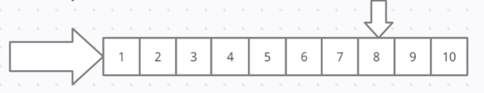
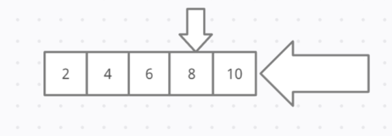
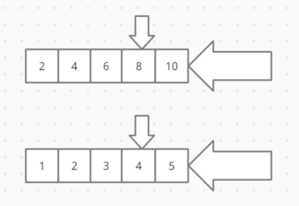
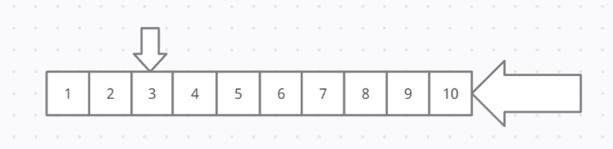
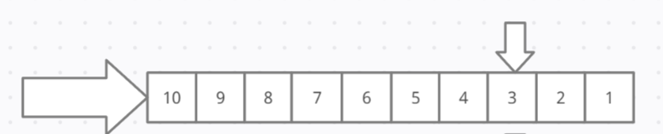
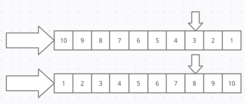

# 程序设计基础 C5 答案（2022秋）

## A 麦麦的测绘

### 题目

#### 题目描述

在平面直角坐标系中，极坐标 $(r, \theta)$ 与直角坐标 $(x, y)$ 的关系为

$$x = r\cos\theta, \quad y = r\sin\theta$$

给定一点的极坐标，求它的直角坐标。

#### 输入格式

一行两个实数 $r, \theta$ ，其中 $\theta$ 为弧度制。

#### 输出格式

一行两个实数，分别为 $x$ 和 $y$ ，保留 1 位小数，用空格分隔。

#### 样例输入

```text
2 0
```

#### 样例输出

```text
2.0 0.0
```

### 答案

### 题目分析

本题为签到题，主要 math.h 中函数的使用，按要求读入并输出即可。

### 示例代码

```c
#include <stdio.h>
#include <math.h> //注意添加math.h头文件
int main()
{
    double r, theta;
    scanf("%lf%lf", &r, &theta); //读入r和theta
    printf("%.1lf %.1lf", r * cos(theta), r * sin(theta)); //按要求输出即可
    return 0;
}
```

## B 点名

### 题目

#### 题目描述

点名时需要统计名单里各类字符的数量。给定一段字符（读到文件结束为止），分别统计其中数字字符、小写字母、大写字母的个数。

#### 输入格式

若干个字符，读到文件结束为止。

#### 输出格式

一行三个整数，依次为数字字符、小写字母、大写字母的个数，用空格分隔。

#### 样例输入

```text
Ab3 cD!
```

#### 样例输出

```text
1 2 2
```

### 答案

### 题目解读

按照题意要求调用头文件，调用函数，写 if 分支判断可以完成此题

由于 oj 上有些函数返回值并不是 0 或者 1

因此不建议在 oj 做题时使用下面的判断

```c
if（isdigit(x)==1）//想要判断 x 是否是数字字符
```

### 代码

```c
#include<stdio.h>
#include<ctype.h>
int main()
{
    int sumlower = 0, sumdigit = 0, sumupper=0;
    char ch;
    while((ch=getchar())!=EOF)
    {
        if(isdigit(ch))
        sumdigit++;
        else if(islower(ch))
        sumlower++;
        else if(isupper(ch))
        sumupper++;
    }
    printf("%d %d %d",sumdigit, sumlower, sumupper);
    return 0;
}
```

## C 陨石猜想

### 题目

#### 题目描述

对给定的正整数 $x$ 反复执行下面的操作，直到 $x < 10$ 为止：

- 若 $x \bmod 4 \ne 0$ ，则令 $x = x + (x \bmod 10) + 2$ ；
- 否则令 $x = x / 2$ 。

每次得到新的 $x$ 后把它输出，所有操作结束后输出 `End` 。

#### 输入格式

一行一个正整数 $x$ 。

#### 输出格式

按上述规则逐行输出每次得到的新 $x$ ，最后输出一行 `End` 。

#### 样例输入

```text
20
```

#### 样例输出

```text
10
12
6
End
```

### 答案

### 题解

根据 Hint 完成即可。

```c
#include <stdio.h>
void f(int x) {
    if (x < 10)
        return;
    // your code here:
    if (x % 4 != 0)
        x = x + x % 10 + 2;
    else
        x = x / 2;
    printf("%d\n", x);
    f(x);
    return;
}
int main() {
    int x;
    scanf("%d", &x);
    f(x);
    printf("End");
}
```

## D 莱娜的庭园

### 题目

#### 题目描述

莱娜的庭园里有 4 个点 $P_1, P_2, P_3, P_4$ 。她想分别知道由 $(P_1, P_2, P_3)$ 、 $(P_1, P_2, P_4)$ 、 $(P_1, P_3, P_4)$ 、 $(P_2, P_3, P_4)$ 构成的三角形的重心坐标。

#### 输入格式

4 行，每行两个整数，依次为 $P_1, P_2, P_3, P_4$ 的坐标。

#### 输出格式

4 行，每行两个实数，依次为上述 4 个三角形的重心坐标，均保留 1 位小数，用空格分隔。

#### 样例输入

```text
0 0 3 0 0 3 3 3
```

#### 样例输出

```text
1.0 1.0
2.0 1.0
1.0 2.0
2.0 2.0
```

### 答案

### 题目分析

题目需要多次对不同数值进行相同的计算并输出，于是我们可以定义一个函数来完成这个操作。同时，利用全局变量保存读入数据，可以更方便地在函数中对其进行读取。

### 示例代码

```c
#include <stdio.h>
int x[5], y[5]; //读入存至全局数组，方便函数读取
void PrintBarycenter(int a, int b, int c); //输出重心的函数
int main()
{
    for (int i = 1; i <= 4; i++)
        scanf("%d%d", &x[i], &y[i]);
    //依次调用函数完成输出
    PrintBarycenter(1, 2, 3);
    PrintBarycenter(1, 2, 4);
    PrintBarycenter(1, 3, 4);
    PrintBarycenter(2, 3, 4);
    return 0;
}
void PrintBarycenter(int a, int b, int c)
{
    double xb = (x[a] + x[b] + x[c]) / 3.0; //计算重心坐标，注意变量名不要重复
    double yb = (y[a] + y[b] + y[c]) / 3.0;
    printf("%.1lf %.1lf\n", xb, yb); //函数内输出，不需要多返回值
}
```

## E 分数运算mini

### 题目

#### 题目描述

给定 $n$ 个分数，求它们的和，并把结果约分到最简形式：若结果是整数，直接输出该整数；否则输出 `分子/分母` 。

#### 输入格式

第一行一个正整数 $n$ 。

接下来 $n$ 行，每行一个分数，形如 `a/b` 。

#### 输出格式

一行，为约分后的结果。

#### 样例输入

```text
2
1/2
1/3
```

#### 样例输出

```text
5/6
```

### 答案

### 题目分析

本题主要考察使用辗转相除法求最大公因数，同时可以写成最大公因数函数 $gcd()$ 和最小公倍数函数 $lcm()$ 来简化代码。

先对 $a/b$ 进行约分，然后使用分数加法公式

$$\frac{x}{y} + \frac{a}{b} = \frac{lcm(y,b) * x / y + lcm(y,b) * a / b}{lcm(y,b)} $$

，其中 $lcm(y, b) = y * b / gcd(y, b)$ ，计算后再对结果进行约分即可。

### 示例代码

```c
#include <stdio.h>
int n, a, b, x, y;
// 辗转相除法求最大公因数
int gcd(int a, int b) {// 返回a和b的最大公因数
    while (b != 0) {
        int t = a;
        a = b;
        b = t % b;
    }
    return a;
}
int main() {
    scanf("%d", &n);
    scanf("%d/%d", &x, &y);
    n--;
    while (n--) {
        scanf("%d/%d", &a, &b);
        int tmp = gcd(a, b);// 计算最大公因数
        a /= tmp, b /= tmp;// 对a/b约分
        tmp = b * y / gcd(b, y);// 计算最小公倍数
        x = tmp * x / y + tmp * a / b;
        y = tmp;
        tmp = gcd(x, y);
        x /= tmp, y /= tmp;// 计算结果x/y约分
    }
    if (y != 1)
        printf("%d/%d", x, y);
    else
        printf("%d", x);
    return 0;
}
```

<!-- markdownlint-disable-next-line MD026 -->
## F Bit Adder?

### 题目

#### 题目描述

石板会对输入的整数 $x$ 做如下运算：把 $x$ 的二进制表示中每一个 1 所在的位号（最低位记为第 0 位）相加，得到的和作为新的 $x$ 。

请求出连续做 $k$ 次这种运算之后的结果。

#### 输入格式

一行两个数：整数 $x$ 与正整数 $k$ 。

#### 输出格式

一行一个整数，为连续做 $k$ 次运算后的结果。

#### 样例输入

```text
5 2
```

#### 样例输出

```text
1
```

#### 数据范围

- $x$ 的范围可能超出 `int`，需要用 `long long`

### 答案

### 题目分析

本题中的石板每次输出的结果可以通过递归来方便地计算：每次计算当前位，然后将剩余位与当前位数加一进行递归计算，并返回递归得到的值与当前位结果之和。而只需通过循环重复计算 $k$ 次即可得到答案。

也可以继续使用递归来计算 k 次的结果，对应示例代码中的函数 `solve` 。

### 示例代码

```c
#include <stdio.h>
typedef long long LL;
LL f(LL, LL);
LL solve(LL x, int k);
int main()
{
    LL x; //注意x的范围
    int k;
    scanf("%lld%d", &x, &k);
    for (int i = 0; i < k; i++)
        x = f(x, 0); //计算k次x的函数值
    printf("%lld", x);
    return 0;
}
LL f(LL x, LL n) // x表示当前计算数值，n表示当前位对2的幂次
{
    if (x) //如果x不为0，则返回x当前位乘以n的值(x & 1) * n 加上x的剩余位的函数值f(x/2, n*2)
        return (x & 1) * n + f(x / 2, n + 1);
    else // x为0则返回0，结束计算
        return 0;
}
LL solve(LL x, int k) // 递归计算k次运算后的值
{
    if (k)
        return solve(f(x, 0), k - 1);
    else
        return x;
}
```

## G 地下墓穴的密码

### 题目

#### 题目描述

地下墓穴的密码由三个长度均为 $l$ 的整数数组 $a, b, c$ 决定。定义

$$f_1 = \sum_{i=0}^{l-1}\left[(a_i+b_i)^2 + (b_i+c_i)^2 + (a_i+c_i)^2\right]$$

$$f_2 = \sum_{i=0}^{l-1}\left[(a_i-b_i)^2 + (b_i-c_i)^2 + (a_i-c_i)^2\right]$$

$$f_3 = \sum_{i=0}^{l-1}\left(a_i b_i + b_i c_i + a_i c_i\right)$$

请求出 $f_1, f_2, f_3$ 。

#### 输入格式

第一行一个正整数 $l$ 。

接下来三行，每行 $l$ 个整数，依次为数组 $a, b, c$ 。

#### 输出格式

一行三个整数，依次为 $f_1, f_2, f_3$ ，用空格分隔。

#### 样例输入

```text
2
1 2
3 4
5 6
```

#### 样例输出

```text
316 48 67
```

### 答案

### 题目分析

本题的要点在于引入了数组变量。

但由于本题中需要运算的数组是固定的。因此为避免数组传参，可以将数组作为全局变量，并直接在函数中进行调用，计算最终结果。

本题中长度亦可作为全局变量，使函数直接不含参数，但在标程中未如此处理。

### 示例代码

```c
# include <stdio.h>
int a[11],b[11],c[11];
int f1(int n)
{
    int s =0;
    for(int i=0; i<n; i++)
    {
        s+=(a[i]+b[i])*(a[i]+b[i]) + (b[i]+c[i])*(b[i]+c[i]) + (a[i]+c[i])*(a[i]+c[i]);
    }
    return s;
}
int f2(int n)
{
    int s =0;
    for(int i=0; i<n; i++)
    {
        s+=(a[i]-b[i])*(a[i]-b[i]) + (b[i]-c[i])*(b[i]-c[i]) + (a[i]-c[i])*(a[i]-c[i]);
    }
    return s;
}
int f3(int n)
{
    int s =0;
    for(int i=0; i<n; i++)
    {
        s+=a[i]*b[i]+b[i]*c[i]+a[i]*c[i];
    }
    return s;
}
int main()
{
    int l,i;
    scanf("%d",&l);
    for(i=0; i<l; i++)
    {
        scanf("%d",&a[i]);
    }
    for(i=0; i<l; i++)
    {
        scanf("%d",&b[i]);
    }
    for(i=0; i<l; i++)
    {
        scanf("%d",&c[i]);
    }
    printf("%d %d %d\n",f1(l),f2(l),f3(l));
    return 0;
}
```

## H 冯 · 诺依曼的自然数理论

### 题目

#### 题目描述

众所周知，冯 · 诺依曼被誉为计算机之父。但鲜有人知的是，他在理论数学上的贡献也是举足轻重的。甚至，他的一些自然数理论如今已然成为集合论的公理。

我们定义自然数时，一般都是采用归纳定义，即皮亚诺公理。

冯 · 诺依曼给出了自然数的另一个定义，即序数和基数构造性定义，其可以简略地概括为：

$$
\begin{aligned}
0 &= \{\} \\
1 &= \{0\} = \{\{\}\} \\
2 &= \{0, 1\} = \{\{\}, \{\{\}\}\} \\
&\cdots \\
n &= \{0, 1, \cdots, n - 1\} \\
&\cdots
\end{aligned}
$$

其中，将自然数用集合形式（即仅包含左大括号、右大括号、逗号这三种字符）表示，我们称其为该自然数的**本原表示**。

给定一个自然数 $n$ ，输出它的**本原表示**（其中元素顺序必须按照上述规则，即不能交换元素顺序）。

**注意：仅包含上述三种字符，不包含空格！**

#### 输入格式

第一行一个正整数 $t$ ，表示数据组数。

接下来 $t$ 行，每行一个自然数 $n$ 。

#### 输出格式

共 $t$ 行，每行为对应的本原表示。

#### 样例输入

```text
2
0
2
```

#### 样例输出

```text
{}
{{},{{}}}
```

### 答案

### 题目描述

众所周知，冯 · 诺依曼被誉为计算机之父。但鲜有人知的是，他在理论数学上的贡献也是举足轻重的。甚至，他的一些自然数理论如今已然成为集合论的公理。

我们定义自然数时，一般都是采用归纳定义，即皮亚诺公理。

冯 · 诺依曼给出了自然数的另一个定义，即序数和基数构造性定义，其可以简略地概括为：

$$
\begin{aligned}
0 &= \{\} \\
1 &= \{0\} = \{\{\}\} \\
2 &= \{0, 1\} = \{\{\}, \{\{\}\}\} \\
&\cdots \\
n &= \{0, 1, \cdots, n - 1\} \\
&\cdots
\end{aligned}
$$

其中，将自然数用集合形式（即仅包含左大括号、右大括号、逗号这三种字符）表示，我们称其为该自然数的**本原表示**。

给定一个自然数 $n$ ，输出它的**本原表示**（其中元素顺序必须按照上述规则，即不能交换元素顺序）。

**注意：仅包含上述三种字符，不包含空格！**

### 解题思路

我们可以定义这样一个递归函数来打印大括号和括号：

```c
// 伪代码
void print_von_Neumann(int n){
    打印左括号;
    递归调用 print_von_Neumann(i)（i 从 0 到 n-1）;
    别忘了两次递归调用之间还要打印逗号;
    打印右括号;
}
```

### 示例代码

```c
#include <stdio.h>
void print_von_Neumann(int n) {
    printf("{");
    for (int i = 0;i < n;i++) {
        print_von_Neumann(i);
        if (i != n - 1) printf(",");
    }
    printf("}");
}
int main() {
    int t;
    scanf("%d", &t);
    while (t--) {
        int n;
        scanf("%d", &n);
        print_von_Neumann(n);
        printf("\n");
    }
}
```

## I 隔板问题

### 题目

#### 题目描述

把 $n$ 个相同的元素分成 $k$ 组，要求每组至少有一个元素，且组之间有先后顺序。

请求出所有满足条件的分法（按第一组元素个数从小到大依次输出），最后输出分法总数。

#### 输入格式

一行两个正整数 $n, k$ 。

#### 输出格式

先按上述顺序输出每一种分法，每种分法占一行，为 $k$ 个正整数，用空格分隔；最后一行输出分法总数。

#### 样例输入

```text
4 2
```

#### 样例输出

```text
1 3
2 2
3 1
3
```

### 答案

### 题目分析

本题我们使用递归求解。由于题目要求输出符合题意的方案，所以我们需要用全局数组保存方案。在每次递归中记录当前剩余的元素个数和当前正在处理的组数，遍历该组能分到的元素个数并进入下一轮递归。

递归边界：

1. 由于题目要求每组至少有一个元素，所以当未处理完 k 组但剩余元素为 0 时不合要求。
2. 当已处理完 $k$ 组但剩余元素不为 0 时，不合要求。
3. 当处理完 $k$ 组且剩余元素恰好为 0 时，找到一个符合题意的方案，输出方案，总方案数 +1。

### 示例代码

```c
#include<stdio.h>
int n, k, sum = 0, a[50];
void func(int ret, int t) { //ret：剩余元素的数量，t:目前正在处理的组数
    if (t == k + 1) {
        if (ret) return; //边界2
        //边界3
        sum ++;
        for (int i = 1; i <= k; i++)
            printf("%d ", a[i]);
        printf("\n");
        return ;
    }
    if (!ret) return ; // 边界1
    for (int i = 1; i <= ret; i ++) {
            a[t] = i; //保存该组内的元素个数
            func(ret - i, t + 1);
        }

}
int main()
{
    scanf("%d%d", &n, &k);
    func(n, 1);
    printf("%d\n", sum);
    return 0;
}
```

## J 任务分块

### 题目

#### 题目描述

把一个任务分成若干块来完成的代价按下面的递推式计算：对正整数 $n$ ，

- 若 $n$ 是质数，则 $\mathrm{divide}(n) = n$ ；
- 否则取不超过 $\sqrt{n}$ 的最大因数 $i$ （即满足 $i | n$ 的最大 $i$ 且 $i^2 \le n$ ），此时

$$\mathrm{divide}(n) = k\left(i + \frac{n}{i}\right) + \mathrm{divide}\left(\frac{n}{i}\right) + \mathrm{divide}(i)$$

其中 $k$ 是给定的常数。

给定 $t$ 组询问与常数 $k$ ，对每个 $n$ 求 $\mathrm{divide}(n)$ 。

#### 输入格式

第一行两个正整数 $t, k$ 。

接下来 $t$ 行，每行一个正整数 $n$ 。

#### 输出格式

共 $t$ 行，每行一个整数，为对应的 $\mathrm{divide}(n)$ 。

#### 样例输入

```text
2 1
6
7
```

#### 样例输出

```text
10
7
```

#### 数据范围

- 答案可能超过 `int` 范围，需要用 `long long`

### 答案

### 题目分析

很普通的递归题，但是有两个注意点：

1. 答案最大值可以超过 int 上限，要用 long long。
2. 反复调用函数会 tle，可以用数组记录返回值，第二次和之后同一个入参进入函数时，直接返回已经计算过了的结果。

这段代码中应用了一个小技巧：赋值（=，+=，%=等）语句会返回赋值后的左值。也就是说：

```c
int ans = (a += b);
```

等价于

```c
a += b；
int ans = a;
```

### 示例代码

```c
#include <math.h>
#include <stdio.h>
long long result[10000], k;
long long divide(int x) {
    if (result[x])
        return result[x];
    for (int i = sqrt(x); i > 1; i--) {
        if ((x % i) == 0)
            return result[x] = k * (i + x / i) + divide(x / i) + divide(i);
    }
    return result[x] = x; //如果是质数就会在这里返回
}
int main() {
    int t;
    scanf("%d%lld", &t, &k);
    while (t--) {
        int n;
        scanf("%d", &n);
        printf("%lld\n", divide(n));
    }
}
```

## K 灵梦的大清洗

### 题目

| 难度 | 考点 |
| --- | --- |
| 3 | 递归 |

#### 题目描述

把 $1, 2, \cdots, n$ 从左到右排成一列，灵梦要做大清洗。

清洗时两种操作交替进行：先从左向右，消去当前序列中第 $1, 3, 5, \cdots$ 个数；再从右向左，消去当前序列中倒数第 $1, 3, 5, \cdots$ 个数；如此反复，直到只剩下一个数。

求最后剩下的数。

#### 输入格式

一行一个正整数 $n$ 。

#### 输出格式

一行一个整数，表示最后剩下的数。

#### 样例输入

```text
10
```

#### 样例输出

```text
8
```

### 答案

### 题目分析

本题采用递归的思想，将大的目标转化为更小且更易解决的子目标。

放到这道题来，就是将一个从 1 到 $n$ 的序列不断转化为更小的从 1 到 $n$ 的序列来处理。

题目中有两种操作：从左向右消去和从右向左消去，两种操作轮流执行，得到最终剩下的数字。

以 $n = 10$ 为例，我们用大箭头标记即将操作的方向，小箭头标记（假定是）最终保留的数字的位置。

#### 首先我们来看从左到右操作的情况



我们执行完一次操作之后，序列变为下图



有没有注意到队列中只剩下偶数？那么接下来我们将这个队列的元素全部除以 2 ，如下图



可以发现，从 1 到 10 的序列从左到右的最终结果的位置，就是从 1 到 5 的序列从右到左的最终保留结果所在的位置，且值是其两倍。

假定我们用函数 `GreatPurge(n,i)` 来表示 1 到 $n$ 的序列，以 `i` 为方向的最终保留结果，那么我们可以得到：

```text
GreatPurge(n, LEFT) = 2 * GreatPurge(n/2, RIGHT)
```

可以验证， $n$ 为奇数时上式仍然成立， $\frac{n}{2}$ 向下取整即可。

#### 接下来我们处理从右到左的情况



假如我们需要得到一个从 1 到 10 的序列从右向左进行操作之后得到的最终结果，那么我们可以将整个序列左右反转，如下图



我们得到了一个 10 到 1 的序列，这个序列从左到右进行操作的最终结果就是我们所需要的结果。

但是这并没有简化问题——我们得想个办法还原成递增的序列进行操作，才能进行递归。

于是我们构造一个递增的从 1 到 10 的序列，如图



可以看到，两个序列上相同位置的数字的和是相同的 11 ——普遍的来说，是 $n + 1$

那么只要计算出从 1 到 10 的序列进行从左向右的操作的最终结果，就能得出其从右向左的最终结果，即

```text
GreatPurge(n, RIGHT) = n + 1 - GreatPurge(n, LEFT)
```

以上，递归关系就找出来了，接下来我们需要一个初始状态——只剩下一个人的时候，就不需要再操作了，她就是最终结果，也即

$$GreatPurge(1, LEFT) = GreatPurge(1, RIGHT) = 1 $$

由此，我们可以得到整个递归函数

```c
const int LEFT = 0, RIGHT = 1;
//使用数字标记方向，方便判断
int GreatPurge(int n, int direction) {
    if (n == 1) {
        return 1;//只剩一个人时，她就是最终被赦免的人
    } else if (direction == LEFT) {
        return 2 * GreatPurge(n / 2, RIGHT);
        //从左往右操作的递推关系
    } else {
        return n + 1 - GreatPurge(n, LEFT);
        //从右往左操作的递推关系
    }
}
```

### 示例代码

```c
#include <stdio.h>
const int LEFT = 0, RIGHT = 1;
int GreatPurge(int, int);
int main(void) {
    int n;
    scanf("%d", &n);
    printf("%d", GreatPurge(n, LEFT));
    return 0;
}
int GreatPurge(int n, int direction) {
    if (n == 1) {
        return 1;
    } else if (direction == LEFT) {
        return 2 * GreatPurge(n / 2, RIGHT);
    } else {
        return n + 1 - GreatPurge(n, LEFT);
    }
}
```
