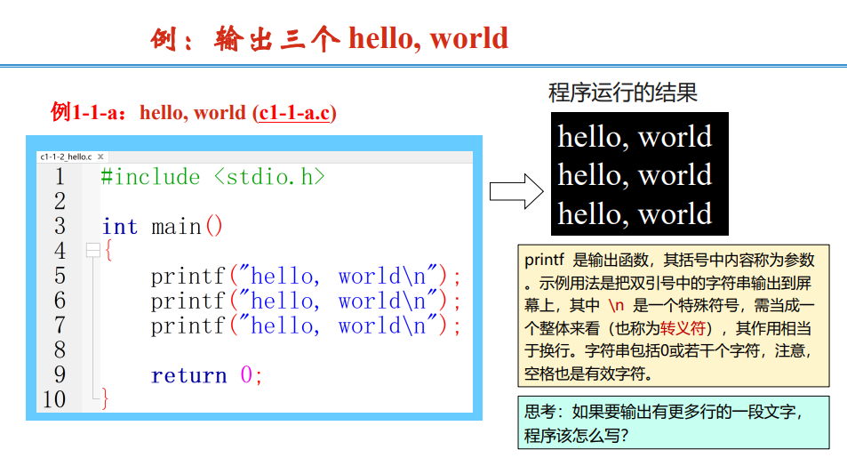
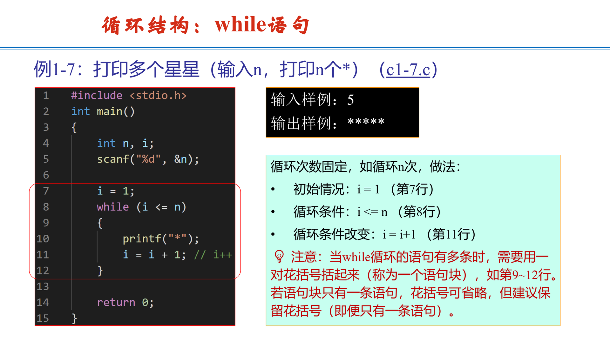
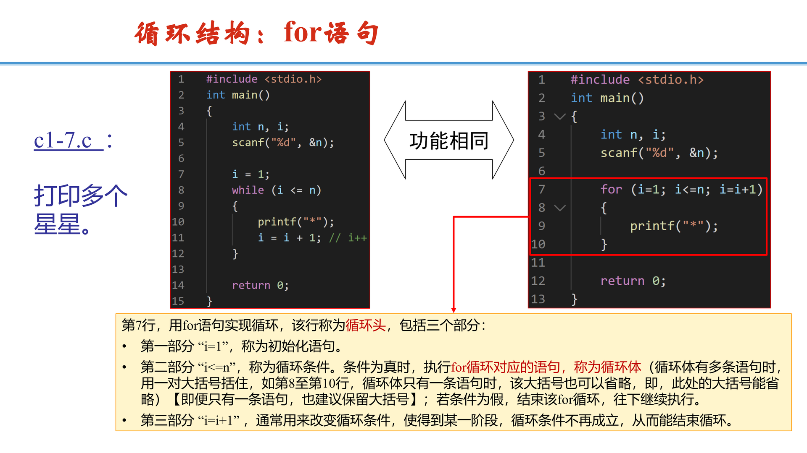
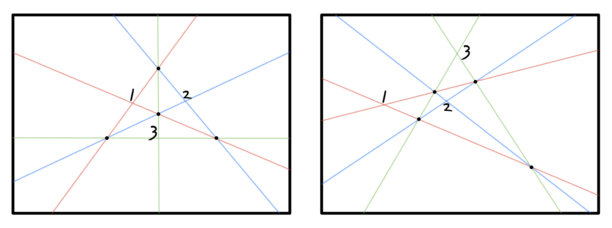

# 程序设计基础 C1 答案（2023秋）

## A hELL0,WOrlD

### 题目

#### 题目描述

在时空狭缝的检测战中，*Omega* 由于能量过载对光之战士说出了混乱的话语。

请你输出这段话语。

```text
FoR rIFt ENergY uNnecEsSary iT iS?
oUtPut mAXimiZeD,BUg mAss pROducti0n...
hEll0,WOrlD!?
```

#### 输入格式

无

#### 输出格式

三行，如题所述的字符串。

#### 输入样例

无

#### 输出样例

```text
FoR rIFt ENergY uNnecEsSary iT iS?
oUtPut mAXimiZeD,BUg mAss pROducti0n...
hEll0,WOrlD!?
```

#### Hint

题目所给的代码块是可以复制的，别真一个字母一个字母手打呀。

输入多行文本的方法：



#### 数据范围

- 本题无输入

Author:星辰的微光

### 答案

| 难度 | 考点 |
| --- | --- |
| 1 | 字符串输出 |

### 题目分析

输出如题所示的字符串即可，可以直接复制粘贴。

注意需要加上换行符，否则输出会挤在同一行。

错误示范

```c
printf("FoR rIFt ENergY uNnecEsSary iT iS?");
printf("oUtPut mAXimiZeD,BUg mAss pROducti0n...");
printf("hEll0,WOrlD!?");
```

其运行结果为

```text
FoR rIFt ENergY uNnecEsSary iT iS?oUtPut mAXimiZeD,BUg mAss pROducti0n...hEll0,WOrlD!?
```

正确做法为

```c
printf("FoR rIFt ENergY uNnecEsSary iT iS?\n");
printf("oUtPut mAXimiZeD,BUg mAss pROducti0n...\n");
printf("hEll0,WOrlD!?\n");
```

这样才会正确的输出三行结果。

### 示例代码

```c
#include <stdio.h>
int main(void) {
    printf("FoR rIFt ENergY uNnecEsSary iT iS?\n");
    printf("oUtPut mAXimiZeD,BUg mAss pROducti0n...\n");
    printf("hEll0,WOrlD!?\n");
    return 0;
}
```

## B 无情的复读机

### 题目

#### 题目描述

*Fontaine* 科学院利用芒性、荒性能量块的湮没原理造出了许多有用的发条机关，其中有一台前期试验机的功能非常简单，就是获取输入的正整数，并**连续**输出对应个数的字符 `+`。请你也来实现一下这个非常简单的功能吧 ~

#### 输入

1 行，1 个数字 $n$，保证 $1 \le n \le 10000$ 且 $n$ 为整数

#### 输出

1 行，包含连续的 $n$ 个字符 `+`

#### 输入样例

```text
6
```

#### 输出样例

```text
++++++
```

#### Hint

参考课件P1例1-7





#### 数据范围

- $1 \le n \le 10000$，且 $n$ 为整数

Author: 逐月的游星

### 答案

| 难度 | 考点 |
| --- | --- |
| 1 | 循环，输入输出 |

### 题目分析

根据题目要求，只需要读入一个正整数，然后输出对应次数的字符 + 即可。

观察数据范围 $1 \le n \le 10000$，可知没有超过 int 类型变量能容纳的数值上限，使用 int 类型变量存储输入的数即可。输出指定次数的字符通常使用 for 或 while 循环，循环指定次数 $n$，每次循环输出一次字符 + 且不换行，最后的输出结果就是连续的 $n$ 个字符 + 。

### 示例代码

```c
#include <stdio.h>

int main(){
    int i, n;   //声明变量
    scanf("%d", &n);    //读入输入数据
    for (i = 0; i < n; i = i + 1) { //通过for循环输出指定次数
        printf("+");
    }

    return 0;
}
```

## C 博雅

### 题目

#### 题目背景

北航的博雅课程计数遵循如下的规则：如果你成功报名并签到了，那么净有效次数加一。如果你成功报名但是没签到，那么净有效次数不仅不增加，还要倒扣一次。净有效次数可以被扣成负数。

#### 题目描述

丽奈同学这学期报了 $n$ 个博雅课程，但是只去了 $m$ 次，请计算她这学期最终的博雅课程净有效次数是多少。

如果净有效次数达到 4 次，博雅才不会挂科，请判断她这学期会不会挂科。

#### 输入

一行两个自然数 $n$ 和 $m$，依次是报名的博雅课程总数和到课的博雅课程总数，保证 $0 \le m \le n \le 10^{9}$

#### 输出

第一行输出一个数，表示丽奈同学这学期最终的博雅课程净有效次数是多少

第二行输出一个字符串，如果她可以及格（不会挂科），输出 `Yes`，否则输出 `No`

#### 输入样例

```text
5 3
```

#### 输出样例

```text
1
No
```

#### 样例解释

总共报了 5 次名，去了 3 次，没去 2 次，净有效次数为 $1 + 1 + 1 - 1 - 1 = 1$ 次， $1 < 4$，所以不及格。

#### 数据范围

- $0 \le m \le n \le 10^{9}$

Author:梁秋月

### 答案

| 难度 | 考点 |
| --- | --- |
| 1 | 基本四则运算，分支结构 |

### 题目解析

由题知，最终的博雅净有效次数等于出勤的次数减去没去的次数，如果设总报名次数为 $n$，到课的次数为 $m$，没去的次数为 $x$，净有效次数为 $a$，则有：

$$
x = n - m
$$

$$
a = m - x
$$

可由此公式计算出答案。

最后，再判断 $a$ 是否达到了 4，并根据判断结果输出对应字符串。

### 示例代码

```c
#include <stdio.h>

int main() {
    int m, n;
    scanf("%d%d", &n, &m);
    int x = n - m; //没去的次数
    int a = m - x;
    printf("%d\n", a);

    if(a>=4) {
        printf("Yes\n");
    } else {
        printf("No\n");
    }
    return 0;
}
```

### 扩展阅读：三目运算符

像逻辑非 ! 和负号 - 这种只连接一个数据的符号，称为“单目运算符”，例如 -a ；像加号 + 、减号 - 和乘号 * 这种连接两个数据的符号，称为“双目运算符”，例如 a+b ；以此类推，连接三个元素的符号就称为三目运算符。

在C语言中，只有一种三目运算符，一般形式为： 表达式1 ? 表达式2 ：表达式3

在运算时，程序会先求解 表达式1 ，若其值为真（非 0 ）则将 表达式2 的值作为整个表达式的取值，否则（ 表达式1 的值为 0 ）将 表达式3 的值作为整个表达式的取值。这里的“表达式”，既可以是数，也可以是字符串。

例如，语句 int Max = (a > b) ? a : b; 的意思就是：如果 $a > b$ ，那么 $Max = a$ ，否则 $Max = b$

我们可以利用三目运算符来缩短本题的代码：

```c
#include <stdio.h>

int main() {
    int m, n;
    scanf("%d%d", &n, &m);
    int x = n - m;//没去的次数
    int a = m - x;
    printf("%d\n",a);
    printf(a >= 4 ? "Yes" : "No");
    return 0;
}
```

## D De：从向量开始

### 题目

#### 题目描述

DeNeRATe太懒了，连向量的点积都不想自己算。

给定两个向量 $\vec{r_1} = (x_1, y_1, z_1), \vec{r_2} = (x_2, y_2, z_2)$，求出

$$\vec{r_1} \cdot \vec{r_2}$$

#### 输入

共两行，第一行三个数 $x_1, y_1, z_1$，第二行三个数 $x_2, y_2, z_2$

保证输入数据均为 `int` 范围内的正整数

#### 输出

共一行，一个数，即向量点乘的结果

且保证输出结果在 `int` 范围内

#### 输入样例

```text
1 2 3
3 2 1
```

#### 输出样例

```text
10
```

#### Hint

（感觉不需要Hint，以防真有同学忘了点乘）

$$\vec{r_1} \cdot \vec{r_2} = (x_1, y_1, z_1) \cdot (x_2, y_2, z_2) = x_1 \times x_2 + y_1 \times y_2 + z_1 \times z_2$$

#### 数据范围

- 输入数据均为 int 范围内的正整数
- 输出结果在 int 范围内

### 答案

| 难度 | 考点 |
| --- | --- |
| 1 | 四则运算 |

### 题目分析

由题目可以知道，我们需要输出两个三维向量的点乘

$$
\vec{r_1} \cdot \vec{r_2} = x1 \times x2 + y1 \times y2 + z1 \times z2
$$

所以我们在输入 $x_1, y_1, z_1, x_2, y_2, z_2$ 后，按照上述公式输出 `x1 * x2 + y1 * y2 + z1 * z2` 即可得到结果

### 示例代码

```c
#include <stdio.h>

int main() {
    int X1, Y1, Z1;
    int X2, Y2, Z2;
    scanf("%d %d %d %d %d %d", &X1, &Y1, &Z1, &X2, &Y2, &Z2);
    printf("%d\n", X1 * X2 + Y1 * Y2 + Z1 * Z2);
    return 0;
}
```

## E b mod a

### 题目

#### 题目描述

让我们从最基本的运算符之一：取余开始。

现在给出 $n$ 组自然数 $a$， $b$，请你计算出每一组 $b \bmod a$ 的值。

#### 输入格式

输入共 $n + 1$ 行

- 第一行为一个正整数 $n$，表示数据组数，满足 $n \le 10$
- 接下来 $n$ 行，每行两个自然数 $a$， $b$，满足 $a, b < 10^{8}$

#### 输出格式

输出为 $n$ 行，对于每一组 $a$， $b$

- 若 $a \ne 0$，则输出该算式及其结果，例如 `5 mod 2 = 1`
- 若 $a = 0$，则输出 `Wait. That's illegal.`

#### 输入样例

```text
2
2 5
0 5
```

#### 输出样例

```text
5 mod 2 = 1
Wait. That's illegal.
```

#### Hint

本题为多组输入，你可以采用以下代码以进行读取

```c
int n, a, b, i;
scanf("%d", &n);
for (i = 0; i < n; i++) {
    scanf("%d%d", &a, &b);
    //补充剩余的部分
}
```

需要填充的部分或许可以参考ppt上的例题1-6。

善用复制功能，题目中的代码块，样例输入输出都是可以复制的。

<!-- markdownlint-disable-next-line MD036 -->
**小心审题**

#### 数据范围

- $n \le 10$
- $a, b < 10^{8}$

Author:星辰的微光

### 答案

| 难度 | 考点 |
| --- | --- |
| 2 | 判断结构 基本运算 |

### 题目分析

如题所述，计算 $b \bmod a$ 的值。

注意以下几点

- 题目为多组数据输入 需要使用循环结构进行输入输出。
- 题目所要求计算的是 $b \bmod a$ 而非 $a \bmod b$，不要搞错了变量。
- 在进行取余运算之前就要先行判断 $a$ 是否为 0 再做运算，否则程序会在试图对 0 取余的时候崩溃。

整体结构仿照“例题1-6”即可，可以得到以下示例代码。

### 示例代码

```c
#include <stdio.h>
int main(void) {
    int n, a, b, i;
    scanf("%d", &n);
    for (i = 0; i < n; i++) {
        scanf("%d%d", &a, &b);
        if (a == 0) {
            printf("Wait. That's illegal.\n");
        } else {
            printf("%d mod %d = %d\n", b, a, b % a);
            // 注意题干 计算的是 b mod a 而不是 a mod b
        }
    }
    return 0;
}
```

## F 军乐团选拔

### 题目

#### 题目描述

*BUAers* 最喜欢军训啦！信息大类军训的同学被划分为 $n$ 个连，每个连中都有一部分人想报名参加军乐团。军乐团总指挥「Ormandy」先生负责选拔工作，他想先知道这 $n$ 个连中平均有多少同学报名，但统计过程中似乎出了一些问题，有些连队中没有人报名，高情商的「Ormandy」先生会认为报名人数为 0 的连队只是「统计失误」，并会将其移除统计名单，只统计有人报名的所有连队的平均报名同学数。
但如果所有连队都「统计失误」，他就会大喊 `Oh!No!`。
你能帮「Ormandy」先生完成这个统计嘛？

#### 输入

第一行一个整数 $n$，表示连队总数，保证 $1 \le n \le 1000$。

第二行 $n$ 个整数，分别为 $a_1, a_2, \ldots, a_n$，其中 $a_i$ 表示第 $i$ 个连队的报名人数，保证 $0 \le a_i \le 200$。

#### 输出

若所有连队都「统计失误」，只输出 `Oh!No!`。
否则输出一个**整数**，为 $a_1, a_2, \ldots, a_n$ 中所有不为 0 的数的平均数（**向下取整**）。

#### 输入样例 1

```text
5
11 21 0 31 40
```

#### 输出样例 1

```text
25
```

#### 输入样例 2

```text
3
0 0 0
```

#### 输出样例 2

```text
Oh!No!
```

#### 样例解释

- 样例一中去除掉 3 连，只统计 1, 2, 4, 5 连报名人数平均数，共 103 人，除以 4 向下取整为 25 人。
- 样例二所有连队报名人数均为 0，输出 `Oh!No!`。

#### Hint

整数除法 `/` 是默认向下取整的喔~

#### 数据范围

- $1 \le n \le 1000$
- $0 \le a_i \le 200$

### 答案

| 难度 | 考点 |
| --- | --- |
| 2 | 四则运算 条件判断 |

### 题目分析

本题实际上为计算 $n$ 个自然数中所有不为 0 的数的平均数，应该用一个变量 num 存储所有不为 0 的数的总和，再用另一个变量 cnt 记录人数不为 0 的连队数目。

具体实现方式为每读入一个连队的人数 a ，就进行一次判断，若 a 不为 0 则将不为零的连队数 +1。

```c
if(a != 0)
{
    num += a;  //更新总人数num
    cnt++;  //更新参与计算平均人数的连队数目
}
```

最后只需判断 cnt 是否为 0，即可确定输出平均数还是 Oh!No! 了。

### 示例代码

```c
#include<stdio.h>

int main()
{
    int n, a, ans, num=0, cnt=0; //num和cnt是不断累加的，所以一定要初始化成0
    scanf("%d", &n);
    for(int i = 1; i <= n; i++)
    {
        scanf("%d", &a);
        if(a != 0)
        {
            num += a;  //更新总人数num
            cnt++;  //更新参与计算平均人数的连队数目
        }
    }

    if(cnt != 0)  //有人报名
    {
        ans = num / cnt;  //平均人数
        printf("%d", ans);
    }
    else  //无人报名
        printf("Oh!No!");

    return 0;
}
```

## G 兜兜转转找到你

### 题目

#### 题目描述

*Zelda* 被困在了 1 号神庙里，*Link* 在 $x$ 号神庙里，*Link* 想要找到 *Zelda*，但是他从 $n$ 号神庙去往下一个神庙必须要满足如下规律：

- 若 $n$ 为奇数，则下一个神庙编号为 $3n + 1$；
- 若 $n$ 为偶数，则下一个神庙编号为 $\frac{n}{2}$。

你能帮忙算算 *Link* 要走过多少个神庙才能找到 *Zelda* 吗？

#### 输入

一行一个正整数 $x$，保证 $1 < x \le 10000$

保证 *Link* 最终一定能去到 1 号神庙，经过的神庙编号都在 `int` 范围内，且答案不超过 $10^{7}$。

#### 输入样例

```text
3
```

#### 输出样例

```text
7
```

#### 样例解释

*Link* 从 $x = 3$ 号神庙到 1 号神庙的路径为： $3 \to 10 \to 5 \to 16 \to 8 \to 4 \to 2 \to 1$

一共走过了 7 个神庙（不算 1 号神庙）

#### Not Hint

$x = 27$ 时 *Link* 要走过 111 个神庙才能来到 1 号神庙，经过的神庙编号最大达到了 9232，所以是“兜兜转转找到你”~

#### 数据范围

- $1 < x \le 10000$
- 经过的神庙编号都在 int 范围内
- 答案不超过 $10^{7}$

Author: David Tong

### 答案

| 难度 | 考点 |
| --- | --- |
| 2 | 循环结构，分支结构，基本运算 |

### 题目解析

按照题目要求，用循环实现从 $x$ 开始不断对其进行操作，循环条件为 $x \ne 1$，用变量 cnt 记录循环次数即可。

### 示例代码

```c
#include <stdio.h>
int main()
{
    int x, cnt;
    scanf("%d", &x);
    for(cnt = 0; x != 1; ++cnt)
    {
        if(x % 2 == 1)
            x = 3 * x + 1;
        else
            x = x / 2;
    }
    printf("%d", cnt);
    return 0;
}
```

## H 永久的爱

### 题目

#### 题目描述

Messi 和 Antonella 在维持一段恋情，每天他们会使用 Wechat 聊天，如果这天他们聊天了，Messi 会在他的小本本上记下一个数字 1，但有时他们可能太忙了无暇聊天，此时他则会记下一个数字 0，我们定义一段恋情的**连续程度**为这段 01 序列中最长的连续的 1 的个数。

现在已知这段恋情持续了 $a$ 天，并且其中 1 的个数是 $b$，求这段恋情的连续程度可能的最大值和最小值分别是多少。

#### 输入

第一行一个正整数 $T(T \le 100)$，表示数据的组数。

接下来 $T$ 行，每行两个整数 $a, b$，含义如题面所示，保证 $1 \le a \le 10^{3}, 0 \le b \le 10^{3}, b \le a$。

#### 输出

$T$ 行，每行两个由空格分隔的整数，分别表示这段恋情连续程度的可能的最大值和最小值。

#### 输入样例

```text
3
5 4
9 0
100 50
```

#### 输出样例

```text
4 2
0 0
50 1
```

#### 样例解释

对于第一组样例，一种连续程度可能的最大的序列是 11110，一种连续程度可能的最小的序列是 11011。

#### 数据范围

- $T \le 100$
- $1 \le a \le 10^{3}$， $0 \le b \le 10^{3}$， $b \le a$

Author: supercarrydyc

### 答案

| 难度 | 考点 |
| --- | --- |
| 3 | 整数除法，抽屉原理 |

### 题目分析

先考虑求最大值，这是我们将所有的 1 全部排在一起，最大值显然为 $b$。

接下来考虑求最小值，问题可以描述为用 $a-b$ 个 0 去分隔 $b$ 个 1，相当于将 $b$ 个 1 放到 $a-b+1$ 个抽屉里，由抽屉原理可知，至少有一个抽屉中的 1 的数量不小于 $\lceil \frac{b}{a-b+1} \rceil$（向上取整），这就是最小值。

由 $\lceil \frac{x}{y} \rceil = \lfloor \frac{x+y-1}{y} \rfloor$（向下取整），知 $\lceil \frac{b}{a-b+1} \rceil = \lfloor \frac{a}{a-b+1} \rfloor$，可以用表达式 a / (a - b + 1) 表示。

### 示例代码

```c
#include <stdio.h>
int main()
{
    int t;
    scanf("%d", &t);
    while(t--)
    {
        int a, b;
        scanf("%d%d", &a, &b);
        printf("%d %d\n", b, a / (a - b + 1));
    }
    return 0;
}
```

## I 军乐团分组

### 题目

#### 题目描述

*BUAers* 最喜欢军训啦！军乐团总指挥「Ormandy」先生发现信息大类一共有 8 个连队，**每个连队都有人报名**军乐团，但这 8 个连队各自的报名人数不尽相同，为了便于管理，「Ormandy」先生希望将他们分成若干组，分组需同时满足以下四个条件：

- 每个人属于且仅属于一个小组
- 所有的小组人数必须相同
- 一个小组的所有同学必须来自同一个连队
- 分出的组数尽可能少

你能帮「Ormandy」先生求出最少需要将同学们分成几组嘛？

#### 输入

一行 8 个整数，分别为 $a_1, a_2, \ldots, a_8$，其中 $a_i$ 表示第 $i$ 个连队的报名人数，保证 $1 \le a_i \le 200$。

#### 输出

一个整数，为满足了四条要求的最少组数。

#### 输入样例

```text
10 20 15 25 35 55 40 45
```

#### 输出样例

```text
49
```

#### 样例解释

每 5 个人一组，从 1 连到 8 连的同学分别分出 2, 4, 3, 5, 7, 11, 8, 9 个组，共 49 组。

#### Hint

想一想有没有什么办法不用定义 8 个变量就能 `AC` 这道题目呢~

例如 $a, b, c$ 的最大公约数可以先求 $a$ 与 $b$ 的最大公约数，得到的结果再与 $c$ 求最大公约数，8 个数的最大公约数以此类推~

#### 数据范围

- 连队数固定为 8
- $1 \le a_i \le 200$

### 答案

| 难度 | 考点 |
| --- | --- |
| 4 | 最大公因数 $gcd$ |

### 题目分析

分析题意不难发现，分组要求同组人必须来自同连，也就是说每组人数必须是所有连人数的公因数。但不要被样例解释部分误导，不需要求每一连队分了多少组，只需要用**总人数 / 每组人数**即可求出总组数。因此用一个 num 变量记录 8 个连的总人数，再用一个变量 gcd 循环求取 8 个连人数的最大公因数（ $gcd$）。

### 示例代码

```c
#include<stdio.h>

int main()
{
    int n, a, b, gcd, num = 0;
    scanf("%d", &a);
    gcd = a;
    num = a;
    for(int i = 2; i <= 8; i++)
    {
        scanf("%d", &b);
        num += b;

        if(gcd > b)  //求最大公因数
            gcd = b;
        while(!(a % gcd == 0 && b % gcd == 0))
        {
            gcd--;
        }
        a = gcd;
    }
    n = num / gcd;
    printf("%d", n);
    return 0;
}
```

### 补充内容

对于本题的数据范围 $1 \le a_i \le 200$ 且只有 8 个数，时间复杂度 $O(n)$ 似乎是足够的（ $n = \min(a, b)$），但对于更大规模的求 $gcd$，有没有更高效的方法呢？这里贴出一个古老且神奇的**辗转相除法**，感兴趣的同学可以自行研究它的原理和正确性，其时间复杂度降到了 $O(\log n)$。

```c
int a,b,gcd,temp;  //求a和b的最大公因数
scanf("%d%d",&a,&b);
if(a < b)
{
    temp = a;
    a = b;
    b = temp; //交换a和b的值
} //始终保证a是二者中较大的数
while(b != 0)
{
    temp = a % b;
    a = b;
    b = temp;
}
gcd = a; //最终求出gcd的值
```

## J 分割平面

### 题目

#### 题目描述

平面上任选 $n$ 个点（任意三点不共线），两点确定一条直线，显然共能够确定 $\frac{n(n-1)}{2}$ 条直线。

这些直线将平面分割成若干区域，请求出它们最多能够将平面分割成多少个区域。

由于结果可能很大，**请输出答案对 998244353 取模的结果**（即答案除以 998244353 的余数）。

#### 输入

一行一个正整数 $n$，保证 $2 \le n < 2^{31}$

#### 输出

一行一个正整数，表示最多能够将平面分割成多少区域

由于结果可能很大，**请输出答案对 998244353 取模的结果**

#### 输入样例 1

```text
3
```

#### 输出样例 1

```text
7
```

#### 输入样例 2

```text
4
```

#### 输出样例 2

```text
18
```

#### Hint

<!-- markdownlint-disable-next-line MD036 -->
**1. 欧拉示性数公式：**

若平面内有 $v$ 个顶点， $e$ 条边， $f$ 个区域，则有 $v - e + f = \chi$

特别地，在本题对应的平面几何情境中 $\chi = 1$

如下图，对于 $n = 3$ 的情况， $v = 3, e = 9, f = 7$；对于 $n = 4$ 的情况， $v = 7, e = 24, f = 18$。均有 $v - e + f = 1$



<!-- markdownlint-disable-next-line MD036 -->
**2. 关于模运算（求余运算）**

- 不要只在输出的时候取模，计算的过程中就有可能溢出导致结果错误
- 对非负整数 $a, b, c$ 与整数 $p$，模意义下的运算具有如下性质：

$$(a + b) \bmod p = [(a \bmod p) + (b \bmod p)] \bmod p$$

$$(a \times b) \bmod p = [(a \bmod p) \times (b \bmod p)] \bmod p$$

- 同时，加法的交换律、结合律，乘法的交换律、结合律、分配律在模意义下仍然成立。
- 模 998244353 意义下，除以 2 等价于乘以 $\frac{998244353+1}{2} = 499122177$

<!-- markdownlint-disable-next-line MD036 -->
**3. 关于 `long long`**

计算过程中可能需要用到 `long long`，可以参考如下代码：

```c
long long n;     //声明
scanf("%lld", &n); //读入
printf("%lld", n); //输出
```

#### 数据范围

- $2 \le n < 2^{31}$
- 答案对 998244353 取模

Author: David Tong

- End -

### 答案

| 难度 | 考点 |
| --- | --- |
| 5~6 | 计数，取模 |

本题难度过高，不做要求。

### 题目解析

若使得区域最多，显然需要使尽量多的直线不共点，且任意两条直线不相互平行。即除了初始的 $n$ 个点以外，任意点不能同时在三条直线上，且任意两条直线都有交点。

由 Hint 中的欧拉示性数公式 $v - e + f = 1$，分割的区域数量就是公式中的 $f$，因此我们需要求得 $v, e$ 的值，即可通过 $f = e - v + 1$ 求得答案。

#### 如何求顶点数 $v$？

顶点有两个来源，第一种是最初给出的 $n$ 个点，第二种是若干条直线的两两相交新增的交点。

由两点确定一条直线，一个新增交点涉及到两条直线，4 个初始点。

然而 4 条初始点能够确定 3 对相交的直线，如下图：


即任选 4 个初始点会产生 3 个新增交点，因此产生的新增交点总数为 $3 \cdot C_n^4$。

所以顶点总数 $v = n + 3 \cdot C_n^4$。

#### 如何求边数 $e$?

两点确定一条直线，对于每一条直线，若不计新增交点，该直线被两个初始点分成了 3 段，即每条直线最初都贡献了 3 条边，一共有 $C_n^2$ 条直线，所有直线最初贡献了 $3 \cdot C_n^2$ 条边。

对于一条直线，每个新增交点会增加一条边。而每个新增交点会作用于两条直线，即每个新增交点贡献了 2 条边，因此所有新增交点贡献了 $2 \cdot 3 \cdot C_n^4 = 6 \cdot C_n^4$ 条边。

所以边的总数 $e = 3 \cdot C_n^2 + 6 \cdot C_n^4$。

因此最终答案为

$$
f = e - v + 1 = 3 \cdot C_n^2 + 3 \cdot C_n^4 - n + 1 = \frac{3n(n-1)}{2} + \frac{n(n-1)(n-2)(n-3)}{8} - n + 1 。
$$

注意事项：

1. 需要用 long long 类型
2. 注意模运算和数据范围，记得在运算过程中取模，具体看代码。

### 示例代码

```c
#include <stdio.h>
int main()
{
    long long n;
    long long mod = 998244353; //模数
    long long inv2 = (mod + 1) / 2; //除以2等价于乘inv2
    scanf("%lld", &n);
    long long A = n * (n - 1) / 2 * 3 % mod; //答案第一项
    long long B = (n * (n - 1) / 2 % mod) * ((n - 2) * (n - 3) / 2 % mod) % mod * inv2 % mod; //答案第二项
    long long ans = A + B - n + 1; //答案
    ans = (ans % mod + mod) % mod; //保证ans为正
    printf("%lld", ans);
    return 0;
}
```

### 第二种解法 by cwz

首先考虑这个问题：对于平面上 $m$ 条直线，任意三线不共点，最多能够把平面划分成多少个区域？

1 条直线最多可以将平面划分为 2 个区域，2 条直线最多可以将平面划分为 4 个部分，3 条直线最多可以将平面划分为 7 个部分。每增加一条直线，都最多可以和平面上已有的 $i - 1$ 条直线相交，增加 $i$ 个区域。由此，我们可以得到，对于平面上 $m$ 条直线，任意三线不共点，最多能够把平面划分成 $\frac{m(m+1)}{2} + 1$ 个区域。

我们已经知道了这个题有 $\frac{n(n-1)}{2}$ 条直线。可是，对于这个题来说， $n$ 个点确定 $\frac{n(n-1)}{2}$ 条直线时，显然组成的图形会有 $n$ 个点不是只由两条直线相交得到的，而是 $n - 1$ 条直线的公共点。

所以接下来考虑第二个问题：当 $k$ 条直线汇聚于一点时，会比这 $k$ 条直线任意三线不共点时把平面少划分多少区域？

显然当 $k$ 条直线汇聚于一点时，可以把平面划分为 $2k$ 个区域， $\frac{k(k+1)}{2} + 1 - 2k = \frac{k^2-3k+2}{2} = \frac{(k-1)(k-2)}{2}$ 。因此，当 $k$ 条直线汇聚于一点时，会比这 $k$ 条直线任意三线不共点时把平面少划分 $\frac{(k-1)(k-2)}{2}$ 个区域。

综合以上问题的考虑，对于这个题，直线数量 $m = \frac{n(n-1)}{2}$，不是只由两条直线相交得到的点有 $n$ 个，这 $n$ 个点全部都是 $n - 1$ 条直线的公共点，即 $k = n - 1$，我们可以写出平面区域数 $f$ 的最终表达式：

$$
f = \frac{\frac{n(n-1)}{2} \cdot \left( \frac{n(n-1)}{2} + 1 \right)}{2} + 1 - n \cdot \frac{(n-3)(n-2)}{2}
$$

又注意到结果有可能很大，我们不能在计算完毕之后再求模，而是应该在计算的过程之中就要求模。AC 代码如下：

```c
#include <stdio.h>
int main(void)
{
    long long n, f, line;
    int div2 = 499122177, mod = 998244353;
    scanf("%lld", &n); // n 的最大可能取值超过了 int 范围
    line = n * (n - 1) / 2 % mod;
    f = line * (line + 1) / 2 % mod + 1 - n * ((n - 3) * (n - 2) / 2 % mod) % mod;
    f = (f % mod + mod) % mod; // 防止出现负数求模
    printf("%lld", f);
    return 0;
}
```

Author: David Tong

本题灵感来自于3Blue1Brown的视频：【官方中配】分圆问题，诡异的数列规律：解答篇-哔哩哔哩

- End -
