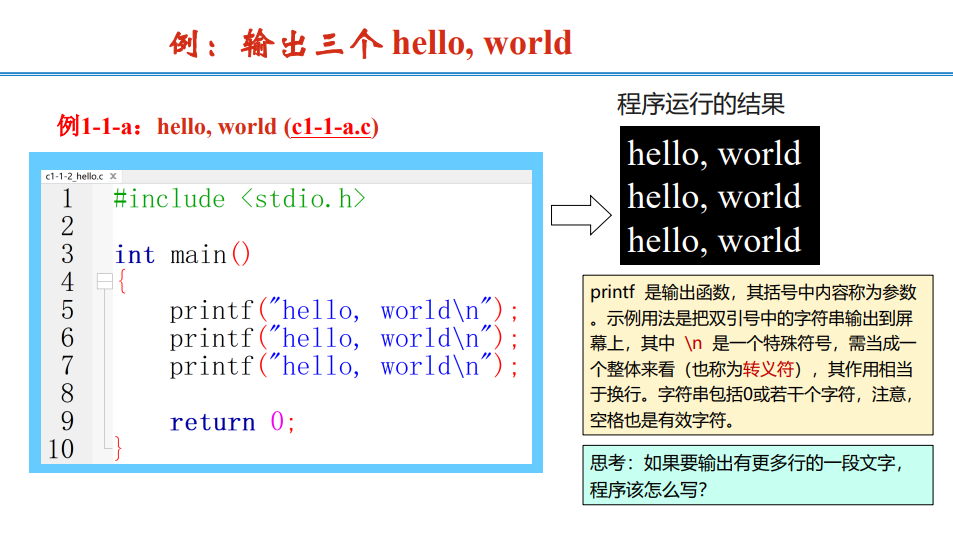
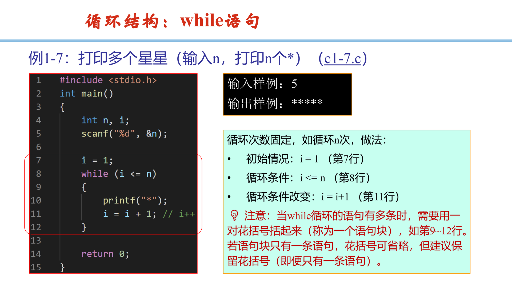
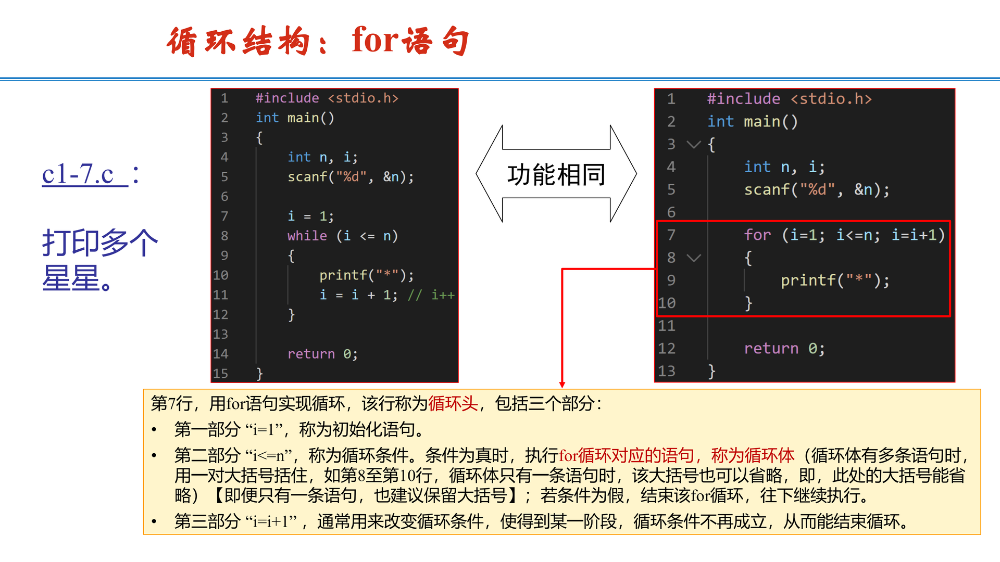
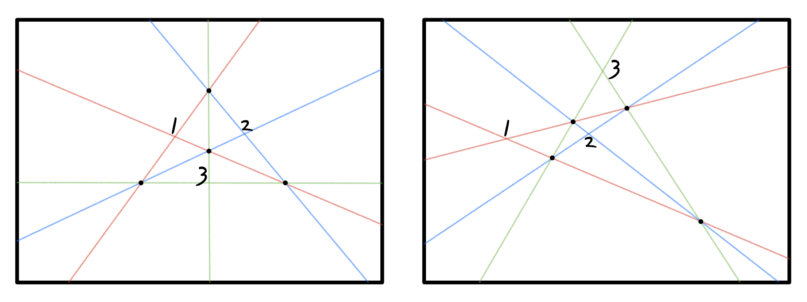

# 程序设计基础 C1 题目（2023秋）

## A hELL0,WOrlD

### 题目描述

在时空狭缝的检测战中，*Omega* 由于能量过载对光之战士说出了混乱的话语。

请你输出这段话语。

```text
FoR rIFt ENergY uNnecEsSary iT iS?
oUtPut mAXimiZeD,BUg mAss pROducti0n...
hEll0,WOrlD!?
```

### 输入格式

无

### 输出格式

三行，如题所述的字符串。

### 输入样例

无

### 输出样例

```text
FoR rIFt ENergY uNnecEsSary iT iS?
oUtPut mAXimiZeD,BUg mAss pROducti0n...
hEll0,WOrlD!?
```

### Hint

题目所给的代码块是可以复制的，别真一个字母一个字母手打呀。

输入多行文本的方法：



### 数据范围

- 本题无输入

Author:星辰的微光

## B 无情的复读机

### 题目描述

*Fontaine* 科学院利用芒性、荒性能量块的湮没原理造出了许多有用的发条机关，其中有一台前期试验机的功能非常简单，就是获取输入的正整数，并**连续**输出对应个数的字符 `+`。请你也来实现一下这个非常简单的功能吧 ~

### 输入

1 行，1 个数字 $n$，保证 $1 \le n \le 10000$ 且 $n$ 为整数

### 输出

1 行，包含连续的 $n$ 个字符 `+`

### 输入样例

```text
6
```

### 输出样例

```text
++++++
```

### Hint

参考课件P1例1-7





### 数据范围

- $1 \le n \le 10000$，且 $n$ 为整数

Author: 逐月的游星

## C 博雅

### 题目背景

北航的博雅课程计数遵循如下的规则：如果你成功报名并签到了，那么净有效次数加一。如果你成功报名但是没签到，那么净有效次数不仅不增加，还要倒扣一次。净有效次数可以被扣成负数。

### 题目描述

丽奈同学这学期报了 $n$ 个博雅课程，但是只去了 $m$ 次，请计算她这学期最终的博雅课程净有效次数是多少。

如果净有效次数达到 4 次，博雅才不会挂科，请判断她这学期会不会挂科。

### 输入

一行两个自然数 $n$ 和 $m$，依次是报名的博雅课程总数和到课的博雅课程总数，保证 $0 \le m \le n \le 10^{9}$

### 输出

第一行输出一个数，表示丽奈同学这学期最终的博雅课程净有效次数是多少

第二行输出一个字符串，如果她可以及格（不会挂科），输出 `Yes`，否则输出 `No`

### 输入样例

```text
5 3
```

### 输出样例

```text
1
No
```

### 样例解释

总共报了 5 次名，去了 3 次，没去 2 次，净有效次数为 $1 + 1 + 1 - 1 - 1 = 1$ 次， $1 < 4$，所以不及格。

### 数据范围

- $0 \le m \le n \le 10^{9}$

Author:梁秋月

## D De：从向量开始

### 题目描述

DeNeRATe太懒了，连向量的点积都不想自己算。

给定两个向量 $\vec{r_1} = (x_1, y_1, z_1), \vec{r_2} = (x_2, y_2, z_2)$，求出

$$\vec{r_1} \cdot \vec{r_2}$$

### 输入

共两行，第一行三个数 $x_1, y_1, z_1$，第二行三个数 $x_2, y_2, z_2$

保证输入数据均为 `int` 范围内的正整数

### 输出

共一行，一个数，即向量点乘的结果

且保证输出结果在 `int` 范围内

### 输入样例

```text
1 2 3
3 2 1
```

### 输出样例

```text
10
```

### Hint

（感觉不需要Hint，以防真有同学忘了点乘）

$$\vec{r_1} \cdot \vec{r_2} = (x_1, y_1, z_1) \cdot (x_2, y_2, z_2) = x_1 \times x_2 + y_1 \times y_2 + z_1 \times z_2$$

### 数据范围

- 输入数据均为 int 范围内的正整数
- 输出结果在 int 范围内

## E b mod a

### 题目描述

让我们从最基本的运算符之一：取余开始。

现在给出 $n$ 组自然数 $a$， $b$，请你计算出每一组 $b \bmod a$ 的值。

### 输入格式

输入共 $n + 1$ 行

- 第一行为一个正整数 $n$，表示数据组数，满足 $n \le 10$
- 接下来 $n$ 行，每行两个自然数 $a$， $b$，满足 $a, b < 10^{8}$

### 输出格式

输出为 $n$ 行，对于每一组 $a$， $b$

- 若 $a \ne 0$，则输出该算式及其结果，例如 `5 mod 2 = 1`
- 若 $a = 0$，则输出 `Wait. That's illegal.`

### 输入样例

```text
2
2 5
0 5
```

### 输出样例

```text
5 mod 2 = 1
Wait. That's illegal.
```

### Hint

本题为多组输入，你可以采用以下代码以进行读取

```c
int n, a, b, i;
scanf("%d", &n);
for (i = 0; i < n; i++) {
    scanf("%d%d", &a, &b);
    //补充剩余的部分
}
```

需要填充的部分或许可以参考ppt上的例题1-6。

善用复制功能，题目中的代码块，样例输入输出都是可以复制的。

<!-- markdownlint-disable-next-line MD036 -->
**小心审题**

### 数据范围

- $n \le 10$
- $a, b < 10^{8}$

Author:星辰的微光

## F 军乐团选拔

### 题目描述

*BUAers* 最喜欢军训啦！信息大类军训的同学被划分为 $n$ 个连，每个连中都有一部分人想报名参加军乐团。军乐团总指挥「Ormandy」先生负责选拔工作，他想先知道这 $n$ 个连中平均有多少同学报名，但统计过程中似乎出了一些问题，有些连队中没有人报名，高情商的「Ormandy」先生会认为报名人数为 0 的连队只是「统计失误」，并会将其移除统计名单，只统计有人报名的所有连队的平均报名同学数。
但如果所有连队都「统计失误」，他就会大喊 `Oh!No!`。
你能帮「Ormandy」先生完成这个统计嘛？

### 输入

第一行一个整数 $n$，表示连队总数，保证 $1 \le n \le 1000$。

第二行 $n$ 个整数，分别为 $a_1, a_2, \ldots, a_n$，其中 $a_i$ 表示第 $i$ 个连队的报名人数，保证 $0 \le a_i \le 200$。

### 输出

若所有连队都「统计失误」，只输出 `Oh!No!`。
否则输出一个**整数**，为 $a_1, a_2, \ldots, a_n$ 中所有不为 0 的数的平均数（**向下取整**）。

### 输入样例 1

```text
5
11 21 0 31 40
```

### 输出样例 1

```text
25
```

### 输入样例 2

```text
3
0 0 0
```

### 输出样例 2

```text
Oh!No!
```

### 样例解释

- 样例一中去除掉 3 连，只统计 1, 2, 4, 5 连报名人数平均数，共 103 人，除以 4 向下取整为 25 人。
- 样例二所有连队报名人数均为 0，输出 `Oh!No!`。

### Hint

整数除法 `/` 是默认向下取整的喔~

### 数据范围

- $1 \le n \le 1000$
- $0 \le a_i \le 200$

## G 兜兜转转找到你

### 题目描述

*Zelda* 被困在了 1 号神庙里，*Link* 在 $x$ 号神庙里，*Link* 想要找到 *Zelda*，但是他从 $n$ 号神庙去往下一个神庙必须要满足如下规律：

- 若 $n$ 为奇数，则下一个神庙编号为 $3n + 1$；
- 若 $n$ 为偶数，则下一个神庙编号为 $\frac{n}{2}$。

你能帮忙算算 *Link* 要走过多少个神庙才能找到 *Zelda* 吗？

### 输入

一行一个正整数 $x$，保证 $1 < x \le 10000$

保证 *Link* 最终一定能去到 1 号神庙，经过的神庙编号都在 `int` 范围内，且答案不超过 $10^{7}$。

### 输入样例

```text
3
```

### 输出样例

```text
7
```

### 样例解释

*Link* 从 $x = 3$ 号神庙到 1 号神庙的路径为： $3 \to 10 \to 5 \to 16 \to 8 \to 4 \to 2 \to 1$

一共走过了 7 个神庙（不算 1 号神庙）

### Not Hint

$x = 27$ 时 *Link* 要走过 111 个神庙才能来到 1 号神庙，经过的神庙编号最大达到了 9232，所以是“兜兜转转找到你”~

### 数据范围

- $1 < x \le 10000$
- 经过的神庙编号都在 int 范围内
- 答案不超过 $10^{7}$

Author: David Tong

## H 永恒的爱

### 题目描述

Messi 和 Antonella 在维持一段恋情，每天他们会使用 Wechat 聊天，如果这天他们聊天了，Messi 会在他的小本本上记下一个数字 1，但有时他们可能太忙了无暇聊天，此时他则会记下一个数字 0，我们定义一段恋情的**连续程度**为这段 01 序列中最长的连续的 1 的个数。

现在已知这段恋情持续了 $a$ 天，并且其中 1 的个数是 $b$，求这段恋情的连续程度可能的最大值和最小值分别是多少。

### 输入

第一行一个正整数 $T(T \le 100)$，表示数据的组数。

接下来 $T$ 行，每行两个整数 $a, b$，含义如题面所示，保证 $1 \le a \le 10^{3}, 0 \le b \le 10^{3}, b \le a$。

### 输出

$T$ 行，每行两个由空格分隔的整数，分别表示这段恋情连续程度的可能的最大值和最小值。

### 输入样例

```text
3
5 4
9 0
100 50
```

### 输出样例

```text
4 2
0 0
50 1
```

### 样例解释

对于第一组样例，一种连续程度可能的最大的序列是 11110，一种连续程度可能的最小的序列是 11011。

### 数据范围

- $T \le 100$
- $1 \le a \le 10^{3}$， $0 \le b \le 10^{3}$， $b \le a$

Author: supercarrydyc

## I 军乐团分组

### 题目描述

*BUAers* 最喜欢军训啦！军乐团总指挥「Ormandy」先生发现信息大类一共有 8 个连队，**每个连队都有人报名**军乐团，但这 8 个连队各自的报名人数不尽相同，为了便于管理，「Ormandy」先生希望将他们分成若干组，分组需同时满足以下四个条件：

- 每个人属于且仅属于一个小组
- 所有的小组人数必须相同
- 一个小组的所有同学必须来自同一个连队
- 分出的组数尽可能少

你能帮「Ormandy」先生求出最少需要将同学们分成几组嘛？

### 输入

一行 8 个整数，分别为 $a_1, a_2, \ldots, a_8$，其中 $a_i$ 表示第 $i$ 个连队的报名人数，保证 $1 \le a_i \le 200$。

### 输出

一个整数，为满足了四条要求的最少组数。

### 输入样例

```text
10 20 15 25 35 55 40 45
```

### 输出样例

```text
49
```

### 样例解释

每 5 个人一组，从 1 连到 8 连的同学分别分出 2, 4, 3, 5, 7, 11, 8, 9 个组，共 49 组。

### Hint

想一想有没有什么办法不用定义 8 个变量就能 `AC` 这道题目呢~

例如 $a, b, c$ 的最大公约数可以先求 $a$ 与 $b$ 的最大公约数，得到的结果再与 $c$ 求最大公约数，8 个数的最大公约数以此类推~

### 数据范围

- 连队数固定为 8
- $1 \le a_i \le 200$

## J 分割平面

### 题目描述

平面上任选 $n$ 个点（任意三点不共线），两点确定一条直线，显然共能够确定 $\frac{n(n-1)}{2}$ 条直线。

这些直线将平面分割成若干区域，请求出它们最多能够将平面分割成多少个区域。

由于结果可能很大，**请输出答案对 998244353 取模的结果**（即答案除以 998244353 的余数）。

### 输入

一行一个正整数 $n$，保证 $2 \le n < 2^{31}$

### 输出

一行一个正整数，表示最多能够将平面分割成多少区域

由于结果可能很大，**请输出答案对 998244353 取模的结果**

### 输入样例 1

```text
3
```

### 输出样例 1

```text
7
```

### 输入样例 2

```text
4
```

### 输出样例 2

```text
18
```

### Hint

<!-- markdownlint-disable-next-line MD036 -->
**1. 欧拉示性数公式：**

若平面内有 $v$ 个顶点， $e$ 条边， $f$ 个区域，则有 $v - e + f = \chi$

特别地，在本题对应的平面几何情境中 $\chi = 1$

如下图，对于 $n = 3$ 的情况， $v = 3, e = 9, f = 7$；对于 $n = 4$ 的情况， $v = 7, e = 24, f = 18$。均有 $v - e + f = 1$



<!-- markdownlint-disable-next-line MD036 -->
**2. 关于模运算（求余运算）**

- 不要只在输出的时候取模，计算的过程中就有可能溢出导致结果错误
- 对非负整数 $a, b, c$ 与整数 $p$，模意义下的运算具有如下性质：

$$(a + b) \bmod p = [(a \bmod p) + (b \bmod p)] \bmod p$$

$$(a \times b) \bmod p = [(a \bmod p) \times (b \bmod p)] \bmod p$$

- 同时，加法的交换律、结合律，乘法的交换律、结合律、分配律在模意义下仍然成立。
- 模 998244353 意义下，除以 2 等价于乘以 $\frac{998244353+1}{2} = 499122177$

<!-- markdownlint-disable-next-line MD036 -->
**3. 关于 `long long`**

计算过程中可能需要用到 `long long`，可以参考如下代码：

```c
long long n;     //声明
scanf("%lld", &n); //读入
printf("%lld", n); //输出
```

### 数据范围

- $2 \le n < 2^{31}$
- 答案对 998244353 取模

Author: David Tong

- End -
