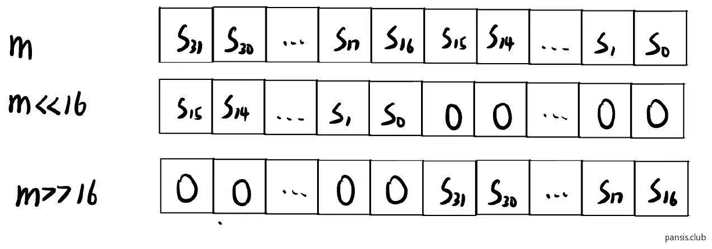

# 程序设计基础 C3 答案（2023秋）

## A 奇怪的位运算

### 题目

| 难度 | 考点 |
| --- | --- |
| 1 | 位运算 |

#### 题目描述

有这样一种奇怪的位运算 $\odot$，它将两个自然数二进制表示的每一位按照如下法则进行运算：

| $p_i$ | $q_i$ | $(p \odot q)_i$ |
| --- | --- | --- |
| 0 | 0 | 0 |
| 0 | 1 | 0 |
| 1 | 0 | 1 |
| 1 | 1 | 0 |

其中 $p_i, q_i, (p \odot q)_i$ 分别表示 $p, q, p \odot q$ 的二进制表示中的第 $i$ 位。

你能迅速的给出两个数进行这种奇怪的位运算后的得数吗？

#### 输入格式

多组数据输入，每组数据为一行两个正整数 $a, b$ 。

#### 输出格式

对每组数据，输出一行一个数字，为 $a \odot b$ 的值。

#### 样例输入

```text
7 10
14 19
```

#### 样例输出

```text
5
12
```

#### 样例解释

- 样例 1：7 的二进制为 00000111，10 的二进制为 00001010， $7 \odot 10$ 的二进制即为 00000101，也就是十进制的 5。
- 样例 2：14 的二进制为 00001110，19 的二进制为 00010011， $14 \odot 19$ 的二进制即为 00001100，也就是十进制的 12。

#### Hint

观察数据范围，需要使用 `unsigned long long`。

可以先对 $q$ 按位取反，然后再和 $p$ 进行按位与运算。

#### 数据范围

- $0 \le a, b \le 10^{18}$
- 数据组数不超过 $10^{5}$

### 答案

### 题目分析

| $a_i$ | $b_i$ | $a_i \odot b_i$ |
| --- | --- | --- |
| 0 | 0 | 0 |
| 0 | 1 | 0 |
| 1 | 0 | 1 |
| 1 | 1 | 0 |

位运算对于每一位都是独立的，这个奇怪的位运算 $\odot$ 也一样。从 Hint 里得知 $\odot$ 可以看作是按位取反和按位求与的复合运算，即 $a_i \odot b_i = a_i \wedge (\neg b_i)$ ，其中 $\wedge$ 表示按位求与， $\neg$ 代表按位取反。于是我们可以先对 $b$ 取反，再将此结果与 $a$ 求与，即可直接得到 $a \odot b$ 的值。注意 C 语言中按位与和按位取反运算符分别是 `&` 和 `~` 。

### 示例代码

```c
#include <stdio.h>
int main(void)
{
    int a, b;
    while (scanf("%d%d", &a, &b) != EOF)
    {
        printf("%d\n", a & ~b);
    }
    return 0;
}
```

## B 置0置1

### 题目

| 难度 | 考点 |
| --- | --- |
| 2 | 位运算 |

#### 题目描述

给定一个 `unsigned int` 范围内的自然数 $n$ ，随后给出 $t$ 次操作。

每次操作给出两个整数 $k$ 和 $c$ ，其中第 $k$ 位指 $n$ 的二进制表示中从低位到高位、从 $0$ 开始计数的第 $k$ 位：

- 若 $c = 0$ ，则把 $n$ 的第 $k$ 位置为 $0$ ；
- 若 $c = 1$ ，则把 $n$ 的第 $k$ 位置为 $1$ 。

每次操作后输出当前的 $n$ ，所有操作结束后再输出一次 $n$ 。

#### 输入格式

第一行一个 `unsigned int` 范围内的自然数 $n$ 。

第二行一个正整数 $t$ ，表示操作次数。

接下来 $t$ 行，每行两个整数 $k$ 和 $c$ 。

#### 输出格式

共 $t + 1$ 行。前 $t$ 行每行为一次操作之后的 $n$ ，最后一行为全部操作结束之后的 $n$ 。

#### 样例输入

```text
10
3
0 1
3 0
1 1
```

#### 样例输出

```text
11
3
3
3
```

#### 数据范围

- $n$ 在 `unsigned int` 范围内
- $c$ 只取 $0$ 或 $1$

### 答案

### 题目分析

该题主要涉及两个知识点，第一个为 `unsigned int` 的数据范围，第二个知识点是位运算的相关知识。

对于一个二进制的数，将它的第 $k$ 位置 $1$ 的方法是：

先将 $1$ 左移 $k$ 位，这样我们就得到了一个仅有第 $k$ 位为 $1$ 的，其他位均为 $0$ 的二进制数，将输入的数字 $n$ 与它进行或运算。这样，对于第 $k$ 位以外的位上，与 $0$ 进行或运算均为其本身，即仅有第 $k$ 位上与 $1$ 进行或运算，即为 $1$ 。语句为 `x | (1 << k)` 。

同样的，将 $n$ 的第 $k$ 位置 $0$ 的方法是：

先将 $1$ 左移 $k$ 位，这样我们就得到了一个仅有第 $k$ 位为 $1$ 的，其他位均为 $0$ 的二进制数，然后对于该二进制数取反，这样我们就得到了一个仅有第 $k$ 位为 $0$ 的，其他位均为 $1$ 的二进制数。将输入的数字 $n$ 与它进行与运算，这样，对于第 $k$ 位以外的位上，与 $1$ 进行与运算均为其本身，即仅有第 $k$ 位上与 $0$ 进行与运算，即为 $0$ 。语句为 `x & ~(1 << k)` 。

课件/书上例题 3-5 和 3-6 也给出了以上两个操作对应的语句。

特别要注意的是，本题数据在 `unsigned int` 范围内，因此使用 `1u` 表示 `unsigned int` 类型的 $1$ 更为规范。

### 示例代码

```c
#include <stdio.h>
int main() {
    int  t, k;
    unsigned int n;
    scanf("%u", &n);
    scanf("%d", &t);
    for (int i = 1; i <= t; i++) {
        scanf("%d", &k);
        int choice;
        scanf("%d", &choice);
        if (choice == 0) {
            n = n & ~(1u << k);
        }
        else if (choice == 1) {
            n = n | (1u << k);
        }
        printf("%u\n", n);
    }
    printf("%u\n", n);
    return 0;
}
```

## C 高低位对调

### 题目

| 难度 | 考点 |
| --- | --- |
| 3 | 位运算 |

#### 题目描述

给定 $n$ 个 `unsigned int` 范围内的自然数，对每个数把它的二进制表示的高 $16$ 位与低 $16$ 位整体对调，输出对调后得到的数。

#### 输入格式

第一行一个正整数 $n$ ，表示数字个数。

接下来 $n$ 个 `unsigned int` 范围内的自然数 $m_1, m_2, \cdots, m_n$ 。

#### 输出格式

共 $n$ 行，每行一个数，为对应数字高低 $16$ 位对调后的结果。

#### 样例输入

```text
3
1
65537
4294967295
```

#### 样例输出

```text
65536
65537
4294967295
```

#### 数据范围

- $m_i$ 在 `unsigned int` 范围内

### 答案

### 题目分析

根据题意，我们需要将给定数字的高 $16$ 位与低 $16$ 位对调。

尽管在计算机中，整数是以补码形式储存，但 `unsigned int` 类型的变量由于没有负数，原码与补码形式相同。

实现高 16 位与低 16 位对调的表达式为 `m = (m << 16) | (m >> 16)` ，下图可以帮助大家理解。

### 示例代码

```c
#include <stdio.h>
int main() {
    int n;
    unsigned int m;
    scanf("%d", &n);
    while (n--) { //n次循环
        scanf("%u", &m);
        m = (m << 16) | (m >> 16); //高低位调换
        printf("%u\n", m);
    }
}
```



## D 身份证号验证

### 题目

| 难度 | 考点 |
| --- | --- |
| 4 | 数组，循环 |

#### 题目描述

中华人民共和国公民的身份证号码由 18 位数字或 $X$ 组成，其中最后一位可能是 $X$ 。

身份证号码的前 6 位表示行政区划代码，第 7 位到第 14 位表示出生日期，第 15 位到第 17 位表示顺序码，第 18 位表示校验码。

现给定若干个身份证号，请检验身份证号是否合法。如果合法，输出 `YES` ，否则输出 `NO` 。

保证前 17 位数字合法，因此你只需要检验第 18 位校验码是否合法即可。

校验码的计算方法如下：

- 将前面的身份证号码 17 位数分别乘以不同的系数。从第 1 位到第 17 位的系数分别为 $7, 9, 10, 5, 8, 4, 2, 1, 6, 3, 7, 9, 10, 5, 8, 4, 2$ 。
- 将这 17 位数字和系数相乘的结果相加。
- 用加出来的和除以 11 ，看余数是多少。
- 余数只可能有 $0, 1, 2, 3, 4, 5, 6, 7, 8, 9, 10$ 这 11 个数字。其分别对应的最后一位身份证的号码为 $1, 0, X, 9, 8, 7, 6, 5, 4, 3, 2$ 。（即余数 0 对应 1 ，余数 1 对应 0 ，余数 2 对应 $X$ ……）

#### 输入格式

共 $n + 1$ 行。

第一行一个正整数 $n$ 。

接下来 $n$ 行，每一行为一个身份证号。（若最后一位为 $X$ ，则为大写字母 `X`）

#### 输出格式

输出 $n$ 行。

每行表示身份证号码是否合法。如果合法，输出 `YES` ，否则输出 `NO` 。

#### 样例输入

```text
2
371311200312247819
130631197601191234
```

#### 样例输出

```text
YES
NO
```

#### 数据范围

- $1 \le n \le 50$
- 每个身份证号 18 位，前 17 位保证合法

### 答案

### 题目分析

首先，我们需要读入身份证号。由于我们需要处理每一位身份证号，而且身份证号并非纯数字，所以我们使用字符数组 `id` 去存储身份证号。

依据题意，我们需要将身份证号码前 $17$ 位数分别乘以不同的系数并求和。这里我们采用 Hint 中的“数组+循环”的方法实现。用数组 $w$ 储存系数 $7, 9, 10, 5, 8, 4, 2, 1, 6, 3, 7, 9, 10, 5, 8, 4, 2$ 。

计算出的结果除余后与校验码存在着对应关系，这个对应关系也可以使用数组进行对应，具体实现方式详见代码。

### 示例代码

```c
#include <stdio.h>
int main() {
    int w[20] = {0, 7, 9, 10, 5, 8, 4, 2, 1, 6, 3, 7, 9, 10, 5, 8, 4, 2};//不同位数对应的不同系数，w[1]对应第1位，以此类推
    char yu[11] = {'1', '0', 'X', '9', '8', '7', '6', '5', '4', '3', '2'}; //余数与校验码对应关系，yu[i]表示余数为i时对应的校验码
    int n;
    char id[20];
    scanf("%d", &n);
    getchar(); //跳过换行符
    while (n--) { //n次循环
        int sum = 0;
        for (int i = 1; i <= 17; ++i) {
            scanf("%c", &id[i]); //循环读入身份证号的每一位
            sum += ((id[i] - '0') * w[i]); //数组+循环 求和
        }
        sum %= 11;
        scanf("%c", &id[18]);
        getchar(); //跳过换行符
        if (yu[sum] == id[18]) { //利用数组，将余数映射成校验码，与id[18]进行比较
            printf("YES");
        } else {
            printf("NO");
        }
        printf("\n");
    }
    return 0;
}
```

## E 质数，异或和一

### 题目

| 难度 | 考点 |
| --- | --- |
| 3~4 | 异或，质数 |

#### 题目描述

把质数从小到大排列，第 $1$ 个质数是 $2$ ，第 $2$ 个质数是 $3$ ，依次类推。

给定若干组询问，每组给出两个正整数 $m, n$ ，表示第 $m$ 个质数与第 $n$ 个质数。若这两个质数的按位异或等于 $1$ ，输出 `YEEEEE!!!` ，否则输出 `W00000!!!` 。

#### 输入格式

多组数据输入，每组数据为一行两个正整数 $m, n$ ，读到文件结束为止。

#### 输出格式

对每组数据输出一行：若第 $m$ 个质数与第 $n$ 个质数的按位异或等于 $1$ ，输出 `YEEEEE!!!` ，否则输出 `W00000!!!` 。

#### 样例输入

```text
1 2
2 1
1 3
```

#### 样例输出

```text
YEEEEE!!!
YEEEEE!!!
W00000!!!
```

### 答案

### 题意分析

首先对可能满足 $a \oplus b = 1$ 的两个质数进行分析。

若 $a \oplus b = 1$ ，说明 $a, b$ 在二进制下仅有最低位不同而其余的位皆相同，由此可知 $a, b$ 具有不同的奇偶性。

而质数中仅有 $2$ 一个偶数，故 $a, b$ 中必定存在 $2$ 。而满足与 $2$ 有最低位不同而其余的位皆相同的数字为 $3$ 。由上可知仅有 $2, 3$ 满足题意，其分别为第 $1$ 个质数和第 $2$ 个质数。因此仅需判断 $\{m, n\}$ 是否为 $\{1, 2\}$ 即可。

### 示例代码

```c
#include <stdio.h>
int main(void) {
    int m, n;
    while (scanf("%d%d", &m, &n) != EOF) {
        if (((m == 1) && (n == 2)) || ((m == 2) && (n == 1))) {
            puts("YEEEEE!!!");
        } else {
            puts("W00000!!!");
        }
    }
    return 0;
}
```

## F 式神们夜里不睡觉mini

### 题目

| 难度 | 考点 |
| --- | --- |
| 5 | 进制转换 |

#### 题目描述

给定 $T$ 组询问，每组给出一个用 $M$ 进制表示的自然数，请把它转换成 $N$ 进制的表示并输出。

若这个数为 $0$ ，那么它在任意进制下的表示都是 `0` 。

#### 输入格式

第一行一个正整数 $T$ ，表示数据组数。

接下来 $T$ 行，每行先给出两个正整数 $M, N$ ，再给出一个由数字字符组成的字符串 $s_1$ ，表示 $M$ 进制的自然数。

#### 输出格式

共 $T$ 行，每行为对应的 $N$ 进制表示。

#### 样例输入

```text
4
2 10 1011
10 2 11
8 10 0
10 8 100
```

#### 样例输出

```text
11
1011
0
144
```

### 答案

### 问题分析

对于一个任意进制转换的问题，我们首先应当把待转换的数码用我们熟悉的进制来表示，即十进制，否则对于一个字符串我们几乎无法获得任何有效信息。 $k$ 进制转十进制的方法较为容易，可以按如下实现：

```c
int n, len, M, N, i;
char s1[100];//转换前的字符串
scanf("%d%d%s", &M, &N, s1);
len = strlen(s1);//获取字符串s1的长度
for (i = 0; i < len; i++)
    n = n * M + (s1[i] - '0');
```

注意到上面使用了一个函数 `strlen()` ，用来获取一个字符串的长度，这个函数包含在 `string.h` 头文件中。

而对于十进制转 $k$ 进制，对于一般正进制的题目来说，基本思路是将待转换的数不停地对 $k$ 取余，然后将余数倒序输出。

当然，我们不能忘记 $0$ 这个特殊数字，它在任意进制下的表示都为 $0$ ，特判一下就可以了。

### 参考代码

```c
#include <stdio.h>
#include <string.h>
int main()
{
    char s1[100], s2[100] = {};
    int T;
    scanf("%d", &T);
    while (T--) //循环T次
    {
        int n = 0, M, N, i;
        scanf("%d%d%s", &M, &N, s1);
        if (s1[0] == '0') //特殊情况
            printf("0\n");
        else
        {
            int len = strlen(s1);
            
            //将自然数的M进制表示字符串s1转为int类型的自然数
            for (i = 0; i < len; i++)
                n = n * M + s1[i] - '0';
            
            //将int类型的自然数转为N进制表示的字符串s2(倒序)
            for (i = 0; n; i++)
            {
                s2[i] = n % N + '0';
                n /= N;
            }
            
            //逆序输出s2
            while(i > 0)
            {
                i--;
                printf("%c", s2[i]);
            }
            
            printf("\n");
        }
    }
    return 0;
}
```

## G Te：离间计

### 题目

| 难度 | 考点 |
| --- | --- |
| 5 | 位运算 |

#### 题目描述

为了打败 GYCY 大军，DeNeRATe 决定从其大军内部瓦解他，使出离间计，可以使 GYCY 大军中的士兵随 DeNeRATe 的意志进行策反（以下用 D 代表 DeNeRATe，G 代表 GYCY）。

士兵的编号从 $1 \sim n$ ，DeNeRATe 会给出 $m$ 条命令：

- 当命令为 `1` 时，将此条命令开始之前的 G 的所有士兵变为 D 的士兵，此条命令开始之前的 D 的所有士兵变为 G 的士兵
- 当命令为 `2` 时，将编号最小的 G 的士兵策反为 D 的士兵（如果没有 G 的士兵了，则所有士兵都不发生改变）

初始状态下，所有士兵都是 G 的，DeNeRATe 想知道，最后会有多少 D 的士兵。

#### 输入格式

第一行两个正整数 $n, m$ ，分别表示 GYCY 大军人数和 DeNeRATe 给出的命令条数。

接下来 $m$ 行，每行一个正整数 `1` 或 `2` 表示给出的命令。

#### 输出格式

共一行，表示最终有多少士兵是 D 的。

#### 样例输入

```text
4 4
2
2
1
2
```

#### 样例输出

```text
3
```

#### Hint

和位运算（`unsigned long long`）联系起来考虑哦~

#### 数据范围

- $0 < n \le 64$
- $m \le 10^{6}$

### 答案

### 题目分析

首先，由 Hint 或者数据范围可以知道这道题应该是用位的状态来表示人的状态，比如 $0$ / $1$ 分别表示 G / D 的人。

因此，对于题目中要求的两种操作：

第一种，士兵身份改变，可以相当于位的取反操作，因此，也就非常轻松了

第二种，将最小编号的士兵改变身份，那么，位运算中什么运算什么办法可以取出或者删除一个数的最低位呢？我们想到的是可以从低到高暴力枚举每一位，直到出现当前位上的数为 $0$ 为止，我们将它变为 $1$ 即可

到此为止，这道题的全部思路就搞定了。

### 示例代码

```c
#include <math.h>
unsigned long long now, test, opt, n, ans;
int main() {
    scanf("%llu %llu", &n, &test);
    // now最初为0
    while(test--) {
        scanf("%llu", &opt);
        if(opt == 1) now = ~now;
        else
        {
            int flag = 0; //flag表示是否找到过为0的位
            int j; //用于存储最低的为0的位是第几位
            for(int i = 0; i < 64; i++)
            {
                if(flag == 0 && ((now >> i) & 1) == 0) //如果没找到过为0的位
                {
                    flag = 1;
                    j = i;
                }
            }
            if(flag == 1) //如果存在为0的位
                now |= (1ull << j);
        }
        // else 下方的代码块可用下列一条语句代替：
        // now = now | (now + 1);
    }
    for(int i = 0; i < n; i++)
    {
        if(((now >> i) & 1) == 1) {
            ans++;
            printf("%d ", i + 1);
        }        
    }
    printf("\n%llu\n", ans);
    return 0;
}
```

### 小拓展

将整数 $x$ 最低的为 $0$ 的位置 $1$ ：

```c
x = x | (x + 1);
```

求整数 $x$ 二进制下最低的为 $1$ 的位：

```c
low = (x & (-x));
```

将整数 $x$ 最低的为 $1$ 的位置 $0$ ：

```c
x = x & (x - 1);
```

## H 非标准进制

### 题目

| 难度 | 考点 |
| --- | --- |
| 5~6 | 数论 |

#### 题目描述

对于自然数 $n$ 与大于 1 的正整数 $b_1, \cdots, b_m$，存在自然数 $a_0, a_1, \cdots, a_m$ 使得：

$$n = a_0 + a_1b_1 + a_2b_1b_2 + a_3b_1b_2b_3 + \cdots + a_mb_1b_2 \cdots b_m$$

我们希望最小化 $a_0 + a_1 + \cdots + a_m$ 。

#### 输入格式

第一行，用空格分隔的 `long long int` 范围内的自然数 $n, m$ 。

第二行，用空格分隔的 $b_1, \cdots, b_m$ ，保证 $b_1b_2 \cdots b_m$ 均大于 1 且在 `long long int` 范围内。

#### 输出格式

$a_0 + a_1 + \cdots + a_m$ 的最小值。

#### 样例输入

```text
95696
60 60 24
```

#### 样例输出

```text
93
```

#### 提示

在 $a_0 + 60a_1 + 3600a_2 + 86400a_3 = 95696$ 的条件下 $a_0 + a_1 + a_2 + a_3$ 的最小值是 93 。

注意到，1 分钟是 60 秒，1 小时是 60 分钟，1 天是 24 小时，所以 95696 秒是 1 天 2 小时 34 分钟 56 秒，从而 $56 + 34 + 2 + 1 = 93$ 。

#### 数据范围

- $n, m$ 在 `long long int` 范围内
- $b_1, \cdots, b_m$ 均大于 1 且在 `long long int` 范围内

### 答案

### 观察

$$n = a_0 + a_1 b_1 + a_2 b_1 b_2 + a_3 b_1 b_2 b_3 + \cdots + a_m b_1 b_2 \cdots b_m $$

注意到，如果 $a_k \ge b_{k+1}$ ，那么我们构造

$$a'_t = \begin{cases} a_k - b_k & , t = k \\ a_{k+1} - 1 & , t = k + 1 \\ a_t & , \text{else} \end{cases} $$

从而

$$n = a'_0 + a_1 b_1 + a'_2 b_1 b_2 + a'_3 b_1 b_2 b_3 + \cdots + a'_m b_1 b_2 \cdots b_m $$

此时

$$a'_0 + a'_1 + \cdots + a'_m = a_0 + a_1 + \cdots + a_m - (b_{k+1} - 1) $$

这意味着， $a_1 + a_2 + \cdots + a_m$ 取到最小值时，必然有 $a_k < b_{k+1}$ ，从而 $a_0 = n \bmod b_1$ 与

$$\eta = \alpha_0 + \alpha_1 \beta_1 + \alpha_2 \beta_1 \beta_2 + \alpha_3 \beta_1 \beta_2 \beta_3 + \cdots + \alpha_{m-1} \beta_1 \beta_2 \cdots \beta_{m-1} $$

其中 $\eta = \left\lfloor \dfrac{n}{b_1} \right\rfloor$ 与 $\alpha_k = a_{k+1}, \beta_k = b_{k+1}$ ，这个形式与题目给出的如下条件是相似的

$$n = a_0 + a_1 b_1 + a_2 b_1 b_2 + a_3 b_1 b_2 b_3 + \cdots + a_m b_1 b_2 \cdots b_m $$

因此，我们不需要存储 $b_1, b_2, \cdots, b_m$ ，只需要按照顺序读取。

此外， $n = 0$ 时我们直接可得答案为 $0$ 而不需要接着读取；实际上，由于 $b_k \ge 2, n < 2^{64}$ ，我们可以发现只有 $b_1, b_2, \cdots, b_{64}$ 可能对答案有影响。

### 示例代码

```c
#include <stdio.h>
int main(void) {
    unsigned long long int n;
    unsigned long long int m;
    unsigned long long int x;
    unsigned long long int sum = 0ull;
    scanf("%llu", &n);
    while (n > 0ull && scanf("%llu", &x) != EOF) {
        sum = sum + (n % x);
        n = n / x;
    }
    sum = sum + n;
    printf("%llu", sum);
    return 0;
}
```

## I 最小异或和

### 题目

| 难度 | 考点 |
| --- | --- |
| 5~6 | 位运算 |

#### 题目描述

给出 $n$ 个正整数 $a_1, a_2, \cdots, a_n$ ，用正整数 $x$ 与它们分别进行按位异或后再加和，求 $x$ 使得和式最小，输出这个最小和。

即求 $\min\{\sum_{i=1}^{n}(x \oplus a_i) | x \in \mathbb{N}\}$ ，其中 $\oplus$ 代表按位异或。

#### 输入格式

共两行。

第一行一个正整数 $n$ 。

第二行 $n$ 个正整数 $a_1, a_2, \cdots, a_n$ ，保证均在 `unsigned int` 范围内。

#### 输出格式

一行一个正整数，表示最小和。

#### 样例输入

```text
3
1 2 2
```

#### 样例输出

```text
3
```

#### 样例解释

$x = 2$ 时和式最小， $(2 \oplus 1) + (2 \oplus 2) + (2 \oplus 2) = 3$ ，故输出 3 。

#### Hint

异或运算对于每一位是独立的。

#### 数据范围

- $1 \le n \le 10^{6}$
- $a_i$ 均在 `unsigned int` 范围内

### 答案

### 题意分析

给出 $n$ 个正整数 $a_1, a_2, \cdots, a_n$ ，求 $\min\left\{\sum_{i=1}^{n}(x \oplus a_i) \mid x \in \mathbb{N}\right\}$ 。正如 Hint 中提到的，按位异或运算对于每一位是独立的，计算 $\sum_{i=1}^{n}(x \oplus a_i)$ 我们可以按照每一位的顺序去计算，而不是按照数列 $a$ 的顺序计算。

设 $a_i$ 的 32 位二进制表示为 $a_{i,31}a_{i,30} \cdots a_{i,1}a_{i,0}$ ，即 $a_i = \sum_{j=0}^{31} a_{i,j} \times 2^j$ ，设 $x$ 的 32 位二进制表示为 $x_{32}x_{31} \cdots x_0$ ，即 $x = \sum_{j=0}^{31} x_j \times 2^j$ 。

统计第 $j$ 位为 $1$ 的 $a_i$ 个数（即多少个 $a_i$ 的满足 $a_{i,j} = 1$ ），记作 $cnt_{1,j}$ ，则第 $j$ 位为 $0$ 的 $a_i$ 个数 $cnt_{0,j} = n - cnt_{1,j}$ 。

若 $x_j = 1$ ，则第 $j$ 位对答案的贡献为 $cnt_{0,j} \times 2^j$ （即所有第 $j$ 位为 $0$ 的数变成了 $1$ ）；若 $x_j = 0$ ，则第 $j$ 位对答案的贡献为 $cnt_{1,j} \times 2^j$ （即每个数都不变）。因此要让答案最小，我们只需要对每一位取 $cnt_{0,j} = n - cnt_{1,j}$ 和 $cnt_{1,j}$ 中的较小者，然后计算结果即可。

数学语言描述：

$$\sum_{i=1}^{n}(x \oplus a_i) = \sum_{i=1}^{n}\sum_{j=0}^{31}(x_j \oplus a_{i,j}) \times 2^j = \sum_{j=0}^{31} 2^j \times \sum_{i=1}^{n}(x_j \oplus a_{i,j}) = \sum_{j=0}^{31} cnt_{1 \oplus x,j} \times 2^j $$

遍历计算即可。

### 示例代码

```c
#include <stdio.h>
#define min(a,b) ((a)<(b)?(a):(b))
int cnt[32]; //记录cnt1j
long long ans; //答案可能在long long范围内
int main()
{
    unsigned int n, a;
    scanf("%u", &n);
    for(int i = 0; i < n; ++i)
    {
        scanf("%u", &a);
        for(int j = 0; j < 32; ++j)
            if(a >> j & 1) ++cnt[j]; //统计cnt[j]
    }
    for(int j = 0; j < 32; ++j)
        ans += (long long)min(cnt[j], n - cnt[j]) << j; //乘2^j等价于左移j位，这里记得一定要用long long计算。
    printf("%lld", ans);
    return 0;
}
```

Author: 哪吒

## J 导弹密码

### 题目

| 难度 | 考点 |
| --- | --- |
| 8 | 位运算+贪心 |

#### 题目描述

邪恶的 DeNeRATe 为达到他不可告人的秘密，向某地区发射了一枚物质泯灭导弹。为阻止 DeNeRATe 的阴谋，你向先知 GYCY 求助，GYCY 告诉你，这枚导弹内部有一个长度为 $n$ 的自然数数列 $a_1, a_2, \cdots, a_n$ ，你需要将其划分为 $m$ 段连续的区间，使得 $password$ 值**最小**， $password$ 即为**终止导弹的密码**。 $password$ 定义如下：

$$
\begin{aligned}
password = (a_1 \oplus a_2 \oplus \cdots \oplus a_{x_1}) \vee (a_{x_1+1} \oplus a_{x_1+2} \oplus \cdots \oplus a_{x_2}) \vee \\
\cdots \vee (a_{x_{m-1}+1} \oplus a_{x_{m-1}+2} \oplus \cdots \oplus a_n)
\end{aligned}
$$

其中，符号 $\oplus, \vee$ 分别表示按位异或和按位或运算。

#### 输入格式

第一行，两个正整数 $n, m$ 。

第二行， $n$ 个自然数 $a_1, a_2, \cdots, a_n$ ，保证均在 `int` 范围内。

#### 输出格式

一行，表示导弹的终止密码。

#### 样例输入

```text
5 3
9 5 2 7 1
```

#### 样例输出

```text
9
```

#### 数据范围

- $1 \le m \le n \le 5 \times 10^{5}$
- $a_i$ 均在 `int` 范围内

### 答案

### 题目分析

#### 前置知识

首先我们要先了解关于按位异或的两个基本性质：

1. $0 \oplus 1 = 1$ ， $0 \oplus 0 = 0$
2. $b = a \oplus b \oplus a$

以及按位或的一个性质：多个数按位或，任意一个数的第 $i$ 位为 1，则结果的第 $i$ 位为 1

#### 思路分析

题目基本意思比较明确：要求将数列分成 M 段，求每段的异或和，让最后每段异或和的按位或最小。对于两个数比较大小，我们总是优先比较高位数字大小，所以我们很容易想到贪心算法：从高位向低位贪心，尽量保证高位为 0，要使得最后按位或结果为 0，则这 M 段每段的按位异或都为 0。

#### 代码设计

对于第 $j$ 位，从前往后计算前缀异或和，统计前缀异或和出现 0 的次数，若小于 M，则说明该位无论怎么分，最后按位或结果都是 1。这里要注意的是，0 的次数可能会大于 M，因为我们用的是前缀和，两个相邻 0 合并之后异或和还是 0，这说明在这里可能存在多种分段方法。

因为贪心思想为尽量保证高位为 0，所以当低位的分发与高位相冲突，并且不能存在其他方案时，最后的按位或结果也是 0。

那么我们需要将高位不能作为断点的位置标记下来，用 `tab=1` 标记，在枚举低位的时候，要同时进行判断异或和是否为 0 以及该点是否为高位断点。

### 示例代码

```c
#include<stdio.h>
int n, m;
unsigned int a[500005], tab[500005], ans;
int main()
{
    scanf("%d %d", &n, &m);
    for(int i = 1; i <= n; i++)
        scanf("%u", &a[i]);
    for(int j = 31; j >= 0; j--) //unsigned int 位数不超过32位
    {
        unsigned int temp = 0, sum = 0; //temp为前缀和，sum为统计temp出现0的次数
        for(int i = 1; i <= n; i++)
        {
            temp = temp ^ ((a[i] >> j) & 1);
            if(!temp && !tab[i]) sum++; //前缀和为0，并且该位置在高位时并未被标记
        }
        if(temp || sum < m) //temp最后如果为1或者无法分成m段，则该位无论怎么分都只能为1
        {
            ans = ans + (1u << j);
            continue;
        }
        //能进行到这一步说明一定能有一种方案使得该位最后按位或结果为0
        temp = 0;
        for(int i = 1; i <= n; i++) //进行标记，如果temp为1，则该点一定不能被断
        {
            temp = temp ^ ((a[i] >> j) & 1);
            if(temp && !tab[i]) tab[i] = 1;
        }
    }
    printf("%u", ans);
    return 0;
}
```

- End -
