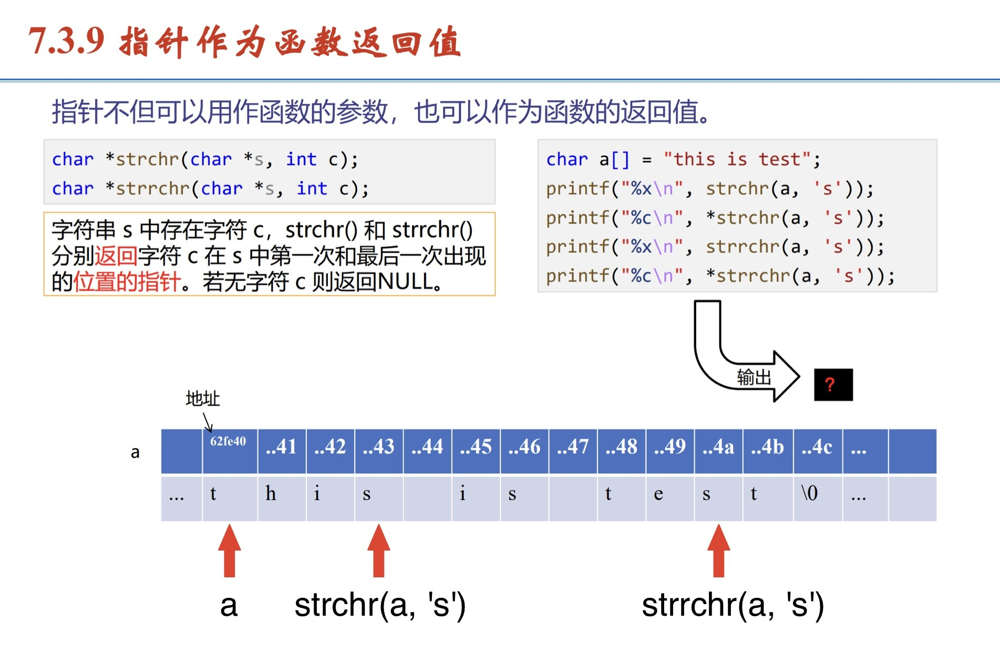
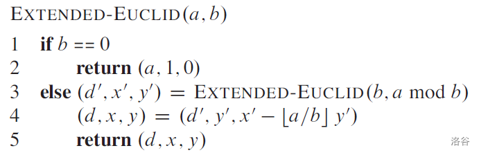
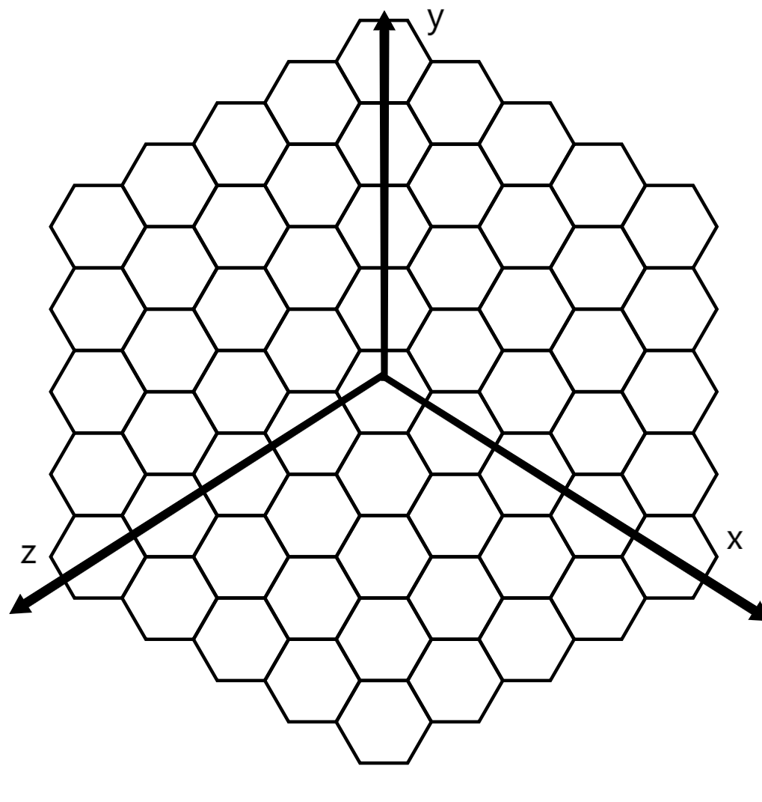
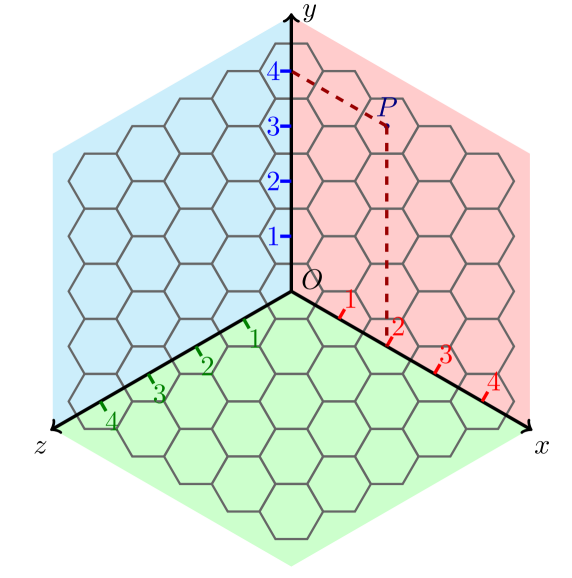
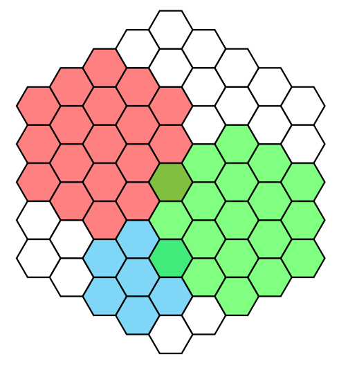
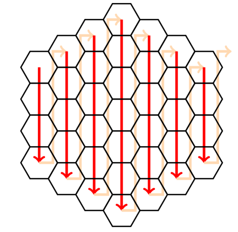
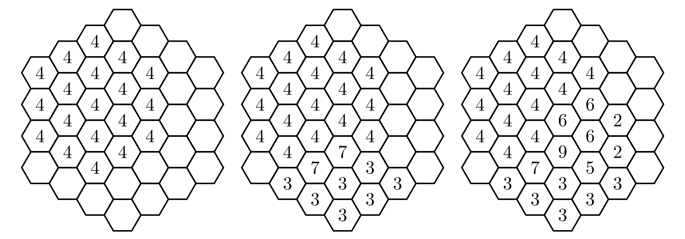
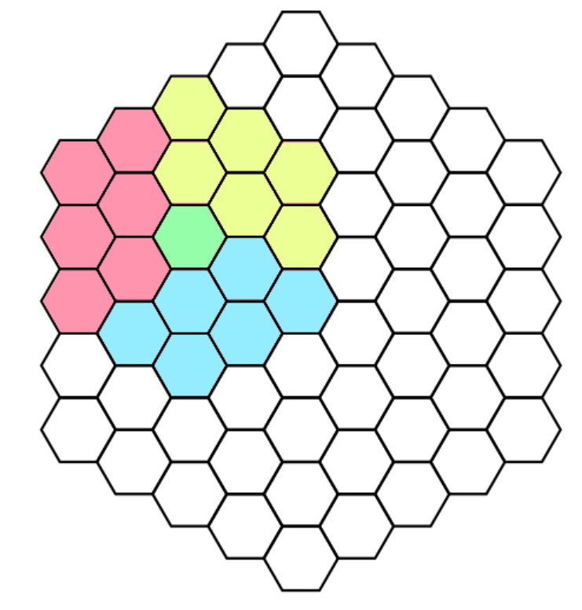

# 程序设计基础 C7 答案（2023秋）

## A 我怎可将你与夏日比拟

### 题目

#### 题目描述

“第18号十四行诗”是莎士比亚最著名的十四行诗之一，全文如下：

```text
Shall I compare thee to a summer's day?
Thou art more lovely and more temperate:
Rough winds do shake the darling buds of May,
And summer's lease hath all too short a date;
Sometime too hot the eye of heaven shines,
And often is his gold complexion dimm'd;
And every fair from fair sometime declines,
By chance or nature's changing course untrimm'd;
But thy eternal summer shall not fade,
Nor lose possession of that fair thou ow'st;
Nor shall death brag thou wander'st in his shade,
When in eternal lines to time thou grow'st:
     So long as men can breathe or eyes can see,
     So long lives this, and this gives life to thee.
```

对于给定的 $n$ ，请你输出它的第 $n$ 行。

#### 输入

**不定组数据输入**，保证输入组数不超过 30 。

每组数据输入一行一个正整数 $n$ ，保证 $1 \le n \le 14$ 。

<!-- markdownlint-disable-next-line MD024 -->
#### 输入

每组数据输出一行字符串，表示第 $n$ 行。

#### 输入样例

```text
1
2
3
4
5
6
7
8
9
10
11
12
13
14
```

#### 输出样例

```text
Shall I compare thee to a summer's day?
Thou art more lovely and more temperate:
Rough winds do shake the darling buds of May,
And summer's lease hath all too short a date;
Sometime too hot the eye of heaven shines,
And often is his gold complexion dimm'd;
And every fair from fair sometime declines,
By chance or nature's changing course untrimm'd;
But thy eternal summer shall not fade,
Nor lose possession of that fair thou ow'st;
Nor shall death brag thou wander'st in his shade,
When in eternal lines to time thou grow'st:
     So long as men can breathe or eyes can see,
     So long lives this, and this gives life to thee.
```

#### Hint

使用二维数组存储字符串吧！显然每行的字符数量均小于100。

第13行和第14行要输出前面的空格哦~

#### 数据范围

- 输入组数不超过 30
- $1 \le n \le 14$
- 每行字符数量均小于 100

Author: David Tong

### 答案

| 难度 | 考点 |
| --- | --- |
| 1 | 二维数组，字符串 |

### 题目分析

建立二维字符数组，初始化每行为对应字符串，每组数据输出对应的字符串即可。

### 示例代码

```c
#include <stdio.h>
char s[14][100] =
{
    "Shall I compare thee to a summer's day?",
    "Thou art more lovely and more temperate:",
    "Rough winds do shake the darling buds of May,",
    "And summer's lease hath all too short a date;",
    "Sometime too hot the eye of heaven shines,",
    "And often is his gold complexion dimm'd;",
    "And every fair from fair sometime declines,",
    "By chance or nature's changing course untrimm'd;",
    "But thy eternal summer shall not fade,",
    "Nor lose possession of that fair thou ow'st;",
    "Nor shall death brag thou wander'st in his shade,",
    "When in eternal lines to time thou grow'st:",
    "    So long as men can breathe or eyes can see,",
    "    So long lives this, and this gives life to thee."
};
int main()
{
    int n;
    while(~scanf("%d", &n))
        puts(s[n - 1]);
    return 0;
}
```

### 示例代码 - 2

利用指针数组实现。区别在于该方法指针指向的字符串为常量，不可修改。

```c
#include <stdio.h>
char *s[14] =
{
    "Shall I compare thee to a summer's day?",
    "Thou art more lovely and more temperate:",
    "Rough winds do shake the darling buds of May,",
    "And summer's lease hath all too short a date;",
    "Sometime too hot the eye of heaven shines,",
    "And often is his gold complexion dimm'd;",
    "And every fair from fair sometime declines,",
    "By chance or nature's changing course untrimm'd;",
    "But thy eternal summer shall not fade,",
    "Nor lose possession of that fair thou ow'st;",
    "Nor shall death brag thou wander'st in his shade,",
    "When in eternal lines to time thou grow'st:",
    "    So long as men can breathe or eyes can see,",
    "    So long lives this, and this gives life to thee."
};
int main()
{
    int n;
    while(~scanf("%d", &n))
        puts(s[n - 1]);
    return 0;
}
```

## B 小亮学矩阵加减法

### 题目

#### 题目背景

小亮最近在复习线性代数，但他忘记了矩阵加减法如何计算，请为他写一个C语言程序实现矩阵加减法。

#### 题目描述

给定两个矩阵 $A$, $B$和一个运算符 $S$，其中 $A$ 为 $m$ 行 $n$ 列的矩阵， $B$ 为 $m$ 行 $n$ 列的矩阵，运算符 $S \in \{1, 2\}$ 。

$S = 1$ 时，矩阵 $A$ 加矩阵 $B$ 。

$S = 2$ 时，矩阵 $A$ 减矩阵 $B$ 。

#### 输入

共 $1 + 2 \times m$ 行。

第一行，三个空格隔开的整数 $m, n, S$ ，保证 $1 \le m, n \le 40$ ， $S \in \{1, 2\}$ .

接下来的 $m$ 行，每行 $n$ 个空格隔开的整数 $a_{i,j}$ ，表示 $m$ 行 $n$ 列的矩阵 $A$ .

再接下来的 $m$ 行，每行 $n$ 个空格隔开的整数 $b_{i,j}$ ，表示 $m$ 行 $n$ 列的矩阵 $B$ .

保证 $a_{i,j}$ ， $b_{i,j}$ 在 `int` 范围内。

#### 输出

共 $m$ 行，每行 $n$ 个空格隔开的整数，表示矩阵 $A$ , $B$ 的相加或相减的结果。

#### 输入样例1

```text
3 3 1
1 1 1
1 1 1
1 1 1
1 2 3
4 5 6
7 8 9
```

#### 输出样例1

```text
2 3 4
5 6 7
8 9 10
```

#### 输入样例2

```text
3 3 2
1 1 1
1 1 1
1 1 1
1 2 3
4 5 6
7 8 9
```

#### 输出样例2

```text
0 -1 -2
-3 -4 -5
-6 -7 -8
```

#### Hint

注意数据范围哦

#### 数据范围

- $1 \le m, n \le 40$
- $S \in \{1, 2\}$
- $a_{i,j}$ ， $b_{i,j}$ 在 int 范围内

### 答案

| 难度 | 考点 |
| --- | --- |
| 1 | 二维数组 循环 |

### 题目分析

矩阵的加减法是两个矩阵对应元素的加减法。

需要注意的是计算结果可能会超出 `int` 范围，需要保证计算范围和输出数组都需要在 `long long` 范围内。

### 示例代码

```c
#include <stdio.h>

int main()
{
    int a[50][50]={0};
    int b[50][50]={0};
    long long c[50][50]={0};
    int m,n,k;int s;
    scanf("%d%d%d",&m,&n,&s);
    for (int i = 0; i < m; ++i) {//矩阵A
        for (int j = 0; j < n; ++j) {
            scanf("%d", &a[i][j]);
        }
    }
    for (int i = 0; i < m; ++i) {//矩阵B
        for (int j = 0; j < n; ++j) {
            scanf("%d", &b[i][j]);
        }
    }

    for (int i = 0; i < m; ++i) {
        for (int j = 0; j < n; ++j) {
            if (s==1) c[i][j]=1ll*a[i][j]+b[i][j];//矩阵相加，注意1ll
            else c[i][j]=1ll*a[i][j]-b[i][j];//矩阵相减，注意1ll
        }
    }
    for (int i = 0; i < m; ++i) {
        for (int j = 0; j < n; ++j) {
            printf("%lld ",c[i][j]);
        }
        printf("\n");
    }
    return 0;
}
```

## C 寻找字符

### 题目

#### 题目描述

给出一个字符串 $s$ 和若干个字符。对于每个字符 $c$ ，请按以下要求进行输出：

- 若 $c$ 在 $s$ 中**未出现**，请输出 `-1` ；
- 若 $c$ 在 $s$ 中**恰好出现一次**，请输出 $c$ 在 $s$ 中的位置，**下标从 0 开始**；
- 若 $c$ 在 $s$ 中**出现不止一次**，请输出 $c$ 在 $s$ 中第一次出现的位置和最后一次出现的位置的距离。

字符区分大小写。

#### 输入

输入共两行。

第一行一个字符串 $s$ ，长度不超过 1000 ，保证仅有可见字符组成，即 ASCII 码在区间 $[32, 126]$ 中。

第二行若干个**连续的**字符，表示给出的若干个字符，个数不超过 1000 ，仅有可见字符组成，即 ASCII 码在区间 $[32, 126]$ 中。

#### 输出

输出若干行。

对于输入中第二行的每个字符 $c$ ，请按下方要求输出一行：

- 若 $c$ 在 $s$ 中**未出现**，请输出 `-1` ；
- 若 $c$ 在 $s$ 中**恰好出现一次**，请输出 $c$ 在 $s$ 中的位置，**下标从 0 开始**；
- 若 $c$ 在 $s$ 中**出现不止一次**，请输出 $c$ 在 $s$ 中第一次出现的位置和最后一次出现的位置的距离。

#### 输入样例

```text
Website: accoding.buaa.edu.cn
wW a.
```

#### 输出样例

```text
-1
0
8
12
9
```

#### 样例解释

`'w'`（小写w）在 $s$ 中未出现过；

`'W'`（大写W）在 $s$ 中出现过一次，位置为 0 ；

`' '`（空格）在 $s$ 中出现过一次，位置为 8 ；

`'a'`（小写a）在 $s$ 中出现不止一次，第一次出现的位置为 9 ，最后一次出现的位置为 21 ，因此距离为 12 ；

`'.'`（点）在 $s$ 中出现不止一次，第一次出现的位置为 17 ，最后一次出现的位置为 26 ，因此距离为 9 。

#### Hint

可以使用 string.h 库中的 `strchr` 和 `strrchr` 函数：

`char *strchr(const char *str, int c)` 在参数 str 所指向的字符串中搜索第一次出现字符 c（一个无符号字符）的位置。

`char *strrchr(const char *str, int c)` 在参数 str 所指向的字符串中搜索最后一次出现字符 c（一个无符号字符）的位置。



注意空格也算字符。

在本地环境调试时，有可能因为最后输入了换行导致多输出了一个 `-1` ，属于正常情况，忽略即可。

#### 数据范围

- 字符串 $s$ 长度不超过 1000，字符 ASCII 码在 $[32, 126]$ 中
- 第二行字符个数不超过 1000，字符 ASCII 码在 $[32, 126]$ 中

### 答案

| 难度 | 考点 |
| --- | --- |
| 2 | 指针，字符串函数 |

### 题目分析

利用 `strchr` 和 `strrchr` 函数搜索字符串 $s$ 中字符 $c$ 第一次出现和最后一次出现的位置。代码如下：

```c
char *p = strchr(s, c);
char *q = strrchr(s, c);
```

根据指针 `p`,`q` 的值进行判断：

- 若 $c$ 在 $s$ 中未出现，则 `p`,`q` 均为空；
- 若 $c$ 在 $s$ 中恰好出现一次，则 `p`,`q` 相等，均指向 $c$ 在 $s$ 中唯一出现的位置，`p - s` 的值就是答案；
- 若 $c$ 在 $s$ 中出现不止一次，则 `p`,`q` 分别指向 $c$ 在 $s$ 中第一次出现的位置和最后一次出现的位置，`q - p` 就是答案。

分类讨论即可。

### 示例代码

```c
#include <stdio.h>
#include <string.h>
char s[100005], c;
int main()
{
    gets(s);
    while(~(c = getchar()))
    {
        char *p = strchr(s, c), *q = strrchr(s, c);
        if(p == NULL)
            printf("-1\n");
        else if(p == q)
            printf("%d\n", p - s);
        else
            printf("%d\n", q - p);
    }
    return 0;
}
```

## D One Last Kiss

### 题目

#### 题目描述

对一个字符串，请在**不区分大小写**的条件下找到它包含的所有 `kiss` 子串的数量，当数量不为 0 时，还需要找到**最后一个** `kiss` 子串的首字母在原字符串中的位置下标

#### 输入

不定组数据输入，保证数据组数不超过 1000

每组数据 1 行，一个仅由可见字符组成且不包含空格的字符串，字符串长度 $len$ 满足 $1 \le len \le 1000$

#### 输出

多行输出，行数与输入行数相同

每行 2 个整数，以空格隔开

第一个数表示对应字符串中包含的 `kiss` 子串数量，第二个数表示当包含的目标子串数量不为 0 时，最后一个 `kiss` 子串的首字母在原字符串中的位置下标（再次强调：**不区分大小写**），若不包含目标子串则第二个数输出 -1

#### 输入样例

```text
CanYouGiveMeOneLastKiss?
wasuretakunaikoto
```

#### 输出样例

```text
1 19
0 -1
```

#### Hint

善用英文字符大小写转换可以帮你更快地做题

可以从第一个字符开始找，当找到第一个匹配的子串时，从匹配位置的下一个位置开始继续找，直到找不到新的匹配子串为止

怎么找大字符串中第一个与指定小字符串匹配的子串呢？试试 `strstr` 函数吧：

`char *strstr(char *s, char *sub_str);` ：返回子字符串 sub_str 在字符串 s 中第一次出现的位置的指针。如果 s 中没有 sub_str ，返回 `NULL`

怎么由子串位置指针得出首字母在原字符串中的下标值呢？结合数组在内存空间中连续存储、数组名表示数组的首地址、同一数组中同类型指针相减的结果想想

#### 数据范围

- 数据组数不超过 1000
- $1 \le len \le 1000$
- 字符串仅由可见字符组成且不包含空格

Author:逐月的游星

### 答案

| 难度 | 考点 |
| --- | --- |
| 2~3 | 子串查找函数 `strstr` 的使用，英文字符大小写转换 |

### 题目分析

根据题目要求，需要使用不定组输入语句读入多组字符串。对每组输入的字符串 `str`，要在忽略大小写的条件下，寻找字符串 `str` 中 `kiss` 子串的出现次数，与最后一次出现时子串首字母在原字符串中的位置下标

题目要求忽略大小写，因此我们可以直接在读入字符串 `str` 后，把所有字符转成小写，然后直接使用 `strstr` 函数在字符串 `str` 中查找全小写的 `kiss` 子串的首地址值。

如果查找操作返回地址值为 `NULL` 说明目标子串不存在，如果返回地址值不为 `NULL`，说明目标子串存在，记录本次查找到的子串首地址，同时将计数变量自增 1，然后从这次查到的位置的**后一个位置**开始，继续循环执行查找、计数累加、记录首地址的操作，直到查找失败返回 `NULL`，此时记录下的最后一个地址就是 `str` 字符串中最后一个目标子串的首地址

因为一个数组在内存中是连续存储的，而数组首地址指向的是数组中下标为 0 的元素的位置，将数组中某个指定位置的地址值与数组首地址作差后，得到的结果就是两个位置的下标差，即指定位置在数组中的下标。所以将前面查到的目标子串最后一次出现位置的首地址减去 `str` 数组首地址，就得到了目标子串首字母在 `str` 数组中的位置下标。保险起见，推荐使用强制类型转换将结果类型转换为 `int` 再输出

### 示例代码

```c
#include <stdio.h>
#include <ctype.h>
#include <string.h>

int main() {
    char str[1001] = {};
    while (scanf("%s", str) != EOF) {   //因为输入字符串中不包含空格，所以可以使用scanf读入每组的字符串
        //也可以使用while (gets(str) != NULL) {}
        int cnt = 0;
        for (int i = 0; str[i] != '\0'; ++i) {
            //使用ctype.h库中的tolower函数，当传入大写字母时返回小写字母的ASCII值，否则返回传入字符的原ASCII值
            str[i] = (char) tolower(str[i]);
            //也可以使用如下代码，利用ASCII值之差实现大小写转换
            //if ('A' <= str[i] && str[i] <= 'Z') {
            //    str[i] = (char) (str[i] - 'A' + 'a');
            //}
        }
        char *aim = NULL, *tmp = strstr(str, "kiss");
        while (tmp != NULL) {   //当找到目标子串时，累加计数并把该目标子串的首地址赋给指针变量aim
            cnt++;
            aim = tmp;
            tmp = strstr(aim + 1, "kiss");  //从成功匹配位置的下一个位置开始，再次查找目标子串
        }
        if (cnt > 0) {
            printf("%d %d\n", cnt, (int) (aim - str));
        } else {
            printf("0 -1\n");
        }
    }

    return 0;
}
```

## E 面壁计划

### 题目

#### 题目背景

现在你是面壁计划的一个情报员，你需要把罗辑的思想转换为三体人无法辨识的密文，一旦失败，三体人可能就会根据你泄露的情报反过来翻译出罗辑的思想，你能否成为一个合格的情报员呢？

#### 题目描述

给定一个长度不超过 1000 的仅有小写字母构成的字符串，代表待加密电文，请按以下规则进行加密：

- 将字符串逆序，即将字符串进行逐个字符的逆序排列，即第一个字符和最后一个字符互换位置，以此类推。
- 接下来将逆序后的字符串与原始字符串拼接，形成一个长度为 $2l$ 的新字符串（ $l$ 代表原始字符串长度）。
- 将新字符串分为奇数串和偶数串（下标从 0 开始），即第 $2k$ 位上的字符和 $2k + 1$ 位上的字符分别组成两个新的字符串，保留字典序较小的字符串作为加密结果。

一次加密不足以迷惑三体人，请你**对电文重复加密** $n$ 次，并输出最终的加密电文。

#### 输入

两行，分别为一个字符串和一个整数 $n$ 。

第一行为一个仅由小写字符串组成的最多为 1000 位的字符串。

第二行为一个整数 $n$ ，表示加密的次数 $n$ ， $1 \le n \le 10$ 。

#### 输出

一行，代表加密后的字符串 $str$

#### 输入样例

```text
abc
1
```

#### 输出样例

```text
acb
```

#### 样例解释

$abc$ 翻转得到 $cba$ 。

拼接得到 $abccba$

取奇数串和偶数串 $acb$ 和 $bca$ ，比较后取 $acb$ 。

加密一次完成。

#### Hint

想想上课学了什么字符串函数，比如 `strstr` , `strcat` , `strcpy` 以及字典序比较函数 `strcmp` 。

构建字符串时要注意字符串以 `'\0'` 结尾。

OJ上编译环境采用标准C，有的编译器对C标准库进行扩展，可以支持较多库函数，但OJ不一定支持，比如字符串翻转函数 `strrev` 等。此时，请自己动手实现函数功能。

#### 数据范围

- 字符串长度不超过 1000，仅由小写字母构成
- $1 \le n \le 10$

Author：罗辑

### 答案

| 难度 | 考点 |
| --- | --- |
| 3~4 | 字符串函数 |

### 题目分析

主要考察对于 $strlen$ , $strcpy$ , $strcmp$ 的函数运用。

本题的思路非常清晰，按照所给的步骤一步一步模拟即可。实现时，有一些细节需要注意，例如不要用变量定义数组的长度，记得字符串是以 `'\0'` 结尾的。

### 示例代码

```c
#include <stdio.h>
#include <string.h>
#include <ctype.h>
#define mlen 1005

// 函数：将字符串进行逆序
void reverseStringAndAlphabets(char* str) {
    int start = 0;
    int end = strlen(str) - 1;
    // 首字符逆序
    while (start < end) {
        char temp = str[start];
        str[start] = str[end];
        str[end] = temp;
        start++;
        end--;
    }
}

// 函数：进行字符串加密
void encryptString(char* str) {
    int len = strlen(str);
    char copy1[mlen  + 1]; // 存储逆序后的字符串
    char newStr[mlen + 1]; // 存储新的长度为n的字符串
    char copy[2 * mlen + 1];//存储逆序后的字符串和源字符串
    char jc[mlen + 1];//奇串
    char oc[mlen + 1];//偶串
    strcpy(copy1, str); // 复制字符串
    reverseStringAndAlphabets(copy1); // 逆序后的字符串
    strcpy(copy, str);
    strcat(copy, copy1);//存放整体的字符串
    copy[len * 2] = '\0';
    for (int i = 0; i < strlen(copy); i++) {//奇串和偶串
        if (i % 2 == 0) {
            jc[i/2] = copy[i];
        }
        else {
            oc[(i-1)/2] = copy[i];
        }
    }
    jc[len] = '\0';
    oc[len] = '\0';
    if (strcmp(jc, oc) < 0)
    {
        strcpy(newStr, jc);
    }
    else
    {
        strcpy(newStr, oc);
    }
    strcpy(str, newStr); // 更新原始字符串内容
}
int main() {
    char s[1005];
    gets(s);
    int n;
    scanf("%d", &n);
    while (n--)
    {
        encryptString(s);

    }
    printf("%s", s);
    return 0;
}
```

### 示例代码 - 2

```c
#include <stdio.h>
#include <string.h>
int main()
{
    char s[2001];
    int n;
    scanf("%s%d", s, &n);
    int len = strlen(s);
    while(n--)
    {
        for(int i = 0; i < len; ++i)
            s[2 * len - 1 - i] = s[i];
        char e[1001], o[1001];
        for(int i = 0; i < len; ++i)
        {
            e[i] = s[2 * i];
            o[i] = s[2 * i + 1];
        }
        e[len] = o[len] = '\0';
        strcpy(s, strcmp(e, o) > 0 ? o : e);
    }
    puts(s);
    return 0;
}
```

## F 生成扫雷地图

### 题目

#### 题目描述

扫雷是 Windows 上的一个经典小游戏。游戏界面由一个方阵构成，方阵中的每一项可能含有雷，也可能不含有雷。

在本题中的方阵中，如果这个格子中有雷，则用字母 `M` 表示；如果这个方阵中不含雷，则用数字表示。数字的意义为与这个格子相邻的上、下、左、右、左上、左下、右上、右下的 8 个格子中雷的个数（若遇到边界，则排除掉缺失的部分，对应格子数相应减少）。

现给出一张仅布设好雷的位置的地图，请你补全这张地图。

#### 输入

第一行，两个整数 $n, m$ ，为方阵地图的高和宽；

接下来 $n$ 行，每行 $m$ 个字符，为地图的情况。 约定用 `M` 表示有雷， `0` 表示没有雷。

保证 $0 < n \le 100, 0 < m \le 100$ 。

#### 输出

共 $n$ 行，每行 $m$ 个字符，表示出补全后的地图。

#### 输入样例

```text
7 6
00M000
00000M
000000
00M000
0000M0
000M00
000000
```

#### 输出样例

```text
01M111
01111M
011111
01M211
0123M1
001M21
001110
```

#### Hint

注意边界的判断。

#### 数据范围

- $0 < n \le 100$
- $0 < m \le 100$

### 答案

| 难度 | 考点 |
| --- | --- |
| 3~4 | 二维数组 |

### 题目分析

本题思路较简单，代码只需要输入、处理、输出三部分即可完成目标。三部分代码均有多种实现方式，思路多种多样，以下为三部分代码的部分实现方式：

#### 0. 代码开始部分

```c
#include<stdio.h>
char a[103][103];
int b[10][3] = {{1, 1}, {1, 0}, {1, -1}, {0, -1}, {-1, -1}, {-1, 0}, {-1, 1}, {0, 1}};
//b用来简化读取周围8个空格的过程，利用8个if也可实现，形式不唯一
int n, m;
```

#### 1. 输入部分

##### 1.逐字符地输入

从“二维字符数组”出发，逐个读入字符的处理方式，注意处理掉换行符。

```c
void input() {
    scanf("%d%d", &n, &m);
    getchar();
    for (int i = 1; i <= n; i++) {
        for (int j = 1; j <= m; j++) {
            scanf("%c", &a[i][j]);
        }
        getchar();
    }
}
```

##### 2.利用gets

一次读取一行，注意处理掉 $n, m$ 之后的换行符，以及注意字符串要从角标为 1 的部分开始存储。

```c
void input() {
    scanf("%d%d", &n, &m);
    getchar();
    for (int i = 1; i <= n; i++) {
        gets(a[i] + 1);
    }
}
```

##### 3.利用%s

一次读取一行，注意字符串要从角标为 1 的部分开始存储，无需考虑换行符。

```c
void input() {
    scanf("%d%d", &n, &m);
    for (int i = 1; i <= n; i++) {
        scanf("%s", a[i] + 1);
    }
}
```

#### 2. 处理部分

本题的所产生的数字均不会大于 $8$。由于 `'0'` 到 `'8'` 在 ASCII 码中是连续的，所以在本题中直接对 `char` 类型的字符递增加一即可。

##### 1.从每个空格出发，考虑这个空格会怎么样地受到周围的雷的影响

遍历二维数组。当读到雷的位置的时候跳过，当读到空格的位置时，找寻周围有几个雷。

```c
void process() {
    for (int i = 1; i <= n; i++) {
        for (int j = 1; j <= m; j++) {
            if (a[i][j] != 'M') {
                for (int k = 0; k <= 7; k++) {
                    if (a[i + b[k][0]][j + b[k][1]] == 'M') {
                        a[i][j] += 1;
                    }
                }
            }
        }
    }
}
```

##### 2.从每个雷出发，考虑这个雷会怎么样地对周围的空格产生影响

遍历二维数组。当读到空格的位置的时候跳过，当读到雷的位置时，给周围所有不是雷的空格的计数加一。

```c
void process() {
    for (int i = 1; i <= n; i++) {
        for (int j = 1; j <= m; j++) {
            if (a[i][j] == 'M') {
                for (int k = 0; k <= 7; k++) {
                    if (a[i + b[k][0]][j + b[k][1]] != 'M') {
                        a[i + b[k][0]][j + b[k][1]] += 1;
                    }
                }
            }
        }
    }
}
```

#### 3.输出部分

##### 1.逐字符地输出

```c
void output() {
    for (int i = 1; i <= n; i++) {
        for (int j = 1; j <= m; j++) {
            printf("%c", a[i][j]);
        }
        printf("\n");
    }
}
```

##### 2.整体地输出字符串

参照前面的输入部分，注意要从 `a[i]+1` 开始输出，否则会产生问题。

```c
void output() {
    for (int i = 1; i <= n; i++) {
        printf("%s\n",a[i]+1);
    }
}
```

### 示例代码

组装上面三部分的代码，每部分代码任选一种实现方式即可。题解为了使结构清晰使用了函数来实现，也可不使用函数。

```c
#include<stdio.h>
char a[103][103];
int b[10][3] = {{1, 1}, {1, 0}, {1, -1}, {0, -1}, {-1, -1}, {-1, 0}, {-1, 1}, {0, 1}};
int n, m;
void input() {
    scanf("%d%d", &n, &m);
    getchar();
    for (int i = 1; i <= n; i++) {
        for (int j = 1; j <= m; j++) {
            scanf("%c", &a[i][j]);
        }
        getchar();
    }
}//输入
void process() {
    for (int i = 1; i <= n; i++) {
        for (int j = 1; j <= m; j++) {
            if (a[i][j] != 'M') {
                for (int k = 0; k <= 7; k++) {
                    if (a[i + b[k][0]][j + b[k][1]] == 'M') {
                        a[i][j] += 1;
                    }
                }
            }
        }
    }
}//处理
void output() {
    for (int i = 1; i <= n; i++) {
        for (int j = 1; j <= m; j++) {
            printf("%c", a[i][j]);
        }
        printf("\n");
    }
}//输出
int main() {
    input();
    process();
    output();
    return 0;
}//主程序，依次调用三部分
```

## G Ex-GCD

### 题目

#### 题目描述

正整数 $a$ 和 $b$ 的最大公约数可表示为

$$d = \gcd(a, b) = ax + by$$

即能被 $a$ 和 $b$ 线性表出的最小正整数，其中， $x$ 和 $y$ 是整数（可能为 0 或负数）。

为了求得 $d, x, y$ ，我们可以使用下方展示的函数，该函数接收一个自然数二元组 $(a, b)$ ，得到一个整数三元组 $(d, x, y)$ 。其伪代码如下：



输入 $a$ 和 $b$ ，求出如上的表达式，格式为 `d = a*(x) + b*(y)` 。

请参考**Hint**完成本题。

#### 输入

一行，两个空格分隔的 `int` 范围内的整数 $a, b$ 。

#### 输出

一行，一个算式 `d = a*(x) + b*(y)` 。

#### 输入样例1

```text
28 63
```

#### 输出样例1

```text
7 = 28*(-2) + 63*(1)
```

#### 输入样例2

```text
2029126176 1613441024
```

#### 输出样例2

```text
32 = 2029126176*(4726833) + 1613441024*(-5944649)
```

#### Hint

题目中给出的递归函数每次会返回 3 个值 $(d, x, y)$ ，但是C语言中每次函数只能返回一个值，如何才能实现返回3个值的效果呢？

我们可以使用指针作为参数传入函数中，通过修改指针指向的变量的值达到计算多个返回值的效果。

代码模板如下：

```c
#include<stdio.h>
void ExGCD(int a, int b, int *d, int *x, int *y)
{
    if(b == 0)
    {
        //将(a,1,0)分别赋给d,x,y指向的变量
        return;
    }
    int dd, xx, yy; //分别代表伪代码中的d',x',y'
    //根据伪代码，调用ExGCD，传入dd,xx,yy的【地址】获得计算结果
    //根据伪代码进行计算，并赋给d,x,y指向的变量
}
int main()
{
    int a, b, d, x, y;
    //读入
    //调用ExGCD函数，传入d,x,y的【地址】获得计算结果
    //输出
    return 0;
}
```

这样就能实现返回3个值的效果啦~

#### 数据范围

- $a, b$ 为 int 范围内的整数

### 答案

| 难度 | 考点 |
| --- | --- |
| 3~4 | 指针，递归 |

### 题目分析

按照伪代码和Hint写出递归函数即可。

### 示例代码 - 1

```c
#include<stdio.h>
void ExGCD(int a, int b, int *d, int *x, int *y)
{
    if(b == 0)
    {
        *d = a, *x = 1, *y = 0;
        return;
    }
    int dd, xx, yy;
    ExGCD(b, a % b, &dd, &xx, &yy);
    *d = dd, *x = yy, *y = xx - a / b * yy;
}
int main()
{
    int a, b, d, x, y;
    scanf("%d%d", &a, &b);
    ExGCD(a, b, &d, &x, &y);
    printf("%d = %d*(%d) + %d*(%d)", d, a, x, b, y);
    return 0;
}
```

### 示例代码 - 2

```c
#include <stdio.h>
void Exgcd(int a, int b, int *d, int *x, int *y)
{
    if(b == 0) *d = a, *x = 1, *y = 0;
    else Exgcd(b, a % b, d, y, x), *y -= a / b * *x;
}
int main()
{
    int a, b, d, x, y;
    scanf("%d%d", &a, &b);
    Exgcd(a, b, &d, &x, &y);
    printf("%d = %d*(%d) + %d*(%d)\n", d, a, x, b, y);
    return 0;
}
```

### 示例代码 - 3

```c
#include<stdio.h>
int ExGCD(int a, int b, int *x, int *y)
{
    if(b == 0)
    {
        *x = 1;
        *y = 0;
        return a;
    }
    else
    {
        int d = ExGCD(b, a % b, y, x);
        *y -= a / b * *x;
        return d;
    }
}
int main()
{
    int a, b, x, y;
    scanf("%d%d", &a, &b);
    int d = ExGCD(a, b, &x, &y);
    printf("%d = %d*(%d) + %d*(%d)", d, a, x, b, y);
    return 0;
}
```

## H Cirno 的完美函数教室

### 题目

#### 题目背景

Cirno 又找到 Yakumo Ran 学习数学了！这次 Ran 打算教她一点函数的知识。

#### 题目描述

Ran 给出的函数有一些性质：

$$
B(\alpha, \beta, \gamma) = \begin{cases}
1, & \text{if } \alpha \le 0 \text{ or } \beta \le 0 \text{ or } \gamma \le 0 \\
B(25, 25, 25), & \text{else if } \alpha > 25 \text{ or } \beta > 25 \text{ or } \gamma > \\
B(\alpha, \beta, \gamma - 1) + B(\alpha, \beta - 1, \gamma - 1) - B(\alpha, \beta - 1, \gamma), & \text{else if } \alpha < \beta < \gamma \\
B(\alpha - 1, \beta, \gamma) + B(\alpha - 1, \beta - 1, \gamma) + B(\alpha - 1, \beta, \gamma - 1) - B(\alpha - 1, \beta - 1, \gamma - 1), & \text{else.}
\end{cases}
$$

Ran 想考考 Cirno，任意给定三个整数 $a, b, c$ ，她能不能通过以上性质来计算出 $B(a, b, c)$ 的值。为了防止 Cirno 蒙混过关，Ran 一共会询问 $T$ 次。

#### 输入

**多组数据输入。**

第一行一个整数 $T$（ $1 \le T \le 10^{5}$ ），表示数据组数。

接下来 $T$ 行，每行三个整数 $a, b, c$ ，含义见上，保证 $a, b, c$ 在 `int` 范围内。

数据保证计算过程与结果均在 `int` 范围内。

#### 输出

每组数据一行一个整数，表示 $B(a, b, c)$ 的值。

#### 输入样例

```text
3
1 2 3
-1 -2 -3
3 2 1
```

#### 输出样例

```text
2
1
7
```

#### Hint

可以把算过的数存在数组中，避免重复计算。

#### 数据范围

- $1 \le T \le 10^{5}$
- $a, b, c$ 在 int 范围内
- 计算过程与结果均在 int 范围内

### 答案

| 难度 | 考点 |
| --- | --- |
| 4 | 递归，剪枝 |

### 问题分析

本题如果使用递归，需要剪枝，存储计算过的函数值，否则递归次数过多会导致TLE。

当然，也可以使用递推，要注意递推的关系式和更新的顺序。

### 参考代码 #1

```c
#include <stdio.h>

int f[30][30][30];

int B(int a, int b, int c)
{
    if (a <= 0 || b <= 0 || c <= 0)
        return 1;
    else if (a > 25 || b > 25 || c > 25)
        return B(25, 25, 25);
    else
    {
        if (f[a][b][c])
            return f[a][b][c];
        else if (a < b && b < c)
            f[a][b][c] = B(a, b, c - 1) + B(a, b - 1, c - 1) - B(a, b - 1, c);
        else
            f[a][b][c] = B(a - 1, b, c) + B(a - 1, b - 1, c) + B(a - 1, b, c - 1) - B(a - 1, b - 1, c - 1);
    }
    return f[a][b][c];
}

int main()
{
    int T, a, b, c;
    scanf("%d", &T);
    while (T--)
    {
        scanf("%d%d%d", &a, &b, &c);
        printf("%d\n", B(a, b, c));
    }
    return 0;
}
```

### 参考代码 #2

```c
#include <stdio.h>

int main() {
    int B[26][26][26];
    for (int i = 0; i < 26; ++i) {
        for (int j = 0; j < 26; ++j) {
            for (int k = 0; k < 26; ++k) {
                if (i == 0 || j == 0 || k == 0) {
                    B[i][j][k] = 1;
                } else {
                    if (i < j && j < k) {
                        B[i][j][k] = B[i][j][k - 1] + B[i][j - 1][k - 1] - B[i][j - 1][k];
                    } else {
                        B[i][j][k] = B[i - 1][j][k] + B[i - 1][j - 1][k] + B[i - 1][j][k - 1] - B[i - 1][j - 1][k - 1];
                    }
                }
            }
        }
    }
    int T, a, b, c;
    scanf("%d", &T);
    for (int i = 0; i < T; ++i) {
        scanf("%d%d%d", &a, &b, &c);
        if (a <= 0 || b <= 0 || c <= 0) {
            a = b = c = 0;
        } else if (a > 25 || b > 25 || c > 25) {
            a = b = c = 25;
        }
        printf("%d\n", B[a][b][c]);
    }

    return 0;
}
```

## I 拔刀

### 题目

#### 题目描述

将军的战刀由于用力过猛被卡在石头缝里了，八重宫司希望你能计算出战刀剩余的长度。

给定一个高为 $h$ ，宽为 $w$ 的矩阵，该矩阵只包含 0, 1 两种元素，元素间以空格隔开，其中 0 代表石头， 1 代表刀身，请你计算从**第一行**开始，刀剩余的最长长度时多少？即，计算最多有多少行存在元素 1 能够与第一行的元素 1 **连通**。**本题中连通指，两个元素 1 间存在一条通路，该通路上的每一个元素均为 1（包括端点）。**

#### 输入

第一行为两个自然数 $h, w$ ，保证 $2 \le h, w \le 1000$ 。

接下来 $h$ 行， 每行 $w$ 个整数，值为 0 或 1。

确保这 $h$ 行中的第一行**至少存在一个整数 1** 。

#### 输出

一行，一个自然数，为能够连通至第一行的元素 1 的元素所在行序号的最大值

#### 输入样例 1

```text
5 4
1 1 1 0
0 1 0 1
0 1 1 0
0 1 0 1
0 0 0 1
```

#### 输出样例 1

```text
4
```

#### 样例解释 1

**第四行第二列**的元素 `1` 是能够连通至第一行的元素 `1` 的元素中，所在行序号最大的一个。

#### 输入样例 2

```text
5 7
1 1 0 0 0 1 1
1 0 1 1 1 0 1
1 1 1 0 1 0 1
0 0 0 0 1 0 0
1 1 0 0 0 0 1
```

#### 输出样例 2

```text
4
```

#### 样例解释 2

**第4行第5列**的元素 `1` 是能够连通至第一行的元素 `1` 的元素中，所在行序号最大的一个。

#### 数据范围

- $2 \le h, w \le 1000$
- 矩阵元素只有 0 和 1，第一行至少存在一个 1

Author: 八重绳子

### 答案

| 难度 | 考点 |
| --- | --- |
| 5 | 二维数组，递归 |

### 题目分析

本题是一个相对标准的递归问题，递归中，若当前位置为1，则进入其相邻四个元素判断（需要考虑向上的情况），否则返回当前行序号。

### 示例代码

```c
int graph[1005][1005];
int used[1005][1005];
int m, n;
int max=-1;
void dfs(int i, int j);
int main(void)
{
    int i, j;
    scanf("%d%d", &m, &n);
    for (i = 0; i < m; i++)
    {
        for (j = 0; j < n; j++)
        {
            scanf("%d", &graph[i][j]);
        }
    }
    for (i = 0; i < n; i++)
    {
        if(graph[0][i]==1)
            dfs(0, i);
    }
    printf("%d", max + 1);
    return 0;
}
void dfs(int i, int j)
{
    if (i < 0 || j < 0 || i >= m || j >= n || used[i][j] || graph[i][j] == 0)
        return;
    used[i][j] = 1;
    dfs(i, j + 1);
    dfs(i, j - 1);
    dfs(i + 1, j);
    dfs(i - 1, j);
    max = MAX(max, i);
}
```

### 示例代码 - 2

```c
#include <stdio.h>
int a[1005][1005], ans;
void f(int i, int j)
{
    if(!a[i][j]) return;
    a[i][j] = 0;
    if(i > ans) ans = i;
    f(i - 1, j);
    f(i + 1, j);
    f(i, j - 1);
    f(i, j + 1);
}
int main()
{
    int h, w;
    scanf("%d%d", &h, &w);
    for(int i = 1; i <= h; ++i)
        for(int j = 1; j <= w; ++j)
            scanf("%d", &a[i][j]);
    for(int j = 1; j <= w; ++j) f(1, j);
    printf("%d", ans);
    return 0;
}
```

## J De想成为六边形站侍

### 题目

本题时间限制为2000ms。

#### 题目描述

“又是元气满满的一天！”，DeNeRATe也想要成为当代青年中的六边形站侍

De有一个由多个正六边形组成的正六边形战力表，如下图



我们对边长为 $n$ 的战力表中每个块进行标号

以中心为原点延伸出三根射线作为三根轴 $X, Y, Z$ ，如下图，那么我们可以用一个三元组 $(x, y, z)$ 描述单个块的坐标



由于如此之下每个块描述方式不唯一，因此我们将战力表分为三个区域，每个块只用包围其所在区域的两根轴对应坐标即可唯一描述，如图中 $P$ 点描述为 $(2, 4, 0)$

每一天，通过De的努力，战力表都会成块更新，给出 $x, y, z, r, k$ ，表示这一天，De战力表中以 $(x, y, z)$ 为中心的边长为 $r$ 的正六边形区域 $T$ 内战力集体加 $k$ ，如下图（这个区域 $T$ 覆盖的范围可能超出了De的战力表，这些点战力的更新对De没用哦）



努力 $m$ 天后，De想要知道自己战力表中每个位置的战力是多少

#### 输入

第一行两个数 $n, m$ 分别表示De战力表的边长及De努力了多少天

接下来 $m$ 行，每行5个整数 $x, y, z, r, k$ 表示该天以 $(x, y, z)$ 为中心，边长为 $r$ 的区域内所有块战力加 $k$

保证 $1 \le n \le 800, 1 \le m \le 10^{6}, 1 \le r \le 10^{9}, 1 \le k \le 10^{3}$

#### 输出

共一行，若干个整数。

按照从左往后，从上至下的顺序，依次输出战力表中每个块的战力值，如下图所示，每两个值之间用空格隔开



#### 输入样例

```text
4 3
0 1 1 3 4
3 0 3 3 3
1 0 0 2 2
```

#### 输出样例

```text
4 4 4 0 4 4 4 4 3 4 4 4 4 7 3 0 4 4 6 9 3 3 0 4 6 6 5 3 0 0 2 2 3 0 0 0 0
```

#### 样例解释



（二次注意，更新区域超出战力表范围的不需要进行处理）

#### 数据范围

- $1 \le n \le 800$
- $1 \le m \le 10^{6}$
- $1 \le r \le 10^{9}$
- $1 \le k \le 10^{3}$
- 本题时间限制为 2000ms

— End —

### 答案

| 难度 | 考点 |
| --- | --- |
| 6 | 二维数组，差分 |

### 题目分析

首先，我们基本可以确定这道题需要使用差分，对于有规则的平面图形，我们打算使用二维差分，尝试将一个六边形的整体加法用一个差分数组表示

具体方法（其中一种方法）如下：



我们将一个正六边形分为三个部分，如图中红黄蓝部分，那么易知对于其中一块，我们可以以其边所平行的两个轴来将整个图形及平面移为“平面直角坐标系”，并且每个点表示方法唯一

比如对于黄色区域如果我们要 `+1`，那么相当于是二维差分中修改：

`c[-2][1]++, c[1][1]--, c[-2][3]--, c[1][3]++`（表示方法依个人实现方式不同而不尽相同）

<!-- markdownlint-disable-next-line MD036 -->
**因此，我们只需要维护三个二位差分即可，另外，注意一下超出边界的点不需要管**

- 中心块我们单独处理
- 黄色区域轴 `x - y`
- 红色区域轴 `y - z`
- 蓝色区域轴 `x - z`


### 示例代码

~~（有点长，大家的实现肯定有非常短的）~~

```c
#include <math.h>
#include <stdlib.h>
#include <stdio.h>
#include <string.h>

#define ll long long
#define max(a, b) ((a) > (b) ? (a) : (b))
#define min(a, b) ((a) < (b) ? (a) : (b))
#define rep(i, a, b) for(int i = a; i <= b; i++)
#define per(i, a, b) for(int i = a; i >= b; i--)

#define maxn 805

int pre[3][maxn << 1][maxn << 1], node[maxn << 1][maxn << 1];
int n, test, lim;
int X, Y, Z, r, k;

void update(int X, int Y, int Z, int r, int k) {
    pre[0][min(lim, X - Z + n + 1)][min(lim, (Y + 1) - Z + n + 1)] += k;
    pre[0][min(lim, (X + r) - Z + n + 1)][min(lim, (Y + 1) - Z + n + 1)] -= k;
    pre[0][min(lim, X - Z + n + 1)][min(lim, (Y + r) - Z + n + 1)] -= k;
    pre[0][min(lim, (X + r) - Z + n + 1)][min(lim, (Y + r) - Z + n + 1)] += k;

    pre[1][min(lim, (X + 1) - Y + n + 1)][min(lim, Z - Y + n + 1)] += k;
    pre[1][min(lim, (X + r) - Y + n + 1)][min(lim, Z - Y + n + 1)] -= k;
    pre[1][min(lim, (X + 1) - Y + n + 1)][min(lim, (Z + r) - Y + n + 1)] -= k;
    pre[1][min(lim, (X + r) - Y + n + 1)][min(lim, (Z + r) - Y + n + 1)] += k;

    pre[2][min(lim, Y - X + n + 1)][min(lim, (Z + 1) - X + n + 1)] += k;
    pre[2][min(lim, Y - X + n + 1)][min(lim, (Z + r) - X + n + 1)] -= k;
    pre[2][min(lim, (Y + r) - X + n + 1)][min(lim, (Z + 1) - X + n + 1)] -= k;
    pre[2][min(lim, (Y + r) - X + n + 1)][min(lim, (Z + r) - X + n + 1)] += k;
}

void push_up() {
    rep(i, 1, lim)
        rep(j, 1, lim) {
            pre[0][i][j] += pre[0][i - 1][j] + pre[0][i][j - 1] - pre[0][i - 1][j - 1];
            pre[1][i][j] += pre[1][i - 1][j] + pre[1][i][j - 1] - pre[1][i - 1][j - 1];
            pre[2][i][j] += pre[2][i - 1][j] + pre[2][i][j - 1] - pre[2][i - 1][j - 1];
        }
}

int get(int X, int Y, int Z) {
    return node[X - Z + n + 1][Y - Z + n + 1] +
        pre[0][X - Z + n + 1][Y - Z + n + 1] +
        pre[1][X - Y + n + 1][Z - Y + n + 1] +
        pre[2][Y - X + n + 1][Z - X + n + 1];
}

int main() {
    scanf("%d %d", &n, &test);
    lim = (n << 1 | 1);
    while(test--) {
        scanf("%d %d %d %d %d", &X, &Y, &Z, &r, &k);
        node[X - Z + n + 1][Y - Z + n + 1] += k;
        update(X, Y, Z, r, k);
    }
    push_up();

    per(i, n - 1, 0)
        per(j, n - 1, 1 + i - n)
            printf("%d ", get(0, j, i));
    per(i, -1, 1 - n)
        per(j, n - 1 + i, 1 - n)
            printf("%d ", get(0, j, i));
    // system("pause");
    return 0;
}
```

### 示例代码 - 2

```c
#include <stdio.h>
#define max(a,b) ((a)>(b)?(a):(b))
#define min(a,b) ((a)<(b)?(a):(b))
int xy[1601][1601], yz[1601][1601], zx[1601][1601];
int (*A)[1601] = (int(*)[1601])&xy[800][800]; //偏移中心点，实现负数下标
int (*B)[1601] = (int(*)[1601])&yz[800][800];
int (*C)[1601] = (int(*)[1601])&zx[800][800];
int main()
{
    int n, m;
    scanf("%d%d", &n, &m);
    //维护差分数组
    while(m--)
    {
        int x, y, z, r, k, i, j;
        scanf("%d%d%d%d%d", &x, &y, &z, &r, &k);
        if(z == 0)
            i = x, j = y;
        else if(x == 0)
            i = -z, j = y - z;
        else
            i = x - z, j = -z;
        A[i][j] += k;
        A[min(i + r, n)][j] -= k;
        A[i][min(j + r, n)] -= k;
        A[min(i + r, n)][min(j + r, n)] += k;
        if(x == 0)
            i = y, j = z;
        else if(y == 0)
            i = -x, j = z - x;
        else
            i = y - x, j = -x;
        B[i][j + 1] += k;
        B[min(i + r, n)][j + 1] -= k;
        B[i][min(j + r, n)] -= k;
        B[min(i + r, n)][min(j + r, n)] += k;
        if(y == 0)
            i = z, j = x;
        else if(z == 0)
            i = -y, j = x - y;
        else
            i = z - y, j = -y;
        C[i + 1][j + 1] += k;
        C[min(i + r, n)][j + 1] -= k;
        C[i + 1][min(j + r, n)] -= k;
        C[min(i + r, n)][min(j + r, n)] += k;
    }
    //计算二维前缀和
    for(int i = -n + 1; i <= n; ++i)
    {
        for(int j = -n + 1; j <= n; ++j)
        {
            A[i][j] += A[i][j - 1] + A[i - 1][j] - A[i - 1][j - 1];
            B[i][j] += B[i][j - 1] + B[i - 1][j] - B[i - 1][j - 1];
            C[i][j] += C[i][j - 1] + C[i - 1][j] - C[i - 1][j - 1];
        }
    }
    //输出结果
    for(int i = -n + 1; i < n; ++i)
        for(int j = -n + 1 + max(i, 0); j < n + min(i, 0); ++j)
            printf("%d ", A[i][i - j] + B[-j][-i] + C[j - i][j]);
    return 0;
}
```

- End -

## 我的代码

### A

```cpp
#include<stdio.h>
#include<math.h>
#include<string.h>
#include<stdlib.h>
#define ll long long
int max(int a,int b)
{
   if(a>b)return a;
   return b;
}
int min(int a,int b)
{
   if(a<b)return a;
   return b;
}
int gcd(int a,int b)
{
   if(b==0)return a;
   return gcd(b,a%b);
}
void swap(void *a,void *b,int data_type_size)
{
   unsigned char *p=(unsigned char *)a;
   unsigned char *q=(unsigned char *)b;
   unsigned char temp;
   while(data_type_size--)
   {
      temp=*p;
      *p=*q;
      *q=temp;
      p++;
      q++;
   }
}
int n; 
int main()
{
   while(scanf("%d",&n)!=EOF)
   {
         if(n==1)printf("Shall I compare thee to a summer's day?\n");
         if(n==2)printf("Thou art more lovely and more temperate:\n");
         if(n==3)printf("Rough winds do shake the darling buds of May,\n");
         if(n==4)printf("And summer's lease hath all too short a date;\n");
         if(n==5)printf("Sometime too hot the eye of heaven shines,\n");
         if(n==6)printf("And often is his gold complexion dimm'd;\n");
         if(n==7)printf("And every fair from fair sometime declines,\n");
         if(n==8)printf("By chance or nature's changing course untrimm'd;\n");
         if(n==9)printf("But thy eternal summer shall not fade,\n");
         if(n==10)printf("Nor lose possession of that fair thou ow'st;\n");
         if(n==11)printf("Nor shall death brag thou wander'st in his shade,\n");
         if(n==12)printf("When in eternal lines to time thou grow'st:\n");
         if(n==13)printf("    So long as men can breathe or eyes can see,\n");
         if(n==14)printf("    So long lives this, and this gives life to thee.\n");
   }
   return 0;
}
```

### B

```cpp
#include<stdio.h>
#include<math.h>
#include<string.h>
#include<stdlib.h>
#define ll long long
int max(int a,int b)
{
   if(a>b)return a;
   return b;
}
int min(int a,int b)
{
   if(a<b)return a;
   return b;
}
int gcd(int a,int b)
{
   if(b==0)return a;
   return gcd(b,a%b);
}
void swap(void *a,void *b,int data_type_size)
{
   unsigned char *p=(unsigned char *)a;
   unsigned char *q=(unsigned char *)b;
   unsigned char temp;
   while(data_type_size--)
   {
      temp=*p;
      *p=*q;
      *q=temp;
      p++;
      q++;
   }
}
int n,m,s;
long long a[50][50],b;
int main()
{
   scanf("%d%d%d",&m,&n,&s);
   for(int i=1;i<=m;i++)
      for(int j=1;j<=n;j++)scanf("%lld",&a[i][j]);
   for(int i=1;i<=m;i++)
   {
         for(int j=1;j<=n;j++)
      {
           scanf("%lld",&b);
           if(s==1)a[i][j]+=b;
           else a[i][j]-=b;
           printf("%lld ",a[i][j]);
      }
      printf("\n");
   }
      
    
   return 0;
}
```

### C

```cpp
#include<stdio.h>
#include<math.h>
#include<string.h>
#include<stdlib.h>
#define ll long long
int max(int a,int b)
{
   if(a>b)return a;
   return b;
}
int min(int a,int b)
{
   if(a<b)return a;
   return b;
}
int gcd(int a,int b)
{
   if(b==0)return a;
   return gcd(b,a%b);
}
void swap(void *a,void *b,int data_type_size)
{
   unsigned char *p=(unsigned char *)a;
   unsigned char *q=(unsigned char *)b;
   unsigned char temp;
   while(data_type_size--)
   {
      temp=*p;
      *p=*q;
      *q=temp;
      p++;
      q++;
   }
}
char s[1005],ch;
int st,ed,sum;
int main()
{
   gets(s);
   while(scanf("%c",&ch)!=EOF)
   {
         sum=0;
         for(int i=0;i<strlen(s);i++)
         {
              if(s[i]==ch)
              {
                  sum++;
                  if(sum==1)st=i;
                  else ed=i;
         }
      }
      if(!sum)printf("-1\n");
      else if(sum==1)printf("%d\n",st);
      else printf("%d\n",ed-st);
   }
   return 0;
}
```

### D

```cpp
#include<stdio.h>
#include<math.h>
#include<string.h>
#include<stdlib.h>
#define ll long long
int max(int a,int b)
{
   if(a>b)return a;
   return b;
}
int min(int a,int b)
{
   if(a<b)return a;
   return b;
}
int gcd(int a,int b)
{
   if(b==0)return a;
   return gcd(b,a%b);
}
void swap(void *a,void *b,int data_type_size)
{
   unsigned char *p=(unsigned char *)a;
   unsigned char *q=(unsigned char *)b;
   unsigned char temp;
   while(data_type_size--)
   {
      temp=*p;
      *p=*q;
      *q=temp;
      p++;
      q++;
   }
}
char s[1005];
int sum,last;
void change()
{
   for(int i=0;i<strlen(s);i++)
      if(s[i]>='A'&&s[i]<='Z')s[i]+=32;
}
int main()
{
   while(scanf("%s",&s)!=EOF)
   {
         change();sum=0;last=-1;
         int len=strlen(s);
      for(int i=0;i<len;i++)
      {
           if(s[i]=='k'&&s[i+1]=='i'&&s[i+2]=='s'&&s[i+3]=='s')
         {
            sum++;
            last=i;
         }
      }
      printf("%d %d\n",sum,last);
   }
   return 0;
}
```

### E

```cpp
#include<stdio.h>
#include<math.h>
#include<string.h>
#include<stdlib.h>
#define ll long long
int max(int a,int b)
{
   if(a>b)return a;
   return b;
}
int min(int a,int b)
{
   if(a<b)return a;
   return b;
}
int gcd(int a,int b)
{
   if(b==0)return a;
   return gcd(b,a%b);
}
void swap(void *a,void *b,int data_type_size)
{
   unsigned char *p=(unsigned char *)a;
   unsigned char *q=(unsigned char *)b;
   unsigned char temp;
   while(data_type_size--)
   {
      temp=*p;
      *p=*q;
      *q=temp;
      p++;
      q++;
   }
}
char s[2005];
int n,len;
void change(int x)
{
   for(int i=0;i<len;i++)s[i]=s[2*i+x];
}
int main()
{
   scanf("%s%d",&s,&n);
   len=strlen(s);
   while(n--)
   {
         for(int i=0;i<len;i++)s[len+i]=s[len-i-1];
         for(int i=0;i<2*len-1;i+=2)
         {
              if(s[i]>s[i+1])
              {
                  change(1);
                  break;
         }
         if(s[i]<s[i+1])
              {
                  change(0);
                  break;
         }
      }
   }
   for(int i=0;i<len;i++)printf("%c",s[i]);
   return 0;
}
```

### F

```cpp
#include<stdio.h>
#include<math.h>
#include<string.h>
#include<stdlib.h>
#define ll long long
int max(int a,int b)
{
   if(a>b)return a;
   return b;
}
int min(int a,int b)
{
   if(a<b)return a;
   return b;
}
int gcd(int a,int b)
{
   if(b==0)return a;
   return gcd(b,a%b);
}
void swap(void *a,void *b,int data_type_size)
{
   unsigned char *p=(unsigned char *)a;
   unsigned char *q=(unsigned char *)b;
   unsigned char temp;
   while(data_type_size--)
   {
      temp=*p;
      *p=*q;
      *q=temp;
      p++;
      q++;
   }
}
char a[105][105];
int n,m,sum;
int check(int i,int j)
{
   sum=0;
   if(a[i][j]=='M')return 0;
   if(a[i-1][j]=='M')sum++;
   if(a[i-1][j-1]=='M')sum++;
   if(a[i-1][j+1]=='M')sum++;
   if(a[i+1][j]=='M')sum++;
   if(a[i+1][j-1]=='M')sum++;
   if(a[i+1][j+1]=='M')sum++;
   if(a[i][j]=='M')sum++;
   if(a[i][j-1]=='M')sum++;
   if(a[i][j+1]=='M')sum++;
   return sum;
}
int main()
{
   scanf("%d%d",&n,&m);getchar();
   for(int i=1;i<=n;i++)
   {
      for(int j=1;j<=m;j++)scanf("%c",&a[i][j]);
      getchar();
   }
      
   for(int i=1;i<=n;i++)
   {
      for(int j=1;j<=m;j++)
      {
         a[i][j]+=check(i,j);
         printf("%c",a[i][j]);
      }
      printf("\n");
   }
   return 0;
}
```

### G

```cpp
#include<stdio.h>
#include<math.h>
#include<string.h>
#include<stdlib.h>
#define ll long long
int max(int a,int b)
{
   if(a>b)return a;
   return b;
}
int min(int a,int b)
{
   if(a<b)return a;
   return b;
}
int gcd(int a,int b)
{
   if(b==0)return a;
   return gcd(b,a%b);
}
void swap(void *a,void *b,int data_type_size)
{
   unsigned char *p=(unsigned char *)a;
   unsigned char *q=(unsigned char *)b;
   unsigned char temp;
   while(data_type_size--)
   {
      temp=*p;
      *p=*q;
      *q=temp;
      p++;
      q++;
   }
}
void ExGCD(int a, int b, int *d, int *x, int *y)
{
    if(b == 0)
    {
        *d=a;
        *x=1;
        *y=0;
        return;
    }
    int dd, xx, yy;
    ExGCD(b,a%b,&dd,&xx,&yy);
    *d=dd;
    *x=yy;
    *y=xx-(a/b)*yy;
}
int main()
{
    int a, b, d, x, y;
    scanf("%d%d",&a,&b);
    ExGCD(a,b,&d,&x,&y);
    printf("%d = %d*(%d) + %d*(%d)",d,a,x,b,y);
    return 0;
}
```

### H

```cpp
#include<stdio.h>
#include<math.h>
#include<string.h>
#include<stdlib.h>
#define ll long long
int max(int a,int b)
{
   if(a>b)return a;
   return b;
}
int min(int a,int b)
{
   if(a<b)return a;
   return b;
}
int gcd(int a,int b)
{
   if(b==0)return a;
   return gcd(b,a%b);
}
void swap(void *a,void *b,int data_type_size)
{
   unsigned char *p=(unsigned char *)a;
   unsigned char *q=(unsigned char *)b;
   unsigned char temp;
   while(data_type_size--)
   {
      temp=*p;
      *p=*q;
      *q=temp;
      p++;
      q++;
   }
}
int con[30][30][30],T;
int f(int a,int b,int c)
{
   if(a<=0||b<=0||c<=0)return con[0][0][0]=1;
   if(a>25||b>25||c>25)return con[25][25][25]=f(25,25,25);
   if(con[a][b][c])return con[a][b][c];
   if(a<b&&b<c)return con[a][b][c]=f(a,b,c-1)+f(a,b-1,c-1)-f(a,b-1,c);
   return con[a][b][c]=f(a-1,b,c)+f(a-1,b-1,c)+f(a-1,b,c-1)-f(a-1,b-1,c-1);
}
int main()
{
   scanf("%d",&T);
   int a,b,c;
   while(T--)
   {
         scanf("%d%d%d",&a,&b,&c);
         printf("%d\n",f(a,b,c));
   }
   return 0;
}
```

### I

```cpp
#include<stdio.h>
#include<math.h>
#include<string.h>
#include<stdlib.h>
#define ll long long
int max(int a,int b)
{
   if(a>b)return a;
   return b;
}
int min(int a,int b)
{
   if(a<b)return a;
   return b;
}
int gcd(int a,int b)
{
   if(b==0)return a;
   return gcd(b,a%b);
}
void swap(void *a,void *b,int data_type_size)
{
   unsigned char *p=(unsigned char *)a;
   unsigned char *q=(unsigned char *)b;
   unsigned char temp;
   while(data_type_size--)
   {
      temp=*p;
      *p=*q;
      *q=temp;
      p++;
      q++;
   }
}
int h,w,a[1005][1005],ans,d[1005][1005],flag[1005][1005];
int dfs(int i,int j)
{
   if(d[i][j])return d[i][j];
   if(!flag[i-1][j]&&a[i-1][j])
   {
         flag[i-1][j]=1;
      d[i][j]=max(d[i][j],dfs(i-1,j));
      flag[i-1][j]=0;
   }
   if(!flag[i][j-1]&&a[i][j-1])
   {
         flag[i][j-1]=1;
      d[i][j]=max(d[i][j],dfs(i,j-1));
      flag[i][j-1]=0;
   }
   if(!flag[i][j+1]&&a[i][j+1])
   {
         flag[i][j+1]=1;
      d[i][j]=max(d[i][j],dfs(i,j+1));
      flag[i][j+1]=0;
   }
   if(!flag[i+1][j]&&a[i+1][j])
   {
         flag[i+1][j]=1;
      d[i][j]=max(d[i][j],dfs(i+1,j));
      flag[i+1][j]=0;
   }
   d[i][j]=max(d[i][j],i);
   return d[i][j];
}
int main()
{
   scanf("%d%d",&h,&w);
   for(int i=1;i<=h;i++)
      for(int j=1;j<=w;j++)scanf("%d",&a[i][j]);
   for(int i=1;i<=w;i++)
      if(a[1][i])ans=max(ans,dfs(1,i));
   printf("%d",ans);
   return 0;
}
```

### J

```cpp
#include<stdio.h>
#include<math.h>
#include<string.h>
#include<stdlib.h>
#define ll long long
int max(int a,int b)
{
   if(a>b)return a;
   return b;
}
int min(int a,int b)
{
   if(a<b)return a;
   return b;
}
int gcd(int a,int b)
{
   if(b==0)return a;
   return gcd(b,a%b);
}
void swap(void *a,void *b,int data_type_size)
{
   unsigned char *p=(unsigned char *)a;
   unsigned char *q=(unsigned char *)b;
   unsigned char temp;
   while(data_type_size--)
   {
      temp=*p;
      *p=*q;
      *q=temp;
      p++;
      q++;
   }
}
int n,m;
int main()
{
   printf("4 4 4 0 4 4 4 4 3 4 4 4 4 7 3 0 4 4 6 9 3 3 0 4 6 6 5 3 0 0 2 2 3 0 0 0 0");
   return 0;
}
```
