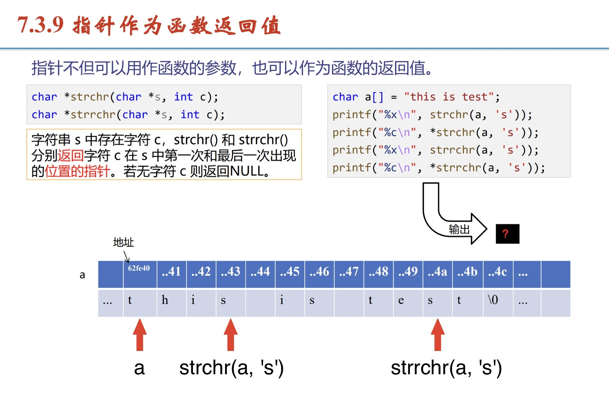
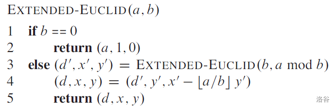
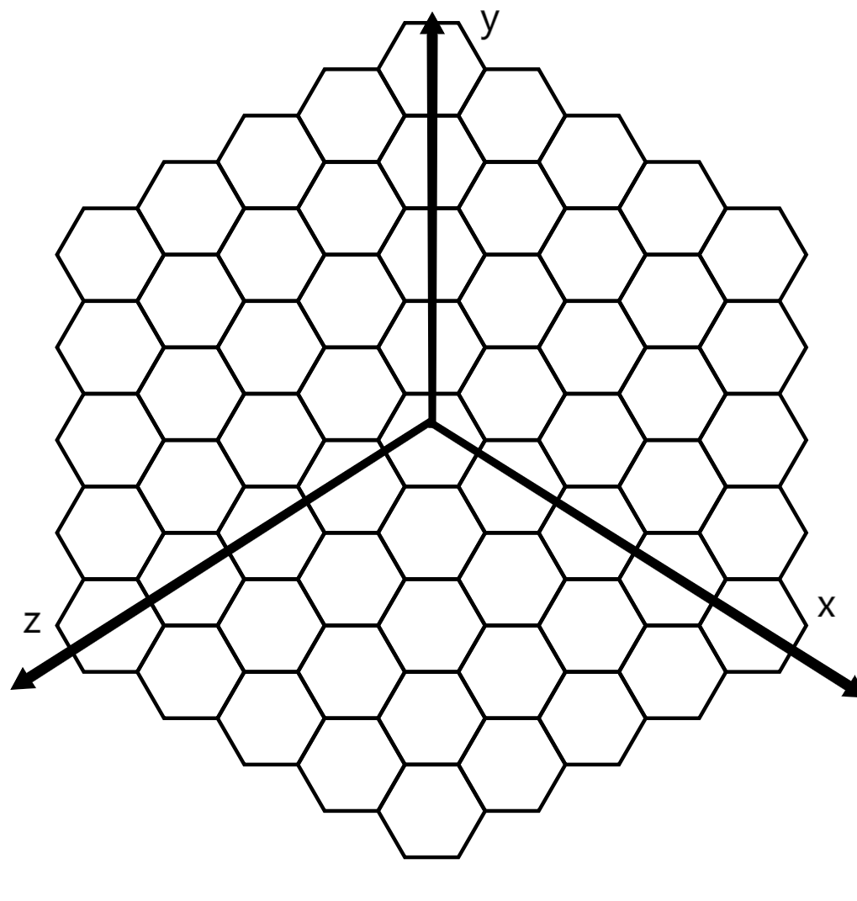
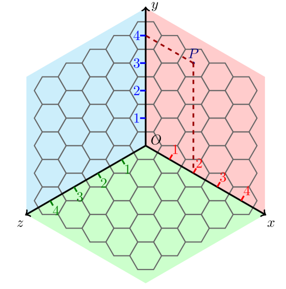
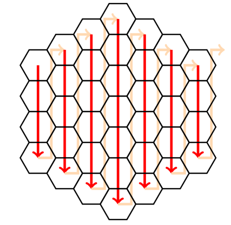
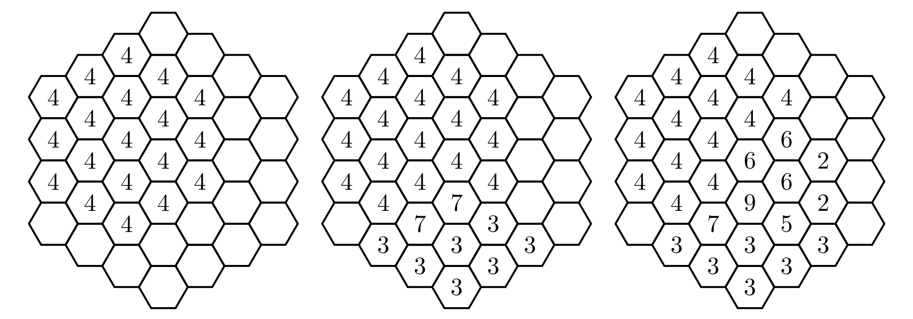

# 程序设计基础 C7 题目（2023秋）

<!-- markdownlint-disable-next-line MD026 -->
## A 我怎可将你与夏日比拟？

### 题目描述

“第18号十四行诗”是莎士比亚最著名的十四行诗之一，全文如下：

```text
Shall I compare thee to a summer's day?
Thou art more lovely and more temperate:
Rough winds do shake the darling buds of May,
And summer's lease hath all too short a date;
Sometime too hot the eye of heaven shines,
And often is his gold complexion dimm'd;
And every fair from fair sometime declines,
By chance or nature's changing course untrimm'd;
But thy eternal summer shall not fade,
Nor lose possession of that fair thou ow'st;
Nor shall death brag thou wander'st in his shade,
When in eternal lines to time thou grow'st:
     So long as men can breathe or eyes can see,
     So long lives this, and this gives life to thee.
```

对于给定的 $n$ ，请你输出它的第 $n$ 行。

### 输入

**不定组数据输入**，保证输入组数不超过 30 。

每组数据输入一行一个正整数 $n$ ，保证 $1 \le n \le 14$ 。

<!-- markdownlint-disable-next-line MD024 -->
### 输入

每组数据输出一行字符串，表示第 $n$ 行。

### 输入样例

```text
1
2
3
4
5
6
7
8
9
10
11
12
13
14
```

### 输出样例

```text
Shall I compare thee to a summer's day?
Thou art more lovely and more temperate:
Rough winds do shake the darling buds of May,
And summer's lease hath all too short a date;
Sometime too hot the eye of heaven shines,
And often is his gold complexion dimm'd;
And every fair from fair sometime declines,
By chance or nature's changing course untrimm'd;
But thy eternal summer shall not fade,
Nor lose possession of that fair thou ow'st;
Nor shall death brag thou wander'st in his shade,
When in eternal lines to time thou grow'st:
     So long as men can breathe or eyes can see,
     So long lives this, and this gives life to thee.
```

### Hint

使用二维数组存储字符串吧！显然每行的字符数量均小于100。

第13行和第14行要输出前面的空格哦~

### 数据范围

- 输入组数不超过 30
- $1 \le n \le 14$
- 每行字符数量均小于 100

Author: David Tong

## B 小亮学矩阵加减法

### 题目背景

小亮最近在复习线性代数，但他忘记了矩阵加减法如何计算，请为他写一个C语言程序实现矩阵加减法。

### 题目描述

给定两个矩阵 $A$, $B$和一个运算符 $S$，其中 $A$ 为 $m$ 行 $n$ 列的矩阵， $B$ 为 $m$ 行 $n$ 列的矩阵，运算符 $S \in \{1, 2\}$ 。

$S = 1$ 时，矩阵 $A$ 加矩阵 $B$ 。

$S = 2$ 时，矩阵 $A$ 减矩阵 $B$ 。

### 输入

共 $1 + 2 \times m$ 行。

第一行，三个空格隔开的整数 $m, n, S$ ，保证 $1 \le m, n \le 40$ ， $S \in \{1, 2\}$ .

接下来的 $m$ 行，每行 $n$ 个空格隔开的整数 $a_{i,j}$ ，表示 $m$ 行 $n$ 列的矩阵 $A$ .

再接下来的 $m$ 行，每行 $n$ 个空格隔开的整数 $b_{i,j}$ ，表示 $m$ 行 $n$ 列的矩阵 $B$ .

保证 $a_{i,j}$ ， $b_{i,j}$ 在 `int` 范围内。

### 输出

共 $m$ 行，每行 $n$ 个空格隔开的整数，表示矩阵 $A$ , $B$ 的相加或相减的结果。

### 输入样例1

```text
3 3 1
1 1 1
1 1 1
1 1 1
1 2 3
4 5 6
7 8 9
```

### 输出样例1

```text
2 3 4
5 6 7
8 9 10
```

### 输入样例2

```text
3 3 2
1 1 1
1 1 1
1 1 1
1 2 3
4 5 6
7 8 9
```

### 输出样例2

```text
0 -1 -2
-3 -4 -5
-6 -7 -8
```

### Hint

注意数据范围哦

### 数据范围

- $1 \le m, n \le 40$
- $S \in \{1, 2\}$
- $a_{i,j}$ ， $b_{i,j}$ 在 int 范围内

## C 寻找字符

### 题目描述

给出一个字符串 $s$ 和若干个字符。对于每个字符 $c$ ，请按以下要求进行输出：

- 若 $c$ 在 $s$ 中**未出现**，请输出 `-1` ；
- 若 $c$ 在 $s$ 中**恰好出现一次**，请输出 $c$ 在 $s$ 中的位置，**下标从 0 开始**；
- 若 $c$ 在 $s$ 中**出现不止一次**，请输出 $c$ 在 $s$ 中第一次出现的位置和最后一次出现的位置的距离。

字符区分大小写。

### 输入

输入共两行。

第一行一个字符串 $s$ ，长度不超过 1000 ，保证仅有可见字符组成，即 ASCII 码在区间 $[32, 126]$ 中。

第二行若干个**连续的**字符，表示给出的若干个字符，个数不超过 1000 ，仅有可见字符组成，即 ASCII 码在区间 $[32, 126]$ 中。

### 输出

输出若干行。

对于输入中第二行的每个字符 $c$ ，请按下方要求输出一行：

- 若 $c$ 在 $s$ 中**未出现**，请输出 `-1` ；
- 若 $c$ 在 $s$ 中**恰好出现一次**，请输出 $c$ 在 $s$ 中的位置，**下标从 0 开始**；
- 若 $c$ 在 $s$ 中**出现不止一次**，请输出 $c$ 在 $s$ 中第一次出现的位置和最后一次出现的位置的距离。

### 输入样例

```text
Website: accoding.buaa.edu.cn
wW a.
```

### 输出样例

```text
-1
0
8
12
9
```

### 样例解释

`'w'`（小写w）在 $s$ 中未出现过；

`'W'`（大写W）在 $s$ 中出现过一次，位置为 0 ；

`' '`（空格）在 $s$ 中出现过一次，位置为 8 ；

`'a'`（小写a）在 $s$ 中出现不止一次，第一次出现的位置为 9 ，最后一次出现的位置为 21 ，因此距离为 12 ；

`'.'`（点）在 $s$ 中出现不止一次，第一次出现的位置为 17 ，最后一次出现的位置为 26 ，因此距离为 9 。

### Hint

可以使用 string.h 库中的 `strchr` 和 `strrchr` 函数：

`char *strchr(const char *str, int c)` 在参数 str 所指向的字符串中搜索第一次出现字符 c（一个无符号字符）的位置。

`char *strrchr(const char *str, int c)` 在参数 str 所指向的字符串中搜索最后一次出现字符 c（一个无符号字符）的位置。



注意空格也算字符。

在本地环境调试时，有可能因为最后输入了换行导致多输出了一个 `-1` ，属于正常情况，忽略即可。

### 数据范围

- 字符串 $s$ 长度不超过 1000，字符 ASCII 码在 $[32, 126]$ 中
- 第二行字符个数不超过 1000，字符 ASCII 码在 $[32, 126]$ 中

## D One Last Kiss

### 题目描述

对一个字符串，请在**不区分大小写**的条件下找到它包含的所有 `kiss` 子串的数量，当数量不为 0 时，还需要找到**最后一个** `kiss` 子串的首字母在原字符串中的位置下标

### 输入

不定组数据输入，保证数据组数不超过 1000

每组数据 1 行，一个仅由可见字符组成且不包含空格的字符串，字符串长度 $len$ 满足 $1 \le len \le 1000$

### 输出

多行输出，行数与输入行数相同

每行 2 个整数，以空格隔开

第一个数表示对应字符串中包含的 `kiss` 子串数量，第二个数表示当包含的目标子串数量不为 0 时，最后一个 `kiss` 子串的首字母在原字符串中的位置下标（再次强调：**不区分大小写**），若不包含目标子串则第二个数输出 -1

### 输入样例

```text
CanYouGiveMeOneLastKiss?
wasuretakunaikoto
```

### 输出样例

```text
1 19
0 -1
```

### Hint

善用英文字符大小写转换可以帮你更快地做题

可以从第一个字符开始找，当找到第一个匹配的子串时，从匹配位置的下一个位置开始继续找，直到找不到新的匹配子串为止

怎么找大字符串中第一个与指定小字符串匹配的子串呢？试试 `strstr` 函数吧：

`char *strstr(char *s, char *sub_str);` ：返回子字符串 sub_str 在字符串 s 中第一次出现的位置的指针。如果 s 中没有 sub_str ，返回 `NULL`

怎么由子串位置指针得出首字母在原字符串中的下标值呢？结合数组在内存空间中连续存储、数组名表示数组的首地址、同一数组中同类型指针相减的结果想想

### 数据范围

- 数据组数不超过 1000
- $1 \le len \le 1000$
- 字符串仅由可见字符组成且不包含空格

Author:逐月的游星

## E 面壁计划

### 题目背景

现在你是面壁计划的一个情报员，你需要把罗辑的思想转换为三体人无法辨识的密文，一旦失败，三体人可能就会根据你泄露的情报反过来翻译出罗辑的思想，你能否成为一个合格的情报员呢？

### 题目描述

给定一个长度不超过 1000 的仅有小写字母构成的字符串，代表待加密电文，请按以下规则进行加密：

- 将字符串逆序，即将字符串进行逐个字符的逆序排列，即第一个字符和最后一个字符互换位置，以此类推。
- 接下来将逆序后的字符串与原始字符串拼接，形成一个长度为 $2l$ 的新字符串（ $l$ 代表原始字符串长度）。
- 将新字符串分为奇数串和偶数串（下标从 0 开始），即第 $2k$ 位上的字符和 $2k + 1$ 位上的字符分别组成两个新的字符串，保留字典序较小的字符串作为加密结果。

一次加密不足以迷惑三体人，请你**对电文重复加密** $n$ 次，并输出最终的加密电文。

### 输入

两行，分别为一个字符串和一个整数 $n$ 。

第一行为一个仅由小写字符串组成的最多为 1000 位的字符串。

第二行为一个整数 $n$ ，表示加密的次数 $n$ ， $1 \le n \le 10$ 。

### 输出

一行，代表加密后的字符串 $str$

### 输入样例

```text
abc
1
```

### 输出样例

```text
acb
```

### 样例解释

$abc$ 翻转得到 $cba$ 。

拼接得到 $abccba$

取奇数串和偶数串 $acb$ 和 $bca$ ，比较后取 $acb$ 。

加密一次完成。

### Hint

想想上课学了什么字符串函数，比如 `strstr` , `strcat` , `strcpy` 以及字典序比较函数 `strcmp` 。

构建字符串时要注意字符串以 `'\0'` 结尾。

OJ上编译环境采用标准C，有的编译器对C标准库进行扩展，可以支持较多库函数，但OJ不一定支持，比如字符串翻转函数 `strrev` 等。此时，请自己动手实现函数功能。

### 数据范围

- 字符串长度不超过 1000，仅由小写字母构成
- $1 \le n \le 10$

Author：罗辑

## F 生成扫雷地图

### 题目描述

扫雷是 Windows 上的一个经典小游戏。游戏界面由一个方阵构成，方阵中的每一项可能含有雷，也可能不含有雷。

在本题中的方阵中，如果这个格子中有雷，则用字母 `M` 表示；如果这个方阵中不含雷，则用数字表示。数字的意义为与这个格子相邻的上、下、左、右、左上、左下、右上、右下的 8 个格子中雷的个数（若遇到边界，则排除掉缺失的部分，对应格子数相应减少）。

现给出一张仅布设好雷的位置的地图，请你补全这张地图。

### 输入

第一行，两个整数 $n, m$ ，为方阵地图的高和宽；

接下来 $n$ 行，每行 $m$ 个字符，为地图的情况。 约定用 `M` 表示有雷， `0` 表示没有雷。

保证 $0 < n \le 100, 0 < m \le 100$ 。

### 输出

共 $n$ 行，每行 $m$ 个字符，表示出补全后的地图。

### 输入样例

```text
7 6
00M000
00000M
000000
00M000
0000M0
000M00
000000
```

### 输出样例

```text
01M111
01111M
011111
01M211
0123M1
001M21
001110
```

### Hint

注意边界的判断。

### 数据范围

- $0 < n \le 100$
- $0 < m \le 100$

## G Ex-GCD

### 题目描述

正整数 $a$ 和 $b$ 的最大公约数可表示为

$$d = \gcd(a, b) = ax + by$$

即能被 $a$ 和 $b$ 线性表出的最小正整数，其中， $x$ 和 $y$ 是整数（可能为 0 或负数）。

为了求得 $d, x, y$ ，我们可以使用下方展示的函数，该函数接收一个自然数二元组 $(a, b)$ ，得到一个整数三元组 $(d, x, y)$ 。其伪代码如下：



输入 $a$ 和 $b$ ，求出如上的表达式，格式为 `d = a*(x) + b*(y)` 。

请参考**Hint**完成本题。

### 输入

一行，两个空格分隔的 `int` 范围内的整数 $a, b$ 。

### 输出

一行，一个算式 `d = a*(x) + b*(y)` 。

### 输入样例1

```text
28 63
```

### 输出样例1

```text
7 = 28*(-2) + 63*(1)
```

### 输入样例2

```text
2029126176 1613441024
```

### 输出样例2

```text
32 = 2029126176*(4726833) + 1613441024*(-5944649)
```

### Hint

题目中给出的递归函数每次会返回 3 个值 $(d, x, y)$ ，但是C语言中每次函数只能返回一个值，如何才能实现返回3个值的效果呢？

我们可以使用指针作为参数传入函数中，通过修改指针指向的变量的值达到计算多个返回值的效果。

代码模板如下：

```c
#include<stdio.h>
void ExGCD(int a, int b, int *d, int *x, int *y)
{
    if(b == 0)
    {
        //将(a,1,0)分别赋给d,x,y指向的变量
        return;
    }
    int dd, xx, yy; //分别代表伪代码中的d',x',y'
    //根据伪代码，调用ExGCD，传入dd,xx,yy的【地址】获得计算结果
    //根据伪代码进行计算，并赋给d,x,y指向的变量
}
int main()
{
    int a, b, d, x, y;
    //读入
    //调用ExGCD函数，传入d,x,y的【地址】获得计算结果
    //输出
    return 0;
}
```

这样就能实现返回3个值的效果啦~

### 数据范围

- $a, b$ 为 int 范围内的整数

## H Cirno 的完美函数教室

### 题目背景

Cirno 又找到 Yakumo Ran 学习数学了！这次 Ran 打算教她一点函数的知识。

### 题目描述

Ran 给出的函数有一些性质：

$$
B(\alpha, \beta, \gamma) = \begin{cases}
1, & \text{if } \alpha \le 0 \text{ or } \beta \le 0 \text{ or } \gamma \le 0 \\
B(25, 25, 25), & \text{else if } \alpha > 25 \text{ or } \beta > 25 \text{ or } \gamma > \\
B(\alpha, \beta, \gamma - 1) + B(\alpha, \beta - 1, \gamma - 1) - B(\alpha, \beta - 1, \gamma), & \text{else if } \alpha < \beta < \gamma \\
B(\alpha - 1, \beta, \gamma) + B(\alpha - 1, \beta - 1, \gamma) + B(\alpha - 1, \beta, \gamma - 1) - B(\alpha - 1, \beta - 1, \gamma - 1), & \text{else.}
\end{cases}
$$

Ran 想考考 Cirno，任意给定三个整数 $a, b, c$ ，她能不能通过以上性质来计算出 $B(a, b, c)$ 的值。为了防止 Cirno 蒙混过关，Ran 一共会询问 $T$ 次。

### 输入

**多组数据输入。**

第一行一个整数 $T$（ $1 \le T \le 10^{5}$ ），表示数据组数。

接下来 $T$ 行，每行三个整数 $a, b, c$ ，含义见上，保证 $a, b, c$ 在 `int` 范围内。

数据保证计算过程与结果均在 `int` 范围内。

### 输出

每组数据一行一个整数，表示 $B(a, b, c)$ 的值。

### 输入样例

```text
3
1 2 3
-1 -2 -3
3 2 1
```

### 输出样例

```text
2
1
7
```

### Hint

可以把算过的数存在数组中，避免重复计算。

### 数据范围

- $1 \le T \le 10^{5}$
- $a, b, c$ 在 int 范围内
- 计算过程与结果均在 int 范围内

## I 拔刀

### 题目描述

将军的战刀由于用力过猛被卡在石头缝里了，八重宫司希望你能计算出战刀剩余的长度。

给定一个高为 $h$ ，宽为 $w$ 的矩阵，该矩阵只包含 0, 1 两种元素，元素间以空格隔开，其中 0 代表石头， 1 代表刀身，请你计算从**第一行**开始，刀剩余的最长长度时多少？即，计算最多有多少行存在元素 1 能够与第一行的元素 1 **连通**。**本题中连通指，两个元素 1 间存在一条通路，该通路上的每一个元素均为 1（包括端点）。**

### 输入

第一行为两个自然数 $h, w$ ，保证 $2 \le h, w \le 1000$ 。

接下来 $h$ 行， 每行 $w$ 个整数，值为 0 或 1。

确保这 $h$ 行中的第一行**至少存在一个整数 1** 。

### 输出

一行，一个自然数，为能够连通至第一行的元素 1 的元素所在行序号的最大值

### 输入样例 1

```text
5 4
1 1 1 0
0 1 0 1
0 1 1 0
0 1 0 1
0 0 0 1
```

### 输出样例 1

```text
4
```

### 样例解释 1

**第四行第二列**的元素 `1` 是能够连通至第一行的元素 `1` 的元素中，所在行序号最大的一个。

### 输入样例 2

```text
5 7
1 1 0 0 0 1 1
1 0 1 1 1 0 1
1 1 1 0 1 0 1
0 0 0 0 1 0 0
1 1 0 0 0 0 1
```

### 输出样例 2

```text
4
```

### 样例解释 2

**第4行第5列**的元素 `1` 是能够连通至第一行的元素 `1` 的元素中，所在行序号最大的一个。

### 数据范围

- $2 \le h, w \le 1000$
- 矩阵元素只有 0 和 1，第一行至少存在一个 1

Author: 八重绳子

## J De想成为六边形站侍

本题时间限制为2000ms。

### 题目描述

“又是元气满满的一天！”，DeNeRATe也想要成为当代青年中的六边形站侍

De有一个由多个正六边形组成的正六边形战力表，如下图



我们对边长为 $n$ 的战力表中每个块进行标号

以中心为原点延伸出三根射线作为三根轴 $X, Y, Z$ ，如下图，那么我们可以用一个三元组 $(x, y, z)$ 描述单个块的坐标



由于如此之下每个块描述方式不唯一，因此我们将战力表分为三个区域，每个块只用包围其所在区域的两根轴对应坐标即可唯一描述，如图中 $P$ 点描述为 $(2, 4, 0)$

每一天，通过De的努力，战力表都会成块更新，给出 $x, y, z, r, k$ ，表示这一天，De战力表中以 $(x, y, z)$ 为中心的边长为 $r$ 的正六边形区域 $T$ 内战力集体加 $k$ ，如下图（这个区域 $T$ 覆盖的范围可能超出了De的战力表，这些点战力的更新对De没用哦）


努力 $m$ 天后，De想要知道自己战力表中每个位置的战力是多少

### 输入

第一行两个数 $n, m$ 分别表示De战力表的边长及De努力了多少天

接下来 $m$ 行，每行5个整数 $x, y, z, r, k$ 表示该天以 $(x, y, z)$ 为中心，边长为 $r$ 的区域内所有块战力加 $k$

保证 $1 \le n \le 800, 1 \le m \le 10^{6}, 1 \le r \le 10^{9}, 1 \le k \le 10^{3}$

### 输出

共一行，若干个整数。

按照从左往后，从上至下的顺序，依次输出战力表中每个块的战力值，如下图所示，每两个值之间用空格隔开



### 输入样例

```text
4 3
0 1 1 3 4
3 0 3 3 3
1 0 0 2 2
```

### 输出样例

```text
4 4 4 0 4 4 4 4 3 4 4 4 4 7 3 0 4 4 6 9 3 3 0 4 6 6 5 3 0 0 2 2 3 0 0 0 0
```

### 样例解释



（二次注意，更新区域超出战力表范围的不需要进行处理）

### 数据范围

- $1 \le n \le 800$
- $1 \le m \le 10^{6}$
- $1 \le r \le 10^{9}$
- $1 \le k \le 10^{3}$
- 本题时间限制为 2000ms

— End —
