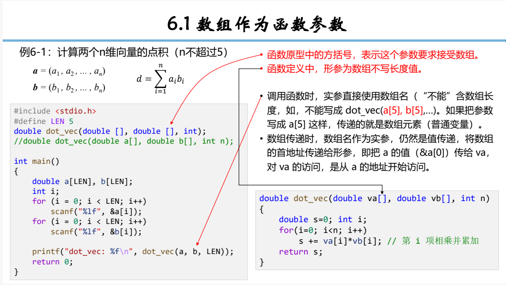
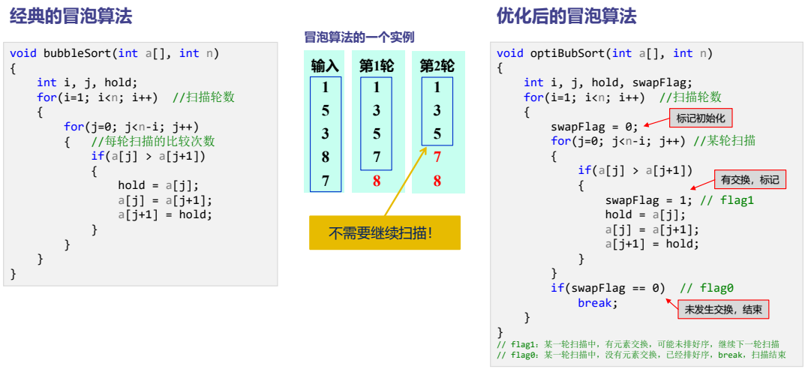
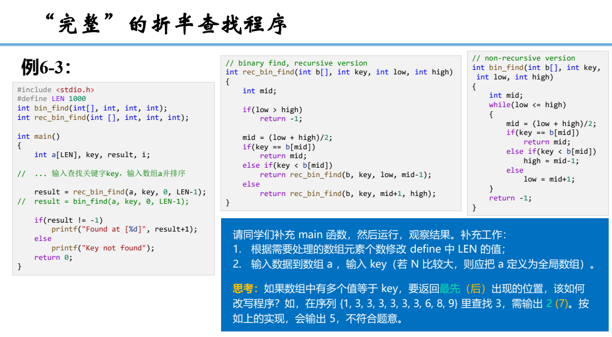

# 程序设计基础 C6 答案（2024秋）

## A 小懒獭与反向点积

### 题目

#### 题目描述

小懒獭创造了一种独特的向量运算方式，她称之为**反向点积**。反向点积是指将两个向量的元素按特定的方式反向相乘并求和。对于给定的两个长度相同的向量 $A$ 和 $B$，小懒獭想知道它们的反向点积是多少。

具体来说，对于向量 $A = ( a_0, a_1, \dots, a_{n-1} )$ 和 $B = (b_0, b_1, \dots, b_{n-1})$，小懒獭的反向点积定义为：

$$
A \odot B = a_0 \times b_{n-1} + a_1 \times b_{n-2} + \dots + a_{n-1} \times b_0
$$

每次给定两个长度相同的向量 $A$ 和 $B$，请帮助小懒獭计算它们的反向点积。

#### 输入

不定组数据输入，保证不超过 $1000$ 组。

对于每组数据，第一行包含一个整数 $ n $（ $1 \leq n \leq 1000$），表示两个向量的长度；第二行包含 $ n $ 个整数 $ A_{0}, A_{1}, \dots, A_{n-1} $，表示向量 $ A $ 的元素；第三行包含 $ n $ 个整数 $ B_{0}, B_{1}, \dots, B_{n-1} $，表示向量 $ B $ 的元素。保证向量的每个元素的值在 $[ -100,100 ]$ 区间内。

#### 输出

对于每组输入，输出一行一个整数，表示向量 $ A $ 和 $ B $ 的反向点积结果。

#### 输入样例

```text
3
1 2 3
4 5 6
3
1 -2 3
-4 5 -6
```

#### 输出样例

```text
28
-28
```

#### 样例解释

对于第一组样例，结果为 $1 \times 6 + 2 \times 5 + 3 \times 4 = 28$。

对于第一组样例，结果为 $1 \times (-6) - 2 \times 5 + 3 \times (-4) = -28$。

#### Hint

可以参考 PPT 上的 P6 - 1



Author：Moca

### 答案

| 难度 | 考点 |
| --- | --- |
| 1 | 数组 |

### 题目分析

按照题目中给出的公式计算即可，注意一定要找好下标的对应关系，分析数据范围发现 `int` 就足够解决这道题。

可以封装一个函数使主要代码更加简洁。

### 示例代码

```c
#include <stdio.h>
int a[1005], b[1005];
int calc(int n) {
    int ans = 0;
    for(int i = 1; i <= n ;i++)
        ans += a[i] * b[n + 1 - i];
    return ans;
}
int main() {
    int n;
    while (scanf("%d", &n) != EOF) {
        for(int i = 1; i <= n ;i++)
            scanf("%d", &a[i]);
        for(int i = 1; i <= n ;i++)
            scanf("%d", &b[i]);
        printf("%d\n", calc(n));
    }
    
    return 0;
}
```

## B Moca 与水獭排队

### 题目

#### 题目描述

现在有 $n$ 只水獭站成一排。

水獭们的身高参差不齐，看上去十分混乱。为了让队伍看上去更加整齐，Moca 决定帮助小水獭们按身高从矮到高重新排列。

#### 输入

第一行一个正整数 $n$，表示小水獭的个数，保证 $1 \le n \le 2000$。

第二行 $n$ 个正整数，表示每只小水獭的身高 $a_i$，保证 $1 \le a\_i \le 2^{31} - 1$ 。

#### 输出

第一行，将水獭们的身高从小到大排序，相邻的两个整数用一个空格隔开。

第二行一个浮点数，表示水獭们身高的中位数，保留到小数点后一位。

#### 输入样例

```text
5
7 2 11 10 13
```

#### 输出样例

```text
2 7 10 11 13
10.0
```

#### Hint

可以参考 PPT 上的例 6.2.1



奇数个元素的中位数是排序后最中间的一个数字；偶数个元素的中位数是排序后最中间的两个数字的平均值。

Author：Moca

### 答案

| 难度 | 考点 |
| --- | --- |
| 2 | 冒泡排序 |

### 题目分析

简单来说，前半部分就是输入 $n$ 个数字，输出 $n$ 个数字排序后的结果。我们可以利用今天课上学习的冒泡排序解决这个问题。

在计算中位数的时候，注意涉及到两个整数的加法，且这两个整数的和的最大值可能超过 `int`。

### 示例代码

```c
#include <stdio.h>
int a[2005];
int main() {
    int n;
    scanf("%d", &n);
    for(int i = 1; i <= n ;i++)
        scanf("%d", &a[i]);
    
    // 无优化的冒泡排序，也可采用 PPT 上的优化版本提前跳出循环
    for(int i = 1; i <= n - 1 ;i++) {
        for(int j = 1; j <= n-i ;j++) {
            // 顺序不对就交换两个数字
            if(a[j] > a[j + 1]) {
                int temp = a[j];
                a[j] = a[j + 1];
                a[j + 1] = temp;
            }
        }
    }
    
    // 输出排序后的结果
    for(int i = 1; i <= n ;i++)
        printf("%d ", a[i]);
    printf("\n");
    
    // 输出中位数：轻量化的类型转换
    if(n % 2) {
        printf("%.1lf", a[(n + 1) / 2] * 1.0);
    }   
    else {
        printf("%.1lf", (1.0 * a[n / 2] + a[n / 2 + 1]) / 2);
    }
        
    return 0;
}
```

## C 魔法师水獭与悬浮咒

### 题目

#### 题目描述

聪明的魔法师水獭正在学习悬浮咒（ $\mathfrak{Wingardium\  Leviosa}$​）。

咒语的力量源自于平衡。水獭发现，只有找到具有平衡性质的“魔力字符串“，才能成功施展出魔法。具体来说，“魔力字符串“具有以下特点：

1. 如果字符串长度为奇数，且其是一个回文串，即正着读和反着读相同，则此字符串为“魔力字符串”。
2. 如果字符串长度为偶数，且其倒序后与原字符串的每一对应位置字符都不相同，则此字符串为“魔力字符串”。

现在，请你帮忙判断对于给定的字符串，是否是”魔力字符串“。

#### 输入

第一行一个正整数 $n$，表示接下来有 $n$ 组数据要判断，保证 $1 \le n \le 100$。

对于每组数据，输入一行一个字符串 $s$，仅包含小写字母，保证 $1 <= |s| <= 100000$，其中 $|s|$ 表示字符串 $s$ 的长度。

#### 输出

对于每组输入，输出一行，若 $s$ 是“魔力字符串”，输出 `Wingardium Leviosa`，否则输出 `The spell fails`。

#### 输入样例

```text
4
level
otter
otters
ottero
```

#### 输出样例

```text
Wingardium Leviosa
The spell fails
Wingardium Leviosa
The spell fails
```

#### Hint

可以用 `<string.h>` 中的函数 `strlen` 来获取字符串长度

Author：Moca

### 答案

| 难度 | 考点 |
| --- | --- |
| 2 | 字符串、分支结构 |

### 题目分析

由于我们要根据长度是奇数还是偶数来采用不同的操作，所以第一步，我们需要获取字符串的长度；可以利用 `strlen` 来获取字符串的长度。

当长度为偶数时，判断字符串是否是一个回文串，也就是判断是不是对于每个 $i$，都有 `str[len - 1 - i] == str[i]`（下标从 0 开始），我们可以利用流程控制那节课中学到的 `flag` 技巧，记录这一结果。

对于长度为奇数也是类似，只是需要判断是不是对于每一位都不相等。

### 示例代码

```c
#include <stdio.h>
#include <string.h>
char str[100005];
int main() {
    int n;
    scanf("%d", &n);
    for(int i = 1; i <= n ;i++) {
        scanf("%s", str);
        // 获取到字符串的长度
        int len = strlen(str), flag = 0;
        if(len % 2) {
            // 长度为奇数，看看是不是个回文串
            // 优化小技巧：可以只检查前半部分，想一想为什么
            for(int i = 0; i < len ;i++) {
                if(str[len - 1 - i] != str[i]) {
                    flag = 1;
                    break;
                }
            }
        } else {
            // 长度是偶数，看看是不是每一位都不相等
            for(int i = 0; i < len ;i++) {
                if(str[len - 1 - i] == str[i]) {
                    flag = 1;
                    break;
                }
            }    
        }
        
        // 也可以用三目运算符简化代码
        if(!flag)
            printf("Wingardium Leviosa\n");
        else
            printf("The spell fails\n");
    }
    return 0;
}
```

## D 最大池化

### 题目

#### 题目描述

在卷积神经网络（CNN）中，**最大池化**是一种常用的操作，用来对特征图进行降采样，从而减少数据量和计算量。最大池化会**在特征图的每个区域中选取最大值**作为该区域的代表值。

给定一个大小为 $n \times m$ 的矩阵和一个池化窗口的大小 $p \times q$，你需要对这个矩阵进行最大池化操作，即将矩阵划分为若干个 $p \times q$ 的区域，并从每个区域中选取最大值，生成一个新的池化矩阵，具体的生成过程可参考样例解释。

#### 输入

第一行包含四个整数 $n, m, p, q$，分别表示矩阵的行数、列数以及池化窗口的行数和列数（ $2 \le p \le n ≤ 100$， $2 \le q \le m \le 100$，且 $n$ 是 $p$ 的整数倍， $m$ 是 $q$ 的整数倍）。

接下来 $n$ 行，每行包含 $m$ 个整数，表示矩阵中的元素值，保证元素值在 `int` 范围内。

#### 输出

输出一个新的矩阵，表示经过 $p \times q$ 大小的最大池化操作后得到的池化矩阵。矩阵的同一行的相邻元素之间用一个空格隔开。

#### 输入样例

```text
4 4 2 2
1 3 2 4
5 6 7 8
9 10 11 12
13 14 15 16
```

#### 输出样例

```text
6 8
14 16
```

#### 样例解释

得到池化矩阵的过程如下图：


### 答案

| 难度 | 考点 |
| --- | --- |
| 3 | 二维数组 |

### 题目分析

题目较为直接，就是将原矩阵分割为一个个大小为 $p \times q$ 的小矩阵，取每个小矩阵的最大值，作为池化后对应位置的元素值，不难分析出，池化后的矩阵大小为 $(n/p) \times (m/q)$。

在寻找最大值的过程中，我们可以封装一个 `max` 函数，同时注意到由于原矩阵元素的范围是整个 `int`，所以初始化元素值的时候必须要初始化为 `INT_MIN`，这样才能保证正确更新最大值。如果初始化为 $0$ 的话，假如对应范围内的原矩阵元素都是负数，那么最大值就会错误地被记为 $0$。

### 示例代码

```c
#include <stdio.h>
// 三目表达式简化，同时为了避免与库函数名字冲突起名为 myMax
int myMax(int a, int b) {
    return a > b ? a : b;
}
int a[105][105];
int ans[105][105];
int main() {
    int n, m, p, q;
    scanf("%d%d%d%d", &n, &m, &p, &q);
    for(int i = 1; i <= n ;i++)
        for(int j = 1; j <= m ;j++)
            scanf("%d", &a[i][j]);
    
    // 外层循环枚举起点
    for(int i = 1; i <= n ;i += p) {
        for(int j = 1; j <= m ;j += q) {
            // 正确地初始化
            ans[i/p + 1][j/q + 1] = -2147483648;
            // 内层循环更新
            for(int k = 0; k < p ;k++) {
               for(int l = 0; l < q ;l++)
                    ans[i/p + 1][j/q + 1] = myMax(ans[i/p + 1][j/q + 1], a[i + k][j + l]); 
            } 
        }
    }
        
    for(int i = 1; i <= n / p ;i++) {
        for(int j = 1; j <= m / q ;j++)
            printf("%d ", ans[i][j]);
        printf("\n");
    }
    return 0;
}
```

## E 水獭迷宫

### 题目

小水獭不小心走进了一个迷宫，水獭害怕急了，请你帮助小水獭在迷宫中找到出口。
小水獭从起点 $(0,0)$ 出发，它的目标是到达出口的位置 $(a,b)$。小水獭的移动方向有限：它可以向北（N）、向东（E）、向南（S）或向西（W）移动，具体的移动规则如下：

- `N` (北) 表示向上移动一步，即从当前位置 $(x, y)$ 移动到 $(x, y+1)$。
- `E` (东) 表示向右移动一步，即从当前位置 $(x, y)$ 移动到 $(x+1, y)$。
- `S` (南) 表示向下移动一步，即从当前位置 $(x, y)$ 移动到 $(x, y-1)$。
- `W` (西) 表示向左移动一步，即从当前位置 $(x, y)$ 移动到 $(x-1, y)$。

输入一个字符串 s，表示小水獭的移动指令序列（例如 `NESW` 表示依次向北、东、南、西移动）。小水獭将按照这个序列移动一次，如果移动过程中到达过出口，那么小水獭将成功逃出迷宫。
在迷宫中，有 $k$ 个障碍。如果小水獭在某次移动时目标位置是一个障碍，则该次移动无效，小水獭会停留在当前格子位置，不会移动到障碍所在的格子上。例如，如果小水獭当前在位置 $(2, 2)$，且向东移动的目标位置 $(3, 2)$ 是一个障碍，则小水獭将无法移动到 $(3, 2)$，它会停留在 $(2, 2)$ 这个位置，继续执行接下来的指令。
请你判断小水獭能否成功找到出口，离开迷宫。

#### 输入

不定组数据输入，保证输入的数据不超过 $5$ 组。

每组数据第一行，输入三个正整数 $k$、 $a$ 和 $b$； $k$ 表示障碍的数量， $(a, b)$ 表示终点的位置，保证 $1 \le a, b \le 10$， $0 \le k \le 10$ 。

每组数据第二行，输入一个字符串 $s$，表示水獭的移动指令序列，保证 $1 \le |s| \le 500$。

接下来 $k$ 行，每行输入两个整数 $x_i$、 $y_i$，表示第 $i$ 个障碍物的位置；保证 $1 \le x_i, y_i \le 10$。

##### 输出格式

对于每组数据，输出一行，如果小水獭能成功逃出迷宫，输出 `Otter Success`；否则输出 `Otter Failed`。

##### 输入样例

```text
1 2 2
SNNENEEN
1 1
1 5 5
SNNENEEN
1 1
```

##### 输出示例

```text
Otter Success
Otter Failed
```

##### 样例解释

对于第一组数据，小水獭的移动过程如下：

- `S`： $(0,0) \rightarrow (0, -1)$
- `N`： $(0,-1) \rightarrow (0,0)$​
- `N`： $(0,0) \rightarrow (0,1)$
- `E`：由于 $(1,1)$ 有障碍，所以小水獭停在 $(0,1)$ 不动
- `N`： $(0,1) \rightarrow (0,2)$
- `E`： $(0,2) \rightarrow (1,2)$
- `E`： $(1,2) \rightarrow (2,2)$，小水獭成功到达终点，逃出迷宫
- `N`：小水獭已经离开迷宫，剩下的操作就不用管了

对于第二组数据，小水獭最后会移动到 $(2,3)$，在整个过程中也没有到达过 $(5,5)$，所以无法逃出迷宫

### 答案

| 难度 | 考点 |
| --- | --- |
| 4 | 模拟、二维数组 |

### 题目分析

本题是一道比较直接的模拟问题，开始时我们将记录一个执行序列，然后遍历其中的每一个指令，如果该指令的目标位置是一个障碍物，那就不动；否则移动到目标位置。移动到出口就算成功（不一定要最后一个指令结束刚好到达终点，可以参考第一个样例）。

存在的一个问题是如何判断目标位置处是否有障碍物，有两种解决办法：

- 开一个二维数组 `vis`，如果位置 $(i, j)$ 处有障碍物，就把 `vis[i][j]` 的值标记为 $1$，否则它的值就是 $0$。对于移动到的目标位置 $(i, j)$，只要看 `vis[i][j]` 的值就可以。这种方法要注意的一个点就是由于移动到的目标位置可能是个负数，或者是个很大的正数（因为最多只有 $500$ 个操作所以也不会有多大），导致数组越界，出现问题。可以选择的处理方法是访问 `vis[i][j]` 前先看看下标的范围，或者给下表加上一个偏移。
- 直接把不合法的位置记录在一个数组中，每次要移动的目标位置在这个数组中顺序查询看看有没有。这种方式比较直接，也不需要特殊处理（题解采用的是这种方式）。

### 示例代码

```c
#include <stdio.h>
#include <string.h>
char str[505];
int visX[15], visY[15];
int main() {
    int k, a, b;
    while(~scanf("%d%d%d", &k, &a, &b)) {
        scanf("%s", str);
        int len = strlen(str);
        
        // 读入 k 个障碍
        for(int i = 1; i <= k ;i++) 
            scanf("%d%d", &visX[i], &visY[i]);
        int x = 0, y = 0;
        for(int i = 0; i < len ;i++) {
            // 标记移动的方向
            int dx = 0, dy = 0;
            if(str[i] == 'N') 
                dy++;
            else if(str[i] == 'E')
                dx++;
            else if(str[i] == 'S')
                dy--;
            else if(str[i] == 'W')
                dx--;
            
            // 看看目标位置是不是障碍
            int flag = 0;
            for(int i = 1; i <= k ;i++) {
               if(visX[i] == x + dx && visY[i] == y + dy) {
                    flag = 1;
                    break;
                } 
            }
                
            // 如果不是障碍就移动
            if(!flag)
                x += dx, y += dy;
            
            // 如果移动到出口了就出去
            if(x == a && y == b)
                break;
        }
        
        if(x == a && y == b)
            printf("Otter Success\n");
        else 
            printf("Otter Failed\n");
    }
    return 0;
}
```

## F Moca 与水獭排队 2

### 题目

**注意内存限制**，该内存限制下无法申请千万级别的数组。

#### 题目描述

现在有 $n$​ 只水獭从低到高站成一排。Moca 希望每次能找到**不低于**某身高 $h$ 的第一只水獭的编号（编号从 $1$ 开始），请你编写一个程序完成这个任务。

#### 输入

第一行两个正整数 $n$ 和 $m$，其中 $n$ 表示小水獭的个数，保证 $1 \le n \le 5 \times 10^5$； $m$ 表示接下来询问的次数，保证 $1 \le m \le 5 \times 10^5$​。

接下来一行，输入 $n$ 个正整数，第 $i$ 个正整数表示第 $i$ 只小水獭的身高 $a_i$，保证 $1 \le a_i \le 10^7$，输入的 $a_i$ 单调不减。

接下来 $m$ 行，每行一个正整数 $h\_i$，表示要查找的值，保证 $1 \le h_i \le 10^7$。

#### 输出

输出 $m$ 行，对每次询问，输出对应的不低于对应身高 $h$ 的第一只水獭的编号；如果不存在这样的水獭输出 `-1`。

#### 输入样例

```text
5 5
2 7 10 10 13
1
8
10
12
14
```

#### 输出样例

```text
1
3
3
5
-1
```

#### Hint

可以参考 PPT 上的例 6-3，但是注意在这道题中，我们要查找数组中可能会出现重复的数字，我们要找到某数字第一次出现的位置，所以需要你对 PPT 上的二分查找代码进行一些修改。



Author：Moca

### 答案

| 难度 | 考点 |
| --- | --- |
| 4 | 二分 |

### 题目分析

这道题的核心任务是实现一个二分查找算法，来查询数组中大于等于某个值的位置，给定一个已排序的高度数组 `heights`，以及一组查询高度 `h`，对于每一个查询高度，找到数组中第一个大于等于 `h` 的元素位置，并返回该位置（从 1 开始计数）。如果不存在大于等于 `h` 的元素，返回 `-1`。

PPT 上的代码可以实现一个无重复数的二分查找，在有重复数的查找过程中需要考虑边界条件，当 `heights[mid] >= h` 时，当前元素可能是符合条件的解，但我们还需继续向左查找，以确保找到第一个符合条件的位置。

查找的流程如下：

- 初始化 `left` 为 $0$，`right` 为 `n - 1`。
- 当满足 `left <= right` 时，在循环中不断更新 `mid` 为 `(left + right) / 2`。如果 `heights[mid] >= h`，说明当前元素符合要求，将 `result` 记录为 `mid`（为了从 1 计数），并继续向左查找，将 `right` 更新为 `mid - 1`；如果 `heights[mid] < h`，将 `left` 更新为 `mid + 1`，在右侧查找更大的元素。
- 循环结束后，如果找到符合要求的元素，则返回 `result + 1`（因为我们要以 1 开始），否则返回 `-1`。

### 示例代码

```c
#include <stdio.h>
int binary_search(int arr[], int n, int h) {
    int left = 0, right = n - 1, result = -1;
    while (left <= right) {
        int mid = (left + right) / 2;
        if (arr[mid] >= h) {
            result = mid;
            right = mid - 1;
        } else {
            left = mid + 1;
        }
    }
    
    // 如果 result != -1，说明找到了，因为编号从 1 开始，我们要给 result + 1
    return result == -1 ? -1 : result + 1;
}
int heights[500005];
int main() {
    int n, m;
    scanf("%d%d", &n, &m);
    
    // 读入身高
    for (int i = 0; i < n; i++)
        scanf("%d", &heights[i]);
    while (m--) {
        int h;
        scanf("%d", &h);
        // 进行查找
        printf("%d\n", binary_search(heights, n, h));
    }
    return 0;
}
```

## G 多项式加法 2024

### 题目

#### 题目描述

给定整数序列 $a_1,a_2,\ldots,a_n$ 和 $b_1,b\_2,\ldots,b_m$，**严格递增**的非负整数序列 $A_1,A_2,\ldots,A_n$ 和 $B_1,B_2,\ldots,B_m$，求解如下多项式：

$$
\left(\sum_{i=1}^na_ix^{A_i}\right)+\left(\sum_{i=1}^mb_ix^{B_i}\right)
$$

#### 输入

第一行一个正整数 $t$（ $1 \le t \le 5$），表示数据组数。

对于每组数据，第一行一个正整数 $n$（ $1 \le n \le 10^5$），含义同题目描述。

第二行 $n$ 个整数 $a_1,a_2,\ldots,a_n$（ $0 < |a_i| \le 10^9$），含义同题目描述。

第三行 $n$ 个非负整数 $A_1,A_2,\ldots,A_n$（ $0 \le A_i \le 10^9$），含义同题目描述。

第四行一个正整数 $m$（ $1 \le m \le 10^5$），含义同题目描述。

第五行 $m$ 个整数 $b_1,b_2,\ldots,b_m$（ $0 < |b_i| \le 10^9$），含义同题目描述。

第六行 $m$ 个非负整数 $B_1,B_2,\ldots,B\_m$（ $0 \le B_i \le 10^9$），含义同题目描述。

保证 $A_{i} > A_{i-1}$ 对 $1 < i \le n$ 成立， $B_{i} > B_{i-1}$ 对 $1 < i \le m$ 成立， $A_i=B_j \Rightarrow a_i+b_j \ne 0$ 对 $1 \le i \le n,1 \le j \le m$ 成立。

#### 输出

对于每组数据，输出三行：

- 第一行一个正整数 $k$，表示所得多项式在**合并同类项**后有 $k$ 个系数非 $0$ 项，并设所得多项式为：

$$
\sum_{i=1}^kc_ix^{C_i}
$$
其中 $C_{i} > C_{i-1}$ 对 $1 < i \le k$ 成立。

- 第二行 $k$ 个整数 $c_1,c_2,\ldots,c_k$，含义同上式。

- 第三行 $k$ 个非负整数 $C_1,C_2,\ldots,C_k$，含义同上式。

#### 输入样例

```text
1
3
1 2 3
1 2 3
3
2 3 4
2 3 4
```

#### 输出样例

```text
4
1 4 6 4
1 2 3 4
```

### 答案

| 难度 | 考点 |
| --- | --- |
| 5 | 合并数组 |

### 题目分析

对于本道题，如果多项式的每一项指数部分都在 $[0, 10^5]$ 这样的范围内，则我们只需要设置一个数组，每次读入的时候以指数部分作为数组下标，将系数记录进数组中即可完成任务。但本题中指数范围过大，直接采取上述方法进行计算将会导致数组越界，因此需要考虑其他方法。

注意到两个函数都是以严格升序给出的，因此可以考虑这样一种做法：

1. 用两个变量 $i, j$ 记录当前正在处理 $f(x)$ 的第 $i$ 项和 $g(x)$ 的第 $j$ 项，最初 $i = j = 1$。
2. W比较 $f(x)$ 的第 $i$ 项和 $g(x)$ 的第 $j$ 项的指数：

   a. 若指数部分相同，说明这两项应该合并，系数应相减，输出，然后将 $i, j$ 都向后移动一位；

   b. 若 $f(x)$ 的第 $i$ 项的指数较小，说明只有 $f(x)$ 的第 $i$ 项在当前计算的这一项中出现，输出，并将 $i$ 向后移动一位；

   c. 若 $g(x)$ 的第 $j$ 项的指数较小，说明只有 $g(x)$ 的第 $j$ 项在当前计算的这一项中出现，输出，并将 $j$ 向后移动一位。

当 $i, j$ 将 $f(x), g(x)$ 的每一项都计算之后，最后结果的多项式也被计算出来了。可以发现，通过该方法得到的多项式，其指数部分也是严格递增的。

由于只会移动最多 $m + n$ 次，因此总循环次数不超过 $m + n$ 次，可以在题目要求的时间范围内完成计算。

### 示例代码

```c
#include <stdio.h>
#include<math.h>
long long a[100006], b[100006], A[100006], B[100006];
long long c[200006], C[200006];
int main() {
    int m, n;
    int t;
    scanf("%d", &t);
    while (t--) {
        scanf("%d", &n);
        for (int i = 1; i <= n; i++) {
            scanf("%lld", &a[i]);
        }
        for (int i = 1; i <= n; i++) {
            scanf("%lld", &A[i]);
        }
        scanf("%d", &m);
        for (int i = 1; i <= m; i++) {
            scanf("%lld", &b[i]);
        }
        for (int i = 1; i <= m; i++) {
            scanf("%lld", &B[i]);
        }
        int i = 1, j = 1, k = 1;
        while (i <= m || j <= n) {
            if (i == m + 1) {
                c[k] = b[j], C[k] = B[j];
                j++;
                k++;
            } else if (j == n + 1) {
                c[k] = a[i], C[k] = A[i];
                i++;
                k++;
            } else if (A[i] < B[j]) {
                c[k] = a[i], C[k] = A[i];
                i++;
                k++;
            } else if (B[j] < A[i]) {
                c[k] = b[j], C[k] = B[j];
                j++;
                k++;
            } else {
                if (a[i] + b[j] != 0) {
                    c[k] = a[i] + b[j], C[k] = B[j];
                }
                i++;
                j++;
                k++;
            }
        }
        printf("%d\n", k - 1);
        for (int i = 1; i <= k - 1; i++) {
            printf("%lld ", c[i]);
        }
        printf("\n");
        for (int i = 1; i <= k - 1; i++) {
            printf("%lld ", C[i]);
        }
        printf("\n");
    }
    return 0;
}
```

## H 一种简单的语言

### 题目

#### 题目描述

shtog定义了一种新的很简单的编程语言，但是这种语言不能直接被电脑执行，所以他希望可以用c语言编写一个简单的编译器对其进行编译，进而成功执行程序。

语言的语法很简单，其只包含两类语句：赋值语句、输出语句，每条语句占一行。

赋值语句的语法为：`<变量名> <值>`，其中 `<值>`只可能是一个在int范围内的常数或一个在上面的代码中已经被赋值过的变量, 同一个变量可以被重复多次赋值，新赋的值会覆盖之前被赋的值（和C语言逻辑一致），变量名由不超过5个大写或者小写字母组成且不会叫做`print`。

输出语句的语法为：`print <变量名>`。注意，如果欲输出的变量名在之前的代码中未被赋过值（尚未定义），那么输出`line <行号>: print invalid name "<变量名>"!`（行号从1算起），否则则输出变量的值。

请你编写c语言程序帮shtog翻译并执行该语言编写的程序。

#### 输入

一共不会超过**5000**行。

一共若干行，每行一条语句，保证一定会出现有`print`语句。

#### 输出

输出若干行，表示代码的执行结果（每条`print`语句对应一行输出）。

#### 输入样例

```text
a 3
B a
print B
print b
```

#### 输出样例

```text
3
line 4: print invalid name "b"!
```

#### Hint

可以考虑用`strcmp (#include <string.h>)`函数来判断两个字符串是否相等。

可以使用一个二维的字符数组来存储多个字符串，比如，向二维数组`s[][]`中读入一个字符串可以参考：`scanf("%s", s[i]);`（注意不要加`&`符号），需要读入多个的话循环即可。

AUTHOR：shtog

### 答案

| 难度 | 考点 |
| --- | --- |
| 6 | 字符串解析 |

### 题目分析

这道题关键的地方是要识别并存下来定义过的变量对应的值，然后输出的时候去查找并输出即可。

存变量可以用两个数组去存，一个是 `char names[][]`，一个是 `values[]`，`names[i]` 表示 `i` 位置的变量的名字的字符串，`values[i]` 表示 `i` 位置的变量的值。对于多次赋值会覆盖的问题，可以每次存一个变量时，都尾接在数组的末尾，然后查询的时候从末尾往前查询，这样的话第一个查询到的就是变量被赋过的最新的值。

可能用到一些函数：`strcmp strcpy strlen atoi`（将字符串类型的数字转为整型，在 `<stdlib.h>` 库中）..., 当然也可以不用，自己写对应的需要的逻辑。

### 示例代码

```c
#include <stdio.h>
#include <string.h>
char names[5100][7];
int values[5100];
int cnt;
char buf[200];
int isExist; // 表示查找的变量是否存在
int findValOf(char s[], int l1) {
    isExist = 1;
    for (int i = cnt - 1; i >= 0; i--) {
        int l2 = strlen(names[i]);
        if (l1 != l2) continue;
        else {
            int ok = 1;
            for (int j = 0; j < l1; ++j) {
                if (names[i][j] != s[j]) ok = 0;
            }
            if (ok) return values[i];
        }
    }
    isExist = 0; // 表示不存在
    return 0;
}
int main() {
    int line = 1;
    while (scanf("%s", buf) != EOF) {
        int len = strlen(buf);
        if (len == 5 && buf[0] == 'p' && buf[1] == 'r' && buf[2] == 'i' && buf[3] == 'n' && buf[4] == 't') {
            char n[7];
            scanf("%s", n);
            int val = findValOf(n, strlen(n));
            if (!isExist) printf("line %d: print invalid name \"%s\"!\n", line, n);
            else printf("%d\n", val);
        } else { // 存下来变量
            char c;
            long long val = 0;
            // 解析出来要被赋的值val
            while ((c = getchar()) == ' ');
            if (c <= '9' && c >= '0') {
                val = c - '0';
                while ((c = getchar()) <= '9' && c >= '0') val = 10 * val + c - '0';
            } else if (c == '-') {
                while ((c = getchar()) <= '9' && c >= '0') val = 10 * val + c - '0';
                val = -val;
            } else {
                // 查找变量名对应的变量
                char nn[7], index = 0;
                nn[index++] = c;
                while (((c = getchar()) <= 'z' && c >= 'a') || (c <= 'Z' && c >= 'A')) nn[index++] = c;
                val = findValOf(nn, index);
            }
            // 存进去新的变量
            strcpy(names[cnt], buf);
            values[cnt] = val;
            cnt++;
        }
        line++;
    }
}
```

## I 英语大师

### 题目

#### 题目描述

输出整数 $n$ 的英文。

#### 输入

不定行输入，每行一个整数 $n$， $0 \leq n \leq 2^{31} - 1$

#### 输出

对于每组输入，输出一行 $n$ 的英文，所有单词首字母大写，每个单词之间有 $1$ 个空格。

不需要加逗号或者 `And` 。

#### 输入样例

```text
123
12345
1234567
```

#### 输出样例

```text
One Hundred Twenty Three
Twelve Thousand Three Hundred Forty Five
One Million Two Hundred Thirty Four Thousand Five Hundred Sixty Seven
```

#### Hint

以下介绍英语中对自然数的表示，有英语基础的同学可以忽略。

以下定义集合 $\text{Digit}=\{0,1,2,3,4,5,6,7,8,9\}$ 为自然数集的子集，使用具有上划线的数表示这个自然数在字面上是由多个变元或常元直接拼而成的量、并且英文表示的拼接指两个单词中间由一个空格相连。

1. $[0,99]$ 的表示

  下表中列出了一些特殊数的表示。

| 数字 | 对应的单词 | 整数 | 对应的单词 | 整十数 | 对应的单词 |
| --- | --- | --- | --- | --- | --- |
| $0$ | Zero | | | | |
| $1$ | One | $11$ | Eleven | $10$ | Ten |
| $2$ | Two | $12$ | Twelve | $20$ | Twenty |
| $3$ | Three | $13$ | Thirteen | $30$ | Thirty |
| $4$ | Four | $14$ | Fourteen | $40$ | Forty |
| $5$ | Five | $15$ | Fifteen | $50$ | Fifty |
| $6$ | Six | $16$ | Sixteen | $60$ | Sixty |
| $7$ | Seven | $17$ | Seventeen | $70$ | Seventy |
| $8$ | Eight | $18$ | Eighteen | $80$ | Eighty |
| $9$ | Nine | $19$ | Nineteen | $90$ | Ninety |

  对于一般数，即大于 $20$ 的、个位不为 $0$ 的两位数，其表示由十位数对应的整十数的表示和个位数的表示拼接而成，即：对于大于 $20$ 的非整十数 $\overline{ab}=10\times a+b,a,b\in \text{Digit},ab\neq 0,a\ge 2$ ，总可以先读 $\overline{a0}=10\times a$ 的表示，再读 $b$ 的表示。

1. $[100,999]$ 的表示

  所有的三位数都可以表示为 $\overline{abc},a,b,c\in \text{Digit},a\neq 0$ 的形式，其表示由 $a$ 的表示、 `Hundred` 和 $\overline{bc}$ 的表示拼接而成，如果 $b\neq 0$ 或者 $c\neq 0$ 。否则，其表示为 $a$ 的表示和 `Hundred` 拼接而成。

1. 更大正整数的表示

  所有的位数大于等于 $4$ 的无前导零的正整数都可以从低位向高位每 $3$ 位一节截断。从高位节向低位节，将每节的 $3$ 位数或具有前导零的 $2$ 位数或 $1$ 位数表示拼接起来，并再拼接表示当前节数的单词，即可得到该正整数的表示。特别地，如果一节中的 $3$ 位数字全为 $0$ ，那么直接跳过这一节，不进行任何拼接。下表中给出了本题可能需要用到的表示当前节数的单词。

| 从低位向高位数的节数 | 对应的单词 |
| --- | --- |
| $1$ | 无单词，不需要拼接 |
| $2 $ | Thousand |
| $3$ | Million |
| $4$ | Billion |
| $5$ | 本题不需要用到 |

$Author:munian$

### 答案

| 难度 | 考点 |
| --- | --- |
| 4 | 字符串、递归 |

### 题目分析

$n$ 最多有 $10$ 位，根据英文规则，按 $3$ 位一组进行划分，递归得到每一组的英文。根据每组数字所在的范围，具体操作如下：

- $n < 20$，直接转换成英文；
- $20 \le n < 100$，先将十位转换成英文，然后对个位递归地转换成英文；
- $n \ge 100$，先将百位转换成英文，然后对十位和个位递归地转换成英文。

得到每一组的英文后，需要对每一组加上对应的表示单位的词，然后拼接得到整数 $n$ 的英文。

注意：

- 只有非零的组的英文才会拼接到整数 $n$ 的英文中；
- $n$ 为零时需要特判，直接返回 `Zero`。

### 示例代码

```c
#include <stdio.h>
#include <stdlib.h>
#include <string.h>
const char SMALL[20][12] = {"Zero ", "One ", "Two ", "Three ", "Four ", "Five ", "Six ", "Seven ", "Eight ", "Nine ", "Ten ", "Eleven ", "Twelve ", "Thirteen ", "Fourteen ", "Fifteen ", "Sixteen ", "Seventeen ", "Eighteen ", "Nineteen "};
const char TEN[10][12] = {"Zero ", "Ten ", "Twenty ", "Thirty ", "Forty ", "Fifty ", "Sixty ", "Seventy ", "Eighty ", "Ninety "};
const char BIG[4][12] = {"Hundred ", "Thousand ", "Million ", "Billion "};
const int VAL[4] = {100, 1000, 1000000, 1000000000};
char res[10086];
void n2word(int n) {
    // 大于等于100的数，从最大的单位开始处理
    if (n >= 100) {
        for (int i = 3; i >= 0; --i) {
            if (n / VAL[i] > 0) {
                n2word(n / VAL[i]);
                strcat(res, BIG[i]);
                n%=VAL[i];
            }
        }
    }
    if (n == 0) {
        return;
    }
    // 小于20的数，直接查找 SMALL 数组
    else if (n < 20) {
        strcat(res, SMALL[n]);
    }
    // 小于100的数，查找 TENS 数组，然后递归处理个位
    else {
        strcat(res, TEN[n / 10]);
        n2word(n % 10);
    }
}
int main() {
    int n;
    while (scanf("%d", &n) != EOF) {
        if (n == 0) {
            printf("Zero\n");
        } else {
            memset(res, 0, sizeof(res));
            n2word(n);
            printf("%s\n", res);
        }
    }
    return 0;
}
```

## J 朝日捡石头

### 题目

#### 题目描述

asahi 到河边去捡石头了！

河边有 $n$ 个石头，这 $n$ 个石头排成一列，编号为 $1\sim n$ 。相邻的石头距离为 $1$ 。

每个石头都有价值。第 $i$ 个石头的价值为 $a_i$ 。

asahi 想从中选出 $m$ 个石头，但她不喜欢看到有石头离得太近。她希望对于任意两个选出来的石头，其距离不小于 $k$ 。

asahi 想知道，她选出的石头的价值和最大是多少。

形式化地说，你需要选出一个 $\{1,2,...,n\}$ 的一个大小为 $m$ 的子集 $\{b_1,b_2,...b_m\}$ ，满足 $\forall 1\le i<j\le m,|b_i-b_j|\ge k$ 。

求 $\sum_{1\le i\le m} a_{b_i}$ 的最大值。

#### 输入

第一行三个整数 $n,m,k$ ，表示石头数量，asahi 要选的石头数量，距离限制。 $1\le n\le 3\times10^5 ,1\le m,k\le n$ 。

第二行 $n$ 个整数 $a_i$ ，表示每个石头的价值。 $|a_i|\le 10^9$ 。

数据保证至少有一个选石头的方案。

#### 输出

一行一个整数，表示答案。

#### 输入样例

```text
5 2 2
-2 4 6 7 3
```

#### 输出样例

```text
11
```

### 答案

| 难度 | 考点 |
| --- | --- |
| 5 | 带权二分 |

### 题目分析

先考虑没有 $m$ 怎么做。

可以得到一个简单递推： $f_i = max\{f_{i-1}, f_{i-k} + a_i\}$。其中 $f_i$ 表示在前 $i$ 个石头中选若干个的答案。

考虑二分一个附加值 $x$，让所有 $a_i$ 去加上这个 $x$，再做上述的递推，同时记录一下 $f_i$ 取到最值时取了多少个石头，记作 $g_i$。

$x$ 越大， $g$ 越大，反之越小。<sup>(1)</sup>

因此，我们不断二分这个 $x$ 直到 $g$ 取到 $m$。

有一些细节是， $f_i$ 取到最值时 $g_i$ 可能有不同的取值，相当于切到了凸包的边<sup>(2)</sup>，你要明确 $g$ 此时求的是最大还是最小值。

### 示例代码

```c
#include<stdio.h>
#define N 300010
const int inf=1000000007;
int n,m,k,a[N],g[N],A[N];
long long f[N];
int max(int x,int y){return x>y?x:y;}
int check(int d) {
    for(int i=1;i<=n;i++)A[i]=a[i]+d;
    for(int i=1;i<=n;i++) {
        int j=max(0,i-k);
        long long tmp=f[j]+A[i];
        if(tmp>=f[i-1])f[i]=tmp,g[i]=g[j]+1; //注意这里g求的是f取最优下的最大值，所以是>=
        else f[i]=f[i-1],g[i]=g[i-1];
    }
    return g[n];
}
int main() {
    scanf("%d%d%d",&n,&m,&k);
    for(int i=1;i<=n;i++)scanf("%d",&a[i]);
    int l=-inf,r=inf;
    while(l<r) {
        int mid=(l+r)>>1;
        if(check(mid)<m)l=mid+1;//如果g取到最大值了还是切不到m，那么二分右侧
        else r=mid;
    }
    check(l);
    printf("%lld",f[n]-1ll*l*m);
}
```

### 正确性

这里对上面 (1)(2) 进行进一步解释。

关于这部分，请有兴趣的同学先行学习带权二分/wqs 二分。

设 $F(m)$ 表示选了 $m$ 个石头的答案，这里简单证明一下这个函数的凸性，也就是对 (1) 的解释。

考虑 $F(m-1)$ 和 $F(m+1)$ 的共 $2m$ 个石头，总可以构造出一种方案，将它们划分成两个大小为 $m$ 的石头集合 $A, B$ 满足距离限制。

所以有 $F(m-1) + F(m+1) = \sum_{A} a_i + \sum_{B} a_i \le 2F(m)$，所以 $F$ 是上凸的。

我们二分的 $x$，其实就是二分一个斜率去切 $F$ 这个凸包，一直切到 $m$ 为止。

### 思考

如果仅把距离限制改成：相邻的石头之间距离要 $\le k$，还能这么做吗？
