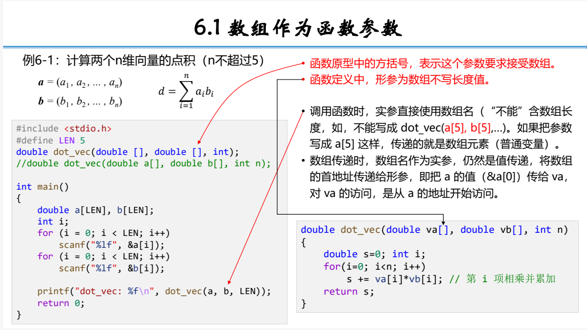
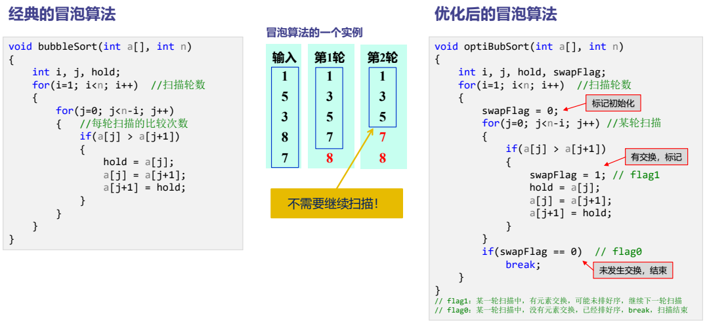
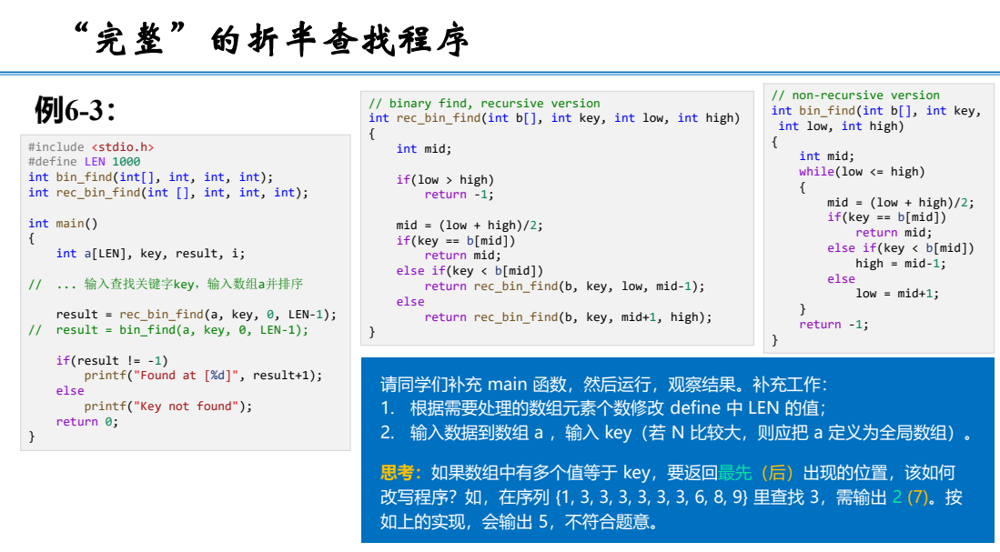

# 程序设计基础 C6 题目（2024秋）

## A 小懒獭与反向点积

### 题目描述

小懒獭创造了一种独特的向量运算方式，她称之为**反向点积**。反向点积是指将两个向量的元素按特定的方式反向相乘并求和。对于给定的两个长度相同的向量 $A$ 和 $B$，小懒獭想知道它们的反向点积是多少。

具体来说，对于向量 $A = ( a_0, a_1, \dots, a_{n-1} )$ 和 $B = (b_0, b_1, \dots, b_{n-1})$，小懒獭的反向点积定义为：

$$
A \odot B = a_0 \times b_{n-1} + a_1 \times b_{n-2} + \dots + a_{n-1} \times b_0
$$

每次给定两个长度相同的向量 $A$ 和 $B$，请帮助小懒獭计算它们的反向点积。

### 输入

不定组数据输入，保证不超过 $1000$ 组。

对于每组数据，第一行包含一个整数 $ n $（ $1 \leq n \leq 1000$），表示两个向量的长度；第二行包含 $ n $ 个整数 $ A_{0}, A_{1}, \dots, A_{n-1} $，表示向量 $ A $ 的元素；第三行包含 $ n $ 个整数 $ B_{0}, B_{1}, \dots, B_{n-1} $，表示向量 $ B $ 的元素。保证向量的每个元素的值在 $[ -100,100 ]$ 区间内。

### 输出

对于每组输入，输出一行一个整数，表示向量 $ A $ 和 $ B $ 的反向点积结果。

### 输入样例

```text
3
1 2 3
4 5 6
3
1 -2 3
-4 5 -6
```

### 输出样例

```text
28
-28
```

### 样例解释

对于第一组样例，结果为 $1 \times 6 + 2 \times 5 + 3 \times 4 = 28$。

对于第一组样例，结果为 $1 \times (-6) - 2 \times 5 + 3 \times (-4) = -28$。

### Hint

可以参考 PPT 上的 P6 - 1



Author：Moca

## B Moca 与水獭排队

### 题目描述

现在有 $n$ 只水獭站成一排。

水獭们的身高参差不齐，看上去十分混乱。为了让队伍看上去更加整齐，Moca 决定帮助小水獭们按身高从矮到高重新排列。

### 输入

第一行一个正整数 $n$，表示小水獭的个数，保证 $1 \le n \le 2000$。

第二行 $n$ 个正整数，表示每只小水獭的身高 $a_i$，保证 $1 \le a\_i \le 2^{31} - 1$ 。

### 输出

第一行，将水獭们的身高从小到大排序，相邻的两个整数用一个空格隔开。

第二行一个浮点数，表示水獭们身高的中位数，保留到小数点后一位。

### 输入样例

```text
5
7 2 11 10 13
```

### 输出样例

```text
2 7 10 11 13
10.0
```

### Hint

可以参考 PPT 上的例 6.2.1



奇数个元素的中位数是排序后最中间的一个数字；偶数个元素的中位数是排序后最中间的两个数字的平均值。

Author：Moca

## C 魔法师水獭与悬浮咒

### 题目描述

聪明的魔法师水獭正在学习悬浮咒（ $\mathfrak{Wingardium\  Leviosa}$​）。

咒语的力量源自于平衡。水獭发现，只有找到具有平衡性质的“魔力字符串“，才能成功施展出魔法。具体来说，“魔力字符串“具有以下特点：

1. 如果字符串长度为奇数，且其是一个回文串，即正着读和反着读相同，则此字符串为“魔力字符串”。
2. 如果字符串长度为偶数，且其倒序后与原字符串的每一对应位置字符都不相同，则此字符串为“魔力字符串”。

现在，请你帮忙判断对于给定的字符串，是否是”魔力字符串“。

### 输入

第一行一个正整数 $n$，表示接下来有 $n$ 组数据要判断，保证 $1 \le n \le 100$。

对于每组数据，输入一行一个字符串 $s$，仅包含小写字母，保证 $1 <= |s| <= 100000$，其中 $|s|$ 表示字符串 $s$ 的长度。

### 输出

对于每组输入，输出一行，若 $s$ 是“魔力字符串”，输出 `Wingardium Leviosa`，否则输出 `The spell fails`。

### 输入样例

```text
4
level
otter
otters
ottero
```

### 输出样例

```text
Wingardium Leviosa
The spell fails
Wingardium Leviosa
The spell fails
```

### Hint

可以用 `<string.h>` 中的函数 `strlen` 来获取字符串长度

Author：Moca

## D 最大池化

### 题目描述

在卷积神经网络（CNN）中，**最大池化**是一种常用的操作，用来对特征图进行降采样，从而减少数据量和计算量。最大池化会**在特征图的每个区域中选取最大值**作为该区域的代表值。

给定一个大小为 $n \times m$ 的矩阵和一个池化窗口的大小 $p \times q$，你需要对这个矩阵进行最大池化操作，即将矩阵划分为若干个 $p \times q$ 的区域，并从每个区域中选取最大值，生成一个新的池化矩阵，具体的生成过程可参考样例解释。

### 输入

第一行包含四个整数 $n, m, p, q$，分别表示矩阵的行数、列数以及池化窗口的行数和列数（ $2 \le p \le n ≤ 100$， $2 \le q \le m \le 100$，且 $n$ 是 $p$ 的整数倍， $m$ 是 $q$ 的整数倍）。

接下来 $n$ 行，每行包含 $m$ 个整数，表示矩阵中的元素值，保证元素值在 `int` 范围内。

### 输出

输出一个新的矩阵，表示经过 $p \times q$ 大小的最大池化操作后得到的池化矩阵。矩阵的同一行的相邻元素之间用一个空格隔开。

### 输入样例

```text
4 4 2 2
1 3 2 4
5 6 7 8
9 10 11 12
13 14 15 16
```

### 输出样例

```text
6 8
14 16
```

### 样例解释

得到池化矩阵的过程如下图：


## E 水獭迷宫

小水獭不小心走进了一个迷宫，水獭害怕急了，请你帮助小水獭在迷宫中找到出口。
小水獭从起点 $(0,0)$ 出发，它的目标是到达出口的位置 $(a,b)$。小水獭的移动方向有限：它可以向北（N）、向东（E）、向南（S）或向西（W）移动，具体的移动规则如下：

- `N` (北) 表示向上移动一步，即从当前位置 $(x, y)$ 移动到 $(x, y+1)$。
- `E` (东) 表示向右移动一步，即从当前位置 $(x, y)$ 移动到 $(x+1, y)$。
- `S` (南) 表示向下移动一步，即从当前位置 $(x, y)$ 移动到 $(x, y-1)$。
- `W` (西) 表示向左移动一步，即从当前位置 $(x, y)$ 移动到 $(x-1, y)$。

输入一个字符串 s，表示小水獭的移动指令序列（例如 `NESW` 表示依次向北、东、南、西移动）。小水獭将按照这个序列移动一次，如果移动过程中到达过出口，那么小水獭将成功逃出迷宫。
在迷宫中，有 $k$ 个障碍。如果小水獭在某次移动时目标位置是一个障碍，则该次移动无效，小水獭会停留在当前格子位置，不会移动到障碍所在的格子上。例如，如果小水獭当前在位置 $(2, 2)$，且向东移动的目标位置 $(3, 2)$ 是一个障碍，则小水獭将无法移动到 $(3, 2)$，它会停留在 $(2, 2)$ 这个位置，继续执行接下来的指令。
请你判断小水獭能否成功找到出口，离开迷宫。

### 输入

不定组数据输入，保证输入的数据不超过 $5$ 组。

每组数据第一行，输入三个正整数 $k$、 $a$ 和 $b$； $k$ 表示障碍的数量， $(a, b)$ 表示终点的位置，保证 $1 \le a, b \le 10$， $0 \le k \le 10$ 。

每组数据第二行，输入一个字符串 $s$，表示水獭的移动指令序列，保证 $1 \le |s| \le 500$。

接下来 $k$ 行，每行输入两个整数 $x_i$、 $y_i$，表示第 $i$ 个障碍物的位置；保证 $1 \le x_i, y_i \le 10$。

#### 输出格式

对于每组数据，输出一行，如果小水獭能成功逃出迷宫，输出 `Otter Success`；否则输出 `Otter Failed`。

#### 输入样例

```text
1 2 2
SNNENEEN
1 1
1 5 5
SNNENEEN
1 1
```

#### 输出示例

```text
Otter Success
Otter Failed
```

#### 样例解释

对于第一组数据，小水獭的移动过程如下：

- `S`： $(0,0) \rightarrow (0, -1)$
- `N`： $(0,-1) \rightarrow (0,0)$​
- `N`： $(0,0) \rightarrow (0,1)$
- `E`：由于 $(1,1)$ 有障碍，所以小水獭停在 $(0,1)$ 不动
- `N`： $(0,1) \rightarrow (0,2)$
- `E`： $(0,2) \rightarrow (1,2)$
- `E`： $(1,2) \rightarrow (2,2)$，小水獭成功到达终点，逃出迷宫
- `N`：小水獭已经离开迷宫，剩下的操作就不用管了

对于第二组数据，小水獭最后会移动到 $(2,3)$，在整个过程中也没有到达过 $(5,5)$，所以无法逃出迷宫

## F Moca 与水獭排队 2

**注意内存限制**，该内存限制下无法申请千万级别的数组。

### 题目描述

现在有 $n$​ 只水獭从低到高站成一排。Moca 希望每次能找到**不低于**某身高 $h$ 的第一只水獭的编号（编号从 $1$ 开始），请你编写一个程序完成这个任务。

### 输入

第一行两个正整数 $n$ 和 $m$，其中 $n$ 表示小水獭的个数，保证 $1 \le n \le 5 \times 10^5$； $m$ 表示接下来询问的次数，保证 $1 \le m \le 5 \times 10^5$​。

接下来一行，输入 $n$ 个正整数，第 $i$ 个正整数表示第 $i$ 只小水獭的身高 $a_i$，保证 $1 \le a_i \le 10^7$，输入的 $a_i$ 单调不减。

接下来 $m$ 行，每行一个正整数 $h\_i$，表示要查找的值，保证 $1 \le h_i \le 10^7$。

### 输出

输出 $m$ 行，对每次询问，输出对应的不低于对应身高 $h$ 的第一只水獭的编号；如果不存在这样的水獭输出 `-1`。

### 输入样例

```text
5 5
2 7 10 10 13
1
8
10
12
14
```

### 输出样例

```text
1
3
3
5
-1
```

### Hint

可以参考 PPT 上的例 6-3，但是注意在这道题中，我们要查找数组中可能会出现重复的数字，我们要找到某数字第一次出现的位置，所以需要你对 PPT 上的二分查找代码进行一些修改。



Author：Moca

## G 多项式加法 2024

### 题目描述

给定整数序列 $a_1,a_2,\ldots,a_n$ 和 $b_1,b\_2,\ldots,b_m$，**严格递增**的非负整数序列 $A_1,A_2,\ldots,A_n$ 和 $B_1,B_2,\ldots,B_m$，求解如下多项式：

$$
\left(\sum_{i=1}^na_ix^{A_i}\right)+\left(\sum_{i=1}^mb_ix^{B_i}\right)
$$

### 输入

第一行一个正整数 $t$（ $1 \le t \le 5$），表示数据组数。

对于每组数据，第一行一个正整数 $n$（ $1 \le n \le 10^5$），含义同题目描述。

第二行 $n$ 个整数 $a_1,a_2,\ldots,a_n$（ $0 < |a_i| \le 10^9$），含义同题目描述。

第三行 $n$ 个非负整数 $A_1,A_2,\ldots,A_n$（ $0 \le A_i \le 10^9$），含义同题目描述。

第四行一个正整数 $m$（ $1 \le m \le 10^5$），含义同题目描述。

第五行 $m$ 个整数 $b_1,b_2,\ldots,b_m$（ $0 < |b_i| \le 10^9$），含义同题目描述。

第六行 $m$ 个非负整数 $B_1,B_2,\ldots,B\_m$（ $0 \le B_i \le 10^9$），含义同题目描述。

保证 $A_{i} > A_{i-1}$ 对 $1 < i \le n$ 成立， $B_{i} > B_{i-1}$ 对 $1 < i \le m$ 成立， $A_i=B_j \Rightarrow a_i+b_j \ne 0$ 对 $1 \le i \le n,1 \le j \le m$ 成立。

### 输出

对于每组数据，输出三行：

- 第一行一个正整数 $k$，表示所得多项式在**合并同类项**后有 $k$ 个系数非 $0$ 项，并设所得多项式为：

$$
\sum_{i=1}^kc_ix^{C_i}
$$
其中 $C_{i} > C_{i-1}$ 对 $1 < i \le k$ 成立。

- 第二行 $k$ 个整数 $c_1,c_2,\ldots,c_k$，含义同上式。

- 第三行 $k$ 个非负整数 $C_1,C_2,\ldots,C_k$，含义同上式。

### 输入样例

```text
1
3
1 2 3
1 2 3
3
2 3 4
2 3 4
```

### 输出样例

```text
4
1 4 6 4
1 2 3 4
```

## H 一种简单的语言

### 题目描述

shtog定义了一种新的很简单的编程语言，但是这种语言不能直接被电脑执行，所以他希望可以用c语言编写一个简单的编译器对其进行编译，进而成功执行程序。

语言的语法很简单，其只包含两类语句：赋值语句、输出语句，每条语句占一行。

赋值语句的语法为：`<变量名> <值>`，其中 `<值>`只可能是一个在int范围内的常数或一个在上面的代码中已经被赋值过的变量, 同一个变量可以被重复多次赋值，新赋的值会覆盖之前被赋的值（和C语言逻辑一致），变量名由不超过5个大写或者小写字母组成且不会叫做`print`。

输出语句的语法为：`print <变量名>`。注意，如果欲输出的变量名在之前的代码中未被赋过值（尚未定义），那么输出`line <行号>: print invalid name "<变量名>"!`（行号从1算起），否则则输出变量的值。

请你编写c语言程序帮shtog翻译并执行该语言编写的程序。

### 输入

一共不会超过**5000**行。

一共若干行，每行一条语句，保证一定会出现有`print`语句。

### 输出

输出若干行，表示代码的执行结果（每条`print`语句对应一行输出）。

### 输入样例

```text
a 3
B a
print B
print b
```

### 输出样例

```text
3
line 4: print invalid name "b"!
```

### Hint

可以考虑用`strcmp (#include <string.h>)`函数来判断两个字符串是否相等。

可以使用一个二维的字符数组来存储多个字符串，比如，向二维数组`s[][]`中读入一个字符串可以参考：`scanf("%s", s[i]);`（注意不要加`&`符号），需要读入多个的话循环即可。

AUTHOR：shtog

## I 英语大师

### 题目描述

输出整数 $n$ 的英文。

### 输入

不定行输入，每行一个整数 $n$， $0 \leq n \leq 2^{31} - 1$

### 输出

对于每组输入，输出一行 $n$ 的英文，所有单词首字母大写，每个单词之间有 $1$ 个空格。

不需要加逗号或者 `And` 。

### 输入样例

```text
123
12345
1234567
```

### 输出样例

```text
One Hundred Twenty Three
Twelve Thousand Three Hundred Forty Five
One Million Two Hundred Thirty Four Thousand Five Hundred Sixty Seven
```

### Hint

以下介绍英语中对自然数的表示，有英语基础的同学可以忽略。

以下定义集合 $\text{Digit}=\{0,1,2,3,4,5,6,7,8,9\}$ 为自然数集的子集，使用具有上划线的数表示这个自然数在字面上是由多个变元或常元直接拼而成的量、并且英文表示的拼接指两个单词中间由一个空格相连。

1. $[0,99]$ 的表示

  下表中列出了一些特殊数的表示。

| 数字 | 对应的单词 | 整数 | 对应的单词 | 整十数 | 对应的单词 |
| --- | --- | --- | --- | --- | --- |
| $0$ | Zero | | | | |
| $1$ | One | $11$ | Eleven | $10$ | Ten |
| $2$ | Two | $12$ | Twelve | $20$ | Twenty |
| $3$ | Three | $13$ | Thirteen | $30$ | Thirty |
| $4$ | Four | $14$ | Fourteen | $40$ | Forty |
| $5$ | Five | $15$ | Fifteen | $50$ | Fifty |
| $6$ | Six | $16$ | Sixteen | $60$ | Sixty |
| $7$ | Seven | $17$ | Seventeen | $70$ | Seventy |
| $8$ | Eight | $18$ | Eighteen | $80$ | Eighty |
| $9$ | Nine | $19$ | Nineteen | $90$ | Ninety |

  对于一般数，即大于 $20$ 的、个位不为 $0$ 的两位数，其表示由十位数对应的整十数的表示和个位数的表示拼接而成，即：对于大于 $20$ 的非整十数 $\overline{ab}=10\times a+b,a,b\in \text{Digit},ab\neq 0,a\ge 2$ ，总可以先读 $\overline{a0}=10\times a$ 的表示，再读 $b$ 的表示。

1. $[100,999]$ 的表示

  所有的三位数都可以表示为 $\overline{abc},a,b,c\in \text{Digit},a\neq 0$ 的形式，其表示由 $a$ 的表示、 `Hundred` 和 $\overline{bc}$ 的表示拼接而成，如果 $b\neq 0$ 或者 $c\neq 0$ 。否则，其表示为 $a$ 的表示和 `Hundred` 拼接而成。

1. 更大正整数的表示

  所有的位数大于等于 $4$ 的无前导零的正整数都可以从低位向高位每 $3$ 位一节截断。从高位节向低位节，将每节的 $3$ 位数或具有前导零的 $2$ 位数或 $1$ 位数表示拼接起来，并再拼接表示当前节数的单词，即可得到该正整数的表示。特别地，如果一节中的 $3$ 位数字全为 $0$ ，那么直接跳过这一节，不进行任何拼接。下表中给出了本题可能需要用到的表示当前节数的单词。

| 从低位向高位数的节数 | 对应的单词 |
| --- | --- |
| $1$ | 无单词，不需要拼接 |
| $2 $ | Thousand |
| $3$ | Million |
| $4$ | Billion |
| $5$ | 本题不需要用到 |

$Author:munian$

## J 朝日捡石头

### 题目描述

asahi 到河边去捡石头了！

河边有 $n$ 个石头，这 $n$ 个石头排成一列，编号为 $1\sim n$ 。相邻的石头距离为 $1$ 。

每个石头都有价值。第 $i$ 个石头的价值为 $a_i$ 。

asahi 想从中选出 $m$ 个石头，但她不喜欢看到有石头离得太近。她希望对于任意两个选出来的石头，其距离不小于 $k$ 。

asahi 想知道，她选出的石头的价值和最大是多少。

形式化地说，你需要选出一个 $\{1,2,...,n\}$ 的一个大小为 $m$ 的子集 $\{b_1,b_2,...b_m\}$ ，满足 $\forall 1\le i<j\le m,|b_i-b_j|\ge k$ 。

求 $\sum_{1\le i\le m} a_{b_i}$ 的最大值。

### 输入

第一行三个整数 $n,m,k$ ，表示石头数量，asahi 要选的石头数量，距离限制。 $1\le n\le 3\times10^5 ,1\le m,k\le n$ 。

第二行 $n$ 个整数 $a_i$ ，表示每个石头的价值。 $|a_i|\le 10^9$ 。

数据保证至少有一个选石头的方案。

### 输出

一行一个整数，表示答案。

### 输入样例

```text
5 2 2
-2 4 6 7 3
```

### 输出样例

```text
11
```
