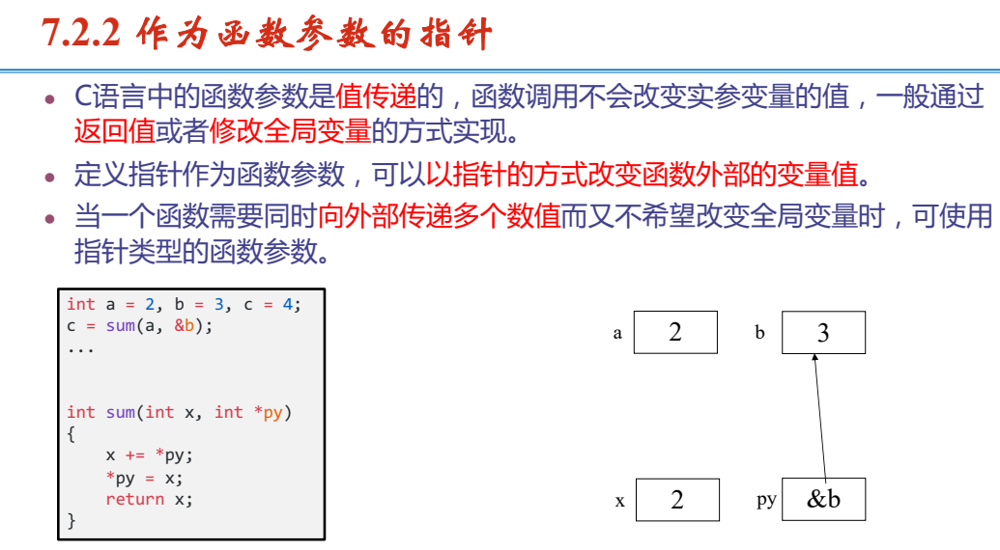
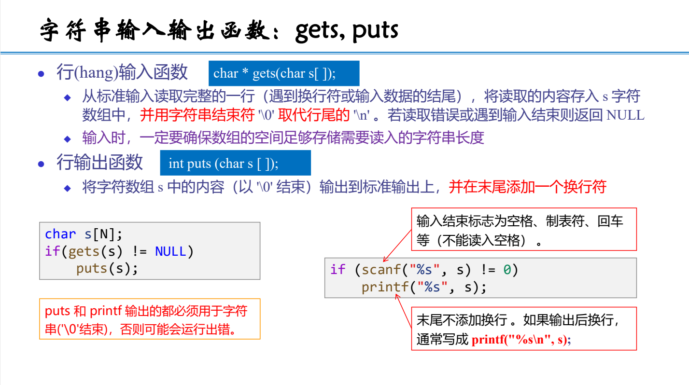
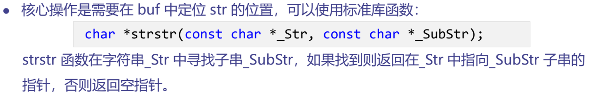

# 程序设计基础 C7 答案（2024秋）

## A Otter256

### 题目

#### 题目背景

水獭学院的每位水獭都拥有唯一的学号，格式为 `OTTERXXX`，其中前 5 个字符是固定的大写字母 `OTTER`，后三个字符是从 `000` 到 `256` 的数字（含 `000` 和 `256` 需要包含前导零）。

现在，小水獭需要编写一个程序，帮助验证某个学号是否为合法的学号。

##### 输入格式

不定组输入，每组输入一行，包含一个长度为 8 的字符串 $S$，保证数据不超过 $1000$ 组，保证字符串只有大小写字母和数字组成。

##### 输出格式

如果 $S$ 是合法的学号，输出 `Valid`；如果 $S$ 不是合法的学号，输出 `Invalid`。

##### 输入样例

```text
OTTER003
OTTER257
OTTER12a
```

##### 输出样例

```text
Valid
Invalid
Invalid
```

#### Hint

可以参考下面的代码片段：

```c
char str[10];
while(scanf("%s", str) != EOF) {
    if(str 前五位是 OTTER 且后三位是数字) {
        // 拆分出后三位表示的数字 num
        int num = (str[5] - '0') * 100 + (str[6] - '0') * 10 + (str[7] - '0');
        if(num 在 [0, 256] 范围内)
            printf("Valid\n");
        else
            printf("Invalid\n");
    } else
        printf("Invalid\n");
}
```

在判断前五位是否为 `OTTER` 时，可使用库函数 `int strncmp(const char *str1, const char *str2, size_t n)`，它可以比较两个字符串的前 n 个字符是否相等，相等时返回 `0`，不相等时依据字典序关系返回正数或者负数。比如我们可以用 `strncmp(str, "OTTER", 5) == 0` 来判断前五位是不是 `OTTER`。当然也可以选择逐位检查前五个字符。

### 答案

| 难度 | 考点 |
| --- | --- |
| 1 | 字符串 |

### 题目分析

本题为输入一个长度八位的字符串，然后判断字符串的格式是否满足要求。

输入完一个字符串后，最简单的办法我们可以先检查前五位是否依次为 O、T、T、E、R（也可以利用 `strstr` 函数或者 `strncmp` 函数直接看前五位是不是 `OTTER`），然后把后三位提取为一个整数看看是否在合法范围内。

需要注意的是在判断后三位是否合法的时候有同学使用了这样的代码 `strcmp(str + 5, "000") >= 0 && strcmp(str + 5, "256") <= 0`，要注意的是在字典序意义下比较是不一定正确的，还要判断后三位是不是都是数字（一个不正确的例子如 `OTTER00a`）。

### 示例代码

```c
#include <stdio.h>
#include <ctype.h>
char str[10];
int main() {
    while(scanf("%s", str) != EOF) {
        // 判断前五位也可以逐位判断
        // 也可以 strstr(str, "OTTER") == str
        if(strncmp(str, "OTTER", 5) == 0 && isdigit(str[5]) && isdigit(str[6]) && isdigit(str[7])) {
            int num = (str[5] - '0') * 100 + (str[6] - '0') * 10 + str[7] - '0';
            if(num >= 0 && num <= 256)
                printf("Valid\n");
            else
                printf("Invalid\n");
        } else
            printf("Invalid\n");
    }
}
```

## B 爱吃糖葫芦

### 题目

#### 题目描述

>
> 阿呦阿呦，爱吃甜甜的糖葫芦
>
> 阿呦阿呦，偶尔也犯点小迷糊

在某个热闹街角，有一家小摊因其独特的糖葫芦而备受欢迎。这里的糖葫芦不仅味道独特，还有一个特别的传统：每串糖葫芦都对应着一句神秘的“密语”。只有真正的老顾客才能凭借对摊主的了解，说出这句密语，从而触发一个特别的隐藏事件——免单。

阿呦作为糖葫芦的忠实爱好者，自然了解这些密语的构造规则：**摊主会按照一个固定的顺序将3种食材递给顾客，当顾客依次将食材串到竹签上时，密语就是所有食材名称沿竹签自顶向下组成的符号串的后半部分**。

现在，阿呦又一次来到了小摊前，他已经迫不及待想要品尝今天的糖葫芦了。请你帮助阿呦，根据摊主递给他的食材顺序，大声地说出那句密语，确保他能够准确地触发免单的优惠。

#### 输入

总共 $3$ 行，每行包含一个由小写英文字母组成的字符串 $s\;(2\leq |s|\leq 1000)$，且 $|s|$为偶数，代表一种食材的名称。

#### 输出

输出一行，一个字符串，表示这串糖葫芦对应的密语（**将三种食材的名称按给定顺序的倒序拼接在一起，后半部分即为密语**）。

#### 输入样例

```text
hawthorn
strawberry
pear
```

#### 输出样例

```text
rryhawthorn
```

#### 样例解释

先按顺序串联起所有的字符串，得到一个字符串`pearstrawberryhawthorn`，再截取字符串的后半段，即可得到密语`rryhawthorn`。

#### Hint

怎么才能得到触发免单的密语呢？不妨试试`char *strcat(char *dest, const char *src)`函数吧！


### 答案

| 难度 | 考点 |
| --- | --- |
| 2 | 字符串拼接 strcat |

### 题目分析

本题输入为三个字符串，输出为字符串拼接后的后半部分。需要注意的有两点：

1. 用于存储拼接三个字符串的 `char` 类型数组要足够大，在本题应不小于 $3 \times 1000 = 3000$
2. `ans` 字符串的后半部分的范围应当是 $\left[\left\lfloor \dfrac{|ans|}{2} \right\rfloor, |ans|\right)$

### 示例代码

```c
#include <stdio.h>
#include <string.h>
char a[1009], b[1009], c[1009];
char ans[3009];
int main() {
    scanf("%s%s%s", a, b, c);
    strcat(ans, c);
    strcat(ans, b);
    strcat(ans, a);
    for(int i=strlen(ans)/2;i<strlen(ans);i++){
        printf("%c",ans[i]);
    }
    //printf("%s", ans + strlen(ans) / 2);
    return 0;
}
```

## C 林士谔算法 信类2024ver

### 题目

#### 题目描述

林士谔（1913-1987）先生是中国著名的自动控制学家和航空教育专家，广东平远人。他于1935年毕业于上海交通大学电机系，随后于1939年获得美国麻省理工学院航空系航空工程博士学位。林士谔先生是北京航空航天大学的建校元老之一，对中国的航空自动控制学科和陀螺惯导学科有着奠基性的贡献。

林士谔算法，是林士谔先生在上世纪三十年代首次提出的一种求解高次方程近似解的方法。林士谔算法可以对一个次数大于等于 $3$ 的多项式 $f(x)=a_nx^n+\dots+a_1x+a\_0$ ，近似地求出一个形如 $x^2+px+q$ 的二次因子。这个二次因子对应的方程 $x^2+px+q=0$ 的解就是方程 $f(x)=0$ 的近似解。因此，如果我们得知了 $f(x)$ 的各项系数，我们可以通过求出 $p,q$ ，进而求出 $f(x)=0$ 的近似解。

对于输入的 $n$ 和 $a_n,a_{n-1},\dots,a_1,a_0$ ，通过调用函数 `Shie` ，可以计算得到多项式的近似解。函数 `Shie` 的定义如下：

```c
#include<stdio.h>
#include<string.h>
double a[20];
void Shie(int n, double a[], double *p, double *q);

int main()
{
    /*------下面根据指引写你自己的代码------*/
    //定义 int 型变量 n，double 型变量 p 和 q
    //读取n
    //从第n项开始，一直到第0项，读取全局数组a
    //调用Shie函数
    //输出p q
    return 0;
}

/*--下面是Shie函数，只要调用即可，无需理解原理--*/
void Shie(int n, double a[], double *p, double *q)
{
    double eps = 1e-12;
    double b[20];
    double c[20];
    // 数组 b 是多项式 a 除以当前迭代二次三项式的商
   memset(b, 0, sizeof(b));
   // 数组 c 是多项式 b 乘以 x 平方再除以当前迭代二次三项式的商
   memset(c, 0, sizeof(c));
   *p = 0;
   *q = 0;
   double dp = 1;
   double dq = 1;
   while (dp > eps || dp < -eps || dq > eps || dq < -eps)  // eps 自行设定
   {
 double p0 = *p;
 double q0 = *q;
 b[n - 2] = a[n];
 c[n - 2] = b[n - 2];
 b[n - 3] = a[n - 1] - p0 * b[n - 2];
 c[n - 3] = b[n - 3] - p0 * b[n - 2];
 int j;
 for (j = n - 4; j >= 0; j--) {
            b[j] = a[j + 2] - p0 * b[j + 1] - q0 * b[j + 2];
       c[j] = b[j] - p0 * c[j + 1] - q0 * c[j + 2];
 }
 double r = a[1] - p0 * b[0] - q0 * b[1];
 double s = a[0] - q0 * b[0];
 double rp = c[1];
 double sp = b[0] - q0 * c[2];
 double rq = c[0];
 double sq = -q0 * c[1];
 dp = (rp * s - r * sp) / (rp * sq - rq * sp);
 dq = (r * sq - rq * s) / (rp * sq - rq * sp);
 *p += dp;
 *q += dq;
   }
    return;
```

 }

函数利用了指针类型的参数来保存多个返回结果（相当于利用指针将函数里对参数造成的影响传递到函数外），`*p` 和 `*q` 分别表示二次因子 $x^2+px+q$ 中的一次项系数 $p$ 和常数项系数 $q$ 。

请你根据上面的函数 ，以及输入的变量 $n$ 和 $a_n,a_{n-1},\dots,a_1,a_0$ ，求出参数 $p,q$ 。

#### 输入

两行，第一行一个整数 $n$ ，保证 $3\le n\le 10$ ；

第二行 $n+1$ 个保留一位小数的浮点数 $a_n,a_{n-1},\dots,a_1,a_0$ ，保证其绝对值均不大于 $50$ 。

注意数组的读入顺序（按降幂顺序读取），从 $a_n$ 开始读取（ $a_n$ 是 $n+1$ 个数的第一个），最后一个读取 $a_0$ ，**不要读取反了**。

#### 输出

一行两个浮点数 $p,q$ ，保留 $6$ 位小数。

#### 输入样例 1

```text
6
1.0 -4.0 11.0 -18.0 22.0 -16.0 8.0
```

#### 输出样例 1

```text
-1.000000 2.000000
```

#### 输入样例 2

```text
10
1.0 1.0 1.0 1.0 1.0 1.0 1.0 1.0 1.0 1.0 1.0
```

#### 输出样例 2

```text
0.284630 1.000000
```

#### Hint

可以参考 PPT 7.2.2：



### 答案

| 难度 | 考点 |
| --- | --- |
| 2 | 函数传参，指针类型参数 |

### 题目分析

本题相当于代码填空题，利用给定的函数实现功能，主要考察数组类型参数和指针类型参数的传参。

数组传参时，在函数中的形参如这种形式：`int f(int a[])`，调用函数传参时如这种形式：`int a[100];f(a);`

指针传参时，在函数中的形参如这种形式：`int f(int *a)`，调用函数传参时如这种形式：`int a;f(&a);`（一定要注意 `*` 在指针相关部分有两种不同的含义，一个是声明一个指针类型，一个是对指针类型使用解引用）

接下来每一行逐行翻译即可，最关键的地方就是调用函数那一行。

### 示例代码

```c
#include<stdio.h>
#include<string.h>
double a[20];
void Shie(int n, double a[], double *p, double *q);
int main()
{
    /*------下面根据指引写你自己的代码------*/
    //定义 int 型变量 n，double 型变量 p 和 q
    int n;
    double p, q;
    
    //读取n
    scanf("%d", &n);
    
    //从第n项开始，一直到第0项，读取全局数组a
    for(int i = n; i >= 0 ;i--)
        scanf("%lf", &a[i]);
    
    //调用Shie函数
    Shie(n, a, &p, &q);
    
    //输出p q
    printf("%.6lf %.6lf", p, q);
    
    return 0;
}
/*--下面是Shie函数，只要调用即可，无需理解原理--*/
void Shie(int n, double a[], double *p, double *q) 
{
    double eps = 1e-12;
    double b[20];
    double c[20];
    // 数组 b 是多项式 a 除以当前迭代二次三项式的商
    memset(b, 0, sizeof(b));
    // 数组 c 是多项式 b 乘以 x 平方再除以当前迭代二次三项式的商
    memset(c, 0, sizeof(c));
    *p = 0;
    *q = 0;
    double dp = 1;
    double dq = 1;
    while (dp > eps || dp < -eps || dq > eps || dq < -eps)  // eps 自行设定
    {
    double p0 = *p;
    double q0 = *q;
    b[n - 2] = a[n];
    c[n - 2] = b[n - 2];
    b[n - 3] = a[n - 1] - p0 * b[n - 2];
    c[n - 3] = b[n - 3] - p0 * b[n - 2];
    int j;
    for (j = n - 4; j >= 0; j--) {
            b[j] = a[j + 2] - p0 * b[j + 1] - q0 * b[j + 2];
        c[j] = b[j] - p0 * c[j + 1] - q0 * c[j + 2];
    }
    double r = a[1] - p0 * b[0] - q0 * b[1];
    double s = a[0] - q0 * b[0];
    double rp = c[1];
    double sp = b[0] - q0 * c[2];
    double rq = c[0];
    double sq = -q0 * c[1];
    dp = (rp * s - r * sp) / (rp * sq - rq * sp);
    dq = (r * sq - rq * s) / (rp * sq - rq * sp);
    *p += dp;
    *q += dq;
    }
    return;
}
```

## D 魔法师水獭与标准咒语指南

### 题目

#### 题目背景

魔法师水獭正在学习《标准咒语指南》，书中隐藏着许多强大的咒语。为了提高学习效率，魔法师水獭希望能找到某些咒语在书中的位置。

现在，请你写一个程序帮助魔法师水獭找到魔法书中第一个匹配的咒语。如果找到了咒语，就输出它在魔法书中首次出现的起始位置（从 0 开始计数）；如果没有找到，就输出 `Spell Not Found!`。

#### 输入

第一行是一个字符串，表示魔法书的内容（长度不超过 $1000$）。

第二行一个正整数 $n$，表示要寻找 $n$ 个咒语，保证 $n$ 不超过 $100$。

接下来 $n$ 行，每行一个字符串，表示要寻找的咒语关键词（长度不超过 $1000$​），保证不以空格开头或结尾，但是中间可能含有空格。

保证字符串中的字符 ASCII 值在 $[32, 126]$ 范围内。

#### 输出

- 如果在魔法书中找到了关键词，输出关键词在字符串中第一次出现的起始位置（从 0 开始）。
- 如果没有找到，输出 `Spell Not Found!`。

#### 输入样例

```text
Expecto Patronum! Otter whispered into the darkness.
4
Patronum
to
Avada Kedavra
Otterwhispered
```

#### 输出样例

```text
8
5
Spell Not Found!
Spell Not Found!
```

#### Hint

在读入时，由于输入的字符串中含有空格，可以使用 `gets` 来进行读入，同时别忘了**处理整数后面的换行符**：


可以使用 `<string.h>` 中的函数 `char *strstr(char *s, char *sub_str);`在字符串中查找子串，具体用法可参考例 7 - 9：


### 答案

| 难度 | 考点 |
| --- | --- |
| 3 | strstr、字符串、数组与指针 |

### 题目分析

本题主要考察库函数 `strstr` 的使用，并借由该函数引导同学们掌握 `<string.h>` 中一类库函数的使用。

在 `strstr(text, keyword)` 中，我们要传两个参数，一个是原字符串 $text$，一个是要查找的子串 $keyword$，根据 PPT 上的例子，传进去两个数组名（数组名相当于数组的起始地址，利用 `char` 数组的起始地址我们就能确定一个字符串）。`strstr(text, keyword)` 返回值是 $keyword$ 第一次在 $text$ 中出现的地址（没找到返回空指针 `NULL`），返回值类型是 `char *`。因为一个数组在内存中是连续存储的，而数组首地址指向的是数组中下标为 $0$ 的元素的位置，指向同一数组内的元素的指针作差后，得到的结果就是两个位置的下标差。所以将前面查到的目标子串第一次出现位置的首地址减去 $text$ 数组首地址，就得到了目标子串首字母在 $text$ 数组中的位置下标。

最后，如果不处理整数后面的换行符的话，根据 `gets` 会一直读入，直到遇到换行符停止，把这个换行符一起读进来后再把它变成空字符，在读入完 $n$ 之后如果直接使用 `gets` 读检索关键词，那么其实只会把这个换行符读走，导致字符串其实是空串。

### 示例代码

```c
#include <stdio.h>
#include <string.h>
char str[1005];
char tem[1005];
int main() {
    gets(str);
    int n;
    scanf("%d", &n);
    getchar();
    for(int i = 1; i <= n; i++) {
        gets(tem);
        char *r = strstr(str, tem);
        if(r == NULL)
            printf("Spell Not Found!\n");
        else
            printf("%d\n", r - str);
    }
    return 0;
}
```

## E 摩卡与指针

### 题目

#### 题目背景

Moca 今天学习了指针，并发现指针和地址有着紧密的联系。通过学习，他了解到数组的元素在内存中是连续存储的，因此可以根据数组的起始地址、元素类型的大小以及数组下标，计算出数组中每个元素的内存起始地址。

假设有一个数组 $ A $，它的起始地址是 $base$，数组的元素类型大小为 $ size $。数组中第 $ i $ 个元素的内存起始地址可以通过以下公式计算：

$$
\text{address}(i) = \text{base} + (i \times \text{size})
$$
请你帮助 Moca 完成一个程序，查询数组中某元素的起始地址（假设数组的起始地址为 `0x00000000`）。

#### 输入

第一行包含一个字符串 $ type $ ，表示数组的 **元素类型**， $ type $ 的可能取值为：

- `int`：表示整型，大小为 4 字节。
- `char`：表示字符型，大小为 1 字节。
- `float`：表示浮点型，大小为 4 字节。
- `double`：表示双精度浮点型，大小为 8 字节。
- `long long`：表示长整型，大小为 8 字节。

第二行包含一个整数 $ n $ ( $ 1 \leq n \leq 10^5 $) 和一个整数 $ q $ ( $ 1 \leq q \leq 10000 $)，分别表示数组长度和查询次数。

第三行包含 $ q $ 个整数 $ i_1, i_2, \dots, i_q $ ( $ 0 \leq i_k \leq 10^6 $)，表示每次查询的数组下标。

#### 输出

对于每次查询，输出一行如果下标 $ i_k $ 在合法范围内 ( $ 0 \leq i_k < n $)，输出数组中第 $ i_k $ 个元素的内存起始地址，格式为 `0x` + 对应的八位十六进制数（不足八位用前导 0 来补位，字母使用**小写字母**）；如果下标 $ i_k $ 超出合法范围，输出 `Careless Otter!`。

#### 输入样例 1

```text
int
5 3
0 3 5
```

#### 输出样例 1

```text
0x00000000
0x0000000c
Careless Otter!
```

#### 输入样例 2

```text
char
10 4
0 9 10 15
```

#### 输出样例 2

```text
0x00000000
0x00000009
Careless Otter!
Careless Otter!
```

#### Hint

由于数据类型 `long long` 中间含有空格，你可能需要使用 `gets` 来进行字符串的读入；可以用 `printf("0x%08x", num)` 实现题目中要求的以 `0x` 开头的八位十六进制输出，如 `printf("0x%08x", 26)` 会输出 `0x0000001a`。

### 答案

| 难度 | 考点 |
| --- | --- |
| 3 | 输入输出、指针与数组 |

### 题目分析

数组名相当于数组的起始地址，假设数组中每个元素的数据类型为 `type`，根据 `type` 我们就能知道每个类型元素的大小 `size`（建议使用诸如 `sizeof(type)` 的方式来获取该类型元素的大小，因为在不同平台上同样数据类型的大小可能并不一致，使得写出来的程序在本地和在 OJ 上结果不同）。那么第 $i$ 个元素的起始地址就能利用公式 $base + (i \times size)$ 来计算，其中 $base$ 是数组的起始地址。

在这道题中，读入 `type` 后，可以用 `strcmp` 来确定 `type` 具体是什么，还可以只通过第一个字符来判断 `type`。

第二就是假如我声明了一个数组 `int a[100];`，实际上合法的下标范围只有 $[0, 99]$，并没有 $100$，尤其是在利用字符数组读入字符串的地方，一定要注意这一点。

### 示例代码

```c
#include <stdio.h>
#include <string.h>
char str[15];
int main() {
    gets(str);
    int sz = 0;
    switch (str[0])
    {
    case 'i':
        // 这道题规定了每种类型的大小，所以我们也可以不使用 sizeof(int) 这样的方式
        sz = 4;
        break;
    case 'c':
        sz = 1;
        break;
    
    case 'f':
        sz = 4;
        break;
    case 'd':
        sz = 8;
        break;
    
    case 'l':
        sz = 8;
        break;
    }
    int n, q, pos;
    scanf("%d%d", &n, &q);
    for(int i = 1; i <= q ;i++) {
        scanf("%d", &pos);
        if(pos >= n)
            printf("Careless Otter!\n");
        else
            printf("0x%08x\n", pos * sz);
    }
    return 0;
}
```

## F ddz 点亮矿洞

### 题目

#### 题目描述

$ddz$ 在玩 $Minecraft$ 时在自己的家下面开了一条 $n$ 格的矿道，由于担心刷怪， $ddz$ 就在矿道里放置了 $k$ 个铜灯来点亮矿洞。但由于没有蜜脾给铜灯涂蜡，一些铜灯被氧化了，氧化的铜灯的亮度降低，就可能导致一些地方会刷怪，请你帮 $ddz$ 数一下矿洞中有多少格有可能刷怪。（当一个格子的亮度**小于等于** $7$ 的时候会刷怪，部分数值不一定与游戏相符，以题面为准）

根据氧化程度铜灯分为**普通**、**斑驳**、**锈蚀**和**氧化**四个等级，它们的亮度分别是 $15,\ 12,\ 8,\ 4$ 。最开始没有铜灯时每个格子的亮度是 $0$ ，亮度传播时每经过一格会减一，多个铜灯同时照到一个格子时取其中最大的亮度，例如对于一条长 $14$ 格的矿道，在第 $3$ 格有一个锈蚀的铜灯，在第 $10$ 格有一个氧化的铜灯时，整个矿道的亮度为 $[6, 7, 8, 7, 6, 5, 4, 3, 3, 4, 3, 2, 1, 0]$ ，一共有 $13$ 个格子会刷怪。

#### 输入

第一个数为数据组数 $t$ $( 1 \le t \le 100 )$ 。

接下来 $t$ 组数据，每组数据第一行为 $2$ 个整数 $n,\ k$ $( 1 \le k \le n \le 5×10^5 )$ ，接下来 $k$ 行，每行两个数 $a,\ b$ 表示第 $a$ 格有一个氧化程度为 $b$ 的铜灯（ $b = 0,\ 1,\ 2,\ 3$分别对应**普通**、**斑驳**、**锈蚀**和**氧化**）。

数据保证 $n$ 的总和不超过 $5×10^5$ 。

#### 输出

对于每组数据，输出一行一个整数 $x$，表示有 $x$ 格会刷怪。

#### 输入样例

```text
2
14 2
3 2
10 3
30 4
3 0
25 1
16 3
20 2
```

#### 输出样例

```text
13
10
```

#### 样例解释

1. 第一组数据即题面
2. 矿洞亮度为 $[13, 14, 15, 14, 13, 12, 11, 10, 9, 8, 7, 6, 5, 4, 3, 4, 5, 6, 7, 8, 8, 9, 10, 11, 12, 11, 10, 9, 8, 7]$

#### Hint

由于是多组数据，你可能需要用 $for$ 循环先将数组的前 $n$ 个数清零再进行计算

##### Author: ddz

### 答案

| 难度 | 考点 |
| --- | --- |
| 4 | 循环、模拟 |

### 题目分析

根据题意简单模拟，开一个数组存放每个格子的亮度，对于每个铜灯更新它能照到的范围的亮度，最后遍历数组计算亮度小于 $7$ 的格子个数即可。（详见示例代码一）

当然，你可以忽略亮度到底是多少，只记录是否大于 $7$。详见（示例代码二）

### 示例代码一

```c
#include <stdio.h>
#define max(a, b) ((a) > (b) ? (a) : (b))
#define ll long long
ll light[505005], L[4] = {15, 12, 8, 4};
void work() {
    ll n, k, a, b;
    scanf("%lld %lld", &n, &k);
    for (ll i = 1000; i <= n + 999; ++i) {
        light[i] = 0;
    }
    while (k--) {
        scanf("%lld %lld", &a, &b);
        ll l = L[b], i = 0;
        a += 999;
        do {
            light[a + i] = max(light[a + i], l);
            //此处可能越界，所以将所有下标加999
            light[a - i] = max(light[a - i], l);
            i++;
        } while (--l);
    }
    ll cnt = 0;
    for (ll i = 1000; i <= n + 999; ++i) {
        if (light[i] <= 7) {
            cnt++;
        }
    }
    printf("%lld\n", cnt);
}
int main() {
    ll t; scanf("%lld", &t); while (t--) work();
    return 0;
}
```

### 示例代码二

```c
#include <stdio.h>
#define max(a, b) ((a) > (b) ? (a) : (b))
#define min(a, b) ((a) < (b) ? (a) : (b))
#define ll long long
ll light[505005], L[4] = {15, 12, 8, 4};
void work() {
    ll n, k, a, b;
    scanf("%lld %lld", &n, &k);
    for (ll i = 1; i <= n; ++i) {
        light[i] = 0;
    }
    ll cnt = n;
    while (k--) {
        scanf("%lld %lld", &a, &b);
        //遍历这个铜灯能让哪些格子不刷怪
        for (ll i = max(1, a - L[b] + 8); i <= min(n, a + L[b] - 8); ++i) {
            if (!light[i]) {
                light[i] = 1;
                cnt--;
            }
        }
    }
    printf("%lld\n", cnt);
}
int main() {
    ll t; scanf("%lld", &t); while (t--) work();
    return 0;
}
```

## G 盟主的挑战--逆序真言

### 题目

#### 题目描述

>
>工欲善其事，必先利其器

在武林的激烈角逐中，T盟盟主正准备迎接即将到来的武林争霸赛。这场赛事不仅是武技的较量，更是内功心法的比拼。盟主在T盟的秘藏中发现了一本古老的内功秘籍，其中记载着一种神秘的内功修炼法门——“逆序真言”。这种法门能够激发武者体内的潜能，但修炼过程极为复杂和神秘，需要按照特定的规则来解读和逆置口诀中的字符。

对于每句功法口诀（每 $k$个字符为一句），按照以下规则处理后，输出最终口诀串联得到的字符串：

1. 如果包含秘籍的名称 $G$(保证一句口诀内最多包含一个 $G$子串)，那么**在逆置过程中， $G$这个子串，相对于这句口诀的位置和顺序不能变动，只逆置其他字符**。
2. 首先判断其逆置后的字典序是否大于原始顺序的字典序。
   - 如果逆置后的字典序大于原始顺序的字典序，则直接逆置这句口诀。
   - 如果逆置后的字典序不大于原始顺序的字典序，则将原口诀内的每个字母颠倒（即a变为z，b变为y，以此类推）。

#### 输入

- 第一行是一个正整数 $k(1\leq k\leq10^4)$，表示每 $k$个字符为一句。
- 第二行是一个字符串 $G(1\leq |G|\leq10^3)$，只包含小写英文字母，表示秘籍的名字。
- 第三行是一个字符串 $S(1\leq |S|\leq10^4)$，只包含小写英文字母，表示所有功法口诀。(保证 $|S|$可以被 $k$整除)

#### 输出

输出共一行，一个字符串，表示最终的功法口诀。

#### 输入样例

```text
7
jug
zheshiyijugongfakouju
```

#### 输出样例

```text
asvhsrbrqftlmtujuokaf
```

#### 样例解释

将 $S$按照每7个字符分割成3句口诀，得到 [`zheshiy`, `ijugong`, `fakouju`]。

- 第一句`zheshiy`，不包含`jug`子串，因此逆置结果为`yishehz`，`yishehz`字典序小于`zheshiy`，因此将原口决`zheshiy`每个字母颠倒得到`asvhsrb`。
- 第二句`ijugong`，包含`jug`子串，`jug`字串在变换前后的位置和顺序不变，因此逆置结果为`gjugnoi`，`gjugnoi`字典序小于`ijugong`，因此将原口决`ijugong`每个字母颠倒得到`rqftlmt`。
- 第三句`fakouju`，不包含`jug`子串，因此逆置结果为`ujuokaf`，`ujuokaf`字典序大于`fakouju`，因此保留此次逆置结果`ujuokaf`。
- 将三句最终口诀拼接在一起，即得到最终的功法`asvhsrbrqftlmtujuokaf`

#### Hint

测评机没有内置`strrev`函数哦，请参考课件【例6-5】实现自己的`strrev`吧!

### 答案

| 难度 | 考点 |
| --- | --- |
| 5 | 字符串 |

### 题目分析

在各个情况下的处理方式，在题目描述中表述的较为明确。

需要注意：

1. 如果口诀包含秘籍名称，那么相较于口诀，秘籍名称位置和顺序不能发生变化
2. 若逆置结果字典序不大于原始顺序字典序，那么每个字母都要颠倒

尽信书不如无书，了解一个函数的实现是为了更好的为程序服务，而不应该局限于函数本身

### 示例代码

```c
#include<stdio.h>
#include<string.h>
char g[1005], s[10005], rev[10005];
int gLen, sLen, k;
int low, hi, gst, ged;
char *str_rev(char *str, int offset) {
    low = offset, hi = offset + k - 1;//当前口诀的起止点
    while (s[hi] == '\0') hi--;
    if (low == gst) low += gLen;
    if (hi == ged) hi -= gLen;
    for (; low < hi;) {
        char tmp = str[low - offset];
        str[low - offset] = str[hi - offset];
        str[hi - offset] = tmp;
        low++, hi--;
        if (low == gst) low += gLen;
        if (hi == ged) hi -= gLen;
    }
}
void solve(int offset) {
    char *p = strstr(s + offset, g);
    gst = -1, ged = -1;
    if (p != NULL) {//如果有名称字串
        gst = p - s;//名称字串的起点
        ged = gst + gLen - 1;//名称字串的终点
    }
    strcpy(rev, s + offset);//复制到rev字符数组
    str_rev(rev, offset);//根据规则逆置口诀
    if (strcmp(rev, s + offset) > 0) {
        strcpy(s + offset, rev);
    } else {
        for (int i = offset; s[i]; i++) {
            s[i] = 'a' + 'z' - s[i];//颠倒原数组
        }
    }
}
int main(void) {
    scanf("%d", &k);
    scanf("%s%s", g, s);
    gLen = strlen(g);
    sLen = strlen(s);
    for (int i = 0; i < sLen; i += k) {
        char tmp = s[i + k];
        s[i + k] = '\0';
        solve(i);
        s[i + k] = tmp;
    }
    printf("%s", s);
    return 0;
}
```

## H 盟主的挑战--不战而胜

### 题目

#### 题目描述

> 百战百胜，非善之善者也；不战而屈人之兵，善之善者也。

武林争霸赛的战火愈演愈烈，T盟盟主的雄心壮志无人能挡。在成功击败了一批擂主之后，局势发生了一些变化：擂主们听闻盟主的威名，纷纷选择避战。在这场智谋与力量的较量中，盟主的威慑力成为了关键因素。已知在x轴上分布着 $n$个擂台，每个擂台的位置用 $a_i$表示。盟主的战斗力为 $\mathbb{MAX }$，威慑力为 $m$，**当位于 $a_i$的擂台认输时，所有在 $a_i$周围 $m$距离以内的擂主都会感受到盟主的威慑力，选择认输**。已知盟主战无不胜，时间紧任务重，为了使所有擂主都屈服于他的威慑之下，至少需要发起多少次挑战。

#### 输入格式如下

- 第一行是一个正整数 $T\quad (1≤T≤50$），表示数据组数。
- 接下来是T组数据：
  - 第一行，是两个正整数 $n,m(1≤n≤10^3,\;1≤m≤10^9$），分别擂台数量和盟主的威慑力。
  - 第二行， $n$个正整数 $a_1,a_2,…,a_n(1≤a_i≤10^9)$，表示擂台所在位置。

#### 输出格式如下

对于每组数据，输出一行一个正整数，表示盟主最少需要发起多少次挑战。

#### 输入样例

```text
2
5 2
1 5 9 3 7
4 3
8 2 6 1
```

#### 输出样例

```text
1
2
```

#### 样例解释

解释第一组样例：擂台在x轴上的位置分别是1、3、5、7、9。盟主的威慑力是2。我们可以通过以下战斗顺序来让所有的擂台认输：

1. 首先，盟主选择挑战位于x=1位置的擂台。由于盟主的威慑力范围是2，这个擂台认输后，所有在x=1±2范围内的擂台也会受到影响，即x=-1到x=3的区间。因此，位于x=3的擂台也会认输。
2. 接下来，由于x=3的擂台已经被认输，盟主的威慑力进而会覆盖x=3±2的范围，即x=1到x=5的区间，因此，位于x=5的擂台也认输。
3. 通过这种方式，盟主仅通过挑战位于x=1的擂台一次，就使得所有在威慑力范围内的擂台都认输了。

综上所述，盟主最少只需要发起1次挑战，就能让所有擂主都屈服于他的威慑力之下。

### 答案

| 难度 | 考点 |
| --- | --- |
| 5 | 排序、贪心 |

### 题目分析

在武林争霸赛中，每个擂主都有两条可能的认输路径：

1. 直接被盟主挑战而认输；
2. 受到盟主威慑力的影响而认输。

深入分析这一情况，我们可以发现擂主之间的威慑传递具有对称性：如果擂主 b 先认输，擂主 a 能够感受到来自 b 的威慑力；反之，如果擂主 a 先认输，擂主 b 同样能感受来自 a 的威慑力。

这意味着我们的分析可以有序地从左至右或从右至左进行，关键在于保持顺序的一致性。

1. 对于任何一个擂主，如果它是序列中的第一个，或者与前一个擂主的距离超过了威慑力 m 的范围，那么盟主必须亲自发起挑战。
2. 在其他情况下，擂主会因为前一个擂主认输而感受到威慑力，从而无需盟主挑战。

### 示例代码

```c
#include <stdio.h>
int T, n, d, ans;
int a[10009];
void swap(int tar[], int i, int j) {
    int tmp = tar[i];
    tar[i] = tar[j];
    tar[j] = tmp;
}
void bubble(int tar[], int num) {
    for (int i = 1; i <= num; i++) {
        for (int j = i; j <= num; j++) {
            if (tar[i] > tar[j]) {
                swap(tar, i, j);
            }
        }
    }
}
int main() {
    scanf("%d", &T);
    while (T--) {
        scanf("%d%d", &n, &d);
        ans = 0, a[0] = -d - 1;
        for (int i = 1; i <= n; i++)
            scanf("%d", &a[i]);
        bubble(a, n);
        for (int i = 1; i <= n; i++) {
            if (a[i - 1] + d < a[i]) {
                ans++;
            }
        }
        printf("%d\n", ans);
    }
}
```

## I Moca 与水獭排队 3

| 难度 | 考点 |
| --- | --- |
| 5 | 贪心，二分 |

### 题目分析

在 `摩卡与水獭排队 2` 中，由于输入有序，所以我们直接简单地使用一个二分即可。在这道题中，唯一的区别就是输入的水獭身高不再有序了。

但显然，对于 $i < j$，如果 $a_i \ge a_j$，那么答案必然不是 $j$，此时，无论 $a_j$ 是多少，只要在 $[1, a_i]$ 范围内，都不会影响答案，都与原问题等价。所以当 $i < j$ 且 $a_i \ge a_j$ 时，都可以把 $a_j$ 修改为与 $a_i$ 相同的值而不会影响答案。从而将原数组转化为一个查询等价的非递减数组，转化为 `摩卡与水獭排队 2`，继续用二分法解决这道题。

在 std 上，该题代码仅仅比 `摩卡与水獭排队 2` 多了两行。

### 示例代码

```c
#include <stdio.h>
int binary_search(int arr[], int n, int h) {
    int left = 0, right = n - 1, result = -1;
    while (left <= right) {
        int mid = (left + right) / 2;
        if (arr[mid] >= h) {
            result = mid;
            right = mid - 1;
        } else {
            left = mid + 1;
        }
    }
    
    // 如果 result != -1，说明找到了，因为编号从 1 开始，我们要给 result + 1
    return result == -1 ? -1 : result + 1;
}
int heights[500005];
int main() {
    int n, m;
    scanf("%d%d", &n, &m);
    
    // 读入身高
    for (int i = 0; i < n; i++)
        scanf("%d", &heights[i]);
    
    for(int i = 1; i < n ;i++) {
        if(heights[i] < heights[i - 1])
            heights[i] = heights[i - 1];
    }
    while (m--) {
        int h;
        scanf("%d", &h);
        // 进行查找
        printf("%d\n", binary_search(heights, n, h));
    }
    return 0;
}
```

## J Baymax 的困难字符串

### 题目

#### 题目描述

如果一个字符串包含两个相邻的重复子串，则称它是「容易的串」；其他串称为「困难的串」。例如，`BB`、`ABCABC`、`ABCDACABCAB` 都是容易的串，而 `D`、`DC`、`ABDAB`、`CBABCBA` 都是困难的串。

对于正整数 $n$ 和 $L$， Baymax 想知道由前 $L$ 个大写字母组成的、字典序第 $n$ 小的困难的串是什么，请你帮帮他吧~

#### 输入

共一行，两个正整数 $n$ 和 $L$。保证 $n \leq 10000，L\leq26$ 。

#### 输出

共一行，表示由前 $L$ 个大写字母组成的、字典序第 $n$ 小的困难的串。保证输出不超过 $10000$ 个字符。

#### 输入样例 1

```text
7 3
```

#### 输出样例 1

```text
ABACABA
```

#### 输入样例 2

```text
30 3
```

#### 输出样例 2

```text
ABACABCACBABCABACABCACBACABA
```

#### 样例解释

对于样例 $1$，前 $7$ 个困难的串分别为 `A`、`AB`、`ABA`、`ABAC`、`ABACA`、`ABACAB`、`ABACABA`。

### 答案

| 难度 | 考点 |
| --- | --- |
| 6 | dfs |

### 题目分析

本题的基本框架不难确定：从左到右依次考虑每个位置上的字符。问题的关键在于如何判断当前字符串是否已经存在连续的重复子串。一种方法是检查所有长度为偶数的子串，分别判断每个子串的前一半是否等于后一半。尽管这种方法是正确的，但是做了很多无用功，因为大量重复子串在前一次递归时已被检查。因此，我们只需要判断每一次递归时新增在末尾的字符是否产生重复子串即可，示例代码如下。

### 示例代码

```c
#include <stdio.h>
int n, L, A[10005], cnt = 0;
int dfs(int cur)
{
    if (cnt++ == n) //dfs进行cnt次，相当于找字典序第cnt小的字符串
    {
        for (int i = 0; i < cur; i++)
            printf("%c", A[i] + 'A');
        return 0;
    }
    else
    {
        for (int i = 0; i < L; i++)
        {
            A[cur] = i;
            int ok = 1;
            for (int j = 1; 2 * j <= cur + 1; j++) //检查长度为 j*2 的后缀
            {
                int equal = 1;
                for (int k = 0; k < j; k++) //检查前一半是否等于后一半
                {
                    if (A[cur - k] != A[cur - k - j])
                    {
                        equal = 0;
                        break;
                    }
                }
                if (equal) //后一半等于前一半，不合法
                {
                    ok = 0;
                    break;
                }
            }
            if (ok) //方案合法，递归寻找下一个字符
                if (!dfs(cur + 1))
                    return 0;
        }
    }
    return 1;
}
int main()
{
    scanf("%d%d", &n, &L);
    dfs(0);
}
```

实际上，当 $L \ge 3$ 时就很少回溯了，此时可以构造出无限长的字符串，不存在相邻的重复子串。
