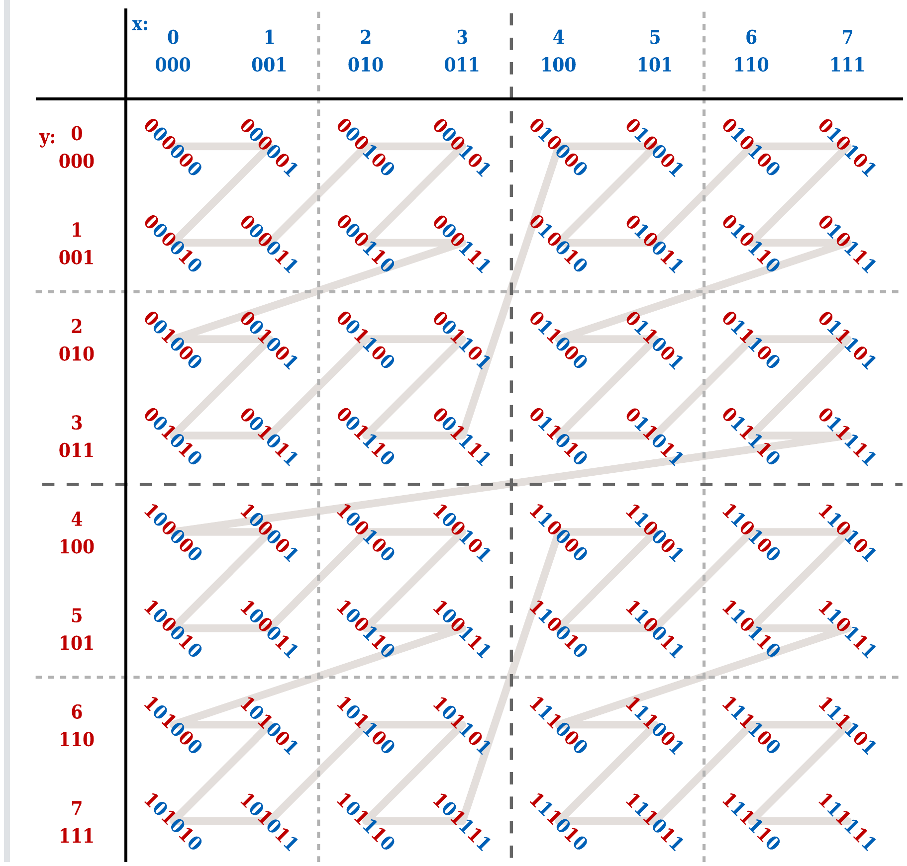
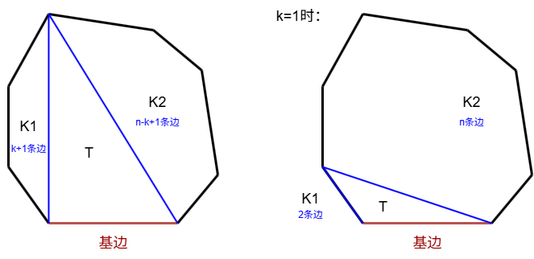

# 程序设计基础 C5 答案（2025秋）

## A 泠涼的偏好 2

| 难度 | 考点 |
| --- | --- |
| 1 | math.h 库函数 |

### 题目

#### 题目描述

多组数据，每组给出 $x$ 和 $y$ ，求 $x$ 的 $y$ 次方根，即 $x^{\frac{1}{y}}$ ，保留 5 位小数输出。注意计算 $\frac{1}{y}$ 时要用浮点数除法，写成 `1 / y` 会因为整数除法而得到 0；也不要用 `float` ，精度不够。

#### 输入格式

第一行一个整数 $n$ ，表示数据组数。接下来 $n$ 行，每行两个整数 $x$ 和 $y$ ，用空格分隔。

#### 输出格式

$n$ 行，每行一个实数，表示 $x^{\frac{1}{y}}$ 的值，保留小数点后 5 位。

#### 样例输入

```text
2
8 3
27 3
```

#### 样例输出

```text
2.00000
3.00000
```

### 答案

### 题目分析

本题主要考查库函数的使用，用法已在「hint」中给出。

注意 `1/y` 时可能的整除导致的答案错误，以及使用 `float` 型可能导致的精度不足。

### 示例代码

```c
#include<stdio.h>
#include<math.h>
int main()
{
    int n, x, y;
    scanf("%d", &n);
    for(int i = 0; i < n; i++) {
        scanf("%d %d", &x, &y);
        printf("%.5lf\n", pow(x, 1. / y));
    }
    return 0;
}
```

## B 哈希大乱炖

| 难度 | 考点 |
| --- | --- |
| 1 | 函数调用 |

### 题目

#### 题目描述

题目给出下面这个哈希函数，它需要 `#include<stdint.h>` ：

```c
int hash_ll(long long key) {
    const uint64_t multiplier = 11400714819323198485ULL;
    uint64_t x = (uint64_t)key;
    x *= multiplier;
    return (int)(x >> 32);
}
```

给定若干个整数，输出每个整数经过 `hash_ll` 之后得到的结果。

#### 输入格式

第一行一个整数 $n$ 。接下来 $n$ 行，每行一个整数 $x$ 。

#### 输出格式

$n$ 行，每行一个整数，表示 `hash_ll(x)` 的返回值。

#### 样例输入

```text
2
1
2
```

#### 样例输出

```text
-1640531527
1013904242
```

#### 数据范围

$x$ 需要用 `long long` 读入。

### 答案

### 解题思路

> 从使用角度：函数是一个黑盒。使用时，只需了解“函数名称、输入数据、输出结果、实现功能”等信息，不必关心具体的设计方法 —— P5 ppt 第 9 页

本题只需知道函数的输入参数类型和返回值类型，然后调用函数即可。

注意一定要将题面给出的内容复制全，不要落下 `#include<stdint.h>` ！！

### 示例代码

```c
#include<stdio.h>
#include<stdint.h>

int hash_ll(long long key) {
    const uint64_t multiplier = 11400714819323198485ULL;
    uint64_t x = (uint64_t)key;
    x *= multiplier;
    return (int)(x >> 32);
}

int main() {
    int n;
    scanf("%d", &n);
    while(n--) {
        long long x;
        scanf("%lld", &x);
        printf("%d\n", hash_ll(x));
    }
    return 0;
}
```

## C 卢卡斯序列

| 难度 | 考点 |
| --- | --- |
| 1 | 递推 |

### 题目

#### 题目描述

卢卡斯序列定义为 $a_0 = 2$ ， $a_1 = 1$ ，对 $i \ge 2$ 有 $a_i = a_{i-1} + a_{i-2}$ 。给定若干个下标，输出对应的项。

#### 输入格式

第一行一个整数 $t$ ，表示询问次数。接下来 $t$ 行，每行一个整数 $b$ ，表示询问的下标。

#### 输出格式

$t$ 行，每行一个整数，表示 $a_b$ 。

#### 样例输入

```text
3
0
1
5
```

#### 样例输出

```text
2
1
11
```

#### 数据范围

$0 \le b \le 50$ 。数列增长很快，需要用 `long long` 存储。

### 答案

### 解题思路

这道题非常简单，参考斐波拉契数列即可。

可以运用一个数组存储第 $n$ 项,然后运用 `for` 循环维护即可。

但需要注意有炸 `int` 的风险，所以需要用 `long long` 存储。

### 示例代码

```c
#include<stdio.h>
long long a[51];
int main ( )
{
    a[1]=1;
    a[0]=2;
    for(int i=2;i<=50;i++)
    {
        a[i]=a[i-1]+a[i-2];
    }
    int t;
    scanf("%d",&t);
    for(int i=1;i<=t;i++)
    {
        int b;
        scanf("%d",&b);
        printf("%lld\n",a[b]);
    }
    return 0 ;
}
```

## D 纺星

| 难度 | 考点 |
| --- | --- |
| 2 | 质数 |

### 题目

#### 题目描述

多组数据，每组给出一个整数 $n$ ，求不小于 $n$ 的最小质数。

#### 输入格式

第一行一个整数 $t$ 。接下来 $t$ 行，每行一个整数 $n$ 。

#### 输出格式

$t$ 行，每行一个整数，表示不小于 $n$ 的最小质数。

#### 样例输入

```text
2
8
14
```

#### 样例输出

```text
11
17
```

#### 数据范围

$n \le 10^{9}$

### 答案

### 题解

参考课上讲的 `isprime` 函数，可以用 `isprime(x)` 来判断 $x$ 是否为质数。

因此，我们直接枚举 $n, n+1, n+2, \cdots$ 直到找到第一个质数为止。

那枚举为什么是对的呢？实际上，在 $[1,x]$ 之间素数的个数约等于 $\frac{x}{\ln x}$。

此外，可以证明在 $[1, 10^9]$ 以内，距离最远的两个素数差为 $436273291 - 436273009 = 282$。

### 示例代码

```c
#include <stdio.h>

int isprime(long long x){
    if(x<=1) return 0;
    for(long long i=2;i*i<=x;i++)
        if(x%i==0) return 0;
    return 1;
}
int main(){
    int t;
    scanf("%d",&t);
    while(t--){
        int n;
        scanf("%d",&n);
        while(isprime(n)==0)        // 或者，使用 while(!isprime(n))
            n++;
        printf("%d\n",n);
    }
    return 0;
}
```

## E Aconsma

| 难度 | 考点 |
| --- | --- |
| 2 | 函数 |

### 题目

#### 题目描述

题目给出下面三个函数，所有运算都在 32 位无符号整数下进行：

```c
unsigned int f(unsigned int x) {
    return (x + 2) * x + 9;
}
unsigned int g(unsigned int x) {
    return f(x) + f(2 * f(x + 3)) + 3 * x;
}
unsigned int h(unsigned int x, unsigned int y) {
    return g(f(x) + y) + f(3 * g(4 * x + y)) + g(f(f(x - y)));
}
```

给定若干组 $x$ 和 $y$ ，求 $h(x, y)$ 。

#### 输入格式

第一行一个整数 $t$ 。接下来 $t$ 行，每行两个非负整数 $x$ 和 $y$ ，用空格分隔。

#### 输出格式

$t$ 行，每行一个无符号整数，表示 $h(x, y)$ 的值。

#### 样例输入

```text
1
1 2
```

#### 样例输出

```text
3147452229
```

### 答案

### 题解 1

直接模拟，使用返回 `unsigned int` 的函数即可。

### 题解 2

注意到答案是

$$
h(x,y)
$$

直接计算即可。由于篇幅限制，我们不提供这种解法的参考代码。

### 示例代码

```c
#include <stdio.h>

unsigned int f(unsigned int x){
    return (x+2)*x+9;
}
unsigned int g(unsigned int x){
    return f(x)+f(2*f(x+3))+3*x;
}
unsigned int h(unsigned int x,unsigned int y){
    return g(f(x)+y)+f(3*g(4*x+y))+g(f(f(x-y)));
}
int main(){
    int t;
    scanf("%d",&t);
    while(t--){
        unsigned int x,y;
        scanf("%u%u",&x,&y);
        unsigned int hxy=h(x,y);
        printf("%u\n",hxy);
    }
    return 0;
}
```

## F 不讲 5 的（扩展版小数据）

| 难度 | 考点 |
| --- | --- |
| 3 | 函数 |

### 题目

#### 题目描述

把 $n$ 拆成三个非负整数之和，求满足 $i + j + k = n$ 且 $0 \le i \le j \le k$ 的三元组 $(i, j, k)$ 的个数，其中 $i$ 、 $j$ 、 $k$ 的十进制表示里都不能出现数字 5。

#### 输入格式

一行一个整数 $n$ 。

#### 输出格式

一行一个整数，表示满足条件的三元组个数。

#### 样例输入

```text
6
```

#### 样例输出

```text
6
```

### 答案

### 题目分析

使用双重循环枚举 $a, b$，验证 $a, b, n - a - b$ 满足大小关系且均不含数字 5 即可。

验证一个自然数是否含数字 5，可以写一个函数来判断，这样就不用写三次一模一样的代码了。

### 示例代码

```c
#include <stdio.h>

int no5(int x) { // 判断 x 是否不含数字 5
    for ( ; x != 0; x /= 10 )
        if ( x % 10 == 5 )
            return 0;
    return 1;
}

int main() {
    int n, ans = 0;
    scanf("%d", &n);
    for ( int i = 0; i <= n; i++ )
        for ( int j = i; j <= n; j++ ) { // 此时已满足 j >= i
            int k = n - i - j;
            if ( k < j ) // 还要满足 k >= j
                break;
            if ( no5(i) && no5(j) && no5(k) )
                ans++;
        }
    printf("%d", ans);
    return 0;
}
```

## G 致虚极

| 难度 | 考点 |
| --- | --- |
| 4 -> 3 | 位运算 -> 递归 |

### 题目

#### 题目描述

定义数列 $A_0$ 只含一个元素。把数列 $(A_0 A_1 \cdots A_{k-1})$ 的每一项都加上 $k$ ，就得到数列 $A_k$ 。把 $A_0, A_1, A_2, \ldots$ 依次拼接起来得到数列 $T$ ，其中 $T_0 = 0$ 。给定 $n$ ，求 $T_n$ 。

#### 输入格式

一行一个非负整数 $n$ 。

#### 输出格式

一行一个非负整数，表示 $T_n$ 。

#### 样例输入

```text
5
```

#### 样例输出

```text
4
```

#### 数据范围

$n$ 按 32 位无符号整数读入，递归或位运算的写法都可以。

### 答案

### 题目分析

为方便后续说明，设 $A, B$ 是两个数列，我们记 $|A|$ 为数列 $A$ 的长度，记 $(AB)$ 为数列 $A$ 和数列 $B$ 的拼接数列。

数列的生成方式为 $(A_0A_1 \cdots A_{k-1})$ 每项加 $k$ 得到数列 $A_k$，因此有 $|A_k| = |(A_0A_1 \cdots A_{k-1})|$。从而每次迭代，数列长度都将翻倍。由于 $|A_0| = 1$，因此有 $|(A_0A_1 \cdots A_k)| = 2^k$。

那么我们找到一个 $k$ 满足 $2^{k-1} \le n < 2^k$ 时，即表明 $T_n$ 是数列 $A_k$ 中的元素 $(A_k)_{n-2^{k-1}}$。由 $A_k$ 的生成方式，它的值等于 $(A_0A_1 \cdots A_{k-1})_{n-2^{k-1}} + k$ 即 $T_{n-2^{k-1}} + k$。进而我们可以递归地去计算。

### 示例代码 1

```c
#include <stdio.h>
unsigned int calc(unsigned int n) {
    if ( n == 0 )
        return 0; // T[0] = 0
    // 首先，我们先求出 n 是在哪个 A 数列出现的。
    unsigned int k = 0, temp = n; // 需要设置临时变量，防止返回时被改
    while ( temp > 0 ) {
        temp /= 2;
        k++;
    }
    // 那么 n 是在 Ak 中出现的。递归地求解 T[n - 2 ^ (k - 1)] 。
    return k + calc(n - (1 << (k - 1)));
}
int main() {
    unsigned int n;
    scanf("%u", &n);
    printf("%u\n", calc(n));
    return 0;
}
```

### 示例代码 2

本题原本是出给位运算专题的。

设 $n = \overline{w_{31}w_{30} \cdots w_0}$。

不难注意到通项为 $T_n = \sum_{i=0}^{31}(i+1) \times w_i$。我们接下来推导它是怎么来的。

由于 $|(A_0A_1 \cdots A_k)| = 2^k$，每个元素的下标正好能用 $k$ 位二进制数表示。那么 $(A_0A_1 \cdots A_{k-1})$ 中的元素的第 $k - 1$ 位为 $0$， $A_k$ 中的元素第 $k - 1$ 位为 $1$。

$A_k$ 的生成满足：与 $(A_0A_1 \cdots A_{k-1})$ 下标相同的元素，值会多 $k$，同时在 $T$ 中，同元素下标增加 $2^{k-1}$，即下标的第 $k - 1$ 位被置为 $1$。

那么在 $T$ 中，每当下标的第 $k - 1$ 位从 $0$ 变为 $1$ 时，其值也将加 $k$，那么第 $k$ 位就是加上 $k + 1$，从而我们可以视 $k + 1$ 为第 $k$ 位的权重。这一步，从第 $0$ 位到第 $31$ 位都是成立的，所以不管 $T_0$ 是什么，都有 $T_n = T_0 + \sum_{i=0}^{31}(i+1) \times w_i$。代入 $T_0 = 0$，我们得到了这个相当简洁的通项公式。

```c
#include <stdio.h>
int main() {
    unsigned int n, ans;
    scanf("%u", &n);
    for ( int i = 31; i >= 0; i-- )
        ans += ((n >> i) & 1) * (i + 1);
    printf("%u", ans);
    return 0;
}
```

## H 泠涼的偏好 3

| 难度 | 考点 |
| --- | --- |
| 4 | 递归 |

### 题目

#### 题目描述

给定 $n$ ，输出一个 $2^n \times 2^n$ 的矩阵，其中第 $i$ 行第 $j$ 列的元素，是按 $Z$ 形路径遍历整个矩阵时该位置被访问的顺序编号，编号从 1 开始。 $Z$ 形路径指每次把矩阵均分成左上、右上、左下、右下四个子矩阵，并按「左上 → 右上 → 左下 → 右下」的顺序递归遍历下去。

#### 输入格式

一行一个整数 $n$ 。

#### 输出格式

$2^n$ 行，每行 $2^n$ 个整数，相邻两数之间用一个空格分隔。

#### 样例输入

```text
2
```

#### 样例输出

```text
1 2 5 6
3 4 7 8
9 10 13 14
11 12 15 16
```

#### 数据范围

本题空间限制严格，不能开二维数组把整个矩阵存下来，需要在遍历到每个坐标时直接算出它的编号。

### 答案

### 题目分析

本题要求我们生成一个 $2^n \times 2^n$ 的矩阵，矩阵中的每个元素的值，是按照 $Z$ 形路径遍历整个矩阵时，该位置被访问的顺序。由于题目特殊的空间限制，我们不能使用数组存储整个矩阵（而且大家也没有学过二维数组），而应该在遍历坐标 `(i, j)` 时，直接计算出该位置的值并输出。

> 本题中的 $Z$ 形路径，又被称为 Z-order curve, Lebesgue curve, Morton space-filling curve 等。它在文件存储方面有独特的作用，感兴趣的同学可以课外自行了解。

一个大小为 $2^n \times 2^n$ 的矩阵可以被分为四个大小为 $2^{n-1} \times 2^{n-1}$ 的子矩阵：左上、右上、左下、右下。 $Z$ 形路径将按照「左上-右上-左下-右下」的顺序依次遍历这四个子矩阵。因此对于任意一个坐标 $(x,y)$（ $x$ 为行， $y$ 为列），我们可以判断它属于哪个子矩阵：

- 若在左上子矩阵，其路径顺序就是它在大小为 $2^{n-1} \times 2^{n-1}$ 的左上子矩阵中的 $Z$ 形路径顺序；
- 若在右上子矩阵，其路径顺序需要加上整个左上子矩阵的方格数（即 $(2^{n-1})^2$），再加上它在右上子矩阵中的相对路径顺序；
- 若在其他两个子矩阵同理。

因此，我们可以编写一个递归函数 `int Zpath (int x, int y, int k)`，计算 $(x,y)$ 在 $2^k \times 2^k$ 的矩阵中的路径顺序。

我们每次递归都可以将大小为 $2^k \times 2^k$ 的矩阵划分成大小为 $2^{k-1} \times 2^{k-1}$ 的子矩阵，也就是说，每次递归 $k$ 都会减 1。（注意 $(x,y)$ 在子矩阵中的相对坐标。）

最后我们需要考虑递归边界（即什么时候结束递归）。我们可以在 $k = 1$（即大小为 $2 \times 2$ 的矩阵）或者 $k = 0$（即只剩 1 个元素时）返回对应的值。

### 示例代码

#### 解一：递归

```c
#include<stdio.h>
int Zpath(int x, int y, int k) {
    if(k == 0) {
        return 1;
    }
    int l = (1 << (k - 1));
    if(x < l && y < l) {
        return Zpath(x, y, k - 1);
    } else if(x < l && y >= l) {
        return Zpath(x, y - l, k - 1) + l * l;
    } else if(x >= l && y < l) {
        return Zpath(x - l, y, k - 1) + l * l * 2;
    } else {
        return Zpath(x - l, y - l, k - 1) + l * l * 3;
    }
}
int main() {
    int n;
    scanf("%d", &n);
    for(int i = 0; i < (1 << n); i++) {
        for(int j = 0; j < (1 << n); j++) {
            printf("%d ", Zpath(i, j, n));
        }
        printf("\n");
    }
    return 0;
}
```

#### 解二：位运算

同学们可以参考下图或查阅相关资料进行理解。



```c
#include<stdio.h>
int main() {
    int n;
    scanf("%d", &n);
    for(int i = 0; i < (1 << n); i++) {
        for(int j = 0; j < (1 << n); j++) {
            int res = 0;
            for(int k = 0; k < n; k++) {
                res |= ((i >> k & 1) * 2 + (j >> k & 1)) << (k * 2);
            }
            printf("%d ", res + 1);
        }
        printf("\n");
    }
    return 0;
}
```

## I 三角地划分

| 难度 | 考点 |
| --- | --- |
| 5 | 记忆化递归/递推 |

### 题目

#### 题目描述

求用互不相交的对角线把一个凸 $n$ 边形划分成若干个三角形区域的方案数。

#### 输入格式

一行一个整数 $n$ ，表示多边形的边数。

#### 输出格式

一行一个整数，表示划分方案数。

#### 样例输入

```text
5
```

#### 样例输出

```text
5
```

#### 数据范围

$n \le 31$ 。答案增长很快，需要用 `long long` 存储；直接递归会大量重复计算，需要记忆化。

### 答案

### 解题思路

这道题目分解子问题的思路有多种，在此仅介绍其中一种。不同的分解思路将产生出不同的递推公式，进而写出不同的代码实现，只要最终结果正确那么这种思路就是正确的。

为了方便后面公式的书写，我们令 $n = M - 1$，原问题即为求凸 $n + 1$ 边形的三角划分方法数。

首先确定多边形的一条边作为基边。（确定一个基边只是为了方便思考，看完解题思路之后可以思考一下，为什么确定一个基边就可以不重不漏地完成计数）

在除基边两端点以外的多边形顶点中选择一个顶点，这个顶点与基边形成一个三角形区域 $T$。区域 $T$ 将多边形分成两个部分 $K_1, K_2$，其中 $K_1$ 有 $k + 1$ 条边， $K_2$ 有 $n - k + 1$ 条边（ $k = 1, 2, \ldots, n - 1$）（你可能会问有 2 条边的区域是什么，别着急下面有讲）。求 $K_1$ 和 $K_2$ 的三角形划分方法数即是原问题的子问题。

我们记凸 $n + 1$ 边形的三角形划分方法数为 $h_n$，两个子问题即为 $h_k$ 和 $h_{n-k}$。在区域 $T$ 固定的情况下，根据乘法原理，有 $h_k \times h_{n-k}$ 种方法进一步将 $K_1, K_2$ 划分为三角形区域。



$h_1$，即“2边形”，实际是一条线段，我们可以把它看作是具有外部而没有内部的多边形区域。令 $h_1 = 1$，由于我们要将 $h_1$ 与 $h_{n-1}$ 相乘得到如上右图情况下的划分方法数，不可令 $h_1 = 0$。

以上只是 $T$ 确定时的三角形划分方法数。由于选择顶点形成三角形区域 $T$ 的方法有 $(n + 1) - 2 = n - 1$ 种，因此总共有 $h_n = h_1h_{n-1} + h_2h_{n-2} + \cdots + h_{n-1}h_1 = \sum_{k=1}^{n-1}h_kh_{n-k}$ 种方法把凸 $n + 1$ 边形划分成三角形区域。

根据这个递推公式，即可编写代码求解。然而进一步思考我们不难发现，对于每个 $h_n$，我们要计算 $2n$ 个子问题。将计算 $h_n$ 的方法写成一个函数的话，计算 10 边形（计算 $h_9$）要调用 6561 次函数，计算 20 边形（计算 $h_{19}$）要调用约 $3 \times 10^8$ 次函数，计算 30 边形（计算 $h_{29}$）要调用约 $2 \times 10^{13}$ 次函数，这必将超时。因此我们需要用到**记忆化搜索**的技巧。不难发现，比如在计算 $h_5$ 时， $h_4$ 被计算了 2 次， $h_3$ 被计算了 4 次， $h_2$ 被计算了 6 次， $h_1$ 被计算了 8 次，存在大量的重复计算。我们只需将第一次计算 $h_i$ 的结果存储起来，后续每次需要 $h_i$ 时，直接获取即可，这样便会减少大量的重复计算。

### 示例代码

```c
#include <stdio.h>

long long memo[32]; // memo[i] 用于记录 hi 的值

long long h(int n) {
    if (n == 1) return 1;

    if (memo[n] != 0) { // 记忆化搜索：如果之前计算过这个值，直接取用
        return memo[n];
    }

    long long sum = 0;
    for (int i = 1; i < n; i++) {
        sum += h(i) * h(n - i);
    }
    memo[n] = sum; // 记忆化搜索：将计算得到的值存储起来
    return sum;
}

int main() {
    int n;
    scanf("%d", &n);
    long long count = h(n - 1);
    printf("%lld\n", count);

    return 0;
}
```

本题得到的 $h_n$ 递推公式其实是卡特兰数（Catalan）的递推公式，卡特兰数经常出现于各种计数问题中。有算法或者组合数学基础的同学可以思考如何进一步求解这个递推式，从而实现时间复杂度为 $O(n)$ 的解法。

## J 老人与海

| 难度 | 考点 |
| --- | --- |
| 8 | 素数，打表 |

### 题目

#### 题目描述

有 $n$ 条鱼，编号从 1 到 $n$ 。经过题目所述的筛选过程之后，最终被保留下来的鱼的编号恰好是 1 以及 $[1, n]$ 内的全部质数，这一点可以由威尔逊定理得到。请求出最终保留下来的鱼的数量。

#### 输入格式

一行一个整数 $n$ 。

#### 输出格式

一行一个整数，表示最终保留下来的鱼的数量。

#### 样例输入

```text
10
```

#### 样例输出

```text
5
```

#### 数据范围

$n$ 需要用 `long long` 存储。对 $[1, n]$ 中每个数逐一做素性判断可得 5% 的分数，用埃氏筛可得 40% 的分数。

### 答案

### 题目分析

最终我们捕获的鱼的总数：1条

由于本题演都不演了，本题仅给出 0.4 部分分的题解。对于没有竞赛基础或竞赛基础有限的同学，请无视本题。本题的正解是 [min25 筛](https://oi-wiki.org/math/number-theory/min-25/) 的前半部分。

看本题的样例解释，被保留的鱼： $1, 2, 3, 5, 7$ 是否让你感到有点眼熟？

尝试验证所有 $n \le 20$ 的编号，我们发现，被保留的鱼有 $1, 2, 3, 5, 7, 11, 13, 17, 19$。

事实上，最后保留下来的鱼的编号，就是 $[1,n]$ 上的所有质数以及 1。

这是[威尔逊定理](https://baike.baidu.com/item/%E5%A8%81%E5%B0%94%E9%80%8A%E5%AE%9A%E7%90%86/1881444)，详细证明见链接。

问题转变成统计不超过 $n$ 的素数有多少个。

可以使用课程上教的 `isPrime` 函数，对 $[1,n]$ 的每个数进行判断并统计，这样可以获得 $5\%$ 的部分分。

而 $40\%$ 的部分分需要使用素数筛，这里使用更简单易懂的埃式筛。

从 2 遍历到 $n$，如果 $x$ 是素数，那么 $2x, 3x, 4x, \cdots$ 就不会是素数，可以打上标记。

这样遍历一遍，所有没被打上标记的数就是素数了。

### 示例代码 (0.4 分)

```c
#include <stdio.h>
int notprime[10000007];
int main(void)
{
    for (int i = 2; i <= 10000000; i++)
    {
        if (notprime[i] == 0)
        {
            for (int j = i + i; j <= 10000000; j += i)
            {
                notprime[j] = 1;
            }
        }
    }
    int cnt = 1;
    long long n;
    scanf("%lld", &n);
    for (int i = 2; i <= n; i++)
    {
        if (notprime[i] == 0)
            cnt++;
    }
    printf("%d", cnt);
    return 0;
}
```
