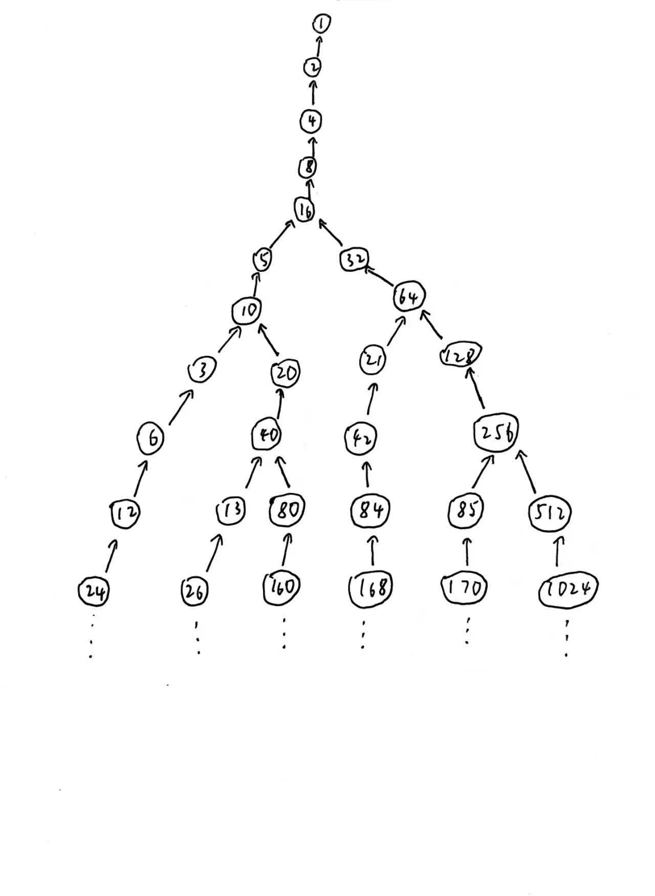

# 程序设计基础 C8 答案（2025秋）

## B 小宇的上机安排

| 难度 | 考点 |
| --- | --- |
| 2 | qsort |

### 题目

#### 题目描述

读入 $n$ 个数，把它们从小到大排序后去重输出。

#### 输入格式

第一行一个整数 $n$ 。接下来 $n$ 行，每行一个整数。

#### 输出格式

一行，按从小到大的顺序输出所有出现过的数，重复的只输出一次，相邻两数之间用一个空格分隔。

#### 样例输入

```text
6
3
1
2
3
2
5
```

#### 样例输出

```text
1 2 3 5
```

#### 数据范围

$n \le 10^{6}$ ，数值需要用 `long long` 存储。冒泡排序会超时，应使用 `qsort` 。

### 答案

### 题目分析

这道题第一步读取输入，将输入存入数组中。第二步对数组升序排序。第三步输出数组，输出的同时注意重复项不要输出。

在数组排序中，大家可能会遇到以下两个问题：

- 使用冒泡排序，结果 `TLE`

  当前大家已经学过冒泡排序和 `qsort` 。冒泡排序的时间复杂度为 $O(n^2)$ ，而 `qsort` 的时间复杂度为 $O(n \log(n))$ ，显然后者的排序速度更快。因此大家在常规的排序中优先使用 `qsort` 。

- 使用了 `qsort` ，但 `cmp` 函数是错误的。

  部分 `WA` 的同学使用下面这种 `cmp` 函数

  ```c
  int cmp(const void* p1, const void* p2)
  {
      return *(long long *)p1-*(long long *)p2;
  }
  ```

  这个函数看似是可行的，但在某些情况下，这种实现可能会导致错误的结果。

  当两个整数的差值超出了整型变量的范围，就会发生溢出，这可能会导致比较结果不正确。

  因此在编写 `cmp` 函数时，一定不要两个数直接相减，而是采用下面这种比较的方式

  ```c
  int cmp(const void* p1, const void* p2) {   //升序排列
      int* a = (long long*)p1, * b = (long long*)p2;
      if (*a < *b)return -1;
      else if (*a > *b) return 1;
      else return 0;
  }
  ```

### 示例代码

```c
#include <stdio.h>
#include <stdlib.h>

int cmp(const void* p1, const void* p2) {   //升序排列
    long long* a = (long long*)p1, * b = (long long*)p2;
    if (*a < *b)return -1;
    else if (*a > *b) return 1;
    else return 0;
}
long long a[1000000];
int main()
{
    int n;
    scanf("%d",&n);
    for (int i = 0; i < n; ++i) {
        scanf("%lld",&a[i]);

    }
    qsort(a,n,sizeof (long long),cmp);
    long long old=a[0];
    printf("%lld ",a[0]);
    for (int i = 1; i < n; ++i) {
        if (old==a[i]) continue; //如果当前数和上一个数相同，就不输出
        printf("%lld ",a[i]);
        old=a[i];
    }
}
```

## C Alice in Palindrome

| 难度 | 考点 |
| --- | --- |
| 1 | 字符串 |

### 题目

#### 题目描述

多组数据，每组给出一个不含空白字符的字符串，求至少修改多少个字符才能把它变成回文串。

#### 输入格式

若干行，每行一个字符串，读到文件结束（EOF）为止。

#### 输出格式

每组输出一行一个整数，表示最少需要修改的字符个数。

#### 样例输入

```text
abcba
abcd
```

#### 样例输出

```text
0
2
```

### 答案

### 题目分析

本题主要考查对无空白字符的字符串的读入和对回文串的理解。

我们将整个字符串分为 $(s_1, s_n), (s_2, s_{n-1}), \ldots$ 共 $\left\lfloor \frac{n}{2} \right\rfloor$ 个二元组，那么 $s$ 为回文串，当且仅当每个二元组中的两个元素相等。

要达到这个条件，且修改次数尽量少，我们只需找到所有二元组 $(a,b), a \neq b$ ，将 $a$ 改为 $b$ （或反之），因此答案即为两个元素不同的二元组的个数。

代码示例中采取指针实现，通过 `p` `q` 两个指针分别指向对称的两个位置，不断相向移动直至相遇，同学们可以通过这份代码再次复习指针的用法。

### 示例代码

```c
#include<stdio.h>
#include<string.h>
char str[10008];
int main(void) {
    while(scanf("%s", str) != EOF) {
        int cnt = 0;
        char *p = str, *q = str + strlen(str) - 1;
        while(p < q) {
            if(*p != *q)
                cnt++;
            p++;
            q--;
        }
        printf("%d\n", cnt);
    }
}
```

## D 五门 D(X)

| 难度 | 考点 |
| --- | --- |
| 3 | 格式化输入, 分支结构 |

### 题目

#### 题目描述

给定若干个随机变量的分布描述，输出它们的数学期望与方差。分布写成 `X~L(...)` 的形式，其中 `X` 是变量名（一个字符）， `L` 是分布代号，参数之间用逗号分隔：

- `B(n,p)` ：二项分布， $E(X) = np$ ， $D(X) = np(1 - p)$ ；
- `P(lambda)` ：泊松分布， $E(X) = D(X) = \lambda$ ；
- `G(p)` ：几何分布， $E(X) = \frac{1}{p}$ ， $D(X) = \frac{1-p}{p^2}$ ；
- `U(a,b)` ：区间 $[a, b]$ 上的均匀分布， $E(X) = \frac{a+b}{2}$ ， $D(X) = \frac{(b-a)^2}{12}$ ；
- `N(mu,sigma2)` ：正态分布， $E(X) = \mu$ ， $D(X) = \sigma^2$ 。

#### 输入格式

第一行一个整数 $T$ 。接下来 $T$ 行，每行一个形如 `X~L(...)` 的分布描述。

#### 输出格式

每组输出一行，格式为 `E(X)=期望,D(X)=方差` ，其中变量名与输入一致，两个数都保留小数点后 4 位。

#### 样例输入

```text
2
X~B(10,0.5)
Y~P(3)
```

#### 样例输出

```text
E(X)=5.0000,D(X)=2.5000
E(Y)=3.0000,D(Y)=3.0000
```

### 答案

### 题目分析

本题主要考查格式化输入与 `switch-case` 分支结构。

本题的输入部分可以采用如下方法处理：

1. 通过 `scanf` 格式字符串控制，如通过 `scanf("%c~%c(", &X, &L)` 读入，本篇题解采用此方法；
2. 通过 `getchar()` 等控制，如：

   ```c
   X = getchar();
   getchar(); // 捕获 `~`
   L = getchar();
   getchar(); // 捕获 `(`
   ```

3. 将整个输入视为字符串，通过 `sscanf` 或正则等方法读入。

注意可能的换行符导致输入不符合预期。

输入符号后，可以通过 `switch-case` 分支结构判断不同的参数格式进行读入并计算。

最后统一输出或分开输出均可。

### 代码示例

```c
#include<stdio.h>
int main() {
    int T;
    scanf("%d", &T);
    while(T--) {
        char X, L;
        double EX, DX;
        scanf(" %c~%c(", &X, &L); // 前置空格滤去可能的换行
        switch (L) {
            case 'B': {
                double n, p;
                scanf("%lf,%lf)", &n, &p);
                EX = n * p;
                DX = n * p * (1 - p);
                break;
            }
            case 'P': {
                double lambda;
                scanf("%lf)", &lambda);
                EX = DX = lambda;
                break;
            }
            case 'G': {
                double p;
                scanf("%lf)", &p);
                EX = 1 / p;
                DX = (1 - p) / (p * p);
                break;
            }
            case 'U': {
                double a, b;
                scanf("%lf,%lf)", &a, &b);
                EX = (a + b) / 2;
                DX = (b - a) * (b - a) / 12;
                break;
            }
            case 'N': {
                double mu, sigma2;
                scanf("%lf,%lf)", &mu, &sigma2);
                EX = mu;
                DX = sigma2;
                break;
            }
        }
        printf("E(%c)=%.4lf,D(%c)=%.4lf\n", X, EX, X, DX);
    }
}
```

## E sølips

| 难度 | 考点 |
| --- | --- |
| 2 | 计算几何 |

### 题目

#### 题目描述

多组数据。给定一个凸多边形的 $n$ 个顶点和绳子的半径 $r$ ，把一根绳子套在这个多边形上（可以看成在每个顶点处放一个半径为 $r$ 的圆，绳子绷紧后由相邻圆之间的外切线和绕在圆外侧的圆弧构成）。求绳子的长度，它等于多边形的周长加上 $2 \pi r$ 。

#### 输入格式

第一行一个整数 $t$ 。每组数据第一行两个整数 $n$ 和 $r$ 。接下来 $n$ 行，每行两个整数 $x$ 和 $y$ ，按顺序给出一个顶点的坐标。

#### 输出格式

每组输出一行一个实数，表示绳子的长度，保留小数点后 15 位。

#### 样例输入

```text
1
4 1
0 0
1 0
1 1
0 1
```

#### 样例输出

```text
10.283185307179586
```

### 答案

### 题解

由于多边形是凸的，所以多边形不会凹进去——这说明，绳子应该由相邻圆的外切线和每个圆外部的圆弧构成。

其中，圆弧的角度之和应当是多边形外角和，即 $2\pi$ 构成一个完整的圆，因此，圆弧总长 $2\pi$ 。

此外，相邻圆的外切线长度等于相邻点的距离，因此，相邻圆的外切线长度之和等于多边形周长。

答案是多边形的周长 $L$ 加上圆弧的长度和 $2\pi r$ 。

### 示例代码

```c
#include <stdio.h>
#include <math.h>

typedef long long ll;
ll x[200010],y[200010];
void solve() {
    int n;
    ll r;
    scanf("%d%lld",&n,&r);
    for(int i=1;i<=n;i++)
        scanf("%lld%lld",&x[i],&y[i]);
    x[0]=x[n]; y[0]=y[n];
    double PI=3.141592653589793238462643383;
    double ans=PI*r*2;
    for(int i=1;i<=n;i++) {
        ans+=sqrt((x[i]-x[i-1])*(x[i]-x[i-1])+(y[i]-y[i-1])*(y[i]-y[i-1]));
    }
    printf("%.15f\n",(double)ans);
}
int main(){
    int t;
    scanf("%d",&t);
    while(t--) solve();
    return 0;
}
```

<!-- markdownlint-disable-next-line MD026 -->
## F world.execute(me);

| 难度 | 考点 |
| --- | --- |
| 3 | 位运算 |

### 题目

#### 题目描述

多组数据，每组给出 $l$ 和 $r$ ，求在所有满足 $l \le a \le b \le r$ 的数对 $(a, b)$ 中 $a \oplus b$ 的最大值。

#### 输入格式

第一行一个整数 $t$ 。接下来 $t$ 行，每行两个整数 $l$ 和 $r$ ，用空格分隔。

#### 输出格式

每组输出一行一个整数，表示最大的异或值。

#### 样例输入

```text
2
1 4
5 5
```

#### 样例输出

```text
7
0
```

#### 数据范围

$l$ 、 $r$ 需要用 `long long` 存储，二进制长度不超过 60 位。

### 答案

### 题目分析

$L, R$ 太大了，直接枚举两个数肯定会超时。不妨直接思考答案长什么样子。

我们设最大值为 $ans$ ，从高到低贪心地考虑 $ans$ 的每一个二进制位。

先来看第 59 位（因为 $L, R$ 二进制最长只有 60 位）。如果 $L$ 和 $R$ 第 59 位不同，那么 $L$ 一定是 $(0abcd\cdots)_2$ 的形式， $R$ 一定是 $(1efgh\cdots)_2$ 的形式，共 60 位。此时取 $a = (0111\cdots1)_2 = 2^{59} - 1, b = (1000\cdots0)_2 = 2^{59}$ ，一定有 $L \le a, b \le R$ ，且 $a \oplus b = (111\cdots1)_2 = 2^{60} - 1$ 。那么这必然是最大值。

如果 $L$ 和 $R$ 第 59 位相同， $ans$ 的第 59 位只能是 0 ，因为 $[L, R]$ 之间所有数的第 59 位都相同。

接下来我们再看第 58 位是否相同，这就跟上面所说的过程一模一样了。

以此类推，如果第 $i$ 位相同就接着往下看，否则可以直接得出答案是 $2^{i+1} - 1$ 。

如果全部相同，答案为 0 。

### 示例代码

```c
#include<stdio.h>
int main(){
    int t;
    long long l,r;
    scanf("%d",&t);
    while(t--){
        scanf("%lld%lld",&l,&r);
        l^=r;
        long long ans=0;
        for(int i=59;i>=0;i--)if((l>>i)&1){
            ans=(1ll<<(i+1))-1;
            break;
        }
        printf("%lld\n",ans);
    }
    return 0;
}
```

## G RINWYN

| 难度 | 考点 |
| --- | --- |
| 4 | 循环，杨辉三角 |

### 题目

#### 题目描述

给定 $n$ 和两组数 $x_0, x_1, \ldots, x_n$ 与 $y_0, y_1, \ldots, y_n$ ，求 $(n+1) \times (n+1)$ 矩阵 $A$ 的行列式，其中 $A$ 的第 $i$ 行第 $j$ 列元素为 $(x_i + y_j)^n$ 。答案对 998442353 取模。

#### 输入格式

第一行一个整数 $n$ 。第二行 $n + 1$ 个整数，表示 $x_0$ 到 $x_n$ 。第三行 $n + 1$ 个整数，表示 $y_0$ 到 $y_n$ 。

#### 输出格式

一行一个整数，表示行列式的值对 998442353 取模的结果。

#### 样例输入

```text
2
1 2 3
4 5 6
```

#### 样例输出

```text
998442345
```

#### 数据范围

$n \le 1000$ 。模数是 998442353 而不是 998244353；加法和乘法过程中都要取模，相乘时需要用 `long long` 避免溢出。

### 答案

### 题目分析

本题主要考查循环结构与组合数的递推求法。

本题通过多种方式提示了本题需要使用类似杨辉三角的方法通过递推得到组合数。

我们熟知 $\binom{n}{k} = \binom{n-1}{k} + \binom{n-1}{k-1}$ ，因此可以通过递推的方式，通过二重循环得到 $\binom{a}{b}, 0 \le a, b \le n$ ，具体参考代码示例。

注意进行加法和乘法的过程中取模，模数为 998442353 而非 998244353 。

### 代码示例

```c
#include<stdio.h>
typedef long long ll; // 使用 long long 避免相乘时溢出
const ll P = 998442353;
int n;
ll x[1008], y[1008];
ll comb[1008][1008];
int main() {
    scanf("%d", &n);
    // 通过二重循环递推预处理组合数
    for (int i = 0; i <= n; i++) {
        for (int j = 0; j <= i; j++) {
            if (j == 0 || j == i) { // 边界条件
                comb[i][j] = 1;
            } else { // 递推式（组合恒等式）
                comb[i][j] = (comb[i - 1][j - 1] + comb[i - 1][j]) % P;
            }
        }
    }
    // 计算行列式的值
    ll res = 1; // 乘法结果的初始值为 1
    for (int i = 0; i <= n; ++i)
        res = (res * comb[n][i]) % P;
    for (int i = 0; i <= n; ++i) {
        scanf("%lld", &x[i]);
        for (int j = 0; j < i; ++j) {
            res = res * (x[i] - x[j] + P) % P;
        }
    }
    for (int i = 0; i <= n; ++i) {
        scanf("%lld", &y[i]);
        for (int j = 0; j < i; ++j) {
            res = res * (y[j] - y[i] + P) % P;
        }
    }
    printf("%lld\n", res);
    return 0;
}
```

## H 排学号

| 难度 | 考点 |
| --- | --- |
| 4 | 快速排序 |

### 题目

#### 题目描述

给定 $n$ 个学生的姓名和 18 位身份证号，按下面的规则排序后依次分配学号：先按性别排，身份证号第 17 位为偶数的是女生、为奇数的是男生，女生排在前面；性别相同则按身份证号前 6 位（出生地编号）的字典序；仍相同则按第 7 到 14 位（出生日期）的字典序；仍相同则按第 15 到 17 位（顺序码）的字典序。排好之后，第 1 个学生的学号是 25700001，之后依次递增。

#### 输入格式

第一行一个整数 $n$ 。接下来 $n$ 行，每行一个姓名和一个 18 位身份证号，用空格分隔。

#### 输出格式

$n$ 行，每行一个学号和对应的姓名，用空格分隔。

#### 样例输入

```text
3
Carl 110101200001010011
Ann 110101200001010023
Ben 110101199901010015
```

#### 样例输出

```text
25700001 Ann
25700002 Ben
25700003 Carl
```

#### 数据范围

$n \le 10^{5}$ 。冒泡排序会超时，应使用 `qsort` 。

### 答案

### 题目分析

由于数据范围较大，使用冒泡排序会运行超时，因此我们需要使用标准库提供的快速排序：库函数 `qsort` 。

方法一：我们可以考虑给每个学生编号，然后对他们的编号进行排序，最后通过编号对应到每个学生。具体地，假设第 $i$ 个学生姓名为 $name_i$ ，身份证号为 $id_i$ ，编号为 $index_i$ 并且初始化为 $i$ ，那么我们可以通过比较 $id_i$ 的规则，给 $index$ 排序，最后 $index$ 对应排序后学生的编号。该方法类似于 PPT 上的“按字符串长度排序”方法。

方法二：使用结构体。此内容超纲，因此仅提供代码，不做详细讲解。

方法三：注意到每个学生的信息都只有身份证号和姓名，都是字符串的形式，因此我们可以通过一个字符串来存储一个学生的信息。再注意到，在性别相同的情况下，事实上是根据身份证号字典序排序，因此我们可以通过将性别信息存储在身份证号前、姓名接在身份证号后的方法进行字典序排序。

### 示例代码 1

```c
#include <stdio.h>
#include <stdlib.h>
#include <string.h>
char name[100010][21], id[100010][20]; // 姓名、身份证号
int n, index[100010]; // 编号
int cmp(const void *, const void *);
int main() {
    scanf("%d", &n);
    for ( int i = 1; i <= n; i++ ) {
        scanf("%s%s", name[i], id[i] + 1); // 身份证号从第 1 位开始存
        index[i] = i; // 第 i 个学生编号为 i
    }

    qsort(index + 1, n, sizeof(int), cmp); // 改为对 index 进行排序
    for ( int i = 1; i <= n; i++ )
        printf("%d %s\n", 25700000 + i, name[index[i]]);
    return 0;
}
int cmp(const void *aa, const void *bb) {
    int a = *(int *)aa, b = *(int *)bb; // a 和 b 是编号，比较对应学生
    if ( id[a][17] % 2 != id[b][17] % 2 ) // 性别不同
        return id[a][17] % 2 - id[b][17] % 2;
    if ( strncmp(id[a] + 1, id[b] + 1, 6) != 0 ) // 出生地编号
        return strncmp(id[a] + 1, id[b] + 1, 6);
    if ( strncmp(id[a] + 7, id[b] + 7, 8) != 0 ) // 生日
        return strncmp(id[a] + 7, id[b] + 7, 8);
    return strncmp(id[a] + 15, id[b] + 15, 3); // 顺序码
}
```

### 示例代码 2

```c
#include <stdio.h>
#include <stdlib.h>
#include <string.h>
struct stu {
    char name[21];
    char id[20];
} A[100010];
int n;
int cmp(const void *, const void *);
int main() {
    scanf("%d", &n);
    for ( int i = 1; i <= n; i++ )
        scanf("%s%s", A[i].name, A[i].id + 1);
    qsort(A + 1, n, sizeof(A[0]), cmp); // 对结构体数组排序
    for ( int i = 1; i <= n; i++ )
        printf("%d %s\n", 25700000 + i, A[i].name);
    return 0;
}
int cmp(const void *aa, const void *bb) {
    struct stu a = *(struct stu *)aa, b = *(struct stu *)bb;
    if ( a.id[17] % 2 != b.id[17] % 2 )
        return a.id[17] % 2 - b.id[17] % 2;
    if ( strncmp(a.id + 1, b.id + 1, 6) != 0 )
        return strncmp(a.id + 1, b.id + 1, 6);
    if ( strncmp(a.id + 7, b.id + 7, 8) != 0 )
        return strncmp(a.id + 7, b.id + 7, 8);
    return strncmp(a.id + 15, b.id + 15, 3);
}
```

### 示例代码 3

```c
#include<stdio.h>
#include<string.h>
#include<stdlib.h>
char str[100000][41];
int N;
int main() {
    scanf("%d", &N);
    for(int i = 1; i <= N; ++i) {
        scanf("%s%s", str[i] + 20, str[i] + 1); // 注意给 \0 留位置
        str[i][0] = str[i][17] % 2 + '0'; // 性别放最前面，女生 0 男生 1
    }
    qsort(str + 1, N, 41, (int (*)(const void *, const void *)) strcmp);
    for(int i = 1; i <= N; ++i)
        printf("257%05d %s\n", i, str[i] + 20);
    return 0;
}
```

## I PANDORA PARADOXXX

| 难度 | 考点 |
| --- | --- |
| 5-6 | 数学 |

### 题目

#### 题目描述

多组数据，每组给出 $n$ 、 $q$ 和 $p$ ，求 $1 + q + q^2 + \cdots + q^n$ 的值模 $p$ 的结果。

#### 输入格式

第一行一个整数 $t$ 。接下来 $t$ 行，每行三个整数 $n$ 、 $q$ 、 $p$ ，用空格分隔。

#### 输出格式

每组输出一行一个整数，表示上述等比数列之和模 $p$ 的结果。

#### 样例输入

```text
2
3 2 1000
0 5 7
```

#### 样例输出

```text
15
1
```

#### 数据范围

$n$ 很大，需要用 `long long` 存储。直接循环累加会超时，需要用递归或快速幂；求 $q$ 的幂时也要用快速幂，否则最坏情况下会超时。

### 答案

### 方法一

我们可以定义 $S(n) = 1 + q + q^2 + \cdots + q^n$ 。

对于 $n$ 是奇数的情况，这是好做的：

我们设 $k = \frac{n-1}{2}$ ，有 $n = 2k+1$ :

$$
\begin{aligned}
S(n) &= 1 + q + q^2 + \cdots + q^n \\
&= (1 + q + \cdots + q^k) + (q^{k+1} + \cdots + q^n) \\
&= (1 + q + \cdots + q^k) + q^{k+1}(1 + q + \cdots + q^k) \\
&= (1 + q^{k+1})(1 + q + \cdots + q^k) \\
&= (1 + q^{k+1}) \times S(k)
\end{aligned}
$$

若 $n$ 是偶数，很显然有

$$S(n) = 1 + q \times S(n-1)$$

因此可以递归做。边界条件为 $S(0) = 1$ 。

对于奇数的情况，每次递归会使 $n$ 的规模削减一半；

对于偶数的情况，每次递归会使 $n$ 的规模减一；

因此，递归次数不会超过量级 $O(2 \log n) \approx 60$ 。

特别注意的是， $q^{k+1}$ 也应当被递归求，否则最坏情况下会被卡到 $O(\log^2 n)$ 的复杂度，有可能会 `TLE` ，因此需要在递归里进行快速幂。

#### 示例代码

```c
#include <stdio.h>

typedef long long ll;
ll calc(ll n,ll q,ll p,ll *qn) {
    if(n==0){
        *qn = 1%p;
        return 1%p;
    }
    if(n%2==1) {
        // [0 ~ mid] [mid+1 ~ n]
        ll mid=(n-1)/2;
        ll qmid;
        ll t=calc(mid,q,p,&qmid);
        ll bonus=1+qmid*q%p;
        *qn=qmid*qmid%p*q%p;
        return t*bonus%p;
    } else {
        ll qn1;
        ll rt=(1+q*calc(n-1,q,p,&qn1)%p)%p;
        *qn=qn1*q%p;
        return rt;
    }
}
int main(){
    int t;
    scanf("%d",&t);
    while(t--){
        ll n,q,p;
        scanf("%lld%lld%lld",&n,&q,&p);
        ll qn;
        ll ans=calc(n,q,p,&qn);
        ans=(ans%p+p)%p;
        printf("%lld\n",ans);
    }
    return 0;
}
```

### 方法二

我们可以定义 $S(q,n) = 1 + q + q^2 + \cdots + q^n$ 。

对于 $n$ 是奇数的情况，这是好做的：

我们设 $k = \frac{n-1}{2}$ ，有 $n = 2k+1$ :

$$
\begin{aligned}
S(q,n) &= 1 + q + q^2 + \cdots + q^n \\
&= (1 + q^2 + q^4 \cdots + q^{n-1}) + (q + q^3 + q^5 \cdots + q^n) \\
&= (1 + q^2 + q^4 \cdots + q^{n-1}) + q(1 + q^2 + q^4 \cdots + q^{n-1}) \\
&= (1+q)(1 + q^2 + q^4 \cdots + q^{n-1}) \\
&= (1+q) \times S(q^2, k)
\end{aligned}
$$

若 $n$ 是偶数，很显然有

$$S(q,n) = 1 + q \times S(q, n-1)$$

因此可以递归做。边界条件为 $S(0) = 1$ 。

对于奇数的情况，每次递归会使 $n$ 的规模削减一半；

对于偶数的情况，每次递归会使 $n$ 的规模减一；

因此，递归次数不会超过量级 $O(2 \log n) \approx 60$ 。

#### 示例代码

```c
#include <stdio.h>
int s(int a, int n, int mod)
{
    if (n == 0)
        return 1 % mod;
    if (n & 1) {
        return s(1ll * a * a % mod, n >> 1, mod) * (1ll + a) % mod;
    } else {
        return (1 + 1ll * a * s(a, n - 1, mod)) % mod;
    }
}
void solve()
{
    int n, q, p;
    scanf("%d%d%d", &n, &q, &p);
    q %= p;
    if (q < 0)
        q += p;
    printf("%d\n", s(q, n, p));
}
int main(void)
{
    int t;
    scanf("%d", &t);
    while (t--)
    {
        solve();
    }
    return 0;
}
```

## J 安静的数

| 难度 | 考点 |
| --- | --- |
| 6 | dfs |

### 题目

#### 题目描述

对正整数定义如下操作：若它是偶数则除以 2，若它是奇数则乘 3 加 1。称正整数 $x$ 是「安静的数」，当且仅当 $x \le m$ ，并且从 $x$ 出发不断做上述操作直到变成 1 的过程中，出现的所有数都不超过 $x + k$ 。求 $[1, m]$ 中安静的数的个数。

#### 输入格式

一行两个整数 $m$ 和 $k$ ，用空格分隔。

#### 输出格式

一行一个整数，表示安静的数的个数。

#### 样例输入

```text
10 0
```

#### 样例输出

```text
4
```

#### 数据范围

对 $[1, m]$ 中每个数逐一检查只能得到部分分。可以反过来从 1 出发，搜索所有能一步走到当前数的数，这些数构成一棵以 1 为根的树，在树上搜索并维护当前链上的最大值即可。

### 答案

### 题目分析

本题的一个很朴素的想法就是对于每个在 $1 \sim m$ 的数都检查一遍。可是这样的效率太低，只能得到 0.6 分。

我们反过来想，走一步就能到 1 的数有且仅有 2 ，走一步就能到 2 的数有且仅有 4 ，走一步就能到 4 的数有 8 和 1 ，不过不考虑从 1 走到 4 的分支，因为走到 1 就截止了。接着是 16 ，而在 16 这个位置出现了岔路，因为 16 既可以通过 32 除以 2 得到，也可以通过 5 乘三加一得到。

于是我们可以从 1 开始 dfs ，寻找能一步走到本数字的数，以此不断遍历到新的数字上。



不难发现，所有的数组成了一个以 1 为根的树，我们的 dfs 也就是在这个树上进行 dfs 。

对于安静的数，就代表在这棵树上，其所有祖先的值都不超过 $x + k$ 。

我们在 dfs 时，可以使用一个全局变量表示当前这条链上，最大的值是多少。具体的，尝试使用当前 dfs 的 $x$ 来更新表示最大值的全局变量，并在 dfs 之后进行回溯，将全局变量还原回之前的情况。

那么 dfs 的中止条件应该怎么写呢？显然在 $[1, m]$ 上所有的安静的数，都不会有一个值超过 $m + k$ 的祖先。于是我们没必要对于值超过 $m + k$ 的点进行 dfs 。

### 示例代码

```c
#include <stdio.h>
#define max(a, b) ((a) > (b) ? (a) : (b))
int m, k;
int ans;
int maxx;
void dfs(int x)
{
    if (x >= (maxx - k) && x <= m)
    {
        ans++;
    }
    int lst = maxx;
    maxx = max(maxx, x);
    if (x * 2 <= (m + k))
    {
        dfs(x * 2);
    }
    if (x != 4 && x % 3 == 1 && (x / 3) % 2 == 1)
    {
        dfs(x / 3);
    }
    maxx = lst; // 回溯
}
void solve()
{
    scanf("%d%d", &m, &k);
    ans = 0;
    dfs(1);
    printf("%d\n", ans);
}
int main(void)
{
    solve();
    return 0;
}
```

## K 不动的大图书馆

| 难度 | 考点 |
| --- | --- |
| 7 | 二分答案 |

### 题目

#### 题目描述

有 $n$ 个魔法阵，第 $i$ 个魔法阵最多放 $A_i$ 张符卡。若第 $i$ 个魔法阵放了 $x$ 张符卡，它造成的伤害是 $x(A_i - x^2)$ 。现在一共有 $m$ 张符卡要全部放上去，求能造成的最大总伤害，答案对 998244353 取模。

#### 输入格式

第一行两个整数 $n$ 和 $m$ ，用空格分隔。第二行 $n$ 个整数，表示 $A_1$ 到 $A_n$ 。

#### 输出格式

一行一个整数，表示最大总伤害对 998244353 取模的结果。

#### 样例输入

```text
2 2
5 5
```

#### 样例输出

```text
8
```

#### 数据范围

直接做背包 DP 的复杂度是 $O(nm)$ ，无法通过。向第 $i$ 个魔法阵放入第 $x$ 张符卡的边际收益是 $A_i - 3x^2 + 3x - 1$ ，它关于 $x$ 单调递减，可以据此贪心并二分。

### 答案

### 题目分析

直接背包 dp 的话，复杂度是 $O(nm)$ 的，无法承受。

我们考虑每放入一张符卡对答案的贡献。

假如第 $i$ 个魔法阵原先放了 $x-1$ 张符卡，再放一张，答案将会增加

$$f(i,x) = x(A_i - x^2) - (x-1)(A_i - (x-1)^2) = A_i - 3x^2 + 3x - 1$$

**由于x是正整数，可以发现 $f(i,x)$ 是关于 $x$ 单调递减的。**

这就相当于，初始有 $n$ 个物品，价值分别为 $f(1,1), f(2,1), \cdots, f(n,1)$ 。每选择一个物品 $f(i,x)$ ，就会新来一个价值为 $f(i, x+1)$ 的物品，直到 $f(i, A_i)$ 。求刚好选 $m$ 个物品的最大价值。

基于贪心，我们每次一定选 $n$ 个物品中最高价值的。并且新换上来的物品价值一定不高于之前已选择的。**因此每次选择的物品价值呈单调递减，贪心策略正确。**

哦，有单调性，这下看懂了，可以二分嘛。

不妨二分**最后一次选择的物品价值** $limit$ 。对于每个 $i$ ，只要 $f(i,x) > limit$ ， $f(i,1), f(i,2), \cdots, f(i,x)$ 一定都会被选择。可以通过嵌套二分在 $O(\log m)$ 时间求出 $x$ ，如果你比较闲也可以直接 $O(1)$ 解二次不等式。

如果所有 $x$ 加起来不超过 $m$ ，check 成功。

找到 $limit$ 之后还没完。此时有可能 $\sum x < m$ ，因为还有 $f(i,x) = limit$ 的没算。对于这部分物品，选择 $m - \sum x$ 个即可，无需全部选完。

那么答案即为

$$(m - \sum_{i=1}^{n} x_i) limit + \sum_{i=1}^{n} x_i (A_i - x_i^2)$$

时间复杂度 $O(n \log V \log m)$ 或 $O(n \log V)$ ，其中 $V$ 表示 $limit$ 的二分区间。注意这个 $V$ 要设得足够大，囊括得住 $f(i,x)$ 的范围。

### 示例代码（双层二分）

```c
#include<stdio.h>
const int mod=998244353;
int n;
long long m,a[10003],c[10003];
long long f(int i,long long x){return a[i]-3*x*x+3*x-1;}
long long check(long long limit){
    long long res=0;
    for(int i=1;i<=n;i++){
        long long l=1,r=a[i],mid;
        c[i]=0;
        while(l<=r){
            mid=(l+r)>>1;
            if(f(i,mid)>limit)l=(c[i]=mid)+1;
            else r=mid-1;
        }
        res+=c[i];
    }
    return res;
}
int main(){
    scanf("%d%lld",&n,&m);
    for(int i=1;i<=n;i++)scanf("%lld",&a[i]);
    long long l=-4e18,r=2e9,mid,ans;
    while(l<=r){
        mid=(l+r)>>1;
        if(check(mid)<=m)r=(ans=mid)-1;
        else l=mid+1;
    }
    long long res=check(ans),damage=0;
    for(int i=1;i<=n;i++){
        long long tmp=((a[i]-c[i]*c[i]%mod)%mod+mod)%mod;
        damage=(damage+c[i]*tmp%mod)%mod;
    }
    ans=(ans%mod+mod)%mod;
    printf("%lld",(damage+(m-res)%mod*ans%mod)%mod);
    return 0;
}
```
