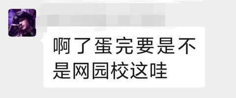

# 程序设计基础 C7 答案（2026秋）

## A call func

| 难度 | 考点 |
| --- | --- |
| 1 | 指针 |

### 题目

#### 题目描述

“巷口灯光忽明忽灭，手中甜咖啡已冷却。嘴角不经意泄露想念，在发呆的窗前凝结。”「James Eugene Raynor」听着歌发呆，随手写出了一个神奇的函数，定义如下：

```c
void func(int *a, int *b, int p) {
    if ( *b == 0 ) {
        *b = p;
        return;
    }
    int t = *a & *b;
    *a ^= *b;
    *b = t << 1;
    func(a, b, p | t);
}
```

随后给出了若干组自然数 $a, b$ 。

对于每组 $a, b$ ，请你使用两个 int 类型的变量分别存储两个值，并且调用一次该函数：将两个变量的地址分别传入函数的前两个参数，第三个参数传入 0。这个神奇的函数会修改两个变量的值。请你输出两个变量的新值。

#### 输入

不定组输入，每组输入一行，两个由单空格分隔的自然数 $a, b(0 \le a, b < 1048576)$ 。

保证不超过 10000 组数据。

#### 输出

对于每组数据，输出一行，调用函数后原先存储 $a, b$ 的两个变量的新值，由单空格分隔。

#### 输入样例

```text
3 0
1 5
2357 1113
```

#### 输出样例

```text
3 0
6 1
3470 113
```

Author: Protoss

### 答案

### 解题思路

根据题意每次读入 $a, b$ ，传参即可。

### 示例代码

```c
#include <stdio.h>

void func(int *a, int *b, int p) {
    if ( *b == 0 ) {
        *b = p;
        return;
    }
    int t = *a & *b;
    *a ^= *b;
    *b = t << 1;
    func(a, b, p | t);
}

int main() {
    int a, b;
    while ( scanf("%d%d", &a, &b) != EOF ) {
        func(&a, &b, 0);
        printf("%d %d\n", a, b);
    }
    return 0;
}
```

<!-- markdownlint-disable-next-line MD026 -->
## B 反方向的钟？

| 难度 | 考点 |
| --- | --- |
| 2 | 字符串 |

### 题目

#### 题面描述



小M在使用AI多次水了C/E赛后，忽然发现，距离期末考试只有一个月左右了！

追悔莫及的小M决定听100遍《反方向的钟》，期待能回到学期开始。

“这一次，我再也不用AI了”

可惜时间是无法翻转的。但从现在再重新开始，也许还不晚。

> 将大局逆转吧！

#### 题目描述

输入一行由一个或多个单词组成的字符串。字符串开头和结尾没有空格，单词之间至多有一个空格。请将每个单词的字母顺序翻转，其余字符保持原样。

字符串只含大小写英文字母和空格。一个单词是一段最长的连续英文字母片段。翻转时不改变字母的大小写。

#### 输入

输入一行长度在 1 到 1000 之间的字符串。保证只含大小写英文字母和空格，字符串开头和结尾没有空格，单词之间至多有一个空格。

#### 输出

输出一行，为翻转后的字符串。字符串开头和结尾没有空格，单词之间用一个空格分隔。

#### 输入样例

```text
ab cde f
```

#### 输出样例

```text
ba edc f
```

#### Hint

期末考试将会使用多种手段防止作弊。请大家对自己的成绩负责。

author: 只只小木条

### 答案

### 解题思路

由于 `scanf("%s")` 本身就会过滤空格，所以本题实际完全不需要反转操作。只需要依次读入不含空格的单词，之后反向输出即可。

### 示例代码

```c
#include<stdio.h>
#include<string.h>
char s[1005];
int main(){
    while(scanf("%s",s) != EOF){
        int len = strlen(s);
        for(int i = len - 1; i >= 0; i--){
            putchar(s[i]);
        }
        putchar(' ');
    }
    putchar('\n');
    return 0;
}
```

## C 「衔尾蛇」

| 难度 | 考点 |
| --- | --- |
| 2 | 数组、指针、模拟 |

### 题目

#### 题目背景

> 虫蚁之于飞禽，野兔之于狼犬，星尘之于黑洞，诸界之于贪饕。

据记载，星神出现前的宇宙存在着许多“古兽”，星神诞生后，古兽便逐渐消失，而「贪饕」奥博洛斯被认为是最后一只留存于世的古兽。

在奥博洛斯看来，生命是虚空海洋中明灭的浮藻，终将随着诞生它们的星辰归于黑暗——这片黑暗就在祂的口中。

#### 题目描述

有一个长度为 $n$ 的整数数组，元素从 1 到 $n$ 编号，初始值均为 0。数组首尾相接，构成一个环。

游标初始指向第 1 个元素。给定一个指令字符串 $s$ ，从左到右依次执行其中的每条指令：

- L：游标向左移动一个位置。若当前位于第 1 个元素，则移动到第 $n$ 个元素。
- R：游标向右移动一个位置。若当前位于第 $n$ 个元素，则移动到第 1 个元素。
- +：将游标当前指向的元素的值加 1，游标的位置不变。

当 $n = 1$ 时，执行 L 或 R 后游标仍指向唯一的元素。

执行完所有指令后，按编号从 1 ~ $n$ 的顺序输出数组中的所有元素。

#### 输入

输入共两行。

第一行，一个正整数 $n$ ，表示数组长度， $1 \le n \le 1000$ 。

第二行，一个非空字符串 $s$ ，表示指令序列，仅包含 L、R 和 +， $1 \le |s| \le 10^5$ ，其中 $|s|$ 表示字符串的长度。

#### 输出

输出一行，共 $n$ 个整数，依次表示第 1 到第 $n$ 个元素的最终值，相邻整数之间用一个空格隔开。

#### 输入样例1

```text
3
+R++L+
```

#### 输出样例1

```text
2 2 0
```

#### 输入样例2

```text
1
L+R++L
```

#### 输出样例2

```text
3
```

#### 输入样例3

```text
4
L+RR+
```

#### 输出样例3

```text
0 1 0 1
```

#### 样例解释

样例 1：第 1 个元素和第 2 个元素各被加了两次，第 3 个元素保持为 0。最后游标位于第 1 个元素。

样例 2：数组只有一个元素，所有移动指令都不会改变游标位置，共执行了三条 + 指令。

样例 3：第一条 L 将游标从第 1 个元素移到第 4 个元素，并将第 4 个元素加 1；随后两条 R 将游标依次移到第 1、第 2 个元素，再将第 2 个元素加 1。

Author: muzermat playing Honkai StarRail

### 答案

### 解题思路

用初始值全为零的数组保存各位置的计数，用指针 `p` 指向游标所在的元素，初始令 `p = a` 。

执行 `L` 时，若指针已经指向首元素，就把指针改为 `a + n - 1` ；否则执行 `p--` 。执行 `R` 时，若指针已经指向末元素，就回到 `a` ；否则执行 `p++` 。执行 `+` 时，只对 `*p` 加一。

移动前先判断端点，可以使指针始终指向数组内的有效元素。 $n = 1$ 时，首元素和末元素是同一个元素，两种移动都会把指针设回原位置。依次执行全部指令后，按数组顺序输出即可。

每条指令都直接实现题目规定的一次操作，因此处理任意一段指令后，数组和指针分别等于对应的计数状态与游标位置。指令数最多为 $10^5$ ，任意元素的计数均不超过 $10^5$ ，使用 `int` 足够。

设指令串长度为 $L$ ，时间复杂度为 $O(n + L)$ ，数组和指令串共占用 $O(n + L)$ 空间。

### 示例代码

```c
#include <stdio.h>

int main() {
    int n, a[1005] = {0};
    char s[100005];
    scanf("%d%100000s", &n, s);

    int *p = a;
    for (int i = 0; s[i] != '\0'; i++) {
        if (s[i] == 'L') {
            if (p == a) {
                p = a + n - 1;
            } else {
                p--;
            }
        } else if (s[i] == 'R') {
            if (p == a + n - 1) {
                p = a;
            } else {
                p++;
            }
        } else {
            (*p)++;
        }
    }

    for (int i = 0; i < n; i++) {
        if (i > 0) {
            putchar(' ');
        }
        printf("%d", a[i]);
    }
    putchar('\n');
    return 0;
}
```

## D 图片裁剪

| 难度 | 考点 |
| --- | --- |
| 3 | 二维字符数组、遍历、最小值与最大值、边界处理 |

### 题目

#### 题目描述

给定一张 $n$ 行 $m$ 列的图片，用 0 表示空白，用 1 表示有内容。

请去掉图片上、下两端连续的全 0 行，以及左、右两端连续的全 0 列，输出剩余图片。

如果原图片全部为 0，则输出 `EMPTY` 。

#### 输入

第一行，一个整数 $T$ ，表示数据组数，满足 $1 \le T \le 100$ 。

对于每组数据：

第一行，两个整数 $n, m$ ，分别表示图片的行数和列数，满足 $1 \le n, m \le 100$ 。

接下来 $n$ 行，按从上到下的顺序给出图片。每行包含 $m$ 个字符，均为 0 或 1，字符之间没有空格。

单个输入文件中，所有数据组的 $nm$ 之和不超过 $2 \times 10^5$ 。

#### 输出

对于每组数据：

如果图片全部为 0，输出一行 `EMPTY` 。

否则，先输出一行两个整数 $h, w$ ，分别表示裁剪后的行数、列数，用一个空格分隔。接下来输出 $h$ 行，每行 $w$ 个字符，表示裁剪后的图片，字符之间不输出空格。

不同数据组之间不输出空行。

#### 输入样例 1

```text
1
4 5
00000
00100
01010
00000
```

#### 输出样例 1

```text
2 3
010
101
```

#### 输入样例 2

```text
3
2 3
000
000
3 4
1000
0000
0001
1 5
00100
```

#### 输出样例 2

```text
EMPTY
3 4
1000
0000
0001
1 1
1
```

#### 样例解释

样例 1：

截取第 2 至第 3 行、第 2 至第 4 列，得到 2 行 3 列的图片。该区域包含全部 1，且不能再缩小。

样例 2：

第一组没有任何内容，输出 `EMPTY` 。

第二组的左上角和右下角都有 1，因此必须保留整张图片。中间的空白行和空白列也必须保留。

第三组只有一个 1，裁剪后只剩一行一列。

Author:auining

### 答案

### 解题思路

不能删除所有全零的行和列：如果空白行或空白列夹在内容之间，它们也必须保留。本题只裁去外侧多余的空白，不需要寻找连通区域，也不需要移动各个 1。

只要找到所有 1 所在的最上、最下、最左、最右的位置，就能确定保留的矩形。

用二维字符数组保存图片。每一行都是一个字符串，可以用 `scanf("%s", a[i])` 读入整行。数组中保存的是字符，所以判断内容时应与 `'1'` 比较，而不是与整数 `1` 比较。每行的数组容量还要留出字符串结束标志的位置。

从上到下、从左到右扫描所有位置。每遇到一个 1，用它的行号、列号更新四个边界：

- `top` ：最小行号。
- `bottom` ：最大行号。
- `left` ：最小列号。
- `right` ：最大列号。

代码下标从 0 开始。开始时将 `top` 、 `left` 分别设为 $n$ 、 $m$ ，将 `bottom` 、 `right` 设为 $-1$ 。这些初值都在合法下标范围之外，因此遇到第一个 1 时四个边界都会正确更新。每组数据都需要重新初始化。

如果扫描结束后 `bottom` 仍为 $-1$ ，说明没有遇到任何 1，输出 `EMPTY` 。

否则，保留的行号为 `top` 到 `bottom` ，列号为 `left` 到 `right` ，两端都要包含。因此行数为 `bottom - top + 1` ，列数为 `right - left + 1` 。按这个范围输出原数组，里面的空白自然会被保留。

### 示例代码

```c
#include <stdio.h>

char a[100][105];

int main()
{
    int T;
    scanf("%d", &T);
    while (T--)
    {
        int n, m;
        scanf("%d%d", &n, &m);
        for (int i = 0; i < n; ++i)
            scanf("%s", a[i]);

        int top = n, bottom = -1, left = m, right = -1;
        for (int i = 0; i < n; ++i)
            for (int j = 0; j < m; ++j)
                if (a[i][j] == '1')
                {
                    if (i < top) top = i;
                    if (i > bottom) bottom = i;
                    if (j < left) left = j;
                    if (j > right) right = j;
                }

        if (bottom == -1)
            printf("EMPTY\n");
        else
        {
            printf("%d %d\n", bottom - top + 1, right - left + 1);
            for (int i = top; i <= bottom; ++i)
            {
                for (int j = left; j <= right; ++j)
                    printf("%c", a[i][j]);
                printf("\n");
            }
        }
    }
    return 0;
}
```

## E Hera（Re:Master）

| 难度 | 考点 |
| --- | --- |
| 4 | 字符处理、连续段统计、常数空间 |

### 题目

请注意本题非同寻常的空间限制。

#### 题目背景

`crimson000` 不会拆纵连和叠键。于是他决定把所有的「叠」都拆成在一个轨道上连续点击的次数。

#### 题目描述

给定一个只含小写英文字母的非空字符串 $s$ 。我们把 $s$ 中极长的连续相同字符组成的一段称为一个「段」，例如 `aaabbc` 可以分成 `aaa` 、 `bb` 、 `c` 三段。

对每一段，按照以下规则写出它的压缩结果：

- 如果这一段只有一个字符，写出这个字符；
- 如果这一段有 $k \ge 2$ 个字符，先写出这个字符，再写出 $k$ 的十进制表示（不含前导零）。

把所有段的压缩结果按原来的顺序拼接，就得到 $s$ 的压缩结果。给定 $s$ ，请输出它的压缩结果。

#### 输入

一行，一个非空字符串 $s$ ，只含小写英文字母，满足 $1 \le |s| \le 3 \times 10^6$ 。

#### 输出

输出一行，表示 $s$ 的压缩结果。

#### 输入样例 1

```text
aaabbbcc
```

#### 输出样例 1

```text
a3b3c2
```

#### 输入样例 2

```text
zzzzzzzzzzzz
```

#### 输出样例 2

```text
z12
```

#### 输入样例 3

```text
dabcabcdabcabbac
```

#### 输出样例 3

```text
dabcabcdabcab2ac
```

#### 样例解释

样例 1 中， `aaa` 压缩为 `a3` ， `bbb` 压缩为 `b3` ， `cc` 压缩为 `c2` ，拼接得到 `a3b3c2` 。

样例 2 中，12 个 `z` 组成一段，压缩为 `z12` 。

### 答案

### 解题思路

如果先用字符数组读入整个字符串，长度为 $3 \times 10^6$ 时仅存储字符就需要约 3 MB，超过题目 2 MB 的空间限制。

事实上，每个连续段的压缩结果只取决于该段的字符和长度，所以可以**边读边处理、边处理边输出**，无需保存整个字符串。

维护两个变量：

- `last` ：当前连续段的字符；
- `cnt` ：当前连续段的长度。

读入首个字符后，令 `last` 为这个字符、 `cnt=1` 。随后逐字符读取：

1. 若新读入的字符与 `last` 相同，则令 `cnt++` ；
2. 否则，当前段结束：输出 `last` ，若 `cnt>=2` 再输出 `cnt` ；然后令 `last` 为新字符、 `cnt=1` 。

读取结束后，别忘记输出最后一个连续段。

- **时间复杂度：** $O(n)$ 。每个输入字符只处理一次；总输出长度不超过 $O(n)$ 。
- **额外空间复杂度：** $O(1)$ 。只使用常数个变量，不开辟与 $n$ 有关的数组。

### 示例代码

```c
#include <stdio.h>

int main()
{
    int last = getchar();
    int cnt = 1;
    int ch;

    while ((ch = getchar()) >= 'a' && ch <= 'z') {
        if (ch == last) {
            cnt++;
        } else {
            putchar(last);
            if (cnt >= 2) {
                printf("%d", cnt);
            }
            last = ch;
            cnt = 1;
        }
    }

    putchar(last);
    if (cnt >= 2) {
        printf("%d", cnt);
    }
    putchar('\n');

    return 0;
}
```

## F 保险保险你太耀眼（基础版）

| 难度 | 考点 |
| --- | --- |
| 4 | 指针、库函数 |

### 题目

#### 题目背景

「James Eugene Raynor」正愉快地在酸角粥中开保险箱，但是他不太清楚怎么开，所以每次都只能等着自动解锁，请你帮帮他。

#### 题目描述

保险箱的密码是一个由数字和大写字母组成的字符串。与我们手机电脑密码不同，不管我们怎么乱输入，只要最后输入的是正确密码，即使前面输入了一些多余的字符，也可以解锁。例如对于密码 `6DFUP` ，我们输入 `?password=6DFUP` 也可以解锁。需要注意的是，保险箱区分大小写，因此我们输入 `6dfup` 是无法解锁保险箱的。

遗憾的是，「Raynor」分不清保险箱是否解锁，而保险箱解锁后，会自动清空之前的输入，如果接收到输入的新字符，则会立刻上锁，并重新匹配密码（新输入字符算作第一个字符）。

由于「Raynor」不知道密码，因此只能随便输入可见字符。现在我们知道正确密码和他输入的所有字符，请问他总共解开了保险箱多少次。

#### 输入

第一行，一个由可见字符（ASCII 值在 32 到 126 之间）组成的字符串，长度不超过 10000，表示「Raynor」的输入；

第二行，一个仅由数字与大写字母组成的字符串，长度不超过 50 且非空，末尾无换行，表示保险箱的密码。

#### 输出

一个自然数，表示「Raynor」解锁保险箱的次数。

#### 输入样例 1

```text
6DF UP@6DFUP 73556086DFUP?PUFD6
6DFUP
```

#### 输出样例 1

```text
2
```

#### 样例解释 1

空格不能被忽略，因此最开始的 `6DF UP` 并不能解开保险箱。

#### 输入样例 2

```text
ABABABABABAB
ABABAB
```

#### 输出样例 2

```text
2
```

#### 样例解释 2

「Raynor」输入了两次保险箱密码，第一次解锁后输入清空，随后他又输入了一次。

Author: Protoss

### 答案

### 解题思路

本题与课件上例题相似，不过更加简单，不需要考虑字符串的输出，只需要统计子串出现次数即可。

### 示例代码

```c
#include <stdio.h>
#include <string.h>
char str[10086], p[60];
int main() {
    gets(str); // str 可能存在空格，不能用 scanf("%s", str) 读取
    gets(p);
    int cnt = 0, plen = strlen(p);
    char *pos = strstr(str, p);
    while ( pos != NULL ) {
        cnt++;
        pos = strstr(pos + plen, p); // 从当前密码结束后的下一个字符开始匹配
    }
    printf("%d", cnt);
    return 0;
}
```

## G 旋转的瓷砖

| 难度 | 考点 |
| --- | --- |
| 5 | 递归、坐标转换、函数返回值、黑白互换 |

### 题目

#### 题目描述

瓷砖图案只包含白色和黑色格子，用 0 表示白色，用 1 表示黑色。零级图案只有一格，颜色为白色。

制作更高一级的图案时，按下表复制、处理前一级图案，再将得到的四幅图案排列成两行两列：

| 位置 | 处理方式 |
| --- | --- |
| 左上 | 将前一级图案复制一遍，保持原样 |
| 右上 | 将前一级图案复制一遍，再将所有黑色和白色互换 |
| 左下 | 将前一级图案复制一遍，再将整个图案顺时针旋转九十度 |
| 右下 | 将前一级图案复制一遍，先将整个图案顺时针旋转九十度，再将所有黑色和白色互换 |

每次复制都以同一个未经处理的前一级图案为原图，拼接时不留空隙、没有重叠。黑白互换是指每个白色格子变成黑色，每个黑色格子变成白色。

因此， $d$ 级图案有 $2^d$ 行、 $2^d$ 列。行号从上到下递增，列号从左到右递增，均从 1 开始。

给出等级 $d$ 和若干格子的行列位置，请求出这些格子的颜色。

#### 输入

第一行，一个整数 $T$ ，表示数据组数，满足 $1 \le T \le 100$ 。

对于每组数据：

第一行两个整数 $d, q$ ，分别表示图案等级和查询数量，满足 $0 \le d \le 30$ ， $1 \le q \le 2 \times 10^4$ 。

接下来 $q$ 行，每行两个整数 $r, c$ ，表示要查询的行号、列号，满足 $1 \le r, c \le 2^d$ 。

单个输入文件中，所有数据组的 $q$ 之和不超过 $2 \times 10^5$ 。

#### 输出

对于每组数据的每次查询，按输入顺序输出一行一个整数：白色输出 0，黑色输出 1。

不同数据组之间不输出空行。

#### 输入样例 1

```text
2
0 1
1 1
1 4
1 1
1 2
2 1
2 2
```

#### 输出样例 1

```text
0
0
1
0
1
```

#### 输入样例 2

```text
1
2 6
1 3
1 4
3 1
4 1
3 4
4 4
```

#### 输出样例 2

```text
1
0
0
1
1
0
```

#### 样例解释

样例 1：

零级图案只有一格白色。一级图案如下：

| 行号 / 列号 | 1 | 2 |
| --- | --- | --- |
| 1 | 0 | 1 |
| 2 | 0 | 1 |

样例 2：

一级图案顺时针旋转九十度后，第一行为两个白色格子，第二行为两个黑色格子。按题目规定复制、处理并拼接，得到二级图案：

| 行号 / 列号 | 1 | 2 | 3 | 4 |
| --- | --- | --- | --- | --- |
| 1 | 0 | 1 | 1 | 0 |
| 2 | 0 | 1 | 1 | 0 |
| 3 | 0 | 0 | 1 | 1 |
| 4 | 1 | 1 | 0 | 0 |

例如，第 4 行、第 1 列是黑色，所以输出 1；第 4 行、第 4 列是白色，所以输出 0。

#### Hint

对一个 $s$ 行 $s$ 列的图案，顺时针旋转后位于第 $r$ 行、第 $c$ 列的格子，原本位于第 $s - c + 1$ 行、第 $r$ 列。这里的行列号都从该图案的左上角开始计数。

Author:auining

### 答案

### 解题思路

不能生成整个图案：最高等级的边长是 $2^{30}$ 。查询一个格子时，只需找到它对应的前一级格子，再递归查询。

设当前等级为 $d$ ，每个子块的边长为 $h = 2^{d-1}$ 。先根据行列号是否超过 $h$ ，判断目标在左上、右上、左下还是右下。位于下半区时，行号减去 $h$ ；位于右半区时，列号减去 $h$ 。此时坐标已经以当前子块的左上角为起点。

左上、右上的副本没有旋转，可直接查询前一级的同一坐标。下半区的副本顺时针旋转过，需要先还原坐标。

原坐标 $(u, v)$ 旋转后变成 $(v, h - u + 1)$ 。因此，旋转后格子 $(r, c)$ 的原坐标是 $(h - c + 1, r)$ 。不能直接把正向旋转公式当作还原公式；更新行列时，还要先保存旧行号。

查询前一级后，如果当前子块位于右半区，就将结果黑白互换，即用 `1 - ans` 替换结果。互换只作用于当前层对应的副本，多层互换不能遗漏。

递归到零级时，唯一格子为白色，返回 0。每次等级减一，所以一定会结束。

### 示例代码

```c
#include <stdio.h>

int side[31];

int color(int d, int r, int c)
{
    if (d == 0)
        return 0;
    int h = side[d - 1];
    int bottom = r > h, right = c > h;
    if (bottom)
        r -= h;
    if (right)
        c -= h;
    if (bottom)
    {
        int oldr = r;
        r = h + 1 - c;
        c = oldr; // 将顺时针旋转后的坐标还原到原图
    }
    int ans = color(d - 1, r, c);
    if (right)
        ans = 1 - ans;
    return ans;
}

int main()
{
    side[0] = 1;
    for (int i = 1; i <= 30; ++i)
        side[i] = side[i - 1] * 2;
    int T;
    scanf("%d", &T);
    while (T--)
    {
        int d, q;
        scanf("%d%d", &d, &q);
        while (q--)
        {
            int r, c;
            scanf("%d%d", &r, &c);
            printf("%d\n", color(d, r, c));
        }
    }
    return 0;
}
```

## H 我有噪域症

| 难度 | 考点 |
| --- | --- |
| 6 | 二维差分数组 |

### 题目

#### 题目背景

「噪域」是一种矩形的力场，它会侵入「像素塔」，使得一切存在于此的事物变为混沌，不再能与外界连接。


#### 题目描述

「像素塔」是一个被划分为 $n$ 行 $m$ 列个地块的区域，初始状态所有地块均没有「噪域」。

「噪域」是矩形的， $a$ 行 $b$ 列的区域。接下来会有 $q$ 个「噪域」侵入「像素塔」。

「噪域」有两种类型：

1. 「正常」：如果一个地块被一个或多个「正常噪域」覆盖，则这个地块会被摧毁。
2. 「异或」：它会自己覆盖自己的效果。如果一个地块被偶数块「异或噪域」覆盖，则没有任何效果，否则会被摧毁。

两种噪域的影响是独立的，「异或噪域」无法用来修复「正常噪域」带来的损伤。

请问，在这 $q$ 个噪域的影响下，哪些地块被摧毁了，哪些地块没有？

一个地块被摧毁，当且仅当它被「正常噪域」或被「异或噪域」摧毁。

#### 输入

第一行两个正整数 $n, m$ ， $1 \le n, m \le 2000$ ，表示像素塔区域的大小。

第二行一个正整数 $q$ ， $1 \le q \le 10^5$ ，表示噪域数量。

接下来 $q$ 行，每行 5 个非负整数 $t, a, b, x, y$ ， $t \in \{1, 2\}$ 表示噪域类型， $(a, b)$ 表示噪域的大小、 $(x, y)$ 表示噪域距离原点的偏移量（从零开始计数），保证 $1 \le a \le n, 1 \le b \le m, 0 \le x \le n - a, 0 \le y \le m - b$ 。

#### 输出

共 $n$ 行，每行一个长度为 $m$ 的 01 字符串，表示像素塔的整个区域，如果该地块被摧毁了则输出 1，否则输出 0。

#### 输入样例

```text
4 5
4
2 3 3 0 0
2 2 2 1 0
1 1 1 2 1
2 1 1 2 1
```

#### 输出样例

```text
11100
00100
01100
00000
```

#### 样例解释

前两块噪域都是「异或噪域」，叠加之后是一个 $3 \times 3$ 方块被扣出一个 $2 \times 2$ 方块的 L 形。

第三块噪域是「正常噪域」，摧毁了第三行第二列，即使在其上再加一块「异或噪域」也无法消除其影响。

### 答案

### 解题思路

两种噪域的影响是相互独立的，因此我们可以将它们拆开来看。

对于正常噪域，你可以理解为：记录每个地块分别都被多少个正常噪域覆盖了，初始所有地块的值为 0，每次选择一个矩形区块，将其中所有元素都加 1，最后检查所有地块，如果值大于或等于 1，说明它被摧毁了。

如果大家会一维数组上的差分数组的话，肯定会联想到它。差分数组正是可以用来解决这种：“多次进行区间加，最后进行一次总体检查” 问题的工具。

在一维数组上，我们可以维护 $b_i = a_i - a_{i-1}$ 的值。进行区间加后，这个区间内部的所有 $b_i$ 大多数都是不变的，仅区间两端会发生改变。于是对于每次区间加操作，我们不需要对区间内部的所有数都操作，而只需要对它的两端进行操作。所有区间加操作结束后，再对其求一个前缀和即可。

$$\sum_0^n b_i = a_n - a_{-1} = a_n$$

而在二维数组上，我们则是维护 $b_{i,j} = a_{i,j} - a_{i-1,j} - a_{i,j-1} + a_{i-1,j-1}$ 。我们发现，进行矩形加操作时，仅有矩形的四个角的 $b_{i,j}$ 会发生改变，其余所有位置均保持不变。于是与一维差分数组类似，我们不需要对矩形内部的所有数都操作，而只需要对它的四角进行操作。所有矩形加操作结束后，再对其求一个二维前缀和即可。

有了二维差分数组这个工具的帮助，我们就能解决正常噪域了。

对于异或噪域，一种简单的思想依然是使用刚才的二维差分数组，计算所有地块都被多少个异或噪域覆盖了。最后检查所有地块，如果值为奇数，说明它被摧毁了。

当然，更优雅的方式是使用异或差分数组。不过为了保持题解的简明性，不一次性给出过多新内容，这里仅提一嘴。

### 示例代码

```c
#include <stdio.h>
int xxor[2005][2005];
int norm[2005][2005];
int main(void)
{
    int n, m;
    scanf("%d%d", &n, &m);
    int q;
    scanf("%d", &q);
    while (q--)
    {
        int t, a, b, x, y;
        scanf("%d%d%d%d%d", &t, &a, &b, &x, &y);
        if (t == 2)
        {
            xxor[x][y]++;
            xxor[x][y + b]--;
            xxor[x + a][y]--;
            xxor[x + a][y + b]++;
        }
        else
        {
            norm[x][y]++;
            norm[x][y + b]--;
            norm[x + a][y]--;
            norm[x + a][y + b]++;
        }
    }

    for (int i = 1; i < n; i++)
        xxor[i][0] += xxor[i - 1][0];
    for (int j = 1; j < m; j++)
        xxor[0][j] += xxor[0][j - 1];
    for (int i = 1; i < n; i++)
        for (int j = 1; j < m; j++)
            xxor[i][j] += xxor[i - 1][j] + xxor[i][j - 1] - xxor[i - 1][j - 1];

    for (int i = 1; i < n; i++)
        norm[i][0] += norm[i - 1][0];
    for (int j = 1; j < m; j++)
        norm[0][j] += norm[0][j - 1];
    for (int i = 1; i < n; i++)
        for (int j = 1; j < m; j++)
            norm[i][j] += norm[i - 1][j] + norm[i][j - 1] - norm[i - 1][j - 1];
    for (int i = 0; i < n; i++)
    {
        for (int j = 0; j < m; j++)
        {
            if (xxor[i][j] % 2 == 1 || norm[i][j] >= 1)
                putchar('1');
            else
                putchar('0');
        }
        putchar('\n');
    }
    return 0;
}
```

## I 原子积木

| 难度 | 考点 |
| --- | --- |
| 7 | 字符串、指针 |

### 题目

#### 题目背景

> 本视频仅供化学原理展示，并不能作为中学化学的满分操作参考。
>
> ——真·凤舞九天【色彩重铸】02 铬！黄！改！二！

#### 题目描述

*本题的主要任务是检查化学方程式是否配平，但是由于解析平凡的化学方程式太难了，我们对它进行了一些修改。若无特殊说明，下文的「化学方程式」均指符合本题要求的一类字符串。*

> 为了让同学们更好地理解本题的输入格式，而不是尝试理解复杂的文法，输入的形式化定义不在「题目描述」中写出，有需要的同学请自行查看「hint」。

在本题中，一个化学方程式由 $n$ 个项， $n - 2$ 个加号 + 和 1 个等号 = 组成，其中 $n$ 个项构成的 $n - 1$ 个间隔之间一定有且仅有一个加号或等号， $n \ge 2$ ；即一个化学方程式可以抽象为：

$$\underbrace{\text{项} + \text{项} + \cdots + \text{项}}_{\ge 1 \text{ 个项}} = \underbrace{\text{项} + \text{项} + \cdots + \text{项}}_{\ge 1 \text{ 个项}}$$

一个项由项系数 $c$ 和分子组成，其中 $1 \le c \le 9$ ， $c = 1$ 时一定不会写出。如化学方程式 $\mathrm{H2} + \mathrm{Cl2} = 2\mathrm{HCl}$ 中，项 $\mathrm{H2}$ 和 $\mathrm{Cl2}$ 的项系数 $c$ 均为 1（且均未在方程式中写出），项 $2\mathrm{HCl}$ 的项系数 $c$ 为 2。

一个分子由多个原子基团组成，一个原子基团由一个元素和一个基团系数 $d$ 组成，其中 $1 \le d \le 9$ ， $d = 1$ 时一定不会写出。如分子 $\mathrm{KMnO4}$ 中，原子基团 $\mathrm{K}$ 和 $\mathrm{Mn}$ 的基团系数 $d$ 均为 1（且均未在分子中写出），原子基团 $\mathrm{O4}$ 的基团系数 $d$ 为 4。

一个元素在此处并不局限于元素周期表中的元素，甚至长度也不局限于两字母；我们定义一个元素由 1 个大写字母和其后的任意数量（可以为 0 个）小写字母组成。如 $\mathrm{C}, \mathrm{Co}, \mathrm{Coc}, \mathrm{Coco}$ 都是单个元素，而 $\mathrm{CO}, \mathrm{co}$ 都不是单个元素（前者可以视为两个基团系数为 1 的元素构成的分子，后者不合法）。

与一般的化学方程式的配平检查方式不同，在本题中，我们通过检查字母数量来作为化学方程式配平检查的依据，具体地：对于一个项中每个位置上的字母，我们认为该项中这个位置上该字母的数量为 $c \times d$ 。如项 $2\mathrm{SeS2}$ ， $\mathrm{Se}$ 中的 $\mathrm{S}$ 的数量为 $c \times d = 2 \times 1 = 2$ ， $\mathrm{e}$ 的数量为 $c \times d = 2 \times 1 = 2$ ； $\mathrm{S}$ 中的 $\mathrm{S}$ 的数量为 $c \times d = 2 \times 2 = 4$ ，故项 $2\mathrm{SeS2}$ 中 $\mathrm{S}, \mathrm{e}$ 的数量分别为 $2 + 4 = 6$ 和 2。

对于一个化学方程式，我们依次判定其相等性（三者互斥）：

1. 化学上相等（Chemically Equal）：若对所有 52 种英文字母（区分大小写，即大写字母与小写字母独立统计），等号左侧的项中该字母的总数量均等于右侧项中该字母的总数量。（注意：此时仅统计单个字符出现频次，并不意味着真实化学上的元素守恒，参见样例。）
2. 文学上相等（Literally Equal）：若不满足「化学上相等」，但对全部 26 种英文字母（不区分大小写，即同一字母的大小写形式视为同一种字符），等号左侧项中该字母的总数量均等于右侧项中该字母的总数量。
3. 绝对不相等（Absolutely Unequal）：既不满足「化学上相等」，也不满足「文学上相等」。

请根据给定的化学方程式，输出其相等性判定结果。

*应当注意的是，本题的化学方程式中不会出现任何括号、下标，所有数字均为一位数，但可能出现元素中出现重复小写字母，分子中出现重复元素等情况。*

#### 输入格式

第一行包含一个正整数 $T$ ，表示测试用例组数，其中 $1 \le T \le 1000$ 。

接下来 $T$ 行，每行一个由英文字母、数字 $2 \sim 9$ 、加号 + 与等号 = 组成的字符串 $s$ ，表示一个给定的化学方程式。保证输入的字符串严格符合文法定义， $3 \le |s| \le 10^3$ ，其中 $|s|$ 代表字符串 $s$ 的长度。

#### 输出格式

对于每组测试数据，输出一行一个字符串，为 `Chemically Equal` 、 `Literally Equal` 或 `Absolutely Unequal` 之一。

#### 样例输入

```text
3
2Al+2Cu=2Au+Cl2
Ba+2Na=Banana
A+B=C
```

#### 样例输出

```text
Chemically Equal
Literally Equal
Absolutely Unequal
```

#### 样例解释

- 样例 1 解释：
  - 左侧： $2\mathrm{Al} \rightarrow \mathrm{A}: 2, \mathrm{l}: 2$ ； $2\mathrm{Cu} \rightarrow \mathrm{C}: 2, \mathrm{u}: 2$ 。
  - 右侧： $2\mathrm{Au} \rightarrow \mathrm{A}: 2, \mathrm{u}: 2$ ； $\mathrm{Cl2} \rightarrow \mathrm{C}: 2, \mathrm{l}: 2$ 。
  - 两侧在区分大小写的情况下，各字母数量完全一致，故为 `Chemically Equal` 。
- 样例 2 解释：
  - 左侧： $\mathrm{Ba} + 2\mathrm{Na} \rightarrow \mathrm{B}: 1, \mathrm{a}: 3, \mathrm{N}: 2$ 。
  - 右侧： $\mathrm{Banana}$ 中 $\mathrm{anana}$ 是小写字母串，故 $\mathrm{Banana}$ 视为一个元素（原子基团、项），各字母数量： $\mathrm{B}: 1, \mathrm{a}: 3, \mathrm{n}: 2$ 。
  - 区分大小写时左侧为大写 $\mathrm{N}$ 、右侧为小写 $\mathrm{n}$ ，不满足化学上相等；但在不区分大小写时完全一致，故为 `Literally Equal` 。

#### Hint

一个「化学方程式」可由以下文法严格定义：

```text
<Equation>     ::= <Expression> '=' <Expression>
<Expression>   ::= <Term> | <Term> '+' <Expression>
<Term>         ::= <Molecule> | <Number><Molecule>
<Molecule>     ::= <Atom> | <Atom><Molecule>
<Atom>         ::= <Element> | <Element><Number>
<Element>      ::= <Upper> | <Upper><Lowers>
<Lowers>       ::= <Lower> | <Lower><Lowers>
<Upper>        ::= A | B | ... | Z
<Lower>        ::= a | b | ... | z
<Number>       ::= 2 | 3 | ... | 9
```

上述文法对应的各结构定义如下：

- 化学元素（`<Element>`）：由 1 个大写字母后接 $\ge 0$ 个小写字母组成；
- 原子基团（`<Atom>`）：由 1 个化学元素后接 $\le 1$ 个 $2 \sim 9$ 的数字（作为基团系数）组成；
- 化学式（`<Molecule>`）：由 $\ge 1$ 个原子基团顺序拼接组成；
- 项（`<Term>`）：由 $\le 1$ 个 $2 \sim 9$ 的数字（作为项系数）和 1 个化学式组成；
- 表达式（`<Expression>`）：由 $\ge 1$ 个项通过字符 + 连接而成；
- 化学方程式（`<Equation>`）：由 2 个表达式通过字符 = 连接而成，分别称为方程式的左侧表达式与右侧表达式。

我们同时给出字母统计的规则，在一个项（`<Term>`）中：

- 若项以数字开头，则该项的项系数 $c$ 为该数字，否则 $c = 1$ ；
- 对于该项中的任意一个原子基团（`<Atom>`）：若元素后紧随数字，则其基团系数 $d$ 为该数字，否则 $d = 1$ ；
- 该原子基团所包含的每个位置上的英文字母均贡献 $c \times d$ 个对应字母，不同位置独立计算（即若同一字母在该基团中出现 $k$ 次，则贡献累加计算，总贡献为 $k \times c \times d$ ）。

一个表达式中某个英文字母的总数量，定义为该表达式内所有项中该字母的贡献数量之和。

以方程式 $2\mathrm{Na} + \mathrm{Cl2} = 2\mathrm{NaCl}$ 为例，其完整的文法推导过程如下（ `=>` 表示一步推导， `=>*` 表示经多步推导）：

```text
<Equation>
 => <Expression> = <Expression>
 => <Term> + <Expression> = <Term>
 => <Term> + <Term> = <Term>
```

展开方程式中的各项（`<Term>`）：

1. 推导第一项 $2\mathrm{Na}$ ：

```text
<Term>
 => <Number><Molecule>
 => 2 <Atom>
 => 2 <Element>
 => 2 <Upper><Lowers>
 => 2 <Upper><Lower>
 =>* 2Na
```

<!-- markdownlint-disable-next-line MD029 -->
2. 推导第二项 $\mathrm{Cl2}$ ：

```text
<Term>
 => <Molecule>
 => <Atom>
 => <Element><Number>
 => <Upper><Lowers><Number>
 =>* Cl2
```

<!-- markdownlint-disable-next-line MD029 -->
3. 推导右侧项 $2\mathrm{NaCl}$ ：

```text
<Term>
 => <Number><Molecule>
 => 2 <Atom><Molecule>
 => 2 <Atom><Atom>
 =>* 2Na <Atom>
 =>* 2NaCl
```

将上述步骤整合，即完成了从根节点 `<Equation>` 到该符号串的完整推导：

```text
<Equation> =>* 2Na+Cl2=2NaCl
```

Author: Ender_hz waiting 疯狂化学3

### 答案

### 解题思路

在字符串中找到所有的 `+` 和 `=` ，可以将方程式拆分成两边的项，我们考虑如何从一个项中统计字母数量：

1. 如果第一个字符是数字，读取并记下项系数 $c$ ，否则 $c = 1$ ；
2. 对于剩下的分子，我们按原子基团一个个处理：
   1. 尝试读取一个大写字母，失败说明分子部分结束；
   2. 不断尝试读取小写字母直到失败，记录小写字母出现次数；
   3. 如果下一个字符是数字，读取并记下基团系数 $d$ ，否则 $d = 1$ ；
   4. 统计该基团中每个字母实际数量，即每个字母的出现次数 $\times c \times d$ 。

最后两边分别求和，依次进行两个标准的比较判断结果即可。

### 示例代码

```c
#include<stdio.h>
#include<string.h>
#include<ctype.h>
void count(const char* s, int* cnt) { // 统计 s 里的字母数量，记录在 cnt[0..127] 中
    const char* p = s;
    int c = 1, d = 1;
    do {
        // 此时 p 位于一个项的第一个字符
        c = 1;
        if (isdigit(*p)) {
            c = (*p) - '0';
            ++p;
        }
        // 此时 p 位于一个分子（原子基团，元素）的第一个字符
        while(isupper(*p)) {
            // 此时 p 位于一个原子基团 / 元素的第一个字符
            d = 1;
            int cur[128] = {0}; // 记录当前原子基团中字母的出现次数
            cur[*(p++)] = 1;
            while(islower(*p)) {
                ++cur[*p];
                ++p;
            }
            if (isdigit(*p)) {
                d = (*p) - '0';
                ++p;
            }
            for(int i = 0; i < 128; ++i) cnt[i] += cur[i] * c * d;
        }
    } while (*(p++)); // 跳过加号，如果到了字符串末尾就结束。
}
int main() {
    int T; scanf("%d", &T); while(T--) {
        char s[1008] = {0};
        int cntl[128] = {0}, cntr[128] = {0};
        scanf("%s", s);
        char *eq = strchr(s, '=');
        *eq = '\0'; // 拆分成左右两个独立的字符串
        count(s, cntl);
        count(eq + 1, cntr);
        int flag = 1;
        for(int i = 0; i < 128; ++i) {
            if (cntl[i] != cntr[i]) {
                flag = 0;
                break;
            }
        }
        if (flag) {
            puts("Chemically Equal");
            continue;
        }
        flag = 1;
        for(int i = 1; i <= 26; ++i) {
            if (cntl[i + 64] + cntl[i + 96] != cntr[i + 64] + cntr[i + 96]) {
                flag = 0;
                break;
            }
        }
        puts(flag ? "Literally Equal" : "Absolutely Unequal");
    }
}
```

## J 八亏

| 难度 | 考点 |
| --- | --- |
| 8 | 计算几何 |

### 题目

#### 题目背景

> 《破译·辟径》
>
> 收集时间：773.A.P.??.?? | 保管单位：鸠 | 等级：key
>
> 光点愈发密集了。它们互相挤压，交织成致密的网状结构，光亮叠加，炫目而难忍。鸠用手背盖住眼睛，艰难地行进，直到通道的痕迹完全掩埋，唯心中一点冲动，为她指出前进的方向。
>
> 在不知第多少次停下时，鸠鲜有的感到了疲惫，回望身后，黑洞苍白暗淡，占据天幕大半，像一片图，一道影，始一不变，为此地唯一的参照。相比刚出发时，黑洞大小几乎没有任何变化，鸠不觉得这代表自己在原地踏步，但这些杂音一般的存在着实减缓了她的行进速度。
>
> 是否有什么办法能够调动它们呢？鸠思忖着，若将其视作谜题，无法理解题目并不影响寻找其中的一致要素；她开始搅动这片信号的海洋，突出的，重复的，异常的，皆可为线索，皆可有规律，皆可成机会，只需要——尝试。

#### 题目描述

一块『噪域』是一个二维平面上的区域，可以用下面的方式构造：

- 绘制一个以 $(0, 0)$ 为中心，宽为 $w$ ，高为 $h$ 的矩形（包含内部和边界）；
- 然后，将这个矩形绕 $(0, 0)$ 逆时针旋转 $\alpha°$ ；
- 最后，将旋转后的矩形整体平移，使得中心点与 $(a, b)$ 重合。

现在给定 $n$ 个『噪域』，第 $i$ 个『噪域』由 $w_i, h_i, \alpha_i, a_i, b_i$ 按照上述方式构造得到。

你需要回答 $q$ 次询问，每次询问给出平面上两个不同的点 $P(x_1, y_1), Q(x_2, y_2)$ ，你需要求出，射线 $PQ$ 与所有噪域的所有交点中，距离 $P$ 最近的交点的欧几里德距离。

如果射线与所有噪域都没有交点，输出 $-1$ 。

#### 输入格式

第一行输入两个整数 $n, q$ ( $1 \le n, q \le 3000$ )。

接下来 $n$ 行，每行五个整数 $w_i, h_i, \alpha_i, a_i, b_i$ ( $1 \le w_i, h_i \le 10^4$ ， $-10^4 \le a_i, b_i \le 10^4$ ， $0 \le \alpha_i < 360$ ) 表示一块『噪域』。

接下来 $q$ 行，每行四个整数 $x_1, y_1, x_2, y_2$ ( $-10^4 \le x_1, y_1, x_2, y_2 \le 10^4$ ) 表示一个询问，保证 $(x_1, y_1) \ne (x_2, y_2)$ 。

#### 输出格式

对于每个询问，输出一行一个浮点数表示答案。若答案不为 $-1$ ，你的答案被认为正确当且仅当其和标准答案的相对或绝对误差不超过 $10^{-6}$ ；若答案为 $-1$ ，应输出 $-1$ 。

#### 样例输入

```text
2 4
4 2 0 0 0
2 4 90 6 0
-5 0 5 0
3 0 4 0
0 0 1 0
0 3 0 4
```

#### 样例输出

```text
3.0000000000
1.0000000000
0.0000000000
-1
```

#### 样例解释

- 第一次询问的射线沿 $x$ 轴正方向，先在第一个噪域的左边界 $(-2, 0)$ 处相交，距离为 3。
- 第二次询问从 $(3, 0)$ 向右出发，在第二个噪域的左边界 $(4, 0)$ 处相交，距离为 1。
- 第三次询问的起点 $(0, 0)$ 位于第一个噪域内部，因此答案为 0。
- 第四次询问沿 $y$ 轴正方向，射线不会与任意噪域相交，因此输出 $-1$ 。

Author: ExplodingKonjac


### 答案

### 解题思路

对一个噪域，把平面上的点平移到矩形中心，再旋转 $-\alpha$ 度，就回到了矩形未旋转时的局部坐标系。设射线上的点为 $P + t(Q - P)$ ，其中 $t \ge 0$ 。在局部坐标系中，矩形就是 $|u| \le w/2$ 且 $|v| \le h/2$ 。

分别考虑 $u$ 和 $v$ 两个坐标的限制。若某个方向分量为 0，则该坐标要么始终在范围内，要么射线与矩形没有交点；否则可以算出该坐标进入和离开对应区间的两个参数。把两个坐标的进入参数取最大值、离开参数取最小值，再与 $t \ge 0$ 合并，就得到这条射线与该矩形的交段。如果交段存在，最近交点对应的参数就是进入参数与 0 的较大值。

设 $d = Q - P$ ，则参数为 $t$ 的点到 $P$ 的距离是 $t\|d|$ 。枚举所有噪域，取最小的非负距离；如果没有任何交段，就输出 `-1` 。

### 示例代码

```c
#include <math.h>
#include <stdio.h>

typedef long double ld;

#define EPS 1e-12L

typedef struct {
    ld w, h, cs, sn;
    ld cx, cy;
} Rectangle;

Rectangle rect[3005];

ld ray_hits(const Rectangle* r, ld px, ld py, ld dx, ld dy) {
    ld cs = r->cs, sn = r->sn;
    ld ox0 = px - r->cx, oy0 = py - r->cy;
    ld ox = ox0 * cs + oy0 * sn, oy = -ox0 * sn + oy0 * cs;
    ld vx = dx * cs + dy * sn, vy = -dx * sn + dy * cs;
    ld lo[2] = {-r->w / 2.0L, -r->h / 2.0L};
    ld hi[2] = {r->w / 2.0L, r->h / 2.0L};
    ld origin[2] = {ox, oy};
    ld velocity[2] = {vx, vy};
    ld enter = 0.0L, leave = INFINITY;

    for (int axis = 0; axis < 2; ++axis) {
        if (fabsl(velocity[axis]) < EPS) {
            if (origin[axis] < lo[axis] - EPS || origin[axis] > hi[axis] + EPS)
                return INFINITY;
            continue;
        }
        ld t1 = (lo[axis] - origin[axis]) / velocity[axis];
        ld t2 = (hi[axis] - origin[axis]) / velocity[axis];
        if (t1 > t2) {
            ld tmp = t1;
            t1 = t2;
            t2 = tmp;
        }
        if (t1 > enter) enter = t1;
        if (t2 < leave) leave = t2;
    }
    if (leave + EPS < enter || leave < -EPS) return INFINITY;
    return enter > 0.0L ? enter : 0.0L;
}

int main() {
    int n, q;
    scanf("%d%d", &n, &q);
    for (int i = 0; i < n; ++i) {
        int w, h, alpha, a, b;
        scanf("%d%d%d%d%d", &w, &h, &alpha, &a, &b);
        const ld angle = alpha * acosl(-1.0L) / 180.0L;
        rect[i].w = w;
        rect[i].h = h;
        rect[i].cs = cosl(angle);
        rect[i].sn = sinl(angle);
        rect[i].cx = a;
        rect[i].cy = b;
    }
    for (int i = 0; i < q; ++i) {
        int x1, y1, x2, y2;
        scanf("%d%d%d%d", &x1, &y1, &x2, &y2);
        ld dx = (ld)x2 - x1;
        ld dy = (ld)y2 - y1;
        ld length = sqrtl(dx * dx + dy * dy);
        ld best = INFINITY;
        for (int j = 0; j < n; ++j) {
            ld dis = ray_hits(&rect[j], x1, y1, dx, dy) * length;
            if (dis < best) best = dis;
        }
        if (isinf(best)) printf("-1\n");
        else printf("%.10Lf\n", best);
    }
    return 0;
}
```
