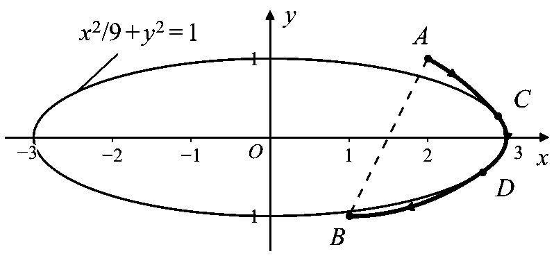
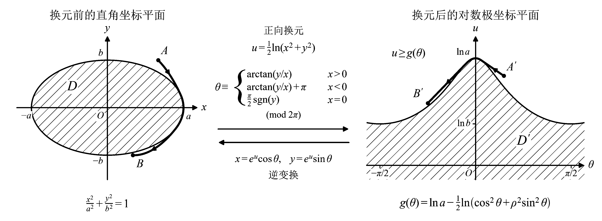
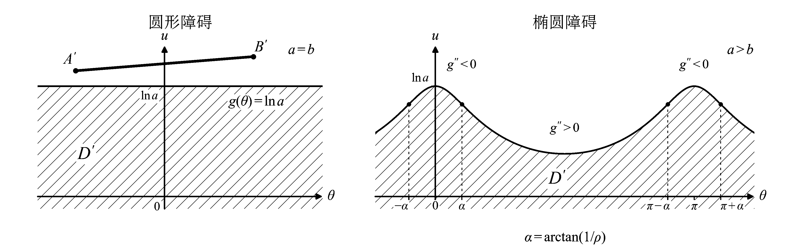
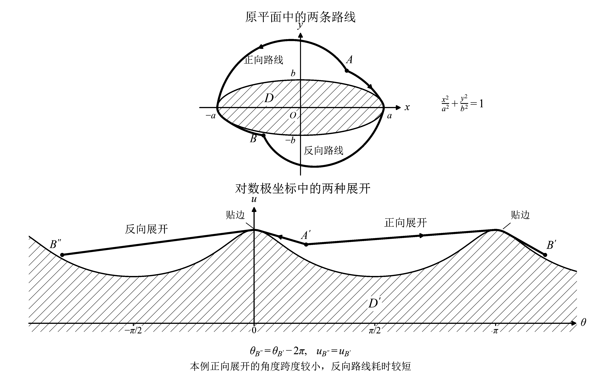
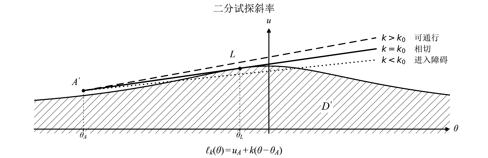
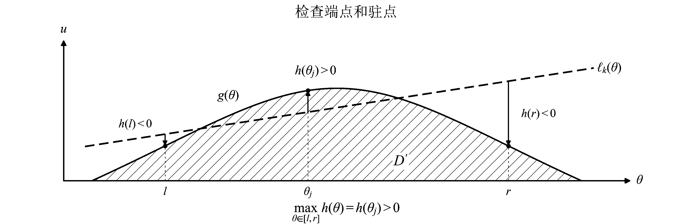

# 程序设计基础 C8 答案（2026秋）

## A 2026模拟考试-诚信考试承诺

| 难度 | 考点 |
| --- | --- |
| 1 | 循环、格式化输出 |

### 题目

时间限制：1000 ms　空间限制：65536 KB

#### 诚信承诺

我承诺：诚信考试，遵守考试规定，自觉维护考场秩序，包括但不限于：

1. 考试全程不使用个人电话，不做与考试无关的事情。
2. 个人独立答题，不通过网络获取答案或提示；除监考老师以外，不与他人进行任何形式的交流。
3. 考试时按监考老师指示进行考试系统的登录，不尝试任何异常登录行为（尝试登录别人的帐号，个人账号在多个设备登录），妥善管理好个人的帐号和密码并保证不透露给他人。

#### 阅读完“诚信承诺”后，请按以下要求输出内容

给定一个正整数 $n$，请输出下方字符串 $n$ 次。

```text
I value my integrity too much to take any shortcuts; I promise I do not cheat in the exam.
```

#### 输入格式

一行一个正整数 $n$（ $1 \le n \le 10$）。

#### 输出格式

按要求输出 $n$ 行字符串。

#### 输入样例

```text
3
```

#### 输出样例

```text
I value my integrity too much to take any shortcuts; I promise I do not cheat in the exam.
I value my integrity too much to take any shortcuts; I promise I do not cheat in the exam.
I value my integrity too much to take any shortcuts; I promise I do not cheat in the exam.
```

### 答案

### 解题思路

读入重复次数 $n$ ，使用循环输出题目指定的字符串。字符串中的大小写、空格和标点均需与题目保持一致，每次输出后换行。

时间复杂度为 $O(n)$ ，额外空间复杂度为 $O(1)$ 。

### 示例代码

```c
#include <stdio.h>

int main() {
    int n;
    scanf("%d", &n);
    while (n--)
        puts("I value my integrity too much to take any shortcuts; I promise I do not cheat in the exam.");
    return 0;
}
```

<!-- markdownlint-disable-next-line MD026 -->
## B 准备考试啦！

| 难度 | 考点 |
| --- | --- |
| 1 | 代码基础 |

### 题目

时间限制：1000 ms　空间限制：65536 KB

#### 题目描述

小 M 要把 $n$ 张试卷装进档案袋，每个档案袋最多装 $k$ 张，试卷不能拆分。

请计算至少需要多少个档案袋，以及使用这些档案袋后最多还能**再**装多少张试卷，且使得所使用档案袋数不变。

#### 输入

第一行一个整数 $T$，表示数据组数， $1 \le T \le 10000$。

接下来 $T$ 行，每行两个整数 $n, k$，分别表示试卷张数和每袋容量， $0 \le n \le 10^9$， $1 \le k \le 10^9$。

#### 输出

每组数据输出一行，依次输出最少档案袋数和这些档案袋的剩余容量，以一个空格分隔。

#### 输入样例

```text
4
10 4
12 4
0 7
1 1000000000
```

#### 输出样例

```text
3 2
3 0
0 0
1 999999999
```

author: 只只小木条

### 答案

### 解题思路

先用整数除法计算装满的袋数，若有余数则再用一个袋子。总容量减去试卷数就是剩余空位。 $n = 0$ 时公式同样成立。使用 `long long` 保存计算结果。

### 示例代码

```c
#include<stdio.h>
int main(){
    int T;
    scanf("%d",&T);
    while(T--){
        long long n,k,c;
        scanf("%lld%lld",&n,&k);
        c=n/k;
        if(n%k) c++;
        printf("%lld %lld
",c,c*k-n);
    }
    return 0;
}
```

## C 创造奇迹的法则

### 题目

时间限制：1000 ms　空间限制：65536 KB

#### 题目描述

Mika 正在广阔的白百合学院里散步。

具体而言，白百合学园可以看做二维的平面直角坐标系，Mika 最初位于 $(0,0)$，朝向 $x$ 轴正方向。

接下来，她有两种行动方式：

1. `F`，向正前方走 1 单位长度；
2. `L`，左转 $90^\circ$，无位移。

一条路径是只由 `F` 和 `L` 组成的字符串。

现在，她有多条常走的路径，请求出对于每条路径，如果她沿着这条路径移动，她最后会走到哪个坐标。

#### 输入

一行一个正整数 $T$ 表示数据组数。

接下来 $T$ 行，每行一个字符串 $S$ 表示一个路径。

数据保证 $1 \le T \le 2 \times 10^5, S_i \in \{\mathtt{F}, \mathtt{L}\}, 1 \le |S| \le 2 \times 10^5, \sum |S| \le 5 \times 10^5$。

#### 输出

对于每组数据输出一行用空格隔开的两个整数表示最后走到的坐标。

#### 输入样例

```text
5
F
L
FFF
FLF
FFLLFFLFLF
```

#### 输出样例

```text
1 0
0 0
3 0
1 1
1 -1
```

#### 样例解释

每条路径都从 $(0,0)$ 出发，初始朝向正东。

第 2 组只改变朝向，位置仍为 $(0,0)$。

第 4 组先向东走 1 步，再左转向北走 1 步，到达 $(1,1)$。

第 5 组依次向东走 2 步、向西走 2 步、向南走 1 步、向东走 1 步，最终到达 $(1,-1)$。

Author: Windowsredstone playing maimai DX

### 答案

| 难度 | 考点 |
| --- | --- |
| 2 | 字符串 |

### 题目分析

考虑用一个值 $dir \in \{0,1,2,3\}$ 表示目前的方向。

可以使用数组 `int dx[4] = {1, 0, -1, 0}` 和 `int dy[4] = {0, 1, 0, -1}` 来表示沿该方向行走时坐标变化。

### 参考代码

```c
#include <stdio.h>
#include <string.h>

char s[200010];
const int dx[4] = {1, 0, -1, 0};
const int dy[4] = {0, 1, 0, -1};
int main() {
    int t;
    scanf("%d", &t);
    while (t--) {
        scanf("%s", s);
        int n = strlen(s);
        int dir = 0;
        int x = 0, y = 0;
        for (int i=0;i<n;i++) {
            if (s[i] == 'L') {
                dir = (dir + 1) % 4;
            } else {
                x += dx[dir];
                y += dy[dir];
            }
        }
        printf("%d %d\n", x, y);
    }
    return 0;
}
```

<!-- markdownlint-disable-next-line MD026 -->
## D What do you want more than a Happy ending?

| 难度 | 考点 |
| --- | --- |
| 3 | 浮点运算、复数乘法、三角函数 |

### 题目

时间限制：2000 ms　空间限制：65536 KB

#### 题目背景

《现实》

收集时间：2091.08.31 | 保管单位：鸠 | 等级：key

鸠：骗子……

房间中，鸠坐在床上，手边的机械蝴蝶振翅欲飞。一张电子早报铺在被子上，头条标题为“地面探索队遭遇强震，致一死多伤”。

泪珠滴落，在光滑的电子纸上晃动，机械蝴蝶却飞走了，鸠急忙穿上鞋，跟着机械蝴蝶奔向门外。

她从卧室跑出去，到客厅，到街上。到了门外，机械蝴蝶不知飞去了哪里，唯有喧嚣的日常，向她袭来。

新郑州的大地上，高楼林立，连接天地，列车道从六面十四方集中在中央车站，日夜不息。

列车连接着无数故事。鸠默想，那里会不会有哥哥的故事。

鸠：……

????：请问……

一道熟悉的声音在耳畔响起，将鸠拉回现实。

Gino：这是你的蝴蝶吗？

蝴蝶在两人贴紧前便钻了出来，悠悠飞远；一串白鸽振翅而起，掠过镜头，去向更高，更高处。


#### 题目描述

蝴蝶变换是信号处理中的一个重要变换，本题中你需要计算 2 阶蝴蝶变换。

记 $\mathrm{i}$ 是虚数单位， $\mathrm{e}$ 是自然对数的底数，定义 $n$ 阶单位根：

$$
\omega_n = \mathrm{e}^{\frac{2\pi\mathrm{i}}{n}} = \cos\frac{2\pi}{n} + \mathrm{i}\sin\frac{2\pi}{n}
$$

根据欧拉公式推导可以得到单位根的幂次满足：

$$
\omega_n^k = \mathrm{e}^{\frac{2k\pi\mathrm{i}}{n}} = \cos\frac{2k\pi}{n} + \mathrm{i}\sin\frac{2k\pi}{n}
$$

我们称蝴蝶变换为下面的变换：

$$
\begin{bmatrix} \hat{x} \\ \hat{y} \end{bmatrix}
= \begin{bmatrix} 1 & \omega_n^k \\ 1 & -\omega_n^k \end{bmatrix}
\begin{bmatrix} x \\ y \end{bmatrix}
= \begin{bmatrix} x + \omega_n^k y \\ x - \omega_n^k y \end{bmatrix}
$$

现给定 $n, k, x, y$ 的值，求 $\hat{x}, \hat{y}$。

#### 输入格式

**本题有多组测试数据。**

第一行输入一个整数 $T$（ $1 \le T \le 10^5$）表示测试数据组数。

接下来 $T$ 行，每行两个整数 $n, k$（ $1 \le n \le 100$， $0 \le k < n$）和四个浮点数 $\mathbb{R}x, \mathbb{I}x, \mathbb{R}y, \mathbb{I}y$（ $-10^4 \le \mathbb{R}x, \mathbb{I}x, \mathbb{R}y, \mathbb{I}y \le 10^4$），保证浮点数不超过两位小数。其中 $\mathbb{R}x, \mathbb{I}x$ 分别表示 $x$ 的实部和虚部。

#### 输出格式

对于每组数据，输出一行四个浮点数 $\mathbb{R}\hat{x}, \mathbb{I}\hat{x}, \mathbb{R}\hat{y}, \mathbb{I}\hat{y}$。你的答案被认为正确当且仅当其与标准答案的相对或绝对误差不超过 $10^{-6}$。

#### 样例输入

```text
4
4 1 1 2 3 4
2 1 -1.5 0.25 2 -3
1 0 0 1.25 -2.5 0
3 1 0.5 -1 2 0.5
```

#### 样例输出

```text
-3 5 5 -1
-3.5 3.25 0.5 -2.75
-2.5 1.25 2.5 1.25
-0.9330127 0.4820508 1.9330127 -2.4820508
```

Author: ExplodingKonjac

祝大家的程设课也都能获得 Happy Ending 喵～

### 答案

### 解题思路

设 $x = x_r + x_i \mathrm{i}$ ， $y = y_r + y_i \mathrm{i}$ ，并记

$$\omega_n^k = \cos\theta + \mathrm{i}\sin\theta, \qquad \theta = \frac{2\pi k}{n} \text{。}$$

先计算复数乘积

$$p = \omega_n^k y = (\cos\theta y_r - \sin\theta y_i) + (\cos\theta y_i + \sin\theta y_r)\mathrm{i} \text{。}$$

矩阵乘法给出 $\hat{x} = x + p$ 、 $\hat{y} = x - p$ ，逐一计算实部和虚部即可。

每组数据只进行常数次三角函数和四则运算，时间复杂度为 $O(1)$ ，额外空间复杂度为 $O(1)$ 。

### 示例代码

```c
#include <math.h>
#include <stdio.h>

int main(void) {
    int T;
    scanf("%d", &T);
    while (T--) {
        int n, k;
        double xr, xi, yr, yi;
        scanf("%d%d%lf%lf%lf%lf", &n, &k, &xr, &xi, &yr, &yi);
        double a = 2.0 * acos(-1.0) * k / n;
        double wr = cos(a), wi = sin(a);
        double pr = wr * yr - wi * yi;
        double pi = wr * yi + wi * yr;
        printf("%.10f %.10f %.10f %.10f
", xr + pr, xi + pi,
               xr - pr, xi - pi);
    }
}
```

## E 距离排序

| 难度 | 考点 |
| --- | --- |
| 3 | qsort |

### 题目

时间限制：1000 ms　空间限制：65536 KB

#### 题目描述

“你听啊秋末的落叶，你听它叹息着离别，只剩我独自领略，海与山，风和月。”

「James Eugene Raynor」想到今天是最后一次上机了，决定出一道简单的题目，考考同学们今天所学的新知识点掌握得怎么样。

给出 $n$ 个平面直角坐标系上的点，请你按他们到原点的距离**从远到近**排序，保证每个点到原点的距离各不相同。

#### 输入

第一行，一个正整数 $n$（ $1 \le n \le 2 \times 10^5$）表示待排序的点数；

接下来 $n$ 行，每行两个整数 $x, y$ 表示一个点的坐标，保证这个点到原点的距离不超过 $10^9$。

#### 输出

输出 $n$ 行，每行以 $(x, y)$ 的形式输出，其中 $x, y$ 是两个整数，表示坐标。请注意逗号后有个空格。

#### 输入样例

```text
4
3 4
-5 1
-2 4
1 4
```

#### 输出样例

```text
(-5, 1)
(3, 4)
(-2, 4)
(1, 4)
```

Author: Protoss

### 答案

### 解题思路

类比于课件上的例题-点集排序，本题只需要将排序条件改为按距离从远到近排序。本题不需要预先计算距离，调用 `qsort` 进行快速排序，每一轮计算两个点到原点距离的平方，比较即可。

### 示例代码

```c
#include <stdio.h>
long long A[200010][2];
int cmp(const void *pa, const void *pb) {
    long long *a = (long long *)pa, *b = (long long *)pb;
    long long disa = a[0] * a[0] + a[1] * a[1];
    long long disb = b[0] * b[0] + b[1] * b[1];
    if ( disa < disb )
        return 1;
    else if ( disa > disb )
        return -1;
    return 0;
    // return (disa < disb) - (disa > disb); // 这样写也是可以的

    // return disb - disa; // 直接这样写会出错，因为比较函数返回值必须是 int 类型，这里做差之后的值超过了 int 能表示的范围。
    // 即使是两个 int 类型相减，也有可能会发生溢出，因此无论何时都不建议直接返回减法。
    // 2024 年期末考试考 qsort 的题目，直接返回减法只能拿到 40 分，白丢 60 分！！！
}
int main() {
    int n;
    scanf("%d", &n);
    for ( int i = 0; i < n; i++ )
        scanf("%lld%lld", &A[i][0], &A[i][1]);
    qsort(A, n, sizeof(A[0]), cmp);
    for ( int i = 0; i < n; i++ )
        printf("(%lld, %lld)
", A[i][0], A[i][1]);
    return 0;
}
```

## F 卡顿的校园网

| 难度 | 考点 |
| --- | --- |
| 3 | 数组标记、顺序模拟 |

### 题目

时间限制：1000 ms　空间限制：65536 KB

#### 题目背景

欢迎大家来到程序设计的世界里。

临近期末考试了，作为程设助教，`muzermat` 正在群里发送通知，只不过，这卡顿的校园网却让助教先生的通知迟迟无法发出。

请聪明的你帮助苦恼的 `muzermat` 解决下面的这个问题吧，加油哦！

相信，经过了这么多次上机赛的陪伴，这件事情对于你来说一定是一件简单的事情，对吧？

#### 题目描述

一共有 $n$ 条消息，编号为 $1, 2, \ldots, n$。

现在，消息按照 $a_1, a_2, \ldots, a_n$ 的顺序依次到达。初始时，所有消息都**未显示**。每到达一条消息 $a_i$，系统都会尝试一轮显示。

1. 记 $k$ 为仍**未显示**的消息中编号最小的那一条；
2. 如果 $k$ 已经到达，就**显示**它，然后重新进行步骤 1；
3. 如果 $k$ 没到达，或者 $k$ 不存在，这一轮显示结束。

请求出在所有轮次中，一轮中**新显示**的消息条数的最大值。

#### 输入

第一行一个正整数 $n$，表示消息数量， $1 \le n \le 2 \times 10^5$。

第二行 $n$ 个正整数 $a_1, a_2, \ldots, a_n$，相邻两个数用空格隔开，表示依次收到的消息编号。

保证 $1 \le a_i \le n$，且 $a_i$ 互不相同。

#### 输出

输出一行一个整数，表示一轮中新显示的消息条数的最大值。

#### 输入样例1

```text
5
2 4 1 5 3
```

#### 输出样例1

```text
3
```

#### 输入样例2

```text
1
1
```

#### 输出样例2

```text
1
```

#### 输入样例3

```text
4
4 3 2 1
```

#### 输出样例3

```text
4
```

#### 样例解释

样例 $_1$：收到编号为 2、4 的消息时，编号为 1 的消息尚未收到，因此均无法显示消息。收到编号为 1 的消息后，依次显示编号为 1、2 的消息。收到编号为 5 的消息时，编号为 3 的消息尚未收到，因此无法显示新消息。最后收到编号为 3 的消息后，依次显示编号为 3、4、5 的消息。五次接收分别新显示 0, 0, 2, 0, 3 条消息，最大值为 3。

样例 $_2$：收到唯一一条消息后，立即显示该消息。

样例 $_3$：前三次接收均无法显示消息；最后收到编号为 1 的消息后，依次显示全部 4 条消息。

Author: muzermat

### 答案

### 解题思路

用数组 `received` 记录每条消息是否已经收到，初始值均为 0。再用变量 `next` 表示下一条应显示的消息编号，初始为 1。

每收到编号为 $x$ 的消息，令 `received[x] = 1` 。随后，只要 `next` 没有超过 $n$ ，并且对应消息已经收到，就显示该消息，将 `next` 加一，同时累计本次新显示的消息数量。用每次的计数更新最大值，即可得到答案。

每次接收前，编号小于 `next` 的消息均已显示，其他消息均未显示。标记新收到的消息后，循环会依次显示从 `next` 开始的所有已收到消息，直到遇到尚未收到的消息或全部显示完毕，恰好符合题目的显示规则。因此，每次计数均正确，所有计数的最大值就是所求答案。

虽然接收循环内还有一个 `while` 循环，但 `next` 始终递增，最多从 1 增长到 $n + 1$ ，因此所有接收过程中 `while` 循环的执行次数合计为 $n$ 。时间复杂度为 $O(n)$ ，空间复杂度为 $O(n)$ 。

数组需要能够访问下标 $n$ 。所有消息显示完毕后， `next` 会等于 $n + 1$ ，因此条件中先检查 `next <= n` ，再访问数组。利用 `&&` 的短路求值规则，可以避免越界。编号、计数与答案均不超过 $2 \times 10^5$ ，使用 `int` 即可。

### 示例代码

```c
#include <stdio.h>

int received[200001];

int main() {
    int n;
    scanf("%d", &n);

    int next = 1, ans = 0;
    for (int i = 0; i < n; i++) {
        int x;
        scanf("%d", &x);
        received[x] = 1;

        int cnt = 0;
        while (next <= n && received[next]) {
            next++;
            cnt++;
        }
        if (cnt > ans) {
            ans = cnt;
        }
    }

    printf("%d
", ans);
    return 0;
}
```

## G X3OR

| 难度 | 考点 |
| --- | --- |
| 4 | 异或性质、分类讨论、构造 |

### 题目

时间限制：3000 ms　空间限制：65536 KB

#### 题目背景

`T` 和 `muzermat` 是「末日反制」工程的魔法师。一天，`T` 通过位分探测仪观测到，一颗名为「A-秘亚」的陨石即将砸向他们所在的星球！

在 `muzermat` 的建议下，`T` 启动了魔法轰击计划：采用 $n$ 个神秘数字进行 X3OR 施法，最终得到的数字 $OMG$ 将成为陨石相对地球的移动速度。他希望让这个数字尽可能小。

#### 题目描述

给定 $n$ 个正整数 $a_1, a_2, \ldots, a_n$，并且 $1 \le a_i \le n$，数值允许重复。可以将这 $n$ 个数任意重新排列。

对于重新排列后的序列，定义 $b_i = a_1 \oplus a_2 \oplus \cdots \oplus a_i$，其中 $1 \le i \le n$， $\oplus$ 表示按位异或。

求 $OMG = b_1 \times b_2 \times \cdots \times b_n$ 的最小可能值。

#### 输入

第一行一个正整数 $T$，表示数据组数， $1 \le T \le 10^2$。

接下来依次给出 $T$ 组数据，每组两行。

第一行一个正整数 $n$， $1 \le n \le 10^5$。

第二行 $n$ 个正整数 $a_1, a_2, \ldots, a_n$，相邻两个数用空格隔开。

#### 输出

按输入顺序输出 $T$ 行。每行一个非负整数，表示对应数据的 $OMG$ 最小可能值。

#### 输入样例1

```text
4
3
1 2 3
1
1
2
2 1
2
2 2
```

#### 输出样例1

```text
0
1
3
0
```

#### 样例解释

第 $_1$ 组按 $1, 2, 3$ 的顺序排列时， $b_1 = 1$， $b_2 = 3$， $b_3 = 0$，乘积为 0。

第 $_2$ 组只有一个数，乘积为 1。

第 $_3$ 组按 $1, 2$ 的顺序排列时，乘积为 $1 \times 3 = 3$。按 $2, 1$ 的顺序排列时，乘积为 $2 \times 3 = 6$，最小值为 3。

第 $_4$ 组的 $b_2 = 2 \oplus 2 = 0$，乘积为 0。

Author: muzermat && TSY

### 答案

### 解题思路

每个前缀异或值都非负，因此乘积至少为 0。只要能让某个前缀异或值等于 0，乘积的最小值就为 0。

当 $n \ge 3$ 时，考虑序列中是否存在重复的数。若存在两个相同的数 $x$ ，将它们放在序列开头，便有 $b_2 = x \oplus x = 0$ 。若所有数都不同，由于 $n$ 个数都在 $[1, n]$ 中，它们恰好是 $1, 2, \ldots, n$ 。此时将 $1, 2, 3$ 放在序列开头，便有 $b_3 = 1 \oplus 2 \oplus 3 = 0$ 。两种情况覆盖了全部可能，所以 $n \ge 3$ 时答案恒为 0，无需实际判断序列是否包含重复值。

当 $n = 1$ 时，唯一的数只能为 1，答案为 1。当 $n = 2$ 时，两个数均属于 $\{1, 2\}$ 。两个数相同时，第二个前缀异或值为 0；两个数不同时，它们为 1 和 2，两种排列的乘积分别为 $1 \times 3 = 3$ 和 $2 \times 3 = 6$ ，最小值为 3。

每组答案只可能为 0、1 或 3。处理多组数据时，每组的 $n$ 个数都要读完，下一次读取才能得到下一组的 $n$ 。当 $n \ge 3$ 时，读入的数据只用于推进输入位置，无需存储。

设第 $j$ 组的长度为 $n_j$ ，总时间复杂度为 $O(\sum_{j=1}^{T} n_j)$ ，额外空间复杂度为 $O(1)$ 。

### 示例代码

```c
#include <stdio.h>

int main() {
    int t;
    scanf("%d", &t);

    while (t--) {
        int n, a, b;
        scanf("%d", &n);

        if (n == 1) {
            scanf("%d", &a);
            puts("1");
        } else if (n == 2) {
            scanf("%d%d", &a, &b);
            puts(a == b ? "0" : "3");
        } else {
            for (int i = 0; i < n; i++) {
                scanf("%d", &a);
            }
            puts("0");
        }
    }

    return 0;
}
```

<!-- markdownlint-disable-next-line MD026 -->
## H 留不住？

| 难度 | 考点 |
| --- | --- |
| 4 | 递归、子问题定位、编号映射 |

### 题目

时间限制：1000 ms　空间限制：65536 KB

#### 题目背景

阅尽天涯离别苦，不道归来，零落花如许。

花底相看无一语，绿窗春与天俱暮。

待把相思灯下诉，一缕新欢，旧恨千千缕。

最是人间留不住，朱颜辞镜花辞树。

愿大家不再**彷徨**，考试的时候不**紧张**，所有的题目都**上道**，会的题全过，不会的题也能拿到暴力分，顺利完成期末考试，取得一个理想的分数。

同时，也感谢大家这半年来在程序设计基础这门课程中的相互陪伴，理解和支持！

`muzermat` 祝您身体健康，万事顺利~

#### 题目描述

最初有一个序列，从左到右依次为 $1, 2, \ldots, n$。定义一个序列中所有元素的离开顺序如下：

- 如果序列只有一个元素，该元素直接离开。
- 否则，按元素在**当前序列**中的位置，将其拆成两个序列：令下标从左到右由 1 开始依次标号，奇数下标的元素按**从左到右**的顺序组成序列 $A$，偶数下标的元素按**从右到左**的顺序组成序列 $B$。
- 先按照相同规则让 $A$ 中的所有元素离开，再按照相同规则让 $B$ 中的所有元素离开。

给定 $n$ 和 $k$，求整个过程中第 $k$ 个离开的元素编号。

#### 输入

第一行输入一个正整数 $T$，表示数据组数， $1 \le T \le 10^4$。

接下来 $T$ 行，每行输入两个正整数 $n, k$，用一个空格分隔。

保证 $1 \le n \le 10^9$， $1 \le k \le n$。

#### 输出

对于每组数据，输出一行一个整数，表示第 $k$ 个离开的元素编号。

#### 输入样例1

```text
7
1 1
6 1
6 2
6 3
6 4
6 5
6 6
```

#### 输出样例1

```text
1
1
5
3
6
2
4
```

#### 输入样例2

```text
5
5 2
26 14
32 17
606 304
5408 2705
```

#### 输出样例2

```text
5
26
32
606
5408
```

#### 样例解释

样例 $_1$：当 $n = 6$ 时，第一次拆分得到 $A = (1,3,5)$、 $B = (6,4,2)$。继续处理后， $A$ 中元素的离开顺序为 $1, 5, 3$， $B$ 中元素的离开顺序为 $6, 2, 4$，因此完整顺序为 $1, 5, 3, 6, 2, 4$。

样例 $_2$：当 $n = 5$ 时，完整顺序为 $1, 5, 3, 4, 2$。后四组数据分别询问第一次拆分后序列 $B$ 中首个离开的元素。

#### 后记（前题目背景）

我觉得这个事情是这样，合理控制做题顺序去提高分数是合理规则之内的使用方式。但是这个东西他不负责程设精神，很多人做题都会这么做，但是没有人挑明了来。

程设的精神是正序开题，一往无前，你不管遇到什么鬼题你都要去干掉他，你对谁全是新人来讲无所谓，但 ExplodingKonjac 他也是个老将，他在程序设计的世界里打了那么多年，拿过那么多奖，你这个东西打到最后叫做晚节不保！

> 开玩笑的，大家在做题的时候还是多看一看后面的题目，也许有对大家而言比较简单的题目。

Author: muzermat

### 答案

### 解题思路

设 $f(n, k)$ 表示初始序列为 $1, 2, \ldots, n$ 时，第 $k$ 个离开的元素编号。当 $n = 1$ 时，只有一个元素，所以 $f(1, 1) = 1$ 。

第一次拆分后，序列 $A$ 有 $a = \lceil n/2 \rceil$ 个元素，依次为 $1, 3, 5, \ldots$ 。如果 $k \le a$ ，答案位于 $A$ 中。将 $A$ 的元素暂时按照当前位置编号为 $1, 2, \ldots, a$ ，便得到规模更小的相同问题。子问题返回的位置为 $p = f(a, k)$ ，它对应原序列中的编号 $2p - 1$ 。

序列 $B$ 有 $b = \lfloor n/2 \rfloor$ 个元素，依次为 $2b, 2b - 2, \ldots, 2$ 。如果 $k > a$ ，说明 $A$ 已经全部处理完毕，需要寻找 $B$ 中第 $k - a$ 个离开的元素。子问题返回位置 $p = f(b, k - a)$ 后，对应的原编号是 $2(b - p + 1)$ 。这里的反向映射来自 $B$ 的排列方向，不能直接使用 $2p$ 。

因此递归关系为：

$$f(n, k) = \begin{cases} 1, & n = 1, \\ 2f(\lceil n/2 \rceil, k) - 1, & k \le \lceil n/2 \rceil, \\ 2(\lfloor n/2 \rfloor - f(\lfloor n/2 \rfloor, k - \lceil n/2 \rceil) + 1), & k > \lceil n/2 \rceil. \end{cases}$$

正确性可按序列长度归纳。单元素情况显然成立；更长的序列按照定义完整处理 $A$ 后才处理 $B$ ，两个分支覆盖所有合法的 $k$ 且不重叠。由归纳假设，递归能正确找到对应子序列中的位置，再通过上述映射还原原编号，因此返回值正确。

每次只进入一个子问题，规模至少缩小到原来的一半向上取整。单组数据的时间复杂度和递归栈空间均为 $O(\log n)$ ，不需要存储完整序列。对于题目给定范围，递归最多进入 31 层。编号不超过 $10^9$ ，奇数分支的乘法中间值最多为 $10^9 + 1$ ，使用 OJ 的 32 位 `int` 即可。

### 示例代码

```c
#include <stdio.h>

int find(int n, int k) {
    if (n == 1) {
        return 1;
    }

    int odd = (n + 1) / 2;
    if (k <= odd) {
        return 2 * find(odd, k) - 1;
    }

    int even = n / 2;
    int pos = find(even, k - odd);
    return 2 * (even - pos + 1);
}

int main() {
    int t;
    scanf("%d", &t);
    while (t--) {
        int n, k;
        scanf("%d%d", &n, &k);
        printf("%d
", find(n, k));
    }
    return 0;
}
```

## I 最大化最小

| 难度 | 考点 |
| --- | --- |
| 6 | 排序、贪心、答案预处理 |

### 题目

时间限制：1000 ms　空间限制：65536 KB

#### 题目描述

给定一个长度为 $n$ 的数组 $a$，你需要将该数组分组并回答 $q$ 次询问。

具体地，第 $i$ 次询问给出一个整数 $k_i$，保证 $k_i$ 能整除 $n$；一次合法分组定义为：将数组 $a$ 的 $n$ 个元素分成 $\frac{n}{k_i}$ 组，使得**每组恰好包含** $k_i$ **个元素，每个元素属于且仅属于一组**。

一次分组的得分为所有组的**最小值之和**，求出每次询问所有合法分组中的**最大得分**。

#### 输入

第一行两个整数 $n$ 和 $q$，满足 $1 \le n, q \le 2 \times 10^5$。

第二行为 $n$ 个整数 $a_1, a_2, \ldots, a_n$，满足 $-10^9 \le a_j \le 10^9$，其中 $1 \le j \le n$。

接下来 $q$ 行，第 $i$ 行为一个整数 $k_i$，满足 $1 \le k_i \le n$ 且 $k_i \mid n$。

相邻整数间用一个空格分隔。

#### 输出

输出 $q$ 行，第 $i$ 行输出一个整数 $s_i$，表示第 $i$ 次询问的最大得分。

#### 输入样例 1

```text
6 4
7 1 5 9 3 8
2
3
1
6
```

#### 输出样例 1

```text
14
8
33
1
```

#### 样例解释

第二次询问中， $k_2 = 3$。可以分成 $1, 5, 3$、 $7, 9, 8$ 两组，得分为 $1 + 7 = 8$，可以证明这是所有合法分组中的最大得分。

第三次询问中， $k_3 = 1$，每个元素单独成组，得分为全部元素之和，即 33。

Provider：LCYing

### 答案

### 解题思路

将数组按从小到大的顺序排序，记为 $b_1 \le b_2 \le \cdots \le b_n$ 。对于组大小 $k$ ，把排序后的数组每 $k$ 个元素分成一组，即可得到最优答案：

$$\mathrm{ans}[k] = b_1 + b_{k+1} + b_{2k+1} + \cdots + b_{n-k+1} \text{。}$$

#### 正确性

正确性是显然的，下面是不显然的正确性证明。

考虑任意一种分组，将各组按组内最小值从小到大排序，记各组的最小值为 $c_1, c_2, \ldots, c_m$ ，其中 $m = n/k$ 。

对任意 $1 \le j \le m$ ，最后 $m - j + 1$ 组一共包含 $(m - j + 1)k = n - (j - 1)k$ 个元素，这些元素都不小于 $c_j$ 。因此，排序后的数组中至少有 $n - (j - 1)k$ 个元素不小于 $c_j$ ，从而有

$$c_j \le b_{(j-1)k+1} \text{。}$$

于是，任意分组的得分都满足

$$\sum_{j=1}^{m} c_j \le \sum_{j=1}^{m} b_{(j-1)k+1} \text{。}$$

将排序后的数组每 $k$ 个元素分成一组时，各组最小值恰好为右侧求和中的元素，能够达到这个上界，因此该方案最优。数组含有负数或重复值时，结论同样成立。

#### 多次询问的优化

所有询问共用同一个数组，只需排序一次，再预处理所有能够整除 $n$ 的组大小对应的答案。每次读入 $k_i$ 后直接输出 $\mathrm{ans}[k_i]$ 。

这里采用答案预处理。普通前缀和计算的是连续区间的和，不能直接求出不同步长的间隔求和，因此不将该优化称为普通前缀和优化。

对于一个合法组大小 $k$ ，计算答案需要累加 $n/k$ 个数。所有合法组大小的累加次数至多为

$$\sum_{k=1}^{n} \left\lfloor \frac{n}{k} \right\rfloor = O(n \log n) \text{。}$$

因此，总时间复杂度为 $O(n \log n + q)$ ，每次查询的时间复杂度为 $O(1)$ ，空间复杂度为 $O(n)$ 。标程使用标准库函数 `qsort` 排序。

答案最大绝对值可达 $2 \times 10^{14}$ ，需要使用 `long long` 。

### 示例代码

```c
#include <stdio.h>
#include <stdlib.h>

int a[200000];
long long ans[200001];

int cmp(const void *p, const void *q)
{
    int x = *(int *)p;
    int y = *(int *)q;
    return (x > y) - (x < y);
}

int main()
{
    int n, q;
    scanf("%d%d", &n, &q);
    for (int i = 0; i < n; i++) {
        scanf("%d", &a[i]);
    }

    qsort(a, n, sizeof(int), cmp);

    for (int k = 1; k <= n; k++) {
        if (n % k == 0) {
            for (int i = 0; i < n; i += k) {
                ans[k] += a[i];
            }
        }
    }

    while (q--) {
        int k;
        scanf("%d", &k);
        printf("%lld
", ans[k]);
    }
    return 0;
}
```

## J Riemann 球面

| 难度 | 考点 |
| --- | --- |
| 7 | 格式化输入，浮点数，库函数 |

### 题目

时间限制：1000 ms　空间限制：65536 KB

#### 题目背景

其实 Gauss 并不是「数学王子」，这里的 Prince 被译作「亲王」更合适，不然也太小瞧 Gauss 的地位了。

当然我们今天讨论的不是 Gauss，而是他的学生 Riemann。具体地，我们讨论的是 Riemann 在 1851 年，在他的博士论文中建立了雏形的 Riemann 球面。通过球极投影，复平面上的每一个点（甚至是代表无穷远的复无穷 $\infty$）都能与球面上的每一个点建立一一对应。

在数学领域几乎每天都在引爆 AI 核弹的今天，让我们来看看这个精妙的球体吧。

#### 题目描述

在空间直角坐标系 $OXYZ$ 中，我们有单位球面 $\Pi: X^2 + Y^2 + Z^2 = 1$，其半径为 1。我们将赤道平面 $Z = 0$ 视为复平面，该平面上的每一个点都可以由一个复数 $z = x + yi$ 表示。

考虑延拓至包含复无穷 $\infty$ 的扩展复数域 $\mathbb{C}^* = \mathbb{C} \cup \{\infty\}$， $\forall z \in \mathbb{C}^*$，通过逆球极投影，每一个 $z$ 都可以唯一确定单位球面上的一个点 $P$。具体映射规则如下：

- 令球面的北极点为 $N(0,0,1)$，对于任意 $z \in \mathbb{C}$，连接 $N$ 与复平面上点 $z$ 的直线会与球面 $\Pi$ 产生唯一一个异于 $N$ 的交点，记为 $P(z)$；特别地，我们规定复无穷 $z = \infty$ 对应的交点 $P(\infty) = N$ 自身。

对于任意球面上的两个不重合且不关于球心对称的点，球面上一定存在一个唯一的，以球心为圆心，过这两点的圆，我们称为过这两点的大圆，大圆上两点间弧度 $< \pi$ 的弧称为这两点构成的大圆劣弧。

对于任意球面上的任意三个点，当它们不共大圆时，它们两两构成的三段大圆劣弧可以围成一个球面三角形，当它们共大圆（包括三个点部分或全部重合时），球面三角形可视为退化形态，其面积为 0。

记单位球面 $\Pi$ 上的三点 $P_k, k \in \{1,2,3\}$ 对应的单位向量 $\vec{p_k} = \overrightarrow{OP_k}$，则这三点围成的球面三角形的面积

$$
S = 2 \cdot \arctan\left( \frac{|\det(\vec{p_1}, \vec{p_2}, \vec{p_3})|}{1 + \sum\limits_{1 \le i < j \le 3} \vec{p_i} \cdot \vec{p_j}} \right)
$$

（van Oosterom and Strackee, 1983）

其中 $|\det(\vec{p_1}, \vec{p_2}, \vec{p_3})|$ 是三个向量组成的行列式的值，其数值上也等于 $|\vec{p_1} \cdot (\vec{p_2} \times \vec{p_3})|$，即三个向量的三重积，其几何意义为三个向量构成的平行六面体的体积；特别地，当有点重合或三点共大圆时，由行列式的性质（或平行六面体的退化），行列式值为 0，答案为 0；否则，当 $\sum\limits_{1 \le i < j \le 3} \vec{p_i} \cdot \vec{p_j} = -1$ 时，可以视为 $S = 2 \cdot \arctan(\infty) = \pi$。该公式中的 $\arctan$ 的值域应理解为 $[0, \pi)$。

给定 3 个复数 $z_1, z_2, z_3 \in \mathbb{C}^*$，求 $P(z_1), P(z_2), P(z_3)$ 构成的球面三角形的面积。

#### 输入格式

输入包含多组测试数据。第一行包含一个正整数 $T$（ $1 \le T \le 1000$），表示测试用例组数。

接下来每组测试数据包含三行，第 $k \in \{1,2,3\}$ 行代表 $z_k \in \mathbb{C}^*$ 的值，一定满足以下输入格式之一：

`a±bi` 或 `+a±bi` 或 `-a±bi`，代表 $\mathbb{C}^*$ 中平凡的点，其中 $a, b$ 是正实数且以无符号十进制小数形式给出；

- `a` 或 `+a` 或 `-a`，代表非零实数，其中 $a$ 是正实数且以无符号十进制小数形式给出；
- `bi` 或 `+bi` 或 `-bi`，代表纯虚数，其中 $b$ 是正实数且以无符号十进制小数形式给出；
- `0`，代表原点；
- `inf`，代表无穷远点 $\infty$。

保证输入没有空格， $0 < a, b < 10^3$，不超过 3 位小数。

特别地，当 $a$ 或 $b$ 为整数时，对应输入可能不含小数点；保证 $b = 1$ 时不会被省略，即输入中不会包含 `+i` `-i` 等子串。

#### 输出格式

对于每组测试数据，输出一行一个实数 $S$，表示 $P(z_1), P(z_2), P(z_3)$ 构成的球面三角形的面积。

特别地，对于你的答案 $S$ 和正确答案 $S_0$，当且仅当 $\left| \frac{S - S_0}{\max(S_0, 1)} \right| < 10^{-9}$（即相对误差或绝对误差 $< 10^{-9}$）时，我们认为你的答案是正确的。

#### 样例输入 1

```text
4
0
1
1i
inf
1
-1
1
2
3
0.9
-0.45+0.799i
-0.45-0.799i
```

#### 样例输出 1

```text
1.570796326795
0
0
5.329441498551
```

#### 样例解释

- 测试数据 1

    $z_1 = 0$ 对应南极点 $P_1(0,0,-1)$；

    $z_2 = 1$ 对应赤道上的点 $P_2(1,0,0)$；

    $z_3 = 1i$ 对应赤道上的点 $P_3(0,1,0)$；

- 它们在南半球围成一个**八分之一球面**三角形，其面积应为整个单位球面表面积（ $4\pi$）的 $\frac{1}{8}$：

$$
S = \frac{4\pi}{8} = \frac{\pi}{2} \approx 1.570796326795
$$

- 测试数据 2

    $z_1 = \mathtt{inf}$ 对应北极点 $P_1(0,0,1)$；

    $z_2 = 1$ 对应点 $P_2(1,0,0)$；

    $z_3 = -1$ 对应点 $P_3(-1,0,0)$；

- 这三点均位于通过空间坐标系 $X$ 轴与 $Z$ 轴的平面上，三点**共大圆**，所围成的球面三角形退化，面积为 0。

- 测试数据 3

    $z_1 = 1$， $z_2 = 2$， $z_3 = 3$。

- 三个点均在复平面的实轴上，由球极投影的性质，它们与北极点一道投影在球面的同一经线大圆上，面积退化为 0。

#### Hint

计算 arctan 时，`math.h` 库里的 `double atan2( double y, double x );` 函数可以帮你在 $x, y$ 不全为 0 的时候计算 $\arctan\frac{y}{x}$；如果你使用 `atan`，请注意返回值可能为负。

如果你的答案错误，评测机将会返回 OE，好心的出题人在评测的详细信息里提供了你该测试点第一次出现答案错误的具体数据，你可以通过打开「我的提交」，将光标放在 OE 上查看。


Author: Ender_hz

### 答案

### 解题思路

知识点：格式化输入，浮点数，库函数

本题需要用到 `double` ，使用 `float` 将不会通过此题。

我们先来推导 $z = x + yi \in \mathbb{C}$ 对应的投影点 $P(z)$ 的坐标：

设射线 $Nz$ 的参数方程 $(X, Y, Z) = (0, 0, 1) + t(x, y, -1) = (tx, ty, 1 - t)$ ，与球面方程 $\Pi : X^2 + Y^2 + Z^2 = 1$ 联立，解得 $t = \dfrac{2}{x^2 + y^2 + 1}$ ，

$$P(z) = \left( \frac{2x}{x^2 + y^2 + 1}, \frac{2y}{x^2 + y^2 + 1}, 1 - \frac{2}{x^2 + y^2 + 1} \right) \text{。}$$

接下来考虑如何输入，我们提供直接以浮点数形式输入的方案：

```c
double re, im;
scanf(" %lf", &re); // 滤去前面可能的空白字符
if (isinf(re)) { // 无穷当然也是一种数
    x[i] = y[i] = 0; z[i] = 1;
} else {
    char c = getchar(); // 读取紧接的字符
    if (c == \+\ || c == \-\) { // 说明是 a+bi 形式
        scanf("%lfi", &im); // 同时读取 i，便于下一次输入
        if (c == \-\) {
            im *= -1;
        }
    } else if (c == \i\) { // 说明是 bi 形式
        im = re;
        re = 0;
    } else { // 剩下的 a 形式
        im = 0;
    }
    x[i] = 2 * re / (re * re + im * im + 1);
    y[i] = 2 * im / (re * re + im * im + 1);
    z[i] = 1 - 2 / (re * re + im * im + 1);
}
```

特别地，我们需要对 `det` 的值进行判断，如果足够接近 0 则视为 0 即可（足够接近 0 时三个向量几乎相同，分母 $\approx 4$ ），这一步不能省略， $\varepsilon$ 取 $10^{-9} \sim 10^{-12}$ 为宜，过大或过小均有可能 WA。

### 示例代码

```c
#include<stdio.h>
#include<math.h>
double x[4], y[4], z[4];
int main() {
    int T;
    scanf("%d", &T);
    while(T--) {
        for(int i = 1; i <= 3; ++i) {
            double re, im;
            scanf(" %lf", &re);
            if (isinf(re)) {
                x[i] = y[i] = 0; z[i] = 1;
            } else {
                char c = getchar();
                if (c == \+\ || c == \-\) {
                    scanf("%lfi", &im);
                    if (c == \-\) {
                        im *= -1;
                    }
                } else if (c == \i\) {
                    im = re;
                    re = 0;
                } else {
                    im = 0;
                }
                x[i] = 2 * re / (re * re + im * im + 1);
                y[i] = 2 * im / (re * re + im * im + 1);
                z[i] = 1 - 2 / (re * re + im * im + 1);
            }
        }
        double det = 0;
        for(int i = 1; i <= 3; ++i) {
            det += x[i] * y[i % 3 + 1] * z[(i + 1) % 3 + 1];
            det -= x[i] * y[(i + 1) % 3 + 1] * z[i % 3 + 1];
        }
        if (det < 0) det = -det;
        if (det < 1e-12) {
            printf("0
");
            continue;
        }
        double den = 1;
        for(int i = 1; i <= 3; ++i) {
            den += x[i] * x[i % 3 + 1];
            den += y[i] * y[i % 3 + 1];
            den += z[i] * z[i % 3 + 1];
        }
        printf("%.12lf
", 2 * atan2(det, den));
    }
}
```

## K Desultory Signals

### 题目

时间限制：2000 ms　空间限制：65536 KB

这是 2026 所有上机赛的**最后一题**。

想必，对于读到这里的你，你的 AK 已经近在咫尺。

那么，就像往常一样，击败这个题吧！

#### 题目背景

“我尝试了……但……”

“我失败了吗？”

“我能逃避吗？”

“……不。”

“面对它，击溃它！”

#### 题目描述

Gino 给定椭圆 $\frac{x^2}{a^2} + \frac{y^2}{b^2} = 1, a \ge b > 0$。

现给定椭圆外两点 $A(x_1, y_1), B(x_2, y_2)$，求从 $A$ 到 $B$ 不经过椭圆内部的最短时间。

鸠觉得，如果速度恒定就太简单了，所以定义在 $(x,y)$ 点的速度不超过 $\sqrt{x^2 + y^2}$。

- 本图为第四组样例。



#### 输入

第一行一个整数 $T$，表示数据组数。

接下来 $T$ 行，每行 6 个整数 $a, b, x_1, y_1, x_2, y_2$ 用空格隔开。

数据保证 $1 \le T \le 10^4$。

数据保证 $1 \le b \le a \le 10^9$， $-10^9 \le x_1, y_1, x_2, y_2 \le 10^9$。保证点 $A, B$ 在椭圆外部。

#### 输出

对于每组数据，输出一行一个浮点数，表示最短时间。

当你的答案与标准答案的绝对误差或相对误差在 $10^{-9}$ 以内时，即 $\frac{|a-b|}{\max(b,1)} < 10^{-9}$ 时，你的答案被判定为正确。

#### 输入样例

```text
5
2 1 3 0 3 0
1 1 2 0 0 2
2 1 3 0 9 0
3 1 2 1 1 -1
1000000000 1 1 1 1 -1
```

#### 输出样例

```text
0.000000000000000
1.570796326794897
1.098612288668110
1.652218533919573
40.783645604110687
```

#### 样例说明

第 1 组中，起点与终点相同，最短时间为 0。

第 2 组中，沿半径为 2 的四分之一圆弧运动即可。路程为 $\pi$，速度恒为 2，最短时间为 $\pi/2$。

第 3 组中，沿正 $x$ 轴从 $(3,0)$ 运动到 $(9,0)$，最短时间为 $\ln 3$。

第 4 组中，椭圆为 $x^2/9 + y^2 = 1$，起点为 $A = (2,1)$，终点为 $B = (1,-1)$。

第 5 组中，椭圆的长短半轴分别为 $10^9$ 和 1。尽管两个端点的直线距离仅为 2，路线仍须绕过椭圆，不能直接穿过其内部。

Author: Ceaseless Signal "不息的信号"


### 答案

| 难度 | 考点 |
| --- | --- |
| 9 | 数值积分，极坐标换元 |

最优路线如图所示，依次经过 $A, C, D, B$。其中， $AC$ 和 $DB$ 是两段对数螺线， $CD$ 沿椭圆边界运动。虚线段 $AB$ 穿过椭圆内部，不能通行。

### 形式化题意

给定 $D = \{(x,y) \mid x^2/a^2 + y^2/b^2 < 1\}$，保证 $a \ge b \ge 1$，求

$$
\min_{x,y \in \mathbb{R}^{[0,1]} - D} \int_0^1 \frac{\sqrt{x'(t)^2 + y'(t)^2}}{\sqrt{x(t)^2 + y(t)^2}} \cdot \mathrm{d}t
$$

其中， $x, y$ 是定义在 $[0,1]$ 上的连续函数，且 $A = (x_0, y_0), B = (x_1, y_1)$。

### 问题转化

可以证明，令

$$
\begin{cases}
x = r\cos\theta, y = r\sin\theta \\
\mathrm{d}x = \mathrm{d}r\cos\theta - r\sin\theta\,\mathrm{d}\theta, \mathrm{d}y = \mathrm{d}r\sin\theta + r\cos\theta\,\mathrm{d}\theta
\end{cases}
$$

$$
\begin{aligned}
&\frac{\sqrt{x'(t)^2+y'(t)^2}}{\sqrt{x(t)^2+y(t)^2}}\cdot \mathrm{d}t
\\
=&\frac{\sqrt{\mathrm{d}x^2/\mathrm{d}t^2+\mathrm{d}y^2/\mathrm{d}t^2}}{\sqrt{x^2+y^2}}\,\mathrm{d}t
\\
=&\frac{\sqrt{(\mathrm{d}r\cos\theta-r\sin\theta\,\mathrm{d}\theta)^2+(\mathrm{d}r\sin\theta+r\cos\theta\,\mathrm{d}\theta)^2}}{r}
\\
=&\frac{\sqrt{(\mathrm{d}r\cos\theta-r\sin\theta\,\mathrm{d}\theta)^2+(\mathrm{d}r\sin\theta+r\cos\theta\,\mathrm{d}\theta)^2}}{r}
\\
=&\frac{\sqrt{\mathrm{d}r^2\cos^2\theta+r^2\sin^2\theta\,\mathrm{d}\theta^2-2r\sin\theta\cos\theta\,\mathrm{d}r\,\mathrm{d}\theta+\mathrm{d}r^2\sin^2\theta+r^2\cos^2\theta\,\mathrm{d}\theta^2+2r\sin\theta\cos\theta\,\mathrm{d}r\,\mathrm{d}\theta}}{r}
\\
=&\frac{\sqrt{\mathrm{d}r^2+r^2\mathrm{d}\theta^2}}{r}
\end{aligned}
$$

取 $u=\ln r, r=e^u, \mathrm{d}r=e^u\,\mathrm{d}u$，有

$$
\begin{aligned}
&\frac{\sqrt{\mathrm{d}r^2+r^2\mathrm{d}\theta^2}}{r}
\\
=&\frac{\sqrt{e^{2u}\mathrm{d}u^2+e^{2u}\mathrm{d}\theta^2}}{e^u}
\\
=&\sqrt{\mathrm{d}u^2+\mathrm{d}\theta^2}
\end{aligned}
$$

故使用换元 $x=e^u\cos\theta, y=e^u\sin\theta$ 时，

$$
\min_{x,y\in\mathbb{R}^{[0,1]}-D}\int_L\frac{\sqrt{x'(t)^2+y'(t)^2}}{\sqrt{x(t)^2+y(t)^2}}\cdot \mathrm{d}t=\min_{u\in(0,+\infty),\theta\in\mathbb{R},(u,\theta)\notin D'}\int_{L'}\sqrt{\mathrm{d}u^2+\mathrm{d}\theta^2}
$$

考虑将 $D$ 换元为 $D'$。取 $\rho=\dfrac{a}{b}\ge 1$，可以证明，

$$
\begin{aligned}
&\frac{x^2}{a^2}+\frac{y^2}{b^2}<1
\\
\iff&\frac{e^{2u}\cos^2\theta}{a^2}+\frac{e^{2u}\sin^2\theta}{b^2}<1
\\
\iff&e^{2u}\left(\cos^2\theta+\rho^2\sin^2\theta\right)<a^2
\\
\iff&e^{2u}<\frac{a^2}{\cos^2\theta+\rho^2\sin^2\theta}
\\
\iff&2u<\ln\frac{a^2}{\cos^2\theta+\rho^2\sin^2\theta}
\\
\iff&u<\frac12\ln\frac{a^2}{\cos^2\theta+\rho^2\sin^2\theta}=\ln a-\frac12\ln(\cos^2\theta+\rho^2\sin^2\theta)
\end{aligned}
$$

故可行域为 $\{(u,\theta)\mid u>0,\theta\in\mathbb{R}\}-D'=\{(u,\theta)\mid u\ge\ln a-\frac12\ln(\cos^2\theta+\rho^2\sin^2\theta)\}$。

取 $g(\theta)=\ln a-\frac12\ln(\cos^2\theta+\rho^2\sin^2\theta)$。可行域为 $\{(u,\theta)\mid u\ge g(\theta)\}$。

此时，将 $xOy$ 系的点 $A,B$ 换元为在 $\theta Ou$ 系的点 $A',B'$，由于 $A,B$ 都在椭圆外部， $A',B'$ 在换元后平面的 $D'$ 区域上面，问题转化为求

$$
\min_{u\in(0,+\infty),\theta\in\mathbb{R},(u,\theta)\notin D'}\int_{L'}\sqrt{\mathrm{d}u^2+\mathrm{d}\theta^2}
$$

这是求最短的 $A'$ 到 $B'$ 的路径，不能经过 $D'$ 区域，即一直在函数 $g(\theta)$ 上方。



### 性质观察

于是，问题转化为了给定函数 $g(\theta)=\ln a-\frac12\ln(\cos^2\theta+\rho^2\sin^2\theta)$ 和函数上方两点 $A',B'$，求两点间欧氏距离最短的不经过 $g(\theta)$ 的路径。

我们只考虑 $\rho>1$ 即 $a>b$ 时，因为若 $a=b$，推出 $g(\theta)=\ln a$ 是常函数，答案是平凡的，直接取 $A'B'$ 线段即可。



考虑研究 $g(\theta)$ 的性质。

令 $g(\theta)=\ln a-\frac12\ln(Q(\theta)),Q(\theta)=\cos^2\theta+\rho^2\sin^2\theta$。由于 $\sin^2\theta$ 和 $\cos^2\theta$ 具有正周期 $\pi$， $Q$ 和 $g$ 也有这个周期。

对 $g(\theta)$ 求导，有

$$
g'(\theta)=-\frac12\frac{Q'(\theta)}{Q(\theta)}=\frac{(1-\rho^2)\sin\theta\cos\theta}{Q(\theta)}
$$

求二阶导，有

$$
\begin{aligned}
g''(\theta)&=\frac{((1-\rho^2)\sin\theta\cos\theta)'Q(\theta)-((1-\rho^2)\sin\theta\cos\theta)Q'(\theta)}{Q^2(\theta)}
\\
&=\frac{((1-\rho^2)\sin\theta\cos\theta)'Q(\theta)-((1-\rho^2)\sin\theta\cos\theta)Q'(\theta)}{Q^2(\theta)}
\\
&=\frac{(1-\rho^2)(\cos^4\theta+(1-\rho^2)\sin^2\theta\cos^2\theta-\rho^2\sin^4\theta)}{Q^2(\theta)}
\\
&=\frac{(1-\rho^2)((1-\sin^2\theta)^2+(1-\rho^2)\sin^2\theta\cos^2\theta-\rho^2\sin^4\theta)}{Q^2(\theta)}
\\
&=\frac{(1-\rho^2)((-1-\rho^2)\sin^2\theta+1)}{Q^2(\theta)}
\\
&=\frac{(1-\rho^2)(\cos^2\theta-\rho^2\sin^2\theta)}{Q^2(\theta)}
\end{aligned}
$$

取 $g''(\theta)=0$，得到 $\cos^2\theta=\rho^2\sin^2\theta\implies\dfrac1\rho=|\tan\theta|$。

令 $\alpha=\arctan(1/\rho)=\arctan(b/a)$，在 $(-\alpha,\alpha)$ 上， $g''(\theta)<0$，在 $(\alpha,\pi-\alpha)$ 上， $g''(\theta)>0$。周期同理。

因此， $g(\theta)$ 是凹凸间隔的。

感性理解一下，如果走过两个峰顶的一条线段，那这个方案应该不优。

这提示着我们，**贴着椭圆走即贴着函数走的路程最多只有一段**。不会出现贴一段之后跳出去然后再贴一段的情况。这提示着我们可以分类讨论贴哪一边。



不难想到二分求解。

容易想到，如果我们打算贴一段路程，那么**一定会尝试去贴上凸的部分**。很显然，如果你贴下凸的部分不如走线段，因为下凸函数的两点连线在函数上方，而两点之间最短的是线段。

因此，策略可以写为**如果能走直的线段，则一定走线段，否则选择一个峰绕过且仅贴一个段**。

### 数值计算

考虑我们如何计算从哪里进入这个峰贴上，从哪里离开这个峰离开。

由于这两个问题是对称的，我们只需要解决其中之一即可。

感性理解，如果我们要绕过这个峰，最好的办法就是从切点的位置进入峰，然后先走线段即可贴上。

我们可以先假设 $A'$ 在峰的左边，要绕过这个峰。

那么，问题就转化为如何在上凸函数上找到一点 $L$ 使其切线经过 $A'$。显然地，这个问题等价于求临界斜率，使得从 $A'$ 延伸出的斜率直线刚好与上凸函数相切，此时斜率为 $k_0$。

可以发现，若 $k>k_0$，则直线与函数不相交，否则 $k\leq k_0$，此时直线与函数相交。

故我们要求 $k$ 的最小值，使得 $g(\theta)\leq u_A+k(\theta-\theta_A)$ 在区间上恒成立。



满足二分性。则问题转化为判定问题：在 $g(\theta)$ 的上凸区间 $[l,r]$ 之间，是否存在某一点在直线 $u=u_A+k(\theta-\theta_A)$ 上方？

等价于求 $\theta\in[l,r],g(\theta)-(u_A+k(\theta-\theta_A))>0$ 是否对至少一个点成立。

令 $h(\theta)=g(\theta)-(u_A+k(\theta-\theta_A))$，有

$$
h'(\theta)=g'(\theta)-k
$$

需要求解方程 $h'(\theta)=0$ 即 $g'(\theta)=k$ 求得极值。

考虑对 $g'(\theta)$ 进行化简，令 $\tan\varphi=\rho\tan\theta,\varphi\in[-\pi/4,\pi/4]$，有

$$
\begin{aligned}
g'(\theta)&=\frac{(1-\rho^2)\sin\theta\cos\theta}{\cos^2\theta+\rho^2\sin^2\theta}
\\
&=\frac{(1-\rho^2)\tan\theta}{1+\rho^2\tan^2\theta}
\\
&=\frac{1-\rho^2}{2\rho}\cdot\frac{2\rho\tan\theta}{1+\rho^2\tan^2\theta}
\\
&=\frac{1-\rho^2}{2\rho}\cdot\frac{2\tan\varphi}{1+\tan^2\varphi}
\\
&=\frac{1-\rho^2}{2\rho}\cdot\sin2\varphi
\\
&=-M\sin2\varphi,\quad M:=\frac{\rho^2-1}{2\rho}
\end{aligned}
$$

令 $g'(\theta)=k,|k|\leq M$，

$$
\begin{aligned}
g'(\theta)=k&\iff\sin2\varphi=-\frac{k}{M}
\\
&\iff\varphi=-\frac12\arcsin\frac{k}{M}
\\
&\iff\tan\varphi=-\tan\frac12\arcsin\frac{k}{M}
\\
&\iff\tan\theta=-\frac{\tan\frac12\arcsin\frac{k}{M}}{\rho}
\\
&\iff\theta_j=-\arctan\frac{\tan\frac12\arcsin\frac{k}{M}}{\rho}+j\pi
\end{aligned}
$$

因此，我们若要判断区间上是否存在 $g(\theta)$ 在直线上方，只需要判断区间的双端点以及在区间内的 $\theta_j$ 是否至少有在直线上方的。最多进行 $3$ 次计算。



于是，我们先判断线段 $A'B'$ 是否在曲线上方。如果在上方，直接走线段即可；否则，我们能够通过二分区间 $[k_{A'B'},M]$ 找到贴上去的临界点 $L$。

同理地，可以找到 $B'$ 对应的临界点 $R$。

可以证明，若 $L'$ 和 $R'$ 不是同一个峰上的两点，则方案不优。

此时最终路径为 $A'\to L\to R\to B'$，只有两个临界点 $L,R$ 走曲线 $g(\theta)$。

### 数值积分

直线长度的计算是简单的。接下来需要算曲线的长度，需要进行数值积分。即求

$$
C=\int_{\theta_L}^{\theta_R}\sqrt{1+g'(\theta)^2}\,\mathrm{d}\theta
$$

其中 $l,r$ 是刚算出来的两个要贴上去的临界点。

该数值积分可以使用自适应辛普森法计算。在此略过。

数值积分

所求答案即为 $|A'L|+C+|RB'|$，精度为 $10^{-9}$。

### 示例代码

```c
#include <stdio.h>
#include <stdlib.h>
#include <math.h>
#include <string.h>
#include <assert.h>
typedef long long ll;
const double pi = 3.141592653589793238462643383;
ll a, b;
double rho, M, alpha;
double sqr(double t) {
    return t * t;
}
double g(double t) {
    return log(a) - 0.5 * log(sqr(cos(t)) + sqr(rho * sin(t)));
}
double g1(double t) {
    return (1 - rho * rho) * sin(t) * cos(t) / (sqr(cos(t)) + sqr(rho * sin(t)));
}
int lower(double t0, double u0, double k, double t) {
    return g(t) - (u0 + k * (t - t0)) > 0;
}
double phi(double k) {
    return -0.5 * asin(fmax(-1, fmin(1, k / M)));
}
double peak(double k) {
    return atan(tan(phi(k)) / rho);
}
int blocked(double t, double u, double k, double left, double right) {
    double tj = peak(k);
    return left < tj && tj < right && lower(t, u, k, tj);
}
double calc(double t, double u, double left, double right) {
    double l = g1(right), r = g1(left);
    for(int times = 1; times <= 80; times++) {
        double mid = (l + r) / 2;
        if (blocked(t, u, mid, left, right)) {
            l = mid;
        } else {
            r = mid;
        }
    }
    return l;
}

double f(double t) {
    return hypot(1, g1(t));
}
double simpson(double l, double r) {
    double mid = (l + r) / 2;
    return (r - l) * (f(l) + 4 * f(mid) + f(r)) / 6;
}
double asr(double l, double r, double eps, double ans, int step) {
    double mid = (l + r) / 2;
    double fl = simpson(l, mid), fr = simpson(mid, r);
    if (fabs(fl + fr - ans) <= 15 * eps || step < 0)
        return fl + fr + (fl + fr - ans) / 15;
    return asr(l, mid, eps / 2, fl, step - 1) + asr(mid, r, eps / 2, fr, step - 1);
}
double integrate(double l, double r, double eps) {
    return asr(l, r, eps, simpson(l, r), 12);
}

double pre(ll x1, ll y1, ll x2, ll y2) {
    if (y1 < 0 || (y1 == 0 && x1 < 0))
        return pre(-x1, -y1, -x2, -y2);
    double u1 = 0.5 * log(x1 * x1 + y1 * y1);
    double u2 = 0.5 * log(x2 * x2 + y2 * y2);
    ll cross = x1 * y2 - x2 * y1;
    ll dot = x1 * x2 + y1 * y2;
    if(cross == 0 && dot > 0) return fabs(u2 - u1);
    // peaks are 0, pi, 2pi, 3pi...
    double dt = atan2(cross, dot);
    if(dt < 0) dt += 2 * pi;
    double t1 = atan2(y1, x1);
    double t2 = t1 + dt;
    double linelen = hypot(dt, u2 - u1);
    if(a == b) return linelen;
    if(y1 * y2 >= 0 && cross < 0) return 1e18;
    double k = (u2 - u1) / dt;
    if(fabs(k) > M) return linelen;
    int j = (y2 >= 0 && k < 0 ? 0 : 1);
    double d1 = t1 - j * pi, d2 = t2 - j * pi;
    double left = fmax(-alpha, d1), right = fmin(alpha, d2);
    if(!blocked(d1, u1, k, left, right)) return linelen;
    double k1 = calc(d1, u1, left, right);
    double k2 = -calc(-d2, u2, -right, -left);
    double dl = peak(k1), dr = peak(k2);
    double L = j * pi + dl, R = j * pi + dr;
    double AL = hypot(t1 - L, u1 - g(dl));
    double BR = hypot(t2 - R, u2 - g(dr));
    double C = integrate(dl, dr, 1e-12);
    return AL + C + BR;
}
void solve() {
    ll x1, y1, x2, y2;
    scanf("%lld%lld%lld%lld%lld%lld", &a, &b, &x1, &y1, &x2, &y2);
    rho = a / (double) b;
    M = (rho * rho - 1) / (2 * rho);
    alpha = atan2(b, a);
    double ans1 = pre(x1, y1, x2, y2);
    double ans2 = pre(x2, y2, x1, y1);
    double ans = fmin(ans1, ans2);
    printf("%.15lf\n", (double) ans);
}
int main() {
    int t;
    scanf("%d", &t);
    while(t--) {
        solve();
    }
    return 0;
}
```
