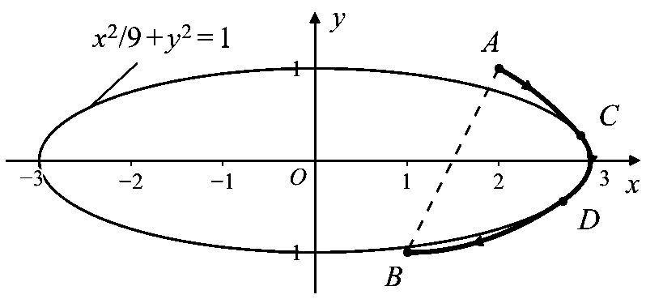

# 程序设计基础 C8 题目（2026秋）

## 题目一览

| 题号 | 题目名称 | 时间限制 | 空间限制 |
| --- | --- | --- | --- |
| A | 2026模拟考试-诚信考试承诺 | 1000 ms | 65536 KB |
| B | 准备考试啦！ | 1000 ms | 65536 KB |
| C | 创造奇迹的法则 | 1000 ms | 65536 KB |
| D | What do you want more than a Happy ending? | 2000 ms | 65536 KB |
| E | 距离排序 | 1000 ms | 65536 KB |
| F | 卡顿的校园网 | 1000 ms | 65536 KB |
| G | X3OR | 3000 ms | 65536 KB |
| H | 留不住？ | 1000 ms | 65536 KB |
| I | 最大化最小 | 1000 ms | 65536 KB |
| J | Riemann 球面 | 1000 ms | 65536 KB |
| K | Desultory Signals | 2000 ms | 65536 KB |

## A 2026模拟考试-诚信考试承诺

时间限制：1000 ms　空间限制：65536 KB

### 诚信承诺

我承诺：诚信考试，遵守考试规定，自觉维护考场秩序，包括但不限于：

1. 考试全程不使用个人电话，不做与考试无关的事情。
2. 个人独立答题，不通过网络获取答案或提示；除监考老师以外，不与他人进行任何形式的交流。
3. 考试时按监考老师指示进行考试系统的登录，不尝试任何异常登录行为（尝试登录别人的帐号，个人账号在多个设备登录），妥善管理好个人的帐号和密码并保证不透露给他人。

### 阅读完“诚信承诺”后，请按以下要求输出内容

给定一个正整数 $n$，请输出下方字符串 $n$ 次。

```text
I value my integrity too much to take any shortcuts; I promise I do not cheat in the exam.
```

### 输入格式

一行一个正整数 $n$（ $1 \le n \le 10$）。

### 输出格式

按要求输出 $n$ 行字符串。

### 输入样例

```text
3
```

### 输出样例

```text
I value my integrity too much to take any shortcuts; I promise I do not cheat in the exam.
I value my integrity too much to take any shortcuts; I promise I do not cheat in the exam.
I value my integrity too much to take any shortcuts; I promise I do not cheat in the exam.
```

<!-- markdownlint-disable-next-line MD026 -->
## B 准备考试啦！

时间限制：1000 ms　空间限制：65536 KB

### 题目描述

小 M 要把 $n$ 张试卷装进档案袋，每个档案袋最多装 $k$ 张，试卷不能拆分。

请计算至少需要多少个档案袋，以及使用这些档案袋后最多还能**再**装多少张试卷，且使得所使用档案袋数不变。

### 输入

第一行一个整数 $T$，表示数据组数， $1 \le T \le 10000$。

接下来 $T$ 行，每行两个整数 $n, k$，分别表示试卷张数和每袋容量， $0 \le n \le 10^9$， $1 \le k \le 10^9$。

### 输出

每组数据输出一行，依次输出最少档案袋数和这些档案袋的剩余容量，以一个空格分隔。

### 输入样例

```text
4
10 4
12 4
0 7
1 1000000000
```

### 输出样例

```text
3 2
3 0
0 0
1 999999999
```

author: 只只小木条

## C 创造奇迹的法则

时间限制：1000 ms　空间限制：65536 KB

### 题目描述

Mika 正在广阔的白百合学院里散步。

具体而言，白百合学园可以看做二维的平面直角坐标系，Mika 最初位于 $(0,0)$，朝向 $x$ 轴正方向。

接下来，她有两种行动方式：

1. `F`，向正前方走 1 单位长度；
2. `L`，左转 $90^\circ$，无位移。

一条路径是只由 `F` 和 `L` 组成的字符串。

现在，她有多条常走的路径，请求出对于每条路径，如果她沿着这条路径移动，她最后会走到哪个坐标。

### 输入

一行一个正整数 $T$ 表示数据组数。

接下来 $T$ 行，每行一个字符串 $S$ 表示一个路径。

数据保证 $1 \le T \le 2 \times 10^5, S_i \in \{\mathtt{F}, \mathtt{L}\}, 1 \le |S| \le 2 \times 10^5, \sum |S| \le 5 \times 10^5$。

### 输出

对于每组数据输出一行用空格隔开的两个整数表示最后走到的坐标。

### 输入样例

```text
5
F
L
FFF
FLF
FFLLFFLFLF
```

### 输出样例

```text
1 0
0 0
3 0
1 1
1 -1
```

### 样例解释

每条路径都从 $(0,0)$ 出发，初始朝向正东。

第 2 组只改变朝向，位置仍为 $(0,0)$。

第 4 组先向东走 1 步，再左转向北走 1 步，到达 $(1,1)$。

第 5 组依次向东走 2 步、向西走 2 步、向南走 1 步、向东走 1 步，最终到达 $(1,-1)$。

Author: Windowsredstone playing maimai DX

## D What do you want more than a Happy ending?

时间限制：2000 ms　空间限制：65536 KB

### 题目背景

《现实》

收集时间：2091.08.31 | 保管单位：鸠 | 等级：key

鸠：骗子……

房间中，鸠坐在床上，手边的机械蝴蝶振翅欲飞。一张电子早报铺在被子上，头条标题为“地面探索队遭遇强震，致一死多伤”。

泪珠滴落，在光滑的电子纸上晃动，机械蝴蝶却飞走了，鸠急忙穿上鞋，跟着机械蝴蝶奔向门外。

她从卧室跑出去，到客厅，到街上。到了门外，机械蝴蝶不知飞去了哪里，唯有喧嚣的日常，向她袭来。

新郑州的大地上，高楼林立，连接天地，列车道从六面十四方集中在中央车站，日夜不息。

列车连接着无数故事。鸠默想，那里会不会有哥哥的故事。

鸠：……

????：请问……

一道熟悉的声音在耳畔响起，将鸠拉回现实。

Gino：这是你的蝴蝶吗？

蝴蝶在两人贴紧前便钻了出来，悠悠飞远；一串白鸽振翅而起，掠过镜头，去向更高，更高处。


### 题目描述

蝴蝶变换是信号处理中的一个重要变换，本题中你需要计算 2 阶蝴蝶变换。

记 $\mathrm{i}$ 是虚数单位， $\mathrm{e}$ 是自然对数的底数，定义 $n$ 阶单位根：

$$
\omega_n = \mathrm{e}^{\frac{2\pi\mathrm{i}}{n}} = \cos\frac{2\pi}{n} + \mathrm{i}\sin\frac{2\pi}{n}
$$

根据欧拉公式推导可以得到单位根的幂次满足：

$$
\omega_n^k = \mathrm{e}^{\frac{2k\pi\mathrm{i}}{n}} = \cos\frac{2k\pi}{n} + \mathrm{i}\sin\frac{2k\pi}{n}
$$

我们称蝴蝶变换为下面的变换：

$$
\begin{bmatrix} \hat{x} \\ \hat{y} \end{bmatrix}
= \begin{bmatrix} 1 & \omega_n^k \\ 1 & -\omega_n^k \end{bmatrix}
\begin{bmatrix} x \\ y \end{bmatrix}
= \begin{bmatrix} x + \omega_n^k y \\ x - \omega_n^k y \end{bmatrix}
$$

现给定 $n, k, x, y$ 的值，求 $\hat{x}, \hat{y}$。

### 输入格式

**本题有多组测试数据。**

第一行输入一个整数 $T$（ $1 \le T \le 10^5$）表示测试数据组数。

接下来 $T$ 行，每行两个整数 $n, k$（ $1 \le n \le 100$， $0 \le k < n$）和四个浮点数 $\mathbb{R}x, \mathbb{I}x, \mathbb{R}y, \mathbb{I}y$（ $-10^4 \le \mathbb{R}x, \mathbb{I}x, \mathbb{R}y, \mathbb{I}y \le 10^4$），保证浮点数不超过两位小数。其中 $\mathbb{R}x, \mathbb{I}x$ 分别表示 $x$ 的实部和虚部。

### 输出格式

对于每组数据，输出一行四个浮点数 $\mathbb{R}\hat{x}, \mathbb{I}\hat{x}, \mathbb{R}\hat{y}, \mathbb{I}\hat{y}$。你的答案被认为正确当且仅当其与标准答案的相对或绝对误差不超过 $10^{-6}$。

### 样例输入

```text
4
4 1 1 2 3 4
2 1 -1.5 0.25 2 -3
1 0 0 1.25 -2.5 0
3 1 0.5 -1 2 0.5
```

### 样例输出

```text
-3 5 5 -1
-3.5 3.25 0.5 -2.75
-2.5 1.25 2.5 1.25
-0.9330127 0.4820508 1.9330127 -2.4820508
```

Author: ExplodingKonjac

祝大家的程设课也都能获得 Happy Ending 喵～

## E 距离排序

时间限制：1000 ms　空间限制：65536 KB

### 题目描述

“你听啊秋末的落叶，你听它叹息着离别，只剩我独自领略，海与山，风和月。”

「James Eugene Raynor」想到今天是最后一次上机了，决定出一道简单的题目，考考同学们今天所学的新知识点掌握得怎么样。

给出 $n$ 个平面直角坐标系上的点，请你按他们到原点的距离**从远到近**排序，保证每个点到原点的距离各不相同。

### 输入

第一行，一个正整数 $n$（ $1 \le n \le 2 \times 10^5$）表示待排序的点数；

接下来 $n$ 行，每行两个整数 $x, y$ 表示一个点的坐标，保证这个点到原点的距离不超过 $10^9$。

### 输出

输出 $n$ 行，每行以 $(x, y)$ 的形式输出，其中 $x, y$ 是两个整数，表示坐标。请注意逗号后有个空格。

### 输入样例

```text
4
3 4
-5 1
-2 4
1 4
```

### 输出样例

```text
(-5, 1)
(3, 4)
(-2, 4)
(1, 4)
```

Author: Protoss

## F 卡顿的校园网

时间限制：1000 ms　空间限制：65536 KB

### 题目背景

欢迎大家来到程序设计的世界里。

临近期末考试了，作为程设助教，`muzermat` 正在群里发送通知，只不过，这卡顿的校园网却让助教先生的通知迟迟无法发出。

请聪明的你帮助苦恼的 `muzermat` 解决下面的这个问题吧，加油哦！

相信，经过了这么多次上机赛的陪伴，这件事情对于你来说一定是一件简单的事情，对吧？

### 题目描述

一共有 $n$ 条消息，编号为 $1, 2, \ldots, n$。

现在，消息按照 $a_1, a_2, \ldots, a_n$ 的顺序依次到达。初始时，所有消息都**未显示**。每到达一条消息 $a_i$，系统都会尝试一轮显示。

1. 记 $k$ 为仍**未显示**的消息中编号最小的那一条；
2. 如果 $k$ 已经到达，就**显示**它，然后重新进行步骤 1；
3. 如果 $k$ 没到达，或者 $k$ 不存在，这一轮显示结束。

请求出在所有轮次中，一轮中**新显示**的消息条数的最大值。

### 输入

第一行一个正整数 $n$，表示消息数量， $1 \le n \le 2 \times 10^5$。

第二行 $n$ 个正整数 $a_1, a_2, \ldots, a_n$，相邻两个数用空格隔开，表示依次收到的消息编号。

保证 $1 \le a_i \le n$，且 $a_i$ 互不相同。

### 输出

输出一行一个整数，表示一轮中新显示的消息条数的最大值。

### 输入样例1

```text
5
2 4 1 5 3
```

### 输出样例1

```text
3
```

### 输入样例2

```text
1
1
```

### 输出样例2

```text
1
```

### 输入样例3

```text
4
4 3 2 1
```

### 输出样例3

```text
4
```

### 样例解释

样例 $_1$：收到编号为 2、4 的消息时，编号为 1 的消息尚未收到，因此均无法显示消息。收到编号为 1 的消息后，依次显示编号为 1、2 的消息。收到编号为 5 的消息时，编号为 3 的消息尚未收到，因此无法显示新消息。最后收到编号为 3 的消息后，依次显示编号为 3、4、5 的消息。五次接收分别新显示 0, 0, 2, 0, 3 条消息，最大值为 3。

样例 $_2$：收到唯一一条消息后，立即显示该消息。

样例 $_3$：前三次接收均无法显示消息；最后收到编号为 1 的消息后，依次显示全部 4 条消息。

Author: muzermat

## G X3OR

时间限制：3000 ms　空间限制：65536 KB

### 题目背景

`T` 和 `muzermat` 是「末日反制」工程的魔法师。一天，`T` 通过位分探测仪观测到，一颗名为「A-秘亚」的陨石即将砸向他们所在的星球！

在 `muzermat` 的建议下，`T` 启动了魔法轰击计划：采用 $n$ 个神秘数字进行 X3OR 施法，最终得到的数字 $OMG$ 将成为陨石相对地球的移动速度。他希望让这个数字尽可能小。

### 题目描述

给定 $n$ 个正整数 $a_1, a_2, \ldots, a_n$，并且 $1 \le a_i \le n$，数值允许重复。可以将这 $n$ 个数任意重新排列。

对于重新排列后的序列，定义 $b_i = a_1 \oplus a_2 \oplus \cdots \oplus a_i$，其中 $1 \le i \le n$， $\oplus$ 表示按位异或。

求 $OMG = b_1 \times b_2 \times \cdots \times b_n$ 的最小可能值。

### 输入

第一行一个正整数 $T$，表示数据组数， $1 \le T \le 10^2$。

接下来依次给出 $T$ 组数据，每组两行。

第一行一个正整数 $n$， $1 \le n \le 10^5$。

第二行 $n$ 个正整数 $a_1, a_2, \ldots, a_n$，相邻两个数用空格隔开。

### 输出

按输入顺序输出 $T$ 行。每行一个非负整数，表示对应数据的 $OMG$ 最小可能值。

### 输入样例1

```text
4
3
1 2 3
1
1
2
2 1
2
2 2
```

### 输出样例1

```text
0
1
3
0
```

### 样例解释

第 $_1$ 组按 $1, 2, 3$ 的顺序排列时， $b_1 = 1$， $b_2 = 3$， $b_3 = 0$，乘积为 0。

第 $_2$ 组只有一个数，乘积为 1。

第 $_3$ 组按 $1, 2$ 的顺序排列时，乘积为 $1 \times 3 = 3$。按 $2, 1$ 的顺序排列时，乘积为 $2 \times 3 = 6$，最小值为 3。

第 $_4$ 组的 $b_2 = 2 \oplus 2 = 0$，乘积为 0。

Author: muzermat && TSY

## H 留不住？

时间限制：1000 ms　空间限制：65536 KB

### 题目背景

阅尽天涯离别苦，不道归来，零落花如许。

花底相看无一语，绿窗春与天俱暮。

待把相思灯下诉，一缕新欢，旧恨千千缕。

最是人间留不住，朱颜辞镜花辞树。

愿大家不再**彷徨**，考试的时候不**紧张**，所有的题目都**上道**，会的题全过，不会的题也能拿到暴力分，顺利完成期末考试，取得一个理想的分数。

同时，也感谢大家这半年来在程序设计基础这门课程中的相互陪伴，理解和支持！

`muzermat` 祝您身体健康，万事顺利~

### 题目描述

最初有一个序列，从左到右依次为 $1, 2, \ldots, n$。定义一个序列中所有元素的离开顺序如下：

- 如果序列只有一个元素，该元素直接离开。
- 否则，按元素在**当前序列**中的位置，将其拆成两个序列：令下标从左到右由 1 开始依次标号，奇数下标的元素按**从左到右**的顺序组成序列 $A$，偶数下标的元素按**从右到左**的顺序组成序列 $B$。
- 先按照相同规则让 $A$ 中的所有元素离开，再按照相同规则让 $B$ 中的所有元素离开。

给定 $n$ 和 $k$，求整个过程中第 $k$ 个离开的元素编号。

### 输入

第一行输入一个正整数 $T$，表示数据组数， $1 \le T \le 10^4$。

接下来 $T$ 行，每行输入两个正整数 $n, k$，用一个空格分隔。

保证 $1 \le n \le 10^9$， $1 \le k \le n$。

### 输出

对于每组数据，输出一行一个整数，表示第 $k$ 个离开的元素编号。

### 输入样例1

```text
7
1 1
6 1
6 2
6 3
6 4
6 5
6 6
```

### 输出样例1

```text
1
1
5
3
6
2
4
```

### 输入样例2

```text
5
5 2
26 14
32 17
606 304
5408 2705
```

### 输出样例2

```text
5
26
32
606
5408
```

### 样例解释

样例 $_1$：当 $n = 6$ 时，第一次拆分得到 $A = (1,3,5)$、 $B = (6,4,2)$。继续处理后， $A$ 中元素的离开顺序为 $1, 5, 3$， $B$ 中元素的离开顺序为 $6, 2, 4$，因此完整顺序为 $1, 5, 3, 6, 2, 4$。

样例 $_2$：当 $n = 5$ 时，完整顺序为 $1, 5, 3, 4, 2$。后四组数据分别询问第一次拆分后序列 $B$ 中首个离开的元素。

### 后记（前题目背景）

我觉得这个事情是这样，合理控制做题顺序去提高分数是合理规则之内的使用方式。但是这个东西他不负责程设精神，很多人做题都会这么做，但是没有人挑明了来。

程设的精神是正序开题，一往无前，你不管遇到什么鬼题你都要去干掉他，你对谁全是新人来讲无所谓，但 ExplodingKonjac 他也是个老将，他在程序设计的世界里打了那么多年，拿过那么多奖，你这个东西打到最后叫做晚节不保！

> 开玩笑的，大家在做题的时候还是多看一看后面的题目，也许有对大家而言比较简单的题目。

Author: muzermat

## I 最大化最小

时间限制：1000 ms　空间限制：65536 KB

### 题目描述

给定一个长度为 $n$ 的数组 $a$，你需要将该数组分组并回答 $q$ 次询问。

具体地，第 $i$ 次询问给出一个整数 $k_i$，保证 $k_i$ 能整除 $n$；一次合法分组定义为：将数组 $a$ 的 $n$ 个元素分成 $\frac{n}{k_i}$ 组，使得**每组恰好包含** $k_i$ **个元素，每个元素属于且仅属于一组**。

一次分组的得分为所有组的**最小值之和**，求出每次询问所有合法分组中的**最大得分**。

### 输入

第一行两个整数 $n$ 和 $q$，满足 $1 \le n, q \le 2 \times 10^5$。

第二行为 $n$ 个整数 $a_1, a_2, \ldots, a_n$，满足 $-10^9 \le a_j \le 10^9$，其中 $1 \le j \le n$。

接下来 $q$ 行，第 $i$ 行为一个整数 $k_i$，满足 $1 \le k_i \le n$ 且 $k_i \mid n$。

相邻整数间用一个空格分隔。

### 输出

输出 $q$ 行，第 $i$ 行输出一个整数 $s_i$，表示第 $i$ 次询问的最大得分。

### 输入样例 1

```text
6 4
7 1 5 9 3 8
2
3
1
6
```

### 输出样例 1

```text
14
8
33
1
```

### 样例解释

第二次询问中， $k_2 = 3$。可以分成 $1, 5, 3$、 $7, 9, 8$ 两组，得分为 $1 + 7 = 8$，可以证明这是所有合法分组中的最大得分。

第三次询问中， $k_3 = 1$，每个元素单独成组，得分为全部元素之和，即 33。

Provider：LCYing

## J Riemann 球面

时间限制：1000 ms　空间限制：65536 KB

### 题目背景

其实 Gauss 并不是「数学王子」，这里的 Prince 被译作「亲王」更合适，不然也太小瞧 Gauss 的地位了。

当然我们今天讨论的不是 Gauss，而是他的学生 Riemann。具体地，我们讨论的是 Riemann 在 1851 年，在他的博士论文中建立了雏形的 Riemann 球面。通过球极投影，复平面上的每一个点（甚至是代表无穷远的复无穷 $\infty$）都能与球面上的每一个点建立一一对应。

在数学领域几乎每天都在引爆 AI 核弹的今天，让我们来看看这个精妙的球体吧。

### 题目描述

在空间直角坐标系 $OXYZ$ 中，我们有单位球面 $\Pi: X^2 + Y^2 + Z^2 = 1$，其半径为 1。我们将赤道平面 $Z = 0$ 视为复平面，该平面上的每一个点都可以由一个复数 $z = x + yi$ 表示。

考虑延拓至包含复无穷 $\infty$ 的扩展复数域 $\mathbb{C}^* = \mathbb{C} \cup \{\infty\}$， $\forall z \in \mathbb{C}^*$，通过逆球极投影，每一个 $z$ 都可以唯一确定单位球面上的一个点 $P$。具体映射规则如下：

- 令球面的北极点为 $N(0,0,1)$，对于任意 $z \in \mathbb{C}$，连接 $N$ 与复平面上点 $z$ 的直线会与球面 $\Pi$ 产生唯一一个异于 $N$ 的交点，记为 $P(z)$；特别地，我们规定复无穷 $z = \infty$ 对应的交点 $P(\infty) = N$ 自身。

对于任意球面上的两个不重合且不关于球心对称的点，球面上一定存在一个唯一的，以球心为圆心，过这两点的圆，我们称为过这两点的大圆，大圆上两点间弧度 $< \pi$ 的弧称为这两点构成的大圆劣弧。

对于任意球面上的任意三个点，当它们不共大圆时，它们两两构成的三段大圆劣弧可以围成一个球面三角形，当它们共大圆（包括三个点部分或全部重合时），球面三角形可视为退化形态，其面积为 0。

记单位球面 $\Pi$ 上的三点 $P_k, k \in \{1,2,3\}$ 对应的单位向量 $\vec{p_k} = \overrightarrow{OP_k}$，则这三点围成的球面三角形的面积

$$
S = 2 \cdot \arctan\left( \frac{|\det(\vec{p_1}, \vec{p_2}, \vec{p_3})|}{1 + \sum\limits_{1 \le i < j \le 3} \vec{p_i} \cdot \vec{p_j}} \right)
$$

（van Oosterom and Strackee, 1983）

其中 $|\det(\vec{p_1}, \vec{p_2}, \vec{p_3})|$ 是三个向量组成的行列式的值，其数值上也等于 $|\vec{p_1} \cdot (\vec{p_2} \times \vec{p_3})|$，即三个向量的三重积，其几何意义为三个向量构成的平行六面体的体积；特别地，当有点重合或三点共大圆时，由行列式的性质（或平行六面体的退化），行列式值为 0，答案为 0；否则，当 $\sum\limits_{1 \le i < j \le 3} \vec{p_i} \cdot \vec{p_j} = -1$ 时，可以视为 $S = 2 \cdot \arctan(\infty) = \pi$。该公式中的 $\arctan$ 的值域应理解为 $[0, \pi)$。

给定 3 个复数 $z_1, z_2, z_3 \in \mathbb{C}^*$，求 $P(z_1), P(z_2), P(z_3)$ 构成的球面三角形的面积。

### 输入格式

输入包含多组测试数据。第一行包含一个正整数 $T$（ $1 \le T \le 1000$），表示测试用例组数。

接下来每组测试数据包含三行，第 $k \in \{1,2,3\}$ 行代表 $z_k \in \mathbb{C}^*$ 的值，一定满足以下输入格式之一：

`a±bi` 或 `+a±bi` 或 `-a±bi`，代表 $\mathbb{C}^*$ 中平凡的点，其中 $a, b$ 是正实数且以无符号十进制小数形式给出；

- `a` 或 `+a` 或 `-a`，代表非零实数，其中 $a$ 是正实数且以无符号十进制小数形式给出；
- `bi` 或 `+bi` 或 `-bi`，代表纯虚数，其中 $b$ 是正实数且以无符号十进制小数形式给出；
- `0`，代表原点；
- `inf`，代表无穷远点 $\infty$。

保证输入没有空格， $0 < a, b < 10^3$，不超过 3 位小数。

特别地，当 $a$ 或 $b$ 为整数时，对应输入可能不含小数点；保证 $b = 1$ 时不会被省略，即输入中不会包含 `+i` `-i` 等子串。

### 输出格式

对于每组测试数据，输出一行一个实数 $S$，表示 $P(z_1), P(z_2), P(z_3)$ 构成的球面三角形的面积。

特别地，对于你的答案 $S$ 和正确答案 $S_0$，当且仅当 $\left| \frac{S - S_0}{\max(S_0, 1)} \right| < 10^{-9}$（即相对误差或绝对误差 $< 10^{-9}$）时，我们认为你的答案是正确的。

### 样例输入 1

```text
4
0
1
1i
inf
1
-1
1
2
3
0.9
-0.45+0.799i
-0.45-0.799i
```

### 样例输出 1

```text
1.570796326795
0
0
5.329441498551
```

### 样例解释

- 测试数据 1

    $z_1 = 0$ 对应南极点 $P_1(0,0,-1)$；

    $z_2 = 1$ 对应赤道上的点 $P_2(1,0,0)$；

    $z_3 = 1i$ 对应赤道上的点 $P_3(0,1,0)$；

- 它们在南半球围成一个**八分之一球面**三角形，其面积应为整个单位球面表面积（ $4\pi$）的 $\frac{1}{8}$：

$$
S = \frac{4\pi}{8} = \frac{\pi}{2} \approx 1.570796326795
$$

- 测试数据 2

    $z_1 = \mathtt{inf}$ 对应北极点 $P_1(0,0,1)$；

    $z_2 = 1$ 对应点 $P_2(1,0,0)$；

    $z_3 = -1$ 对应点 $P_3(-1,0,0)$；

- 这三点均位于通过空间坐标系 $X$ 轴与 $Z$ 轴的平面上，三点**共大圆**，所围成的球面三角形退化，面积为 0。

- 测试数据 3

    $z_1 = 1$， $z_2 = 2$， $z_3 = 3$。

- 三个点均在复平面的实轴上，由球极投影的性质，它们与北极点一道投影在球面的同一经线大圆上，面积退化为 0。

### Hint

计算 arctan 时，`math.h` 库里的 `double atan2( double y, double x );` 函数可以帮你在 $x, y$ 不全为 0 的时候计算 $\arctan\frac{y}{x}$；如果你使用 `atan`，请注意返回值可能为负。

如果你的答案错误，评测机将会返回 OE，好心的出题人在评测的详细信息里提供了你该测试点第一次出现答案错误的具体数据，你可以通过打开「我的提交」，将光标放在 OE 上查看。


Author: Ender_hz

## K Desultory Signals

时间限制：2000 ms　空间限制：65536 KB

这是 2026 所有上机赛的**最后一题**。

想必，对于读到这里的你，你的 AK 已经近在咫尺。

那么，就像往常一样，击败这个题吧！

### 题目背景

“我尝试了……但……”

“我失败了吗？”

“我能逃避吗？”

“……不。”

“面对它，击溃它！”

### 题目描述

Gino 给定椭圆 $\frac{x^2}{a^2} + \frac{y^2}{b^2} = 1, a \ge b > 0$。

现给定椭圆外两点 $A(x_1, y_1), B(x_2, y_2)$，求从 $A$ 到 $B$ 不经过椭圆内部的最短时间。

鸠觉得，如果速度恒定就太简单了，所以定义在 $(x,y)$ 点的速度不超过 $\sqrt{x^2 + y^2}$。

- 本图为第四组样例。



### 输入

第一行一个整数 $T$，表示数据组数。

接下来 $T$ 行，每行 6 个整数 $a, b, x_1, y_1, x_2, y_2$ 用空格隔开。

数据保证 $1 \le T \le 10^4$。

数据保证 $1 \le b \le a \le 10^9$， $-10^9 \le x_1, y_1, x_2, y_2 \le 10^9$。保证点 $A, B$ 在椭圆外部。

### 输出

对于每组数据，输出一行一个浮点数，表示最短时间。

当你的答案与标准答案的绝对误差或相对误差在 $10^{-9}$ 以内时，即 $\frac{|a-b|}{\max(b,1)} < 10^{-9}$ 时，你的答案被判定为正确。

### 输入样例

```text
5
2 1 3 0 3 0
1 1 2 0 0 2
2 1 3 0 9 0
3 1 2 1 1 -1
1000000000 1 1 1 1 -1
```

### 输出样例

```text
0.000000000000000
1.570796326794897
1.098612288668110
1.652218533919573
40.783645604110687
```

### 样例说明

第 1 组中，起点与终点相同，最短时间为 0。

第 2 组中，沿半径为 2 的四分之一圆弧运动即可。路程为 $\pi$，速度恒为 2，最短时间为 $\pi/2$。

第 3 组中，沿正 $x$ 轴从 $(3,0)$ 运动到 $(9,0)$，最短时间为 $\ln 3$。

第 4 组中，椭圆为 $x^2/9 + y^2 = 1$，起点为 $A = (2,1)$，终点为 $B = (1,-1)$。

第 5 组中，椭圆的长短半轴分别为 $10^9$ 和 1。尽管两个端点的直线距离仅为 2，路线仍须绕过椭圆，不能直接穿过其内部。

Author: Ceaseless Signal "不息的信号"


