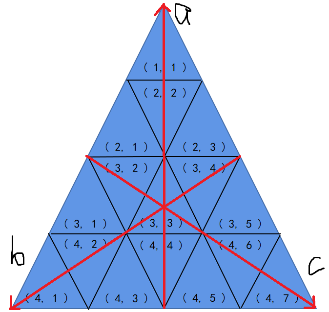
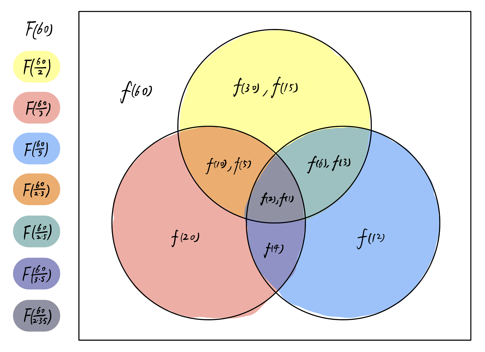

# 程序设计基础 SP 答案（2023秋）

## 题解

### A 国庆的作业

| 难度 | 考点 |
| --- | --- |
| 1 | 构造 |

#### 题目

##### 题目描述

读入一个正整数 $x$ ，构造并输出一组正整数 $y$ 、 $z$ ，使得 $x^2 + y^2 = z^2$ 。题目保证一定有解。

##### 输入格式

一行一个正整数 $x$ 。

##### 输出格式

一行三个整数 $x$ 、 $y$ 、 $z$ ，用空格分隔，其中 $y$ 、 $z$ 满足 $x^2 + y^2 = z^2$ 。

##### 样例输入

```text
5
```

##### 样例输出

```text
5 12 13
```

#### 答案

#### 问题分析

易知一定有解。

对于 $x^2 + y^2 = z^2$，有 $(z+y)(z-y) = x^2$。根据 $x$ 的奇偶性分别讨论构造出 $y$ 和 $z$。

#### 参考代码

```c
#include <stdio.h>

int main()
{
    int x, y, z;
    scanf("%d", &x);
    if (x & 1)
    {
        y = (x * x - 1) / 2;
        z = (x * x + 1) / 2;
    }
    else
    {
        y = (x * x / 2 - 2) / 2;
        z = y + 2;
    }
    printf("%d %d %d", x, y, z);
    return 0;
}
```

### B 小小军势

| 难度 | 考点 |
| --- | --- |
| 1 | 贪心 |

#### 题目

##### 题目描述

给出一个由小写字母组成的军势排列。对任意一个排列，其子列的出现次数必定大于等于其本身，因此只需要统计 26 个小写字母中出现的最大次数即可。

##### 输入格式

一个只含小写字母的字符串，读到文件结束为止。

##### 输出格式

一行一个整数，表示出现次数最多的那个字母出现了多少次。

##### 样例输入

```text
aabbbc
```

##### 样例输出

```text
3
```

#### 答案

#### 问题分析

对于任意一个排列，其子列的出现次数必定大于等于其本身。因此，本题只需统计 26 个小写字母出现最多的个数。

#### 参考代码

```c
#include <stdio.h>

int main()
{
    char ch;
    int a[26] = {0}, max = 0, i;
    while (~scanf("%c", &ch))
        a[ch - 'a']++;
    for (i = 0; i < 26; i++)
    {
        if (a[i] > max)
            max = a[i];
    }
    printf("%d", max);
    return 0;
}
```

### C 神秘的徽章

| 难度 | 考点 |
| --- | --- |
| 2 | 循环结构，输出 |

#### 题目

##### 题目描述

读入一个大写字母，输出以该字母为最宽一行的菱形徽章。设 $c$ 为该字母与 `A` 的 ASCII 码之差。徽章上半部分共 $c+1$ 行，第 $i$ 行，其中 $i$ 从 $0$ 开始先输出 $c-i$ 个空格，再从 `A` 递增输出到第 $i$ 个字母，然后递减输出回 `A` 。下半部分是上半部分去掉最后一行之后的倒序。

##### 输入格式

一个大写字母。

##### 输出格式

输出菱形字符画，每行末尾换行。

##### 样例输入

```text
C
```

##### 样例输出

```text
  A
 ABA
ABCBA
 ABA
  A
```

#### 答案

#### 题目分析

这个菱形可以从中间分开，看作上半部分的三角形和下半部分的倒三角形。输出字母的时候可以利用字符的ASCII码实现字母按照特殊排列输出

#### 示例代码

```c
#include <stdio.h>
int main(void)
{
    int c, i, j;
    c = getchar() - 'A'; // 确定后面循环的次数
    for (i = 0; i <= c; i++)
    {
        for (j = 0; j < c - i; j++)
            putchar(' ');
        for (j = 0; j <= i; j++)
            printf("%c", 'A' + j);
        for (j = i - 1; j >= 0; j--)
            printf("%c", 'A' + j);
        putchar('\n');
    } // 输出上半部分的三角形
    for (i = c - 1; i >= 0; i--)
    {
        for (j = 0; j < c - i; j++)
            putchar(' ');
        for (j = 0; j <= i; j++)
            printf("%c", 'A' + j);
        for (j = i - 1; j >= 0; j--)
            printf("%c", 'A' + j);
        putchar('\n');
    } // 输出下半部分的倒三角形
    return 0;
}
```

### D 博弈方法

#### 题目

##### 题目描述

一堆石子共 $n$ 颗，Hecatia 先手，双方轮流操作：当前玩家把当前这一堆分成两堆非空的石子，对手从中保留一堆、丢掉另一堆，并接着对保留下来的这一堆做同样的操作。无法把一堆分成两堆（即只剩 1 颗）的人判负。

由数学归纳法可知， $n$ 为奇数时先手必败， $n$ 为偶数时先手必胜。

##### 输入格式

第一行一个整数 $N$ ，表示数据组数。接下来 $N$ 行，每行一个整数 $n$ 。

##### 输出格式

每组数据输出一行。 $n$ 为奇数时输出 `Junko W1N!` ，否则输出 `Hecatia W1N!` 。

##### 样例输入

```text
3
1
2
3
```

##### 样例输出

```text
Junko W1N!
Hecatia W1N!
Junko W1N!
```

#### 答案

#### 题意分析

找规律可知奇数先手必败 偶数先手必胜

下面使用数学归纳法证明：当 $n$ 为奇数时先手必败，反之先手必胜。

- 当 $n = 1$ 时，先手无法将其分成两堆，后手获胜。
- 当 $n = 2$ 时，先手将其分为 $1+1$，后手只能留下 1 随后无法分成两堆，先手获胜。
- 假设当 $n < k$ 时结论成立，则 $n = k$ 时：
  - 若 $k$ 为偶数，则先手可将其分为两个奇数，随后后手无论取哪一堆都会成为" $n$ 为奇数时先手必败"的情况，故先手获胜。
  - 若 $k$ 为奇数，则先手仅能将其分为一个奇数和一个偶数，随后后手留下偶数这一堆，情况转化为" $n$ 为偶数时先手必胜"，故后手必胜。

#### 示例代码

```c
#include <stdio.h>
int main(void) {
    int N, n;
    scanf("%d", &N);
    while (N--) {
        scanf("%d", &n);
        if (n % 2 == 1) {
            puts("Junko W1N!");
        } else {
            puts("Hecatia W1N!");
        }
    }
    return 0;
}
```

### E JAY：不能说的秘密

| 难度 | 考点 |
| --- | --- |
| 6 | 三维曼哈顿距离 |

#### 题目

##### 题目描述

在一个三角形网格上，每个格点用二维坐标 $(x,y)$ 表示，相邻格点之间走一步。给定起点 $(X_1,Y_1)$ 与终点 $(X_2,Y_2)$ ，求从起点走到终点最少需要多少步。

把二维坐标 $(x,y)$ 换成三角坐标

$$\left( x,\ \left\lfloor \frac{y+1}{2} \right\rfloor,\ \left\lfloor \frac{2x-1-y}{2} \right\rfloor + 1 \right)$$

之后，每走一步恰好跨过某一轴的一层，答案就是两点的三维曼哈顿距离。

##### 输入格式

一行四个整数 $X_1$ 、 $Y_1$ 、 $X_2$ 、 $Y_2$ ，用空格分隔。

##### 输出格式

一行一个整数，表示最少步数。

##### 样例输入

```text
1 1 2 2
```

##### 样例输出

```text
1
```

#### 答案

#### 题目分析

我们简单尝试可以知道，一层一层地往下走，设计最优路线，可行，但很繁琐，这里，我们展示一个非常有意思的想法

<!-- markdownlint-disable-next-line MD036 -->
**将其转化为三维曼哈顿距离**

我们用一个如图所示的坐标系来表示每一个点的坐标（如我们可以沿 $b$ 轴将三角形同样分为 $1, 2, 3 \cdots$ 层，所以可以用3个轴对应层数来表示每个点）



这样操作后，我们发现，一个点走向另一个点的过程中每一步，都会跨过某一轴的一层

所以，我们只需要把每个二维坐标转化为三角坐标，后使用曼哈顿距离即可

具体的，对于 $(x,y)$ 可以转化为

$$\left( x_1, \left\lfloor \frac{y_1 + 1}{2} \right\rfloor, \left\lfloor \frac{2 \times x_1 - 1 - y_1}{2} \right\rfloor + 1 \right)$$

#### 示例代码

```c
#include <stdio.h>
#include <math.h>
#include <stdlib.h>
#include <string.h>

#define ll long long

ll X1, Y1, X2, Y2;
ll a[3], b[3];

int main() {
    scanf("%lld %lld %lld %lld", &X1, &Y1, &X2, &Y2);
    a[0] = X1;
    a[1] = (Y1 + 1) / 2;
    a[2] = (2 * X1 - 1 - Y1) / 2 + 1;
    b[0] = X2;
    b[1] = (Y2 + 1) / 2;
    b[2] = (2 * X2 - 1 - Y2) / 2 + 1;
    printf("%lld\n", llabs(a[0] - b[0]) + llabs(a[1] - b[1]) + llabs(a[2] - b[2]));
    return 0;
}
```

### F 摩卡与速算水獭

| 难度 | 考点 |
| --- | --- |
| 2 | 位运算 |

#### 题目

##### 题目描述

速算水獭想知道 $1 \oplus 2 \oplus \cdots \oplus n$ 的值，其中 $\oplus$ 表示按位异或。对每组询问给出 $n$ ，输出这个异或和。

##### 输入格式

第一行一个整数 $t$ ，表示询问组数。接下来 $t$ 行，每行一个整数 $n$ 。

##### 输出格式

每组询问输出一行一个整数。

##### 样例输入

```text
4
1
2
3
4
```

##### 样例输出

```text
1
3
0
4
```

#### 答案

#### 题目分析

注意到有 $0 \oplus 1 \oplus 2 \oplus 3 = 00 \oplus 01 \oplus 10 \oplus 11 = 0$，设正整数 $k$ 的二进制表示为 $s_1s_2\ldots s_n$，则 $4k$ 的二进制表示为 $s_1s_2\ldots s_n00$。故有

$$4k \oplus (4k+1) \oplus (4k+2) \oplus (4k+3) = s_1s_2\ldots s_n00 \oplus s_1s_2\ldots s_n01 \oplus s_1s_2\ldots s_n10 \oplus s_1s_2\ldots s_n11 = 0$$

所以:

- 当 $n \bmod 4 = 3$ 时， $1 \oplus 2 \oplus \ldots \oplus n = 0 \oplus 1 \oplus 2 \oplus \ldots \oplus n = 0$
- 当 $n \bmod 4 = 0$ 时， $1 \oplus 2 \oplus \ldots \oplus n = 0 \oplus n = n$
- 当 $n \bmod 4 = 1$ 时， $1 \oplus 2 \oplus \ldots \oplus n = 0 \oplus (n-1) \oplus n = (n-1) \oplus n = s_1s_2\ldots s_n00 \oplus s_1s_2\ldots s_n01 = 1$
- 当 $n \bmod 4 = 2$ 时， $1 \oplus 2 \oplus \ldots \oplus n = 0 \oplus (n-2) \oplus (n-1) \oplus n = ((n-2) \oplus (n-1) \oplus n \oplus (n+1)) \oplus (n-2) \oplus (n-1) \oplus n = n+1$

#### 示例代码

```c
#include <stdio.h>

int main()
{
    int t;
    scanf("%d",&t);
    for(int i = 1;i <= t;i++){
        int n;
        scanf("%d",&n);
        int tem = n % 4;

        if(tem == 3) {
            printf("0\n");
        } else if(tem == 0) {
            printf("%d\n",n);
        } else if(tem == 1) {
            printf("1\n");
        } else {
            printf("%d\n",n + 1);
        }
    }
    return 0;
}
```

学习完 switch 语句后，大家还有其它的写法。

### G 摩卡与数学家水獭

| 难度 | 考点 |
| --- | --- |
| 3 | 数论、素数判断 |

#### 题目

##### 题目描述

数学家水獭给定一个正整数 $k$ ，问最少需要多少个质数相加才能得到 $k$ 。

- $k$ 本身是质数时，答案是 1；
- $k$ 是 2 以外的偶数时，由哥德巴赫猜想可知答案是 2；
- $k$ 是奇合数时，若 $k-2$ 是质数则答案是 2，否则答案是 3。

##### 输入格式

第一行一个整数 $n$ ，表示询问个数。接下来 $n$ 行，每行一个正整数 $k$ 。

##### 输出格式

每个询问输出一行一个整数。

##### 样例输入

```text
3
7
8
9
```

##### 样例输出

```text
1
2
2
```

##### 数据范围

$k \le 5 \times 10^6$ 。

#### 答案

#### 题目分析

首先有数论中的**哥德巴赫猜想**：即任一大于2的**偶数**都可写成两个质数之和。该猜想虽然没有被证明，但是由于数学家水獭最大只问到 $5 \times 10^6$，所以在该题中完全可以使用。

那么，可分为以下几种情况：

- **该数自身是质数**：显然对于这种情况最少需要一个质数就能分解原数（即自身）
- **该数是一个偶数（除 2 外）**：首先该数一定是个合数，所以至少需要两个质数分解；而根据哥德巴赫猜想，一定有两个质数的分解方案，所以答案为 2
- **该数是一个奇合数**：我们知道奇合数减去 3 能够变成一个偶数，而每个非 2 偶数（显然自身不可能是质数）需要两个质数分解，所以所有奇数都能用不到 3 个质数分解；然而有一些质数减去 2 后就能变成一个新的质数（比如 $9 = 2 + 7$），这些奇合数用两个质数就能分解。

最后是如何判断一个数 $k$ 是不是质数，我们的最初想法是从 2 枚举到 $k-1$，看看存不存在某个数 $i$ 使得 $k \bmod i = 0$。我们可以做三点优化：一开始就判断 $k$ 是不是偶数，因为所有非 2 的偶数显然都是合数；从 3 开始枚举因子（在这里我们定义如果 $i$ 满足 $k \bmod i = 0$，那么 $i$ 是 $k$ 的因子），每次加 2，这样能跳过所有偶数因子，因为有偶数因子的数一定是偶数（被我们在上一步中排除了）；只枚举到 $\sqrt{k}$，因为如果存在大于等于 $\sqrt{k}$ 的因子 $j$，那么一定存在因子 $\frac{k}{j} \le \sqrt{k}$。

#### 示例代码

```c
#include <stdio.h>
#include <math.h>

int main()
{
    int n;
    scanf("%d",&n);
    for(int i = 1;i <= n;i++){
        int k;
        scanf("%d",&k);
        int isPrime = 1;    // 是 0 表示不是质数，是 1 表示是质数

        if((k != 2) && (k % 2 == 0)) {
            isPrime = 0;
        }

        int tem = sqrt(k);  // 枚举上界
        for(int j = 3;j <= tem;j++) {
            if(k % j == 0) {
                isPrime = 0;
                break;
            }
        }
        // 是质数
        if(isPrime == 1) {
            printf("1\n");
            continue;
        }

        // 除 2 之外的偶数
        if(k % 2 ==0) {
            printf("2\n");
            continue;
        }

        // 检测 k - 2 是不是质数
        int k2 = k - 2;
        int isPrime2 = 1;
        int tem2 = sqrt(k2);    // 枚举上界
        for(int j = 3;j <= tem2;j++) {
            if(k2 % j == 0) {
                isPrime2 = 0;
                break;
            }
        }

        // k - 2 是质数
        if(isPrime2 == 1) {
            printf("2\n");
            continue;
        } else { // k - 2 不是质数
            printf("3\n");
        }
    }
}
```

学习完函数后，大家还会有更简单的写法；同时这里没有卡判断质数的方法，感兴趣的同学可以了解一下素数筛法。

<!-- markdownlint-disable-next-line MD026 -->
### H 幻想乡没有巴士！

| 难度 | 考点 |
| --- | --- |
| 2 | 模拟 |

#### 题目

##### 题目描述

幻想乡有 $n$ 条公交线路。第 $i$ 条线路在时刻 $s$ 发出第一班车，之后每隔 $t$ 个时间单位发一班车。给定时刻 $T$ ，求在 $T$ 时刻（含）之后最早发车的是哪一条线路。逐次累加发车时刻会超时，需要先用一次除法跳过。

##### 输入格式

第一行两个整数 $n$ 和 $T$ 。接下来 $n$ 行，每行两个整数 $s$ 和 $t$ 。

##### 输出格式

一行一个整数，表示最早发车的线路编号，编号从 1 开始。若有多条线路同时最早发车，输出编号最小的。

##### 样例输入

```text
2 5
1 3
2 4
```

##### 样例输出

```text
2
```

#### 答案

#### 问题分析

直接模拟即可。

注意数据范围和公交发车时间的处理，如果直接累加可能会导致运行超时。

注意 min 的初始化。

#### 参考代码

```c
#include <stdio.h>

int main()
{
    int n, T, s, t, min = 2147483647, r, i;
    scanf("%d%d", &n, &T);
    for (i = 1; i <= n; i++)
    {
        scanf("%d%d", &s, &t);
        if (s < T)
            s += (T - s) / t * t;
        while (s < T)
            s += t;
        if (s < min)
        {
            min = s;
            r = i;
        }
    }
    printf("%d", r);
    return 0;
}
```

### I 妖精的智慧

| 难度 | 考点 |
| --- | --- |
| 2 | 质数筛 |

#### 题目

##### 题目描述

Cirno 与对手轮流操作一个正整数 $n$ ：每次可以把 $n$ 换成它的一个非自身且非 1 的因子。无法操作的人判负，Cirno 先手。

一个正整数存在非自身且非 1 的因子，等价于它不是质数。因此 $n$ 是质数时 Cirno 无法操作、必败；否则 Cirno 可以一步取到一个质数因子，让对手无法操作，必胜。

##### 输入格式

第一行一个整数 $T$ ，表示数据组数。接下来 $T$ 行，每行一个正整数 $n$ 。

##### 输出格式

每组数据输出一行。Cirno 必胜输出 `win` ，必败输出 `lose` 。

##### 样例输入

```text
3
7
8
9
```

##### 样例输出

```text
lose
win
win
```

##### 数据范围

$n \le 10^6$ 。

#### 答案

#### 问题分析

显然地，如果一个正整数 $n$ 有非自身且非 1 的因子，等价于 $n$ 不为质数。

如果初始时给定的数字为质数，那么Cirno无法操作，必定输掉游戏；反之可以选出一个质数因子，从而使得对方无法操作而获胜。

#### 参考代码

```c
#include <stdio.h>
#include <stdbool.h>

bool isPrime[1000005];

void Prime(int n)
{
    for (int i = 2; i <= n; i++)
    {
        if (isPrime[i] == false)
        {
            for (int j = 2; j * i <= n; j++)
                isPrime[i * j] = true;
        }
    }
}

int main()
{
    int T, n;
    scanf("%d", &T);
    Prime(1000000);
    while (T--)
    {
        scanf("%d", &n);
        if (isPrime[n])
            puts("win");
        else
            puts("lose");
    }
    return 0;
}
```

### J 魔法实验 1.0

| 难度 | 考点 |
| --- | --- |
| 1 | 贪心 |

#### 题目

##### 题目描述

对一个正整数列 $a_1, a_2, \ldots, a_n$ 可以进行如下两种操作：

- 融合：将两个正整数相加得到一个新的正整数；
- 浓缩：将一个偶数除以 2。

求最少需要操作多少次才能使所有整数都变为奇数。

##### 输入格式

第一行一个整数 $t$ ，表示数据组数。每组数据第一行一个整数 $n$ ，第二行 $n$ 个正整数 $a_1, a_2, \ldots, a_n$ 。

##### 输出格式

每组数据输出一行一个整数，表示最少操作次数。

##### 样例输入

```text
1
3
4 6 8
```

##### 样例输出

```text
3
```

#### 答案

#### 简要题意

对一个正整数列 $a_1, a_2, \ldots, a_n$ 可进行如下两种操作：

- 融合：将两个正整数相加得到一个新的正整数；
- 浓缩：将一个偶数除以 2。

最少需要操作多少次才能使所有整数变为奇数？

#### 问题分析

我们知道，两数相加，奇偶性相同和为偶，反之为奇。若要使一个偶数变为奇数，最简单的办法便是使用融合，让它与一个奇数相加，显然这是最少的操作方法之一。但是，如果这个数列中没有奇数，我们就需要浓缩来先得到一个奇数。在描述操作前，我们先用一个简单的证明来揭示融合的本质。

设有两数分别为 $2^{p_1} \times p_2$ 和 $2^{q_1} \times q_2$，其中 $p_2, q_2$ 均与 2 互质。

我们不妨设 $p_1 \le q_1$，将两数相加有： $2^{p_1} \times p_2 + 2^{q_1} \times q_2 = 2^{p_1} \times (2^{q_1-p_1} \times q_2 + p_2)$。

由于 $p_2$ 与 2 互质，故 $2^{q_1-p_1} \times q_2 + p_2$ 为奇数。

因此，融合的意义在于生成一个数，它的质因子 2 的个数为两加数中质因子 2 个数的较小值。

明白了这一点，本题的目标就很明确了：

- 如果数列中有奇数，就让它与每个偶数相加；
- 如果数列中没有奇数，我们需要找到一个质因子 2 的个数最小的偶数，重复进行浓缩直至变为奇数，再与每个偶数相加。

#### 参考代码

```c
#include <stdio.h>
#define MIN(a,b) (((a)<(b))?(a):(b))

int main()
{
    int t, a, n, ans, flag;
    int cnt;//质因子2的个数
    int min;//记录最小的质因子2的个数
    scanf("%d", &t);
    while (t--)
    {
        min = 2147483647;
        ans = -1;
        flag = 0;
        scanf("%d", &n);
        while (n--)
        {
            scanf("%d", &a);
            cnt = 0;
            while (a % 2 == 0)
            {
                a >>= 1;
                cnt++;
            }
            if (cnt == 0)//数列中有奇数
                flag = 1;
            else
            {
                min = MIN(cnt, min);
                ans++;
            }
        }
        if (flag)
            printf("%d\n", ans + 1);
        else
            printf("%d\n", ans + min);
    }
    return 0;
}
```

### K 魔法实验 2.0

| 难度 | 考点 |
| --- | --- |
| 2 | 期望 |

#### 题目

##### 题目描述

共有 7 种不同的水晶，第 $i$ 种有 $a_i$ 个。把它们随机排列成一列，依次释放魔法。若某一次释放时，连续 7 个水晶两两不同，就触发一次「七色的轮舞」。求触发次数的期望。

记水晶总数 $N = \sum_{i=1}^{7} a_i$ 。每次释放触发一次的概率都相等，由期望的线性可加性，总期望为 $(N-6) \times 7! \times \frac{a_1 a_2 \cdots a_7}{N(N-1)\cdots(N-6)}$ 。

##### 输入格式

一行 7 个数 $a_1, a_2, \ldots, a_7$ ，用空格分隔。

##### 输出格式

一行一个数，保留 4 位小数，表示期望触发次数。

##### 样例输入

```text
1 1 1 1 1 1 1
```

##### 样例输出

```text
1.0000
```

#### 答案

#### 简要题意

对一个含有 7 个不同数字的数列随机排列组合，求连续 7 个元素不重复的子列的个数期望。

#### 问题分析

记总水晶数为 $N$，有 $N = \sum_{i=1}^{7} a_i$。

记在第 $i$ 次释放魔法时触发「七色的轮舞」的次数为 $X_{i-6}$，则对于第 7 次释放魔法，有：

$$P\{X_1 = 1\} = 7! \times \frac{a_1}{N} \times \frac{a_2}{N-1} \times \cdots \times \frac{a_7}{N-6}$$

考虑第 8 次释放魔法，注意到触发「七色的轮舞」的魔法之间互不影响，则可以等价于随机浪费了一个水晶，则有：

$$
\begin{aligned}
P\{X_2 = 1\} =\ & \frac{a_1}{N} \times \left(7! \times \frac{a_1-1}{N-1} \times \frac{a_2}{N-2} \times \cdots \times \frac{a_7}{N-7}\right) + \frac{a_2}{N} \times \left(7! \times \frac{a_1}{N-1} \times \frac{a_2-1}{N-2} \times \cdots \times \frac{a_7}{N-7}\right) \\
& + \cdots + \frac{a_7}{N} \times \left(7! \times \frac{a_1}{N-1} \times \frac{a_2}{N-2} \times \cdots \times \frac{a_7-1}{N-7}\right) \\
=\ & \left(7! \times \frac{a_1}{N-1} \times \frac{a_2}{N-2} \times \cdots \times \frac{a_7}{N-7}\right) \times \left(\frac{a_1-1}{N} + \frac{a_2-1}{N} + \cdots + \frac{a_7-1}{N}\right) \\
=\ & \left(7! \times \frac{a_1}{N-1} \times \frac{a_2}{N-2} \times \cdots \times \frac{a_7}{N-7}\right) \times \frac{N-7}{N} \\
=\ & 7! \times \frac{a_1}{N} \times \frac{a_2}{N-1} \times \cdots \times \frac{a_7}{N-6} \\
=\ & P\{X_1 = 1\}
\end{aligned}
$$

故第 8 次释放魔法与第 7 次释放魔法触发一次「七色的轮舞」概率相等，同理可得，第 $i$ 次触发的概率与第 7 次相等。注意到 $E(X_i) = P(X_i = 1)$，由期望的线性可加性，总期望为 $(N-6)E(X_1)$。

#### 参考代码

```c
#include <stdio.h>

int main()
{
    int i;
    double ans = 1, a[7], sum = 0;
    for (i = 0; i < 7; i++)
    {
        scanf("%lf", &a[i]);
        sum += a[i];
    }
    if (sum < 6)
        printf("0.0000");
    else
    {
        for (i = 1; i < 7; i++)
            ans *= a[i] * (i + 1) / (sum - i + 1);
        printf("%.4lf", ans * a[0]);
    }
    return 0;
}
```

### L 魔法实验 3.0

| 难度 | 考点 |
| --- | --- |
| 2 | 构造 |

#### 题目

##### 题目描述

$n$ 个水晶排成一排，其中 $f$ 个已经被附魔为火属性、 $w$ 个已经被附魔为水属性，位置由输入给出，其余水晶为空。你可以给每个空水晶附魔为火属性或水属性。求相邻两个水晶属性相同的对数的最小值。

以非空水晶为分界线，可以把 $n$ 个水晶划分成若干个空水晶区间，各区间互不影响。对每个空区间，按水火交替的方式附魔一定最优，需要决定的只是该区间第一个水晶是火还是水，两种方案取较小者即可。

##### 输入格式

第一行三个整数 $n$ 、 $f$ 、 $w$ 。第二行 $f$ 个整数，表示火属性水晶的位置。第三行 $w$ 个整数，表示水属性水晶的位置。

##### 输出格式

一行一个整数，表示相邻同属性水晶对数的最小值。

##### 样例输入

```text
5 1 1
2
4
```

##### 样例输出

```text
1
```

#### 答案

#### 问题分析

我们按非空水晶为分界线，将 $n$ 个水晶分为多个空水晶区间，不难发现空区间对答案的影响是独立的。

对于每个空区间，将其按水火间隔的方式附魔必定更优，现在的问题就变为区间的第一个水晶是水还是火。既然对于一个区间只有两种处理方式，直接计算取较小者即可。讨论奇偶性取最优也是可以的。

时间复杂度 $O(f+w)$ 或 $O(n)$。

#### 参考代码

```c
#include <stdio.h>
#define Min(a, b) ((a) < (b) ? (a) : (b))
int a[100010];
int main()
{
    int n, f, w;
    scanf("%d%d%d", &n, &f, &w);
    int temp;
    for (int i = 0; i < f; i++)
    {
        scanf("%d", &temp);
        a[temp] = 1;
    }
    for (int i = 0; i < w; i++)
    {
        scanf("%d", &temp);
        a[temp] = 2;
    }
    int ans = 0, now = 3, past = 0;
    for (int i = 0; i <= n; i++)
    {
        if (a[i])
            now = a[i];
        else
            now = 3 - now;
        ans += now != past;
        past = now;
    }
    printf("%d", n - ans);
}
```

### M 魔法实验 4.0

| 难度 | 考点 |
| --- | --- |
| 2 | 模拟 |

#### 题目

##### 题目描述

给定一个 $n$ 行 $m$ 列的法阵，每个水晶是火属性 `F` 或水属性 `W` 。一次操作可以把某一整行或某一整列的属性全部取反。先转换某行再转换某列，与先转换该列再转换该行，结果相同。

若能把法阵变成全部同属性，输出最少操作次数；否则输出 `mq~` 。

有解的判据是：各行的属性状态只有两种可能，各列的属性状态也只有两种可能。此时把行转换成较少的那一种、列转换成较少的那一种即可，操作次数为 $\min(b_h, n-b_h) + \min(b_l, m-b_l)$ ，其中 $b_h$ 、 $b_l$ 分别是首列为 `F` 的行数与首行为 `F` 的列数。

##### 输入格式

第一行一个整数 $T$ ，表示数据组数。每组数据第一行两个整数 $n$ 和 $m$ ，接下来 $n$ 行每行一个长度为 $m$ 的字符串，只含 `F` 和 `W` 。

##### 输出格式

每组数据输出一行：有解时输出最少操作次数，无解时输出 `mq~` 。

##### 样例输入

```text
1
2 2
FF
WW
```

##### 样例输出

```text
1
```

#### 答案

#### 问题分析

首先可以注意到，先转换某行再转换某列，与先转换某列再转换某行，得到的状态相同。

假设给定的状态可以由全水法阵，先转换某些行再转换某些列得到，考察转换完某些行的法阵，同一行中所有水晶属性是相同的。此时翻转某些列，可知所有转换的列每一行属性相同，所有未转换的列每一行属性相同，且前者与后者属性不同。先转换某些列再转换某些行可以得到类似的结果。这个可以作为有无解的判据。

因此各行的属性状态只有两种可能，各列的属性状态也只有两种可能。转换行数较少的状态，再转换列数较少的状态，即可将法阵变成相同属性，并且有最少的操作次数。

#### 参考代码

```c
#include <stdio.h>
#define MIN(a,b) (((a)-(b)<0)?(a):(b))

char s[1005][1005];

int main()
{
    int n, m, i, j, bh, bl, T;
    char h, l;
    scanf("%d", &T);
next:
    while (T--)
    {
        bh = bl = 0;
        scanf("%d%d", &n, &m);
        for (i = 0; i < n; i++)
        {
            scanf("%s", s[i]);
            if (s[i][0] == 'F')
                bh++;
        }
        for (j = 0; j < m; j++)
        {
            if (s[0][j] == 'F')
                bl++;
        }
        h = (2 * bh > n) ? 'W' : 'F';
        bh = MIN(bh, n - bh);
        l = (2 * bl > m) ? 'W' : 'F';
        bl = MIN(bl, m - bl);
        for (i = 0; i < n; i++)
        {
            if (s[i][0] == h)
            {
                for (j = 0; j < m; j++)
                    s[i][j] = (s[i][j] == 'F') ? 'W' : 'F';
            }
        }
        for (j = 0; j < m; j++)
        {
            if (s[0][j] == l)
            {
                for (i = 0; i < n; i++)
                    s[i][j] = (s[i][j] == 'F') ? 'W' : 'F';
            }
        }
        for (i = 0; i < n; i++)
        {
            for (j = 0; j < m; j++)
            {
                if (s[i][j] != s[0][0])
                {
                    printf("mq~\n");
                    goto next;
                }
            }
        }
        printf("%d\n", bh + bl);
    }
    return 0;
}
```

### N 骰子 2nd

| 难度 | 考点 |
| --- | --- |
| 6 | 动态规划、递推 |

#### 题目分析

如果我们已经知道投掷 $n-1$ 个骰子有可能会出现的结果，那么当我们需要得知投掷 $n$ 个骰子出现的结果时，只需要从 $n-1$ 个骰子的情况出发，加上额外一个骰子的六种情况即可，就可以判断成不成立。由此递推，我们只需要穷举投掷1个骰子时的情况，就可将2个、3个骰子时的情况递推出来，以此类推。

#### 示例代码

```c
#include<stdio.h>
int a[100][600][600];
void init() {
    a[1][7][6] = 1;
    a[1][10][6] = 1;
    a[1][6][8] = 1;
    a[1][6][9] = 1;
    a[1][6][11] = 1;
    a[1][6][12] = 1; //防止后两个下标变成负数
    for (int i = 2; i <= 83; i++) {
        for (int j = 6; j <= 500; j++) {
            for (int k = 6; k <= 500; k++) {
                a[i][j][k] = (a[i - 1][j - 1][k] | a[i - 1][j - 4][k]
                              | a[i - 1][j][k - 2] | a[i - 1][j][k - 3]
                              | a[i - 1][j][k - 5] | a[i - 1][j][k - 6]);
            }
        }
    }
}
int main() {
    init();
    int n,m;
    int c, b;
    int i;
    scanf("%d", &n);
    for (i = 0; i < n; i++) {
        scanf("%d%d%d", &m,&c, &b);
        if (a[m][c + 6][b + 6] == 1)printf("Yes\n");
        else printf("No\n");
    }
}
```

### O iso646.h

| 难度 | 考点 |
| --- | --- |
| 5 | 基本的字符串处理 |

#### 题目

##### 题目描述

`iso646.h` 提供了用单词代替逻辑运算符的写法。给定一段 C 语言代码，把其中作为运算符出现的 `&&` 替换成 `and` 、 `||` 替换成 `or` 、 `!` 替换成单词 `not` 并在其后补一个空格，其余字符原样输出。

需要区分运算符与字符串：单引号和双引号内的内容不替换；被反斜杠转义的引号是「假引号」，不改变引号状态；处于另一种引号范围内的引号同样是「假引号」；`!=` 中的 `!` 不是逻辑非，不替换。

##### 输入格式

一段 C 语言代码，读到文件结束为止。

##### 输出格式

替换之后的代码。

##### 样例输入

```text
if (a && b || !c != d) printf("a&&b");
```

##### 样例输出

```text
if (a and b or not c != d) printf("a&&b");
```

#### 答案

#### 题目分析

在判断遇到的 `&&`、`||`、`!` 是否需要被替换时，我们首先需要判断这些字符在代码中是作为字符串出现的，还是作为运算符出现的。

引号有单引号和双引号两种，我们可以用两个变量 `flag1, flag2` 分别记录当前字符是否在单引号中，是否在双引号中。注意引号也是有可能以字符串形式存在于代码中的，我们要把这种"假引号"与"真引号"区分开来，让 `flag` 变量只在遇到"真引号"的时候才变化。

一种假引号是被反斜杠 `\` 转义的引号。由于在本题中反斜杠不会转义它自身，若引号的前一位字符是 `\`，那么这个引号一定是假引号。

另一种假引号虽然没被 `\` 转义，但是它处于另一种引号范围内，仍然是假的引号。

最后一个特殊情况，`!=` 运算符并不是 `!` 运算符，所以如果 `!` 的下一位字符是 `=`，我们就不能将其替换。

事实上，本题的输入样例已经有极高的强度，如果你的代码能够顺利通过输入样例，那么你的代码就大概率能够 AC。

#### 示例代码

```c
#include <stdio.h>
#include <iso646.h>
char str[10005];
int main(void)
{
    int c, len = 0, i;
    int flag1, flag2; // 分别记录当前字符是否在单双引号之中，数值为 0 则不在，数值为 1 则在。
    flag1 = 0, flag2 = 0; // 初始状态显然是不在单双引号之中
    while ((c = getchar()) != EOF)
    {
        str[len++] = c;
    }
    for (i = 0; i < len; i++)
    {
        if (i == 0) // 由于后面的判断涉及到字符的前一位，为了防止越界，第 0 位特殊处理
        {
            putchar(str[i]); // 代码的第一个字符一定不需要特殊判断，这一位直接输出就好
            continue;
        }

        if (str[i] == '"' && str[i - 1] != '\\' && !flag1)
            flag2 ^= 1; // 遇到真的双引号，就把 flag2 反转 (0 变成 1，1 变成 0)
        if (str[i] == '\'' && str[i - 1] != '\\' && !flag2)
            flag1 ^= 1; // 遇到真的单引号，就把 flag1 反转

        if (!flag1 && !flag2) // 不在单双引号中的处理
        {
            if (str[i] == '&' && str[i + 1] == '&')
            {
                printf("and");
                i++; // 这里额外自增是因为已经将后一个字符与当前字符一起替换了，不需要对后一个字符进一步处理。
            }
            else if (str[i] == '|' && str[i + 1] == '|')
            {
                printf("or");
                i++; // 同上
            }
            else if (str[i] == '!' && str[i + 1] != '=')
            {
                printf("not "); // 只要 '!' 的下一位不是 '=' 那么就需要替换，记得补上空格
            }
            else
                putchar(str[i]);
        }
        else // 在单双引号中的处理 (直接输出就好)
            putchar(str[i]);
    }
    return 0;
}
```

### P 摩卡与主唱

| 难度 | 考点 |
| --- | --- |
| 4 | 差分、模拟 |

#### 题目

##### 题目描述

给定一个长度为 $n$ 、只由 `0` 、 `1` 和 `?` 组成的字符串。把所有 `?` 换成 `0` 或 `1` ，使得替换后的字符串中 `01` 子串与 `10` 子串一样多，求有多少种填充方案。

一个 `01` 序列中 `01` 子串与 `10` 子串一样多，等价于它的第一个字符与最后一个字符相同。因此只需保证首尾字符相同：首尾都是 `?` 时答案乘 2，首尾一 `0` 一 `1` 时答案为 0，其余情况答案就是中间的 `?` 个数对应的 $2$ 的幂。长度为 1 的字符串需要单独处理。

##### 输入格式

第一行一个整数 $n$ 。第二行一个长度为 $n$ 的字符串，只含 `0` 、 `1` 、 `?` 。

##### 输出格式

一行一个整数，表示方案数对 $10^9+7$ 取模的结果。

##### 样例输入

```text
5
0?1?0
```

##### 样例输出

```text
4
```

#### 答案

#### 题目分析

把题意理解后，简单来说，这题就是输入一个只由 `0`、`1` 和 `?` 组成的字符串，把所有 `?` 换成 `0` 或 `1` 使得替换后的字符串中 `01` 子串和 `10` 子串一样多，有多少种填充方案。

我们先尝试探索 `01` 子串和 `10` 子串一样多的 `01` 序列有什么特征。假设我们根据原 `01` 序列 $a_i$ 构造一新序列 $b_i$，使得：

$$b_i = \begin{cases} a_1 & , i = 1 \\ a_i - a_{i-1} & , else \end{cases}$$

那么，假设原数列中 $a_i = 0$ 且 $a_{i+1} = 1$，则对应的 $b_{i+1}$ 的值为 1；若原数列中 $a_i = 1$ 且 $a_{i+1} = 0$，则对应 $b_{i+1}$ 的值为 $-1$；其余情况下 $b_i = 0$。那么若原数列中 `01` 子串和 `10` 子串一样多，就相当于除了 $b_1$ 外，数列 $b$ 中的 1 和 $-1$ 一样多。且由数列 $b$ 的定义易知：

$$\sum_{i=1}^{n} b_i = a_n$$

所以原数列中 `01` 子串和 `10` 子串一样多 $\iff \sum_{i=2}^{n} b_i = 0 \iff \sum_{i=1}^{n} b_i = a_n = b_1 + \sum_{i=2}^{n} b_i = b_1 = a_1 \iff a_n = a_1$，即最后一个字符和第一个字符相等。

所以，我们在替换时，只要保证第一个字符和最后一个字符相等就可以，只要保证了这一点，中间的过程我们都可以忽略不看。那么，可分为以下几种情况：

- **读入时第一位和最后一位都是 0 或者都是 1**：中间每出现一次 `?`，可能的答案就会翻倍。
- **读入时第一位和最后一位一个是 0 或者 1，另一个是 ?**：那么这个 `?` 的值实际上已经确定了，仍是中间每出现一次 `?`，可能的答案就会翻倍。
- **第一位和最后一位都是 ?**：可以控制最后一位同为 `0` 或者同为 `1`，在中间每出现一次 `?`，可能的答案就会翻倍的基础上最后再乘 2，表示头和尾的两种可能。
- **第一位和最后一位一个是 0 一个是 1**：这种情况一定构造不出合法串，说明俩人记错了，答案为 0。

还要注意的是有一些同学在只有一个音符的时候出问题了，这个要特殊注意一下。

#### 示例代码

```c
#include <stdio.h>
const long long mod = 1000000007;

int main()
{
    int n;
    scanf("%d",&n);
    char sta,end,tem;
    long long ans = 1;
    scanf(" %c",&sta);  // 读入开始字符
    for(int i = 2;i < n;i++)
    {
        scanf("%c",&tem);
        if(tem == '?') ans = ans * 2 % mod;     // 每遇到一个 ? 可能性变为 2 倍
    }
    if(n != 1) scanf("%c",&end);
    else {  // 对长度为 1 的情况进行特判
        if(sta == '?') printf("2");
        else printf("1");
        return 0;
    }
    if(((sta == '?') && (end != '?')) || ((sta != '?') && (end == '?'))) {
        // 头和尾有一个 ?
        printf("%lld",ans);
    }
    else if((sta == '?') && (end == '?')) {
        // 头和尾都是 ?
        printf("%lld",ans * 2 % mod);
    }
    else if(sta == end) {
        // 头和尾同 0 同 1
        printf("%lld",ans);
    }
    else {
        // 头和尾一个 0 一个 1
        printf("0");
    }

    return 0;
}
```

### Q 摩卡与取石子游戏

| 难度 | 考点 |
| --- | --- |
| 4 | 博弈论 |

#### 题目

##### 题目描述

Ran 与 Moca 轮流从一堆石子中取走质数颗石子，Ran 先手。获胜规则有两条：取走最后一颗石子的人获胜；石子数变为 1 时轮到操作的一方获胜。

质数不可能被 4 整除，而除以 4 余 1、2、3 的质数都存在，对应的最小质数分别是 5、2、3。由此可得：初始石子数是 4 的倍数时 Moca 必胜，否则 Ran 必胜。

##### 输入格式

第一行一个整数 $n$ ，表示数据组数。接下来 $n$ 行，每行一个整数，表示初始石子数。

##### 输出格式

每组数据输出一行，胜者名字 `Moca` 或 `Ran` 。

##### 样例输入

```text
3
4
5
6
```

##### 样例输出

```text
Moca
Ran
Ran
```

#### 答案

#### 题目分析

我们不难知道，质数不可能有能被 4 整除的；但是除以 4 余 1、余 2、余 3 的质数都是存在的，而且对应的最小质数分别是 5、2 和 3。

当石子的初始个数是 4 的倍数时，第一回合的动作无非如下几种可能：

- **Ran 拿走 4k+1 个石子**：那么对于剩下的石子数 $n'$ 有 $n' \bmod 4 = 3$；若 $n' = 3$，Moca 拿走 3 个石子后取得胜利；若 $n' > 3$，Moca 拿走 3 个石子仍能保证剩下的石子数是 4 的倍数。
- **Ran 拿走 4k+2 个石子**：实际上这种情况下 Ran 只能拿走 2 个石子。那么对于剩下的石子数 $n'$ 有 $n' \bmod 4 = 2$；若 $n' = 2$，Moca 拿走 2 个石子后取得胜利；若 $n' > 2$，Moca 拿走 2 个石子仍能保证剩下的石子数是 4 的倍数。
- **Ran 拿走 4k+3 个石子**：那么对于剩下的石子数 $n'$ 有 $n' \bmod 4 = 1$；若 $n' = 1$，根据获胜规则 2，Moca 获胜；若 $n' = 5$，Moca 拿走 5 个石子后取得胜利；若 $n' > 5$，Moca 拿走 5 个石子仍能保证剩下的石子数是 4 的倍数。

综上，若初始石子数为 4 的倍数，那么每当一回合结束时，Moca 要么胜利，要么能继续保持石子数一直为 4 的倍数，直到胜利。

当初始石子数不为 4 的倍数时，显然当 $n = 2$ 或者 $n = 3$、 $n = 5$ 时 Ran 能胜利；当 $n > 5$ 时，有如下几种情况：

- **若初始石子数 $n \bmod 4 = 1$**：Ran 可以拿走 5 颗石子，此时到 Moca 先手且石子数为 4 的倍数，根据上述推导 Ran 最后胜利。
- **若初始石子数 $n \bmod 4 = 2$**：Ran 可以拿走 2 颗石子，此时到 Moca 先手且石子数为 4 的倍数，根据上述推导 Ran 最后胜利。
- **若初始石子数 $n \bmod 4 = 3$**：Ran 可以拿走 3 颗石子，此时到 Moca 先手且石子数为 4 的倍数，根据上述推导 Ran 最后胜利。

综上所述，当初始石子数是 4 的倍数时，Moca 必胜；否则 Ran 必胜。

基于上述结论程序实现就非常简单了。

#### 示例代码

```c
#include <stdio.h>

int main()
{
    int n;
    scanf("%d",&n);
    for(int i = 1;i <= n;i++)
    {
        int tem;
        scanf("%d",&tem);
        if(tem % 4 == 0) {
            printf("Moca\n");
        } else {
            printf("Ran\n");
        }
    }

    return 0;
}
```

这题其实可以说算是**巴什博弈**的一个小变化，感兴趣的同学可以了解一下。

### R 狂饮之宴

#### 题目

##### 题目描述

给定一个长度为 $n$ 的序列 $c$ ，求出一个最长的子序列，满足该子序列的后一个元素不大于前一个元素，即最长不上升子序列的长度。

##### 输入格式

第一行一个整数 $n$ 。第二行 $n$ 个整数 $c_1, c_2, \ldots, c_n$ 。

##### 输出格式

一行一个整数，表示最长不上升子序列的长度。

##### 样例输入

```text
6
1 3 2 4 3 5
```

##### 样例输出

```text
2
```

#### 答案

#### 题意分析

这是一道经典的最长不上升子序列问题，即

**给定一个长度为 $n$ 的序列 $c$，求出一个最长的的子序列，满足该子序列的后一个元素不大于前一个元素。**

我们记 $dp_i$ 为以 $c_i$ 为子序列的最后一个元素时，不上升子序列的最大长度。那么我们可以得到：

- 当 $i = 0$ 时， $dp(i) = 1$
- 当 $i > 0$ 时，我们尝试将 $c_i$ 添加在一个不上升子序列之后，遍历所有的结果中取得的最大值就是以 $c_i$ 为最后一个元素时子序列的最大长度，即

$$dp(i) = \max_{0 \le j < i, c_j \ge c_i} [dp(j) + 1]$$

由此我们可以得到以下示例代码

当然存在更加高效的方法可以参考 [OI Wiki上的动态规划基础](https://oi-wiki.org/dp/basic/) 获取更多信息。

#### 示例代码

```c
#include <stdio.h>
int main(void) {
    int num[10000], dp[10000];
    int n, max = 1;
    scanf("%d", &n);
    for (int i = 1; i <= n; i++) {
        scanf("%d", &num[i]);
    }
    for (int i = 1; i <= n; i++) {
        dp[i] = 1;
        for (int j = 1; j < i; j++) {
            if (num[j] >= num[i] && dp[j] + 1 > dp[i]) {
                dp[i] = dp[j] + 1;
            }
        }
        if (max < dp[i]) {
            max = dp[i];
        }
    }
    printf("%d", max);
    return 0;
}
```

### S 赌怪

| 难度 | 考点 |
| --- | --- |
| 4 | 异或前缀和 |

#### 题目

##### 题目描述

有 $n$ 张卡片排成一排，第 $i$ 张卡片有一个正反状态（`0` 为反面、`1` 为正面）和一个数字 $a_i$ 。记 $res_0$ 为所有反面卡片上数字的异或和， $res_1$ 为所有正面卡片上数字的异或和。

接下来有 $q$ 次操作：

- `0 l r` ：把区间 $[l,r]$ 内所有卡片翻面；
- `1 x` ：查询 $res_x$ 。

利用异或前缀和，每次修改与查询都可以做到 $O(1)$ 。

##### 输入格式

第一行一个整数 $n$ 。第二行一个长度为 $n$ 的 `01` 字符串，表示每张卡片的正反状态。第三行 $n$ 个整数 $a_1, a_2, \ldots, a_n$ 。第四行一个整数 $q$ 。接下来 $q$ 行，每行一条操作。

##### 输出格式

对每个 `1 x` 操作，输出 $res_x$ ，后面跟一个空格。

##### 样例输入

```text
5
01010
1 2 3 4 5
5
1 0
1 1
0 2 4
1 0
1 1
```

##### 样例输出

```text
7 6 2 3 
```

#### 答案

#### 题目分析

首先回顾一下与异或相关的两条重要性质。

- $x \oplus x = 0$
- $x \oplus 0 = x$

结合上述重要性质，不难发现对于取反操作，正面的数字变为反面，反面的数字变为正面，这个操作可以通过直接异或上操作区间的异或和得到。

如何快速求一个操作区间的异或和？考虑 **异或前缀和**。

设一个数列前 $i$ 项的异或和为 $sum_i$，那么它的第 $l$ 项到第 $r$ 项的异或和为 $sum_{l-1} \oplus sum_r$，这也可以通过以上异或的性质推出。

进而每次修改和查询的复杂度都为 $O(1)$，可以通过此题。

#### 示例代码

```c
#include <stdio.h>
#include <string.h>
#define maxN 200000

int n, xsum[maxN + 5], a[maxN + 5], q, res[2], op; // 0是反面，1是正面
char s[maxN + 5];

int main() {
    scanf("%d", &n);
    scanf("%s", s + 1);
    for (int i = 1; i <= n; i++) {
        scanf("%d", a + i);
        xsum[i] = xsum[i - 1] ^ a[i];
        res[s[i] - '0'] ^= a[i];
    }
    scanf("%d", &q);
    while (q--) {
        scanf("%d", &op);
        if (op == 0) {
            int l, r;
            scanf("%d%d", &l, &r);
            res[0] ^= xsum[r] ^ xsum[l - 1];
            res[1] ^= xsum[r] ^ xsum[l - 1];
        } else if (op == 1) {
            int x;
            scanf("%d", &x);
            printf("%d ", res[x]);
        }
    }
    return 0;
}
```

### T 输出自己

| 难度 | 考点 |
| --- | --- |
| 4 | 输出 |

#### 题目

##### 题目描述

写一个程序，输出它自己的源代码。要求输出与提交的源文件逐字节相同。

题目的提示是：抄写后面的话，写个冒号，然后把它在双引号里再写一遍。做法之一是把格式控制字符串本身作为变量 $p$ 保存，再用 `printf(p, ...)` 输出；另一种做法是用 `__FILE__` 宏配合 `freopen` 打开源代码文件后逐字输出。

##### 输入格式

无。

##### 输出格式

输出你提交的源代码本身。

##### 样例输入

无。

##### 样例输出

```text
#include <stdio.h>
int main(void){char n='\n';char b='\\';char q='"';char*p="#include <stdio.h>%cint main(void){char n='%cn';char b='%c%c';char q='%c';char*p=%c%s%c;printf(p,n,b,b,b,q,q,p,q,n);return 0;}%c";printf(p,n,b,b,b,q,q,p,q,n);return 0;}
```

#### 答案

#### 题目解析

其实本题的思路在提示里面已经说得很明白了，即：

> 抄写后面的话，写个冒号，然后把它在双引号里再写一遍："抄写后面的话，写个冒号，然后把它在双引号里再写一遍"

我们平时写 printf 函数的格式控制字符串（format 字符串）都是直接写出的，但是它其实也是函数参数，自然也可以由其他地方定义的字符串变量给出。在本题中，p 就是 format 字符串。

可以根据这个思路写出示例代码 1。

另一种思路是，C语言中其实有很多有趣的宏，比如

- `__DATE__`：当前日期，一个以 "MMM DD YYYY" 格式表示的字符串常量。
- `__TIME__`：当前时间，一个以 "HH:MM:SS" 格式表示的字符串常量。
- `__FILE__`：当前文件路径，一个字符串常量。
- `__LINE__`：当前行号，一个整型常量。

例如对于下面这个代码：

```c
#include <stdio.h>

int main() {
    printf("%s\n", __FILE__);
    printf("%s\n", __DATE__);
    printf("%s\n", __TIME__);
    printf("%d\n", __LINE__);
    return 0;
}
```

在我的电脑上运行以后会输出：

```text
F:/学习/2023秋季学期/助教/debug/test.c
Oct 11 2023
09:51:22
7
```

所以我们可以直接利用文件操作，打开源代码并逐字输出。

可以根据这个思路写出示例代码 2。

#### 示例代码

##### 示例代码1

```c
#include <stdio.h>
int main(void){char n='\n';char b='\\';char q='"';char*p="#include <stdio.h>%cint main(void){char n='%cn';char b='%c%c';char q='%c';char*p=%c%s%c;printf(p,n,b,b,b,q,q,p,q,n);return 0;}%c";printf(p,n,b,b,b,q,q,p,q,n);return 0;}
```

##### 示例代码2

```c
#include <stdio.h>
int main() {
    int c;
    freopen(__FILE__, "r", stdin);
    while ((c = getchar()) != EOF) {
        putchar(c);
    }
}
```

### U 哪吒随便出的

| 难度 | 考点 |
| --- | --- |
| 5 | 位运算，计数 |

#### 题目

##### 题目描述

给定 unsigned int（无符号 32 位整型）范围内的 $a$ ，求在 unsigned int 范围内有多少个整数 $b$ 满足 $|a - (a \oplus b)| \le b$ ，其中 $\oplus$ 表示按位异或。

由恒等式 $a+b = (a \oplus b) + 2(a \& b)$ 与 $a-b = (a \oplus b) - 2(\sim a \& b)$ 可知，条件等价于 $a \& b \ne 0$ 且 $\sim a \& b \ne 0$ 。设 $a$ 的 32 位二进制表示中 1 的个数为 $cnt$ ，则答案为 $(2^{cnt}-1)(2^{32-cnt}-1)$ 。

##### 输入格式

若干个 unsigned int 范围内的整数 $a$ ，读到文件结束为止。

##### 输出格式

对每个读入的 $a$ 输出一行一个整数。

##### 样例输入

```text
5
```

##### 样例输出

```text
3221225469
```

#### 答案

#### 题意分析

对于自然数 $a, b$，存在以下两个恒等式：

$$a + b = (a \oplus b) + 2 \times (a \& b)$$

$$a - b = (a \oplus b) - 2 \times (\sim a \& b)$$

其中， $\&$ 表示按位与， $\oplus$ 表示按位异或， $\sim$ 表示按位取反。

因此有 $a - (a \oplus b) = 2 \times (a \& b) - b = b - 2 \times (\sim a \& b)$。

注意到 $a \& b$ 和 $\sim a \& b$ 一定均为自然数且不大于 $b$，因此有 $|a - (a \oplus b)| \le b$，当且仅当 $a \& b = 0$ 或 $\sim a \& b = 0$ 时取等。

对于给定的 unsigned int（无符号32位整型）范围内的 $a$，求在 unsigned int 范围内有多少个整数 $b$ 满足 $|a - (a \oplus b)| \le b$，即时求在 unsigned int 范围内有多少个整数 $b$ 满足 $a \& b \ne 0$ 且 $\sim a \& b \ne 0$。

统计 $a$ 的32位二进制表示中 1 的个数，记作 $cnt$，则 $b$ 的二进制表示中对应的这 $cnt$ 位不能全部为 0（否则 $a \& b = 0$），且剩下的 $32 - cnt$ 位也不能全部为 0（否则 $\sim a \& b = 0$），因此满足条件的 $b$ 共有 $(2^{cnt} - 1) \times (2^{32-cnt} - 1)$ 个。

#### 示例代码

```c
#include <stdio.h>
int main()
{
    unsigned int a;
    while(~scanf("%u", &a))
    {
        int cnt = 0;
        while(a)
        {
            a &= a - 1;
            ++cnt;
        }
        printf("%u\n", ((1u << cnt) - 1) * ((1u << 32 - cnt) - 1));
        //虽然1u<<32会溢出，但是此时(1u<<0)-1=0，因此不影响答案正确。
    }
    return 0;
}
```

Author:哪吒

### V "不可分解"的01串

| 难度 | 考点 |
| --- | --- |
| 7~8 | 数论，容斥原理 |

#### 题目

##### 题目描述

一个长度为 $n$ 的 `01` 串称为「不可分解」的，当且仅当它不能写成某个更短的 `01` 串重复若干次拼接而成。给定 $n$ ，求长度为 $n$ 的不可分解 `01` 串的数量，对 $998244353$ 取模。

设长度为 $n$ 的不可分解 `01` 串数量为 $f(n)$ ，则 $2^n = \sum_{d \mid n} f(d)$ 。满分做法是把 $n$ 的所有不同素因子用容斥原理组合起来，得到

$$f(n) = \sum_{d = p_1 p_2 \cdots p_a} (-1)^a 2^{n/d}$$

其中 $p_1, p_2, \cdots, p_a$ 是 $n$ 的 $a$ 个不同素因子， $d=1$ 视为 0 个素因子的乘积。

##### 输入格式

一行一个整数 $n$ 。

##### 输出格式

一行一个整数，表示答案对 $998244353$ 取模的结果。

##### 样例输入

```text
4
```

##### 样例输出

```text
12
```

#### 答案

#### 题目分析

本题思路重点在于，一个长度为 $n = k * d$ 的 01 字符串分解成 $k = \frac{n}{d}$ 个相同的长度为 $d$ 的不可分解串的方法是唯一的，不可能有两个不同的不可分解的串分别经过一定次数的重复拼接后得到相同的串。

考虑所有长度为 $n$ 的字符串，共 $2^n$ 个，其中能够分解为 $\frac{n}{d}$ 个相同的长度为 $d$ 的不可分解串的数量应该与长度为 $d$ 的不可分解串的数量相等，因此设长度为 $n$ 的不可分解的 01 字符串数量为 $f(n)$，则可得公式：

$$2^n = \sum_{d \mid n} f(d)$$

由此公式我们可以计算 $f(n)$。

#### 50分思路

由公式 $2^n = \sum_{d \mid n} f(d)$，可得 $f(n) = 2^n - \sum_{d \mid n, d \ne n} f(d)$，因此我们可以用递推的思路来计算 $f(n)$。

建立一个数组 $f[2000005]$，记录 $f(n)$，先将所有的 $f[i]$ 设为 $2^i$，然后从 $i = 1$ 开始遍历，将 $f[i$ 的倍数 $]$ 减去 $f[i]$，由于 $i > n/2$ 时 $f[i]$ 对 $f[n]$ 不再有影响，因此遍历到 $i = n/2$ 即可，然后输出 $f[n]$.

计算过程中别忘记对 998244353 取模。

复杂度分析：空间复杂度为 $O(n)$. 由于遍历到 $i$ 时，对 $i$ 的每个倍数计算了一次，共计算了 $\frac{n}{i}$ 次，所以总共计算了 $\sum_{i=1}^{n/2} \frac{n}{i} = n * \sum_{i=1}^{n/2} \frac{1}{i}$ 次， $n$ 很大时约为 $n * ln(\frac{n}{2})$ 次，时间复杂度可视为 $O(n \log n)$.

为了防止减法运算中出现负数，可以参考如下代码：

```c
(a%M-b%M+M)%M //模M意义下的a-b
```

95分示例代码如下：

```c
#include<stdio.h>
#define M 998244353
int f[2000005];
int main(){
    int n;
    scanf("%d",&n);
    f[0]=1;
    for(int i=1; i<=n; ++i) //遍历数组f，将f[i]设为2的i次幂
        f[i]=(f[i-1]<<1)%M;
    for(int i=1; i<=n/2; ++i)
        for(int j=2*i; j<=n; j+=i) //将f[i的倍数]减去f[i]
            f[j]=(f[j]+M-f[i])%M;
    printf("%d",f[n]);
    return 0;
}
```

#### 满分思路

设 $F(n) = 2^n$，则 $F(n) = \sum_{d \mid n} f(d)$。问题转化为，已知 $F(n)$ 和上述由 $f(n)$ 推出 $F(n)$ 的关系式，如何用 $F(n)$ 表示 $f(n)$.

关于这部分内容，感兴趣的同学可以看完示例后翻到题解最后的补充部分。

我们用一个简单的例子说明这个过程。设 $n = 60$，则有以下公式：

$$F(\frac{60}{1}) = F(60) = f(1) + f(2) + f(3) + f(4) + f(5) + f(6) + f(10) + f(12) + f(15) + f(20) + f(30) + f(60)$$

$$F(\frac{60}{2}) = F(30) = f(1) + f(2) + f(3) + f(5) + f(6) + f(10) + f(15) + f(30)$$

$$F(\frac{60}{3}) = F(20) = f(1) + f(2) + f(4) + f(5) + f(10) + f(20)$$

$$F(\frac{60}{5}) = F(12) = f(1) + f(2) + f(3) + f(4) + f(6) + f(12)$$

$$F(\frac{60}{2*3}) = F(10) = f(1) + f(2) + f(5) + f(10)$$

$$F(\frac{60}{2*5}) = F(6) = f(1) + f(2) + f(3) + f(6)$$

$$F(\frac{60}{3*5}) = F(4) = f(1) + f(2) + f(4)$$

$$F(\frac{60}{2*3*5}) = F(2) = f(1) + f(2)$$

利用容斥原理，如下图所示：



因此

$$f(60) = F(60) - F(\frac{60}{2}) - F(\frac{60}{3}) - F(\frac{60}{5}) + F(\frac{60}{2*3}) + F(\frac{60}{2*5}) + F(\frac{60}{3*5}) - F(\frac{60}{2*3*5})$$

在这个例子中，60 有三个**不同素因子** $2, 3, 5$，因此利用 3 个集合的容斥原理进行计算，即可得到上式。

将这个例子一般化，设数 $n$ 有 $cnt$ 个素因子，则应利用 $cnt$ 个集合的容斥原理进行计算，得到 $f(n)$ 的表达式：

$$f(n) = \sum_{d = p_1 p_2 \cdots p_a} (-1)^a F(\frac{n}{d})$$

其中 $p_1, p_2, \cdots, p_a$ 为 $n$ 的 $a$ 个**不同素因子**，特别地， $d = 1$ 视为 0 个素因子的乘积

即 $d$ 是 $n$ 的所有**不同素因子**中部分（可能全部，可能部分，也可能没有）的乘积，组成 $d$ 的素因子个数的是偶数还是奇数决定了 $F(\frac{n}{d})$ 的符号是正还是负，对所有的 $d$，将 $F(\frac{n}{d})$ 带上符号累加起来，即可得到答案 $f(n)$.

因此我们只需要求出 $n$ 的所有不同的素因子，然后遍历这些素因子不同的组合方式（即遍历所有的 $d$），判断组成 $d$ 的素因子个数的奇偶性从而确定符号，计算 $F(\frac{n}{d})$，然后再将 $F(\frac{n}{d})$ 带上符号累加起来就可以得到 $f(n)$.

设 $n$ 有 $cnt$ 个素因子，分别为 $p[0]$ 到 $p[cnt-1]$，则这些素因子的不同组合方式共有 $2^{cnt} = 1 << cnt$ 种（每个素因子可选可不选），我们可以从 $i = 0$ 遍历到 $i = 2^{cnt} - 1$， $i$ 的二进制表示的第 $j$ 位是否为 1 代表第 $j$ 个素因子 $p[j]$ 是否被选（比如二进制数 1101 代表了 $p[0], p[2], p[3]$ 的组合），则每一个 $i$ 代表了 $n$ 的不同素因子的一种组合方式。

用 $sum$ 记录 $f(n)$，初始为 0。每一次遍历 $i$，用 $s$ 代表 $\frac{n}{d}$， $d$ 为该素因子组合的乘积；用 $sign$ 代表 $F(\frac{n}{d})$ 的符号。初始 $s = n, sign = 1$，从 $j = 0$ 遍历到 $j = cnt - 1$， $i \& (1 << j)$ 是否为非 0 说明 $i$ 的第 $j$ 位是否为 1，若是 1 则说明 $p[j]$ 被选，即在该素因子组合之中，则 $s$ 应除以 $p[j]$，该组合中素因子数量增加了 1，符号 $sign$ 应取相反数。遍历 $j$ 结束后， $sum$ 加上 $sign * F(\frac{n}{d}) = sign * 2^s$。全部的 $i$ 遍历完（即全部的 $d$ 遍历完）之后， $sum$ 即为最终答案 $f(n)$.

计算过程中别忘记对 998244353 取模。

求 $n$ 的所有素因子的方法如下：

```c
int cnt=0;
long long t = n;
for (long long i = 2; i * i <=t; i++)
{
    if (t % i == 0)
    {
        p[cnt++] = i;
        while (t % i == 0)
            t /= i;
    }
}
if (t != 1LL) p[cnt++] = t;
```

模 $M$ 意义下快速计算 $a$ 的 $b$ 次幂的方法（快速幂）如下：

```c
long long qpow(long long a, long long b)
{
    long long ret = 1LL;
    while (b)
    {
        if (b & 1) ret = ret * a % M;
        a = a * a % M;
        b >>= 1;
    }
    return ret;
}
```

复杂度分析：求 $n$ 的所有素因子可以在 $O(\sqrt{n})$ 的时间复杂度内求出，快速幂计算 2 的幂次时间复杂度为 $O(log(s)) \le O(log(n))$，遍历 $i, j$ 一共运算不超过 $2^{cnt} * (cnt + log(n))$ 次，由于 $j > 0$ 时 $p[j] > 2$，又有 $\prod_{j=0}^{cnt-1} p[j] \le n$，因此 $cnt$ 较大时 $2^{cnt} * (cnt + log(n))$ 应该远小于 $n$。另外值得注意的是，前 14 个质数相乘已经大于 $10^{15}$，因此 $cnt <= 13$，又有 $log(n) < log(10^{15}) <= 50$，显然这部分小于 $O(\sqrt{n})$。因此时间复杂度可粗略估计为 $O(\sqrt{n})$。空间复杂度取决于数组 $p$ 的大小，即 $O(cnt)$.

#### 示例代码 1

```c
#include <stdio.h>
#define ll long long
#define M 998244353

ll qpow(ll a, ll b)
{
    ll ret = 1LL;
    while (b)
    {
        if (b & 1) ret = ret * a % M;
        a = a * a % M;
        b >>= 1;
    }
    return ret;
}

int main()
{
    ll p[20], sum = 0, n;
    int cnt = 0;
    scanf("%lld", &n);
    ll t = n;
    for (ll i = 2; i * i <= n; i++)
    {
        if (n % i == 0)
        {
            p[cnt++] = i;
            while (n % i == 0)
                n /= i;
        }
    }
    if (n != 1LL) p[cnt++] = n;
    n = t;
    t = 1LL << cnt;
    for (ll i = 0; i < t; i++)
    {
        ll sign = 1, s = n;
        for (int j = 0; j < cnt; j++)
            if (i >> j  & 1)
            {
                sign *= -1;
                s /= p[j];
            }
        sum = (sum + sign * qpow(2, s) + M) % M;
    }
    printf("%lld", sum);
    return 0;
}
```

#### 示例代码 2

遍历素因子的不同组合方式，除了利用位运算的状态压缩思想外，还可以用递归函数来深度优先遍历。

```c
#include<stdio.h>
#include<math.h>
#define ll long long
ll n;
ll p[50], cc[50], cnt;
#define mod 998244353
ll ans = 0;
int qpow(int a, int b)
{
    int ans = 1;
    while(b)
    {
        if(b & 1)ans = 1ll * ans * a % mod;
        a = 1ll * a * a % mod;
        b >>= 1;
    }
    return ans;
}
void dfs(int st, int mu, ll cur)
{
    if(st == cnt + 1)
    {
        ans += 1ll * (mod + mu) * qpow(2, (n / cur) % (mod - 1));
        ans %= mod;
        return;
    }
    dfs(st + 1, mu, cur);
    dfs(st + 1, -mu, cur * p[st]);
}
int main()
{
    scanf("%lld", &n);
    ll i, o = n;
    for(i = 2; i * i <= o; i++)
    {
        if(o % i == 0)
        {
            ++cnt;
            p[cnt] = i;
            while(o % i == 0)
            {
                o /= i;
                cc[cnt]++;
            }
        }
    }
    if(o != 1) p[++cnt] = o, cc[cnt] = 1;
    dfs(1, 1, 1);
    printf("%lld", ans);
    return 0;
}
//Author: wdy
```

#### 补充

莫比乌斯反演：

设 $F(n)$ 和 $f(n)$ 是定义在正整数集合上的两个函数

若 $F(n) = \sum_{d \mid n} f(d)$，则有 $f(n) = \sum_{d \mid n} \mu(d) F(\frac{n}{d})$.

其中 $\mu(d)$ 称为莫比乌斯函数，定义如下：

① $\mu(1) = 1$；

② $\mu(p_1 p_2 \cdots p_a) = (-1)^a$，其中 $a$ 个 $p$ 为不同素数；

③ 其余情况 $\mu(d) = 0$.

关于莫比乌斯反演和莫比乌斯函数的更多内容，感兴趣的同学可以自行搜索了解。

Author:哪吒

### W clay17 的字符串问题

| 难度 | 考点 |
| --- | --- |
| 2 | 找规律 |

#### 题目

##### 题目描述

给定一个字符串，求其中「有规律的」子串数量。「有规律的」子串指只由一种字符构成的子串。

对于一段长度为 $n$ 的只由一种字符构成的字符串，共有 $\frac{n(n+1)}{2}$ 个这样的子串。因此把原串划分成若干段极长的同字符连续段，分别计算后求和即可。

##### 输入格式

一行一个字符串。

##### 输出格式

一行一个整数，表示「有规律的」子串数量。

##### 样例输入

```text
aaabbc
```

##### 样例输出

```text
10
```

#### 答案

#### 题目分析

容易发现，对于一段长度为 $n$ 的仅由一种字符构成的字符串，总共有 $\frac{n(n+1)}{2}$ 个"有规律的"子串。因此我们只需要把原字符串划分成若干仅由一种字符构成的字符串，再分别计算它们的有规律的字符串数量并求总和即可。

#### 示例代码

```c
#include <stdio.h>
#include <string.h>
char str[1000005];
int main(void)
{
    scanf("%s", str);
    long long sum = 0; // 结果可能超过 int 范围
    int i, len = strlen(str), cnt = 0;
    for (i = 0; i < len; i++)
    {
        cnt = 1;
        while (str[i + 1] == str[i])
        {
            cnt++, i++;
        }
        sum += 1ll * cnt * (cnt + 1) / 2; // 记得强制转换为 long long 再相乘
    }
    printf("%lld", sum);
    return 0;
}
```

### X clay17 的五子棋

| 难度 | 考点 |
| --- | --- |
| 4 | 循环判断 |

#### 题目

##### 题目描述

给定一个 $n$ 行 $m$ 列的五子棋盘面，`1` 表示 clay17 的棋子， `2` 表示 RYJ 的棋子， `0` 表示空位。判断这个盘面是否合法，并给出结果。

- 若两人落子数之差的绝对值不小于 2，输出 `INV` ；
- 否则若两人同时出现五子连珠，输出 `INV` ；
- 否则若只有 clay17 五子连珠，输出 `clay17` ；
- 否则若只有 RYJ 五子连珠，输出 `RYJ` 。

五子连珠指横、竖或斜方向上连续 5 个同色棋子。

##### 输入格式

第一行两个整数 $n$ 和 $m$ 。接下来 $n$ 行，每行 $m$ 个整数，取值为 `0` 、 `1` 或 `2` 。

##### 输出格式

一行，按上述规则输出 `INV` 、 `clay17` 或 `RYJ` 。

##### 样例输入

```text
5 5
1 1 1 1 1
2 2 2 2 0
0 0 0 0 0
0 0 0 0 0
0 0 0 0 0
```

##### 样例输出

```text
clay17
```

#### 答案

#### 题目分析

对于一个盘面是否存在五子连珠的情况，最容易想到的方法就是从一个点开始朝八个方向查找有无这样的情况，然后对盘面上的每个点都这样查找一遍。可是这时就要注意越界问题，避免访问负数位。我们可以通过扩大数组，并以较高位作为存储起点来避免这个问题。为了显化过程，降低代码复用，示例代码采用函数化编程的思想。

#### 示例代码

```c
#include <stdio.h>
#include <stdlib.h>
int graph[30][30];
int n, m;
int turn(int i, int j, int num, int i_plus, int j_plus)
{ // 在点 (i, j) 的某一指定方向上查找是否有5个 num 连续出现的情况，有则返回1，无则返回0
    int x;
    for (x = 0; x < 5; x++)
    {
        if (graph[i][j] != num)
            return 0;
        i += i_plus, j += j_plus;
    }
    return 1;
}
int check(int num)
{ // 查找数字 num 是否存在五子连珠的情况，有则返回1，无则返回0
    for (int i = 5; i < n + 5; i++)
        for (int j = 5; j < m + 5; j++)
        { // 分别向右方，下方，右下方，左下方寻找有无出现 num 五子连珠的情况，与之相反的方向无需重复查找
            if (turn(i, j, num, 0, 1) || turn(i, j, num, 1, 0) || turn(i, j, num, 1, 1) || turn(i, j, num, -1, 1))
                return 1;
        }
    return 0;
}
int main(void)
{
    int cnt1 = 0, cnt2 = 0; // 记录两人各下了多少步
    scanf("%d%d", &n, &m);
    for (int i = 5; i < n + 5; i++)
        for (int j = 5; j < m + 5; j++) // 从第(5, 5) 位开始存储，避免后续过程访问到负数位
        {
            scanf("%d", &graph[i][j]);
            if (graph[i][j] == 1)
                cnt1++;
            else if (graph[i][j] == 2)
                cnt2++;
        }
    if (abs(cnt1 - cnt2) >= 2)
    {
        printf("INV");
    }
    else
    {
        int flag1 = check(1); // 数字1是否五子连珠
        int flag2 = check(2); // 数字2是否五子连珠
        if (flag1 && flag2)
            printf("INV");
        else if (flag1)
            printf("clay17");
        else if (flag2)
            printf("RYJ");
    }
    return 0;
}
```

### Y clay17 的奶茶

| 难度 | 考点 |
| --- | --- |
| 5 | 最大子段和 |

#### 题目

##### 题目描述

有 $n$ 种奶茶排成一排。第 $i$ 种奶茶给出三个整数 $v_i$ 、 $s_i$ 、 $o_i$ ，其中这一段的快乐值是 $s_i$ ，价格是 $v_i \times o_i$ 。

要求选出一段连续的奶茶，使快乐值之和最大；若快乐值最大的区间有多个，取其中价格最低的那个。输出最大快乐值和对应的价格。

用前缀和可以在 $O(1)$ 时间内求出任意区间的和。快乐值最大的区间可能有多个，需要在更新答案时比较价格。

##### 输入格式

第一行一个整数 $n$ 。接下来 $n$ 行，每行三个整数 $v_i$ 、 $s_i$ 、 $o_i$ 。

##### 输出格式

一行两个整数，用空格分隔，依次是最大快乐值和对应区间的价格。

##### 样例输入

```text
3
2 3 1
1 -1 2
3 4 1
```

##### 样例输出

```text
6 7
```

#### 答案

#### 题目分析

本题考察求一个序列的最大子段和，为了快速求一个区间里所有元素的和，可以构造前缀和数组，每个元素都是原数组从首位元素一直加到这个位置的总和，这样每次求一个区间的和只需要求前缀和数组对应两个元素的差即可。注意快乐值最大的区间可能有多个，需要找其中价格最低的。

#### 示例代码

```c
#include <stdio.h>
#define N 2000005
long long v[N], s[N], o, happy = -1e18, price = 1e18;
int main()
{
    int n;
    scanf("%d", &n);
    for (int i = 1; i <= n; i++)
    {
        scanf("%lld%lld%lld", &v[i], &s[i], &o);
        v[i] *= o;
        v[i] += v[i - 1]; // 构造前缀和数组
        s[i] += s[i - 1];
    }
    long long min_s = 0, min_v = 0; // 前缀和数组的极小值，初始为前缀和数组首位元素0
    for (int i = 1; i <= n; i++)
    {
        if (s[i] - min_s > happy) // 找到更大的快乐值就要把快乐值和价格都更新
        {
            happy = s[i] - min_s;
            price = v[i] - min_v;
        }
        else if (s[i] - min_s == happy) // 如果和原来快乐值相等就比较哪一个价格更低
        {
            if (v[i] - min_v < price)
            {
                price = v[i] - min_v;
            }
        }
        if (s[i] < min_s)
        {
            min_s = s[i];
            min_v = v[i];
        }
        else if (s[i] == min_s)
        {
            if (v[i] > min_v)
            {
                min_v = v[i];
            }
        }
    }
    printf("%lld %lld\n", happy, price);
    return 0;
}
```

### Z 竖式加法 by clay17

| 难度 | 考点 |
| --- | --- |
| 7 | 动态规划 |

#### 题目

##### 题目描述

给定一个 $n$ 位数 $a$ 、一个 $n$ 位数 $b$ 和一个 $n$ 位数 $c$ ，表示竖式 $a + b = c$ 。你可以删去若干列（同一列的三个数字一起删去），使剩下的竖式在十进制下成立。求最少需要删去多少列。

一列是否正确不仅取决于这一列，还取决于低位是否有进位。从低位向高位做动态规划： $dp[i][0]$ 表示处理到第 $i$ 位且该位没有进位时竖式成立所需删去的最小列数， $dp[i][1]$ 表示该位有进位时的值。处理完最高位后只能保留没有进位的情况。

##### 输入格式

第一行一个整数 $n$ 。接下来三行，每行一个长度为 $n$ 的数字字符串，依次是 $a$ 、 $b$ 、 $c$ 。

##### 输出格式

一行一个整数，表示最少需要删去的列数。

##### 样例输入

```text
3
123
456
579
```

##### 样例输出

```text
0
```

#### 答案

#### 题目分析

竖式中一列是否正确，不仅和这一列有关，还和这一列的较低位是否有进位有关。从最低位向高位看，判断一个竖式是否正确，也要分当前最高位进位是否被处理。由于更高位还有未处理的数字，形如 `998 + 244 = 242` 的局面也是可以接受的，因为更高位可能有能够处理这里进位的列，例如与前方的列组成 `1998 + 3244 = 5242`。不过当处理到输入的最高位之后，我们就只能保留最高位没有进位的情况，因为没有更高位的列了，也就不可能处理最高位尚有进位的情况。

由此构造dp数组 `dp[N][2]`，其中 `dp[i][0]` 表示目前最高位，即第 `i` 位，没有进位的情况下竖式正确，需要删去的最小列数；`dp[i][1]` 表示目前最高位，即第 `i` 位，有进位的情况下竖式正确，需要删去的最小列数。

#### 示例代码

```c
#include <stdio.h>
#define MIN(a, b) ((a) < (b) ? (a) : (b))
char a[200005];
char b[200005];
char c[200005];
int dp[200005][2];
int inf = 1e7;
int main(void)
{
    int n, i;
    scanf("%d", &n);
    for (i = 0; i <= n; i++)
    {
        dp[i][0] = dp[i][1] = inf; // 初始把需要删去的列数都设置为无穷大
    }
    getchar();
    for (i = 0; i < n; i++)
    {
        a[n - i] = getchar() - '0'; // 这里反向存储数字字符串，便于之后的dp，后同
    }
    getchar();
    for (i = 0; i < n; i++)
    {
        b[n - i] = getchar() - '0';
    }
    getchar();
    for (i = 0; i < n; i++)
    {
        c[n - i] = getchar() - '0';
    }

    dp[0][0] = 0, dp[0][1] = inf;
    /* 显然最低位之前不可能有进位，
    因此当没有任何列的时候，没有进位且正确的情况无需删掉任何列，而有进位且正确的情况不存在。*/
    for (i = 1; i <= n; i++)
    {
        dp[i][0] = dp[i - 1][0] + 1; // 初始默认需要删掉自己所在的这一列
        dp[i][1] = dp[i - 1][1] + 1;
        if (a[i] + b[i] == c[i]) // 无需进位，且不造成进位
            dp[i][0] = MIN(dp[i][0], dp[i - 1][0]);
        else if (a[i] + b[i] == c[i] + 10) // 无需进位，且造成进位
            dp[i][1] = MIN(dp[i][1], dp[i - 1][0]);
        else if (a[i] + b[i] + 1 == c[i]) // 需要进位，且不造成进位
            dp[i][0] = MIN(dp[i][0], dp[i - 1][1]);
        else if (a[i] + b[i] + 1 == c[i] + 10) // 需要进位，且造成进位
            dp[i][1] = MIN(dp[i][1], dp[i - 1][1]);
    }
    printf("%d", dp[n][0]); // 最后我们要求的就是到最高位之后不造成进位所需删去的最小列数
    return 0;
}
```
