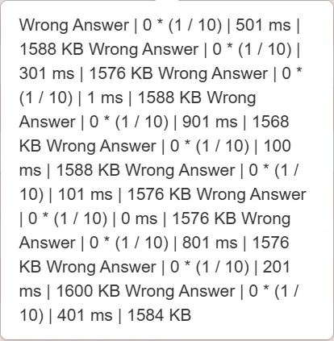

# 程序设计基础 专项 创新题 答案（2024秋）

## S 哈希攻击

| 难度 | 考点 |
| --- | --- |
| 6 | 暴力 |

### 题目

#### 题目描述

给定哈希基数 $b$ 与模数 $p$ 。对只含小写字母的字符串 $s$ ，其哈希值按

$$\mathrm{val}_0 = 0,\qquad \mathrm{val}_{i+1} = \left(\mathrm{val}_i \times b + (s_i - \texttt{'a'} + 1)\right) \bmod p$$

计算。请输出两个不同的字符串，使它们的哈希值相同。

由生日悖论可知，随机生成约 $O(\sqrt{p})$ 个字符串就足以找到一对哈希值相同的字符串，远小于 $p$ 。取字符串长度 $len = 9$ 时 $26^9 = 5429503678976$ 显著大于 $p$ ，可以保证各哈希值几乎等概率出现。

#### 输入格式

一行两个整数 $b$ 和 $p$ ，用空格分隔。

#### 输出格式

两行，每行一个只含小写字母的字符串。两个字符串必须不同，且哈希值相同。

#### 样例输入

```text
31 1009
```

#### 样例输出

```text
gllovqdik
rrqzltmhb
```

### 答案

### 题目分析

对于本题，比较朴素的思路就是，随机生成一堆字符串，然后在里面找到哈希值相同的两个字符串。

那么这个朴素的思路可不可行呢？咋一看好像不太可能，因为当 $p = 1000000007$ 时，字符串的哈希值会分布于 $0 \sim 1000000006$ 之间，最坏情况下，可能需要生成 $p + 1$ 个字符串才能找到冲突，这样看效率实在是太低了。

然而实际如此吗？看看本次的 F 题，然后拓展思考：哈希值有 1000000007 个，且字符串的哈希值在这些值里面是平均分布的，那么对于 $n$ 个字符串来说，它们的哈希值两两互不相同的概率是多少呢？

由于和 F 题的过程一模一样，这里省去计算过程，直接给出若干计算结果

| 字符串数量 $n$ | 模数 $p$ | 哈希值两两互不相同的概率 |
| --- | --- | --- |
| 10 | 1000000007 | 0.9999999550 |
| 100 | 1000000007 | 0.9999950500 |
| 1000 | 1000000007 | 0.9995006246 |
| 10000 | 1000000007 | 0.9512340225 |
| 50000 | 1000000007 | 0.2865059932 |
| 100000 | 1000000007 | 0.0067371611 |
| 200000 | 1000000007 | 0.0000000021 |

可以看到，我们所需的字符串数量远远小于 $p$，只需要 100000 个字符串，就可以以高于 99% 的概率成功哈希攻击。事实上，这个数字是 $O(\sqrt{p})$ 的。

同时，我们也不需要生成特别长的字符串就能完成攻击。对于字符串的长度 $len$，我们只需要 $26^{len}$ 显著大于 $p$，就可以保证所有可能的哈希值都能以几乎相等的概率出现，且在有限次尝试下**几乎不可能产生两个完全相同的字符串，而几乎总能产生两个哈希值相等的字符串**。题解使用的 $len$ 是 9， $26^9 = 5429503678976$，用生日悖论理论可以计算出 100000 次尝试下，生成的字符串两两不同的概率为 0.9990795386，失败率小于千分之一。

这就是 anti-hash 最经典的攻击方式：birthday attack。

### 示例代码（比较好懂，但效率较低）

```c
#include <stdio.h>
#include <stdlib.h>
#include <time.h>
#define LEN 9
#define TRY 100000 // 尝试的次数，100000次其实已足够。

int strhash(char s[], int len, int b, int p)
{
    int val = 0;
    for (int i = 0; i < len; i++)
    {
        val = (1ll * val * b + s[i] - 'a' + 1) % p;
    }
    return val;
}

char str[TRY][LEN + 1];

void gen(char s[], int len) // 随机生成一串长度为 len 的字符串
{
    for (int i = 0; i < len; i++)
    {
        s[i] = 'a' + rand() % 26;
    }
}

int b, p;

int cmp(const void *s1, const void *s2)
{
    return strhash((char *)s1, LEN, b, p) - strhash((char *)s2, LEN, b, p);
} // 这样的效率其实是比较低的，因为每次都花费 O(LEN) 的时间来计算哈希值

int main(void)
{
    srand(time(0));
    scanf("%d%d", &b, &p);
    for (int i = 0; i < TRY; i++)
    {
        gen(str[i], LEN);
    }
    qsort(str, TRY, sizeof(str[0]), cmp); // 排序，查找是否产生了哈希值一样的字符串
    for (int i = 1; i < TRY; i++)
    {
        if (strhash(str[i], LEN, b, p) == strhash(str[i - 1], LEN, b, p))
        {
            printf("%s\n", str[i]);
            printf("%s\n", str[i - 1]);
            return 0;
        }
    }
    return 0;
}
```

### 示例代码（预处理哈希值，提高效率）

```c
#include <stdio.h>
#include <stdlib.h>
#include <time.h>
#define LEN 9
#define TRY 100000 // 尝试的次数，100000次其实已足够。

int strhash(char s[], int len, int b, int p)
{
    int val = 0;
    for (int i = 0; i < len; i++)
    {
        val = (1ll * val * b + s[i] - 'a' + 1) % p;
    }
    return val;
}

char str[TRY][LEN + 1];
int val[TRY];
int ind[TRY];

void gen(char s[], int len) // 随机生成一串长度为 len 的字符串
{
    for (int i = 0; i < len; i++)
    {
        s[i] = 'a' + rand() % 26;
    }
}

int cmp(const void *a, const void *b)
{
    int x, y;
    x = *(int *)a;
    y = *(int *)b;
    return (val[x] > val[y]) - (val[x] < val[y]);
}

int main(void)
{
    srand(time(0));
    int b, p;
    scanf("%d%d", &b, &p);
    for (int i = 0; i < TRY; i++)
    {
        gen(str[i], LEN);
        val[i] = strhash(str[i], LEN, b, p); // 提前计算哈希值，之后对标号排序，提升效率
        ind[i] = i;
    }
    qsort(ind, TRY, sizeof(ind[0]), cmp); // 排序，查找是否产生了哈希值一样的字符串
    for (int i = 1; i < TRY; i++)
    {
        if (val[ind[i]] == val[ind[i - 1]])
        {
            printf("%s\n", str[ind[i]]);
            printf("%s", str[ind[i - 1]]);
            return 0;
        }
    }
    return 0;
}
```

### 拓展阅读

birthday attack 是最经典最基础的哈希攻击，编写简单但效率不高，时间复杂度为 $O(\sqrt{p} \log p)$。当 $p$ 较大时（比如梅森素数 $2^{61} - 1$）其时间复杂度是不可接受的。针对单哈希还有一种比较经典的算法：tree attack，其时间复杂度为 $2^{\sqrt{2 \lg p}}$。其缺点就是，生成的两个字符串的长度都比较长。birthday attack 可以在 $p = 1000000007$ 时找到两个长度仅为 9 的字符串，而在相同条件下，tree attack 需要的字符串长度为 512 或 1024 时才能以较高的概率找到冲突。而且出题者只知道这个方法而不知道其原理。若有想更深入了解各种 anti-hash 算法的大佬，推荐这篇纯英文帖子：On the mathematics behind rolling hashes and anti-hash tests

## T 多重哈希攻击

| 难度 | 考点 |
| --- | --- |
| 8 | 暴力，数论 |

### 题目

#### 题目描述

给定两组哈希参数 $(b_1, p_1)$ 与 $(b_2, p_2)$ ，哈希值的计算方式与 S 题相同。请输出两个不同的字符串，使它们在两组参数下的哈希值都相同。

直接对双哈希做生日攻击需要 $O(\sqrt{p_1 p_2})$ 个字符串，不可接受。可行做法是「组合式攻击」：先用生日攻击找到在 $(b_1,p_1)$ 下冲突的一对字符串 $S, T$ ，再把 $S, T$ 看作大小为 2 的字符集，对 $(b_2,p_2)$ 再做一次生日攻击。

#### 输入格式

两行，每行两个整数，依次是 $b_1$ 、 $p_1$ 和 $b_2$ 、 $p_2$ 。

#### 输出格式

两行，每行一个只含小写字母的字符串。两个字符串必须不同，且在两组参数下哈希值都相同。

#### 样例输入

```text
31 1009
131 1000000007
```

#### 样例输出

```text
tcuvzmhrvtcuvzmhrvcikzzrmxgcikzzrmxgcikzzrmxgtcuvzmhrvtcuvzmhrvtcuvzmhrvcikzzrmxgtcuvzmhrvtcuvzmhrvcikzzrmxgtcuvzmhrvcikzzrmxgcikzzrmxgcikzzrmxgcikzzrmxgtcuvzmhrvcikzzrmxgtcuvzmhrvcikzzrmxgcikzzrmxgtcuvzmhrvcikzzrmxgtcuvzmhrvcikzzrmxgcikzzrmxgtcuvzmhrvcikzzrmxgcikzzrmxgtcuvzmhrvcikzzrmxgcikzzrmxgtcuvzmhrvtcuvzmhrvcikzzrmxgtcuvzmhrvcikzzrmxgtcuvzmhrvtcuvzmhrvcikzzrmxgcikzzrmxgtcuvzmhrvcikzzrmxgcikzzrmxgtcuvzmhrvtcuvzmhrvcikzzrmxg
cikzzrmxgcikzzrmxgcikzzrmxgtcuvzmhrvtcuvzmhrvtcuvzmhrvtcuvzmhrvtcuvzmhrvcikzzrmxgtcuvzmhrvcikzzrmxgtcuvzmhrvcikzzrmxgcikzzrmxgcikzzrmxgcikzzrmxgcikzzrmxgtcuvzmhrvcikzzrmxgcikzzrmxgcikzzrmxgcikzzrmxgcikzzrmxgcikzzrmxgcikzzrmxgtcuvzmhrvcikzzrmxgtcuvzmhrvtcuvzmhrvcikzzrmxgcikzzrmxgcikzzrmxgcikzzrmxgcikzzrmxgtcuvzmhrvtcuvzmhrvtcuvzmhrvcikzzrmxgtcuvzmhrvcikzzrmxgcikzzrmxgcikzzrmxgcikzzrmxgcikzzrmxgcikzzrmxgcikzzrmxg
```

#### 数据范围

$31 \le p_1, p_2 \le 1000000007$ 。

### 答案

### 题目分析

在阅读本题解之前请确保已读懂 S 题题解。

我们接着尝试进行一下朴素的思路：随机生成一大堆字符串，然后在里面找到两个字符串，它们在给定的两组 $b, p$ 中都满足哈希值相等。

此时我们会发现，一个字符串对应的两个哈希值有 $p_1 \times p_2$ 种可能，如果要继续使用 birthday attack，需要生成的字符串数量是 $O(\sqrt{p_1 \times p_2})$ 的，而 $31 \le p_1, p_2 \le 1000000007$，显然直接 birthday attack 的时间复杂度是不可接受的。

没关系，我们看输出样例给出的一组字符串：

```text
rkfmftoxsjtoxsjrkfmfrkfmftoxsjrkfmfrkfmfrkfmftoxsj
toxsjtoxsjtoxsjtoxsjrkfmftoxsjrkfmftoxsjrkfmfrkfmf
```

注意到，它们都是由 `rkfmf` 和 `toxsj` 两个字符串交互拼接而成的。

注意力惊人的同学可能还能注意到， `rkfmf` 和 `toxsj` 两个字符串在 $b = 31, p = 1009$，即 $b_1, p_1$ 中，具有一样的哈希值。

现在开始介绍 “组合式攻击” 的原理。

“组合式攻击” 是专门针对双哈希、多哈希的一种攻击方式。第一步，使用某种方法，找到能使得在 $b_1, p_1$ 产生冲突的两个字符串，例如我们可以使用之前提到的 birthday attack 在 $O(\sqrt{p} \log p)$ 的时间复杂度下找到这样的两个字符串。显然，它们在 $b_2, p_2$ 下大概率是不会产生冲突的。

第二步，记刚才找到的两个字符串为 $S, T$，由多项式哈希的性质，我们发现，由若干 $S$ 和 $T$ 按照任意顺序拼接形成的两个字符串，它们在 $b_1, p_1$ 下的哈希值依然是一样的。这不难理解，因为在 $b_1, p_1$ 下， $S$ 和 $T$ 被认为是同样的两个字符串，那么若干个 $S$ 和 $T$ 按照任意顺序拼接对于 $b_1, p_1$ 来说依然是相同的。

那么此时，我们将 $S, T$ 看作大小为 2 的字符集，用 $S, T$ 来对 $b_2, p_2$ 再进行一次 birthday attack，得到类似 $SSTSTT, STSTTT$ 的两个字符串。注意，由于字符集从 26 变成 2，我们需要更长的长度才能找到哈希冲突。题解使用的 $len_2$ 是 40，在 100000 次尝试下，生成的字符串两两不同的概率为 0.9954628957，失败率小于千分之五。最终我们找到的两个字符串长度为 $9 \times 40 = 360$。

类似的，如果你想攻击三哈希，将攻击完双哈希得到的两个字符串再记为 $S', T'$，再进行一次字符集大小为 2 的 birthday attack 即可。

注意，`rand() % 2` 的随机性可能会在 `RAND_MAX` 为 32767 的环境下并不好，其循环节仅为 $2^{17}$，100000 次随机生成字符串产生重复的概率很可能远超预期。因此，建议写成 `rand() >> 10 & 1`。不过，在 OJ 上，`RAND_MAX` 好像是 $2^{31} - 1$，因此 `rand() % 2` 的循环节也会大一点，所以提交时写成 `rand() % 2` 也是能过的。

### 示例代码

```c
#include <stdio.h>
#include <stdlib.h>
#include <string.h>
#include <time.h>
#define TRY 100000 // 尝试的次数，100000次其实已足够。
#define LEN1 9
#define LEN2 40

int strhash(char s[], int len, int b, int p)
{
    int val = 0;
    for (int i = 0; i < len; i++)
    {
        val = (1ll * val * b + s[i] - 'a' + 1) % p;
    }
    return val;
}

char brute1[TRY][LEN1 + 1]; // 随机产生 TRY 次字符串，尝试找到哈希冲突
char brute2[TRY][LEN2 + 1];
int val[TRY]; // 上述字符串的哈希值
int ind[TRY];

char bomb[2][LEN1 + 1]; // 在第一组b,p下产生哈希冲突的一对字符串，他们将成为攻击第二组b,p的种子
int hash_val[2];        // 上面两个字符串在第二组b,p下的哈希值，一般来说是不同的

void gen1(char s[])
{
    for (int i = 0; i < LEN1; i++)
    {
        s[i] = 'a' + rand() % 26;
    }
}
void gen2(char s[])
{
    for (int i = 0; i < LEN2; i++)
    {
        s[i] = rand() >> 10 & 1;
    }
}

int cmp(const void *a, const void *b)
{
    int x, y;
    x = *(int *)a;
    y = *(int *)b;
    return (val[x] > val[y]) - (val[x] < val[y]);
}

int powint(int x, int y, int mod)
{
    int ans = 1;
    for (int i = 0; i < y; i++)
    {
        ans = 1ll * ans * x % mod;
    }
    return ans;
}

int strhash2(char s[], int len, int b, int p)
{
    int val = 0;
    for (int i = 0; i < len; i++)
    {
        val = (1ll * val * b + hash_val[s[i]]) % p;
    }
    return val;
}

int main(void)
{
    srand(time(0));
    int b, p;
    scanf("%d%d", &b, &p);
    for (int i = 0; i < TRY; i++)
    {
        gen1(brute1[i]);
        val[i] = strhash(brute1[i], LEN1, b, p);
        ind[i] = i;
    }
    qsort(ind, TRY, sizeof(ind[0]), cmp);

    scanf("%d%d", &b, &p);
    for (int i = 1; i < TRY; i++)
    {
        if (val[ind[i]] == val[ind[i - 1]])
        {
            strcpy(bomb[0], brute1[ind[i]]);
            strcpy(bomb[1], brute1[ind[i - 1]]);
            hash_val[0] = strhash(bomb[0], LEN1, b, p);
            hash_val[1] = strhash(bomb[1], LEN1, b, p);
            break;
        }
    }

    b = powint(b, LEN1, p); // 由于S和T的长度都是LEN1，因此算一个S相当于要乘LEN1个b，即b的LEN1次方
    for (int i = 0; i < TRY; i++)
    {
        gen2(brute2[i]);
        val[i] = strhash2(brute2[i], LEN2, b, p);
        ind[i] = i;
    }
    qsort(ind, TRY, sizeof(ind[0]), cmp);
    for (int i = 1; i < TRY; i++)
    {
        if (val[ind[i]] == val[ind[i - 1]])
        {
            for (int j = 0; j < LEN2; j++)
                printf("%s", bomb[brute2[ind[i]][j]]);
            printf("\n");
            for (int j = 0; j < LEN2; j++)
                printf("%s", bomb[brute2[ind[i - 1]][j]]);
            printf("\n");
            return 0;
        }
    }
    return 0;
}
```

### 拓展阅读

组合式攻击的一个显著缺点就是，尽管运行时间是每次攻击的运行时间之和，但其产生的字符串长度是每次攻击产生的字符串长度的乘积。对于多哈希来说，尽管它能很快找到一对能产生冲突的字符串，可是其长度可能会太长，导致我们根本无法使用这一对字符串来进行攻击。

Lattice reduction attack 是一种专门针对字符集大小较大（例如 a-z 共 26 个小写英文字母），且没有经过离散化处理的多哈希的一种攻击方式。可是，理解这种攻击需要较高的线性代数水平，且这是个 NP 困难问题，只有较好的近似算法而没有准确算法，已大大超出了本人的水平，故只给出有关链接，供学有余力（过于有余力了）的大佬们参考。

- A tool for hacking rolling hashes with fixed modulos and bases （如果你打 codeforces，这个帖子将非常实用）

- On the mathematics behind rolling hashes and anti-hash tests

### 思路 2（By tb148 同学）

本质上，本题要求你找出两个次数相等的整系数多项式 $p(x), q(x)$，要求次数小于 $10^4$，系数属于 $[1, 26]$，并且 $p(b_1) \equiv q(b_1) \pmod {p_1}, p(b_2) \equiv q(b_2) \pmod {p_2}$

考虑 $f(x) = p(x) - q(x)$，则 $f(x)$ 次数小于 $10^4$，系数绝对值不超过 25，并且 $p_1 \mid f(b_1), p_2 \mid f(b_2)$。

为了构造出 $f(x)$，我们采用如下的启发式（Heuristic）方法：

我们构造 $N$ 个多项式，初始时 $f_i(x) = x^i (0 \le i < N)$。为了让 $f(b) \bmod p$ 尽量小，我们可以将 $f_i$ 按照 $f_i(b) \bmod p$ 排序，然后计算相邻两个多项式的差分，即
$f_i(x) \leftarrow f_i(x) - f_{i-1}(x) (i = N - 1, N - 2, \ldots, 1)$。这样，由于相邻两个多项式的 $f(b) \bmod p$ 接近，差分所得的多项式的 $f(b) \bmod p$ 就会很小，重复若干次后，就可以在系数绝对值没有达到 25 时，让 $f(b) \bmod p = 0$。

由于本题有两组 $(b, p)$，操作时应交替使用 $(b_1, p_1)$ 与 $(b_2, p_2)$。

尽管 $N \le 10^4$ 即可满足次数要求，为了满足时间限制，实际上取 $N = 10^3$ 较好。

**注意**：本做法是一个启发式（启发式算法是基于人类的经验和直观感觉，对一些算法的优化）的做法，效率确实很高，但并不保证对于数据范围内总能有效地找到解，然而这个做法确实非常高效，希望能开拓同学们的思路。

<!-- markdownlint-disable-next-line MD024 -->
### 示例代码

```c
/* Author: 唐路凌 */

#include <ctype.h>
#include <stdio.h>
typedef long long ll;
typedef long double lf;
// begin fast io
ll fgetll(FILE *stream) {
    ll x = 0, y = 1;
    char c = fgetc(stream);
    while (!isdigit(c)) {
        if (c == '-') {
            y = -1;
        }
        c = fgetc(stream);
    }
    while (isdigit(c)) {
        x = x * 10 + c - '0';
        c = fgetc(stream);
    }
    return x * y;
}
ll getll() {
    return fgetll(stdin);
}
void fputll(ll x, FILE *stream) {
    char s[30] = "";
    if (x < 0) {
        fputc('-', stream);
        x = -x;
    }
    ll i = 0;
    do {
        s[i++] = x % 10 + '0';
        x /= 10;
    }
    while (x != 0);
    while (i > 0) {
        fputc(s[--i], stream);
    }
}
void putll(ll x) {
    fputll(x, stdout);
}
void fputllch(ll x, char c, FILE *stream) {
    fputll(x, stream);
    fputc(c, stream);
}
void putllch(ll x, char c) {
    fputllch(x, c, stdout);
}
void fgetarr(ll *x, ll *y, FILE *stream) {
    for (ll *i = x; i < y; i++) {
        *i = fgetll(stream);
    }
}
void getarr(ll *x, ll *y) {
    fgetarr(x, y, stdin);
}
void fputarr(ll *x, ll *y, FILE *stream) {
    for (ll *i = x; i < y; i++) {
        fputll(*i, stream);
        putc(' ', stream);
    }
    putc('\n', stream);
}
void putarr(ll *x, ll *y) {
    fputarr(x, y, stdout);
}
// end fast io
// begin heap sort
void swap(ll *x, ll *y) {
    ll tmp = *x;
    *x = *y;
    *y = tmp;
}
void heap(ll *arr, ll x, ll y, ll cmp(ll x, ll y)) {
    for (ll j = x;;) {
        ll k = j;
        if (2 * j + 1 < y && cmp(arr[k], arr[2 * j + 1])) {
            k = 2 * j + 1;
        }
        if (2 * j + 2 < y && cmp(arr[k], arr[2 * j + 2])) {
            k = 2 * j + 2;
        }
        if (k == j) {
            break;
        }
        swap(arr + j, arr + k);
        j = k;
    }
}
void hsort(ll *x, ll *y, ll cmp(ll x, ll y)) {
    ll len = y - x;
    for (ll i = len - 1; i >= 0; i--) {
        heap(x, i, len, cmp);
    }
    for (ll i = len - 1; i > 0; i--) {
        swap(x, x + i);
        heap(x, 0, i, cmp);
    }
}
// end heap sort
#define N 1024
ll n1, m1, n2, m2, l, a1[N], a2[N], b[N][N], id[N];
char s[N], t[N];
ll cmp1(ll x, ll y) {
    return a1[x] <= a1[y];
}
ll cmp2(ll x, ll y) {
    return a2[x] <= a2[y];
}
int main() {
    n1 = getll();
    m1 = getll();
    n2 = getll();
    m2 = getll();
    for (ll i = 0, j1 = 1, j2 = 1; i < 1000; i++) {
        a1[i] = j1;
        a2[i] = j2;
        b[i][i] = 1;
        id[i] = i;
        j1 = j1 * n1 % m1;
        j2 = j2 * n2 % m2;
    }
    while (a1[id[0]] != 0 || a2[id[0]] != 0) {
        hsort(id, id + 1000, cmp1);
        for (ll i = 999; i >= 1; i--) {
            a1[id[i]] = (a1[id[i]] - a1[id[i - 1]] + m1) % m1;
            a2[id[i]] = (a2[id[i]] - a2[id[i - 1]] + m2) % m2;
            for (ll j = 0; j < 1000; j++) {
                b[id[i]][j] -= b[id[i - 1]][j];
            }
        }
        hsort(id, id + 1000, cmp2);
        for (ll i = 999; i >= 1; i--) {
            a1[id[i]] = (a1[id[i]] - a1[id[i - 1]] + m1) % m1;
            a2[id[i]] = (a2[id[i]] - a2[id[i - 1]] + m2) % m2;
            for (ll j = 0; j < 1000; j++) {
                b[id[i]][j] -= b[id[i - 1]][j];
            }
        }
    }
    for (ll i = 0; i < 1000; i++) {
        if (b[id[0]][i] >= 0) {
            s[999 - i] = 'a' + b[id[0]][i];
            t[999 - i] = 'a';
        }
        else {
            s[999 - i] = 'a';
            t[999 - i] = 'a' - b[id[0]][i];
        }
    }
    printf("%s\n%s\n", s, t);
    return 0;
}
```

## V 查重红线

| 难度 | 考点 |
| --- | --- |
| 2 | 分块 |

### 题目

#### 题目描述

共有 $n$ 次提交，编号 $1 \sim n$ ，其中恰有一次越过了查重红线，记它的编号为 $m$ 。你可以进行若干次「提交」操作：每次给出一个编号 $x$ ，评测机回答 $1$ 表示 $m \ge x$ ，回答 $0$ 表示 $m < x$ 。提交次数有上限，最优策略下最少需要 $\lfloor \sqrt{2n} \rfloor$ 次。

做法是分块：第一块的容量取提交次数上限，此后每向下一块容量减 1 ，直到容量减为 0 或所有块容量之和达到 $n$ 。第一轮依次询问每一块的块尾，触发预警后第一轮结束；第二轮在触发预警的那一块内从块首向块尾逐个询问，即可确定 $m$ 。

#### 输入格式

第一行一个整数 $n$ 。此后每提交一次，读入一个字符 `1` 或 `0` 作为评测机的回答。

#### 输出格式

每次提交输出一行一个编号，并刷新输出缓冲区。确定答案后输出一行 `m=<编号>` 。

#### 样例输入

```text
3
1
0
```

#### 样例输出

```text
2
3
m=2
```

### 答案

### 题目分析

这是一道典型的分块+优化问题。
为了叙述方便不引起歧义，我们将题目中的 “ 提交 ” 称为一次 “ 询问 ”。

#### 1. 分块

所谓分块，就是我们可以将 $n$ 分成 $\frac{n}{t}$ 块，每块容量是 $t$。

第 1 块从头到尾依次是： $n, n - 1, n - 2, \ldots, n - t + 1$；
第 2 块从头到尾依次是： $n - t, n - t - 1, n - t - 2, \ldots, n - 2t + 1$；
...
第 $\frac{n}{t}$ 块从头到尾依次是： $t, t - 1, t - 2, \ldots, 1$。

我们有两轮预警机会可以使用：
第一轮遍历询问每一块的末尾，触发预警后第一轮结束；
第二轮在触发了预警的块内从头到尾遍历询问，触发预警后即能找到答案。

这样我们的询问次数不超过 $t + \frac{n}{t} - 1$，较优的分块是 $t = \frac{n}{t} = \sqrt{n}$，询问次数不超过 $= 2\sqrt{n} - 1$。

此时已经将询问次数降到了 $O(\sqrt{n})$，但常数较大不满足要求，考虑继续优化。

#### 2. 优化

我们注意到如果 $m$ 落在第一块内则最多只要询问 $\sqrt{n}$ 次，但如果落在最后一块内则最多要询问 $2\sqrt{n} - 1$ 次。这种不平衡造成了类似于 “ 木桶效应 ”。能不能使用某种策略使得在每一块内，最坏情况所需的询问次数都相同呢？

其实第一轮中每向下一块，我们就多消耗了一次询问次数，留给第二轮的剩余询问次数就减少一次。那么如果每向下一块就将下一块的容量 $-1$，就能保证每一块内最坏情况所需的提交次数都相同了。

不难发现，这种策略下「 最坏情况下的提交次数 $==$ 第一块的容量 」。

那么我们只需将 **提交次数上限** 作为第一块的容量，此后块的容量依次 $-1$，直到块的容量减为 0 或所有块容量之和达到 $n$。

然后仍然按照刚才「 第一轮遍历每一块的末尾，第二轮在预警块内遍历 」的策略进行即可找到答案。

如果你感兴趣的话，可以看看下面对于提交次数上限的推导过程：

<!-- markdownlint-disable-next-line MD026 -->
#### 3. 证明最优策略下最少提交次数为 $\lfloor \sqrt{2n} \rfloor$：

设第一块大小为 $p$，则向下若干块大小依次为 $p - 1, p - 2, \ldots$，那么 $p$ 的大小至少应该满足：

$$
\sum_{i=1}^{p} i = \frac{p(p+1)}{2} \ge n
$$

若存在正整数 $p_0, n_0$，使得 $\frac{p_0(p_0+1)}{2} = n_0$（恰好取等），则有：

$$
p_0^2 < 2n_0 < (p_0 + \frac{1}{2})^2，即 p_0 < \sqrt{2n_0} < p_0 + \frac{1}{2}，故 p_0 = \lfloor \sqrt{2n_0} \rfloor
$$

而对于任意 $n_1 > n_0$，则有：

$$
(p_0 + \frac{1}{2})^2 = 2n_0 + \frac{1}{4} < 2n_1，即 p_0 + \frac{1}{2} < \sqrt{2n_1}，故 p_0 < \lfloor \sqrt{2n_1} \rfloor
$$

由此可得，最优策略下 $p = \lfloor \sqrt{2n} \rfloor$ 是满足条件的最少提交次数。

### 示例代码

```c
#define submit(x) (printf("%d\n",x),fflush(stdout),scanf(" "),(int)(getchar()-'0'))
#define guess(x) return (printf("m=%d\n",x),fflush(stdout))

#include<stdio.h>
#include<math.h>

int main()
{
    int n,nn,jud;
    scanf("%d",&n);
    int p=(int)round(sqrt(2*n));
    n++; //n 是上一块块首，所以最初++
    while(p) //p 是块的容量，一定要避免出现 p=0 然后不停 submit 同一个值的情况
    {
        if(n-p>=0) nn=n-p;
        else nn=1; //nn 是块尾，尽量避免询问负数（虽然也不是不行）
        jud=submit(nn);
        if(jud==1) break; //找到出错块了
        n=nn;
        p--;
    }
    while((--n)>nn) //在预警块内从块首到块尾遍历
    { //注意块尾不要再次询问，所以终止条件是 n>nn，没有等号
        jud=submit(n);
        if(jud==1) break;
    }
    guess(n);
    return 0; //这行可以省略，因为 guess(n) 自带return
}
```

## BF 蟹堡王的迷宫

| 难度 | 考点 |
| --- | --- |
| 1 | 学会看详细评测信息，以及前端检查功能 |

### 题目

#### 题目描述

海绵宝宝在一个迷宫里行走，起点是迷宫中的黄色位置。迷宫中的元素含义如下：

- 蓝色区域可以通行；
- `h` 是椅子，海绵宝宝走到椅子上时只显示海绵宝宝，不显示椅子；
- `+` 是门，到达时需要输入密码，密码正确才能走到门处，密码错误会被弹回门口 (12, 7) 处；
- `$` 是钱包，打开门之后才能看见，必须走到钱包所在位置才算取到，只开门不取钱包不算；
- `X` 是陷阱，到达该处直接 `Game Over` ；
- `#` 是墙，撞墙不发生任何事情，可以继续行走。

取到钱包之后，从 $(-1, 14)$ 处离开即可通过。

#### 输入格式

交互题，程序不需要读入数据。

#### 输出格式

输出一串字符控制海绵宝宝移动：`W` 、 `A` 、 `S` 、 `D` 分别表示上、左、下、右；走到门处时紧接着输出门的密码。

### 答案

### 题目分析

本题是走一个迷宫，迷宫全局如图：

- 蓝色的是可走区域， `h` 是椅子（难道不像椅子嘛？），当海绵宝宝走到椅子上时，只显示海绵宝宝而不显示椅子。

- `+` 是门，到达时需输入密码，若密码正确能走到门处，若密码错误会被弹回到门口 $(12, 7)$ 处。

- `$` 是钱包，打开门之后才能看见，到达钱包的位置才算取到，只开门不取钱包是不可以的。取到钱包后从 $(-1, 14)$ 处离开即能 AC。

- `X` 是陷阱，到达此处后会直接 `Game Over` 。

- `#` 是墙，撞墙不会发生任何事情，后续可以直接继续行走（很合理叭~）

- 黄色的是海绵宝宝的起始位置。

### 示例代码

```c
#include<stdio.h>
void pt(char c,int n)//输出n次字符c
{
    for(int i=1;i<=n;i++)
        printf("%c",c);
}
int main()
{
    char password[6]=""; //题解中密码不公布了，请自行探索~
    char w='W',a='A',s='S',d='D';
    pt(d,18); pt(w,11); pt(a,9);   pt(s,7);
    pt(d,5);  pt(w,3);  pt(a,2);   pt(s,1);
    printf(password);
    pt(a,1);  pt(d,1);
    pt(w,1);  pt(d,2);  pt(s,3);   pt(a,5);
    pt(w,7);  pt(d,9);  pt(s,11);  pt(a,19);
    return 0;
}
```

## BX 猜猜数据点

| 难度 | 考点 |
| --- | --- |
| 2 | 尝试 |

### 题目

#### 题目描述

本题共有 10 个数据点，每个数据点的输入是一个 $0 \sim 10$ 的整数 $x$ ，每个数据点有一个固定的正确答案。输入 $x = 0$ 时，需要一次性输出这 10 个数据点各自的正确答案；输入 $x \ne 0$ 时，输出第 $x$ 个数据点的正确答案。

10 个数据点的正确答案依次是 5、3、0、9、1、1、0、8、2、4。

#### 输入格式

一行一个整数 $x$ ，满足 $0 \le x \le 10$ 。

#### 输出格式

$x = 0$ 时输出 10 行，每行一个整数； $x \ne 0$ 时输出一行一个整数。

#### 样例输入

```text
0
```

#### 样例输出

```text
5
3
0
9
1
1
0
8
2
4
```

### 答案

### 题目分析

显而易见，本题需要通过查看评测记录来获取对应数据点的信息，因此，我们不妨无脑输出 $0 \sim 10$ 各试一遍，可以获得以下信息（第一行代表每个数据点的输入的值，第二行代表数据点对应的正确输出）：

```text
? ? ? ? ? ? ? ? ? ?
1 0 ? 2 5 5 ? 8 3 9
```

容易知道，第二行的 `?` 对应的输入一定是 $0$，否则之前的尝试一定有某次是正确的。

```text
? ? 0 ? ? ? 0 ? ? ?
1 0 ? 2 5 5 ? 8 3 9
```

我们可以先从 $0$ 入手。注意到，第二行有一个 $3$，这说明第一行至少有一个 $3$，而这个 $3$ 对应的正确输出一定是 $0$，所以第二行唯一的一个 $0$ 对应的输入一定是 $3$。

```text
? 3 0 ? ? ? 0 ? ? ?
1 0 ? 2 5 5 ? 8 3 9
```

同理，我们可以知道，第一行其它位置不能是 $3$。因此第二行的 $3$ 对应的输入一定是 $2$。

```text
? 3 0 ? ? ? 0 ? 2 ?
1 0 ? 2 5 5 ? 8 3 9
```

类似地，我们来看 $9$ 的情况。第二行的 $9$ 表明第一行至少有一个 $9$，而我们知道第 $9$ 个数据点的输入是 $2$，因此，只能是第 $4$ 个数据点的输入是 $9$。

```text
? 3 0 9 ? ? 0 ? 2 ?
1 0 ? 2 5 5 ? 8 3 9
```

同理，我们可以知道，第一行其它位置不能是 $9$。因此第二行的 $9$ 对应的输入一定是 $4$。

```text
? 3 0 9 ? ? 0 ? 2 4
1 0 ? 2 5 5 ? 8 3 9
```

对于第一行剩余的四个 `?` ，我们通过简单的假设可以得到以下四种可能的排列： $1, 5, 5, 8$ 、 $1, 8, 8, 5$ 、 $5, 1, 1, 8$ 、 $8, 5, 5, 1$，依次尝试即可得到正确答案 $5, 3, 0, 9, 1, 1, 0, 8, 2, 4$ 。

### 示例代码

```c
#include<stdio.h>
int ans[12]={0,5,3,0,9,1,1,0,8,2,4};
int x;
int main(){
    scanf("%d",&x);
    if ( x==0 )
        for ( int i=1 ; i<=10 ; i++ )
            printf("%d\n",ans[i]);
    else
        printf("%d",ans[x]);
    return 0;
}
```

### 另解

某群聊内某位同学提出了另一种解法，很巧妙地解决了获取输入的问题，不过使用了课程内容以外的方法，故不要求掌握。

我们可以从评测结果获取到的信息有：错误代码、运行时间和运行内存。

由于本题中 $n$ 的取值只有 $0 \sim 10$ 这 11 种，因此可以考虑占用运行时间来判断输入值。

首先提交如下代码：

```c
#include<stdio.h>
#include<unistd.h>
int n;
int main(){
    scanf("%d",&n);
    usleep(n*1000*100);//本课程不要求掌握该函数。其作用是让程序暂停n*1000*100微秒
    return 0;
}
```

从而很容易从评测结果中通过运行时间观察到每个数据点的输入。


