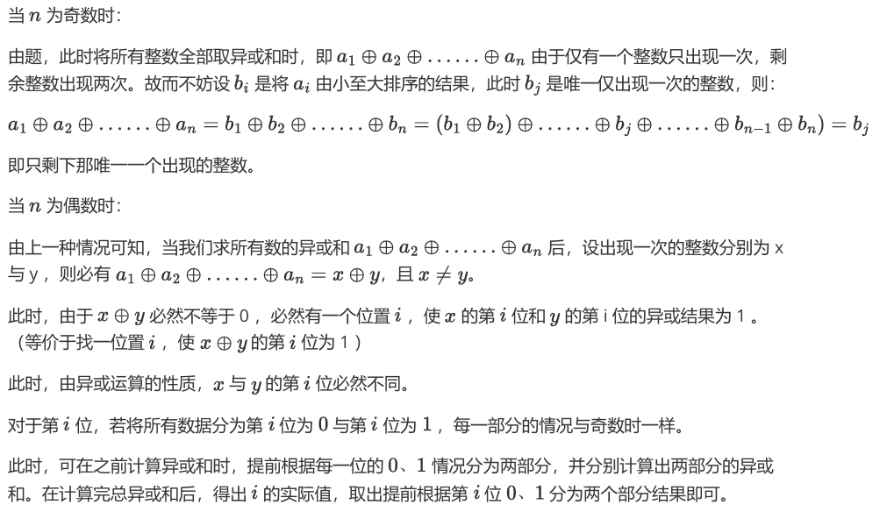

# 程序设计基础 专项 简单题 答案（2025秋）

## K 除法取整

| 难度 | 考点 |
| --- | --- |
| 1 | 除法 |

### 题目

#### 题目描述

给定两个整数 $a$ 和 $b$ （ $b \ne 0$ ），求 $a \div b$ 的向下取整和向上取整，也就是数学意义上的 $\left\lfloor a / b \right\rfloor$ 和 $\left\lceil a / b \right\rceil$ 。

注意 C 语言的整数除法是向零取整，与数学上的向下取整不同；也不能用 $a \times b$ 去判断 $a$ 、 $b$ 是否同号，因为两者相乘会超出 long long 范围；同样不能改用 double、ceil 或 floor，否则会出现精度问题。

#### 输入格式

一行两个整数 $a$ 和 $b$ 。

#### 输出格式

一行两个整数，用空格分隔，依次是 $\left\lfloor a / b \right\rfloor$ 和 $\left\lceil a / b \right\rceil$ 。

#### 样例输入

```text
7 2
```

#### 样例输出

```text
3 4
```

### 答案

### 题目分析

题解略，给出几个可能出错的点：

1. 不能使用 $a * b$ 去判断 $a, b$ 是否同号，因为这两个数相乘会超过 $long\ long$ 范围。

2. 不能使用 $double$ 类型，可以尝试用 $double$ 存储一个 $10^{16}$ 以上的整数，可以发现此时输出的整数不再是输入的整数了。同理，也不能用 $ceil$ 与 $floor$ ，因为你在使用这个函数的同时已经先将 $a, b, a/b$ 中的一个或多个转换为 $double$ 了，从而出现精度缺失。

### 示例代码

```c
#include <stdio.h>
//#define int long long
//signed main() {
int main(){
    //int a,b;
    long long a,b;
    scanf("%lld%lld",&a,&b);
    //int x=a/b;
    long long x=a/b;
    if(a==b*x)
    {
        printf("%lld %lld",x,x);
        return 0;
    }
    if(a>=0&&b>=0||a<=0&&b<=0)
    {
        printf("%lld %lld",x,x+1);
    }
    else
    {
        printf("%lld %lld",x-1,x);
    }
    return 0;
}
```

## L 猫鼠斗

| 难度 | 考点 |
| --- | --- |
| 4 | 博弈论 |

### 题目

#### 题目描述

Tom 和 Jerry 轮流从一堆石子中拿走石子，每次可以拿走 $p^k$ 颗，其中 $p$ 是质数、 $k$ 是非负整数，也就是可以拿走 $1$ 、 $2$ 、 $3$ 、 $4$ 、 $5$ 、 $7$ 、 $8$ 、 $9$ 、 $\dots$ 颗。拿走最后一颗石子的人获胜。Jerry 先手，Tom 后手，判断谁必胜。

结论是：剩余石子数是 $6$ 的倍数时先手必败，其余情况先手必胜。因为任何 $p^k$ 都不是 $6$ 的倍数，从 $6n$ 拿走石子后必然不是 $6$ 的倍数；而 $6n + k$ （ $k = 1, 2, 3, 4, 5$ ）都可以拿走 $k$ 颗转移回 $6n$ 。

#### 输入格式

第一行一个整数 $T$ ，表示数据组数。

接下来 $T$ 行，每行一个整数 $n$ ，表示石子个数。

#### 输出格式

每组数据输出一行，Tom 必胜输出 Tom wins，Jerry 必胜输出 Jerry wins。

#### 样例输入

```text
3
6
7
12
```

#### 样例输出

```text
Tom wins
Jerry wins
Tom wins
```

### 答案

### 博弈论题目首先找规律

对于 $n$ 剩余 $1 \sim 5$ 的情况，有 $1 = p^0, 2 = 2^1, 3 = 3^1, 4 = 2^2, 5 = 5^1$ 。都是必胜态，可以直接结束游戏。

但是我们发现， $6$ 个石子就没法一次拿完了，而且无论此时我们拿几个石子，剩余石子数必将是 $1 \sim 5$ 个，下一回合对手必胜。**所以说 $6$ 个石子是必败态，当场上剩余6个石子且轮到你拿的时候，你一定失败**

同理，我们可以一直推到 $12$ ，发现 $7 - 11$ 都是必胜态，然而到 $12$ 又是必败了，因为无论拿走多少石子，对手下一回合都能拿走全部石子。

枚举到现在，我们可以猜想 <strong> $6n$ 是必败态，除此之外都是必胜。</strong>

我们采用数学归纳法予以证明。

假设 $0 \sim 6n - 1$ 都满足结论。

首先我们证明 $6n$ 是必败的，因为任何 $p^n$ 都不是 $6$ 的倍数，**所以 $6n$ 个石子拿完后必然不是 $6$ 的倍数，所以必然到对方回合时是对方的必胜态，所以 $6n$ 是必败态。**

然后我们证明非 $6n$ 都是必胜的。即 $6n + k\ (k = 1, 2, 3, 4, 5)$ ，**我们都能够通过拿走 $k$ 个石子从而转移至 $6n$ 的对方必败态**，而对方无论如何拿石子都会重新转移至 $6n + k\ (k = 1, 2, 3, 4, 5)$ ，形成闭环，直到 $n = 0$ 方一次能全部拿走。

证毕。

所以我们只需要判断一下输入是否为 $6n$ 即可。

### 示例代码

```c
#include<stdio.h>
int main ( )
{
    int T;
    scanf("%d",&T);  //输入测试点组数
    for(int i=1;i<=T;i++)
    {
        int n;
        scanf("%d",&n);  //输入石子个数
        if(n%6==0)       //n是6的倍数必败
        printf("Tom wins");
        else             //n非6的倍数必胜
        printf("Jerry wins");
        printf("\n");    //换行，与题目输出要求保持一致。
    }
    return 0 ;       //好习惯
}
```

## M Chronos Collapse - La Campanella

| 难度 | 考点 |
| --- | --- |
| 2 | 输入输出 |

### 题目

#### 题目描述

给定两个长方形，分别用对角线上的两个顶点 $(a_{x1}, a_{y1})$ 、 $(a_{x2}, a_{y2})$ 和 $(b_{x1}, b_{y1})$ 、 $(b_{x2}, b_{y2})$ 表示。求它们的交集面积和并集面积。

由 $S_{A \cup B} = S_A + S_B - S_{A \cap B}$ ，先算出两个长方形重叠部分的面积，再算出并的面积。

#### 输入格式

第一行一个整数 $t$ ，表示数据组数。

每组数据一行八个整数 $a_{x1}, a_{y1}, a_{x2}, a_{y2}, b_{x1}, b_{y1}, b_{x2}, b_{y2}$ 。

#### 输出格式

每组数据输出一行两个整数，用空格分隔，依次是交集面积和并集面积。

#### 样例输入

```text
1
0 0 2 2 1 1 3 3
```

#### 样例输出

```text
1 7
```

### 答案

### 题目分析

有 $S_{A \cup B} = S_A + S_B - S_{A \cap B}$ 。先计算两个长方形重叠的面积，然后用这个公式就能算出并的面积。

### 示例代码

```c
#include <stdio.h>
int min(int a,int b){
    return a<b?a:b;
}
int max(int a,int b){
    return a>b?a:b;
}
int main(){
    int t;
    scanf("%d",&t);
    while(t--){
        int ax1,ay1,ax2,ay2,bx1,by1,bx2,by2;
        scanf("%d%d%d%d%d%d%d%d",&ax1,&ay1,&ax2,&ay2,&bx1,&by1,&bx2,&by2);
        int cx1=max(ax1,bx1),cx2=min(ax2,bx2);
        int cy1=max(ay1,by1),cy2=min(ay2,by2);
        int dx=max(0,cx2-cx1),dy=max(0,cy2-cy1);
        int ans1=dx*dy;
        int ans2=(ax2-ax1)*(ay2-ay1)+(bx2-bx1)*(by2-by1)-ans1;
        printf("%d %d\n",ans1,ans2);
    }
    return 0;
}
```

## N 小忆的函数

| 难度 | 考点 |
| --- | --- |
| 4 | 输入输出 |

### 题目

#### 题目描述

给定二次函数 $f(x) = ax^2 + bx + c$ ，以及两个点 $(x_1, y_1)$ 和 $(x_2, y_2)$ 所确定的直线，求这条直线与函数图像的交点。

- 若 $x_1 = x_2$ ，直线就是竖直线 $x = x_1$ ，与图像恰有一个交点 $(x_1, f(x_1))$ 。
- 否则设直线为 $y = kx + m$ 。
  - 若 $a = 0$ ：直线与图像重合时交点有无穷多个；平行时没有交点；否则恰有一个交点。
  - 若 $a \ne 0$ ：由判别式决定，小于 $0$ 时没有交点，等于 $0$ 时恰有一个交点，大于 $0$ 时有两个交点，按横坐标从小到大输出。

#### 输入格式

第一行一个整数 $t$ ，表示数据组数。

每组数据一行七个整数 $a, b, c, x_1, y_1, x_2, y_2$ 。

#### 输出格式

每组数据输出一行：先输出交点个数（ $-1$ 表示无穷多个），再依次输出各交点。交点写成 (x,y) 的形式，横纵坐标都保留 $2$ 位小数，各项之间用一个空格分隔。

#### 样例输入

```text
2
1 0 -1 0 0 2 0
1 0 0 1 5 1 7
```

#### 样例输出

```text
2 (-1.00,0.00) (1.00,0.00)
1 (1.00,1.00)
```

### 答案

### 题目分析

同 `E2G` ，但是你可能要额外判一下 $x_1 = x_2$ 的情况。

此题并未故意卡精度，但是如果卡精度能再卡掉 95% 的人，所以就没卡。

本题标程判断全部采用整数，因此不会出错。

### 示例代码

```c
#include <stdio.h>
#include <math.h>

typedef long long ll;
ll a,b,c,x1,y1,x2,y2;
double f(double x){
    return a*x*x+b*x+c;
}
ll sqr(ll x){
    return x*x;
}
void solve(){
    scanf("%lld%lld%lld%lld%lld%lld%lld",&a,&b,&c,&x1,&y1,&x2,&y2);
    if(x1==x2){
        // totally x=x1.
        printf("1 (%.2lf,%.2lf)\n",(double)x1,f(x1));
    } else {
        ll delta_up=sqr((x2-x1)*b-(y2-y1))-4*a*(x2-x1)*((x2-x1)*c-(x2*y1- x1*y2));
        ll delta_down=(x2-x1)*(x2-x1);
        double k=(y2-y1)/(double)(x2-x1);
        double m=(x2*y1-x1*y2)/(double)(x2-x1);
        double A=a,B=b-k,C=c-m;
        if(a==0){
            if(b*(x2-x1)==y2-y1){
                if(c*(x2-x1)==(x2*y1-x1*y2)){
                    printf("-1\n");
                } else {
                    printf("0\n");
                }
            } else {
                double X=-C/B;
                printf("1 (%.2lf,%.2lf)\n",X,f(X));
            }
        }else{
            if(delta_up<0){
                printf("0\n");
            } else if(delta_up==0){
                double X=-B/(2*A);
                printf("1 (%.2lf,%.2lf)\n",X,f(X));
            } else{
                double Delta=B*B-4*A*C;
                double X1=(-B-sqrt(Delta))/(2*A),X2=(-B+sqrt(Delta))/(2*A);
                if(X1<X2)
                    printf("2 (%.2lf,%.2lf) (%.2lf,%.2lf)\n",X1,f(X1),X2,f(X2));
                else
                    printf("2 (%.2lf,%.2lf) (%.2lf,%.2lf)\n",X2,f(X2),X1,f(X1));
            }
        }
    }
}
int main(){
    int t;
    scanf("%d",&t);
    while(t--)
        solve();
    return 0;
}
```

## O 题目增强计划-C3H

| 难度 | 考点 |
| --- | --- |
| 4 | 位运算 |

### 题目

#### 题目描述

给定 $t$ 组询问，每组给出两个整数 $l$ 和 $r$ ，求

$$
l \;|\; (l + 1) \;|\; (l + 2) \;|\; \dots \;|\; r
$$

的值，其中 $|$ 表示按位或。

这个或之和等价于 $l \;|\; r \;|\; f(r - l)$ ，其中 $f(x)$ 表示把 $x$ 二进制最高位往下的所有位全部置为 $1$ 的结果。

#### 输入格式

第一行一个整数 $t$ ，表示数据组数。

接下来 $t$ 行，每行两个整数 $l$ 和 $r$ 。

#### 输出格式

每组数据输出一行一个整数。

#### 样例输入

```text
1
5 7
```

#### 样例输出

```text
7
```

### 答案

### 题目分析

本题有一个 $O(Tloglog10^{18})$ 的做法。

考虑 $[l, r]$ 的或之和，易得其等价于 $l|(l + 1)|(l + 2)|(l + 4)|(l + 8)|\ldots|(l + 2^n)|r$ 的结果，易得其等价于 $l|r|1|2|4|8|\ldots|2^n$ 。因此，该或之和等价于 $l|r|f(r - l)$ ， $f(x)$ 代表将 $x$ 二进制的最高位往下的所有位全都置为 $1$ 的结果。考虑最坏情况，此时仅有最高位为 $1$ ，此时可以采用倍增思想，先将最高位往下的第一位置为 $1$ ，然后依靠这两位将最高位往下的第二、三位置为 $1$ ，依次类推，只需要执行 $O(logw)$ 次（ $w$ 为位数）便可以将所有位置为 $1$ ，故复杂度为 $O(Tloglog10^{18})$ 。

注：由于输入的时间复杂度超过了算法的时间复杂度，因此很难卡住 $O(Tlog10^{18})$ 且常量时间少的算法，只要在原题基础上稍微减少每次循环次数便可通过此题。

### 示例代码

```c
#include <stdio.h>
#include <math.h>
#include <assert.h>
long long read()
{
    long long x = 0, f = 1;
    long long c = getchar();
    while (c > '9' || c < '0')
    {
        if (c == '-')
            f = -f;
        c = getchar();
    }
    while (c >= '0' && c <= '9')
        x = (x << 3) + (x << 1) + (c ^ '0'), c = getchar();
    return x * f;
}
int main(){
    long long t; t=read();
    while(t--){
        long long l,r;
        l=read();
        r=read();
        long long ans = l | r;
        long long temp=r-l;
        temp|=temp>>1;
        temp|=temp>>2;
        temp|=temp>>4;
        temp|=temp>>8;
        temp|=temp>>16;
        temp|=temp>>32;
        ans|=temp;
        printf("%lld\n", ans);
    }
    return 0;
}
```

## S 别样的进制转换

| 难度 | 考点 |
| --- | --- |
| 5 | 进制，高精度 |

### 题目

#### 题目描述

把一个 $p$ 进制下的小数转换成 $q$ 进制下的小数，并输出前 $m$ 位。

整数部分为 $0$ 的 $p$ 进制小数 $a = \left(\overline{0.a_1a_2\cdots a_n}\right)_p$ 中，第 $i$ 小数位的权为 $p^{-i}$ 。与十进制类似地，挪动小数点可以使数扩大至原来的 $p$ 的幂倍，因此可以用「乘基取整法」：每次把小数部分乘上目标进制 $q$ ，取整数部分作为 $q$ 进制下的下一位数码。

例如 $0.3_{10} = 0.0\dot{1}00\dot{1}_2$ 。

#### 输入格式

第一行一个整数 $p$ ，表示源进制。

第二行一个字符串，形如 0.a1a2… ，表示 $p$ 进制下的小数。

第三行两个整数 $q$ 和 $m$ ，分别表示目标进制和要输出的位数。

#### 输出格式

一行，形如 0. 后接 $m$ 位 $q$ 进制下的数码。

#### 样例输入

```text
10
0.3
2 6
```

#### 样例输出

```text
0.010011
```

### 答案

### 题目分析

整数部分为 $0$ 的 $p$ 进制小数

$$
a = \left(\overline{0.a_1a_2 \cdots a_n}\right)_p
$$

中的第 $i$ 小数位的权为 $p^{-i}$ ，即

$$
a = \sum_{i=1}^{n} a_i p^{-i}
$$

；而与十进制类似地，挪动小数点可以使数扩大至原来的 $p$ 的幂倍，具体地，

$$
p^k a = \left(\overline{a_1a_2 \cdots a_k.a_{k+1}a_{k+2} \cdots a_n}\right)_p \quad 1 \le k \le n
$$

，因此我们可以通过每次乘上基数并取整数部分来得到每个数位上的数码（这个方法被称为「乘基取整法」），如样例：

| 数位 $a_i$ | 数 $a$（十进制下） | 取整数部分 |
| --- | --- | --- |
| $a_1$ | $0.3 \times 2 = 0.6$ | $0$ |
| $a_2$ | $0.6 \times 2 = 1.2$ | $1$ |
| $a_3$ | $0.2 \times 2 = 0.4$ | $0$ |
| $a_4$ | $0.4 \times 2 = 0.8$ | $0$ |
| $a_5$ | $0.8 \times 2 = 1.6$ | $1$ |
| $a_6$ | $0.6 \times 2 = 1.2$ | $1$ |

因此 $0.3_{10} = 0.0\dot{1}00\dot{1}_2$ 。

> 由于每次减去整数部分后剩下的小数部分 $< 1$ ，故乘上 $p$ 后整数部分一定 $< p$ ，可以用 $p$ 进制下的数码（ $0 \sim p - 1$ ）表示。

### 示例代码

```c
#include <stdio.h>
#include <string.h>
int num1[3000];
int main(void)
{
    char s[1005];
    int p;
    scanf("%d", &p);
    scanf("%s", s);
    int q, m;
    scanf("%d%d", &q, &m);
    int n = strlen(s) - 2;
    for (int i = 0; i < n; i++)
    {
        num1[i] = s[i + 2] - '0';
    }
    printf("0.");
    for (int j = 0; j < m; j++)
    {
        for (int i = 1999; i >= 0; i--)
        {
            num1[i] *= q;
        }
        for (int i = 1999; i >= 0; i--)
        {
            if (i)
                num1[i - 1] += num1[i] / p;
            else
                putchar('0' + num1[i] / p);
            num1[i] %= p;
        }
    }
    putchar('\n');
    return 0;
}
```

<!-- markdownlint-disable-next-line MD026 -->
## U Ahoy!

| 难度 | 考点 |
| --- | --- |
| 2 | 数论，质数判断 |

### 题目

#### 题目描述

本题给出一个整数 $x$ ，满足 $0 < x < 2 \times 10^8$ 且 $2^x - 1$ 为素数（即梅森素数）。需要判断 $2^x + 1$ 是否为质数。

任意连续的三个整数中必有一个是 $3$ 的倍数。对 $n > 2$ ， $2^n - 1$ 和 $2^n$ 都不是 $3$ 的倍数，因此 $2^n + 1$ 必定是 $3$ 的倍数，从而为合数；而 $n = 2$ 时 $2^2 + 1 = 5$ 是质数。

#### 输入格式

若干个整数 $x$ ，读到文件结束为止。

#### 输出格式

每个 $x$ 输出一行， $2^x + 1$ 是质数输出 Ahh，否则输出 Hoy!。

#### 样例输入

```text
2
3
```

#### 样例输出

```text
Ahh
Hoy!
```

#### 数据范围

$0 < x < 2 \times 10^8$

### 答案

### 题目分析

本题给出一个整数 $x$ ，满足 $0 < x < 2 \times 10^8$ 且 $2^x - 1$ 为素数（即梅森素数）。需要判断 $2^x + 1$ 是否为质数。

### 思路分析

我们注意到任意连续的三个整数中必有一个是 $3$ 的倍数。

对于 $n > 2$ 的情况，

- $2^n - 1$ 不是 $3$ 的倍数；

- $2^n$ 不是 $3$ 的倍数；

  因此 $2^n + 1$ 必定是 $3$ 的倍数，从而为**合数**。

而当 $n = 2$ 时，

$2^2 + 1 = 5$ ，是质数。

综上：

- 若 $x = 2$ ，输出 $Ahh$ ；

- 否则输出 $Hoy!$ 。

### 示例代码

```c
#include <stdio.h>

int main() {
    int x;
    while (scanf("%d", &x) != EOF) {
        if (x == 2)
            printf("Ahh\n");
        else
            printf("Hoy!\n");
    }
    return 0;
}
```

---

### 核心

除 $x = 2$ 外，所有满足 $2^x - 1$ 为素数的 $x$ ，其 $2^x + 1$ 都是合数。

## V Flappy_Bird.log

| 难度 | 考点 |
| --- | --- |
| 5 | 模拟，物理公式，区间极值判定 |

### 题目

#### 题目描述

根据日志复原 Flappy Bird 的飞行过程，判断小鸟是否全程存活。

已知屏幕竖直坐标范围为 $[-100, 100]$ ，初始时刻 $y = 0$ ， $v = 0$ 。每秒分为两个阶段：

- 若有按键 K，则速度设为 $v_0$ ；否则速度不变。
- 小鸟以加速度 $a = -g$ 匀变速运动 $1$ 秒，更新

$$
y \to y + v - \frac{1}{2}g, \quad v \to v - g
$$

若在过程中超出上下界，或撞上障碍物，即判为失败；若飞完 $T$ 秒仍未出界，则判为存活。

一秒内的高度变化符合 $y(t) = y_0 + vt - \frac{1}{2}gt^2$ ，最高点或最低点可能出现在 $t^* = \frac{v}{g}$ ，因此需要计算该秒内的高度极值并与障碍区间比较。若上障碍或下障碍不存在，视为边界 $\pm 100$ 。

#### 输入格式

第一行三个数 $T$ 、 $g$ 、 $v_0$ 。

第二行一个长度为 $T$ 的字符串，表示每秒的上障碍：字符 `*` 表示没有上障碍（取 $100$ ），数字字符 $d$ 表示上障碍在 $d \times 10$ 。

第三行一个长度为 $T$ 的字符串，表示每秒的下障碍：字符 `_` 表示没有下障碍（取 $-100$ ），数字字符 $d$ 表示下障碍在 $-d \times 10$ 。

第四行一个长度为 $T$ 的字符串，表示每秒是否按键：`.` 表示不按键，K 表示按键。

#### 输出格式

若在第 $j$ 秒失败，输出 Failed! (j)；若存活，输出 Alive! (k)，其中 $k$ 是按键的总次数。

#### 样例输入

```text
3 10 10
***
___
...
```

#### 样例输出

```text
Alive! (0)
```

### 答案

### 题目分析

本题要求根据日志复原 Flappy Bird 的飞行过程，判断小鸟是否全程存活。

已知屏幕竖直坐标范围为 $[-100, 100]$ ，初始时刻 $y = 0, v = 0$ 。

每秒分为两个阶段：

- 若有按键 $K$ ，则速度设为 $v_0$ ；否则速度不变。

- 小鸟以加速度 $a = -g$ 匀变速运动 $1$ 秒，更新：

$$
y \to y + v - \frac{1}{2}g, \quad v \to v - g
$$

若在过程中超出上下界，或撞上障碍物，即判为失败。若飞完 $T$ 秒仍未出界，则判为存活。

关键点在于：在上升或下落过程中，小鸟的最高点或最低点可能出现在秒中，而非秒末，因此需计算该秒内的高度极值，并与障碍区间比较。

### 示例代码

```c
#include<stdio.h>
#include<string.h>
#include<math.h>
#include<stdlib.h>
#include<ctype.h>
#define MAX(a,b) (((a)<(b))?(b):(a))
#define MIN(a,b) (((a)>(b))?(b):(a))
int main()
{
    float begin_position=0;
    float begin_v;
    int t;
    float g,v;
    float max_height,min_height;

    scanf("%d%f%f",&t,&g,&v);
    getchar();
    char a[2005],b[2005],c[2005];
    int aa[2005],bb[2005];
    for(int i=0;i<t;i++)
    {
        scanf("%c",&a[i]);
        if(a[i]=='*')
            aa[i]=100;
        else
            aa[i]=(a[i]-'0')*10;
    }
    getchar();
    for(int i=0;i<t;i++)
    {
        scanf("%c",&b[i]);
        if(b[i]=='_')
            bb[i]=-100;
        else
            bb[i]=-(b[i]-'0')*10;
    }
    getchar();
    for(int i=0;i<t;i++)
    {
        scanf("%c",&c[i]);
    }
    float tool_v=0;
    int flag=0;
    for(int j=0;j<t;j++){
        if(c[j]=='.'){
            begin_v=tool_v;
        }
        else{
            begin_v=v;
        }
        if(begin_v>=g){
            min_height=begin_position;
            max_height=begin_position+begin_v-0.5*g;
            begin_position=max_height;
        }
        else if(begin_v<=0){
            min_height=begin_position+begin_v-0.5*g;
            max_height=begin_position;
            begin_position=min_height;
        }
        else{
            max_height=begin_position+v*v/(2*g);
            min_height=MIN(begin_position,begin_position+begin_v-0.5*g);
            begin_position=begin_position+begin_v-0.5*g;
        }
        tool_v=begin_v-g;
        if(max_height>=MIN(100,aa[j])||min_height<=MAX(-100,bb[j])){
            flag=1;
            printf("Failed! (%d)",j+1);
            break;
        }
    }
    if(flag==0){
        int K_num=0;
        for(int p=0;p<t;p++)
        {
            if(c[p]=='K')
                K_num++;
        }
        printf("Alive! (%d)",K_num);
    }
    return 0;
}
```

### Hint

- 一秒内的高度变化符合 $y(t) = y_0 + vt - \frac{1}{2}gt^2$ ，最高点或最低点可能出现在 $t^* = \frac{v}{g}$ 。

- 若上障碍或下障碍不存在，视为边界 $\pm 100$ 。

- 判定时需比较该秒内的最小高度与最大高度是否超出安全区间。

## W Fragrance

| 难度 | 考点 |
| --- | --- |
| 5 | 位运算 |

### 题目

#### 题目描述

给定 $t$ 组询问，每组给出一个整数 $n$ ，求 $[0, n)$ 中所有整数的二进制表示里 $1$ 的个数之和。

把序列 $0, 1, 2, 3, 4, 5, \dots$ 写下来，第 $k$ 位二进制位刚好是循环节为 $2 \times 2^k$ 的 $0, 0, \dots, 0, 1, 1, \dots, 1$ 序列，每一整段 $0$ 、 $1$ 的长度正好为 $2^k$ 。因此只需枚举二进制第 $k$ 位，统计 $[0, n)$ 中有多少数这一位为 $1$ ，再全部加和。

#### 输入格式

第一行一个整数 $t$ ，表示数据组数。

接下来 $t$ 行，每行一个整数 $n$ 。

#### 输出格式

每组数据输出一行一个整数。

#### 样例输入

```text
2
4
5
```

#### 样例输出

```text
4
5
```

### 答案

### 题目分析

我们把序列 $0, 1, 2, 3, 4, 5, \ldots$ 写下，观察到它们的二进制第 $k$ 位刚好是循环节为 $2 \times 2^k$ 的 $0, 0, \ldots, 0, 1, 1, \ldots, 1$ 序列，每一整段 $0, 1$ 的长度正好为 $2^k$ 。

考虑每一位对答案的贡献即可。也就是，枚举二进制第 $k$ 位，看在 $[0, n)$ 中有多少数这一位为 $1$ 。然后把这个全部加和即为答案。

### 示例代码

```c
#include <stdio.h>

typedef long long ll;
ll p=998244353;
ll some1(ll x,int w){
    ll rt=(x&~((1<<w+1)-1))/2+(x&1<<w?x&(1<<w)-1:0);
    return rt;
}
int main(){
    int t;
    scanf("%d",&t);
    while(t--){
        ll n;
        scanf("%lld",&n);
        ll ans=0;
        for(int i=0;i<=30;i++)
            ans+=some1(n,i);
        printf("%lld\n",ans);
    }
    return 0;
}
```

<!-- markdownlint-disable-next-line MD026 -->
## Y Get up, squids!

| 难度 | 考点 |
| --- | --- |
| 2 | 循环 |

### 题目

#### 题目描述

给出 $n$ 个数，去掉其中一个最大值和一个最小值，求剩下 $n - 2$ 个数的平均数：

$$
Ave = \frac{\sum_{i=1}^{n} x_i - \max\limits_{i=1,2,\cdots,n} x_i - \min\limits_{i=1,2,\cdots,n} x_i}{n-2}
$$

本题要求不使用四舍五入，而是直接截断，保留 $2$ 位小数。

#### 输入格式

第一行一个整数 $n$ 。

第二行 $n$ 个整数。

#### 输出格式

一行一个数，保留 $2$ 位小数。

#### 样例输入

```text
5
1 2 3 4 5
```

#### 样例输出

```text
3.00
```

### 答案

### 题目分析

根据平均数的计算公式，本题实际上要先计算 $Ave = \frac{\sum_{i=1}^{n} x_i - \max\limits_{i=1,2,\cdots,n} x_i - \min\limits_{i=1,2,\cdots,n} x_i}{n-2}$ 。

读入的时候，我们可以使用三个变量分别存储已经输入的数中最大的数、最小的数、所有数的和。这样就不需要再使用数组了。之后我们再进行除法运算。本题要求不使用四舍五入，而是直接截断。因此我们可以先计算出来答案的 100 倍（利用整除截断），再去添加小数点即可。

### 示例代码

```c
#include <stdio.h>
int main() {
    int n, x; // 总数、读入变量
    int maxn, minn, sum; // 最大值、最小值、总和

    scanf("%d%d", &n, &x);
    sum = maxn = minn = x; // 初始化为第一个值

    for ( int i = 1; i < n; i++ ) {
        scanf("%d", &x);
        sum += x;
        if ( x > maxn )
            maxn = x;
        if ( x < minn )
            minn = x;
    }

    sum -= maxn + minn; // 去掉一个最大值、一个最小值
    n -= 2;

    // 接下来怎样计算小数呢？我们可以使用整除
    sum *= 100;
    sum /= n;
    // 此时得到的 sum 是需要输出答案的 100 倍
    printf("%d.", sum / 100);

    // 小数部分需要考虑只有一位的情况。注意 0 在这里也算一位数（因为会输出一位 0 ）
    if ( sum % 100 < 10 )
        printf("0");
    printf("%d", sum % 100);

    return 0;
}
```

## Z 小明的SCUJN之旅Day2

| 难度 | 考点 |
| --- | --- |
| 4 | 计算几何 |

### 题目

#### 题目描述

给定 $n$ 个点，求覆盖所有点的最小圆，输出它的圆心坐标和半径。

由于这个圆是最小的圆，向任意方向缩小都会导致有点无法被覆盖，因此它一定满足下面两个条件之一：

- 这个圆是某三个点的外接圆；
- 这个圆以某两个点作为直径。

遍历所有的三元组和二元组，求出对应的圆，再检查它是否能覆盖所有的点，用能覆盖的圆里半径最小的那个更新答案。

#### 输入格式

第一行一个整数 $n$ 。

接下来 $n$ 行，每行两个整数，表示一个点的坐标。

#### 输出格式

一行三个浮点数，用空格分隔，依次是圆心横坐标、圆心纵坐标和半径，都保留 $9$ 位小数。

#### 样例输入

```text
4
0 0
2 0
0 2
2 2
```

#### 样例输出

```text
1.000000000 1.000000000 1.414213562
```

#### 数据范围

$1 \le n \le 20$

### 答案

### 题目分析

考虑最终的答案，由于这个圆是最小的圆，向任意方向缩小都会导致有点无法被覆盖，那么这个圆一定满足以下条件之一：

- 这个圆是某三个点的外接圆

- 这个圆是以某两个点作为直径

由于要考虑的点特别少，我们可以遍历所有的三元组和二元组，求出三元组/二元组对应的圆，再检查这个圆是否能够覆盖所有的点。如果能，则用这个圆更新答案，直到找到半径最小的圆。

### 示例代码

```c
#include <stdio.h>
#include <math.h>

#define sq(x) ((x) * (x))

int points[22][2];

void solve2(int i, int j, double *x, double *y, double *r)
{
    *x = (points[i][0] + points[j][0]) / 2.;
    *y = (points[i][1] + points[j][1]) / 2.;
    *r = hypot(points[i][0] - points[j][0], points[i][1] - points[j][1]) / 2.;
}

void solve3(int i, int j, int k, double *x, double *y, double *r)
{
    int a1 = points[j][0] - points[i][0];
    int a2 = points[k][0] - points[i][0];
    int b1 = points[j][1] - points[i][1];
    int b2 = points[k][1] - points[i][1];
    double c1 = (sq(points[j][0]) - sq(points[i][0]) + sq(points[j][1]) - sq(points[i][1])) / 2.;
    double c2 = (sq(points[k][0]) - sq(points[i][0]) + sq(points[k][1]) - sq(points[i][1])) / 2.;
    *y = (a2 * c1 - a1 * c2) / (a2 * b1 - a1 * b2);
    *x = (b2 * c1 - b1 * c2) / (b2 * a1 - b1 * a2);
    *r = hypot(*x - points[j][0], *y - points[j][1]);
}

double ansx, ansy, ansr;

void upd(double x, double y, double r, int n)
{
    if (r >= ansr)
        return;
    for (int i = 0; i < n; i++)
    {
        double dis = hypot(points[i][0] - x, points[i][1] - y);
        if (fabs(dis - r) < 1e-9 || dis < r)
            continue;
        return;
    }
    ansx = x;
    ansy = y;
    ansr = r;
}

int main(void)
{
    ansr = 1e9;
    double x, y, r;
    int n;
    scanf("%d", &n);
    for (int i = 0; i < n; i++)
    {
        scanf("%d%d", &points[i][0], &points[i][1]);
    }
    for (int i = 0; i < n; i++)
    {
        for (int j = i + 1; j < n; j++)
        {
            solve2(i, j, &x, &y, &r);
            upd(x, y, r, n);
            for (int k = j + 1; k < n; k++)
            {
                solve3(i, j, k, &x, &y, &r);
                upd(x, y, r, n);
            }
        }
    }
    printf("%.9f %.9f %.9f", ansx, ansy, ansr);
    return 0;
}
```

## BC 冰雪之旅

| 难度 | 考点 |
| --- | --- |
| 5 | 记忆化搜索 |

### 题目

#### 题目描述

给定一个 $n$ 行 $m$ 列的网格，每个格子上有一个高度。每次可以从一个格子走到上下左右相邻、且高度严格更低的格子。求最长的一条路径经过的格子数。

状态转移方程为

$$
dp[i][j] = \max(dp[i-1][j], dp[i+1][j], dp[i][j-1], dp[i][j+1]) + 1
$$

其中只考虑高度更低、且在网格范围内的相邻格子。用记忆化搜索避免重复计算，从每个点出发各做一次搜索，取最大值。

#### 输入格式

第一行两个整数 $n$ 和 $m$ 。

接下来 $n$ 行，每行 $m$ 个整数，表示各格子的高度。

#### 输出格式

一行一个整数。

#### 样例输入

```text
3 3
9 8 7
6 5 4
3 2 1
```

#### 样例输出

```text
5
```

#### 数据范围

$1 \le n, m \le 200$

### 答案

### 本题我们可以考虑记忆化搜索

在dfs的每种情况中，很有可能该点已经在之前的搜索中搜索过了，没必要再次搜索，因此我们可以储存下来，从而规避重复的搜索。

对于该题目，从每个点出发都是可能的，所以我们需要每个点都进行一次dfs，最后取最大值。

对于每一个点位，我们应当先行判断是否被搜索过，如果有，则可以直接调用之前搜索的结果。如果没有，则继续搜索。

<!-- markdownlint-disable-next-line MD026 -->
### 有状态转移方程：

$$
dp[i][j] = max(dp[i-1][j], dp[i+1][j], dp[i][j-1], dp[i][j+1]) + 1;
$$

附上代码：

```c
#include<stdio.h>
#include<string.h>
int dx[4]={0,0,1,-1};
int dy[4]={1,-1,0,0};
int n,m,a[201][201],s[201][201],ans;
int maxa(int q,int w)
{
    return q>w?q:w;
}
int dfs(int x,int y){
    if(s[x][y])return s[x][y];
    s[x][y]=1;
    for(int i=0;i<4;i++)
    {  int xx=dx[i]+x;
       int yy=dy[i]+y;
       if(xx>0&&yy>0&&xx<=n&&yy<=m&&a[x][y]>a[xx][yy]){
          dfs(xx,yy);
          s[x][y]=maxa(s[x][y],s[xx][yy]+1);
       }
    }
    return s[x][y];
}
int main()
{
    scanf("%d%d",&n,&m);
   for(int i=1;i<=n;i++)
     for(int j=1;j<=m;j++)
       scanf("%d",&a[i][j]);
    for(int i=1;i<=n;i++)
      for(int j=1;j<=m;j++)
        ans=maxa(ans,dfs(i,j));
    printf("%d",ans);
    return 0;
}
```

## BF 不可观测

| 难度 | 考点 |
| --- | --- |
| 4 | 前缀和 |

### 题目

#### 题目描述

给定一个 01 串。把它的所有子串中含有奇数个 1 的那些称为「得分子串」，长度为 $n$ 的 01 串一共有 $2^n - 1$ 个子串，每个子串只能使用一次。两名玩家轮流拿走一个得分子串并得分，玩家总是采用最优策略，所以只要还有得分子串剩余，当前玩家就能得分。因此本题相当于判断得分子串个数的奇偶性：为奇数则先手获胜，为偶数则平局。

用前缀和统计：设「奇前缀」为含有奇数个 1 的前缀子串，「偶前缀」为含有偶数个 1 的前缀子串，则

$$
\text{得分子串个数} = \text{奇前缀个数} \times \text{偶前缀个数}
$$

#### 输入格式

一行一个 01 串。

#### 输出格式

一行：得分子串个数为奇数（先手获胜）输出 else，为偶数（平局）输出 4.692459956。

#### 样例输入

```text
110
```

#### 样例输出

```text
else
```

#### 数据范围

串长不超过 $10^6$

### 答案

### 题目分析

得分条件为 **子串每一位的异或和为`1`** ，即子串中 `1` 的个数为奇数。`下面：#define 得分子串 含有奇数个 1 的子串` 。长度为 $n$ 的 `01` 串有 $2^n - 1$ 个子串，每个子串只能使用一次。玩家总是采用最优策略，所以只要还有得分子串剩余，当前玩家就能得分。

所以这道题相当于判断得分子串的个数的奇偶性，为奇则先手胜，为偶则平局。

那么如何求得分子串的个数呢？

### 解题思路

前缀和的做法。

```text
#define 前缀子串 从头开始截取的子串
#define 奇前缀  含有奇数个 1 的前缀子串
#define 偶前缀  含有偶数个 1 的前缀子串
```

奇偶相减结果为奇数，所以每一组奇前缀和偶前缀都能做差形成一个得分子串，反过来，每一个得分子串对应唯一的一组奇前缀和偶前缀。所以这道题统计奇前缀和偶前缀的对数即可，也就是，

$$
\text{得分子串个数} = \text{奇前缀个数} \times \text{偶前缀个数}
$$

### 代码

```c
#include <stdio.h>
#include <string.h>
#define ll long long

char str[1000005];

int main()
{
    scanf("%s", str);

    ll cnt_odd = 0, cnt_even = 1, prefix = 0;

    for (int i = 0; i < strlen(str); i ++) {
        prefix += (str[i] == '1');
        if (prefix & 1) cnt_odd ++;
        else cnt_even ++;
    }

    ll sum = cnt_odd * cnt_even;

    if (sum & 1) printf ("else\n");
    else printf ("4.692459956\n");

    return 0;
}
```

## BM 计算数根

| 难度 | 考点 |
| --- | --- |
| 3 | 字符串、循环、数学 |

### 题目

#### 题目描述

数根是指把一个正整数的各位数字相加，若结果仍大于等于 $10$ 则继续把各位数字相加，直到结果是一位数为止。给定 $n$ 个正整数，求它们的数根。

最初的数字可能达到百万位，任何整数数据类型都存不下，因此只需在读入时逐位累加数字和。之后仿照题意模拟即可。

#### 输入格式

第一行一个整数 $n$ 。

接下来 $n$ 行，每行一个正整数。

#### 输出格式

每行一个整数，表示对应数字的数根。

#### 样例输入

```text
2
123
99999999999999999999
```

#### 样例输出

```text
6
9
```

#### 数据范围

每个数字的位数不超过 $10^6$

### 答案

### 题目分析

最初的数字可能达到百万位，所以用任何整数数据类型都不可能存下。当然我们只关系其数字和，因此每读入一位，累加一位即可。由于最大也只有 $9 \times 10^6$ ，因此用 `int` 就可以了。

之后我们仿照题意模拟即可。但需要注意的是，题目并没有保证最后一行末尾一定有换行符，因此如果仅使用类似 `getchar() != '\n'` 的方式会造成第一个测试点 `TLE` ，想想为什么。

### 示例代码 1

```c
#include <stdio.h>
int main() {
    int n;
    scanf("%d\n", &n); // 格式控制符需要添加一个空格，或者使用一个 `getchar()` 以匹配 $ n $ 后面的换行符。
    while ( n-- ) {
        int x = 0;
        for ( char r; (r = getchar()) != EOF && r != '\n'; x += r - '0' ); // 别忘了同时判断 EOF 和 \n
        while ( x >= 10 ) {
            int tmp = 0; // 使用 tmp 保存临时结果
            for ( ; x > 0; x /= 10 )
                tmp += x % 10;
            x = tmp;
        }
        printf("%d\n", x);
    }
    return 0;
}
```

### 示例代码 2

假设 $x$ 的字面表示为 $\overline{x_{k-1}x_{k-2}\cdots x_0}$ ，其中 $x_0, \cdots, x_{k-1}$ 都是数字，且 $x_{k-1} \ne 0$ 。那么有

$$
x = \sum_{i=0}^{k-1}(x_i \times 10^i) = \left(\sum_{i=0}^{k-1} x_i\right) + \sum_{i=1}^{k-1}\left(\overline{\underbrace{9\cdots9}_{i\text{个}9}} \times x_i\right)
$$

。第二项求和显然是 $9$ 的倍数，从而在模 $9$ 意义下， $x$ 与其各位数字和是相同的。那么递归地， $x$ 与其数根在模 $9$ 意义下是相同的。由于正整数的数根只可能是 $1 \sim 9$ ，因此其数根即是其模 $9$ 的余数（ $9$ 的倍数除外，此时其数根为 $9$ ）。

```c
#include <stdio.h>
char str[1008611];
int main() {
    int n;
    scanf("%d ", &n);
    while ( n-- ) {
        gets(str);
        int x = 0;
        for ( int i = 0; str[i] != '\0'; i++ )
            x += str[i] - '0';
        printf("%d\n", (x - 1) % 9 + 1); // 避免 9 的倍数被模成 0
    }
    return 0;
}
```

## BN 题目增强计划-C3G

| 难度 | 考点 |
| --- | --- |
| 3 | 位运算、异或的性质 |

### 题目

#### 题目描述

给定 $n$ 个整数，其中只有一个（ $n$ 为奇数）或两个（ $n$ 为偶数）整数只出现一次，其余整数都恰好出现两次。找出只出现一次的整数。

当 $n$ 为奇数时，把所有整数全部取异或和，出现两次的整数两两抵消，剩下的就是那个只出现一次的整数。

当 $n$ 为偶数时，设只出现一次的整数为 $x$ 和 $y$ ，则所有数的异或和等于 $x \oplus y$ ，且 $x \ne y$ 。取 $x \oplus y$ 中为 $1$ 的最低位 $i$ ，则 $x$ 与 $y$ 的第 $i$ 位必然不同；按第 $i$ 位是 $0$ 还是 $1$ 把所有数分成两部分，每一部分的异或和就分别是 $x$ 和 $y$ 。

#### 输入格式

第一行一个整数 $n$ 。

第二行 $n$ 个整数。

#### 输出格式

$n$ 为奇数时输出一行一个整数； $n$ 为偶数时输出一行两个整数，用空格分隔，按从小到大排列。

#### 样例输入

```text
6
1 1 2 2 3 5
```

#### 样例输出

```text
3 5
```

### 答案

### 题目分析



### 示例代码

```c
#include<stdio.h>
 int ans1[32];
 int ans2[32];
 signed main()
 {
    int n,ans0,a,i,j;
    scanf("%d",&n);
    ans0=0;
    for(i=0;i<n;i++)
    {
        scanf("%d",&a);
        ans0^=a;
        for(j=0;j<32;j++)
        {
            if((a>>j)&1)
            {
                ans1[j]^=a;
            }
            else
            {
                ans2[j]^=a;
            }
        }
    }
    if(n%2==1)
    {
        printf("%d",ans0);
    }
    else
    {
        for(i=0;i<32;i++)
        {
            if((ans0>>i)&1)
            {
                break;
            }
        }
        if(ans1[i]<ans2[i])printf("%d %d",ans1[i],ans2[i]);
        else printf("%d %d",ans2[i],ans1[i]);
    }
    return 0;
 }

```

## BQ AN-94 的薯条

| 难度 | 考点 |
| --- | --- |
| 3 | 博弈论 |

### 题目

#### 题目描述

AN-94 和 AK-12 轮流从一堆薯条中拿走薯条。当前有 $n$ 根薯条时，一次可以拿走 $n$ 的一个因子 $x$ 根（ $1 \le x \le n$ ， $x$ 整除 $n$ ），拿走后剩下 $n - x$ 根。拿走最后一根薯条的人输掉游戏。AN-94 先手，判断谁必胜。

结论是： $n$ 为偶数时先手必胜，否则先手必败。因为 $n = 1$ 时先手只能拿走 $1$ 根并输掉游戏； $n$ 为偶数时可以转移到 $n - 1$ 这个先手必败态； $n$ 为奇数时它的所有因子都是奇数，必然转移到偶数的先手必胜态。

#### 输入格式

第一行一个整数 $T$ ，表示数据组数。

接下来 $T$ 行，每行一个整数 $n$ 。

#### 输出格式

每组数据输出一行，AN-94 必胜输出 AN-94，AK-12 必胜输出 AK-12。

#### 样例输入

```text
2
1
2
```

#### 样例输出

```text
AK-12
AN-94
```

### 答案

### 题目分析

由于两人都按照最优策略来玩游戏，因此我们可以简化一些考虑。

首先，对于当前的薯条数目 $n$ ，我们称之为 “状态”，通过拿取薯条这个操作，我们可以转移到其它的状态。具体地，对于 $n$ 的因子 $x$ ，我们在一次拿取后可以转移到 $n - x$ 这个状态。

那么我们可以先来模拟一些 $n$ 比较小的情况：

$n = 1$ 时，正如样例所言，AN-94 只能拿走 1 根薯条然后输掉游戏，我们称这种状态为 “先手必败态”，也即 AN-94 作为先手，她一定会输掉游戏的状态。

$n = 2$ 时，样例中也有解释，AN-94 若选择拿走 1 根薯条，那么就会来到 AK-12 先手且 $n = 1$ 的状态，而由于 $n = 1$ 是 “先手必败态”，那么 AK-12 作为此时的先手，一定会输掉游戏，而 AN-94 如此则可赢下游戏。

注意到 “两人都按照最优策略来玩游戏” 这句话了吗？这保证了 AN-94 一定会选择拿走 1 根薯条并赢下游戏。对于这种状态，我们称之为 “先手必胜态”，也即 AN-94 作为先手，她一定会赢下游戏的状态。

诶，那这样看，是不是每一种状态都可以被归于 “先手必败态” 和 “先手必胜态” 中的一种呢？确实是这样！我们不妨采用数学归纳法来证明：

首先 $n = 1$ 满足要求，对于 $n > 1$ 的情况，先由归纳法假设对于 $1 \sim n - 1$ 内的所有状态都满足要求，则对于 $n$ 这个状态而言，其可以到达若干个状态 $n_1', n_2', n_3' \cdots$ ，且这些状态都满足 $n_i' < n$ ，也即他们一定是上文提到的两种状态中的一种。

我们来讨论这些状态的情况：

1. 如果这些状态中存在 $n_i'$ 为 “先手必败态”，那么此时我们选择由状态 $n$ 转移到状态 $n_i'$ ，将先手权交给对手使其必败，这样我们作为先手就是必胜的，也即状态 $n$ 为 “先手必胜态”；

2. 如果这些状态中不存在 “先手必败态”，那么此时我们无论选择转移到哪一个状态 $n_i'$ ，其均为 “先手必胜态”，也即我们把先手权交给对手时，亦将必胜态交给了对手，因此我们此时的状态 $n$ 就是一个 “先手必败态”。

由此得证，每一种状态都可以被归于 “先手必败态” 和 “先手必胜态” 中的一种。并且在证明过程中，我们还得出了一个检测每个状态属于哪一种的算法。

到了这一步，我们可以通过这个算法，对小范围内的 $n$ 求解并寻找规律。

如果实现了这个程序，就会发现结论其实很简单： $n$ 为偶数时先手必胜，否则先手必败。

证明也很简单：首先 $n = 1$ 作为先手必败态毋庸置疑，对于 $n > 1$ 的情况，若 $n$ 为偶数，则可以转移到 $n - 1$ 这个先手必败态，否则， $n$ 为奇数，其所有因子必然均为奇数，那么其必将转移到 $n$ 为偶数的先手必胜态，也即其本身为先手必败态，由归纳法即可证明结论正确。

（事实上， $n = 0$ 作为偶数也是一个先手必胜态，只不过由于题面的 $n$ 为正整数，因此我们没有特意提及这个状态了。）

### 示例代码

```c
# include <stdio.h>

int main ()
{
    int T = 0 ; scanf ( "%d", &T ) ;
    while ( T-- )
    {
        int n = 0 ; scanf ( "%d", &n ) ;
        if ( n & 1 ) puts ( "AK-12" ) ;
        else puts ( "AN-94" ) ;
    }

    return 0 ;
}
```
