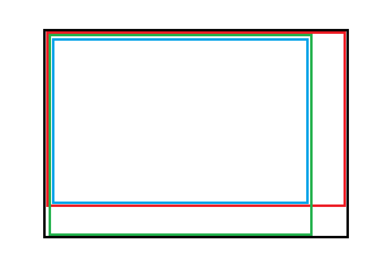
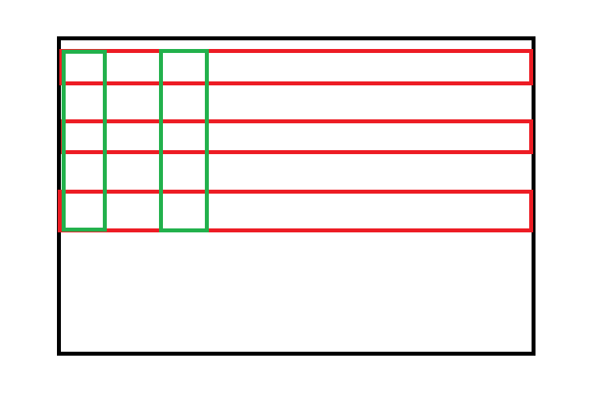
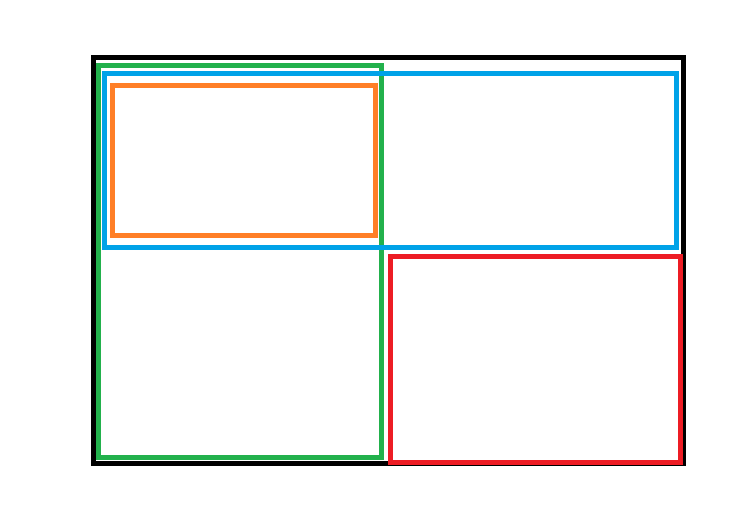

# 程序设计基础 · 参考资料 · 串讲 · 2020秋 · 串讲讲义

## 一、基础部分

​

### 字符转义

​  例题：`C2 - A` 立个flag

### 格式化输入输出

`scanf()` ：**严格按照给定格式读入**

```c
scanf("%d:%d") 
    scanf("%4d:%2d:%2d") == 3 ?
```

`printf()`：**可规定格式输出**

* `%5d` ： 打印五格，不足则**左**边补空格
* `%-5d`：打印五格，不足则**右**边补空格
* `%05d`：打印五格，不足则**左**边补 `0`
* `%.5f`：保留小数点后五位

常用的**八**个数据类型：

* `%c` -> `char`
* `%s` -> `char[]`
* `%d` -> `int` ： $[-2147483648, 2147483647]$
* `%u` -> `unsigned int`
* `%lld` -> `long long`
* `%llu` -> `unsigned long long`
* `%f` -> `float` （**读入、输出**）
* `%lf` -> `double` （**仅限读入**）

### 字符、字符串输入输出

`scanf("%s", str)` ：仅读入一般意义下的可见字符，遇到**空格、换行、回车、制表符**则会跳过。

​  注意 $str$ 作为字符串不加取址符，且谨防**定义陷阱**

`gets(str)`：读行，且仅会**覆盖**读入。

​  注意如果上一行结尾的**换行符**没有处理，则仅会读入空串。**能不使用则尽量不使用**

​   `gets` 下多组数据的读法：

```c
while(gets(str) != NULL){}
```

`ch = getchar()`：按字符读入，等价于 `scanf("%c", &ch)`，通常用来处理行末换行符

### 库函数

#### <string.h>

* `strlen(str)` ：获取字符串 $str$ 的长度（从头至第一个 `'\0'` 前的字符数量）
* `sizeof(x)`：返回元素 $x$ 所占字节数（ $x$ 可包括数组、结构体）
* `strcmp(s1, s2)` ：逐字符比较两字符串，返回 `0`，`1`，`-1` （字典序相等、后者大、后者小）
* `strncmp(s1, s2, n)` ：同上，但仅比较前 $n$ 个字符，注意 $n \le \min(strlen(s1), strlen(s2))$
* `strcpy(s1, s2)` ：将 $s2$ 整个复制到 $s1$ 中，自动补一位结束符 `'\0'`
* `strncpy(s1, s2, n)` ：复制 $s2$ 前 $n$ 个字符至 $s1$ 中，仅做替换，不补结束符，注意 $n$ 要求同上
* `strchr(str, ch)` ：返回 $str$ 串中**第一次**出现字符 $ch$ 的指针（可能返回 `NULL`）
* `strrchr(str, ch)` ：返回 $str$ 串中**最后一次**出现字符 $ch$ 的指针（可能返回 `NULL`）
* `strstr(s1, s2)` ：返回 $s1$ 串中**第一次**出现 $s2$ 串的**首位置**指针（可能返回 `NULL`）
* `strrstr(s1, s2)` ：返回 $s1$ 串中**最后一次**出现 $s2$ 串的**首位置**指针（可能返回 `NULL`）
* `memset(a, 0, sizeof(a))` ：将数组 $a$ 中 $sizeof(a)$ 个元素置为 `0`，通常用于**初始化**

##### 特别要求：不要使用这些常见函数之外的函数，否则可能出现 CE 的结果

#### <math.h>

* `abs(x)` ，`llabs(x)` ，`fabs(x)` 分别计算 `int` ，`long long` ，`double` 型的绝对值
* `log(x)` ，`log10(x)` 分别计算 $x$ 以自然常数 `e` 、`10` 为底的对数
* `exp(x)` 计算自然常数 `e` 的 $x$ 次方
* `pow(a, x)` 计算给定数 $a$ 的 $x$ 次方
* `sqrt(x)` 计算 $x$ 的平方根
* `sin(x)` ，`cos(x)` ，`tan(x)` ，`asin(x)` ，`acos(x)` ，`atan(x)` ，`atan2(y, x)` 以**弧度制**表示
* `floor(x)` ，`celi(x)` 向下、向上取整，返回值为 `double` 型

```c
//四舍五入
double x;
scanf("%lf", x);
printf("%d", (int)(x + 0.5));
```

#### <ctype.h>（不建议使用）

* `isalnum(x)`：检查 $x$ 是否为字母或数字
* `isalpha(x)`：检查 $x$ 是否为字母
* `isdigit(x)`：检查 $x$ 是否为十进制数字
* `islower(x)`：检查 $x$ 是否为**小**写字母
* `isupper(x)`：检查 $x$ 是否为**大**写字母
* `tolower(x)`：将**大**写字母转换为**小**写字母，注意参数 $x$ 必须为**字母**，否则会出错（RE？OE？）
* `toupper(x)`：将**小**写字母转换为**大**写字母，注意参数 $x$ 必须为**字母**，否则会出错（RE？OE？）

```c
if(x >= 'a' && x <= 'z')
```

### #define宏定义：二义性陷阱

```c
#define pow(x) x * x//×
#define pow(x) (x) * (x)//×
#define pow(x) ((x) * (x))//√

output pow(x) -> x * x

output pow(x + 1) -> x + 1 * x + 1 = 2x + 1
    
output pow(x + 1) / pow(x + 1) 
    -> (x + 1) * (x + 1) / (x + 1) * (x + 1)
    -> (x + 1) * (x + 1)
```

### 位运算

* 按位与 `&`

* 按位或 `|`

* 按位取反 `~`

* 按位异或 `^`

* 按位左移、右移 `<<` `>>` ，一边溢出抹除 ， 另一边补 `0`

  #### 运算优先级：括号最高，其余无需全部记住，所以打括号即可

### 重定向

```c
freopen("file_name", "r", stdin);
freopen("file_name", "w", stdout);
```

### 递归

* 定义：如果你不知道什么是递归，请再次阅读递归的定义。

* 必要要素：**终止条件**

​  例：汉诺塔

```c
char s[4] = {' ', 'a', 'b', 'c'};
int cnt = 0;

void hanoi(int n, int a, int b, int c){
    if(n == 1){
        printf("step #%d : move %d from %c to %c\n", ++cnt, x, s[a], s[c]);
        return;
    }
    hanoi(n - 1, a, c, b);
    printf("step #%d : move %d from %c to %c\n", ++cnt, x, s[a], s[c]);
    hanoi(n - 1, b, a, c);
}
```

### 排序

* 冒泡排序：复杂度 $O(n^2)$

```c
for(int i = 1; i < n; i++){
    for(int j = n; j > i; j--){
        if(a[j] < a[j-1]){
            swap(a[j], a[j-1]);
        }
    }
}
```

* 快速排序：复杂度 $O(nlogn)$

  ​ 统一使用 `stdlib.h` 中的 `qsort` 。

  ​ 函数原型及参数：

```c
void qsort(void*base,
           size_t num,
           size_t width,
           int(__cdecl *compare)(const void*,const void*));
```

  ```c
例 ： qsort(a + 1, n, sizeof(a[0]), cmp);
  ```

  重点： `cmp` 函数。

```c
int cmp(const void *a, const void *b){
    return *(int*)a - *(int*)b;
}
```

​  额外要点：（多关键字）结构体排序

```c
typedef struct node{
 int a, b, c;
    char d[233];
}s[233];

int cmp(const void *a, const void *b){
    node x = *(node*)a, y = *(node*)b;
   if(x.a != y.a) return x.a - y.a;
   if(x.b != y.b) return x.b - y.b;
   if(x.c != y.c) return x.c - y.c;//按关键字优先顺序列出
   return strcmp(x.d, y.d);
}
```

### 指针：无选择题，此处不讲，代码中能避免则避免

---

## 二、常见操作汇总

### 时间复杂度概述

说法极其不严谨，仅仅让大家有个概念，为的是大家**不要**在考试时去浪费时间写必然 `TLE` 的程序！！

设题目中输入的数据范围大小为 $n$，那么如果你的程序运算次数 $x$ 和 $f(n)$ 的增长速度同级，那么你的程序时间复杂度就是 $O(f(n))$。

OJ 评测机每秒运算量在 ${10}^8$ 到 ${10}^9$ 数量级，我们可以反推出常见复杂度对应的适合的数据范围：

* $O(\sqrt{n})$， $n \le 10^{14}$。
* $O(n)$， $n \le 10^{7}$。
* $O(n \log n)$， $n \le 10^6$，常见的是 $n = 10^5$，看见这个数字基本就是告诉你， $O(n^2)$ 别想过了！！
* $O(n^2)$， $n \le 5000$。
* $O(n^3)$， $n \le 500$。
* $O(2^n)$， $n \le 24$。
* $O(n!)$， $n \le 11$。

### 多组数据读入

* 对于给定组数 $t$

```c
int t; scanf("%d", &t);
for(int i = 1; i <= t; i++){scanf("...");}
或者
while(t--){scanf("...");}//此写法需保证 t 不参与运算
```

* 对于不定组数

```c
while(scanf("...") != EOF){} 或者 while(~scanf("...")){}
```

### 最大公约数和最小公倍数

设 $\gcd(x,y)$ 是 $x$ 和 $y$ 的最大公约数， $\operatorname{lcm}(x,y)$ 是 $x$ 和 $y$ 的最小公倍数，那么 $x \cdot y = \gcd(x,y) \cdot \operatorname{lcm}(x,y)$ 。

上述公式对多个数不一定成立，例如 $x \cdot y \cdot z = \gcd(x,y,z) \cdot \operatorname{lcm}(x,y,z)$ 不一定成立。

$O(\log n)$ 求 $\gcd(x,y)$：

```c++
int gcd(int x, int y){//精简版
    return y ? gcd(y, x % y) : x;
}

int gcd(int x, int y){
    if(y) return gcd(y, x % y);
    return x;
}
```

* 例题：C1-H。

### 补码

计算机中整数直接使用补码存储，没必要进行复杂的转换操作，直接判断每一位的值即可。

```c++
for(int i = 31;~i;i--) printf("%d", (x & (1 << i)) != 0);
```

* 例题：C3-D。

### 十进制正整数转换到 b 进制

十进制正整数 $x$ 在 $b$ 进制下的唯一表示法：（我们求的数是有限的，所以从某一个 $i$ 开始 $a_i$ 全为 $0$）
$$
x=\sum_{i=0}^{+\infty}a_ib^i\\
a_i = 0, 1, \cdots, b - 1
$$

```c++
int a[10086], cnt;
while(x){
    ++cnt;
    a[cnt] = x % b;
    x /= b;
}
for(int i = cnt;i;i--) printf("%d", a[i]);
```

* 例题：C3-H。

### 数位之和

同上，我们求出了 $a_i$，数位之和即为：
$$
\sum_{i=0}^{+\infty}a_i
$$

* 例题：C2-G。

### 分解质因数

$n$ 至多有一个质因子大于 $\sqrt{n}$。

```c++
int x = n;
for(int i = 2;i * i <= n && x > 1;i++){
    while(x % i == 0){
        x /= i;
        printf("%d ", i);
    }
}
if(x > 1) printf("%d ", x);
```

* 例题：E5-A。

### 求全部因子

除完全平方数外，两两因子成一对，一个大于 $\sqrt{n}$，一个小于 $\sqrt{n}$。完全平方数额外有一个因子 $\sqrt{n}$。

```c++
for(int i = 2;i * i <= n;i++){
    if(n % i) continue;
    printf("%d ", i);
    if(i * i != n) printf("%d ", n / i);
}
```

* 例题：E1-K。

### 记录字母/数字出现次数

开一个数组 a，让 a[i] 表示第 i 个量的出现次数，下面以统计一个小写字母串中每个字母出现的次数为例：

```c++
for(int i = 0;i < len;i++) a[s[i] - 'a']++;
```

例题：E8-F。

### 二维画图题

先把每个位置的字符存到字符数组中，最后再统一输出。

```c++
char s[105][105];
/*
do something
*/
for(int i = 1;i <= n;i++) printf("%s\n", s[i]);
```

* 例题：E6-G。

### 高精度加法

原理是加法竖式：
$$
\begin{array}{ccc}  
&1&2&3&4\\  
+&5&6&7&8\\  
\hline  
&6&9&1&2
\end{array}
$$

```c++
int a[10086], b[10086], c[10086];
int x = 0;//进位标记
for(int i = 1;i <= n + 1;i++){//n为a和b位数的最大值
    c[i] = a[i] + b[i] + x;
    x = c[i] / 10;
    c[i] %= 10;
}
```

### 高精度减法

原理是减法竖式：
$$
\begin{array}{ccc}  
&6&9&1&2\\  
-&5&6&7&8\\  
\hline  
&1&2&3&4
\end{array}
$$

```c++
int a[10086], b[10086], c[10086];
int x = 0;//借位标记
for(int i = 1;i <= n;i++){//n为a和b位数的最大值
    c[i] = a[i] - x - b[i];
    if(c[i] < 0) c[i] += 10, x = 1;
    else x = 0;
}
```

### 高精度乘法

#### 高精度乘低精度

$$
x=\sum_{i=0}^{+\infty}a_i{10}^i\\
a_i = 0, 1, \cdots, 9 \\
bx =\sum_{i=0}^{+\infty}a_ib{10}^i
$$

因此只需将每一位上的数字乘以 $b$ 再进位即可。

```c++
int a[10086], b;
int x = 0;
for(int i = 1;;i++){
    a[i] = a[i] * b + x;
    x = a[i] / 10;
    a[i] %= 10;
    if(i >= n && x == 0) break;//n为a的位数
}
```

#### 高精度乘高精度

我们考虑 $a_n a_{n-1} \cdots a_1a_0$ 和 $b_m b_{m-1} \cdots b_1b_0$ 两个十进制的相乘。

* 乘法竖式：
  $$
  \begin{array}{ccc}  
  &&&&1&2&3&4\\  
  \times &&&&5&6&7&8\\  
  \hline  
  &&&&9&8&7&2\\
  &&&8&6&3&8\\
  &&7&4&0&4\\
  +&6&1&7&0\\
  \hline  
  &6&8&19&15&15&15&2\\
  \hline
  =&7&0&0&6&6&5&2
  \end{array}
  $$
  可以观察到在不进位的情况下结果的每一位，有：
  $$
  c_i = \sum_{j=0}^i a_j b_{i-j}
  $$
  之后再处理进位即可。

* 多项式乘法：

  高精度乘法相当于计算：
  $$
  \left(\sum_{i=0}^{n}a_i {10}^i \right) \times \left(\sum_{i=0}^{m}b_i{10}^i  \right)
  $$
  我们将 $10$ 当作自变量 $x$，相当于计算两个多项式的乘积：
  $$
  \left(\sum_{i=0}^{n}a_i x^i \right) \times \left(\sum_{i=0}^{m}b_ix^i  \right)
  $$
  结果多项式每一项的系数为：
  $$
  c_i = \sum_{j=0}^i a_j b_{i-j}
  $$
  之后再处理进位即可。

```c++
int a[10086], b[10086], c[20086];
for(int i = 0;i <= n + m;i++){
    c[i] = 0;
    for(int j = 0;j <= i;j++){
        c[i] += a[i] * b[i - j];
 }
}
int x = 0;
for(int i = 1;i <= n + m + 1;i++){
    c[i] += x;
    x = c[i] / 10;
    c[i] %= 10;
}
```

### 高精度除法

#### 高精度除低精度

原理是除法竖式：
$$
\begin{array}{ccc}  
&1&1&6\\  \hline  
2 \mid &2&3&3\\  
&2&\\
\hline  
&&3&\\
&&2&\\
\hline  
&&1&3\\
&&1&2\\
\hline  
&&&1\\
\end{array}
$$

```c++
int a[10086], b;
int x = 0;
for(int i = 1;i <= n;i++){
    a[i] += x * 10;
    x = a[i] % b;
    a[i] /= b;
}
//a为商，x为余数
```

#### 高精度除高精度

[可以看这里](https://oi-wiki.org/math/bignum/#_9)

### 模运算性质

$$
(a+b) \bmod p = ((a \bmod p) + (b \bmod p)) \bmod p \\
(a-b) \bmod p = ((a \bmod p) - (b \bmod p)) \bmod p \\
(a \times b) \bmod p = ((a \bmod p) \times  (b \bmod p)) \bmod p
$$

注意减法可能会出现负数，C 语言中负数取模得到的是一个非正整数！ $(a - b) \bmod p$ 可以使用如下写法：

```c++
x = (a % p + p - b % p) % p;
```

乘法可能会爆 `int`，我们可以选择运算过程中转换为 `long long`：

```c++
x = 1ll * (a % p) * (b % p) % p;
```

当然，如果不熟练也可以直接全部用 `long long`，省时省力！！

### 高精度取模

对于一个高精度数字，如果只想知道它对一个数取模的结果，不需要去进行高精度除法，可以利用模运算性质快速得到，比如：
$$
1234 \\
= 10 \times 123 + 4 \\
= 10 \times(10 \times 12 + 3) + 4 \\
= 10 \times(10 \times (1 \times 10 + 2) + 3) + 4 \\
$$

```c++
int a[10086];
int ans = 0;
for(int i = 1;i <= n;i++){//n是a的位数 p是模数
    ans = (1ll * ans * 10 + a[i]) % p;
}
```

### 二分查找

在一个单调递增数组中判断是否存在一个值，这里给出两个稳定的写法模板。

* 找到 $x$ 第一次出现的位置（如果存在）。

  ```c++
  int a[10086];//a是有序的
  int x;//x为要寻找的数
  int l = 1, r = n, mid;//n为数组长度
  while(l < r){
      mid = (l + r >> 1) + 1;
      if(a[i] <= x) l = mid;
      else r = mid - 1;
  }
  if(a[l] == x){//如果存在的话
      // do something
  }
  ```

* 找到 $x$ 最后一次出现的位置（如果存在）。

  ```c++
  int a[10086];//a是有序的
  int x;//x为要寻找的数
  int l = 1, r = n, mid;//n为数组长度
  while(l < r){
      mid = l + r >> 1;
      if(a[i] >= x) r = mid;
      else l = mid + 1;
  }
  if(a[l] == x){//如果存在的话
      // do something
  }
  ```

### 二分求根

以函数仅有一个零点，零点左侧函数值小于 $0$，右侧函数值大于 $0$ 为例。

```c++
double l = -1e9, r = 1e9, mid;
while(r - l > 1e-7){//最终二分出来的精度
    mid = (l + r) / 2;
    if(cal(mid) < 0) l = mid;
    else r = mid;
}
printf("%.5f", l);
```

### 前缀和优化

给出一个序列 $[a_1, a_2, \cdots, a_n]$， $m$ 次询问给出 $l,r$，求：
$$
\sum_{i = l}^r a_i
$$
直接暴力复杂度为 $O(nm)$，可能会超时，可以 $O(n)$ 预处理出前缀和数组：
$$
\textit{sum}_i = \sum_{j=1}^i a_i
$$
对于每次询问只需输出：
$$
\sum_{i = l}^r a_i = \textit{sum}_r - \textit{sum}_{l-1}
$$
总时间复杂度为 $O(n+m)$。

```c++
int n, m, l, r;
int a[10086], sum[10086];
scanf("%d%d", &n, &m);
for(int i = 1;i <= n;i++) scanf("%d", &a[i]);
sum[0] = 0;
for(int i = 1;i <= n;i++) sum[i] = sum[i - 1] + a[i];
while(m--){
    scanf("%d%d", &l, &r);
    printf("%d\n", sum[r] - sum[l - 1]);
}
```

* 例题：E5-H，E6-E。

### 逆序对

逆序对的定义为：
$$
\{(i,j)|i<j \ \operatorname{and} \  p_i>p_j\}
$$
$O(n^2)$ 求逆序对：

```c++
int a[10086], n, ans = 0;
for(int i = 1;i <= n;i++){
    for(int j = 1;j < i;j++){
        ans += a[i] < a[j];
    }
}
```

冒泡排序交换元素个数的次数是一个序列的逆序对个数。

归并排序/树状数组可以 $O(n \log n)$ 求解逆序对数量。

* 例题：C2-J，E3-J。

---

## 三、题目选讲（含去年真题）

### 方阵旋转

* 题意：给定一个 $n \times n$ 的方阵，输出将其逆时针旋转 90° 后的方阵。

  比如：
  $$
  \begin{pmatrix}
  1&2&3\\
  4&5&6\\
  7&8&9\\
  \end{pmatrix}
  \rightarrow
  \begin{pmatrix}
  3&6&9\\
  2&5&8\\
  1&4&7\\
  \end{pmatrix}
  $$
  
* 题解：找规律可以发现第 $i$ 行 $j$ 列的数位置会变为 $n + 1 - j$ 行 $i$ 列。

### 二维前缀和

* 题意：给定一个 $n \times m$ 的矩阵，多次询问某个子矩阵内所有元素的和，要求每次询问 $O(1)$ 时间完成。

* 题解：预处理出一个二维前缀和数组，定义如下：
  $$
  \textit{sum}_{i,j} =\sum_{k=1}^i\sum_{l=1}^ja_{l,k}
  $$
  两种方式预处理：
  
  * 容斥原理：
  
    
  
    ```c++
    for(int i = 1;i <= n;i++){
        for(int j = 1;j <= m;j++){
            sum[i][j] = sum[i - 1][j] + sum[i][j - 1] - sum[i - 1][j - 1] +a[i][j];
        }
    }
    ```
  
  * 先求出每行的前缀和，再求出二位前缀和：
  
    

    ```c++
    for(int i = 1;i <= n;i++){
     for(int j = 1;j <= m;j++){
      sum[i][j] = sum[i][j - 1] + a[i][j];
     }
    }
    for(int i = 1;i <= n;i++){
     for(int j = 1;j <= m;j++){
      sum[i][j] += sum[i - 1][j];
     }
    }
    ```
  
  对于每组询问，使用容斥原理得出答案，设询问的子矩阵左上角为 $(x_1,y_1)$，右下角为 $(x_2,y_2)$，那么答案为：
  
  
  $$
  \textit{sum}_{x_2,y_2}-\textit{sum}_{x_1-1,y_2}-\textit{sum}_{x_2,y_1-1}+\textit{sum}_{x_1-1,y_1-1}
  $$

### 差分

* 题意：一共有 $n$ 个数， $m$ 次操作第 $l_i, l_i+1, \cdots, r_i$ 每个数增加 $1$，问最后每个数是多少，要求在 $O(n+m)$ 时间内完成。

* 题解：设 $n$ 个数为 $a_1,a_2,\cdots, a_n$，定义：
  $$
  b_i =
  \begin{cases}
  a_i, &i=1\\
  a_i-a_{i-1}, &i > 1
  \end{cases}
  $$
  那么每次操作 $b_{l_i}$ 增加了 $1$， $b_{r_i+1}$ 减少了 $1$，可以 $O(1)$ 修改，最后有：
  $$
  a_i = \sum_{j=1}^ia_j
  $$
  求一次 $b$ 数组的前缀和即可。

### 相同的数

* 题意： $n$ 个 `int` 范围内的数，问有没有两个数相同的数。 $(2 \le n \le 10^5)$

* 题解：排序后检查相邻两个数是否相等。

### 递推题

* 题意：Intouchables​ 度过了一个很快乐的假期，他每天都在玩游戏。设游戏有 $A, B, C$ 三种，每种游戏每天玩都会有不同的快乐值，第 $i$ 天分别为 $a_i,b_i,c_i$，Intouchables 每天只玩一种，且**相邻的两天内不会玩同一种游戏**，请你计算 $n$ 天后总共能获得的**最大**快乐值。

* 题解：设 $f_{i,j}$ 是前 $i$ 天在最后一天玩第 $j$ 个游戏 ( $j=1,2,3$ 分别代表 $A,B,C$ 三种游戏) 的情况下快乐值的最大值，有下列递推式：
  $$
  f_{i,1} =
  \begin{cases}
  a_1,&i=1 \\
  a_i+\max(f_{i-1,2},f_{i-1,3}),&i > 1
  \end{cases}\\
  
  f_{i,2} =
  \begin{cases}
  b_1,&i=1 \\
  b_i+\max(f_{i-1,1},f_{i-1,3}),&i > 1
  \end{cases}\\
  
  f_{i,3} =
  \begin{cases}
  c_1,&i=1 \\
  c_i+\max(f_{i-1,1},f_{i-1,2}),&i > 1
  \end{cases}\\
  $$

  ```c++
  for(int i = 1;i <= n;i++){
      if(i == 1){
          f[i][1] = a[1];
          f[i][2] = b[1];
          f[i][3] = c[1];
      }else{
          f[i][1] = a[i] + max(f[i - 1][2], f[i - 1][3]);
          f[i][2] = b[i] + max(f[i - 1][1], f[i - 1][3]);
          f[i][3] = c[i] + max(f[i - 1][1], f[i - 1][2]);
   }
  }
  ```

### 贪心题

* 题意：选择一个 $1$ 到 $26$ 的排列 $[p_1,p_2,\cdots,p_{26}]$，使得 $f(\text{a}) = p_1,f(\text{b}) = p_2, \cdots, f(\text{z}) = p_{26}$。使得对给定的长度为 $n$ 的字符串 $s$，下列值最小：
  $$
  \sum_{i=1}^nf(s_i)
  $$

比如， $[p_1,p_2,\cdots,p_{26}] = [1,2,\cdots, 26]$，那么字符串 $\text{abca}$ 的权值为 $1+2+3+1=7$。
  
* 题解：按照出现次数从小到大排序，分别赋值 $26,25,\cdots, 1$。

#### 如果你想AK

（以去年为例）建议熟练掌握：

* DFS（全排列，找连通块等）
* BFS（01最短路，迷宫等）
* 基础 DP 递推

---

## 四、Debug技巧+易错点总结

### 1.理清逻辑、简化思维后再开始打码

### 2.断点调试 or 中间变量输出

### ※抓取错误码

* **ACCESS_VIOLATION**

  内存非法访问（`scanf` 不加 `&` ，数组越界等） 常见值 ： `322122 5 4 7 7`

* **STACK_OVERFLOW**

  栈空间溢出（定义过大局部变量、无穷递归等） 常见值 ： `322122 5 7 2 5`

* **DIVIDE_BY_ZERO**

  除数为 `0`  常见值 ： `322122 5 6 1 4` ， `322122 5 6 2 0`

### WA：答案错误

* 题意读错？
* 代码逻辑错误？
* 细节不到位？
* `eps` 精度不够？
* 精度溢出？
* 多组数据未初始化？
* `if - else` 语句使用**单等号**？括号是否匹配？句尾是否误加**分号**？
* 自造边界数据测试

### PE：格式错误

* 空格、换行、制表符是否正确输出？
* 输出 $n$ 个以空格隔开的数据时的一般约定

### TLE：超出时间限制

* 程序陷入死循环？
* 未注意时间复杂度？

### MLE：超出内存限制

* 几乎不出现，唯一原因：数组过大（`65536kb` 约为 $1.6 \times 10^7$ 个 `int` 型数据所占内存）

### CE：编译错误

* 检查语法
* 避免**非常用**函数

### RE：运行时错误

* 数组越界访问（注意变量做下标时的数据范围，例：多项式加法）
* 函数（递归）调用过多导致爆栈

* 局部定义数组过大导致爆栈
* 除数、模数为 `0`

### OE：其他错误

* 很少出现，很难给出一致原因

```c
int mian(){...}
```

---

## 五、应试技巧

### 1.模板准备

* 纸质资料
* 做题模板（注意按要求妥善保存以防死机）

### 2.不要死磕一题

* 或许后面有对你来说更简单的题

### 3.注意每题时空限制，关注Hint

### 4.操作别太快，运行窗口别开太多，防止死机

---

## 六、考前复习建议

### 1.错题回顾

### 2.保持手感

每天保证 3 - 5 题
