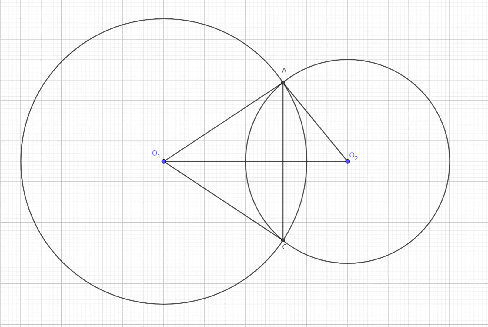

# 程序设计基础 期末练习赛（2024秋）答案

## A 郑重承诺

### 题目

时间限制：1000ms　内存限制：65536KB

#### 题目描述

给出一个正整数 $k$，请你输出如下段落的前 $k$ 行。

```text
No legacy is so rich as honesty.
If one loses honesty, he will lose everything.
I promise I do not cheat in the exam.
```

#### 输入格式

一行一个正整数 $k(1 \le k \le 3)$。

#### 输出格式

输出 $k$ 行，每行一个字符串。

#### 样例输入

```text
3
```

#### 样例输出

```text
No legacy is so rich as honesty.
If one loses honesty, he will lose everything.
I promise I do not cheat in the exam.
```

### 答案

### 题面要点

- 限制：时间 1000ms，内存 65536KB。
- 题意：给定 $k$，输出三行诚信承诺文本的前 $k$ 行。
- 输入：一行一个正整数 $k(1 \le k \le 3)$。
- 输出： $k$ 行，每行一个字符串。

### 简单思路

尽量从 OJ 上复制粘贴而不是 pdf 中。期末考试为纸质试卷。

此外，`A` 题为必做题，并非必对题，本题分值为 10 分而其余题目都是 100 分，如果本题提交多次仍不对，直接跳过即可。

### 示例代码

```c
#include <stdio.h>
int main() {
    int k;
    scanf("%d", &k);
    if ( k >= 1 )
        puts("No legacy is so rich as honesty.");
    if ( k >= 2 )
        puts("If one loses honesty, he will lose everything.");
    if ( k >= 3 )
        puts("I promise I do not cheat in the exam.");
    return 0;
}
```

## B 前驱元素

### 题目

时间限制：1000ms　内存限制：65536KB

#### 题目描述

$n$ 个互不相同的正整数 $A_1, A_2, \cdots, A_n$ 排成一圈， $A_k(k \ge 2)$ 的前驱元素是 $A_{k-1}$， $A_1$ 的前驱元素是 $A_n$。

给出一个数 $x$，请你求出它的前驱元素。如果 $x$ 不在上面给出的 $n$ 个正整数中，输出 $-1$。

#### 输入格式

第一行，两个由单空格分隔的正整数 $n, x(1 \le n \le 1000, 1 \le x \le 10^5)$；

第二行， $n$ 个由单空格分隔的正整数 $A_1, A_2, \cdots, A_n$，每个数不超过 $10^5$。

#### 输出格式

一行一个整数，表示 $x$ 的前驱元素，或 $-1$ 表示 $x$ 不存在。

#### 样例输入 1

```text
4 6
2 5 6 1
```

#### 样例输出 1

```text
5
```

#### 样例输入 2

```text
4 6
2 3 4 5
```

#### 样例输出 2

```text
-1
```

### 答案

### 题面要点

- 限制：时间 1000ms，内存 65536KB。
- 题意： $n$ 个互不相同的正整数排成一圈，求给定 $x$ 的前驱元素； $x$ 不在其中时输出 $-1$。
- 输入：第一行 $n, x(1 \le n \le 1000, 1 \le x \le 10^5)$；第二行 $n$ 个正整数，每个不超过 $10^5$。
- 输出：一行一个整数。

### 简单思路

遍历数组判断 $x$ 是否在数组中即可。

### 示例代码

```c
#include <stdio.h>
int A[1010];
int main() {
    int n, x;
    scanf("%d%d", &n, &x);
    for ( int i = 1; i <= n; i++ )
        scanf("%d", &A[i]);
    int ans = -1;
    A[0] = A[n];
    for ( int i = 1; i <= n; i++ )
        if ( A[i] == x ) {
            ans = A[i - 1];
            break;
        }
    printf("%d", ans);
    return 0;
}
```

## C 相关系数

### 题目

时间限制：1000ms　内存限制：65536KB

#### 题目描述

给出两组样本 $x_1, x_2, \cdots, x_n$ 和 $y_1, y_2, \cdots, y_n$，请你计算两组样本间的 $Pearson$ 相关系数 $r_{xy}$。

相关系数的计算公式如下：

$$
r_{xy} = \frac{\sum_{i=1}^{n}(x_i - \bar{x})(y_i - \bar{y})}{\sqrt{\sum_{i=1}^{n}(x_i - \bar{x})^2}\sqrt{\sum_{i=1}^{n}(y_i - \bar{y})^2}}
$$

其中 $\bar{x}$ 和 $\bar{y}$ 分别为样本 $x$ 和样本 $y$ 的平均值。

#### 输入格式

第一行，一个正整数 $n(2 \le n \le 1000)$，表示每组样本中的样品个数；

第二行， $n$ 个单空格分隔的实数，表示样本 $x$。保证每个数绝对值不超过 100，且保留两位小数；

第三行， $n$ 个单空格分隔的实数，表示样本 $y$。保证每个数绝对值不超过 100，且保留两位小数。

数据保证样本 $x$、样本 $y$ 分别不全部相同。

#### 输出格式

一行一个实数，表示两组样本间的相关系数，保留两位小数。

#### 样例输入

```text
4
-8.63 23.42 34.56 77.11
-0.99 26.37 63.58 43.21
```

#### 样例输出

```text
0.68
```

### 答案

### 题面要点

- 限制：时间 1000ms，内存 65536KB。
- 题意：给定两组各 $n$ 个样本，按 Pearson 相关系数公式计算 $r_{xy}$。
- 输入：第一行 $n(2 \le n \le 1000)$；第二、三行各 $n$ 个保留两位小数的实数，绝对值不超过 100，且两组样本分别不全部相同。
- 输出：一行一个实数，保留两位小数。

### 简单思路

按题意计算即可。

### 示例代码

```c
#include <stdio.h>
#include <math.h>
double x[1010], y[1010];
int main() {
    int n;
    scanf("%d", &n);
    for ( int i = 1; i <= n; i++ )
        scanf("%lf", &x[i]);
    for ( int i = 1; i <= n; i++ )
        scanf("%lf", &y[i]);

    double x_bar = 0, y_bar = 0;
    for ( int i = 1; i <= n; i++ )
        x_bar += x[i], y_bar += y[i];
    x_bar /= n, y_bar /= n;

    double cov = 0;
    for ( int i = 1; i <= n; i++ )
        cov += (x[i] - x_bar) * (y[i] - y_bar);

    double x_var = 0, y_var = 0;
    for ( int i = 1; i <= n; i++ ) {
        x_var += (x[i] - x_bar) * (x[i] - x_bar);
        y_var += (y[i] - y_bar) * (y[i] - y_bar);
    }

    printf("%.2lf", cov / sqrt(x_var * y_var));
    return 0;
}
```

## D 箭头箭头

### 题目

时间限制：1000ms　内存限制：65536KB

#### 题目描述

称一个仅由 `<`、`>`、`=` 组成的字符串为箭头，当且仅当它满足以下条件：

- 字符串长度至少为 2；
- 除首尾字符外，其余字符全部为 `=`；
- 首字符不能是 `>`，尾字符不能是 `<`；
- 首尾字符不能同时为 `=`。

根据箭头两端的字符，可以将箭头分为以下三种：

- 左箭头：首字符为 `<` 且尾字符为 `=`，如 `<===`；
- 右箭头：首字符为 `=` 且尾字符为 `>`，如 `===>`；
- 双向箭头：首字符为 `<` 且尾字符为 `>`，如 `<===>`。

现在给你若干个字符串，请你分别判断每个字符串是不是箭头。

#### 输入格式

本题为不定组输入，不超过 1000 组。

每组输入一行一个仅由 `<`、`>`、`=` 组成的字符串，长度不超过 1000 且至少由两个字符组成。

#### 输出格式

对于每组输入，输出一行。

- 如果输入的是左箭头，输出 `Left Arrow`；
- 如果输入的是右箭头，输出 `Right Arrow`；
- 如果输入的是双向箭头，输出 `Bidirectional Arrow`；
- 如果输入的字符串不是箭头，输出 `Not an Arrow`。

#### 样例输入

```text
<======>
>=<
<======
============>
```

#### 样例输出

```text
Bidirectional Arrow
Not an Arrow
Left Arrow
Right Arrow
```

### 答案

### 题面要点

- 限制：时间 1000ms，内存 65536KB。
- 题意：判断每个仅由 `<`、`>`、`=` 组成的字符串是否为箭头，并区分左箭头、右箭头与双向箭头。
- 输入：不定组输入，不超过 1000 组；每组一行一个长度不超过 1000 且至少由两个字符组成的字符串。
- 输出：每组一行 `Left Arrow` / `Right Arrow` / `Bidirectional Arrow` / `Not an Arrow`。

### 简单思路

一个箭头除了两侧的字符全部都是 `=`，所以如果中间存在不是 `=` 的字符，那就一定不是箭头。

最左边的字符不能是 `>`，最右边的字符不能是 `<`，此外两侧至少有一个箭头。

依照上述判断标准，可以判断是否是箭头，以及是哪种箭头。

### 示例代码

```c
#include <stdio.h>
#include <string.h>
char s[1010];
int main() {
    while ( scanf("%s", s) != EOF ) {
        int l = strlen(s);
        int isarr = s[0] != '>' && s[l - 1] != '<';
        int isleft = s[0] == '<', isright = s[l - 1] == '>';
        for ( int i = 1; i < l - 1; i++ )
            if ( s[i] != '=' ) {
                isarr = 0;
                break;
            }
        if ( isarr == 0 || isleft == 0 && isright == 0 )
            puts("Not an Arrow");
        else if ( isleft == 1 && isright == 0 )
            puts("Left Arrow");
        else if ( isleft == 0 && isright == 1 )
            puts("Right Arrow");
        else
            puts("Bidirectional Arrow");
    }
    return 0;
}
```

## E 位权排序

### 题目

时间限制：2000ms　内存限制：65536KB

#### 题目描述

对于一个 32 位整型变量 $x$，设它的二进制补码为 $(w_{31}w_{30}\cdots w_1w_0)_2$，定义它的位权和为 $\sum_{i=0}^{31} w_i(i+1)$。

给出 $n$ 个 32 位整型变量，请你将它们按位权和从大到小排序，位权和相同则按数值从大到小排序。

#### 输入格式

第一行，一个正整数 $n(1 \le n \le 5 \times 10^5)$；

第二行， $n$ 个由单空格分隔的整数，保证在 `int` 范围内。

#### 输出格式

一行 $n$ 个整数，表示排序后的结果。

#### 样例输入

```text
8
57 128 -1 15 0 74 67 88
```

#### 样例输出

```text
-1 88 57 74 67 15 128 0
```

### 答案

### 题面要点

- 限制：时间 2000ms，内存 65536KB。
- 题意：把 $n$ 个 32 位整型变量按位权和 $\sum_{i=0}^{31} w_i(i+1)$ 从大到小排序，位权和相同则按数值从大到小排序。
- 输入：第一行 $n(1 \le n \le 5 \times 10^5)$；第二行 $n$ 个 `int` 范围内的整数。
- 输出：一行 $n$ 个整数。

### 简单思路

注意到数据范围较大，因此使用 `qsort` 进行排序。设计比较函数时，如果每次都计算位权和，有可能会超时，所以我们预先计算每一个数的位权和，保存在数组中。

这样我们在比较函数中，先比较两个数的位权和，位权和相等时再比较大小即可。位权和的最大值是 $\sum_{i=0}^{31}(i+1) = 528$，可以做差，不会发生溢出；而两个数原先是 `int` 范围内，如果直接返回它们的差，可能会发生溢出，因此必须要比较大小判断。

### 示例代码

```c
#include <stdio.h>
#include <stdlib.h>
int A[500010][2]; // A[i][0] 为原数，A[i][1] 为位权和
int cmp(const void *, const void *);
int main() {
    int n;
    scanf("%d", &n);
    for ( int i = 0; i < n; i++ ) {
        scanf("%d", &A[i][0]);
        for ( int j = 0; j < 32; j++ ) // 计算位权和
            A[i][1] += ((A[i][0] >> j) & 1) * (j + 1);
    }
    qsort(A, n, sizeof(A[0]), cmp);
    for ( int i = 0; i < n; i++ )
        printf("%d ", A[i][0]);
    return 0;
}
// 从大到小排序
int cmp(const void *e1, const void *e2) {
    int *a = (int*)e1, *b = (int*)e2;
    if ( a[1] > b[1] )
        return -1;
    else if ( a[1] < b[1] )
        return 1;
    if ( a[0] > b[0] )
        return -1;
    else if ( a[0] < b[0] )
        return 1;
    return 0;
}
```

## F 单表密码

### 题目

时间限制：1000ms　内存限制：65536KB

#### 题目描述

给定一段文本，其中可能包含大小写英文字母、空格、换行。请你按如下规则操作：

1. 统计每个字母的出现次数，不区分大小写，保证每个出现过的字母出现的次数各不相同。
2. 将每个字母按出现次数从大到小排序。
3. 对于每个字母，如果它出现次数排在第 $k$ 名，则在文本中将它替换为 `ETAOINSHRDLCUMWFGYPBVKJXQZ` 中的第 $k$ 个字母。替换时保持大小写不变，即文本中原本大写的字母也要被替换为大写，原本小写的字母也要被替换为小写。
4. 空格和换行保持不变，随后请输出替换后的文本。

#### 输入格式

若干行，每行仅由大小写英文字母和空格组成。

加上换行符，保证总长度不超过 $10^5$。

#### 输出格式

若干行，输出被替换后的文本，格式同输入。

#### 样例输入

```text
Ehis is ap apple
I lipe apples
Apples ale paap fol oie healeh
```

#### 样例输出

```text
Tsin in ae aeeot
I oiet aeeotn
Aeeotn aot eaae rho hit staots
```

#### 样例解释

将每个出现过的字符按出现次数从大到小排序后，按照规则替换。下表中列出了排序后各字母出现次数，与替换后的字母。

| 原字母 | 出现次数 | 替换后的字母 |
| --- | --- | --- |
| P | 10 | E |
| E | 9 | T |
| A | 8 | A |
| L | 7 | O |
| I | 5 | I |
| S | 4 | N |
| H | 3 | S |
| O | 2 | H |
| F | 1 | R |

### 答案

### 题面要点

- 限制：时间 1000ms，内存 65536KB。
- 题意：把文本中每个字母按出现次数从大到小排定名次，替换为 `ETAOINSHRDLCUMWFGYPBVKJXQZ` 中对应名次的字母，大小写、空格与换行保持不变。
- 输入：若干行，每行仅由大小写英文字母和空格组成；加上换行符总长度不超过 $10^5$。
- 输出：若干行，替换后的文本，格式同输入。

### 简单思路

首先我们需要存储全部文本。我们可以将文本视作一个长字符串，其中可能存在大小写字母、空格和换行符。由于全部输入仅有文本，因此我们可以不断尝试读入字符，将整个文本存在一个字符串里。

接着对每个字母的出现频次进行统计，循环枚举每一个字符，如果是字母就给对应字母出现次数 +1。

然后对所有字母的出现次数排序。由于字母只有 26 个，因此我们只需要枚举：对于每种字母，出现次数比它多的字母的种数。

最后对文本中的所有字母映射到新的字母，非字母字符原样输出即可。

### 示例代码

```c
#include <stdio.h>
#include <ctype.h>
char s[100010];
const char *T = "ETAOINSHRDLCUMWFGYPBVKJXQZ";
int gt[26], cnt[26];
int main() {
    int len = 0;
    while ( (s[len] = getchar()) != EOF )
        len++;
    s[len] = '\0';
    for ( int i = 0; i < len; i++ )
        if ( isalpha(s[i]) )
            cnt[tolower(s[i]) - 'a']++;
    for ( int i = 0; i < 26; i++ )
        for ( int j = 0; j < 26; j++ )
            if ( cnt[j] > cnt[i] )
                gt[i]++;
    for ( int i = 0; i < len; i++ )
        putchar(
            isalpha(s[i]) ?
            (T[gt[tolower(s[i]) - 'a']] | (s[i] & 32)) :
            s[i]
        );
    return 0;
}
```

## G 最小变换

### 题目

时间限制：1000ms　内存限制：65536KB

#### 题目描述

给出一个 $H$ 行 $W$ 列的字符矩阵，每个位置的字符可能为 `o`、`.`、`x`。请在其中找到一个边长为 $k$ 的正方形子矩阵，要求其中不能包含 `x`，且 `.` 的数量尽可能少。请输出最少的 `.` 的数量，如果不存在则输出 $-1$。

#### 输入格式

本题有多组输入。

第一行，一个正整数 $t(1 \le t \le 10)$，表示数据组数；

对于每组数据：

- 第一行，三个单空格分隔的正整数 $H, W, K(1 \le K \le H, W \le 80, K \le 50)$；
- 接下来 $H$ 行，每行 $W$ 个字符，每行中只包含 `o`、`.`、`x`。

#### 输出格式

共 $t$ 行，每组数据一行一个整数，表示不包含 `x` 的正方形子矩阵中 `.` 的最少数量，如果不存在则输出 $-1$。

#### 样例输入

```text
2
5 4 3
oo.o
o.xo
ooox
.o.x
o.oo
3 3 2
o.o
.x.
o.o
```

#### 样例输出

```text
3
-1
```

### 答案

### 题面要点

- 限制：时间 1000ms，内存 65536KB。
- 题意：在 $H$ 行 $W$ 列的 `o` / `.` / `x` 矩阵中，找一个边长为 $K$、不含 `x` 且 `.` 数量最少的正方形子矩阵。
- 输入：第一行 $t(1 \le t \le 10)$；每组第一行 $H, W, K(1 \le K \le H, W \le 80, K \le 50)$，接下来 $H$ 行每行 $W$ 个字符。
- 输出：共 $t$ 行，每组一行一个整数，不存在则输出 $-1$。

### 简单思路

题目要求找到 `.` 最少的、仅包含 `o` 和 `.` 的、边长为 $k$ 的正方形。

考虑暴力方法：枚举每个点作为正方形左上角，判断该正方形是否不包含 `x`，如果是则更新最小值，否则不更新。该方法的时间复杂度是 $O(tHWK^2)$，对于题目的数据范围是可以通过的，不需要进行任何优化。

### 示例代码

```c
#include <stdio.h>
#define maxn 10086
// 注意我们后面通过给 cnt 加上 maxn 的值来认为 cnt 大于 ans 从而不更新
// 我们要使初值足够大，但又不能让 cnt 溢出，因此 maxn 的选择比较重要
// 要求 maxn >= K ^ 2，但 maxn * K ^ 2 不能溢出。本题 K ^ 2 <= 2500
// 因此 10086 是个在本题条件范围内很好的“大数”
char r[100][100];
int main() {
    int t;
    scanf("%d", &t);
    while ( t-- ) {
        int H, W, K;
        scanf("%d%d%d", &H, &W, &K);
        for ( int i = 0; i < H; i++ )
            scanf("%s", r[i]);
        int ans = maxn;
        for ( int i = 0; i <= H - K; i++ )
            for ( int j = 0; j <= W - K; j++ ) {
                int cnt = 0;
                for ( int ii = 0; ii < K; ii++ )
                    for ( int jj = 0; jj < K; jj++ )
                        if ( r[i + ii][j + jj] == 'x' )
                            cnt += maxn;
                        else if ( r[i + ii][j + jj] == '.' )
                            cnt++;
                if ( cnt < ans )
                    ans = cnt;
            }
        printf("%d\n", ans == maxn ? -1 : ans);
    }
    return 0;
}
```

## H 括号展开

### 题目

时间限制：1000ms　内存限制：65536KB

#### 题目描述

给出一个由小写英文字母、左右小括号、数字组成的字符串。这个字符串可以按如下规则展开：左右小括号 `(` `)` 总是成对匹配的，一对匹配的小括号之间的内容需要被重复，重复的次数为 `(` 之前的数。并且保证每个数后面都紧跟一对匹配的小括号。括号可以嵌套，需要不断展开，直到整段字符串只有小写字母为止。例如：

- `3(ab)` 需要展开为 `ababab`；
- `2(a2(b))` 需要展开为 `abbabb`；
- `2(ab)d3(c)` 需要展开为 `ababdccc`。

保证整个字符串展开后的长度不超过 $10^4$，任意一对小括号之间至少有一个英文字母。请你输出展开后的字符串。

#### 输入格式

本题有多组输入。

第一行，一个正整数 $t(1 \le t \le 10)$，表示数据组数；

对于每组数据，一行一个字符串，长度不超过 $10^3$，仅由小写英、数字、左右小括号组成。

#### 输出格式

共 $t$ 行，每组数据一行一个字符串，表示展开后的字符串。

#### 样例输入

```text
2
a2(c)oding
ilove3(bu2(a))
```

#### 样例输出

```text
accoding
ilovebuaabuaabuaa
```

### 答案

### 题面要点

- 限制：时间 1000ms，内存 65536KB。
- 题意：把 `数(串)` 形式、括号可嵌套的压缩字符串展开为只含小写字母的字符串。
- 输入：第一行 $t(1 \le t \le 10)$；每组一行长度不超过 $10^3$ 的字符串，展开后长度不超过 $10^4$。
- 输出：共 $t$ 行，每组一行展开后的字符串。

### 简单思路

可以通过递归展开字符串，每次遇到括号，就递归展开新的括号内容，随后重复前面数字次递归展开的内容，继续处理即可。

由于我们要传递每一个展开的内容，因此使用 `malloc` 动态地分配内存即可。

### 示例代码

```c
#include <stdio.h>
#include <ctype.h>
#include <string.h>
#include <stdlib.h>

char r[1010];

char *expand(char *s, char *t);

int main() {
    int n;
    scanf("%d", &n);
    while ( n-- ) {
        scanf("%s", r);
        char *p = expand(r, r + strlen(r) - 1);
        printf("%s\n", p);
        free(p);
    }
    return 0;
}

char *expand(char *s, char *t) {
    char *res = (char *)malloc(sizeof(char) * 10086);
    memset(res, 0, 10086); // 清零，注意不要写成 sizeof(res)
    int l = 0;
    for ( ; s <= t; s++ ) {
        if ( isalpha(*s) ) // 字母直接拼进去
            res[l++] = *s;
        else {
            int times = 0; // 数字
            for ( ; *s != '('; s++ )
                times = times * 10 + *s - '0';
            char *right = s + 1; // 此时 *s 是左括号，从下一个字符开始计数
            for ( int cnt = 1; cnt > 0; right++ )
                if ( *right == '(' )
                    cnt++;
                else if ( *right == ')' )
                    cnt--;
            // 循环结束时，cnt = 0，right 指向对应右括号的下一个字符
            char *zz = expand(s + 1, right - 2); // 递归展开括号内的部分
            int len = strlen(zz);
            for ( int i = 0; i < times; i++, l += len )
                strcat(res + l, zz); // 拼接 times 次
            free(zz); // 每一次调用 expand 都会分配空间，避免内存泄漏
            s = right - 1; // 循环末尾有个 s++，所以让 s 指向右括号即可
        }
    }
    return res;
}
```

## I 重叠的圆

### 题目

时间限制：1000ms　内存限制：65536KB

#### 题目描述

给出平面上 $n$ 个圆，求出它们覆盖的总面积。保证任意三个圆的交集为空。

#### 输入格式

本题为多组输入。

第一行，一个正整数 $t(1 \le t \le 10)$，表示数据组数；

对于每组数据：

- 第一行，一个正整数 $n(1 \le n \le 15)$，表示圆的个数；
- 接下来 $n$ 行，每行三个整数 $x, y, r(-1000 \le x, y \le 1000, 1 \le r \le 1000)$，表示圆的圆心坐标和半径。

#### 输出格式

共 $t$ 行，每组数据一行一个实数，表示覆盖的总面积，保留四位小数。

#### 样例输入

```text
1
2
0 0 3
2 2 1
```

#### 样例输出

```text
29.6150
```

### 答案

### 题面要点

- 限制：时间 1000ms，内存 65536KB。
- 题意：求平面上 $n$ 个圆覆盖的总面积，保证任意三个圆的交集为空。
- 输入：第一行 $t(1 \le t \le 10)$；每组第一行 $n(1 \le n \le 15)$，接下来 $n$ 行每行三个整数 $x, y, r(-1000 \le x, y \le 1000, 1 \le r \le 1000)$。
- 输出：共 $t$ 行，每组一行一个实数，保留四位小数。

### 简单思路

每当输入一个圆的时候，计算它到之前每个圆的重叠面积，最后对结果的贡献就是圆的面积减去所有重叠的面积。

两圆重叠的面积不为 0，当且仅当两圆的圆心距离小于两圆的半径之和；其中大圆不完全包含小圆，当且仅当两圆的圆心距离大于两圆半径之差的绝对值。

当完全包含时，小圆对结果没有任何贡献，因此不用再考虑；否则就要算出重叠部分的面积。



如上图所示， $AC$ 为根轴，将重叠区域分为两个部分。

右半部分的面积通过扇形减去三角形的面积得到。设两圆圆心距离为 $d$。由余弦定理， $\theta_1 = \angle AO_1O_2 = \arccos \frac{R_1^2 + d^2 - R_2^2}{2 \times R_1 \times d}$，所以扇形的面积为 $2 \times \frac{\theta_1}{2} \times R_1^2 = \theta_1 \times R_1^2$，三角形的面积为 $\frac{1}{2} \times R_1^2 \times \sin(2\theta_1)$。注意到三角形的面积有方向，而当 $O_1$ 落在 $O_2$ 同一侧时，正好有重叠区域的右半部分是扇形面积加三角形面积，结论仍然成立。

因而右半部分面积为 $R_1^2 \times (\theta_1 - \frac{\sin(2\theta_1)}{2})$。

重叠区域左半部分的面积可以用类似的方法求。因而重叠区域总面积为

$$
R_1^2 \times \left( \theta_1 - \frac{\sin(2\theta_1)}{2} \right) + R_2^2 \times \left( \theta_2 - \frac{\sin(2\theta_2)}{2} \right)
$$

循环考虑每两个圆的重叠区域面积即可。

### 示例代码

```c
#include <stdio.h>
#include <math.h>
int x[20], y[20], r[20];
int main() {
    int T;
    scanf("%d", &T);
    while ( T-- ) {
        double ans = 0;
        int n;
        scanf("%d", &n);
        for ( int i = 1; i <= n; i++ ) {
            scanf("%d%d%d", &x[i], &y[i], &r[i]);
            ans += acos(-1) * r[i] * r[i]; // 先加上圆面积
            for ( int j = 1; j < i; j++ ) {
                double d = sqrt((x[i] - x[j]) * (x[i] - x[j]) + (y[i] - y[j]) * (y[i] - y[j]));

                // 判断是否有圆完全覆盖
                if ( d <= r[i] - r[j] ) {
                    ans -= acos(-1) * r[j] * r[j];
                    continue; // i 覆盖了 j，i 可能还会和其它圆重叠
                }
                else if ( d <= r[j] - r[i] ) {
                    ans -= acos(-1) * r[i] * r[i];
                    break; // j 覆盖了 i，i 不可能和其它圆重叠
                }

                // 判断两圆是否不重叠
                if ( d >= r[i] + r[j] )
                    continue;

                double theta1 = acos((r[i] * r[i] + d * d - r[j] * r[j]) / (2 * r[i] * d)), theta2 = acos((r[j] * r[j] + d * d - r[i] * r[i]) / (2 * r[j] * d));
                ans -= r[i] * r[i] * (theta1 - sin(2 * theta1) / 2) + r[j] * r[j] * (theta2 - sin(2 * theta2) / 2);
            }
        }
        printf("%.4lf\n", ans);
    }
    return 0;
}
```

## J 最小功率

### 题目

时间限制：2000ms　内存限制：65536KB

#### 题目描述

考场中有 $n$ 台电脑，第 $i$ 台电脑的初始电量为 $A_i$，每分钟消耗 $B_i$ 电量。

考试持续 $k$ 分钟，每分钟开始时，你可以选择一台电脑，为其充电，使其电量增加 $x$，随后所有电脑同时消耗电量。

若某台电脑在考试结束前电量小于 `0`，则考试失败；但若在考试第 $k$ 分钟结束后电量才小于 `0`，则认为考试顺利完成。

为保障考试顺利进行，请你求出最小的非负整数 $x$，使得存在一种充电方案让所有人考试顺利完成。如果不存在这样的 $x$，输出 $-1$。

#### 输入格式

本题为不定组输入，不超过 5 组数据。

对于每组数据：

- 第一行，两个正整数 $n, k(1 \le n, k \le 2 \times 10^5)$；
- 第二行， $n$ 个自然数 $A_i(0 \le A_i \le 10^9)$，表示每台电脑的初始电量；
- 第三行， $n$ 个正整数 $B_i(1 \le B_i \le 10^7)$，表示每台电脑每分钟耗电量。

#### 输出格式

对于每组数据，输出一行一个整数，表示最小的充电功率 $x$，或 $-1$。

#### 样例输入

```text
3 5
3 4 5
2 2 3
4 7
2 3 8 4
3 7 2 3
2 8
10 80
1 1
```

#### 样例输出

```text
5
-1
0
```

#### 样例解释

对于第一组输入，考虑如下充电方案：

| 分钟 | 电脑 1 结束时电量 | 电脑 2 结束时电量 | 电脑 3 结束时电量 |
| --- | --- | --- | --- |
| 1 | 3 + 5 - 2 = 6 | 4 - 2 = 2 | 5 - 3 = 2 |
| 2 | 6 - 2 = 4 | 2 - 2 = 0 | 2 + 5 - 3 = 4 |
| 3 | 4 - 2 = 2 | 0 + 5 - 2 = 3 | 4 - 3 = 1 |
| 4 | 2 - 2 = 0 | 3 - 2 = 1 | 1 + 5 - 3 = 3 |
| 5 | 0 + 5 - 2 = 3 | 1 - 2 = -1 | 3 - 3 = 0 |

第五分钟考试结束，即使电量为负数也认为考试顺利完成，因此该方案可行。可以证明当 $x \le 4$ 时没有可行的充电方案。

对于第二组输入，前两台电脑在第一分钟后电量变为负数，由于只能选择一台电脑充电，因此总会有一台电脑无法完成考试。

对于第三组输入，所有电脑不充电也可以完成考试。

### 答案

### 题面要点

- 限制：时间 2000ms，内存 65536KB。
- 题意：每分钟开始时可以给一台电脑充电使其电量增加 $x$，求让所有电脑顺利完成 $k$ 分钟考试的最小非负整数 $x$，不存在则输出 $-1$。
- 输入：不定组输入，不超过 5 组；每组第一行 $n, k(1 \le n, k \le 2 \times 10^5)$，第二行 $n$ 个自然数 $A_i(0 \le A_i \le 10^9)$，第三行 $n$ 个正整数 $B_i(1 \le B_i \le 10^7)$。
- 输出：每组一行一个整数。

### 简单思路

直接计算最小功率是很难的，但验证一个功率是否满足要求是简单的——统计每一分钟电量不足的电脑数，如果超过了当前的分钟数，那就无法满足要求，否则我们可以提前充电满足要求。

因而我们可以通过二分来不断缩小判断区间，进而找到最小值。

注意到最大总需电量 $nkb = 4 \times 10^{17}$，也可能不需要充电，因此我们初始的区间范围设置为 $[0, 4 \times 10^{17}]$ 即可。

### 示例代码

```c
#include <stdio.h>
#include <string.h>
long long A[200010], B[200010], cnt[200010];
int n, k;
int check(long long x);
int main() {
    while ( scanf("%d%d", &n, &k) != EOF ) {
        for ( int i = 1; i <= n; i++ )
            scanf("%lld", A + i);
        for ( int i = 1; i <= n; i++ )
            scanf("%lld", B + i);
        long long l = 0, r = 400000000000000000LL;
        while ( l < r ) {
            long long mid = (l + r) / 2;
            if ( check(mid) )
                r = mid;
            else
                l = mid + 1;
        }
        if ( check(l) )
            printf("%lld\n", l);
        else
            printf("-1\n");
    }
    return 0;
}
int check(long long x) {
    memset(cnt, 0, sizeof(cnt));
    for ( int i = 1; i <= n; i++ ) {
        long long tmp = A[i], nextneedtime = A[i] / B[i] + 1;
        if ( nextneedtime < k && x == 0 )
            return 0;
        // 如果考试第 k 分钟结束，就算结算电量是负数，也认为顺利完成
        while ( nextneedtime < k ) {
            cnt[nextneedtime]++;
            tmp += x;
            nextneedtime = tmp / B[i] + 1;
        }
    }
    long long sum = 0;
    for ( int i = 1; i < k; i++ ) {
        sum += cnt[i];
        if ( sum > i ) // 前 i 分钟需要充电大于 i 次
            return 0;
    }
    return 1;
}
```

## K 小球排列

### 题目

时间限制：1000ms　内存限制：65536KB

#### 题目描述

现有一由不超过 $k$ 种小球的排列，长度为 $n$，自然编号为 $1, 2, \cdots, n$。规定第 $i$ 个小球的价值 $P_i = i - L_i$，其中 $L_i$ 是前一个同种小球的编号（如不存在前一个同种小球，则 $L_i = 0$）。定义该序列的价值为全部小球价值之和。

我们只知道部分位置小球的种类，以及这个序列的价值 $m$，请计算该序列的排列有多少种可能。由于这个数可能太大，你只需要输出其模 998244353 的余数。

#### 输入格式

第一行，两个正整数 $m, k$，含义如上所示，满足 $1 \le k \le 10, 1 \le m \le k \times n - C_k^2$；

第二行，由数字 $0, \cdots, k-1$ 和下划线组成的字符串（长度 $n$ 满足 $1 \le n \le 800$），不同数字代表不同种类小球，下划线表示这个位置的小球种类未知。

题目保证，如果字符串中共出现了 $k'$ 种数字且 $k' \ne 0$，那么出现的数字一定是 $0, 1, \cdots, k' - 1$。

#### 输出格式

一个整数，表示排列总方案数模 998244353 的余数。

#### 输入样例

```text
13 6
01__1
```

#### 输出样例

```text
12
```

#### 样例解释

两个下划线表示两个没有确定小球种类的位置。

- 如果两个位置小球种类相同：
  - 都是 `0`：总价值为 1 + 2 + 2 + 1 + 3 = 9；
  - 都是 `1`：总价值为 1 + 2 + 1 + 1 + 1 = 6；
  - 都是其他数字：总价值为 1 + 2 + 3 + 1 + 3 = 10；
- 两个位置小球种类不同：
  - 第一个位置是 `0`，第二个位置是 `1`：总价值为 1 + 2 + 2 + 2 + 1 = 8；
  - 第一个位置是 `1`，第二个位置是 `0`：总价值为 1 + 2 + 1 + 3 + 2 = 9；
  - 第一个位置是其他数字，第二个位置是 `0`：总价值为 1 + 2 + 3 + 3 + 3 = 12；
  - 第一个位置是其他数字，第二个位置是 `1`：总价值为 1 + 2 + 3 + 2 + 1 = 9；
  - 第一个位置是 `0`，第二个位置是其他数字：总价值为 1 + 2 + 2 + 4 + 3 = 12；
  - 第一个位置是 `1`，第二个位置是其他数字：总价值为 1 + 2 + 1 + 4 + 2 = 10；
  - 两个位置是不同的其他数字：总价值为 1 + 2 + 3 + 4 + 3 = 13；

从而只有两个位置是不同的非 `0`, `1` 数字时，总价值才为 13。第一个位置有 4 种可能，第二个位置有 3 种可能，共有 12 种可能。

### 答案

### 题面要点

- 限制：时间 1000ms，内存 65536KB。
- 题意：已知部分位置的小球种类与序列价值 $m$，求该排列的方案数模 998244353 的余数。
- 输入：第一行 $m, k$，满足 $1 \le k \le 10, 1 \le m \le k \times n - C_k^2$；第二行由数字 $0, \cdots, k-1$ 和下划线组成、长度 $n$ 满足 $1 \le n \le 800$ 的字符串。
- 输出：一个整数。

### 简单思路

易得一种小球的总价值是其最后一次出现的位置，从而容易转化为类似背包问题的方法，

我们可以利用状态压缩判断后续某个数字是否还会出现。如果状态表示这一位可以填的数字后续不会出现了，则我们可以选取这一位作为它最后一次出现，背包减去其位置即可。

顺序遍历，由于每一位可以出现的数字可以是自由的（下划线），也可以是强制的（数字），因此需要对每一位是数字还是下划线分类判断。

- 如果是数字：这一位填法是固定的。如果它是最后一次强制出现，我们可以自由选择它后续是否出现。
- 如果是下划线：后续还会出现的数字这里都可以填；同时也可以作为最后一次出现。

此方法的时间复杂度为 $O(nmk2^k)$，只能通过 50% 的测试点。

由于我们只关心后面还会出现几种数字，并不关心具体是什么数字，因此状态压缩是不必要的，我们只需要讨论可以填的数字种类即可。

同样顺序遍历，对每一位进行分类讨论，不过我们这次只关心下划线处能填几种数字，而不关心具体数字是什么。

初始化时，假设某状态认为总共会出现 $k''$ 种数字，强制出现 $k'$ 种数字，那么我们可以在剩下的 $k - k'$ 个数字中挑选 $k'' - k'$ 个数字填入序列中。由于我们的答案总是来源于初始条件的累加，因此要使用 $k''$ 种数字的结果翻组合数 $C_{k-k'}^{k''-k'}$，我们只需要让初值从 1 变成该组合数即可。

此方法的时间复杂度为 $O(nmk)$，可以通过全部测试点。

注：由于内存限制，我们需要使用滚动数组，详见代码。

### 示例代码

```c
#include <stdio.h>
#include <string.h>
const int mod = 998244353;

char str[1010];

int cnt[1010], isstop[1010]; // cnt[i] 表示从第 i 位开始，强制出现的数字数；isstop 表示是否为某个数最后一次强制出现
long long dp[2][11][10000]; // dp[i % 2][j][k] 表示遍历到第 i 位，后面还会出现 j 种数字，背包剩余容量为 k 的种类数

int popcnt(int x) { // 返回 x 二进制表示中 1 的个数
    int ret = 0;
    while ( x > 0 ) {
        ret += x & 1;
        x >>= 1;
    }
    return ret;
}

long long C(int n, int m) { // 计算组合数
    long long ret = 1;
    for ( int i = 1; i <= m; i++ )
        ret = ret * (n - i + 1) / i;
    return ret;
}

int main() {
    int n, m, k;
    scanf("%d%d%s", &m, &k, str + 1);
    n = strlen(str + 1);

    for ( int i = n; i > 0; i-- )
        if ( str[i] != '_' ) {
            str[i] -= '0';
            cnt[i] = cnt[i + 1] | (1 << str[i]); // 先状态避免重复计数
        }
        else
            cnt[i] = cnt[i + 1];
    for ( int i = n; i > 0; i-- ) {
        cnt[i] = popcnt(cnt[i]);
        if ( cnt[i] != cnt[i + 1] ) // 第 i 位开始和第 i + 1 位开始强制出现的数字种数不同，则第 i 位是该数字最后一次强制出现
            isstop[i] = 1;
    }

    for ( int j = cnt[1]; j <= k; j++ ) // cnt[1] 即是 k'
        dp[0][j][m] = C(k - cnt[1], j - cnt[1]); // 初始化

    for ( int i = 1, ii = 1, li = 0; i <= n; i++, li = ii, ii ^= 1 ) { // 滚动数组，ii = i & 1，li = ii ^ 1，分别表示当前位和上一位（均模二）
        for ( int j = 0; j <= k; j++ )
            for ( int l = 0; l <= m; l++ )
                dp[ii][j][l] = 0; // 清零
        for ( int j = 0; j <= k; j++ )
            if ( str[i] != '_' )
                for ( int l = 0; l <= m; l++ ) {
                    dp[ii][j][l] = (dp[ii][j][l] + dp[li][j][l]) % mod;
                    if ( j > cnt[i + 1] && isstop[i] && l >= i )
                        dp[ii][j - 1][l - i] = (dp[ii][j - 1][l - i] + dp[li][j][l]) % mod;
                }
            else
                for ( int l = 0; l <= m; l++ ) {
                    dp[ii][j][l] = (dp[ii][j][l] + dp[li][j][l] * j) % mod;
                    if ( j > cnt[i + 1] && l >= i )
                        dp[ii][j - 1][l - i] = (dp[ii][j - 1][l - i] + dp[li][j][l] * (j - cnt[i + 1])) % mod; // 后续强制出现的数字不可能在这一位最后一次出现
                }
    }

    printf("%lld", dp[n & 1][0][0]); // 后续不会出现任何数字，且背包剩余空间为 0 时，即为所求答案
    return 0;
}
```
