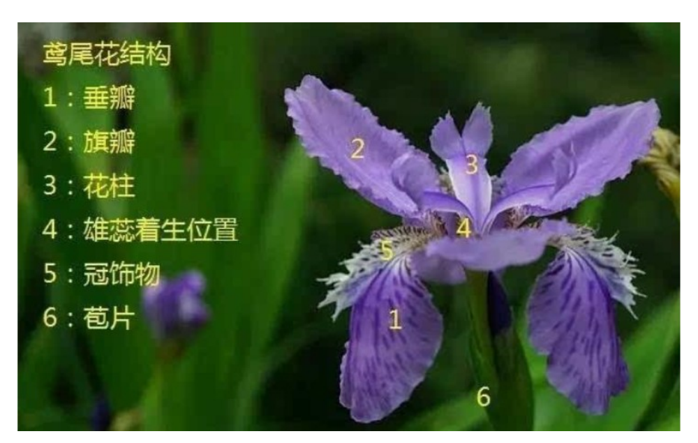
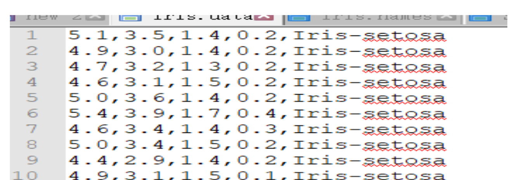
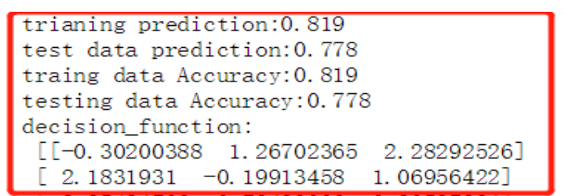
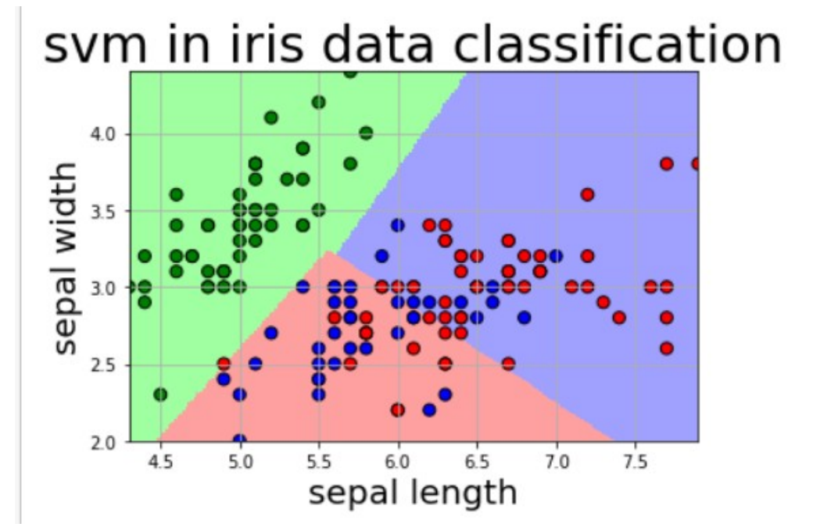
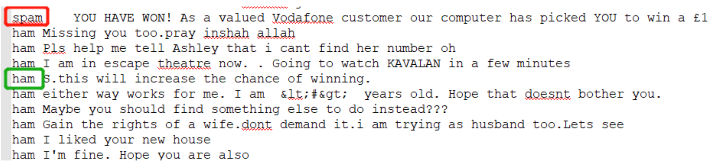
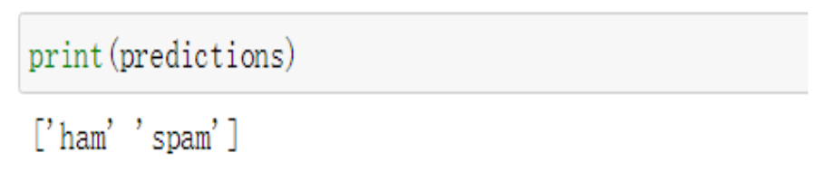

# 人工智能导论 第三次作业题目（2024春）

## 一、实验一 鸢尾花分类作业

利用支持向量机 SVM 对鸢尾花数据进行分类，实验时请将数据集按 4 : 1 划分训练集和测试集。

### 任务要求

- 选取数据集里面的不同特征（比如花瓣、花萼等），尝试不同的核函数和参数组合，标出准确率最高的模型；
- 提交一份报告，内容包括实验步骤、代码实现、实验结果（可复现）。

### 提交要求

- 请于 5 月 19 号前提交至网盘第二次作业，命名方式同作业一。

## 二、鸢尾花分类实验指导

### 1、鸢尾花



图中标注：1 垂瓣、2 旗瓣、3 花柱、4 雄蕊着生位置、5 冠饰物、6 苞片。

### 2、Iris 鸢尾花数据集

Iris 鸢尾花数据集是一个经典数据集，在统计学习和机器学习领域都经常被用作示例。数据集内包含 3 类共 150 条记录，每类各 50 个数据，每条记录都有 4 项特征：花萼长度、花萼宽度、花瓣长度、花瓣宽度，可以通过这 4 个特征预测鸢尾花卉属于（iris-setosa, iris-versicolour, iris-virginica）中的哪一品种，具体数据集见 flower-master 里面的 iris.data，数据结构如下图：



其中数据集中，第一列至第四列分别代表 花萼长度、花萼宽带、花瓣长度、花瓣宽带，第五列代表花类别。

### 3、程序讲解

#### （a）导入程序所需的包

```python
import numpy as np  #导入程序所需的包
import sklearn
from matplotlib import colors
from sklearn import svm
from sklearn.svm import SVC
from sklearn import model_selection
import matplotlib.pyplot as plt
import matplotlib as mpl
```

#### （b）类别编码与加载数据

将不同的鸢尾花分为 0,1,2 三种类别，0 代表 Iris-setosa，1 代表 Iris-versicolor，2 代表 Iris-virginica，从 iris.data 文件中加载数据。

```python
def iris_type(s):
    it = {b'Iris-setosa':0, b'Iris-versicolor':1, b'Iris-virginica':2}
    return it[s]
```

```python
#data_path='C:|iris|iris'
```

```python
#data_path='C:|Users|87220|Desktop|flower-master|iris|iris.data'
data_path='iris.data'
```

```python
data = np.loadtxt(data_path,
                  dtype=float,
                  delimiter=',',
                  converters={4:iris_type})
```

#### （c）选取特征并划分训练数据、测试数据

从数据集中选取 花萼长度、花萼宽度作为分类特征，并将数据集分为训练数据和测试数据（注：此代码中可以将 x = x[:, 0:2] 改为 x = x[:, 1:3]，表示根据花萼宽度以及花瓣长度对数据进行分类，修改分类特征最后可观察不同的分类效果，准确率精确率会不一样）。

```python
x = x[:, 0:2]   #0:2 代表花萼长度，花萼宽度，进行数据训练，修改为 1:3 变为花萼宽度，花瓣长度进行训练最终图片是不一样的
print(x)
x_train,x_test,y_train,y_test=model_selection.train_test_split(x,
                                                               y,
                                                               random_state=1,
                                                               test_size=0.3)  #修改test_size 可对最终图片结果造成影响
```

#### （d）创建分类器并训练

创建分类器，并对数据进行训练（注：选择程序里面的 LogisticRegression 方法可以观看逻辑回归的分类效果）。

```python
def classifier():
    #clf = svm.SVC(C=0.8,kernel='rbf', gamma=50,decision_function_shape='ovr')
    clf = svm.SVC(C=0.5,
                  kernel='linear',
                  decision_function_shape='ovr')
    #clf = sklearn.linear_model.LogisticRegression(multi_class='auto', solver = 'lbfgs')
    return clf
```

```python
clf = classifier()
```

```python
def train(clf,x_train,y_train):
    clf.fit(x_train,
            y_train.ravel())
```

```python
train(clf,x_train,y_train)
```

#### （e）打印准确率、精确率

打印训练集与测试集的准确率、精确率，结果如下方右侧图。

```python
def show_accuracy(a, b, tip):
    acc = a.ravel() == b.ravel()
    print('%s Accuracy:%.3f' %(tip, np.mean(acc)))
```

```python
def print_accuracy(clf,x_train,y_train,x_test,y_test):
    print('trianing prediction:%.3f' %(clf.score(x_train, y_train)))
    print('test data prediction:%.3f' %(clf.score(x_test, y_test)))
    show_accuracy(clf.predict(x_train), y_train, 'traing data')
    show_accuracy(clf.predict(x_test), y_test, 'testing data')
    print('decision_function:\n', clf.decision_function(x_train))
```

```python
print_accuracy(clf,x_train,y_train,x_test,y_test)
```

输出（slides 用红框标出开头几行，decision_function 的完整输出在原图里继续向下）：



#### （f）绘制分类结果

将分类结果绘制图片，程序见下方左图，效果见下方右图。

```python
def draw(clf, x):
    iris_feature = 'sepal length', 'sepal width', 'petal length', 'petal width'
    # 开始画图,上面英文为花萼长度，花萼宽度，花瓣长度，花瓣宽度
    x1_min, x1_max = x[:, 0].min(), x[:, 0].max()
    x2_min, x2_max = x[:, 1].min(), x[:, 1].max()
    x1, x2 = np.mgrid[x1_min:x1_max:200j, x2_min:x2_max:200j]
    grid_test = np.stack((x1.flat, x2.flat), axis=1)
    print('grid_test:\n', grid_test)
    # 输出样本到决策面的距离
    z = clf.decision_function(grid_test)
    print('the distance to decision plane:\n', z)

    grid_hat = clf.predict(grid_test)
    print('grid_hat:\n', grid_hat)
    grid_hat = grid_hat.reshape(x1.shape)

    cm_light = mpl.colors.ListedColormap(['#A0FFA0', '#FFA0A0', '#A0A0FF'])
    cm_dark = mpl.colors.ListedColormap(['g', 'b', 'r'])

    plt.pcolormesh(x1, x2, grid_hat, cmap=cm_light)

    plt.scatter(x[:, 0], x[:, 1], c=np.squeeze(y), edgecolor='k', s=50, cmap=cm_dark)
    plt.scatter(x_test[:, 0], x_test[:, 1], s=120, facecolor='none', zorder=10)
    plt.xlabel(iris_feature[0], fontsize=20)
    plt.ylabel(iris_feature[1], fontsize=20)
    plt.xlim(x1_min, x1_max)
    plt.ylim(x2_min, x2_max)
    plt.title('svm in iris data classification', fontsize=30)
    plt.grid()
    plt.show()
```

效果：



## 三、垃圾短信分类实验指导

### 1、数据集

数据集 SMSSpamCollection.csv 文件中，共有 5574 条数据，spam 为垃圾短信，Ham 为非垃圾短信。



### 2、程序说明

#### （a）加载数据集并创建逻辑回归分类器

主要程序与鸢尾花原理类似，首先加载数据集，将数据集分为训练数据集，创建逻辑回归分类器。

```python
import pandas as pd
from sklearn import linear_model
from sklearn.feature_extraction.text import TfidfVectorizer
```

```python
#加载数据集
df = pd.read_csv('SMSSpamCollection.txt',delimiter='\t',header=None)
```

```python
#将数据集分为训练数据集
y,X_train = df[0],df[1]
```

```python
#转化为向量
vectorizer = TfidfVectorizer()
```

```python
#训练数据集
X = vectorizer.fit_transform(X_train)
```

```python
#TODO: fill your code here
#使用linear_model创建逻辑回归分类器，进行训练。
```

#### （b）输入语句并预测分类

输入语句，对语句进行预测分类，结果如下图。

测试 spam 语句输入：

```text
You are awarded a SiPix Digital Camera! call 09061221061 from landline. Delivery within 28days. T Cs Box177. M221BP. 2yr warranty. 150ppm. 16 . p p£3.99
```

```python
#测试集
testX = vectorizer.transform(['You are awarded a SiPix Digital Camera! call 09061221061 from landline. Delivery within 28days. T Cs Box177. M221BP. 2yr warranty. 150ppm. 16 . p p£3.99'])
```

```python
#TODO: fill your code here
#对语句进行预测分类，输出结果
```

```python
print(predictions)
```

```text
['ham' 'spam']
```



## 四、实验二 垃圾短信分类作业

### 任务要求

1. 在 TODO 位置填写你的代码，实现垃圾短信识别功能。最终效果：输入不同的短信，输出预测结果：是垃圾短信还是非垃圾短信。
2. 提交一份报告，包含实验代码和说明，以及预测结果（可复现）。

### 提交要求

1. 请于 5 月 26 号前提交至网盘第三次作业，命名方式同作业一。
