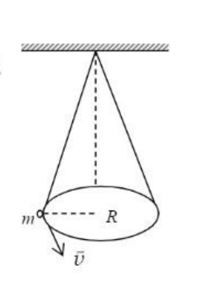
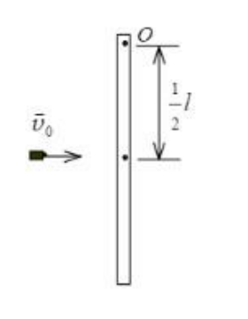
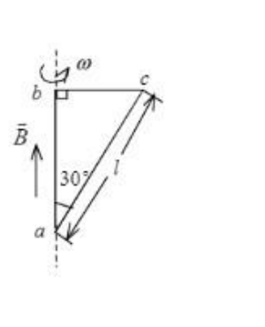
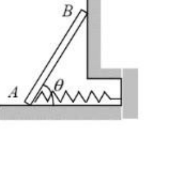
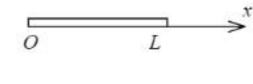
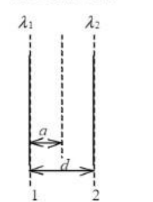
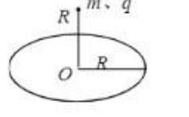
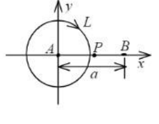
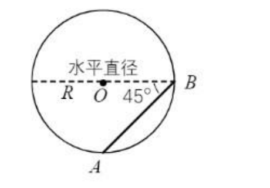
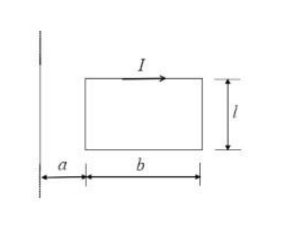

# 基础物理学A(1) 2021–2022 学年第二学期期末试卷参考答案

## 一、选择题（每小题 3 分，共 30 分）

### 1. 质量为 0.25 kg 的质点，受力 $\vec F=t\,\vec i$（SI）的作用，式中 $t$ 为时间． $t=0$ 时该质点以 $\vec v=2\vec j$（SI）的速度通过坐标原点，则该质点任意时刻的位置矢量是（　　）

#### 题目

质量为 0.25 kg 的质点，受力 $\vec F=t\,\vec i$（SI）的作用，式中 $t$ 为时间． $t=0$ 时该质点以 $\vec v=2\vec j$（SI）的速度通过坐标原点，则该质点任意时刻的位置矢量是（　　）。

(A) $\left(\dfrac{2}{3}t^3+2t\right)\vec i$（SI）．　　(B) $\left(2t+\dfrac{2}{3}t^3\right)\vec j$（SI）．

(C) $\dfrac{2}{3}t^3\vec i+2t\,\vec j$（SI）．　　(D) $2t\,\vec i+\dfrac{2}{3}t^3\vec j$（SI）．

#### 答案

**答案：** (C)。

$a_x=F_x/m=t/0.25=4t$，且 $a_y=0$。由 $v_x(0)=0,\ v_y(0)=2$ 及 $x(0)=y(0)=0$ 得
$$
v_x=2t^2,\quad x=\frac{2}{3}t^3;\qquad v_y=2,\quad y=2t.
$$
故 $\vec r=\dfrac{2}{3}t^3\vec i+2t\,\vec j$。

### 2. 圆锥摆的摆球质量为 $m$，速率为 $v$，圆半径为 $R$．当摆球在轨道上运动半周时，摆球所受摆绳拉力冲量的大小为（　　）。（ $g$ 为重力加速度）

#### 题目

如图所示，圆锥摆的摆球质量为 $m$，速率为 $v$，圆半径为 $R$．当摆球在轨道上运动半周时，摆球所受摆绳拉力冲量的大小为（　　）。（ $g$ 为重力加速度）

(A) $2mv$．　　(B) $\sqrt{(2mv)^2+(mg\pi R/v)^2}$．

(C) $\pi Rmg/v$．　　(D) $0$．

#### 答案

**答案：** (B)。

运动半周所需时间 $\Delta t=\pi R/v$。由动量定理 $\vec I_T+\vec I_G=\Delta\vec p$，其中 $\Delta\vec p$ 在水平面内、大小为 $2mv$，重力冲量 $\vec I_G$ 竖直向下、大小为 $mg\Delta t=\pi Rmg/v$，二者互相垂直，故
$$

|\vec I_T|=\sqrt{(2mv)^2+\left(\frac{\pi Rmg}{v}\right)^2}.

$$

### 3. 下列说法中正确的是（　　）

#### 题目

下列说法中正确的是（　　）。

(A) 作用力的功与反作用力的功必等值异号．

(B) 作用于一个物体的摩擦力只能作负功．

(C) 内力不改变系统的总机械能．

(D) 一对作用力和反作用力作功之和与参考系的选取无关．

#### 答案

**答案：** (D)。

一对作用力与反作用力的元功之和为 $\mathrm{d}W=\vec f\cdot(\vec v_1-\vec v_2)\,\mathrm{d}t$，只与两物体的相对速度有关，而相对速度与参考系无关，故该功之和与参考系选取无关，(D) 正确。

(A) 错：只有两力作用点位移相同时功才等值反号；(B) 错：摩擦力也可作正功（如传送带带动物体）；(C) 错：非保守内力（摩擦、爆炸等）会改变系统总机械能。

### 4. 一长为 $l$、质量为 $M$ 的均匀细棒悬挂于通过其上端的光滑水平固定轴 $O$ 上．现有一质量为 $m$ 的子弹以水平速度 $v_0$ 射向棒的中心，并以 $\dfrac{1}{2}v_0$ 的速度穿出棒．则此时棒的角速度应为（　　）

#### 题目

如图所示，一长为 $l$、质量为 $M$ 的均匀细棒悬挂于通过其上端的光滑水平固定轴 $O$ 上．现有一质量为 $m$ 的子弹以水平速度 $v_0$ 射向棒的中心，并以 $\dfrac{1}{2}v_0$ 的速度穿出棒．则此时棒的角速度应为（　　）。

(A) $\dfrac{3mv_0}{4Ml}$．　　(B) $\dfrac{5mv_0}{3Ml}$．

(C) $\dfrac{3mv_0}{2Ml}$．　　(D) $\dfrac{9mv_0}{4Ml}$．

#### 答案

**答案：** (A)。

碰撞过程对 $O$ 轴角动量守恒，棒绕上端的转动惯量 $I=\dfrac{1}{3}Ml^2$：
$$
mv_0\cdot\frac{l}{2}=m\cdot\frac{v_0}{2}\cdot\frac{l}{2}+\frac{1}{3}Ml^2\omega,
$$
解得 $\omega=\dfrac{3mv_0}{4Ml}$。

### 5. 在惯性系 $S$ 中，一粒子具有动量 $(p_x,p_y,p_z)=(4,\ 2\sqrt{3},\ 6)$ MeV/c 及总能量 $E=10$ MeV，则在 $S$ 系中测得粒子的速度 $v$ 最接近于（　　）

#### 题目

在惯性系 $S$ 中，一粒子具有动量 $(p_x,p_y,p_z)=(4,\ 2\sqrt{3},\ 6)$ MeV/c（ $c$ 表示真空中光速，1 eV $=1.60\times10^{-19}$ J）及总能量 $E=10$ MeV，则在 $S$ 系中测得粒子的速度 $v$ 最接近于（　　）。

(A) $\dfrac{3}{8}c$．　　(B) $\dfrac{2}{5}c$．　　(C) $\dfrac{3}{5}c$．　　(D) $\dfrac{4}{5}c$．

#### 答案

**答案：** (D)。

$$
p=\sqrt{4^2+(2\sqrt{3})^2+6^2}=8\ \mathrm{MeV}/c,
$$
由 $E=mc^2$、 $p=mv$ 得 $v=\dfrac{pc^2}{E}=\dfrac{8}{10}c=0.8c=\dfrac{4}{5}c$。

### 6. 一半径为 $R$ 的均匀带电球面，带有电荷 $Q$．若规定该球面上的电势值为零，则无限远处的电势为（　　）

#### 题目

一半径为 $R$ 的均匀带电球面，带有电荷 $Q$．若规定该球面上的电势值为零，则无限远处的电势为（　　）。

(A) $-\dfrac{Q}{4\pi\varepsilon_0R}$．　　(B) $0$．

(C) $\dfrac{Q}{4\pi\varepsilon_0R}$．　　(D) $\infty$．

#### 答案

**答案：** (A)。

均匀带电球面内、外电势以球面为界连续，球面上的电势为 $\dfrac{Q}{4\pi\varepsilon_0R}$（取无穷远为零点）。改取球面为零电势点，相当于把整个电势分布平移 $-\dfrac{Q}{4\pi\varepsilon_0R}$，故无限远处电势为
$$
0-\frac{Q}{4\pi\varepsilon_0R}=-\frac{Q}{4\pi\varepsilon_0R}.
$$

### 7. 一平行板电容器充电后仍与电源连接，若用绝缘手柄将电容器两极板间距离拉大，则极板上的电荷 $Q$、极板间电场强度的大小 $E$ 和电场能量 $W$ 将发生如下变化（　　）

#### 题目

一平行板电容器充电后仍与电源连接，若用绝缘手柄将电容器两极板间距离拉大，则极板上的电荷 $Q$、极板间电场强度的大小 $E$ 和电场能量 $W$ 将发生如下变化（　　）。

(A) $Q$ 增大， $E$ 增大， $W$ 增大．

(B) $Q$ 减小， $E$ 减小， $W$ 减小．

(C) $Q$ 增大， $E$ 减小， $W$ 增大．

(D) $Q$ 增大， $E$ 增大， $W$ 减小．

#### 答案

**答案：** (B)。

仍与电源连接，故极板间电压 $U$ 不变。 $d$ 增大时 $C=\dfrac{\varepsilon_0S}{d}$ 减小，于是 $Q=CU$ 减小， $E=\dfrac{U}{d}$ 减小， $W=\dfrac{1}{2}CU^2$ 减小。

### 8. 一质点带有电荷 $q=8.0\times10^{-10}$ C，以速度 $v=3.0\times10^{5}\ \mathrm{m\cdot s^{-1}}$ 在半径为 $R=6.00\times10^{-3}$ m 的圆周上作匀速圆周运动．该带电质点在轨道中心所产生的磁感强度 $\vec B$ 和轨道运动的磁矩 $\vec p_m$ 的大小分别为（　　）

#### 题目

一质点带有电荷 $q=8.0\times10^{-10}$ C，以速度 $v=3.0\times10^{5}\ \mathrm{m\cdot s^{-1}}$ 在半径为 $R=6.00\times10^{-3}$ m 的圆周上作匀速圆周运动．该带电质点在轨道中心所产生的磁感强度 $\vec B$ 和轨道运动的磁矩 $\vec p_m$ 的大小分别为（　　）。（ $\mu_0=4\pi\times10^{-7}\ \mathrm{H\cdot m^{-1}}$）

(A) $6.67\times10^{-5}$ T， $7.20\times10^{-5}\ \mathrm{A\cdot m^2}$．

(B) $6.67\times10^{-7}$ T， $7.20\times10^{-7}\ \mathrm{A\cdot m^2}$．

(C) $3.33\times10^{-7}$ T， $7.20\times10^{-7}\ \mathrm{A\cdot m^2}$．

(D) $6.67\times10^{-7}$ T， $3.60\times10^{-7}\ \mathrm{A\cdot m^2}$．

#### 答案

**答案：** (B)。

运动电荷在圆心处产生的磁场等效于圆电流：
$$
B=\frac{\mu_0qv}{4\pi R^2}=\frac{4\pi\times10^{-7}\times8.0\times10^{-10}\times3.0\times10^{5}}{4\pi\times(6.00\times10^{-3})^2}=6.67\times10^{-7}\ \mathrm{T}.
$$
等效电流 $I=\dfrac{qv}{2\pi R}$，磁矩
$$
p_m=I\pi R^2=\frac{qvR}{2}=\frac{8.0\times10^{-10}\times3.0\times10^{5}\times6.00\times10^{-3}}{2}=7.20\times10^{-7}\ \mathrm{A\cdot m^2}.
$$

### 9. 关于磁场中高斯定理的叙述，下列选项中正确的是（　　）

#### 题目

关于磁场中高斯定理的叙述，下列选项中正确的是（　　）。

(A) 磁场中高斯定理表明磁场是无旋场．

(B) 磁场中高斯定理 $\Phi_m=\displaystyle\oint_S\vec B\cdot\mathrm{d}\vec S=0$，表明闭合曲面上各点处的 $\vec B=0$．

(C) 在任意磁场中穿过闭合曲面的磁通量均为 0．

(D) 磁场中高斯定理只在均匀磁场中成立．

#### 答案

**答案：** (C)。

磁场的高斯定理 $\displaystyle\oint_S\vec B\cdot\mathrm{d}\vec S=0$ 对任意闭合曲面、任意磁场都成立，反映磁场是无源场（磁感应线闭合、无磁单极子），故选 (C)。(A) 混淆了高斯定理与环路定理；(B) 错在磁通量为零并不要求各点 $\vec B=0$；(D) 错在该定理与场是否均匀无关。

### 10. 一直角三角形 $abc$ 导体回路放在一磁感强度为 $\vec B$ 的均匀磁场中，磁场的方向与直角边 $ab$ 平行，当回路绕 $ab$ 边以匀角速度 $\omega$ 旋转时， $abc$ 回路中的感应电动势 $\varepsilon$ 和 $a$、 $c$ 两点间的电势差 $U_a-U_c$ 为（　　）

#### 题目

如图所示，一直角三角形 $abc$ 导体回路放在一磁感强度为 $\vec B$ 的均匀磁场中，磁场的方向与直角边 $ab$ 平行，当回路绕 $ab$ 边以匀角速度 $\omega$ 旋转时， $abc$ 回路中的感应电动势 $\varepsilon$ 和 $a$、 $c$ 两点间的电势差 $U_a-U_c$ 为（　　）。

(A) $\varepsilon=B\omega l^2$， $U_a-U_c=\dfrac{1}{2}B\omega l^2$．

(B) $\varepsilon=B\omega l^2$， $U_a-U_c=-\dfrac{1}{2}B\omega l^2$．

(C) $\varepsilon=0$， $U_a-U_c=\dfrac{1}{8}B\omega l^2$．

(D) $\varepsilon=0$， $U_a-U_c=-\dfrac{1}{8}B\omega l^2$．

#### 答案

**答案：** (D)。

转轴 $ab$ 与 $\vec B$ 平行，回路平面的法线恒与 $\vec B$ 垂直，故穿过回路的磁通量恒为零， $\varepsilon=0$。

距轴 $r$ 处的线元速度 $v=\omega r$， $\vec v\times\vec B$ 沿径向指向外侧，故正电荷被推向离轴较远的 $c$ 点， $c$ 点电势高于 $a$ 点：
$$
U_c-U_a=\int_0^{r_c}B\omega r\,\mathrm{d}r=\frac{1}{2}B\omega r_c^2 .
$$
由图 $\angle bac=30^\circ$、 $ac=l$，得 $r_c=bc=l\sin30^\circ=\dfrac{l}{2}$，于是
$$
U_a-U_c=-\frac{1}{2}B\omega\left(\frac{l}{2}\right)^2=-\frac{1}{8}B\omega l^2.
$$

## 二、填空题（每小题 3 分，共 30 分）

### 1. 飞轮作加速转动时，轮边缘上一点的运动学方程为 $S=0.1t^3$（SI）．飞轮半径为 1.5 m．当此点的速率 $v=30$ m/s 时，其切向加速度为 \_\_\_\_\_\_\_\_，法向加速度为 \_\_\_\_\_\_\_\_

#### 题目

飞轮作加速转动时，轮边缘上一点的运动学方程为 $S=0.1t^3$（SI）．飞轮半径为 1.5 m．当此点的速率 $v=30$ m/s 时，其切向加速度为 \_\_\_\_\_\_\_\_，法向加速度为 \_\_\_\_\_\_\_\_．

#### 答案

**答案：** 切向加速度 $a_t=6\ \mathrm{m\cdot s^{-2}}$，法向加速度 $a_n=600\ \mathrm{m\cdot s^{-2}}$。

$v=\dfrac{\mathrm{d}S}{\mathrm{d}t}=0.3t^2=30\ \mathrm{m/s}\Rightarrow t=10\ \mathrm{s}$，
$$
a_t=\frac{\mathrm{d}v}{\mathrm{d}t}=0.6t=6\ \mathrm{m\cdot s^{-2}},\qquad a_n=\frac{v^2}{R}=\frac{30^2}{1.5}=600\ \mathrm{m\cdot s^{-2}}.
$$

### 2. 两个相互作用的物体 $A$ 和 $B$，无摩擦地在一条水平直线上运动．物体 $A$ 的动量是时间的函数，表达式为 $p_A=-p_0+bt$．在下列两种情况下，写出物体 $B$ 的动量作为时间函数的表达式：(1) 开始时 $B$ 静止；(2) 开始时 $B$ 的动量为 $-p_0$

#### 题目

两个相互作用的物体 $A$ 和 $B$，无摩擦地在一条水平直线上运动．物体 $A$ 的动量是时间的函数，表达式为 $p_A=-p_0+bt$，式中 $p_0$、 $b$ 分别为正值常量， $t$ 是时间．在下列两种情况下，写出物体 $B$ 的动量作为时间函数的表达式：

(1) 开始时，若 $B$ 静止，则 $p_{B1}=$ \_\_\_\_\_\_\_\_；

(2) 开始时，若 $B$ 的动量为 $-p_0$，则 $p_{B2}=$ \_\_\_\_\_\_\_\_．

#### 答案

**答案：** (1) $p_{B1}=-bt$；(2) $p_{B2}=-p_0-bt$。

水平方向无外力，系统动量守恒： $p_A+p_B=$ 常量。

(1) $t=0$ 时总动量为 $-p_0+0=-p_0$，故 $p_{B1}=-p_0-p_A=-p_0-(-p_0+bt)=-bt$。

(2) $t=0$ 时总动量为 $-p_0+(-p_0)=-2p_0$，故 $p_{B2}=-2p_0-p_A=-2p_0-(-p_0+bt)=-p_0-bt$。

### 3. 一长为 $l$、质量为 $M$ 的均质杆 $AB$，杆下端连一弹性系数为 $k$ 的轻弹簧．当杆靠墙竖直放置时，弹簧处于自然长度．设墙和地面都是光滑的．当杆靠墙与地面成 $\theta$ 角时处于平衡状态，则墙对杆的作用力的大小为 \_\_\_\_\_\_\_\_， $M$、 $k$、 $l$、 $\theta$ 应满足的关系式为 \_\_\_\_\_\_\_\_

#### 题目

一长为 $l$、质量为 $M$ 的均质杆 $AB$，杆下端连一弹性系数为 $k$ 的轻弹簧．当杆靠墙竖直放置时，弹簧处于自然长度．设墙和地面都是光滑的．如图所示，当杆靠墙与地面成 $\theta$ 角时处于平衡状态，则墙对杆的作用力的大小为 \_\_\_\_\_\_\_\_， $M$、 $k$、 $l$、 $\theta$ 应满足的关系式为 \_\_\_\_\_\_\_\_．（重力加速度为 $g$）

#### 答案

**答案：** 墙对杆的作用力 $N=kl\cos\theta=\dfrac{Mg}{2}\cot\theta$；关系式为 $2kl\sin\theta=Mg$（即 $\sin\theta=\dfrac{Mg}{2kl}$）。

按图，弹簧水平连接杆下端 $A$ 与墙根；杆竖直时 $A$ 位于墙根、弹簧为原长。杆与地面成 $\theta$ 角时， $A$ 到墙的水平距离为 $l\cos\theta$，弹簧伸长 $l\cos\theta$，弹力 $T=kl\cos\theta$，方向把 $A$ 拉向墙。

水平方向平衡： $N=T$， $N$ 为墙对杆上端 $B$ 的支持力。

对 $A$ 点取力矩：重力作用于杆中点，力臂 $\dfrac{l}{2}\cos\theta$； $N$ 作用于 $B$，力臂 $l\sin\theta$：
$$
Nl\sin\theta=Mg\cdot\frac{l}{2}\cos\theta\ \Rightarrow\ N=\frac{Mg\cos\theta}{2\sin\theta}=\frac{Mg}{2}\cot\theta .
$$
与 $N=kl\cos\theta$ 联立（ $\cos\theta\ne0$）得 $kl=\dfrac{Mg}{2\sin\theta}$，即 $2kl\sin\theta=Mg$。

### 4. 一个细杆总长为 $L$，单位长度的质量为 $\lambda=2\lambda_0+ax$，其中 $\lambda_0$ 和 $a$ 为正常量．则此杆的质心坐标 $x_c=$ \_\_\_\_\_\_\_\_

#### 题目

如图所示，一个细杆总长为 $L$，单位长度的质量为 $\lambda=2\lambda_0+ax$，其中 $\lambda_0$ 和 $a$ 为正常量．则此杆的质心坐标 $x_c=$ \_\_\_\_\_\_\_\_．

#### 答案

**答案：** $x_c=\dfrac{2L(3\lambda_0+aL)}{3(4\lambda_0+aL)}$。

$$
x_c=\frac{\displaystyle\int_0^L x\lambda\,\mathrm{d}x}{\displaystyle\int_0^L\lambda\,\mathrm{d}x}
=\frac{\lambda_0L^2+\dfrac{aL^3}{3}}{2\lambda_0L+\dfrac{aL^2}{2}}
=\frac{2L(3\lambda_0+aL)}{3(4\lambda_0+aL)} .
$$

### 5. 一宇宙飞船相对于地球以 $0.6c$ 的速度飞行．现在一光脉冲从船尾传到船头，已知飞船上的观察者测得飞船长为 90 m．则地球上的观察者测得光脉冲从船尾发出和到达船头两个事件的空间间隔为 \_\_\_\_\_\_\_\_

#### 题目

一宇宙飞船相对于地球以 $0.6c$（ $c$ 表示真空中光速， $c=3\times10^{8}\ \mathrm{m\cdot s^{-1}}$）的速度飞行．现在一光脉冲从船尾传到船头，已知飞船上的观察者测得飞船长为 90 m．则地球上的观察者测得光脉冲从船尾发出和到达船头两个事件的空间间隔为 \_\_\_\_\_\_\_\_．

#### 答案

**答案：** 180 m。

90 m 是飞船的固有长度，地球系中飞船长
$$
L=L_0\sqrt{1-(0.6)^2}=90\times0.8=72\ \mathrm{m}.
$$
在地球系中取光从船尾发出为 $t=0,\ x=0$，船头在 $x=72$ m 并以 $0.6c$ 运动，光追上船头满足
$$
ct=72+0.6ct\ \Rightarrow\ ct=\frac{72}{0.4}=180\ \mathrm{m}.
$$
故两事件的空间间隔为 180 m。

### 6. 两根相互平行的"无限长"均匀带正电直线 1、2，相距为 $d$，其电荷线密度分别为 $\lambda_1$ 和 $\lambda_2$．则场强等于零的点与带电直线 1 的距离 $a$ 为 \_\_\_\_\_\_\_\_，两带电直线上单位长度之间的相互作用力为 \_\_\_\_\_\_\_\_

#### 题目

如图所示，两根相互平行的"无限长"均匀带正电直线 1、2，相距为 $d$，其电荷线密度分别为 $\lambda_1$ 和 $\lambda_2$．则场强等于零的点与带电直线 1 的距离 $a$ 为 \_\_\_\_\_\_\_\_，两带电直线上单位长度之间的相互作用力为 \_\_\_\_\_\_\_\_．

#### 答案

**答案：** $a=\dfrac{\lambda_1d}{\lambda_1+\lambda_2}$；单位长度相互作用力 $f=\dfrac{\lambda_1\lambda_2}{2\pi\varepsilon_0d}$，方向为斥力。

两根线均带正电，零场点只能位于两线之间。设该点到直线 1 的距离为 $a$，则
$$
\frac{\lambda_1}{2\pi\varepsilon_0a}=\frac{\lambda_2}{2\pi\varepsilon_0(d-a)}\ \Rightarrow\ \lambda_1(d-a)=\lambda_2a\ \Rightarrow\ a=\frac{\lambda_1d}{\lambda_1+\lambda_2}.
$$
直线 1 在直线 2 处产生的场强 $E=\dfrac{\lambda_1}{2\pi\varepsilon_0d}$，故单位长度受力
$$
f=\lambda_2E=\frac{\lambda_1\lambda_2}{2\pi\varepsilon_0d},
$$
两者同号，为斥力。

### 7. 一半径为 $R$ 的均匀带电细圆环，带有电荷 $Q$，水平放置．在圆环轴线的上方离圆心 $R$ 处，有一质量为 $m$、带电荷为 $q$ 的小球，已知 $Q$ 与 $q$ 异号．忽略重力，则当小球由静止释放下落到圆心位置时，它的速度大小 $v=$ \_\_\_\_\_\_\_\_

#### 题目

一半径为 $R$ 的均匀带电细圆环，带有电荷 $Q$，水平放置．在圆环轴线的上方离圆心 $R$ 处，有一质量为 $m$、带电荷为 $q$ 的小球，已知 $Q$ 与 $q$ 异号．忽略重力，则当小球由静止释放下落到圆心位置时，它的速度大小 $v=$ \_\_\_\_\_\_\_\_．

#### 答案

**答案：** $v=\sqrt{\dfrac{|Qq|}{2\pi\varepsilon_0Rm}\left(1-\dfrac{\sqrt{2}}{2}\right)}$。

圆环轴线上距圆心 $z$ 处的电势 $V(z)=\dfrac{Q}{4\pi\varepsilon_0\sqrt{R^2+z^2}}$，故
$$
V(R)=\frac{Q}{4\pi\varepsilon_0R\sqrt{2}},\qquad V(0)=\frac{Q}{4\pi\varepsilon_0R}.
$$
由机械能守恒（ $qV(0)+\tfrac12mv^2=qV(R)$）：
$$
\frac{1}{2}mv^2=q\left[V(R)-V(0)\right]=\frac{qQ}{4\pi\varepsilon_0R}\left(\frac{1}{\sqrt{2}}-1\right)
=\frac{|Qq|}{4\pi\varepsilon_0R}\left(1-\frac{\sqrt{2}}{2}\right),
$$
其中用到了 $Q$ 与 $q$ 异号（ $qQ<0$）。

### 8. 平行的无限长直载流导线 $A$ 和 $B$， $A$ 中电流强度为 $I$，垂直纸面向内， $B$ 中电流强度为 $2I$，垂直纸面向外，两根载流导线之间相距为 $a$．(1) $\overline{AB}$ 中点（ $P$ 点）的磁感强度 $\vec B_P$ 的大小为 \_\_\_\_\_\_\_\_．(2) 磁感强度 $\vec B$ 沿图中环路 $L$ 的线积分 $\displaystyle\oint_L\vec B\cdot\mathrm{d}\vec l=$ \_\_\_\_\_\_\_\_

#### 题目

如图，平行的无限长直载流导线 $A$ 和 $B$， $A$ 中电流强度为 $I$，垂直纸面向内， $B$ 中电流强度为 $2I$，垂直纸面向外，两根载流导线之间相距为 $a$，则

(1) $\overline{AB}$ 中点（ $P$ 点）的磁感强度 $\vec B_P$ 的大小为 \_\_\_\_\_\_\_\_．

(2) 磁感强度 $\vec B$ 沿图中环路 $L$ 的线积分 $\displaystyle\oint_L\vec B\cdot\mathrm{d}\vec l=$ \_\_\_\_\_\_\_\_．

#### 答案

**答案：** (1) $B_P=\dfrac{3\mu_0I}{\pi a}$；(2) $\displaystyle\oint_L\vec B\cdot\mathrm{d}\vec l=\mu_0I$。

(1) $P$ 到两导线距离均为 $a/2$。 $A$ 中电流垂直纸面向内，其磁场在 $P$ 处（ $A$ 的右侧）指向 $-y$； $B$ 中电流垂直纸面向外，其磁场在 $P$ 处（ $B$ 的左侧）也指向 $-y$。两者同向相加：
$$
B_P=\frac{\mu_0I}{2\pi(a/2)}+\frac{\mu_0(2I)}{2\pi(a/2)}=\frac{\mu_0I}{\pi a}+\frac{2\mu_0I}{\pi a}=\frac{3\mu_0I}{\pi a}.
$$

(2) 环路 $L$ 只套住导线 $A$，由安培环路定理 $\displaystyle\oint_L\vec B\cdot\mathrm{d}\vec l=\mu_0I_{\text{内}}$。按图 $L$ 的绕行方向为顺时针，其正法线指向纸内，与 $A$ 中电流方向一致，故 $I_{\text{内}}=I$，得 $\mu_0I$。

### 9. 磁场中某点处的磁感应强度为 $\vec B=0.50\vec i+1.00\vec j$（SI），一电子以速度 $\vec v=0.40\times10^{6}\vec i+0.20\times10^{6}\vec j$（SI）通过该点，则作用于该电子上的磁场力 $\vec F$ 为 \_\_\_\_\_\_\_\_

#### 题目

磁场中某点处的磁感应强度为 $\vec B=0.50\vec i+1.00\vec j$（SI），一电子以速度 $\vec v=0.40\times10^{6}\vec i+0.20\times10^{6}\vec j$（SI）通过该点，则作用于该电子上的磁场力 $\vec F$ 为 \_\_\_\_\_\_\_\_．（基本电荷 $e=1.6\times10^{-19}$ C）

#### 答案

**答案：** $\vec F=-4.8\times10^{-14}\vec k\ \mathrm{N}$。

$$
\vec v\times\vec B=(v_xB_y-v_yB_x)\vec k=\left(0.40\times10^{6}\times1.00-0.20\times10^{6}\times0.50\right)\vec k=3.0\times10^{5}\vec k .
$$
电子电荷 $q=-e=-1.6\times10^{-19}$ C，故
$$
\vec F=q(\vec v\times\vec B)=-1.6\times10^{-19}\times3.0\times10^{5}\vec k=-4.8\times10^{-14}\vec k\ \mathrm{N}.
$$

### 10. 半径为 $R$ 的两块圆板组成的平行板电容器充了电，在放电时两板间的电场强度的大小为 $E=E_0e^{-t/\tau}$，式中 $E_0$、 $\tau$ 均为常数．则两板间的位移电流的大小为 \_\_\_\_\_\_\_\_，其方向与场强方向 \_\_\_\_\_\_\_\_

#### 题目

半径为 $R$ 的两块圆板组成的平行板电容器充了电，在放电时两板间的电场强度的大小为 $E=E_0e^{-t/\tau}$，式中 $E_0$、 $\tau$ 均为常数．则两板间的位移电流的大小为 \_\_\_\_\_\_\_\_，其方向与场强方向 \_\_\_\_\_\_\_\_（填"相同"或"相反"）．

#### 答案

**答案：** 位移电流大小 $I_d=\dfrac{\pi R^2\varepsilon_0E_0}{\tau}e^{-t/\tau}$；方向与场强方向**相反**。

$$
I_d=\varepsilon_0\frac{\mathrm{d}\Phi_E}{\mathrm{d}t}=\varepsilon_0\pi R^2\frac{\mathrm{d}E}{\mathrm{d}t}
=\varepsilon_0\pi R^2\left(-\frac{E_0}{\tau}e^{-t/\tau}\right).
$$
放电时 $E$ 随时间减小， $\dfrac{\mathrm{d}E}{\mathrm{d}t}<0$，故位移电流密度 $\vec J_d=\varepsilon_0\dfrac{\partial\vec E}{\partial t}$ 与 $\vec E$ 方向相反。

## 三、计算题（每小题 10 分，共 40 分）

### 1. 在一竖直平面内有一个半径为 $R$ 的固定圆环，圆心为 $O$．一根长为 $\sqrt{2}R$、质量为 $M$ 的均匀细杆 $AB$ 放置在环内侧，与水平直径夹角为 45°．由静止释放后，设杆只能沿环内侧无摩擦的运动．求：(1) $AB$ 杆对通过 $O$ 点垂直圆环面的水平轴的转动惯量；(2) 当杆运动至水平方位时， $A$ 端的运动速率

#### 题目

如图所示，在一竖直平面内有一个半径为 $R$ 的固定圆环，圆心为 $O$．一根长为 $\sqrt{2}R$、质量为 $M$ 的均匀细杆 $AB$ 放置在环内侧，与水平直径夹角为 45°．由静止释放后，设杆只能沿环内侧无摩擦的运动．求：

(1) $AB$ 杆对通过 $O$ 点垂直圆环面的水平轴的转动惯量；

(2) 当杆运动至水平方位时， $A$ 端的运动速率．

#### 答案

**答案：** (1) $I_O=\dfrac{2}{3}MR^2$；(2) $v_A=\sqrt{\dfrac{3gR(\sqrt{2}-1)}{2}}$。

(1) 杆长 $\sqrt2R$ 的弦所对圆心角为 90°，杆中点（质心）到 $O$ 的距离
$$
d=\sqrt{R^2-\left(\frac{\sqrt2R}{2}\right)^2}=\frac{R}{\sqrt2}.
$$
由平行轴定理
$$
I_O=\frac{1}{12}M(\sqrt2R)^2+Md^2=\frac{MR^2}{6}+\frac{MR^2}{2}=\frac{2}{3}MR^2 .
$$

(2) 弦长不变时，杆的中点恒在半径 $R/\sqrt2$ 的圆上，且杆始终垂直于 $O$ 到中点的连线，故杆作绕 $O$ 的定轴转动。

初始位置： $A$ 在圆环最低点、 $B$ 在水平直径端点，质心坐标 $\left(\dfrac{R}{2},-\dfrac{R}{2}\right)$，高度 $y_1=-\dfrac{R}{2}$。

杆滑到最低的水平方位时，质心在 $O$ 正下方， $y_2=-\dfrac{R}{\sqrt2}$。质心下降
$$
\Delta h=y_1-y_2=\frac{R}{\sqrt2}-\frac{R}{2}=\frac{R(\sqrt2-1)}{2}.
$$
由机械能守恒
$$
Mg\Delta h=\frac{1}{2}I_O\omega^2\ \Rightarrow\ \omega^2=\frac{3g(\sqrt2-1)}{2R}.
$$
$A$ 端距 $O$ 为 $R$，故
$$
v_A=\omega R=\sqrt{\frac{3gR(\sqrt2-1)}{2}} .
$$

### 2. 已知 μ 子的静止能量为 105.7 MeV，平均寿命为 $2.2\times10^{-8}$ s．求动能为 150 MeV 的 μ 子的速度 $v$ 和平均寿命 $\tau$

#### 题目

已知 μ 子的静止能量为 105.7 MeV，平均寿命为 $2.2\times10^{-8}$ s．求动能为 150 MeV 的 μ 子的速度 $v$ 和平均寿命 $\tau$．（1 eV $=1.60\times10^{-19}$ J，真空中光速 $c=3\times10^{8}\ \mathrm{m\cdot s^{-1}}$）

#### 答案

**答案：** $v\approx0.911c\approx2.73\times10^{8}\ \mathrm{m\cdot s^{-1}}$； $\tau\approx5.32\times10^{-8}$ s。

总能量
$$
E=E_0+E_k=105.7+150=255.7\ \mathrm{MeV},\qquad \gamma=\frac{E}{E_0}=\frac{255.7}{105.7}=2.419 .
$$
由 $E=\gamma m_0c^2$、 $pc=\gamma m_0vc$ 得
$$
\frac{v}{c}=\sqrt{1-\frac{1}{\gamma^2}}=\sqrt{1-\frac{1}{2.419^2}}=0.911,
$$
即 $v\approx0.911c\approx2.73\times10^{8}\ \mathrm{m\cdot s^{-1}}$。由时间膨胀
$$
\tau=\gamma\tau_0=2.419\times2.2\times10^{-8}\ \mathrm{s}=5.32\times10^{-8}\ \mathrm{s}.
$$

### 3. 半径为 $R$ 的带电介质球，相对介电常量为 $\varepsilon_r$，电荷体密度为 $\rho=\rho_0(1-r/R)$．求：(1) 介质球内的电位移矢量 $\vec D$ 和场强 $\vec E$ 的分布；(2) 介质球内场强最大处的半径 $r_0$

#### 题目

半径为 $R$ 的带电介质球，相对介电常量为 $\varepsilon_r$，电荷体密度为 $\rho=\rho_0(1-r/R)$，式中 $\rho_0$ 为常量， $r$ 是球心到球内某点的距离．求：

(1) 介质球内的电位移矢量 $\vec D$ 和场强 $\vec E$ 的分布；

(2) 介质球内场强最大处的半径 $r_0$．

#### 答案

**答案：**

(1) 由球对称性，取半径为 $r$ 的同心高斯球，包围电荷
$$
q(r)=\int_0^r\rho_0\left(1-\frac{r'}{R}\right)4\pi r'^2\,\mathrm{d}r'=4\pi\rho_0\left(\frac{r^3}{3}-\frac{r^4}{4R}\right).
$$
由 $\displaystyle\oint\vec D\cdot\mathrm{d}\vec S=q(r)$ 得（ $\vec e_r$ 为径向单位矢量，设 $\rho_0>0$）
$$
\vec D=\rho_0\left(\frac{r}{3}-\frac{r^2}{4R}\right)\vec e_r,\qquad
\vec E=\frac{\vec D}{\varepsilon_0\varepsilon_r}=\frac{\rho_0}{\varepsilon_0\varepsilon_r}\left(\frac{r}{3}-\frac{r^2}{4R}\right)\vec e_r .
$$

(2) 令 $\dfrac{\mathrm{d}}{\mathrm{d}r}\left(\dfrac{r}{3}-\dfrac{r^2}{4R}\right)=\dfrac{1}{3}-\dfrac{r}{2R}=0$，得
$$
r_0=\frac{2R}{3},
$$
此处二阶导数为负，确为极大值。

### 4. 长直导线和矩形导线圈共面如图，线圈的边长分别为 $l$ 和 $b$， $l$ 边与长直导线平行．当矩形线圈与无限长直导线间的互感系数为 $M=\dfrac{\mu_0l}{2\pi}$ 时，求：(1) 长直导线与矩形线圈左侧边之间的距离 $a$；(2) 若矩形线圈中通有电流 $I=I_0\sin\omega t$，求直导线中的感生电动势

#### 题目

长直导线和矩形导线圈共面如图，线圈的边长分别为 $l$ 和 $b$， $l$ 边与长直导线平行．当矩形线圈与无限长直导线间的互感系数为 $M=\dfrac{\mu_0l}{2\pi}$ 时，求：

(1) 长直导线与矩形线圈左侧边之间的距离 $a$；

(2) 若矩形线圈中通有电流 $I=I_0\sin\omega t$，电流 $I$ 的正方向如箭头所示，求直导线中的感生电动势．

#### 答案

**答案：** (1) $a=\dfrac{b}{e-1}$；(2) $\varepsilon=-\dfrac{\mu_0lI_0\omega}{2\pi}\cos\omega t$。

(1) 设长直导线通电流 $I$，距导线 $r$ 处 $B=\dfrac{\mu_0I}{2\pi r}$，通过矩形线圈的磁通量
$$
\Phi=\int_a^{a+b}\frac{\mu_0I}{2\pi r}l\,\mathrm{d}r=\frac{\mu_0Il}{2\pi}\ln\frac{a+b}{a},
$$
故互感系数
$$
M=\frac{\Phi}{I}=\frac{\mu_0l}{2\pi}\ln\frac{a+b}{a}.
$$
由 $M=\dfrac{\mu_0l}{2\pi}$ 得 $\ln\dfrac{a+b}{a}=1$，即 $\dfrac{a+b}{a}=e$，所以
$$
a=\frac{b}{e-1}\approx0.582\,b .
$$

(2) 由互感电动势公式
$$
\varepsilon=-M\frac{\mathrm{d}I}{\mathrm{d}t}=-\frac{\mu_0l}{2\pi}I_0\omega\cos\omega t,
$$
其方向由楞次定律确定（与线圈电流的变化率反向）。
