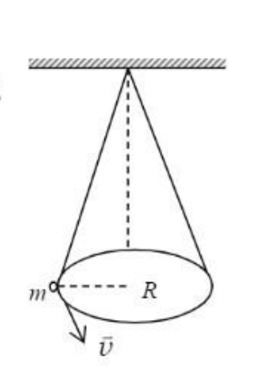
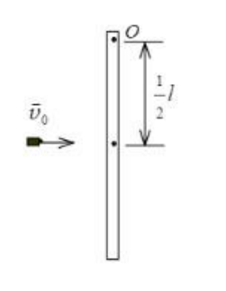
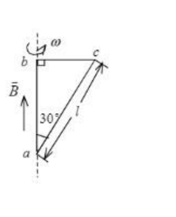
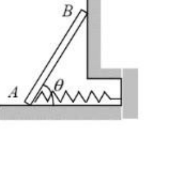
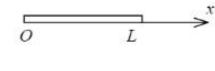
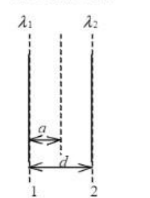
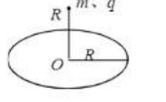
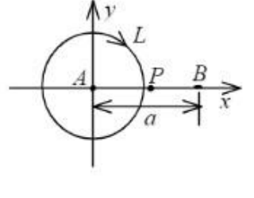
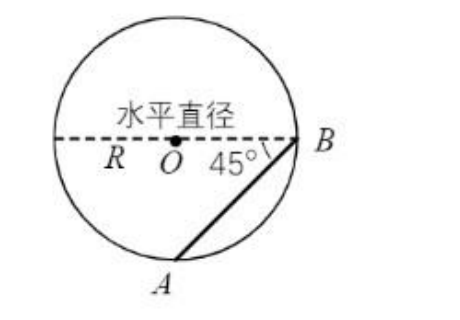
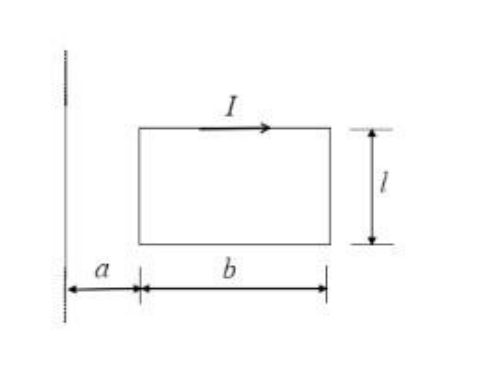

# 基础物理学A(1) 2021–2022 学年第二学期期末试卷

**注意事项：**

1. 试题共 4 页，满分 100 分。
2. 请在 A4 纸或提前打印的答题纸上作答，不必抄题，顺序作答，不作答的题也需写上题号。
3. 答题完毕，将答卷拍照后按顺序整理成一个 PDF 文件提交，照片文字要清晰。文件命名为"班级-学号-姓名-任课老师"。

## 一、选择题（将正确答案的字母填写在答题纸的相应位置，每小题 3 分，共 30 分）

1. 质量为 0.25 kg 的质点，受力 $\vec F=t\,\vec i$（SI）的作用，式中 $t$ 为时间． $t=0$ 时该质点以 $\vec v=2\vec j$（SI）的速度通过坐标原点，则该质点任意时刻的位置矢量是（　　）。

   (A) $\left(\dfrac{2}{3}t^3+2t\right)\vec i$（SI）．　　(B) $\left(2t+\dfrac{2}{3}t^3\right)\vec j$（SI）．

   (C) $\dfrac{2}{3}t^3\vec i+2t\,\vec j$（SI）．　　(D) $2t\,\vec i+\dfrac{2}{3}t^3\vec j$（SI）．

2. 如图所示，圆锥摆的摆球质量为 $m$，速率为 $v$，圆半径为 $R$．当摆球在轨道上运动半周时，摆球所受摆绳拉力冲量的大小为（　　）。（ $g$ 为重力加速度）

   

   (A) $2mv$．　　(B) $\sqrt{(2mv)^2+(mg\pi R/v)^2}$．

   (C) $\pi Rmg/v$．　　(D) $0$．

3. 下列说法中正确的是（　　）。

   (A) 作用力的功与反作用力的功必等值异号．

   (B) 作用于一个物体的摩擦力只能作负功．

   (C) 内力不改变系统的总机械能．

   (D) 一对作用力和反作用力作功之和与参考系的选取无关．

4. 如图所示，一长为 $l$、质量为 $M$ 的均匀细棒悬挂于通过其上端的光滑水平固定轴 $O$ 上．现有一质量为 $m$ 的子弹以水平速度 $v_0$ 射向棒的中心，并以 $\dfrac{1}{2}v_0$ 的速度穿出棒．则此时棒的角速度应为（　　）。

   

   (A) $\dfrac{3mv_0}{4Ml}$．　　(B) $\dfrac{5mv_0}{3Ml}$．

   (C) $\dfrac{3mv_0}{2Ml}$．　　(D) $\dfrac{9mv_0}{4Ml}$．

5. 在惯性系 $S$ 中，一粒子具有动量 $(p_x,p_y,p_z)=(4,\ 2\sqrt{3},\ 6)$ MeV/c（ $c$ 表示真空中光速，1 eV $=1.60\times10^{-19}$ J）及总能量 $E=10$ MeV，则在 $S$ 系中测得粒子的速度 $v$ 最接近于（　　）。

   (A) $\dfrac{3}{8}c$．　　(B) $\dfrac{2}{5}c$．　　(C) $\dfrac{3}{5}c$．　　(D) $\dfrac{4}{5}c$．

6. 一半径为 $R$ 的均匀带电球面，带有电荷 $Q$．若规定该球面上的电势值为零，则无限远处的电势为（　　）。

   (A) $-\dfrac{Q}{4\pi\varepsilon_0R}$．　　(B) $0$．

   (C) $\dfrac{Q}{4\pi\varepsilon_0R}$．　　(D) $\infty$．

7. 一平行板电容器充电后仍与电源连接，若用绝缘手柄将电容器两极板间距离拉大，则极板上的电荷 $Q$、极板间电场强度的大小 $E$ 和电场能量 $W$ 将发生如下变化（　　）。

   (A) $Q$ 增大， $E$ 增大， $W$ 增大．

   (B) $Q$ 减小， $E$ 减小， $W$ 减小．

   (C) $Q$ 增大， $E$ 减小， $W$ 增大．

   (D) $Q$ 增大， $E$ 增大， $W$ 减小．

8. 一质点带有电荷 $q=8.0\times10^{-10}$ C，以速度 $v=3.0\times10^{5}\ \mathrm{m\cdot s^{-1}}$ 在半径为 $R=6.00\times10^{-3}$ m 的圆周上作匀速圆周运动．该带电质点在轨道中心所产生的磁感强度 $\vec B$ 和轨道运动的磁矩 $\vec p_m$ 的大小分别为（　　）。（ $\mu_0=4\pi\times10^{-7}\ \mathrm{H\cdot m^{-1}}$）

   (A) $6.67\times10^{-5}$ T， $7.20\times10^{-5}\ \mathrm{A\cdot m^2}$．

   (B) $6.67\times10^{-7}$ T， $7.20\times10^{-7}\ \mathrm{A\cdot m^2}$．

   (C) $3.33\times10^{-7}$ T， $7.20\times10^{-7}\ \mathrm{A\cdot m^2}$．

   (D) $6.67\times10^{-7}$ T， $3.60\times10^{-7}\ \mathrm{A\cdot m^2}$．

9. 关于磁场中高斯定理的叙述，下列选项中正确的是（　　）。

   (A) 磁场中高斯定理表明磁场是无旋场．

   (B) 磁场中高斯定理 $\Phi_m=\displaystyle\oint_S\vec B\cdot\mathrm{d}\vec S=0$，表明闭合曲面上各点处的 $\vec B=0$．

   (C) 在任意磁场中穿过闭合曲面的磁通量均为 0．

   (D) 磁场中高斯定理只在均匀磁场中成立．

10. 如图所示，一直角三角形 $abc$ 导体回路放在一磁感强度为 $\vec B$ 的均匀磁场中，磁场的方向与直角边 $ab$ 平行，当回路绕 $ab$ 边以匀角速度 $\omega$ 旋转时， $abc$ 回路中的感应电动势 $\varepsilon$ 和 $a$、 $c$ 两点间的电势差 $U_a-U_c$ 为（　　）。

    

    (A) $\varepsilon=B\omega l^2$， $U_a-U_c=\dfrac{1}{2}B\omega l^2$．

    (B) $\varepsilon=B\omega l^2$， $U_a-U_c=-\dfrac{1}{2}B\omega l^2$．

    (C) $\varepsilon=0$， $U_a-U_c=\dfrac{1}{8}B\omega l^2$．

    (D) $\varepsilon=0$， $U_a-U_c=-\dfrac{1}{8}B\omega l^2$．

## 二、填空题（将正确答案填写在答题纸的相应位置，每小题 3 分，共 30 分）

1. 飞轮作加速转动时，轮边缘上一点的运动学方程为 $S=0.1t^3$（SI）．飞轮半径为 1.5 m．当此点的速率 $v=30$ m/s 时，其切向加速度为 \_\_\_\_\_\_\_\_，法向加速度为 \_\_\_\_\_\_\_\_．

2. 两个相互作用的物体 $A$ 和 $B$，无摩擦地在一条水平直线上运动．物体 $A$ 的动量是时间的函数，表达式为 $p_A=-p_0+bt$，式中 $p_0$、 $b$ 分别为正值常量， $t$ 是时间．在下列两种情况下，写出物体 $B$ 的动量作为时间函数的表达式：

   (1) 开始时，若 $B$ 静止，则 $p_{B1}=$ \_\_\_\_\_\_\_\_；

   (2) 开始时，若 $B$ 的动量为 $-p_0$，则 $p_{B2}=$ \_\_\_\_\_\_\_\_．

3. 一长为 $l$、质量为 $M$ 的均质杆 $AB$，杆下端连一弹性系数为 $k$ 的轻弹簧．当杆靠墙竖直放置时，弹簧处于自然长度．设墙和地面都是光滑的．如图所示，当杆靠墙与地面成 $\theta$ 角时处于平衡状态，则墙对杆的作用力的大小为 \_\_\_\_\_\_\_\_， $M$、 $k$、 $l$、 $\theta$ 应满足的关系式为 \_\_\_\_\_\_\_\_．（重力加速度为 $g$）

   

4. 如图所示，一个细杆总长为 $L$，单位长度的质量为 $\lambda=2\lambda_0+ax$，其中 $\lambda_0$ 和 $a$ 为正常量．则此杆的质心坐标 $x_c=$ \_\_\_\_\_\_\_\_．

   

5. 一宇宙飞船相对于地球以 $0.6c$（ $c$ 表示真空中光速， $c=3\times10^{8}\ \mathrm{m\cdot s^{-1}}$）的速度飞行．现在一光脉冲从船尾传到船头，已知飞船上的观察者测得飞船长为 90 m．则地球上的观察者测得光脉冲从船尾发出和到达船头两个事件的空间间隔为 \_\_\_\_\_\_\_\_．

6. 如图所示，两根相互平行的"无限长"均匀带正电直线 1、2，相距为 $d$，其电荷线密度分别为 $\lambda_1$ 和 $\lambda_2$．则场强等于零的点与带电直线 1 的距离 $a$ 为 \_\_\_\_\_\_\_\_，两带电直线上单位长度之间的相互作用力为 \_\_\_\_\_\_\_\_．

   

7. 一半径为 $R$ 的均匀带电细圆环，带有电荷 $Q$，水平放置．在圆环轴线的上方离圆心 $R$ 处，有一质量为 $m$、带电荷为 $q$ 的小球，已知 $Q$ 与 $q$ 异号．忽略重力，则当小球由静止释放下落到圆心位置时，它的速度大小 $v=$ \_\_\_\_\_\_\_\_．

   

8. 如图，平行的无限长直载流导线 $A$ 和 $B$， $A$ 中电流强度为 $I$，垂直纸面向内， $B$ 中电流强度为 $2I$，垂直纸面向外，两根载流导线之间相距为 $a$，则

   

   (1) $\overline{AB}$ 中点（ $P$ 点）的磁感强度 $\vec B_P$ 的大小为 \_\_\_\_\_\_\_\_．

   (2) 磁感强度 $\vec B$ 沿图中环路 $L$ 的线积分 $\displaystyle\oint_L\vec B\cdot\mathrm{d}\vec l=$ \_\_\_\_\_\_\_\_．

9. 磁场中某点处的磁感应强度为 $\vec B=0.50\vec i+1.00\vec j$（SI），一电子以速度 $\vec v=0.40\times10^{6}\vec i+0.20\times10^{6}\vec j$（SI）通过该点，则作用于该电子上的磁场力 $\vec F$ 为 \_\_\_\_\_\_\_\_．（基本电荷 $e=1.6\times10^{-19}$ C）

10. 半径为 $R$ 的两块圆板组成的平行板电容器充了电，在放电时两板间的电场强度的大小为 $E=E_0e^{-t/\tau}$，式中 $E_0$、 $\tau$ 均为常数．则两板间的位移电流的大小为 \_\_\_\_\_\_\_\_，其方向与场强方向 \_\_\_\_\_\_\_\_（填"相同"或"相反"）．

## 三、计算题（每小题 10 分，共 40 分）

1. 如图所示，在一竖直平面内有一个半径为 $R$ 的固定圆环，圆心为 $O$．一根长为 $\sqrt{2}R$、质量为 $M$ 的均匀细杆 $AB$ 放置在环内侧，与水平直径夹角为 45°．由静止释放后，设杆只能沿环内侧无摩擦的运动．求：

   

   (1) $AB$ 杆对通过 $O$ 点垂直圆环面的水平轴的转动惯量；

   (2) 当杆运动至水平方位时， $A$ 端的运动速率．

2. 已知 μ 子的静止能量为 105.7 MeV，平均寿命为 $2.2\times10^{-8}$ s．求动能为 150 MeV 的 μ 子的速度 $v$ 和平均寿命 $\tau$．（1 eV $=1.60\times10^{-19}$ J，真空中光速 $c=3\times10^{8}\ \mathrm{m\cdot s^{-1}}$）

3. 半径为 $R$ 的带电介质球，相对介电常量为 $\varepsilon_r$，电荷体密度为 $\rho=\rho_0(1-r/R)$，式中 $\rho_0$ 为常量， $r$ 是球心到球内某点的距离．求：

   (1) 介质球内的电位移矢量 $\vec D$ 和场强 $\vec E$ 的分布；

   (2) 介质球内场强最大处的半径 $r_0$．

4. 长直导线和矩形导线圈共面如图，线圈的边长分别为 $l$ 和 $b$， $l$ 边与长直导线平行．当矩形线圈与无限长直导线间的互感系数为 $M=\dfrac{\mu_0l}{2\pi}$ 时，求：

   

   (1) 长直导线与矩形线圈左侧边之间的距离 $a$；

   (2) 若矩形线圈中通有电流 $I=I_0\sin\omega t$，电流 $I$ 的正方向如箭头所示，求直导线中的感生电动势．
