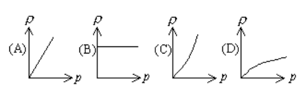
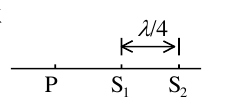
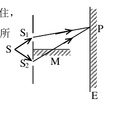
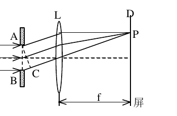
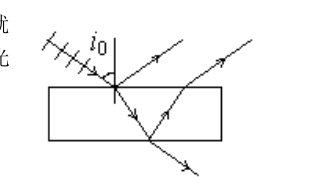
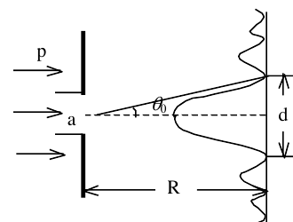
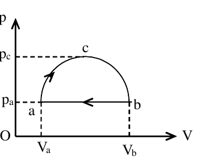
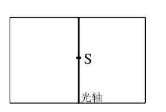
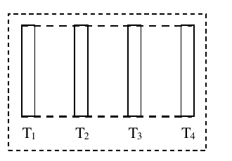
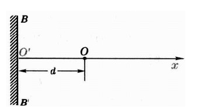

# 工科大学物理（2） 2022 年秋季学期期末考试试题 参考答案

## 一、选择题（将正确答案的字母填在空格内，每小题 3 分，共 30 分）

### 1. 下列各式中哪一式表示气体分子的平均平动动能？（式中 $M$ 为气体的质量， $m$ 为气体分子质量， $N$ 为气体分子总数目， $n$ 为气体分子数密度， $N_A$ 为阿伏加得罗常量）

#### 题目

下列各式中哪一式表示气体分子的平均平动动能？（式中 $M$ 为气体的质量， $m$ 为气体分子质量， $N$ 为气体分子总数目， $n$ 为气体分子数密度， $N_A$ 为阿伏加得罗常量）

(A) $\dfrac{3m}{2M}pV$．　　(B) $\dfrac{3M}{2M_{\mathrm{mol}}}pV$．

(C) $\dfrac{3}{2}npV$．　　(D) $\dfrac{3M_{\mathrm{mol}}}{2M}N_A pV$．

#### 答案

**答案：** (A)。

单个分子的平均平动动能为 $\overline{\varepsilon}=\dfrac{3}{2}kT$。由状态方程 $pV=NkT$ 得 $kT=\dfrac{pV}{N}$，而 $\dfrac{m}{M}=\dfrac{1}{N}$（ $M=Nm$），故

$$
\overline{\varepsilon}=\frac{3}{2}\cdot\frac{pV}{N}=\frac{3m}{2M}pV .
$$

(B) 式给出的是整个气体的总平动动能 $\dfrac{3}{2}\nu RT$；(C) 式量纲不对（ $n$ 为数密度）；(D) 式多出 $N_A/\nu$ 因子。

### 2. 在所给出的四个图象中，哪个图象能够描述一定质量的理想气体，在绝热过程中，密度随压强的变化？

#### 题目

在所给出的四个图象中，哪个图象能够描述一定质量的理想气体，在绝热过程中，密度随压强的变化？

#### 答案

**答案：** (C)。

绝热过程满足 $pV^{\gamma}=C$。定质量气体 $\rho=M/V$，即 $V=M/\rho$，代入得

$$
p\left(\frac{M}{\rho}\right)^{\gamma}=C \quad\Longrightarrow\quad p=C'\rho^{\gamma}.
$$

由于 $\gamma=C_p/C_V>1$， $p$ 随 $\rho$ 单调增大且曲线向上凸（增长快于线性），对应图 (C)。(A) 是线性、(B) 是常数、(D) 向下凹，均不符。

### 3. 设高温热源的热力学温度是低温热源的热力学温度的 $n$ 倍，则理想气体在一次卡诺循环中，传给低温热源的热量是从高温热源吸取热量的

#### 题目

设高温热源的热力学温度是低温热源的热力学温度的 $n$ 倍，则理想气体在一次卡诺循环中，传给低温热源的热量是从高温热源吸取热量的

(A) $n$ 倍．　　(B) $n-1$ 倍．

(C) $\dfrac{1}{n}$ 倍．　　(D) $\dfrac{n+1}{n}$ 倍．

#### 答案

**答案：** (C)。

卡诺循环 $\dfrac{Q_2}{Q_1}=\dfrac{T_2}{T_1}$。已知 $T_1=nT_2$，故 $\dfrac{Q_2}{Q_1}=\dfrac{1}{n}$。

### 4. 某一周期性振动的数学表达式为

#### 题目

某一周期性振动的数学表达式为

$$x = 2a(1+\cos\omega_0 t)\cos\omega t \qquad (\omega = m\omega_0,\ m\ \text{整数}).$$

该振动可以分解为三个简谐振动，它们的角频率分别为 $m\omega_0$ 、 $(m+1)\omega_0$ 和 $(m-1)\omega_0$ ；而其中两个简谐振动的振幅分别为 $a$ 和 $2a$ ，另一个简谐振动的振幅为

(A) $a$．　　(B) $2a$．

(C) $3a$．　　(D) $4a$．

#### 答案

**答案：** (A)。

用积化和差展开：

$$
x=2a\cos\omega t+2a\cos\omega_0 t\cos\omega t
=2a\cos m\omega_0 t+a\cos(m+1)\omega_0 t+a\cos(m-1)\omega_0 t .
$$

三个分量的振幅依次为 $2a$ 、 $a$ 、 $a$ ，故「另一个」振幅仍是 $a$。

### 5. 两相干波源 $S_1$ 和 $S_2$ 相距 $\lambda/4$ ，（ $\lambda$ 为波长）， $S_1$ 的相位比 $S_2$ 的相位超前 $\dfrac{1}{2}\pi$ ，在 $S_1$ ， $S_2$ 的连线上， $S_1$ 外侧各点（例如 $P$ 点）两波引起的两谐振动的相位差是

#### 题目

两相干波源 $S_1$ 和 $S_2$ 相距 $\lambda/4$ ，（ $\lambda$ 为波长）， $S_1$ 的相位比 $S_2$ 的相位超前 $\dfrac{1}{2}\pi$ ，在 $S_1$ ， $S_2$ 的连线上， $S_1$ 外侧各点（例如 $P$ 点）两波引起的两谐振动的相位差是

(A) $0$．　　(B) $\dfrac{1}{2}\pi$．

(C) $\pi$．　　(D) $\dfrac{3}{2}\pi$．

#### 答案

**答案：** (C)。

$P$ 在 $S_1$ 外侧， $S_2$ 比 $S_1$ 远 $\lambda/4$，即 $r_1-r_2=-\lambda/4$。两波在 $P$ 点的相位差为

$$
\Delta\varphi=(\varphi_1-\varphi_2)-\frac{2\pi}{\lambda}(r_1-r_2)
=\frac{\pi}{2}-\frac{2\pi}{\lambda}\left(-\frac{\lambda}{4}\right)
=\frac{\pi}{2}+\frac{\pi}{2}=\pi .
$$

### 6. 在双缝干涉实验中，屏幕 $E$ 上的 $P$ 点处是明条纹. 若将缝 $S_2$ 盖住，并在 $S_1S_2$ 连线的垂直平分面处放一高折射率介质反射面 $M$ ，如图所示，则此时

#### 题目

在双缝干涉实验中，屏幕 $E$ 上的 $P$ 点处是明条纹. 若将缝 $S_2$ 盖住，并在 $S_1S_2$ 连线的垂直平分面处放一高折射率介质反射面 $M$ ，如图所示，则此时

(A) $P$ 点处仍为明条纹．　　(B) $P$ 点处为暗条纹．

(C) 不能确定 $P$ 点处是明条纹还是暗条纹．　　(D) 无干涉条纹．

#### 答案

**答案：** (B)。

$M$ 位于 $S_1S_2$ 的垂直平分面上， $S_1$ 经 $M$ 所成的虚像恰好落在 $S_2$ 的位置，因此「 $S_1$ 经 $M$ 反射到 $P$」与「 $S_2$ 直射到 $P$」几何路程完全相同，两者光程差仍等于原来的 $r_2-r_1=k\lambda$。但 $M$ 是高折射率介质表面，反射时产生 $\pi$ 的附加相位突变（半波损失），故新的相位差为

$$
\Delta\varphi=\frac{2\pi}{\lambda}k\lambda+\pi=(2k+1)\pi ,
$$

$P$ 点由明变暗。这正是劳埃德镜效应。

### 7. 一束波长为 $\lambda$ 的平行单色光垂直入射到一单缝 $AB$ 上，装置如图. 在屏幕 $D$ 上形成衍射图样，如果 $P$ 是中央亮纹一侧第一个暗纹所在的位置，则 $\overline{BC}$ 的长度为

#### 题目

一束波长为 $\lambda$ 的平行单色光垂直入射到一单缝 $AB$ 上，装置如图. 在屏幕 $D$ 上形成衍射图样，如果 $P$ 是中央亮纹一侧第一个暗纹所在的位置，则 $\overline{BC}$ 的长度为

(A) $\lambda/2$．　　(B) $\lambda$．

(C) $3\lambda/2$．　　(D) $2\lambda$．

#### 答案

**答案：** (B)。

图中 $AC\perp CP$，故 $A$、 $B$ 两端点发出的、沿 $\theta$ 方向射向 $P$ 的两条光线之光程差就是 $\overline{BC}=a\sin\theta$（ $a$ 为缝宽）。单缝衍射暗纹条件为

$$
a\sin\theta=k\lambda,\qquad k=\pm1,\pm2,\dots
$$

第一个暗纹对应 $k=1$，故 $\overline{BC}=\lambda$。

### 8. 一束偏振光（偏振方向如图）自空气射向一块平面玻璃，就一般情况而言，它在玻璃的两个界面上会产生如图所示的反射光和透射光。如果入射角恰好等于布儒斯特角 $i_0$ ，则

#### 题目

一束偏振光（偏振方向如图）自空气射向一块平面玻璃，就一般情况而言，它在玻璃的两个界面上会产生如图所示的反射光和透射光。如果入射角恰好等于布儒斯特角 $i_0$ ，则

(A) 反射光光强为零，透射光光强为最大

(B) 反射光是完全偏振光，且振动方向垂直于入射面

(C) 反射光是完全偏振光，且振动方向平行于入射面

(D) 透射光光强为零，反射光光强为最大

#### 答案

**答案：** (A)。

图中入射光上的短划线表示振动方向平行于入射面（即平行于图面）。当入射角等于布儒斯特角 $i_0=\arctan(n_2/n_1)$ 时，平行于入射面的 $p$ 分量反射系数为零，而入射光恰好只有 $p$ 分量，故反射光强为零，全部能量进入透射光，透射光强达到最大。

若入射光振动方向垂直于入射面（ $s$ 分量），则 (B) 才是正确描述——本题图示为平行分量，故不选 (B)。

### 9. 已知用光照的办法将氢原子基态的电子电离，可用的最长波长的光是 91.2 nm 的紫外光，那么氢原子从各受激态跃迁至基态的赖曼系光谱的波长可表示为

#### 题目

已知用光照的办法将氢原子基态的电子电离，可用的最长波长的光是 91.2 nm 的紫外光，那么氢原子从各受激态跃迁至基态的赖曼系光谱的波长可表示为：

(A) $\lambda = 91.2\dfrac{n-1}{n+1}$ nm．　　(B) $\lambda = 91.2\dfrac{n+1}{n-1}$ nm．

(C) $\lambda = 91.2\dfrac{n^{2}}{n^{2}-1}$ nm．　　(D) $\lambda = 91.2\dfrac{n^{2}+1}{n^{2}-1}$ nm．

#### 答案

**答案：** (C)。

基态电离能 $E_1=hc/\lambda_0$， $\lambda_0=91.2$ nm。由玻尔理论 $E_n=-E_1/n^2$，从第 $n$ 能级跃迁到基态：

$$
\frac{hc}{\lambda}=E_n-E_1=E_1\left(1-\frac{1}{n^{2}}\right)
\quad\Longrightarrow\quad
\lambda=\frac{\lambda_0}{1-\dfrac{1}{n^{2}}}=91.2\,\frac{n^{2}}{n^{2}-1}\ \text{nm} .
$$

### 10. 如图所示，一束动量为 $p$ 的电子，通过缝宽为 $a$ 的狭缝. 在距离狭缝为 $R$ 处放置一荧光屏，屏上衍射图样中央最大的宽度 $d$ 等于

#### 题目

如图所示，一束动量为 $p$ 的电子，通过缝宽为 $a$ 的狭缝. 在距离狭缝为 $R$ 处放置一荧光屏，屏上衍射图样中央最大的宽度 $d$ 等于

(A) $2a^{2}/R$．　　(B) $2ha/p$．

(C) $2ha/(Rp)$．　　(D) $2Rh/(ap)$．

#### 答案

**答案：** (D)。

电子的德布罗意波长 $\lambda=h/p$。单缝衍射第一级暗纹满足 $a\sin\theta=\lambda$，小角度下 $\sin\theta\approx\tan\theta$。中央主极大两侧各延伸 $R\tan\theta$，故

$$
d=2R\tan\theta\approx 2R\sin\theta=\frac{2R\lambda}{a}=\frac{2Rh}{ap} .
$$

## 二、填空题（将最简结果填在空格内；每题 3 分，共 30 分）

### 1. 理想气体处于平衡态时，根据麦克斯韦速率分布函数

#### 题目

理想气体处于平衡态时，根据麦克斯韦速率分布函数

$$f(v)=4\pi\left(\frac{m}{2\pi kT}\right)^{\frac{3}{2}}e^{-\frac{mv^{2}}{2kT}}v^{2},$$

可导出得分子的平动动能在 $\varepsilon$ 到 $\varepsilon+\mathrm{d}\varepsilon$ 区间的概率为 $f(\varepsilon)\mathrm{d}\varepsilon=$ \_\_\_\_\_\_\_\_，其中 $\varepsilon=\dfrac{1}{2}mv^{2}$ 。

在根据这一分布式，可导出分子平动动能的最概然值 $\varepsilon_P=$ \_\_\_\_\_\_\_\_。

#### 答案

**答案：**

$$
f(\varepsilon)\,\mathrm{d}\varepsilon=\frac{2}{\sqrt{\pi}}\cdot\frac{\sqrt{\varepsilon}}{(kT)^{3/2}}\,e^{-\varepsilon/kT}\,\mathrm{d}\varepsilon ,
\qquad
\varepsilon_P=\frac{1}{2}kT .
$$

推导：由 $\varepsilon=\dfrac{1}{2}mv^{2}$ 得 $v=\sqrt{2\varepsilon/m}$， $\mathrm{d}v=\dfrac{\mathrm{d}\varepsilon}{mv}$，于是 $v^{2}\mathrm{d}v=\dfrac{\sqrt{2\varepsilon}}{m^{3/2}}\mathrm{d}\varepsilon$。代入速率分布并整理系数 $4\pi\sqrt{2}/(2\pi)^{3/2}=2/\sqrt{\pi}$，即得上式。

最概然值由 $\dfrac{\mathrm{d}}{\mathrm{d}\varepsilon}\left[\varepsilon^{1/2}e^{-\varepsilon/kT}\right]=0$ 定出：

$$
\frac{1}{2}\varepsilon^{-1/2}-\frac{\varepsilon^{1/2}}{kT}=0
\quad\Longrightarrow\quad \varepsilon_P=\frac{kT}{2} .
$$

可验证 $\displaystyle\int_0^{\infty}f(\varepsilon)\mathrm{d}\varepsilon=\frac{2}{\sqrt{\pi}}\Gamma\!\left(\frac32\right)=1$。

### 2. 有 $\nu$ 摩尔理想气体，作如图所示的循环过程 $acba$ ，其中 $acb$ 为半圆弧， $b-a$ 为等压线， $p_c=2p_a$ ．令气体进行 $a-b$ 的等压过程时吸热 $Q_{ab}$ ，则在此循环过程中气体净吸热量 $Q$ \_\_\_\_\_\_\_\_ $Q_{ab}$ 。（填入： $>$ ， $<$ 或 $=$ ）

#### 题目

有 $\nu$ 摩尔理想气体，作如图所示的循环过程 $acba$ ，其中 $acb$ 为半圆弧， $b-a$ 为等压线， $p_c=2p_a$ ．令气体进行 $a-b$ 的等压过程时吸热 $Q_{ab}$ ，则在此循环过程中气体净吸热量 $Q$ \_\_\_\_\_\_\_\_ $Q_{ab}$ 。（填入： $>$ ， $<$ 或 $=$ ）

#### 答案

**答案：** $<$

一个循环中 $\Delta U=0$，故净吸热量等于净功，即循环曲线所围面积。图中半圆的横半轴为 $\dfrac{V_b-V_a}{2}$、纵半轴为 $p_c-p_a=p_a$，故

$$
Q=W_{\text{net}}=\frac{1}{2}\pi\cdot\frac{V_b-V_a}{2}\cdot p_a=\frac{\pi}{4}p_a(V_b-V_a)\approx0.785\,p_a(V_b-V_a) .
$$

而等压过程 $a\to b$ 的吸热为

$$
Q_{ab}=\nu C_p(T_b-T_a)=\frac{C_p}{R}p_a(V_b-V_a)\ge\frac{5}{2}p_a(V_b-V_a)=2.5\,p_a(V_b-V_a) .
$$

（单原子气体 $C_p/R=5/2$，双原子 $7/2$，均不小于 $2.5$。）显然 $Q<Q_{ab}$。

### 3. 一质点作简谐振动，速度最大值 $v_m=$ 5 cm/s，振幅 $A=$ 2 cm。若令其速度具有正最大值的那一时刻为 $t=0$ ，则振动表达式为 \_\_\_\_\_\_\_\_

#### 题目

一质点作简谐振动，速度最大值 $v_m=$ 5 cm/s，振幅 $A=$ 2 cm。若令其速度具有正最大值的那一时刻为 $t=0$ ，则振动表达式为 \_\_\_\_\_\_\_\_。

#### 答案

**答案：** $x=2\cos\left(2.5t-\dfrac{\pi}{2}\right)\ \text{cm}=2\sin(2.5t)\ \text{cm}$。

由 $v_m=A\omega$ 得 $\omega=v_m/A=5/2=2.5\ \mathrm{rad/s}$。设 $x=A\cos(\omega t+\varphi)$，则 $v=-A\omega\sin(\omega t+\varphi)$。 $t=0$ 时 $v$ 取正最大值 $+A\omega$，要求 $\sin\varphi=-1$，即 $\varphi=-\dfrac{\pi}{2}$。

### 4. 一简谐空气波，沿半径为 $R$ 的圆柱形管传播，波的强度为 $I$ ，频率为 $\nu$ ，波速为 $u$ ，则管中波的平均能量密度为 \_\_\_\_\_\_\_\_，管中每两个相邻同相面间的波段中含有的波的能量为 \_\_\_\_\_\_\_\_

#### 题目

一简谐空气波，沿半径为 $R$ 的圆柱形管传播，波的强度为 $I$ ，频率为 $\nu$ ，波速为 $u$ ，则管中波的平均能量密度为 \_\_\_\_\_\_\_\_，管中每两个相邻同相面间的波段中含有的波的能量为 \_\_\_\_\_\_\_\_。

#### 答案

**答案：** 平均能量密度 $\overline{w}=\dfrac{I}{u}$ ；该波段能量 $E=\dfrac{\pi R^{2}I}{\nu}$ 。

平均能量密度与波强的关系为 $I=\overline{w}u$。相邻同相面间距为一个波长 $\lambda=u/\nu$，对应体积 $V=\pi R^{2}\lambda=\dfrac{\pi R^{2}u}{\nu}$，故

$$
E=\overline{w}V=\frac{I}{u}\cdot\frac{\pi R^{2}u}{\nu}=\frac{\pi R^{2}I}{\nu} .
$$

### 5. 一平面简谐波沿 $x$ 轴负方向传播. 已知 $x=-1$ m 处质点的振动方程为 $y=A\cos(\omega t+\phi)$ ，若波速为 $u$ ，则此波的表达式为 \_\_\_\_\_\_\_\_

#### 题目

一平面简谐波沿 $x$ 轴负方向传播. 已知 $x=-1$ m 处质点的振动方程为 $y=A\cos(\omega t+\phi)$ ，若波速为 $u$ ，则此波的表达式为 \_\_\_\_\_\_\_\_。

#### 答案

**答案：** $y=A\cos\left[\omega\left(t+\dfrac{x+1}{u}\right)+\phi\right]$。

沿 $-x$ 方向传播的波可写成 $y=A\cos\left[\omega\left(t+\dfrac{x}{u}\right)+\phi_0\right]$。令 $x=-1$ m，应有 $\phi_0-\dfrac{\omega}{u}=\phi$，即 $\phi_0=\phi+\dfrac{\omega}{u}$。代回得

$$
y=A\cos\left[\omega\left(t+\frac{x}{u}\right)+\phi+\frac{\omega}{u}\right]
=A\cos\left[\omega\left(t+\frac{x+1}{u}\right)+\phi\right] .
$$

### 6. 用 $\lambda=600$ nm 的单色光垂直照射牛顿环装置时，从中央向外数第 4 个（不计中央暗斑）暗环对应的空气膜厚度为 \_\_\_\_\_\_\_\_ μm。（1 nm $=10^{-9}$ m）

#### 题目

用 $\lambda=600$ nm 的单色光垂直照射牛顿环装置时，从中央向外数第 4 个（不计中央暗斑）暗环对应的空气膜厚度为 \_\_\_\_\_\_\_\_ μm。（1 nm $=10^{-9}$ m）

#### 答案

**答案：** $1.2\ \mu\mathrm{m}$。

反射光牛顿环暗纹条件为 $2d=k\lambda$（ $k=0,1,2,\dots$， $k=0$ 对应中央暗斑）。不计中央暗斑时，第 4 个暗环对应 $k=4$：

$$
d=\frac{k\lambda}{2}=\frac{4\times600\ \mathrm{nm}}{2}=1200\ \mathrm{nm}=1.2\ \mu\mathrm{m} .
$$

### 7. 衍射光栅主极大公式 $(a+b)\sin\varphi=\pm k\lambda$ ， $k=0,1,2\cdots\cdots$ ．在 $k=2$ 的方向上第一条缝与第六条缝对应点发出的两条衍射光的光程差 $\delta=$ \_\_\_\_\_\_\_\_

#### 题目

衍射光栅主极大公式 $(a+b)\sin\varphi=\pm k\lambda$ ， $k=0,1,2\cdots\cdots$ ．在 $k=2$ 的方向上第一条缝与第六条缝对应点发出的两条衍射光的光程差 $\delta=$ \_\_\_\_\_\_\_\_。

#### 答案

**答案：** $\delta=10\lambda$。

相邻两缝对应点的光程差为 $(a+b)\sin\varphi=k\lambda=2\lambda$。第一条缝到第六条缝之间相隔 $6-1=5$ 个间隔，故

$$
\delta=5\times 2\lambda=10\lambda .
$$

### 8. 解石晶体内有一点光源 $S$ ，请在通过光轴的平面（见图）上画出晶体中的惠更斯波面图，并分别用点子（表示垂直于图面）和短线（表示平行于图面）标明该平面上 o 光线和 e 光线的振动（电矢量）方向

#### 题目

解石晶体内有一点光源 $S$ ，请在通过光轴的平面（见图）上画出晶体中的惠更斯波面图，并分别用点子（表示垂直于图面）和短线（表示平行于图面）标明该平面上 o 光线和 e 光线的振动（电矢量）方向。

#### 答案

**答案：**（作图题，说明如下）

方解石是负晶体（ $n_e<n_o$， $v_e>v_o$）。以 $S$ 为中心：

- o 光的波面是以 $S$ 为心的**球面**，半径为 $v_o t$。
- e 光的波面是**旋转椭球面**，旋转轴为光轴：沿光轴方向的半轴等于 $v_o t$，垂直于光轴方向的半轴等于 $v_e t$。
- 方解石是负晶体（ $n_e<n_o$，故 $v_e>v_o$），因此椭球面在垂直光轴的方向上伸出球面之外，两者在**光轴方向相切**（该方向上 $v_e=v_o$，不发生双折射）。

振动方向标注：

- o 光的电矢量**垂直于主截面**（主截面是光轴与光线构成的平面，本题即图面），故在图上 o 光线旁画**点子**（·），表示垂直于图面。
- e 光的电矢量**在主截面内**且垂直于光线，故在图上 e 光线旁画**短线**（—），表示平行于图面。

### 9. 如图，真空中有四块完全相同且彼此靠近的大金属板平行放置，表面涂黑（可看成绝对黑体）。最外侧两块的热力学温度各维持为 $T_1$ 和 $T_4$ ，且 $T_1>T_4$ 。当达到热辐射稳定平衡时，第二块板热力学温度 $T_2=$ \_\_\_\_\_\_\_\_；第三块板的热力学温度 $T_3=$ \_\_\_\_\_\_\_\_

#### 题目

如图，真空中有四块完全相同且彼此靠近的大金属板平行放置，表面涂黑（可看成绝对黑体）。最外侧两块的热力学温度各维持为 $T_1$ 和 $T_4$ ，且 $T_1>T_4$ 。当达到热辐射稳定平衡时，第二块板热力学温度 $T_2=$ \_\_\_\_\_\_\_\_；第三块板的热力学温度 $T_3=$ \_\_\_\_\_\_\_\_。

#### 答案

**答案：**

$$
T_2=\left(\frac{2T_1^{4}+T_4^{4}}{3}\right)^{1/4},\qquad
T_3=\left(\frac{T_1^{4}+2T_4^{4}}{3}\right)^{1/4}.
$$

各板表面为绝对黑体，板间只靠辐射换热。中间两块板两个表面都在辐射和吸收，稳定时净辐射为零。取板 2：单位面积吸收 $\sigma T_1^{4}+\sigma T_3^{4}$，辐射 $2\sigma T_2^{4}$，故

$$
2T_2^{4}=T_1^{4}+T_3^{4}. \tag{1}
$$

同理对板 3：

$$
2T_3^{4}=T_2^{4}+T_4^{4}. \tag{2}
$$

由 (1) 得 $T_3^{4}=2T_2^{4}-T_1^{4}$，代入 (2)：

$$
2\left(2T_2^{4}-T_1^{4}\right)=T_2^{4}+T_4^{4}
\ \Longrightarrow\ 3T_2^{4}=2T_1^{4}+T_4^{4},
$$

再回代得 $3T_3^{4}=T_1^{4}+2T_4^{4}$。

### 10. 量子力学得出：若氢原子处于主量子数 $n=4$ 的状态，则其轨道角动量可能取的值（用 $\hbar$ 表示）分别为 \_\_\_\_\_\_\_\_；对应于 $l=3$ 的状态，氢原子的角动量在外磁场方向的投影可能取的值分别为 \_\_\_\_\_\_\_\_

#### 题目

量子力学得出：若氢原子处于主量子数 $n=4$ 的状态，则其轨道角动量可能取的值（用 $\hbar$ 表示）分别为 \_\_\_\_\_\_\_\_；对应于 $l=3$ 的状态，氢原子的角动量在外磁场方向的投影可能取的值分别为 \_\_\_\_\_\_\_\_。

#### 答案

**答案：** 轨道角动量可能取 $0$、 $\sqrt{2}\hbar$、 $\sqrt{6}\hbar$、 $\sqrt{12}\hbar$（即 $2\sqrt{3}\hbar$）； $l=3$ 时投影可能取 $-3\hbar$、 $-2\hbar$、 $-\hbar$、 $0$、 $\hbar$、 $2\hbar$、 $3\hbar$。

$n=4$ 时 $l=0,1,2,3$，轨道角动量大小 $L=\sqrt{l(l+1)}\,\hbar$：

$$
l=0,1,2,3\ \Longrightarrow\ L=0,\ \sqrt{2}\hbar,\ \sqrt{6}\hbar,\ \sqrt{12}\hbar .
$$

$l=3$ 时磁量子数 $m_l=-3,-2,-1,0,1,2,3$，投影 $L_z=m_l\hbar$，共 7 个取值。

## 三、计算题（每题 10 分，共 40 分）

### 1. 1 摩尔单原子理想气体，从初态 $(p_0,V_0)$ 经过一个准静态压缩过程到达终态 $\left(8p_0,\dfrac{1}{4}V_0\right)$ 。（ $R$ 为普适气体常量）

#### 题目

1 摩尔单原子理想气体，从初态 $(p_0,V_0)$ 经过一个准静态压缩过程到达终态 $\left(8p_0,\dfrac{1}{4}V_0\right)$ 。（ $R$ 为普适气体常量）

(1) 求此过程气体的熵增量 $\Delta S$ ；

(2) 假设全过程的每一小过程中，气体对外做功 $\mathrm{d}A$ 与吸收热量 $\mathrm{d}Q$ 之比 $\dfrac{\mathrm{d}A}{\mathrm{d}Q}=4$ ，求此准静态过程的过程方程。

#### 答案

**答案：**

**(1)** 初态 $T_1=\dfrac{p_0V_0}{R}$，终态 $T_2=\dfrac{8p_0\cdot V_0/4}{R}=\dfrac{2p_0V_0}{R}$，故 $T_2/T_1=2$， $V_2/V_1=1/4$。单原子理想气体 $C_V=\dfrac{3}{2}R$：

$$
\Delta S=C_V\ln\frac{T_2}{T_1}+R\ln\frac{V_2}{V_1}
=\frac{3}{2}R\ln2+R\ln\frac{1}{4}
=\frac{3}{2}R\ln2-2R\ln2=-\frac{R}{2}\ln2 .
$$

即 $\Delta S=-\dfrac{R}{2}\ln2\approx-2.88\ \mathrm{J/K}$（负号表示压缩过程气体向外放热、熵减少）。

**(2)** 由 $\dfrac{\mathrm{d}A}{\mathrm{d}Q}=4$ 得 $\mathrm{d}Q=\dfrac{\mathrm{d}A}{4}$。代入热力学第一定律 $\mathrm{d}Q=\mathrm{d}U+\mathrm{d}A$：

$$
\frac{\mathrm{d}A}{4}=\mathrm{d}U+\mathrm{d}A
\quad\Longrightarrow\quad
\mathrm{d}U=-\frac{3}{4}\mathrm{d}A .
$$

对 1 mol 单原子气体 $\mathrm{d}U=C_V\mathrm{d}T=\dfrac{3}{2}R\,\mathrm{d}T$，而 $\mathrm{d}A=p\,\mathrm{d}V$，故

$$
\frac{3}{2}R\,\mathrm{d}T=-\frac{3}{4}p\,\mathrm{d}V
\quad\Longrightarrow\quad
R\,\mathrm{d}T=-\frac{1}{2}p\,\mathrm{d}V .
$$

又由 $T=pV/R$ 得 $R\,\mathrm{d}T=p\,\mathrm{d}V+V\,\mathrm{d}p$，于是

$$
p\,\mathrm{d}V+V\,\mathrm{d}p=-\frac{1}{2}p\,\mathrm{d}V
\quad\Longrightarrow\quad
V\,\mathrm{d}p=-\frac{3}{2}p\,\mathrm{d}V
\quad\Longrightarrow\quad
\frac{\mathrm{d}p}{p}=-\frac{3}{2}\frac{\mathrm{d}V}{V} .
$$

积分得**过程方程**

$$
pV^{3/2}=C .
$$

用初态定常数： $C=p_0V_0^{3/2}$。用终态校验： $8p_0\left(\dfrac{V_0}{4}\right)^{3/2}=8p_0\cdot\dfrac{V_0^{3/2}}{8}=p_0V_0^{3/2}$，一致。

### 2. 一肥皂膜的厚度为 0.550 μm，折射率为 1.35，白光（波长范围为 400 nm~700 nm）垂直照射。问在反射光中那些波长的光得到最大增强？那些波长的光干涉相消？（结果保留两位有效数字）

#### 题目

一肥皂膜的厚度为 0.550 μm，折射率为 1.35，白光（波长范围为 400 nm~700 nm）垂直照射。问在反射光中那些波长的光得到最大增强？那些波长的光干涉相消？（结果保留两位有效数字）

#### 答案

**答案：** 增强： $\lambda\approx594$ nm 与 $\lambda\approx424$ nm（两位有效数字为 $5.9\times10^{2}$ nm 与 $4.2\times10^{2}$ nm）；相消： $\lambda\approx495$ nm（两位有效数字为 $5.0\times10^{2}$ nm）。

肥皂膜上下表面反射分别有、无半波损失（空气→膜有，膜→空气无），故反射光光程差为 $2nd+\dfrac{\lambda}{2}$。取

$$
2nd=2\times1.35\times0.550\ \mu\mathrm{m}=1.485\ \mu\mathrm{m}=1485\ \mathrm{nm}.
$$

**最大增强**（相长）条件 $2nd+\dfrac{\lambda}{2}=k\lambda$，即 $2nd=\dfrac{(2k-1)\lambda}{2}$：

$$
\lambda=\frac{4nd}{2k-1}=\frac{2970}{2k-1}\ \mathrm{nm}
\ \xrightarrow{k=1,2,3,4,5}\ 2970,\ 990,\ 594,\ 424.3,\ 330\ \mathrm{nm} .
$$

落在 400~700 nm 内的只有 $k=3$（594 nm）与 $k=4$（424 nm）。

**干涉相消**条件 $2nd+\dfrac{\lambda}{2}=\left(k+\dfrac12\right)\lambda$，即 $2nd=k\lambda$：

$$
\lambda=\frac{2nd}{k}=\frac{1485}{k}\ \mathrm{nm}
\ \xrightarrow{k=1,2,3,4}\ 1485,\ 742.5,\ 495,\ 371.3\ \mathrm{nm} .
$$

落在可见范围内的只有 $k=3$（495 nm）。

### 3. 如图， $O$ 点处有一波源，开始时波源振动的初相位为 0，波源向左右两边发射振幅为 $A$ 、角频率为 $\omega$ 的余弦简谐波，波速为 $u$ 。 $BB'$ 为反射面， $O'$ 为 $BB'$ 面与 $x$ 轴的交点， $OO'$ 等于 $5\lambda/4$ （ $\lambda$ 为波长）。以 $O$ 点为 $x$ 轴坐标原点

#### 题目

如图， $O$ 点处有一波源，开始时波源振动的初相位为 0，波源向左右两边发射振幅为 $A$ 、角频率为 $\omega$ 的余弦简谐波，波速为 $u$ 。 $BB'$ 为反射面， $O'$ 为 $BB'$ 面与 $x$ 轴的交点， $OO'$ 等于 $5\lambda/4$ （ $\lambda$ 为波长）。以 $O$ 点为 $x$ 轴坐标原点，

(1) 写出沿 $x$ 轴正向和沿 $x$ 轴负向传播的简谐波的波函数；

(2) 当波传播到 $BB'$ 面时, 反射波有半波损失，写出反射波的波函数；

(3) 在（2）的条件下，求出 $O$ 点两边合成波的波函数并给出合成波的属性。

#### 答案

**答案：**

**(1)** 初相为 0，两列行波为

$$
y_{+}(x,t)=A\cos\left[\omega\left(t-\frac{x}{u}\right)\right]\quad(x>0),
\qquad
y_{-}(x,t)=A\cos\left[\omega\left(t+\frac{x}{u}\right)\right]\quad(x<0).
$$

**(2)** 反射面位于 $x_0=OO'=5\lambda/4$。设反射波 $y_r=A\cos\left[\omega\left(t+\dfrac{x}{u}\right)+\varphi\right]$。在 $x=x_0$ 处因半波损失须满足 $y_r=-y_{+}$：

$$
\omega\left(t+\frac{x_0}{u}\right)+\varphi=\omega\left(t-\frac{x_0}{u}\right)+\pi
\ \Longrightarrow\
\varphi=\pi-\frac{2\omega x_0}{u}.
$$

而 $\dfrac{\omega x_0}{u}=\dfrac{2\pi}{\lambda}\cdot\dfrac{5\lambda}{4}=\dfrac{5\pi}{2}$，故 $\varphi=\pi-5\pi=-4\pi\equiv0\pmod{2\pi}$。于是

$$
y_r(x,t)=A\cos\left[\omega\left(t+\frac{x}{u}\right)\right] ,
$$

即反射波与 $O$ 点直接向左发出的波形式完全相同（沿 $-x$ 方向传播）。

**(3)** $O$ 点右侧（ $0<x<5\lambda/4$，入射波与反射波反向传播）：

$$
y=y_{+}+y_r=A\cos\left[\omega\left(t-\frac{x}{u}\right)\right]+A\cos\left[\omega\left(t+\frac{x}{u}\right)\right]
=2A\cos\frac{\omega x}{u}\cos\omega t .
$$

这是**驻波**：振幅 $2A\left|\cos\dfrac{\omega x}{u}\right|$，波节在 $\dfrac{\omega x}{u}=\dfrac{(2n+1)\pi}{2}$，即

$$
x=\frac{(2n+1)\lambda}{4}=\frac{\lambda}{4},\ \frac{3\lambda}{4},\ \frac{5\lambda}{4},\dots
$$

（ $x=5\lambda/4$ 恰为反射面，与半波损失相符）。

$O$ 点左侧（ $x<0$，直接波与反射波同向、同相传播）：

$$
y=y_{-}+y_r=2A\cos\left[\omega\left(t+\frac{x}{u}\right)\right] .
$$

这是**振幅为 $2A$、沿 $-x$ 方向传播的行波**。

### 4. 设有一电子在宽为 0.20 nm 的一维无限深的方势阱中

#### 题目

设有一电子在宽为 0.20 nm 的一维无限深的方势阱中。

(1) 计算电子在最低能级的能量；

(2) 当电子处于第一激发态（ $n=2$ ）时，写出其波函数；并求其在势阱中何处出现的概率最大？

（普朗克常量 $h=6.63\times 10^{-34}$ J·s，电子静止质量 $m_e=9.11\times 10^{-31}$ kg）

#### 答案

**答案：**

**(1)** 取势阱为 $0\le x\le a$， $a=0.20\ \mathrm{nm}=2.0\times10^{-10}\ \mathrm{m}$。一维无限深方势阱能级

$$
E_n=\frac{n^{2}h^{2}}{8m a^{2}},\qquad n=1,2,3,\dots
$$

最低能级 $n=1$：

$$
E_1=\frac{(6.63\times10^{-34})^{2}}{8\times9.11\times10^{-31}\times(2.0\times10^{-10})^{2}}
=\frac{4.3957\times10^{-67}}{2.9152\times10^{-49}}
=1.51\times10^{-18}\ \mathrm{J}\approx9.41\ \mathrm{eV}.
$$

**(2)** $n=2$（第一激发态）的定态波函数为

$$
\psi_2(x)=\sqrt{\frac{2}{a}}\,\sin\frac{2\pi x}{a},\qquad 0\le x\le a .
$$

概率密度

$$

|\psi_2(x)|^{2}=\frac{2}{a}\sin^{2}\frac{2\pi x}{a}

$$

在 $\sin^{2}\dfrac{2\pi x}{a}=1$ 处取极大，即 $\dfrac{2\pi x}{a}=\dfrac{\pi}{2},\dfrac{3\pi}{2}$：

$$
x=\frac{a}{4}=0.05\ \mathrm{nm}
\qquad\text{与}\qquad
x=\frac{3a}{4}=0.15\ \mathrm{nm}.
$$

即在势阱的四分之一和四分之三处电子出现的概率最大。
