# 基础物理学A(1) 2024 · 春 期末试卷（A 卷）参考答案

## 一、选择题（每小题 3 分，共 30 分）

**官方答案：** 1.(A)　2.(C)　3.(B)　4.(C)　5.(A)　6.(D)　7.(B)　8.(C)　9.(D)　10.(B)

### 1. 轻绳跨过轻滑轮，一端挂 $m_1$，另一侧的环 $m_2$ 相对绳以加速度 $a_2$ 下滑，环与绳间的摩擦力为（　　）

#### 题目

一条轻绳跨过一轻滑轮（滑轮与轴间摩擦可忽略），在绳的一端挂一质量为 $m_1$ 的物体，在另一侧有一质量为 $m_2$ 的环，当环相对于绳以恒定的加速度 $a_2$ 沿绳向下滑动时，环与绳间的摩擦力为（　　）。

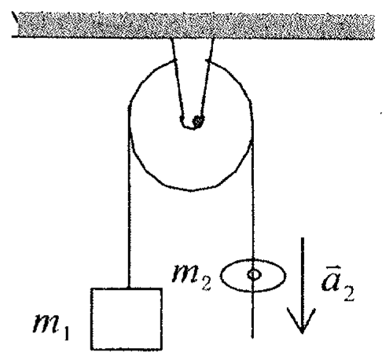

(A) $\dfrac{(2g-a_2)m_1m_2}{m_1+m_2}$．　　(B) $\dfrac{(2g-a_2)m_1m_2}{m_1-m_2}$．

(C) $\dfrac{(2g+a_2)m_1m_2}{m_1+m_2}$．　　(D) $\dfrac{(2g+a_2)m_1m_2}{m_1-m_2}$．

#### 答案

**答案：** (A)。

### 2. 哪种情况下系统的机械能守恒（　　）

#### 题目

对于一个物体系来说，在下列的哪种情况下系统的机械能守恒（　　）。

(A) 合外力为 0．　　(B) 合外力不作功．

(C) 外力和非保守内力都不作功．　　(D) 外力和保守内力都不作功．

#### 答案

**答案：** (C)。外力和非保守内力都不作功时，系统机械能守恒。

### 3. 细杆与球体构成的刚体对过固结点 $O$ 且垂直于杆的轴的转动惯量（　　）

#### 题目

一刚体由匀质细杆和匀质球体两部分构成，杆在球体直径的延长线上，如图所示．球体的半径为 $R$，杆长为 $2R$，杆和球体的质量均为 $m$．若杆对通过其中心 $O_1$ 与杆垂直的轴的转动惯量为 $J_1$，球体对通过球心 $O_2$ 的转动惯量为 $J_2$，则整个刚体对通过杆与球体的固结点 $O$ 且与杆垂直的轴的转动惯量为（　　）。

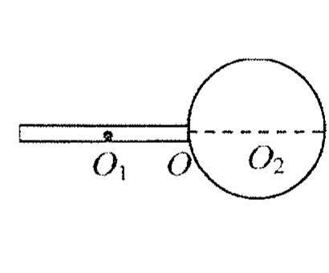

(A) $J=J_1+J_2$．　　(B) $J=(J_1+mR^2)+(J_2+mR^2)$．

(C) $J=mR^2+mR^2$．　　(D) $J=[J_1+m(2R)^2]+[J_2+m(2R)^2]$．

#### 答案

**答案：** (B)。

### 4. 悬挂细杆受水平冲力，要使悬点处无水平作用力，施力位置 $x$ 为（　　）

#### 题目

如图所示，将一根质量为 $m$、长为 $l$ 的均匀细杆悬挂于通过其一端的固定光滑水平轴 $O$ 上．今在悬点下方距离 $x$ 处施以水平冲力 $\vec F$，使杆开始摆动，要使在悬点处杆与轴之间不产生水平方向的作用力，则施力 $\vec F$ 的位置 $x$ 应等于（　　）。

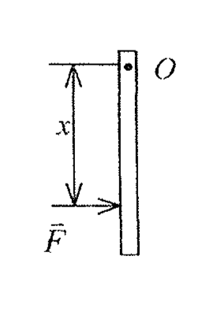

(A) $3l/8$．　　(B) $l/2$．　　(C) $2l/3$．　　(D) $l$．

#### 答案

**答案：** (C)。

### 5. $t$ 时刻波形曲线上能量为最小值的媒质质元位置（　　）

#### 题目

一列机械横波在 $t$ 时刻的波形曲线如图所示，则该时刻能量为最小值的媒质质元的位置是（　　）。

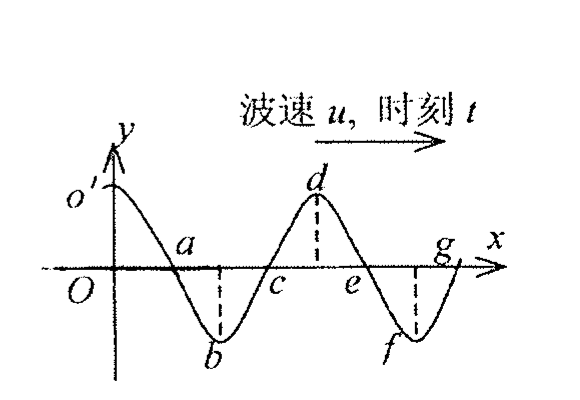

(A) $o'$， $b$， $d$， $f$．　　(B) $a$， $c$， $e$， $g$．

(C) $a$， $b$．　　(D) $d$， $e$．

#### 答案

**答案：** (A)。

### 6. 两个 $+q$ 点电荷与球形高斯面上的两块小面积（　　）

#### 题目

有两个电荷都是 $+q$ 的点电荷，相距为 $2a$．今以左边的点电荷所在处为球心，以 $a$ 为半径作一球形高斯面．在球面上取两块相等的小面积 $S_1$ 和 $S_2$，其位置如图所示．设通过 $S_1$ 和 $S_2$ 的电场强度通量分别为 $\Phi_1$ 和 $\Phi_2$，通过整个球面的电场强度通量为 $\Phi_S$，则（　　）。

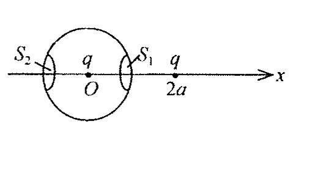

(A) $\Phi_1>\Phi_2$， $\Phi_S=q/\varepsilon_0$．　　(B) $\Phi_1<\Phi_2$， $\Phi_S=2q/\varepsilon_0$．

(C) $\Phi_1=\Phi_2$， $\Phi_S=q/\varepsilon_0$．　　(D) $\Phi_1<\Phi_2$， $\Phi_S=q/\varepsilon_0$．

#### 答案

**答案：** (D)。

### 7. 充满两块介质板的平行板电容器中两侧的电位移矢量（　　）

#### 题目

一平行板电容器与电源相连，电源端电压为 $U$，电容器极板间距离为 $d$．电容器中充满二块大小相同、介电常量（电容率）分别为 $\varepsilon_1$、 $\varepsilon_2$ 的均匀介质板，如图所示，则左、右两侧介质中的电位移矢量 $\vec D$ 的大小分别为（　　）。

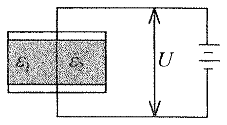

(A) $\varepsilon_0U/d$， $\varepsilon_0U/d$．　　(B) $\varepsilon_1U/d$， $\varepsilon_2U/d$．

(C) $\varepsilon_0\varepsilon_1U/d$， $\varepsilon_0\varepsilon_2U/d$．　　(D) $U/(\varepsilon_1d)$， $U/(\varepsilon_2d)$．

#### 答案

**答案：** (B)。

### 8. 挖去小圆柱体的长直导体中空心轴线上的磁感强度（　　）

#### 题目

在半径为 $R$ 的长直金属圆柱体内部挖去一个半径为 $r$ 的长直圆柱体，两柱体轴线平行，其间距离为 $a$，如图．今在此导体上通以电流 $I$，电流在截面上均匀分布，则空心部分轴线上 $O'$ 点的磁感强度的大小为（　　）。

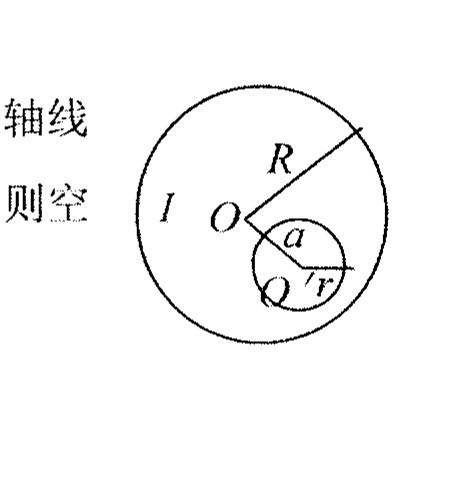

(A) $\dfrac{\mu_0I}{2\pi a}\cdot\dfrac{a^2}{R^2}$．　　(B) $\dfrac{\mu_0I}{2\pi a}\cdot\dfrac{a^2-r^2}{R^2}$．

(C) $\dfrac{\mu_0I}{2\pi a}\cdot\dfrac{a^2}{R^2-r^2}$．　　(D) $\dfrac{\mu_0I}{2\pi a}\left(\dfrac{a^2}{R^2}-\dfrac{r^2}{a^2}\right)$．

#### 答案

**答案：** (C)。

### 9. 形状相同的铜环与木环，磁通量变化率相等时的感应电动势（　　）

#### 题目

将形状完全相同的铜环和木环静止放置，并使通过两环面的磁通量随时间的变化率相等，则不计自感时（　　）。

(A) 铜环中有感应电动势，木环中无感应电动势．

(B) 铜环中感应电动势大，木环中感应电动势小．

(C) 铜环中感应电动势小，木环中感应电动势大．

(D) 两环中感应电动势相等．

#### 答案

**答案：** (D)。由法拉第电磁感应定律，感应电动势只由磁通量的变化率决定，与环的材料无关。

### 10. 单匝线圈 $L=\Phi/I$，电流变小时自感系数 $L$（　　）

#### 题目

对于单匝线圈取自感系数的定义式为 $L=\Phi/I$．当线圈的几何形状、大小及周围磁介质分布不变，且无铁磁性物质时，若线圈中的电流强度变小，则线圈的自感系数 $L$（　　）。

(A) 变大，与电流成反比关系．　　(B) 不变．

(C) 变大，但与电流不成反比关系．　　(D) 变小．

#### 答案

**答案：** (B)。无铁磁性物质时磁介质为线性， $\Phi\propto I$，故 $L$ 与电流无关，保持不变。

## 二、填空题（每小题 3 分，共 30 分）

> 官方评分说明：单位错误总共扣 1 分，数量级错误扣 1 分。

### 1. $x_A=4t+t^2$， $x_B=2t^2+2t^3$，(1) 刚离开出发点时哪辆车在前；(2) $B$ 相对 $A$ 速度为零的时刻

#### 题目

两辆车 $A$ 和 $B$，在笔直的公路上同向行驶，它们从同一起始线上同时出发，并且由出发点开始计时，行驶的距离 $x$ 与行驶时间 $t$ 的函数关系式： $x_A=4t+t^2$， $x_B=2t^2+2t^3$（SI），

(1) 它们刚离开出发点时，行驶在前面的一辆车是 \_\_\_\_\_\_\_\_；

(2) 出发后， $B$ 车相对 $A$ 车速度为零的时刻是 \_\_\_\_\_\_\_\_．

#### 答案

**答案：** (1) $A$ 车（1 分）；(2) $t=0.67$ s 或 $\dfrac{2}{3}$ s（2 分）。

### 2. 质点 $P$ 的角动量与力矩（ $m=2$ kg， $r=3.0$ m， $v=4.0$ m/s， $F=2$ N）

#### 题目

质点 $P$ 的质量为 2 kg，位置矢量为 $\vec r$，速度为 $\vec v$，它受到力 $\vec F$ 的作用．这三个矢量均在 $Oxy$ 面内，某时刻它们的方向如图所示，且 $r=3.0$ m， $v=4.0$ m/s， $F=2$ N．则此刻该质点对原点 $O$ 的角动量 $\vec L=$ \_\_\_\_\_\_\_\_；作用在质点上的力对原点的力矩 $\vec M=$ \_\_\_\_\_\_\_\_．

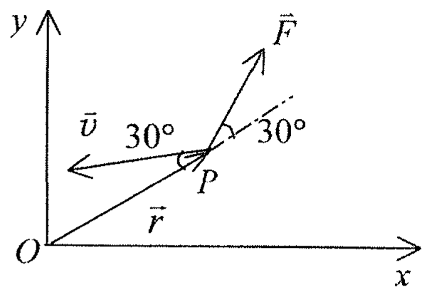

#### 答案

**答案：** $\vec L=12\vec k\ \mathrm{kg\cdot m^2\cdot s^{-1}}$（2 分）； $\vec M=3\vec k\ \mathrm{N\cdot m}$（1 分）。

### 3. 薄圆盘在恒力矩 $M$ 作用下转动， $t$ 秒后边缘 $B$ 点的切向、法向加速度

#### 题目

如图所示，一质量为 $m$、半径为 $R$ 的薄圆盘，可绕通过其一直径的光滑固定轴 $AA'$ 转动，转动惯量 $J=mR^2/4$．该圆盘从静止开始在恒力矩 $M$ 作用下转动， $t$ 秒后位于圆盘边缘上与轴 $AA'$ 的垂直距离为 $R$ 的 $B$ 点的切向加速度 $a_t=$ \_\_\_\_\_\_\_\_，法向加速度 $a_n=$ \_\_\_\_\_\_\_\_．

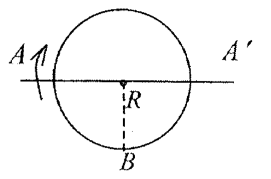

#### 答案

**答案：** $a_t=\dfrac{4M}{mR}$（1 分）； $a_n=\dfrac{16M^2t^2}{m^2R^3}$（2 分）。

### 4. $y=A\cos[\omega(t-x/u)+\pi/4]$， $x_1=L_1$ 处的振动方程与 $x_2=-L_2$ 处的相位差

#### 题目

一平面简谐波沿 $Ox$ 轴正向传播，波动表达式为 $y=A\cos[\omega(t-x/u)+\pi/4]$，则 $x_1=L_1$ 处质点的振动方程是 \_\_\_\_\_\_\_\_； $x_2=-L_2$ 处质点的振动和 $x_1=L_1$ 处质点的振动的相位差为 $\phi_2-\phi_1=$ \_\_\_\_\_\_\_\_．

#### 答案

**答案：** $y_1=A\cos[\omega(t-L_1/u)+\pi/4]$（1 分）； $\phi_2-\phi_1=\dfrac{\omega(L_1+L_2)}{u}$（2 分）。

### 5. 机车汽笛 750 Hz，以时速 90 公里远离静止观察者

#### 题目

一机车汽笛频率为 750 Hz，机车以时速 90 公里远离静止的观察者．观察者听到的声音的频率是（设空气中声速为 340 m/s）\_\_\_\_\_\_\_\_ Hz．

#### 答案

**答案：** 699 Hz（3 分）。

### 6. 使 $P$ 点场强垂直于 $OP$ 时 $\lambda$ 与 $Q$ 的关系及符号

#### 题目

如图所示，一电荷线密度为 $\lambda$ 的无限长带电直线垂直通过图面上的 $A$ 点；一带有电荷 $Q$ 的均匀带电球体，其球心处于 $O$ 点． $\triangle AOP$ 是边长为 $a$ 的等边三角形．为了使 $P$ 点处场强方向垂直于 $OP$，则 $\lambda$ 和 $Q$ 的数量之间应满足 \_\_\_\_\_\_\_\_ 关系，且 $\lambda$ 与 $Q$ 为 \_\_\_\_\_\_\_\_ 号电荷．

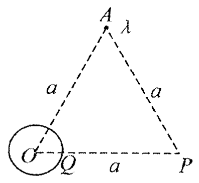

#### 答案

**答案：** $\lambda=Q/a$（2 分）；异号（1 分）。

### 7. 金属轮子在均匀磁场中转动，中心 $O$ 与边缘 $b$ 间的感应电动势与电势最高点

#### 题目

四根辐条的金属轮子在均匀磁场 $\vec B$ 中转动，转轴与 $\vec B$ 平行，轮子和辐条都是导体，辐条长为 $R$，轮子转速为每秒 $n$ 转，则轮子中心 $O$ 与轮边缘 $b$ 之间的感应电动势为 \_\_\_\_\_\_\_\_，电势最高点是在 \_\_\_\_\_\_\_\_ 处．

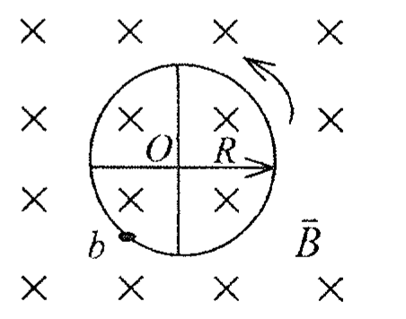

#### 答案

**答案：** $\pi BnR^2$（2 分）； $O$（1 分）。

### 8. 两根平行直导线间距增大时空间的总磁能

#### 题目

两根很长的平行直导线，其间距离为 $a$，与电源组成闭合回路，如图．已知导线上的电流为 $I$，在保持 $I$ 不变的情况下，若将导线间的距离增大，则空间的总磁能 \_\_\_\_\_\_\_\_．（填增大、减小或不变）

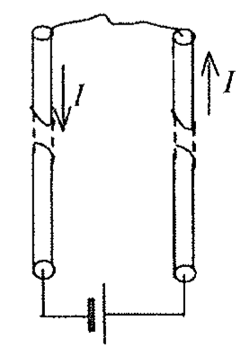

#### 答案

**答案：** 增大（3 分）。

### 9. $\oint_L\vec E\cdot\mathrm{d}\vec l=-\int_S\frac{\partial\vec B}{\partial t}\cdot\mathrm{d}\vec S$ 表明什么

#### 题目

由 $\displaystyle\oint_L\vec E\cdot\mathrm{d}\vec l=-\int_S\frac{\partial\vec B}{\partial t}\cdot\mathrm{d}\vec S$ 式表明 \_\_\_\_\_\_\_\_ 一定伴随有电场，该电场的电场线 \_\_\_\_\_\_\_\_（填是或不是）闭合曲线；\_\_\_\_\_\_\_\_（填能或不能）引入电势的概念．

#### 答案

**答案：** 变化的磁场（1 分）；是（1 分）；不能（1 分）。

### 10. $i=0.2e^{-t}$ 给电容器充电，极板间电压与位移电流

#### 题目

给电容为 $C$ 的平行板电容器充电，电流为： $i=0.2e^{-t}$（SI）， $t=0$ 时电容器极板上无电荷．则充电期间极板间电压 $U$ 随时间 $t$ 变化的关系为 \_\_\_\_\_\_\_\_； $t$ 时刻极板间总的位移电流 $I_d$（忽略边缘效应）为 \_\_\_\_\_\_\_\_．

#### 答案

**答案：** $U=\dfrac{0.2}{C}\left(1-e^{-t}\right)$（2 分）； $I_d=0.2e^{-t}$（1 分）。

## 三、计算题（每小题 10 分，共 40 分）

### 1. $F=F_0\sin(2\pi t/T)$ 作用下质点的冲量、动量与功

#### 题目

质量为 $m$ 的质点开始时静止，在如图所示合力 $F$ 的作用下沿直线运动，已知 $F=F_0\sin(2\pi t/T)$，方向与直线平行，求：

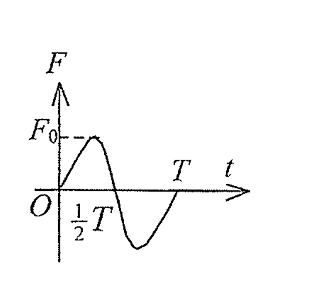

(1) 在 0 到 $T$ 时间内，力 $\vec F$ 的冲量大小；

(2) 在 $t=\dfrac{1}{2}T$ 时刻质点动量的大小；

(3) 在 0 到 $\dfrac{1}{2}T$ 时间内，力 $\vec F$ 所作的总功．

#### 答案

**答案：**

(1)
$$
I_1=\int_0^TF(t)\,\mathrm{d}t=\int_0^TF_0\sin(2\pi t/T)\,\mathrm{d}t=-\frac{TF_0}{2\pi}\cos\frac{2\pi t}{T}\Bigg|_0^T=0
$$
（3 分）

(2)
$$
I_2=\int_0^{T/2}F(t)\,\mathrm{d}t=-\frac{TF_0}{2\pi}\cos\frac{2\pi t}{T}\Bigg|_0^{T/2}=\frac{TF_0}{\pi}
$$
由动量定理， $I_2=p-p_0$， $p_0=0$， $t=\dfrac{1}{2}T$ 时刻质点动量的大小
$$
p=\frac{TF_0}{\pi}
$$
（4 分）

(3) $a=F/m=F_0\sin(2\pi t/T)/m$。由于 $v_0=0$，所以
$$
v=\int_0^ta\,\mathrm{d}t=\int_0^t\frac{F_0}{m}\sin\frac{2\pi t}{T}\,\mathrm{d}t=-\frac{TF_0}{2\pi m}\cos\frac{2\pi t}{T}\Bigg|_0^t=-\frac{TF_0}{2\pi m}\left[\cos\left(\frac{2\pi t}{T}\right)-1\right]
$$
由动能定理 $W=\dfrac{1}{2}mv^2-\dfrac{1}{2}mv_0^2$， $t=0$ 时 $v_0=0$， $t=\dfrac{1}{2}T$ 时 $v=TF_0/(\pi m)$，故
$$
W=\frac{T^2F_0^2}{2\pi^2m}
$$
（3 分）

也可以直接用第二问结果，利用动量和动能关系求解。

### 2. 两端装有小球的细棒作小角度摆动的周期

#### 题目

如图，一细棒两端装有质量均为 $m$ 的小球 $A$、 $B$，可绕水平轴 $O$ 自由转动，且 $OA=l_1$， $OB=l_2$．若细棒的质量可忽略不计，求细棒作角度很小（ $\theta<0.4$ rad）的摆动时的周期．

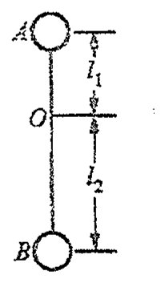

#### 答案

**答案：** $T=2\pi\sqrt{\dfrac{l_1^2+l_2^2}{(l_2-l_1)g}}$。

解：系统在重力矩作用下摆动，由定轴转动定理，有（2 分）
$$
I_O\frac{\mathrm{d}^2\theta}{\mathrm{d}t^2}=mgl_1\sin\theta-mgl_2\sin\theta
$$
式中装置对 $O$ 轴的转动惯量为（2 分）
$$
I_O=ml_1^2+ml_2^2 .
$$
由以上两个方程得到
$$
\frac{\mathrm{d}^2\theta}{\mathrm{d}t^2}+\frac{(l_2-l_1)g}{l_1^2+l_2^2}\sin\theta=0 .
$$
当角度很小时，作小角近似 $\sin\theta\approx\theta$，于是有（2 分）
$$
\frac{\mathrm{d}^2\theta}{\mathrm{d}t^2}+\frac{(l_2-l_1)g}{l_1^2+l_2^2}\theta=0 .
$$
与简谐振动的微分方程 $\dfrac{\mathrm{d}^2x}{\mathrm{d}t^2}+\omega_0^2x=0$ 对比可知，该装置振动的角频率为
$$
\omega_0=\sqrt{\frac{(l_2-l_1)g}{l_1^2+l_2^2}} ,
$$
周期为（4 分）
$$
T=\frac{2\pi}{\omega_0}=2\pi\sqrt{\frac{l_1^2+l_2^2}{(l_2-l_1)g}} .
$$

### 3. 以带电平面为电势零点时周围空间的电势分布

#### 题目

有一电荷面密度为 $\sigma$ 的"无限大"均匀带电平面．若以该平面处为电势零点，试求带电平面周围空间的电势分布．

#### 答案

**答案：** $x\le 0$ 区域 $U=\dfrac{\sigma x}{2\varepsilon_0}$； $x\ge 0$ 区域 $U=-\dfrac{\sigma x}{2\varepsilon_0}$。

解：选坐标原点在带电平面所在处， $x$ 轴垂直于平面。由高斯定理可得场强分布为（4 分）
$$
E=\pm\frac{\sigma}{2\varepsilon_0}
$$
（式中" $+$"对 $x>0$ 区域，" $-$"对 $x<0$ 区域）。平面外任意 $x$ 处电势：

在 $x\le 0$ 区域（3 分）
$$
U=\int_x^0E\,\mathrm{d}x=\int_x^0\frac{-\sigma}{2\varepsilon_0}\,\mathrm{d}x=\frac{\sigma x}{2\varepsilon_0} .
$$

在 $x\ge 0$ 区域（3 分）
$$
U=\int_x^0E\,\mathrm{d}x=\int_x^0\frac{\sigma}{2\varepsilon_0}\,\mathrm{d}x=-\frac{\sigma x}{2\varepsilon_0} .
$$

### 4. 无限长直导线对矩形回路的合力，以及小线圈情形下 $F=p_m\dfrac{\partial B}{\partial x}$

#### 题目

如图，一根无限长直导线载有电流 $I_1$，矩形回路与它共面，且矩形的长边与直导线平行．回路中载有电流 $I_2$，矩形的长为 $l$，宽为 $b$，矩形靠近直导线的一边距直导线为 $a$，

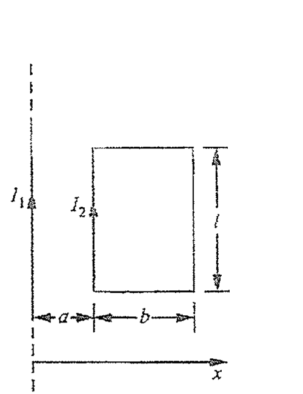

(1) 试求 $I_1$ 作用在矩形回路上的合力；

(2) 试证明：当矩形线圈足够小时，线圈受到的合力 $F$ 的大小为： $F=p_m\dfrac{\partial B}{\partial x}$．其中 $p_m$ 为矩形线圈的磁矩， $\dfrac{\partial B}{\partial x}$ 为直导线产生的磁场沿垂直于直导线方向（图中的 $x$ 方向）上的磁场梯度．

#### 答案

**答案：** (1) $F=\dfrac{\mu_0I_1I_2lb}{2\pi a(a+b)}$，方向向左（指向直导线）；(2) 见证明。

解：(1) 矩形载流回路中 $AD$ 边与 $BC$ 边受无限长直载流导线的作用力相等反向，抵消。 $AB$ 边与 $CD$ 边受力分别为（4 分）
$$
F_{AB}=I_2lB_{AB}=\frac{\mu_0I_1I_2l}{2\pi a},\qquad
F_{CD}=I_2lB_{CD}=\frac{\mu_0I_1I_2l}{2\pi(a+b)} .
$$
$F_{AB}$ 的方向向左， $F_{CD}$ 的方向向右。故矩形回路所受 $I_1$ 的合力为（1 分）
$$
F=F_{AB}-F_{CD}=\frac{\mu_0I_1I_2l}{2\pi}\left(\frac{1}{a}-\frac{1}{a+b}\right)=\frac{\mu_0I_1I_2lb}{2\pi a(a+b)} .
$$
合力 $F$ 的方向向左，即矩形回路被 $I_1$ 吸引。（1 分）

(2) 矩形载流回路的磁矩为 $p_m=I_2S=I_2lb$，代入，可将矩形回路所受 $I_1$ 的合力写为（1 分）
$$
F=\frac{\mu_0I_1I_2lb}{2\pi a(a+b)}=\frac{\mu_0I_1p_m}{2\pi a(a+b)} .
$$
无限长直载流导线在与之相距（垂直距离）为 $x$ 处的磁场以及 $x$ 方向的磁场梯度为（1 分）
$$
B(x)=\frac{\mu_0I_1}{2\pi x},\qquad \frac{\partial B}{\partial x}=-\frac{\mu_0I_1}{2\pi x^2} .
$$
当线圈很小，即当 $b\ll a$ 时，线圈与直导线相距 $x\approx a$，即 $a(a+b)\approx a^2\approx x^2$，代入，得（2 分）
$$
F=\frac{\mu_0I_1p_m}{2\pi a(a+b)}\approx\frac{\mu_0I_1p_m}{2\pi x^2}=p_m\frac{\partial B}{\partial x} .
$$
