# 基础物理学A(1) 2024 · 春 期末试卷（B 卷）

## 一、选择题（将正确答案的字母填写在答题纸的相应位置，每小题 3 分，共 30 分）

1. 质量相等的两个物体甲和乙，并排静止在光滑水平面上（如图所示）．现用一水平恒力 $\vec F$ 作用在物体甲上，同时给物体乙一个与 $\vec F$ 同方向的瞬时冲量 $\vec I$，使两物体沿同一方向运动，则两物体再次达到并排的位置时所经过的时间为（　　）。

   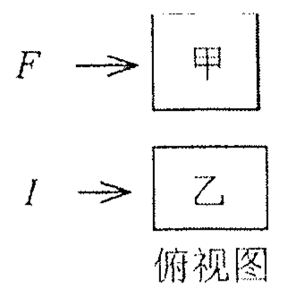

   (A) $I/F$．　　(B) $2I/F$．　　(C) $2F/I$．　　(D) $F/I$．

2. 质量为 $m$ 的小孩站在半径为 $R$ 的水平平台边缘上，平台可以绕通过其中心的竖直光滑固定轴自由转动，转动惯量为 $J$．平台和小孩开始时均静止．当小孩突然以相对于地面为 $v$ 的速率在台边缘沿逆时针转向走动时，则此时平台相对地面旋转的角速度和旋转方向分别为（　　）。

   (A) $\omega=\dfrac{mR^2}{J}\left(\dfrac{v}{R}\right)$，顺时针．　　(B) $\omega=\dfrac{mR^2}{J}\left(\dfrac{v}{R}\right)$，逆时针．

   (C) $\omega=\dfrac{mR^2}{J+mR^2}\left(\dfrac{v}{R}\right)$，顺时针．　　(D) $\omega=\dfrac{mR^2}{J+mR^2}\left(\dfrac{v}{R}\right)$，逆时针．

3. 质量为 $m$ 的质点在外力作用下，其运动方程为： $\vec r=A\cos\omega t\,\vec i+B\sin\omega t\,\vec j$，式中 $A$、 $B$、 $\omega$ 都是正的常量．由此可知外力在 $t=0$ 到 $t=\pi/(2\omega)$ 这段时间内所作的功为（　　）。

   (A) $\dfrac{1}{2}m\omega^2(A^2+B^2)$．　　(B) $m\omega^2(A^2+B^2)$．

   (C) $\dfrac{1}{2}m\omega^2(A^2-B^2)$．　　(D) $\dfrac{1}{2}m\omega^2(B^2-A^2)$．

4. 当一平面简谐机械波在弹性媒质中传播时，下述各结论哪个是正确的（　　）。

   (A) 媒质质元的振动动能增大时，其弹性势能减小，总机械能守恒．

   (B) 媒质质元的振动动能和弹性势能都作周期性变化，但二者的相位不相同．

   (C) 媒质质元的振动动能和弹性势能的相位在任一时刻都相同，但二者的数值不相等．

   (D) 媒质质元在其平衡位置处弹性势能最大．

5. 一火箭初质量为 $M_0$，每秒喷出的质量 $(-\mathrm{d}M/\mathrm{d}t)$ 恒定，喷气相对火箭的速率恒定为 $u$．设火箭竖直向上发射，不计空气阻力，重力加速度 $\vec g$ 恒定，则 $t=0$ 时火箭加速度 $\vec a$ 在竖直方向（向上为正）的投影式为（　　）。

   (A) $a=\dfrac{u}{M_0}\left(-\dfrac{\mathrm{d}M}{\mathrm{d}t}\right)-g$．　　(B) $a=\dfrac{u}{M_0}\left(\dfrac{\mathrm{d}M}{\mathrm{d}t}\right)+g$．

   (C) $a=\dfrac{u}{M_0}\left(-\dfrac{\mathrm{d}M}{\mathrm{d}t}\right)$．　　(D) $a=\dfrac{u}{M_0}\left(\dfrac{\mathrm{d}M}{\mathrm{d}t}\right)-g$．

6. 电荷面密度为 $+\sigma$ 和 $-\sigma$ 的两块"无限大"均匀带电的平行平板，放在与平面相垂直的 $x$ 轴上的 $+a$ 和 $-a$ 位置上，如图所示．设坐标原点 $O$ 处电势为零，则在 $-a\le x\le +a$ 区域的电势分布曲线为（　　）。

   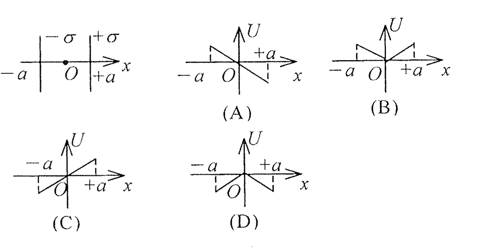

7. 点电荷 $Q$ 被曲面 $S$ 所包围，从无穷远处引入另一点电荷 $q$ 至曲面外一点，如图所示，则引入前后（　　）。

   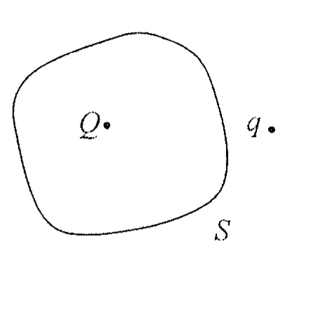

   (A) 曲面 $S$ 的电场强度通量不变，曲面上各点场强不变．

   (B) 曲面 $S$ 的电场强度通量变化，曲面上各点场强不变．

   (C) 曲面 $S$ 的电场强度通量变化，曲面上各点场强变化．

   (D) 曲面 $S$ 的电场强度通量不变，曲面上各点场强变化．

8. 有两个线圈，线圈 1 对线圈 2 的互感系数为 $M_{21}$，而线圈 2 对线圈 1 的互感系数为 $M_{12}$．若它们分别流过 $i_1$ 和 $i_2$ 的变化电流，且 $\left|\dfrac{\mathrm{d}i_1}{\mathrm{d}t}\right|>\left|\dfrac{\mathrm{d}i_2}{\mathrm{d}t}\right|$，并设由 $i_2$ 变化在线圈 1 中产生的互感电动势为 $\varepsilon_{12}$，由 $i_1$ 变化在线圈 2 中产生的互感电动势为 $\varepsilon_{21}$，判断下述哪个论断正确（　　）。

   (A) $M_{12}=M_{21}$， $\varepsilon_{21}=\varepsilon_{12}$．　　(B) $M_{12}\ne M_{21}$， $\varepsilon_{21}\ne\varepsilon_{12}$．

   (C) $M_{12}=M_{21}$， $\varepsilon_{21}>\varepsilon_{12}$．　　(D) $M_{12}=M_{21}$， $\varepsilon_{21}<\varepsilon_{12}$．

9. 用导线围成如图所示的回路（以 $O$ 点为心的圆，加一直径），放在轴线通过 $O$ 点垂直于图面的圆柱形均匀磁场中，如磁场方向垂直图面向里，其大小随时间减小，则感应电流的流向为（　　）。

   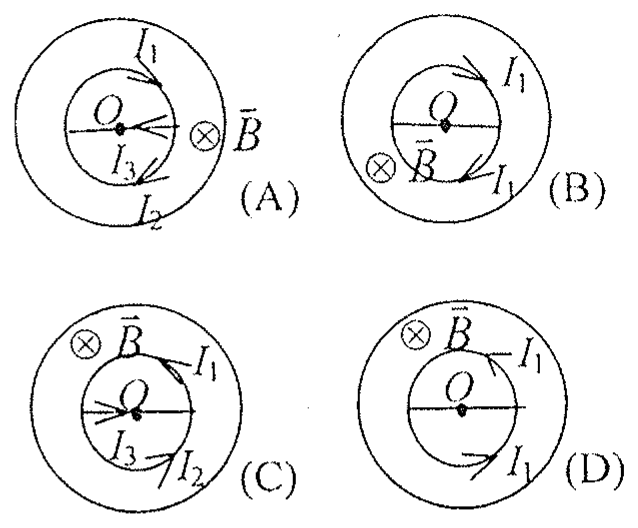

10. 如图，边长为 $a$ 的正方形的四个角上固定有四个电荷均为 $q$ 的点电荷．此正方形以角速度 $\omega$ 绕 $AC$ 轴旋转时，在中心 $O$ 点产生的磁感强度大小为 $B_1$；此正方形以同样角速度 $\omega$ 绕过 $O$ 点垂直于正方形平面的轴旋转时，在 $O$ 点产生的磁感强度的大小为 $B_2$，则 $B_1$ 与 $B_2$ 间的关系为（　　）。

    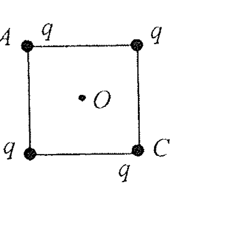

    (A) $B_1=B_2$．　　(B) $B_1=2B_2$．　　(C) $B_1=\dfrac{1}{2}B_2$．　　(D) $B_1=B_2/4$．

## 二、填空题（将正确答案填写在答题纸的相应位置，每小题 3 分，共 30 分）

1. 下列物理量：质量、动量、冲量、动能、势能、功中与参考系的选取有关的物理量是 \_\_\_\_\_\_\_\_。（不考虑相对论效应）

2. 一质点在平面上作曲线运动，其速率 $v$ 与路程 $S$ 的关系为： $v=1+S^2$（SI），则切向加速度以路程 $S$ 来表示的表达式为 $a_\tau=$ \_\_\_\_\_\_\_\_（SI）．

3. 设沿弦线传播的一入射波的表达式为： $y_1=A\cos\left[2\pi\left(\dfrac{t}{T}-\dfrac{x}{\lambda}\right)+\phi\right]$，波在 $x=L$ 处（ $B$ 点）发生反射，反射点为固定端（如图）．设波在传播和反射过程中振幅不变，则反射波的表达式为 $y_2=$ \_\_\_\_\_\_\_\_．

   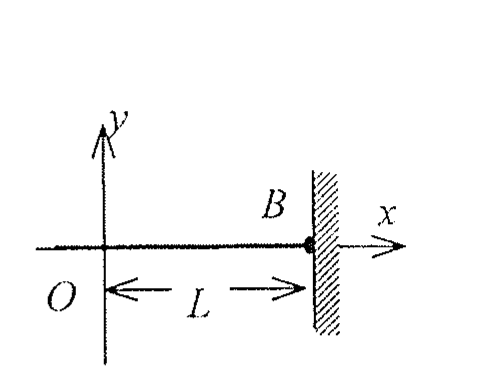

4. 一质点作简谐振动，其振动方程为 $x=0.24\cos\left(\dfrac{1}{2}\pi t+\dfrac{1}{3}\pi\right)$（SI），由初始状态（ $t=0$ 的状态）运动到 $x=-0.12$ m， $v<0$ 的状态所需最短时间 $\Delta t$ 为 \_\_\_\_\_\_\_\_．

5. 质量为 $m$、横截面半径为 $R$ 的实心匀质圆柱体，在水平面上做无滑动的滚动，如果圆柱体的中心轴线方向不变，且其质心以速度 $v$ 作水平匀速运动，则圆柱体的动量大小为 \_\_\_\_\_\_\_\_，动能等于 \_\_\_\_\_\_\_\_，对中心轴线的角动量大小为 \_\_\_\_\_\_\_\_．

6. 两个空气电容器 1 和 2，并联后接在电压恒定的直流电源上，如图所示．今有一块各向同性均匀电介质板缓慢地插入电容器 1 中，则电容器组的总电荷将 \_\_\_\_\_\_\_\_，电容器组储存的电能将 \_\_\_\_\_\_\_\_．（填增大、减小或不变）

   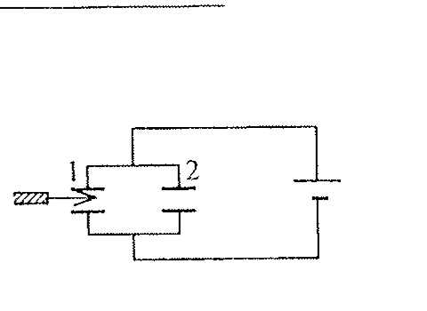

7. 带有电荷 $q$、半径为 $r_A$ 的金属球 $A$，与一原先不带电、内外半径分别为 $r_B$ 和 $r_C$ 的金属球壳 $B$ 同心放置如图．则图中 $P$ 点的电场强度 $\vec E=$ \_\_\_\_\_\_\_\_．如果用导线将 $A$、 $B$ 连接起来，则 $A$ 球的电势 $U=$ \_\_\_\_\_\_\_\_．（设无穷远处电势为零）

   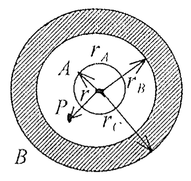

8. 空气平行板电容器的两极板面积均为 $S$，两板相距很近，电荷在平板上的分布可以认为是均匀的．设两极板分别带有电荷 $\pm Q$，则两板间相互吸引力为 \_\_\_\_\_\_\_\_．

9. 磁换能器常用来检测微小的振动．如图，在振动杆的一端固接一个 $N$ 匝的矩形线圈，线圈的一部分在匀强磁场 $\vec B$ 中，设杆的微小振动规律为 $x=A\cos\omega t$，线圈随杆振动时，线圈中的感应电动势为 \_\_\_\_\_\_\_\_．

   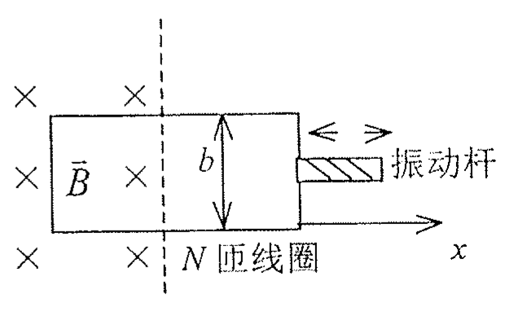

10. 如图，一根通有电流强度为 $I$ 的载流导线被弯成半径为 $R$ 的 1/4 圆弧，放在磁感强度为 $B$ 的均匀磁场中，则载流导线 $ab$ 所受的磁场作用力的大小为 \_\_\_\_\_\_\_\_，方向 \_\_\_\_\_\_\_\_．

    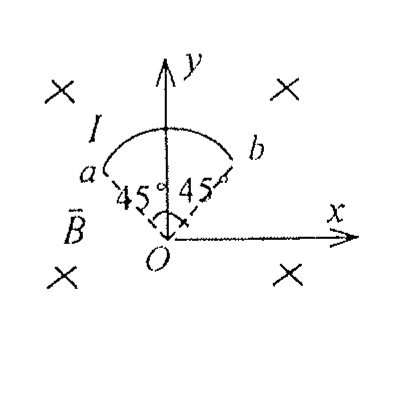

## 三、计算题（每小题 10 分，共 40 分）

1. 一个转盘绕通过盘心的固定竖直轴旋转，将一半径为 $R$、质量为 $m$ 的均匀圆盘轻放到转盘上，其圆心通过转盘的竖直转轴．此后圆盘将受转盘的摩擦力作用而随转盘转动．设圆盘和转盘之间的滑动摩擦系数为 $\mu$，且转盘始终以原来的角速度 $\omega$ 匀速转动．求

   (1) 圆盘刚放到转盘上时所受的摩擦力矩；

   (2) 从圆盘放到转盘上开始到圆盘达到角速度 $\omega$ 需要多长时间．（圆盘的转动惯量 $J=\dfrac{1}{2}mR^2$）

2. 一物体质量为 0.25 kg，在弹性力作用下作简谐振动，弹簧的劲度系数 $k=25\ \mathrm{N\cdot m^{-1}}$，如果起始振动时具有势能 0.06 J 和动能 0.02 J，求

   (1) 振幅；

   (2) 动能恰等于势能时的位移；

   (3) 经过平衡位置时物体的速度．

3. 一无限长圆柱形铜导体（磁导率 $\mu_0$），半径为 $R$，通有均匀分布的电流 $I$．今取一矩形平面 $S$（长为 1 m，宽为 $2R$），位置如右图中画斜线部分所示，求通过该矩形平面的磁通量．

   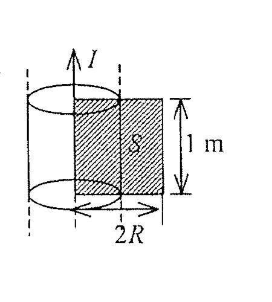

4. 真空中，半径为 $R$ 的两块圆板，构成平行板电容器．今给该电容器充电，使电容器的两极板间电场的变化率为 $\dfrac{\mathrm{d}E}{\mathrm{d}t}$．忽略边缘效应，求：

   (1) 电容器两极板间的位移电流；

   (2) 电容器内与两板中心连线的距离为 $r$ 处的磁感应强度的大小．
